# Development Domain — Database Tables by Submodule

## Source Documents

- [development-domain.md](file:///d:/Project.Private/elsasa-sis-v3/domains/development-domain.md) — Development Domain definition
- [development-entities.md](file:///d:/Project.Private/elsasa-sis-v3/entities/development-entities.md) — Entity identification by submodule and resolved architectural decisions
- [sub-modul-and-development-phases.md](file:///d:/Project.Private/elsasa-sis-v3/sub-modul-and-development-phases.md) — Module decomposition and three-stage implementation roadmap

## Conventions

- **PK** — Primary Key
- **FK** — Foreign Key (logical; referencing another table in this domain or an external domain)
- **UQ** — Unique constraint
- All tables include `created_at`, `updated_at`, and `created_by` audit columns (omitted from key-column listings for brevity)
- **UUID** is used as the primary key type throughout to guarantee zero collisions across distributed multi-campus deployments and seamless cross-domain interoperability
- Columns marked *(nullable)* are not required at creation time, supporting progressive information collection and conditional workflows
- External domain references (Students, Academics, Operations, Teaching, Finance) are stored as opaque identifiers; the Development domain does not own, define, or modify those external tables
- Entity lifecycle states, categories, and classification types are stored as `VARCHAR` with application-level validation, matching the established conventions of Student, Academic, Teaching, Operations, and Finance domains
- Sensitive records enforce strict confidentiality tiers (`standard`, `restricted`, `highly_restricted`) and support audit-preserving sealing (`active`, `sealed`, `archived`) to comply with student privacy and record protection rules

---

## Module 1 — Behaviour & Discipline

**Module responsibility:** Manage behaviour observations, positive recognition, incidents, and formal discipline cases.

**Submodules:** Behaviour Observation & Recognition · Incident Reporting & Triage · Discipline Case Management · Cross-Domain Recommendation  
**Stage:** Stage 3 (Student Development, Advanced Lifecycle, and Operational Maturity)

---

### Submodule 1.1 — Behaviour Observation & Recognition

#### 1.1 `behaviour_observations` — Main Table

| Aspect | Description |
|---|---|
| **Purpose** | Authoritative record of a dated, factual observation of student behaviour in a specific context. Captures observed facts, location, context, and immediate response without prejudging violation or policy fault. |
| **Type** | Core |

**Key Columns:**

| Column | Type | Constraint | Description |
|---|---|---|---|
| `id` | UUID | PK | Unique behaviour observation identifier |
| `observation_number` | VARCHAR | UQ, NOT NULL | Traceable institutional observation code (e.g., "OBS-2026-0187") |
| `student_id` | UUID | FK → external (Students), NOT NULL | Primary student subject of the observation |
| `observed_at` | TIMESTAMPTZ | NOT NULL | Exact date and time when behaviour was observed |
| `location_context` | VARCHAR | NOT NULL | Physical or situational context (e.g., "School Courtyard", "Classroom 3B") |
| `observation_type` | VARCHAR | NOT NULL | Category: `positive_conduct`, `concerning_conduct`, `interpersonal_conduct`, `rule_compliance` |
| `factual_narrative` | TEXT | NOT NULL | Strictly factual narrative distinguishing facts from interpretations or allegations |
| `immediate_response` | TEXT | nullable | Immediate action taken by observer on site |
| `observer_ref` | UUID | NOT NULL | Staff or teacher identity reference who recorded the observation |
| `observer_role` | VARCHAR | NOT NULL | Role of observer: `teacher`, `homeroom_advisor`, `student_development_officer`, `staff` |
| `follow_up_needed` | BOOLEAN | NOT NULL default FALSE | Indicator if further review or support is recommended |
| `confidentiality_level` | VARCHAR | NOT NULL default 'standard' | Access classification: `standard`, `restricted` |
| `record_status` | VARCHAR | NOT NULL default 'active' | Lifecycle status: `active`, `sealed`, `archived` |

**Example:**

| id | observation_number | student_id | observed_at | location_context | observation_type | factual_narrative | observer_role | follow_up_needed |
|---|---|---|---|---|---|---|---|---|
| `obs-0187...` | OBS-2026-0187 | `stu-001...` (Ahmad Rizki) | 2026-09-15 10:15:00+07 | School Courtyard | positive_conduct | Siswa Ahmad Rizki membantu siswa adik kelas yang terjatuh dan membantu merapikan buku-bukunya yang berserakan. | homeroom_advisor | FALSE |
| `obs-0203...` | OBS-2026-0203 | `stu-004...` (Fajar Prasetyo) | 2026-09-20 11:30:00+07 | Classroom 3B | concerning_conduct | Terlihat beradu argumen dengan nada tinggi dan mendorong meja belajar saat jeda pergantian jam. | teacher | TRUE |

> [!IMPORTANT]
> An observation must **not** automatically establish a policy violation. Factual descriptions, subjective interpretations, and allegations must remain strictly distinguishable per domain rules.

---

#### 1.2 `observation_involved_persons` — Supporting Table

| Aspect | Description |
|---|---|
| **Purpose** | Records additional individuals directly involved in a behaviour observation (other students, witnesses, co-participants, recipients of assistance) to maintain clear multi-party context without conflating roles. |
| **Type** | Supporting |

**Key Columns:**

| Column | Type | Constraint | Description |
|---|---|---|---|
| `id` | UUID | PK | Unique record identifier |
| `observation_id` | UUID | FK → `behaviour_observations.id`, NOT NULL | Parent observation record |
| `person_ref` | UUID | NOT NULL | Identity reference (student ID or staff ID) |
| `person_type` | VARCHAR | NOT NULL | Person classification: `student`, `staff`, `external` |
| `involvement_role` | VARCHAR | NOT NULL | Role: `witness`, `co_participant`, `recipient_of_help`, `affected_person` |
| `notes` | TEXT | nullable | Contextual notes regarding involvement |

**Example:**

| id | observation_id | person_ref | person_type | involvement_role | notes |
|---|---|---|---|---|---|
| `oip-001...` | `obs-0187...` | `stu-002...` (Budi Santoso) | student | recipient_of_help | Adik kelas yang dibantu berdiri setelah tersandung |
| `oip-002...` | `obs-0203...` | `stu-008...` (Galih Wicaksono) | student | co_participant | Lawan bicara dalam adu argumen meja kelas |

---

#### 1.3 `observation_evidence` — Supporting Table

| Aspect | Description |
|---|---|
| **Purpose** | Preserves supporting evidence (photographs, written statements, CCTV timestamps, physical incident logs) attached to an observation. |
| **Type** | Supporting |

**Key Columns:**

| Column | Type | Constraint | Description |
|---|---|---|---|
| `id` | UUID | PK | Unique evidence identifier |
| `observation_id` | UUID | FK → `behaviour_observations.id`, NOT NULL | Parent observation |
| `evidence_type` | VARCHAR | NOT NULL | Type: `photo`, `written_statement`, `cctv_reference`, `document` |
| `title` | VARCHAR | NOT NULL | Descriptive title of evidence item |
| `file_uri_or_reference` | TEXT | NOT NULL | Storage URI or system index reference |
| `description` | TEXT | nullable | Explanatory context |
| `captured_at` | TIMESTAMPTZ | nullable | Timestamp when evidence was captured |

**Example:**

| id | observation_id | evidence_type | title | file_uri_or_reference | description |
|---|---|---|---|---|---|
| `oev-001...` | `obs-0203...` | photo | Foto Kerusakan Meja Kelas | `s3://sis-dev/evidence/obs-0203-desk.jpg` | Sudut meja retak akibat dorongan keras |
| `oev-002...` | `obs-0203...` | cctv_reference | Rekaman CCTV Selasar R3B | `cctv://cam-hallway-3b/20260920/1125-1135` | Rekaman memperlihatkan siswa berlari keluar |

---

#### 1.4 `positive_recognitions` — Main Table

| Aspect | Description |
|---|---|
| **Purpose** | Authoritative record of formal recognition for positive conduct reflecting school values, leadership, service, or character development. |
| **Type** | Core |

**Key Columns:**

| Column | Type | Constraint | Description |
|---|---|---|---|
| `id` | UUID | PK | Unique positive recognition identifier |
| `recognition_number` | VARCHAR | UQ, NOT NULL | Traceable recognition code (e.g., "REC-2026-0034") |
| `student_id` | UUID | FK → external (Students), NOT NULL | Recognized student |
| `source_observation_id` | UUID | FK → `behaviour_observations.id`, nullable | Originating observation if directly derived |
| `recognition_category` | VARCHAR | NOT NULL | Category: `commendation`, `character_recognition`, `leadership_recognition`, `service_recognition`, `positive_contribution` |
| `title` | VARCHAR | NOT NULL | Title of recognition (e.g., "Penghargaan Kepemimpinan Mediasi Sebaya") |
| `citation_narrative` | TEXT | NOT NULL | Formal citation text describing the commendable conduct |
| `recognition_criteria` | VARCHAR | NOT NULL | Approved policy criteria code / description |
| `approved_by` | VARCHAR | NOT NULL | Authority granting approval (e.g., "Student Development Officer") |
| `approved_date` | DATE | NOT NULL | Date formal approval was granted |
| `is_public` | BOOLEAN | NOT NULL default TRUE | Flag indicating permission for publication in school bulletin |

**Example:**

| id | recognition_number | student_id | recognition_category | title | approved_by | approved_date | is_public |
|---|---|---|---|---|---|---|---|
| `rec-0034...` | REC-2026-0034 | `stu-003...` (Dina Pertiwi) | leadership_recognition | Penghargaan Kepemimpinan Mediasi Sebaya | Student Development Officer | 2026-10-01 | TRUE |
| `rec-0035...` | REC-2026-0035 | `stu-001...` (Ahmad Rizki) | service_recognition | Teladan Kepedulian Lingkungan Sekolah | Kepala Sekolah | 2026-10-05 | TRUE |

> [!NOTE]
> Positive recognition is **not an academic result**. It documents character, service, and non-academic growth, distinct from academic honors or grading.

---

### Submodule 1.2 — Incident Reporting & Triage

#### 1.5 `behaviour_incidents` — Main Table

| Aspect | Description |
|---|---|
| **Purpose** | Authoritative container for an event involving behaviour that may require immediate safety response, support, investigation, or formal discipline review. |
| **Type** | Core |

**Key Columns:**

| Column | Type | Constraint | Description |
|---|---|---|---|
| `id` | UUID | PK | Unique incident identifier |
| `incident_number` | VARCHAR | UQ, NOT NULL | Traceable incident code (e.g., "INC-2026-0089") |
| `occurred_at` | TIMESTAMPTZ | NOT NULL | Timestamp when the event occurred |
| `location_context` | VARCHAR | NOT NULL | Specific location where event happened |
| `summary` | VARCHAR | NOT NULL | Concise headline summary of the incident |
| `factual_description` | TEXT | NOT NULL | Consolidated factual narrative of the occurrence |
| `alleged_policy_concern` | VARCHAR | nullable | Alleged policy section or violation category |
| `immediate_safety_action` | TEXT | nullable | Immediate safety, medical, or separation steps taken |
| `urgency_level` | VARCHAR | NOT NULL default 'medium' | Triage urgency: `low`, `medium`, `high`, `critical` |
| `status` | VARCHAR | NOT NULL default 'reported' | Incident lifecycle: `reported`, `triaged`, `under_investigation`, `referred`, `closed_no_action` |
| `confidentiality_level` | VARCHAR | NOT NULL default 'standard' | Access classification: `standard`, `restricted` |
| `record_status` | VARCHAR | NOT NULL default 'active' | Lifecycle status: `active`, `sealed`, `archived` |

**Example:**

| id | incident_number | occurred_at | location_context | summary | urgency_level | status |
|---|---|---|---|---|---|---|
| `inc-0089...` | INC-2026-0089 | 2026-09-22 13:30:00+07 | Ruang Kelas 3B | Perkelahian Fisik Antar-Siswa saat Pergantian Jam | high | triaged |
| `inc-0090...` | INC-2026-0090 | 2026-09-24 09:15:00+07 | Lapangan Olahraga | Ketidakpatuhan Seragam dan Protes Berlebihan | low | closed_no_action |

---

#### 1.6 `incident_reports` — Supporting Table

| Aspect | Description |
|---|---|
| **Purpose** | Preserves individual statements and reports submitted by distinct reporters (teachers, staff, students, guardians) regarding an incident, protecting original wording and independent accounts. |
| **Type** | Supporting |

**Key Columns:**

| Column | Type | Constraint | Description |
|---|---|---|---|
| `id` | UUID | PK | Unique report identifier |
| `incident_id` | UUID | FK → `behaviour_incidents.id`, NOT NULL | Parent incident container |
| `report_number` | VARCHAR | NOT NULL | Sequential report index (e.g., "REP-01", "REP-02") |
| `reporter_ref` | UUID | NOT NULL | Identity reference of reporter |
| `reporter_type` | VARCHAR | NOT NULL | Submitter type: `staff`, `student`, `guardian`, `other` |
| `reported_at` | TIMESTAMPTZ | NOT NULL | Exact timestamp when statement was submitted |
| `statement_text` | TEXT | NOT NULL | Verbatim text of report/statement |
| `is_anonymous` | BOOLEAN | NOT NULL default FALSE | Indicator if reporter requested confidential intake |

**Example:**

| id | incident_id | report_number | reporter_type | reported_at | statement_text |
|---|---|---|---|---|---|
| `irep-001...` | `inc-0089...` | REP-01 | staff | 2026-09-22 13:45:00+07 | Saya melihat dua siswa saling mendorong di dekat pintu saat saya hendak memasuki kelas 3B. |
| `irep-002...` | `inc-0089...` | REP-02 | staff | 2026-09-22 14:00:00+07 | Saya mendengar teriakan dari koridor dan mendapati siswa sudah dipisahkan oleh guru piket. |

---

#### 1.7 `incident_involved_persons` — Supporting Table

| Aspect | Description |
|---|---|
| **Purpose** | Tracks each individual involved in an incident, their specific role (alleged subject, affected party, witness), specific immediate safety actions, and guardian notifications. |
| **Type** | Supporting |

**Key Columns:**

| Column | Type | Constraint | Description |
|---|---|---|---|
| `id` | UUID | PK | Unique record identifier |
| `incident_id` | UUID | FK → `behaviour_incidents.id`, NOT NULL | Parent incident |
| `person_ref` | UUID | NOT NULL | Student ID or other person reference |
| `person_type` | VARCHAR | NOT NULL | Person classification: `student`, `staff`, `other` |
| `role_in_incident` | VARCHAR | NOT NULL | Role: `alleged_subject`, `affected_party`, `witness`, `bystander` |
| `individual_safety_action` | TEXT | nullable | Specific immediate safety or medical action for this person |
| `guardian_notified` | BOOLEAN | NOT NULL default FALSE | Whether parent/guardian has been officially contacted |
| `guardian_notified_at` | TIMESTAMPTZ | nullable | Timestamp of guardian notification |

**Example:**

| id | incident_id | person_ref | role_in_incident | individual_safety_action | guardian_notified |
|---|---|---|---|---|---|
| `iip-001...` | `inc-0089...` | `stu-004...` (Fajar Prasetyo) | alleged_subject | Dipisahkan ke ruang konseling untuk pendinginan situasi | TRUE |
| `iip-002...` | `inc-0089...` | `stu-008...` (Galih Wicaksono) | alleged_subject | Diperiksa di UKS, tidak ditemukan luka terbuka | TRUE |
| `iip-003...` | `inc-0089...` | `stu-009...` (Hana Lestari) | witness | Dimintai keterangan singkat sebagai saksi mata | FALSE |

---

#### 1.8 `incident_triage_outcomes` — Supporting Table

| Aspect | Description |
|---|---|
| **Purpose** | Records the formal triage determination by authorized review personnel regarding disposition, assessed urgency, target workflow pathway, and rationale. |
| **Type** | Supporting |

**Key Columns:**

| Column | Type | Constraint | Description |
|---|---|---|---|
| `id` | UUID | PK | Unique triage outcome identifier |
| `incident_id` | UUID | FK → `behaviour_incidents.id`, UQ, NOT NULL | Associated incident (1:1 relationship) |
| `disposition` | VARCHAR | NOT NULL | Disposition: `no_further_action`, `support_referral`, `discipline_review`, `link_to_existing` |
| `linked_incident_id` | UUID | FK → `behaviour_incidents.id`, nullable | Parent incident if merged/linked |
| `triaged_by` | VARCHAR | NOT NULL | Reviewing authority (e.g., "Student Development Officer") |
| `triaged_at` | TIMESTAMPTZ | NOT NULL | Timestamp when triage was conducted |
| `urgency_assessed` | VARCHAR | NOT NULL | Urgency: `low`, `medium`, `high`, `critical` |
| `rationale` | TEXT | NOT NULL | Detailed justification for triage disposition |
| `target_case_type` | VARCHAR | nullable | Target pathway: `discipline_case`, `wellbeing_case`, `counselling_case` |

**Example:**

| id | incident_id | disposition | triaged_by | urgency_assessed | rationale | target_case_type |
|---|---|---|---|---|---|---|
| `ito-001...` | `inc-0089...` | discipline_review | Student Development Officer | high | Kontak fisik agresif terbukti terjadi; memenuhi klausul investigasi disiplin Bab 4 Pasal 2. | discipline_case |
| `ito-002...` | `inc-0090...` | no_further_action | Homeroom Advisor | low | Ketidaklengkapan seragam telah diselesaikan secara langsung dengan pembinaan di tempat. | *(null)* |

---

### Submodule 1.3 — Discipline Case Management

#### 1.9 `discipline_cases` — Main Table

| Aspect | Description |
|---|---|
| **Purpose** | Authoritative record for the formal, policy-governed review of an alleged behaviour violation against a student. Manages the lifecycle from initiation to closure. |
| **Type** | Core |

**Key Columns:**

| Column | Type | Constraint | Description |
|---|---|---|---|
| `id` | UUID | PK | Unique discipline case identifier |
| `case_number` | VARCHAR | UQ, NOT NULL | Traceable case number (e.g., "DSC-2026-0021") |
| `student_id` | UUID | FK → external (Students), NOT NULL | Subject student undergoing review |
| `source_incident_id` | UUID | FK → `behaviour_incidents.id`, nullable | Originating incident reference |
| `opened_at` | DATE | NOT NULL | Date case was formally initiated |
| `case_title` | VARCHAR | NOT NULL | Formal title of case |
| `case_status` | VARCHAR | NOT NULL default 'initiated' | Case lifecycle: `initiated`, `under_investigation`, `hearing_scheduled`, `determined`, `appealed`, `closed` |
| `investigator_ref` | VARCHAR | NOT NULL | Lead investigator or committee chair |
| `student_response_date` | DATE | nullable | Date student submitted their formal response |
| `student_response_summary` | TEXT | nullable | Summary of student's statement and perspective |
| `closed_at` | DATE | nullable | Official date case was closed |
| `closure_reason` | VARCHAR | nullable | Reason: `determination_completed`, `dismissed`, `withdrawn` |
| `confidentiality_level` | VARCHAR | NOT NULL default 'restricted' | Access classification: `restricted` |
| `record_status` | VARCHAR | NOT NULL default 'active' | Lifecycle status: `active`, `sealed`, `archived` |

**Example:**

| id | case_number | student_id | source_incident_id | opened_at | case_title | case_status | investigator_ref |
|---|---|---|---|---|---|---|---|
| `dsc-0021...` | DSC-2026-0021 | `stu-004...` (Fajar Prasetyo) | `inc-0089...` | 2026-09-23 | Tinjauan Disiplin Agresi Fisik R3B | determined | Discipline Officer |
| `dsc-0022...` | DSC-2026-0022 | `stu-008...` (Galih Wicaksono) | `inc-0089...` | 2026-09-23 | Tinjauan Disiplin Agresi Fisik R3B | determined | Discipline Officer |

---

#### 1.10 `discipline_allegations` — Supporting Table

| Aspect | Description |
|---|---|
| **Purpose** | Records the specific formal allegation(s) tested within a discipline case, referencing the exact school behaviour policy version and section. |
| **Type** | Supporting |

**Key Columns:**

| Column | Type | Constraint | Description |
|---|---|---|---|
| `id` | UUID | PK | Unique allegation identifier |
| `case_id` | UUID | FK → `discipline_cases.id`, NOT NULL | Parent discipline case |
| `allegation_order` | INT | NOT NULL default 1 | Sequence number of allegation in case |
| `policy_version_ref` | VARCHAR | NOT NULL | Policy identifier (e.g., "School Behaviour Policy v2026.1") |
| `clause_reference` | VARCHAR | NOT NULL | Section/clause reference (e.g., "Section 4.2 Physical Aggression") |
| `allegation_description` | TEXT | NOT NULL | Specific allegation statement |
| `factual_basis` | TEXT | NOT NULL | Observed facts and incident evidence forming the basis |

**Example:**

| id | case_id | allegation_order | policy_version_ref | clause_reference | allegation_description |
|---|---|---|---|---|---|
| `dal-001...` | `dsc-0021...` | 1 | School Behaviour Policy v2026.1 | Section 4.2 (Agresi Fisik) | Melakukan tindakan fisik agresif berupa dorongan dan pukulan terhadap sesama siswa |

---

#### 1.11 `discipline_evidence` — Supporting Table

| Aspect | Description |
|---|---|
| **Purpose** | Auditable evidence log submitted during case investigation, preserving chain of custody and provenance. |
| **Type** | Supporting |

**Key Columns:**

| Column | Type | Constraint | Description |
|---|---|---|---|
| `id` | UUID | PK | Unique evidence record identifier |
| `case_id` | UUID | FK → `discipline_cases.id`, NOT NULL | Parent discipline case |
| `evidence_type` | VARCHAR | NOT NULL | Type: `witness_statement`, `cctv_reference`, `photo`, `incident_report_ref`, `student_written_response`, `physical_damage_record` |
| `title` | VARCHAR | NOT NULL | Descriptive title of evidence item |
| `source_or_provider` | VARCHAR | NOT NULL | Individual or system supplying evidence |
| `recorded_at` | DATE | NOT NULL | Date evidence was formally logged into case |
| `content_or_uri` | TEXT | NOT NULL | Text summary, document URI, or camera reference |
| `relevance_notes` | TEXT | nullable | Investigator evaluation notes on probative value |

**Example:**

| id | case_id | evidence_type | title | source_or_provider | content_or_uri |
|---|---|---|---|---|---|
| `dev-001...` | `dsc-0021...` | witness_statement | Pernyataan Tertulis Saksi Guru Piket | Pak Joko (Guru) | `s3://sis-dev/cases/dsc-0021/witness-joko.pdf` |
| `dev-002...` | `dsc-0021...` | student_written_response | Tanggapan Tertulis Siswa Terlapor | Fajar Prasetyo | `s3://sis-dev/cases/dsc-0021/response-fajar.pdf` |

---

#### 1.12 `discipline_determinations` — Main Table

| Aspect | Description |
|---|---|
| **Purpose** | Authoritative record of the formal finding reached by the authorized discipline body based on evaluated evidence. |
| **Type** | Core |

**Key Columns:**

| Column | Type | Constraint | Description |
|---|---|---|---|
| `id` | UUID | PK | Unique determination identifier |
| `case_id` | UUID | FK → `discipline_cases.id`, UQ, NOT NULL | Parent discipline case (1:1 relationship) |
| `finding` | VARCHAR | NOT NULL | Outcome finding: `substantiated`, `partially_substantiated`, `unsubstantiated`, `inconclusive`, `dismissed` |
| `determination_summary` | TEXT | NOT NULL | Formal statement of finding |
| `evidence_evaluated_summary` | TEXT | NOT NULL | Summary of evidence weighed and credibility assessments |
| `authorized_by` | VARCHAR | NOT NULL | Authority granting determination (e.g., "Discipline Committee") |
| `determined_date` | DATE | NOT NULL | Date determination was reached |
| `effective_date` | DATE | NOT NULL | Effective date of determination |
| `appeal_deadline` | DATE | nullable | Deadline for student/guardian to file formal appeal |

**Example:**

| id | case_id | finding | determination_summary | authorized_by | determined_date | appeal_deadline |
|---|---|---|---|---|---|---|
| `ddt-0021...` | `dsc-0021...` | substantiated | Dugaan agresi fisik terbukti berdasarkan rekaman CCTV dan konfirmasi saksi; ada unsur provokasi timbal balik. | Discipline Committee | 2026-10-01 | 2026-10-08 |

---

#### 1.13 `discipline_actions` — Main Table

| Aspect | Description |
|---|---|
| **Purpose** | Authoritative record of corrective, restorative, or disciplinary actions authorized as a consequence of a substantiated determination. |
| **Type** | Core |

**Key Columns:**

| Column | Type | Constraint | Description |
|---|---|---|---|
| `id` | UUID | PK | Unique action identifier |
| `case_id` | UUID | FK → `discipline_cases.id`, NOT NULL | Parent discipline case |
| `determination_id` | UUID | FK → `discipline_determinations.id`, NOT NULL | Associated determination |
| `action_type` | VARCHAR | NOT NULL | Type: `written_warning`, `restorative_agreement`, `counselling_referral`, `detention`, `privilege_restriction`, `administrative_suspension_recommendation`, `administrative_expulsion_recommendation` |
| `action_description` | TEXT | NOT NULL | Specific actions, obligations, or restrictions mandated |
| `authorized_by` | VARCHAR | NOT NULL | Authority sanctioning action |
| `start_date` | DATE | NOT NULL | Start date of action |
| `end_date` | DATE | nullable | End date of action (nullable for permanent records) |
| `completion_status` | VARCHAR | NOT NULL default 'pending' | Status: `pending`, `in_progress`, `completed`, `cancelled_on_appeal` |
| `completion_notes` | TEXT | nullable | Notes on student completion of requirements |

**Example:**

| id | case_id | determination_id | action_type | action_description | start_date | completion_status |
|---|---|---|---|---|---|---|
| `dact-001...` | `dsc-0021...` | `ddt-0021...` | written_warning | Surat Peringatan Tertulis Tingkat 1 | 2026-10-02 | completed |
| `dact-002...` | `dsc-0021...` | `ddt-0021...` | administrative_suspension_recommendation | Rekomendasi skorsing administratif selama 1 hari kerja | 2026-10-11 | completed |
| `dact-003...` | `dsc-0021...` | `ddt-0021...` | counselling_referral | Rujukan konseling wajib manajemen amarah (6 sesi) | 2026-10-12 | in_progress |

> [!IMPORTANT]
> Administrative status changes (suspension, withdrawal, expulsion) are **executed by the Students domain**. Development records the authorized finding and issues a recommendation or decision reference.

---

#### 1.14 `discipline_appeals` — Supporting Table

| Aspect | Description |
|---|---|
| **Purpose** | Preserves formal appeals filed against discipline determinations or actions, ensuring independent review and fair process integrity. |
| **Type** | Supporting |

**Key Columns:**

| Column | Type | Constraint | Description |
|---|---|---|---|
| `id` | UUID | PK | Unique appeal identifier |
| `case_id` | UUID | FK → `discipline_cases.id`, NOT NULL | Parent discipline case |
| `appellant_type` | VARCHAR | NOT NULL | Submitter: `student`, `parent_guardian` |
| `appellant_ref` | UUID | NOT NULL | Submitter identity reference |
| `appealed_at` | DATE | NOT NULL | Date appeal was formally lodged |
| `grounds_for_appeal` | TEXT | NOT NULL | Grounds and arguments presented by appellant |
| `appeal_authority` | VARCHAR | NOT NULL | Independent reviewing authority (e.g., "Kepala Sekolah") |
| `appeal_decision` | VARCHAR | NOT NULL default 'pending' | Outcome: `pending`, `upheld`, `modified`, `overturned` |
| `decision_date` | DATE | nullable | Date appeal decision was issued |
| `decision_rationale` | TEXT | nullable | Rationale for appeal finding |
| `revised_action_summary` | TEXT | nullable | Details of revised consequences if modified |

**Example:**

| id | case_id | appellant_type | appealed_at | appeal_authority | appeal_decision | decision_date |
|---|---|---|---|---|---|---|
| `dap-001...` | `dsc-0021...` | parent_guardian | 2026-10-05 | Kepala Sekolah | modified | 2026-10-10 |

---

### Submodule 1.4 — Cross-Domain Recommendation

#### 1.15 `development_recommendations` — Main Table

| Aspect | Description |
|---|---|
| **Purpose** | Formal integration interface for communicating authorized Development decisions or recommendations to external domains (Students, Academics, Finance, Operations) without exposing confidential case details. |
| **Type** | Core |

**Key Columns:**

| Column | Type | Constraint | Description |
|---|---|---|---|
| `id` | UUID | PK | Unique recommendation identifier |
| `recommendation_number` | VARCHAR | UQ, NOT NULL | Traceable recommendation code (e.g., "RECD-2026-0015") |
| `student_id` | UUID | FK → external (Students), NOT NULL | Subject student |
| `target_domain` | VARCHAR | NOT NULL | Target receiving domain: `students`, `academics`, `finance`, `operations` |
| `recommendation_purpose` | VARCHAR | NOT NULL | Purpose: `execute_suspension`, `execute_expulsion`, `academic_accommodation`, `scholarship_qualification`, `attendance_support` |
| `source_entity_type` | VARCHAR | NOT NULL | Originating entity: `discipline_case`, `discipline_action`, `wellbeing_case`, `non_academic_achievement` |
| `source_entity_id` | UUID | NOT NULL | Primary key of source entity |
| `authorized_by` | VARCHAR | NOT NULL | Authority issuing recommendation |
| `issued_date` | DATE | NOT NULL | Date recommendation was issued |
| `effective_date` | DATE | NOT NULL | Proposed effective date of action |
| `minimum_disclosed_narrative` | TEXT | NOT NULL | Minimal necessary actionable statement (protects confidential case notes) |
| `receiving_domain_response_status` | VARCHAR | NOT NULL default 'pending' | Response status: `pending`, `accepted`, `executed`, `declined` |
| `receiving_domain_response_notes` | TEXT | nullable | Notes returned by receiving domain |
| `response_received_at` | TIMESTAMPTZ | nullable | Timestamp of receiving domain response |

**Example:**

| id | recommendation_number | student_id | target_domain | recommendation_purpose | authorized_by | receiving_domain_response_status |
|---|---|---|---|---|---|---|
| `recd-0015...` | RECD-2026-0015 | `stu-004...` | students | execute_suspension | Kepala Sekolah | executed |
| `recd-0016...` | RECD-2026-0016 | `stu-007...` | finance | scholarship_qualification | Student Development Officer | accepted |

---

## Module 2 — Counselling & Wellbeing

**Module responsibility:** Manage counselling referrals, wellbeing concerns, restricted case records, and external referrals.

**Submodules:** Development Referral · Counselling Case Management · Wellbeing Support · Non-Academic Intervention  
**Stage:** Stage 3 (Student Development, Advanced Lifecycle, and Operational Maturity)

---

### Submodule 2.1 — Development Referral

#### 2.1 `development_referrals` — Main Table

| Aspect | Description |
|---|---|
| **Purpose** | Authoritative intake record for requests submitted to the Development domain for non-academic review, assessment, or support. |
| **Type** | Core |

**Key Columns:**

| Column | Type | Constraint | Description |
|---|---|---|---|
| `id` | UUID | PK | Unique referral identifier |
| `referral_number` | VARCHAR | UQ, NOT NULL | Traceable referral code (e.g., "REF-2026-0102") |
| `student_id` | UUID | FK → external (Students), NOT NULL | Subject student needing review |
| `referrer_ref` | UUID | NOT NULL | Identity of submitter (student self-referral, staff, or guardian) |
| `referrer_type` | VARCHAR | NOT NULL | Submitter type: `self_student`, `teacher`, `homeroom_advisor`, `parent_guardian`, `academic_domain` |
| `referred_at` | TIMESTAMPTZ | NOT NULL | Timestamp when referral was lodged |
| `reason_narrative` | TEXT | NOT NULL | Primary observed reason and concerns |
| `observed_context` | TEXT | nullable | Contextual observations or environmental factors |
| `urgency_level` | VARCHAR | NOT NULL default 'medium' | Perceived urgency: `low`, `medium`, `high`, `urgent_safety` |
| `requested_support_type` | VARCHAR | nullable | Suggested support: `counselling`, `wellbeing_support`, `behaviour_intervention`, `unspecified` |
| `status` | VARCHAR | NOT NULL default 'submitted' | Lifecycle: `submitted`, `triaged`, `accepted`, `redirected`, `closed_rejected` |
| `confidentiality_level` | VARCHAR | NOT NULL default 'restricted' | Access classification: `restricted` |

**Example:**

| id | referral_number | student_id | referrer_type | urgency_level | requested_support_type | status |
|---|---|---|---|---|---|---|
| `ref-0102...` | REF-2026-0102 | `stu-005...` (Lina Andari) | homeroom_advisor | medium | counselling | accepted |
| `ref-0103...` | REF-2026-0103 | `stu-006...` (Reza Firmansyah) | teacher | high | wellbeing_support | accepted |

---

#### 2.2 `referral_triages` — Supporting Table

| Aspect | Description |
|---|---|
| **Purpose** | Preserves the triage evaluation of a Development referral, including pathway routing, assigned professional, urgency confirmation, and authorized feedback returned to the referrer. |
| **Type** | Supporting |

**Key Columns:**

| Column | Type | Constraint | Description |
|---|---|---|---|
| `id` | UUID | PK | Unique referral triage identifier |
| `referral_id` | UUID | FK → `development_referrals.id`, UQ, NOT NULL | Parent referral (1:1 relationship) |
| `triaged_by` | VARCHAR | NOT NULL | Reviewing authority (e.g., "Koordinator BK") |
| `triaged_at` | TIMESTAMPTZ | NOT NULL | Timestamp of triage completion |
| `disposition` | VARCHAR | NOT NULL | Pathway disposition: `accepted_counselling`, `accepted_wellbeing`, `accepted_intervention`, `redirected`, `rejected` |
| `assigned_owner_ref` | UUID | nullable | Staff reference of assigned counselor or officer |
| `urgency_confirmed` | VARCHAR | NOT NULL | Confirmed urgency: `low`, `medium`, `high`, `urgent_safety` |
| `triage_rationale` | TEXT | NOT NULL | Professional justification for disposition |
| `permitted_feedback_to_referrer` | TEXT | NOT NULL | Minimal permitted response text visible to referrer |

**Example:**

| id | referral_id | disposition | assigned_owner_ref | urgency_confirmed | permitted_feedback_to_referrer |
|---|---|---|---|---|---|
| `rtr-001...` | `ref-0102...` | accepted_counselling | `counselor-01...` (Bu Ratna) | medium | Rujukan diterima dan telah dijadwalkan sesi asesmen konseling. |
| `rtr-002...` | `ref-0103...` | accepted_wellbeing | `sdo-01...` (Pak Hendra) | high | Rujukan diterima untuk penanganan kasus kesejahteraan siswa terkoordinasi. |

---

### Submodule 2.2 — Counselling Case Management

#### 2.3 `counselling_cases` — Main Table

| Aspect | Description |
|---|---|
| **Purpose** | Authoritative container for school-based counselling support provided by a professional counselor. Tracks student relationship, presenting concern, offline consent confirmation, and lifecycle status. |
| **Type** | Core |

**Key Columns:**

| Column | Type | Constraint | Description |
|---|---|---|---|
| `id` | UUID | PK | Unique counselling case identifier |
| `case_number` | VARCHAR | UQ, NOT NULL | Traceable case number (e.g., "CNC-2026-0048") |
| `student_id` | UUID | FK → external (Students), NOT NULL | Subject student |
| `source_referral_id` | UUID | FK → `development_referrals.id`, nullable | Originating referral if applicable |
| `counselor_ref` | UUID | NOT NULL | Assigned counselor staff identifier |
| `opened_at` | DATE | NOT NULL | Date counselling support commenced |
| `presenting_concern` | TEXT | NOT NULL | Presenting psychological or emotional concern |
| `consent_verified` | BOOLEAN | NOT NULL default TRUE | Flag indicating offline guardian/student consent is verified |
| `consent_notes` | VARCHAR | nullable | Reference to offline consent documentation |
| `status` | VARCHAR | NOT NULL default 'active' | Case status: `intake`, `active`, `on_hold`, `completed`, `referred_external`, `withdrawn` |
| `closed_at` | DATE | nullable | Date case was closed |
| `closure_summary` | TEXT | nullable | High-level non-confidential closure outcome |
| `confidentiality_level` | VARCHAR | NOT NULL default 'restricted' | Access classification: `restricted` |
| `record_status` | VARCHAR | NOT NULL default 'active' | Lifecycle status: `active`, `sealed`, `archived` |

**Example:**

| id | case_number | student_id | counselor_ref | opened_at | presenting_concern | consent_verified | status |
|---|---|---|---|---|---|---|---|
| `cnc-0048...` | CNC-2026-0048 | `stu-005...` (Lina Andari) | `counselor-01...` (Bu Ratna) | 2026-09-20 | Kecemasan sosial dan penarikan diri dari interaksi kelas | TRUE | active |

---

#### 2.4 `counselling_sessions` — Supporting Table

| Aspect | Description |
|---|---|
| **Purpose** | Records the occurrence metadata of an individual counselling session (date, time, duration, status, counselor). Separated from clinical notes to allow schedule and workload visibility without exposing confidential discussions. |
| **Type** | Supporting |

**Key Columns:**

| Column | Type | Constraint | Description |
|---|---|---|---|
| `id` | UUID | PK | Unique session identifier |
| `case_id` | UUID | FK → `counselling_cases.id`, NOT NULL | Parent counselling case |
| `session_number` | INT | NOT NULL | Incremental session counter within case |
| `session_date` | DATE | NOT NULL | Date session was conducted |
| `start_time` | TIME | NOT NULL | Start time |
| `end_time` | TIME | NOT NULL | Concluding time |
| `duration_minutes` | INT | NOT NULL | Total elapsed duration |
| `counselor_ref` | UUID | NOT NULL | Staff reference of presiding counselor |
| `session_type` | VARCHAR | NOT NULL default 'individual' | Format: `individual`, `dyadic`, `family_consultation` |
| `session_status` | VARCHAR | NOT NULL default 'completed' | Status: `scheduled`, `completed`, `cancelled_by_student`, `rescheduled`, `no_show` |

**Example:**

| id | case_id | session_number | session_date | duration_minutes | session_type | session_status |
|---|---|---|---|---|---|---|
| `cses-001...` | `cnc-0048...` | 1 | 2026-09-25 | 45 | individual | completed |
| `cses-002...` | `cnc-0048...` | 2 | 2026-10-02 | 45 | individual | completed |

---

#### 2.5 `counselling_session_notes` — Supporting Table (Highly Restricted)

| Aspect | Description |
|---|---|
| **Purpose** | Highly restricted store for confidential session disclosures, counselor observations, and follow-up intentions. Accessible exclusively to the assigned counselor. |
| **Type** | Supporting (Restricted) |

**Key Columns:**

| Column | Type | Constraint | Description |
|---|---|---|---|
| `id` | UUID | PK | Unique note identifier |
| `session_id` | UUID | FK → `counselling_sessions.id`, UQ, NOT NULL | Associated session (1:1 relationship) |
| `case_id` | UUID | FK → `counselling_cases.id`, NOT NULL | Parent case |
| `session_content_notes` | TEXT | NOT NULL | Detailed notes of student disclosures and discussion |
| `student_disclosures` | TEXT | nullable | Specific sensitive disclosures recorded |
| `counselor_observations` | TEXT | nullable | Professional observations of affect and mindset |
| `follow_up_intentions` | TEXT | nullable | Action plan for subsequent sessions |
| `confidentiality_level` | VARCHAR | NOT NULL default 'highly_restricted' | Access classification: `highly_restricted` |
| `recorded_by` | UUID | NOT NULL | Counselor author identity |

**Example:**

| id | session_id | confidentiality_level | session_content_notes | follow_up_intentions |
|---|---|---|---|---|
| `csn-001...` | `cses-001...` | highly_restricted | [Catatan terenkripsi — hanya dapat diakses oleh Guru BK yang ditugaskan] | Latihan relaksasi pernapasan saat cemas di kelas; sesi berikutnya 2 Okt |

> [!CAUTION]
> Session notes represent the **highest confidentiality tier** in the system. Other domains must only consume authorized high-level outcomes, never raw session notes.

---

#### 2.6 `counselling_goals` — Supporting Table

| Aspect | Description |
|---|---|
| **Purpose** | Structures counselling support around agreed developmental or emotional goals, tracking progress over time. |
| **Type** | Supporting |

**Key Columns:**

| Column | Type | Constraint | Description |
|---|---|---|---|
| `id` | UUID | PK | Unique goal identifier |
| `case_id` | UUID | FK → `counselling_cases.id`, NOT NULL | Parent counselling case |
| `goal_description` | TEXT | NOT NULL | Goal narrative statement |
| `target_date` | DATE | nullable | Target date for review or attainment |
| `status` | VARCHAR | NOT NULL default 'in_progress' | Status: `in_progress`, `achieved`, `revised`, `discontinued` |
| `progress_notes` | TEXT | nullable | Regular counselor progress evaluation |
| `achieved_date` | DATE | nullable | Date goal was confirmed achieved |

**Example:**

| id | case_id | goal_description | target_date | status |
|---|---|---|---|---|
| `cgl-001...` | `cnc-0048...` | Siswa mampu berpartisipasi aktif dalam minimal satu aktivitas diskusi kelompok kecil di kelas tanpa mengalami serangan panik | 2026-11-20 | in_progress |

---

#### 2.7 `external_referrals` — Supporting Table

| Aspect | Description |
|---|---|
| **Purpose** | Records formal outbound referrals from the school to external professional care providers (child psychologists, clinics, social services) when school-level support is insufficient. |
| **Type** | Supporting |

**Key Columns:**

| Column | Type | Constraint | Description |
|---|---|---|---|
| `id` | UUID | PK | Unique external referral identifier |
| `student_id` | UUID | FK → external (Students), NOT NULL | Subject student |
| `source_case_type` | VARCHAR | NOT NULL | Originating case type: `counselling_case`, `wellbeing_case` |
| `source_case_id` | UUID | NOT NULL | ID of originating case |
| `referred_to_provider` | VARCHAR | NOT NULL | Name of external healthcare or psychological provider |
| `provider_specialty` | VARCHAR | NOT NULL | Provider domain: e.g. "Psikologi Klinis Anak" |
| `referral_date` | DATE | NOT NULL | Date referral was issued |
| `referral_reason` | TEXT | NOT NULL | Reason for external consultation |
| `consent_confirmed` | BOOLEAN | NOT NULL default TRUE | Confirmation of parental consent for external referral |
| `external_outcome_summary` | TEXT | nullable | Summary of outcome returned by external professional |
| `outcome_received_date` | DATE | nullable | Date outcome report was received |

**Example:**

| id | student_id | source_case_type | referred_to_provider | provider_specialty | referral_date |
|---|---|---|---|---|---|
| `xref-001...` | `stu-005...` | counselling_case | RS Hermina / Dr. Andi Wijaya, Sp.KJ | Psikiatri / Psikologi Anak | 2026-10-15 |

---

### Submodule 2.3 — Wellbeing Support

#### 2.8 `wellbeing_cases` — Main Table

| Aspect | Description |
|---|---|
| **Purpose** | Authoritative record for managing multi-actor, school-wide response to identified non-academic wellbeing concerns (social, emotional, family, or attendance distress). |
| **Type** | Core |

**Key Columns:**

| Column | Type | Constraint | Description |
|---|---|---|---|
| `id` | UUID | PK | Unique wellbeing case identifier |
| `case_number` | VARCHAR | UQ, NOT NULL | Traceable case number (e.g., "WBC-2026-0031") |
| `student_id` | UUID | FK → external (Students), NOT NULL | Subject student |
| `source_referral_id` | UUID | FK → `development_referrals.id`, nullable | Originating referral |
| `case_coordinator_ref` | UUID | NOT NULL | Assigned lead coordinator (SDO or homeroom advisor) |
| `opened_at` | DATE | NOT NULL | Date case was initiated |
| `primary_category` | VARCHAR | NOT NULL | Category: `emotional_wellbeing`, `social_integration`, `family_circumstance`, `attendance_wellbeing_concern`, `peer_relationship` |
| `urgency_level` | VARCHAR | NOT NULL default 'medium' | Urgency: `low`, `medium`, `high` |
| `status` | VARCHAR | NOT NULL default 'active' | Lifecycle status: `active`, `monitoring`, `resolved`, `closed` |
| `closed_at` | DATE | nullable | Date case concluded |
| `closure_notes` | TEXT | nullable | Summary of case conclusion |
| `confidentiality_level` | VARCHAR | NOT NULL default 'restricted' | Access classification: `restricted` |
| `record_status` | VARCHAR | NOT NULL default 'active' | Lifecycle status: `active`, `sealed`, `archived` |

**Example:**

| id | case_number | student_id | case_coordinator_ref | opened_at | primary_category | status |
|---|---|---|---|---|---|---|
| `wbc-0031...` | WBC-2026-0031 | `stu-006...` (Reza Firmansyah) | `sdo-01...` (Pak Hendra) | 2026-10-02 | family_circumstance | active |

---

#### 2.9 `wellbeing_concerns` — Supporting Table

| Aspect | Description |
|---|---|
| **Purpose** | Logs the historical timeline of specific concerns, alerts, or observations submitted over time by teachers, advisors, or parents regarding a student's wellbeing. |
| **Type** | Supporting |

**Key Columns:**

| Column | Type | Constraint | Description |
|---|---|---|---|
| `id` | UUID | PK | Unique concern identifier |
| `case_id` | UUID | FK → `wellbeing_cases.id`, NOT NULL | Parent wellbeing case |
| `raised_by_ref` | UUID | NOT NULL | Identity of submitter |
| `raised_by_role` | VARCHAR | NOT NULL | Role: `homeroom_advisor`, `teacher`, `parent`, `staff` |
| `raised_at` | TIMESTAMPTZ | NOT NULL | Timestamp when concern was logged |
| `concern_description` | TEXT | NOT NULL | Narrative of specific concern |
| `context_observations` | TEXT | nullable | Physical appearance, attendance patterns, or environmental factors |

**Example:**

| id | case_id | raised_by_role | raised_at | concern_description |
|---|---|---|---|---|
| `wcn-001...` | `wbc-0031...` | homeroom_advisor | 2026-10-01 14:00:00+07 | Siswa absen 6 hari dalam 2 pekan terakhir. Saat hadir tampak letih dan menyampaikan kesulitan di rumah. |

---

#### 2.10 `wellbeing_support_plans` — Supporting Table

| Aspect | Description |
|---|---|
| **Purpose** | Structures the authorized action plan for wellbeing support, coordinating check-ins, accommodations, and family engagement. |
| **Type** | Supporting |

**Key Columns:**

| Column | Type | Constraint | Description |
|---|---|---|---|
| `id` | UUID | PK | Unique support plan identifier |
| `case_id` | UUID | FK → `wellbeing_cases.id`, UQ, NOT NULL | Associated wellbeing case (1:1 relationship) |
| `plan_summary` | TEXT | NOT NULL | Narrative overview of support strategy |
| `start_date` | DATE | NOT NULL | Implementation start date |
| `review_date` | DATE | NOT NULL | Scheduled review date |
| `family_engagement_details` | TEXT | nullable | Agreed family communication and meeting schedule |
| `coordination_notes` | TEXT | nullable | Responsibilities distributed among teachers and advisors |
| `status` | VARCHAR | NOT NULL default 'active' | Status: `draft`, `active`, `reviewed`, `completed` |

**Example:**

| id | case_id | start_date | review_date | plan_summary | status |
|---|---|---|---|---|---|
| `wsp-001...` | `wbc-0031...` | 2026-10-05 | 2026-11-05 | Pendampingan kehadiran, fleksibilitas penyerahan tugas sementara, dan pertemuan suportif orang tua | active |

---

### Submodule 2.4 — Non-Academic Intervention

#### 2.11 `intervention_plans` — Main Table

| Aspect | Description |
|---|---|
| **Purpose** | Authoritative record for a structured non-academic intervention plan (behaviour improvement plan, mentoring, restorative action, social integration support). Distinct from Academic interventions which target learning deficits. |
| **Type** | Core |

**Key Columns:**

| Column | Type | Constraint | Description |
|---|---|---|---|
| `id` | UUID | PK | Unique intervention plan identifier |
| `plan_number` | VARCHAR | UQ, NOT NULL | Traceable plan code (e.g., "INT-2026-0019") |
| `student_id` | UUID | FK → external (Students), NOT NULL | Subject student |
| `source_context_type` | VARCHAR | NOT NULL | Originating trigger: `discipline_action`, `wellbeing_case`, `development_referral` |
| `source_context_id` | UUID | nullable | Primary key of triggering entity |
| `plan_type` | VARCHAR | NOT NULL | Type: `behaviour_improvement`, `mentoring`, `restorative_action`, `social_integration`, `attendance_support` |
| `owner_ref` | UUID | NOT NULL | Staff lead responsible for plan management |
| `start_date` | DATE | NOT NULL | Effective commencement date |
| `review_date` | DATE | NOT NULL | Mandatory review date |
| `overall_goals` | TEXT | NOT NULL | Measurable non-academic targets |
| `status` | VARCHAR | NOT NULL default 'active' | Status: `active`, `under_review`, `completed`, `revised`, `closed_unsuccessful` |
| `closure_reason` | TEXT | nullable | Summary of reason for plan conclusion |
| `confidentiality_level` | VARCHAR | NOT NULL default 'standard' | Access classification: `standard` |
| `record_status` | VARCHAR | NOT NULL default 'active' | Lifecycle status: `active`, `sealed`, `archived` |

**Example:**

| id | plan_number | student_id | plan_type | owner_ref | start_date | review_date | status |
|---|---|---|---|---|---|---|---|
| `int-0019...` | INT-2026-0019 | `stu-004...` (Fajar Prasetyo) | behaviour_improvement | `sdo-01...` | 2026-10-12 | 2026-11-23 | active |
| `int-0020...` | INT-2026-0020 | `stu-006...` (Reza Firmansyah) | attendance_support | `sdo-01...` | 2026-10-15 | 2026-11-15 | active |

---

#### 2.12 `intervention_actions` — Supporting Table

| Aspect | Description |
|---|---|
| **Purpose** | Tracks individual action items, restorative commitments, or mentoring checkpoints assigned within an intervention plan. |
| **Type** | Supporting |

**Key Columns:**

| Column | Type | Constraint | Description |
|---|---|---|---|
| `id` | UUID | PK | Unique action identifier |
| `plan_id` | UUID | FK → `intervention_plans.id`, NOT NULL | Parent intervention plan |
| `action_title` | VARCHAR | NOT NULL | Concise title of action |
| `action_description` | TEXT | NOT NULL | Detailed action requirements |
| `responsible_actor_ref` | UUID | NOT NULL | Assigned staff or facilitator |
| `responsible_actor_role` | VARCHAR | NOT NULL | Role: `counselor`, `homeroom_advisor`, `mentor`, `teacher` |
| `target_date` | DATE | NOT NULL | Target completion date |
| `completion_status` | VARCHAR | NOT NULL default 'pending' | Status: `pending`, `in_progress`, `completed`, `cancelled` |
| `completion_date` | DATE | nullable | Date completed |
| `completion_notes` | TEXT | nullable | Evaluative notes upon completion |

**Example:**

| id | plan_id | action_title | responsible_actor_role | target_date | completion_status |
|---|---|---|---|---|---|
| `iact-001...` | `int-0019...` | Sesi Konseling Regulasi Emosi | counselor | 2026-11-20 | in_progress |
| `iact-002...` | `int-0019...` | Mediasi Restoratif Rekan Sebaya | homeroom_advisor | 2026-10-15 | completed |

---

#### 2.13 `intervention_reviews` — Supporting Table

| Aspect | Description |
|---|---|
| **Purpose** | Records scheduled progress reviews of an intervention plan, documenting goal evaluation and authorized continuation/closure decisions. |
| **Type** | Supporting |

**Key Columns:**

| Column | Type | Constraint | Description |
|---|---|---|---|
| `id` | UUID | PK | Unique review identifier |
| `plan_id` | UUID | FK → `intervention_plans.id`, NOT NULL | Parent intervention plan |
| `review_number` | INT | NOT NULL | Sequence number of review |
| `reviewed_by` | VARCHAR | NOT NULL | Reviewing authority |
| `reviewed_at` | DATE | NOT NULL | Date review occurred |
| `progress_evaluation` | TEXT | NOT NULL | Detailed assessment of progress against goals |
| `decision` | VARCHAR | NOT NULL | Outcome: `continue_plan`, `revise_plan`, `complete_successfully`, `escalate_referral`, `close_unsuccessful` |
| `next_review_date` | DATE | nullable | Next scheduled review milestone |

**Example:**

| id | plan_id | review_number | reviewed_at | decision | next_review_date |
|---|---|---|---|---|---|
| `irv-001...` | `int-0019...` | 1 | 2026-11-23 | continue_plan | 2026-12-20 |

---

## Module 3 — Extracurricular & Achievement

**Module responsibility:** Manage extracurricular programs, participation, and non-academic achievements.

**Submodules:** Extracurricular Program Management · Extracurricular Participation · Non-Academic Achievement Recognition  
**Stage:** Stage 3 (Student Development, Advanced Lifecycle, and Operational Maturity)

---

### Submodule 3.1 — Extracurricular Program Management

#### 3.1 `extracurricular_programs` — Main Table

| Aspect | Description |
|---|---|
| **Purpose** | Authoritative record for approved school extracurricular activities (clubs, sports, arts, student council, leadership). Development owns the developmental goals and participation criteria; Operations coordinates scheduling and facility allocation. |
| **Type** | Core |

**Key Columns:**

| Column | Type | Constraint | Description |
|---|---|---|---|
| `id` | UUID | PK | Unique extracurricular program identifier |
| `program_code` | VARCHAR | UQ, NOT NULL | Traceable program code (e.g., "EXT-2026-0008") |
| `name` | VARCHAR | NOT NULL | Program title (e.g., "Klub Robotik & Otomasi") |
| `category` | VARCHAR | NOT NULL | Category: `club`, `sports`, `arts`, `student_council`, `leadership`, `community_service` |
| `development_purpose` | TEXT | NOT NULL | Developmental competencies and values nurtured |
| `operational_context_ref` | VARCHAR | nullable | Opaque reference to Operations schedule or event |
| `capacity_limit` | INT | nullable | Maximum student enrollment capacity |
| `coordinator_ref` | UUID | NOT NULL | Assigned faculty coordinator/facilitator |
| `status` | VARCHAR | NOT NULL default 'active' | Program lifecycle: `draft`, `active`, `concluded`, `archived` |
| `completion_criteria_summary` | TEXT | nullable | Criteria required for completion certificate or recognition |

**Example:**

| id | program_code | name | category | capacity_limit | status |
|---|---|---|---|---|---|
| `ext-0008...` | EXT-2026-0008 | Klub Robotik & Otomasi | club | 30 | active |
| `ext-0009...` | EXT-2026-0009 | Tim Bola Basket Putra | sports | 20 | active |
| `ext-0010...` | EXT-2026-0010 | Paduan Suara Harmoni | arts | 40 | active |

> [!IMPORTANT]
> If an activity is **formally assessed** for academic grading or curriculum credits, it belongs to the **Academics domain**, not Development.

---

#### 3.2 `extracurricular_eligibility_rules` — Supporting Table

| Aspect | Description |
|---|---|
| **Purpose** | Preserves explicit, policy-governed eligibility rules for program admission (grade level bands, active student status, conduct standing). |
| **Type** | Supporting |

**Key Columns:**

| Column | Type | Constraint | Description |
|---|---|---|---|
| `id` | UUID | PK | Unique eligibility rule identifier |
| `program_id` | UUID | FK → `extracurricular_programs.id`, NOT NULL | Parent program |
| `rule_type` | VARCHAR | NOT NULL | Rule type: `grade_level_range`, `student_status_active`, `disciplinary_clearance`, `capacity_selection` |
| `rule_description` | TEXT | NOT NULL | Policy requirement text |
| `is_mandatory` | BOOLEAN | NOT NULL default TRUE | Whether rule is strictly mandatory |

**Example:**

| id | program_id | rule_type | rule_description | is_mandatory |
|---|---|---|---|---|
| `erl-001...` | `ext-0008...` | grade_level_range | Terbuka untuk siswa aktif jenjang Kelas 5 hingga Kelas 8 | TRUE |
| `erl-002...` | `ext-0008...` | disciplinary_clearance | Tidak sedang menjalani sanksi pembatasan aktivitas disiplin | TRUE |

---

#### 3.3 `extracurricular_role_definitions` — Supporting Table

| Aspect | Description |
|---|---|
| **Purpose** | Defines participant roles recognized within an extracurricular program (e.g., Member, Team Captain, President, Secretary). |
| **Type** | Supporting |

**Key Columns:**

| Column | Type | Constraint | Description |
|---|---|---|---|
| `id` | UUID | PK | Unique role definition identifier |
| `program_id` | UUID | FK → `extracurricular_programs.id`, NOT NULL | Parent program |
| `role_name` | VARCHAR | NOT NULL | Recognized role name |
| `role_description` | TEXT | nullable | Specific responsibilities associated with role |
| `is_leadership_role` | BOOLEAN | NOT NULL default FALSE | Indicator if role confers leadership recognition |

**Example:**

| id | program_id | role_name | is_leadership_role |
|---|---|---|---|
| `erd-001...` | `ext-0008...` | Ketua Tim (Team Captain) | TRUE |
| `erd-002...` | `ext-0008...` | Anggota (Member) | FALSE |

---

### Submodule 3.2 — Extracurricular Participation

#### 3.4 `extracurricular_participations` — Main Table

| Aspect | Description |
|---|---|
| **Purpose** | Authoritative record tracking an individual student's participation lifecycle in an extracurricular program (application, selection, role assignment, completion, or withdrawal). |
| **Type** | Core |

**Key Columns:**

| Column | Type | Constraint | Description |
|---|---|---|---|
| `id` | UUID | PK | Unique participation identifier |
| `participation_number` | VARCHAR | UQ, NOT NULL | Traceable participation code (e.g., "PRT-2026-0156") |
| `student_id` | UUID | FK → external (Students), NOT NULL | Participating student |
| `program_id` | UUID | FK → `extracurricular_programs.id`, NOT NULL | Extracurricular program |
| `current_role_id` | UUID | FK → `extracurricular_role_definitions.id`, nullable | Assigned program role |
| `status` | VARCHAR | NOT NULL default 'applied' | Status: `applied`, `approved`, `waitlisted`, `rejected`, `active`, `completed`, `withdrawn`, `removed` |
| `applied_date` | DATE | NOT NULL | Date student applied or was nominated |
| `joined_date` | DATE | nullable | Date active participation commenced |
| `completed_or_withdrawn_date` | DATE | nullable | Date participation concluded |
| `status_reason` | TEXT | nullable | Explanation for withdrawal, removal, or rejection |

**Example:**

| id | participation_number | student_id | program_id | current_role_id | status | joined_date |
|---|---|---|---|---|---|---|
| `prt-0156...` | PRT-2026-0156 | `stu-007...` (Maya Putri) | `ext-0008...` | `erd-001...` (Ketua Tim) | active | 2026-08-20 |
| `prt-0157...` | PRT-2026-0157 | `stu-010...` (Kevin Sanjaya) | `ext-0008...` | `erd-002...` (Anggota) | active | 2026-08-20 |

---

#### 3.5 `extracurricular_attendances` — Supporting Table

| Aspect | Description |
|---|---|
| **Purpose** | Records session-level student attendance for extracurricular activities where attendance tracking is required for completion or certificates. (Distinct from daily school or academic attendance). |
| **Type** | Supporting |

**Key Columns:**

| Column | Type | Constraint | Description |
|---|---|---|---|
| `id` | UUID | PK | Unique attendance identifier |
| `participation_id` | UUID | FK → `extracurricular_participations.id`, NOT NULL | Parent student participation record |
| `session_date` | DATE | NOT NULL | Date extracurricular session was held |
| `attendance_status` | VARCHAR | NOT NULL | Status: `present`, `absent_excused`, `absent_unexcused`, `late` |
| `notes` | VARCHAR | nullable | Specific attendance or justification notes |
| `recorded_by` | UUID | NOT NULL | Facilitator or teacher recording attendance |

**Example:**

| id | participation_id | session_date | attendance_status | notes |
|---|---|---|---|---|
| `eat-001...` | `prt-0156...` | 2026-09-05 | present | Hadir tepat waktu, memimpin proyek modul 1 |
| `eat-002...` | `prt-0156...` | 2026-09-12 | absent_excused | Izin kegiatan lomba luar sekolah |

> [!NOTE]
> **Attendance Scope:** Development strictly owns **extracurricular attendance**. Daily curricular attendance is owned by Academics. General school event attendance is owned by Operations.

---

### Submodule 3.3 — Non-Academic Achievement Recognition

#### 3.6 `non_academic_achievements` — Main Table

| Aspect | Description |
|---|---|
| **Purpose** | Authoritative record for approved non-academic achievements and accomplishments (competitions, sports, arts, character awards, community service honors). |
| **Type** | Core |

**Key Columns:**

| Column | Type | Constraint | Description |
|---|---|---|---|
| `id` | UUID | PK | Unique achievement identifier |
| `achievement_number` | VARCHAR | UQ, NOT NULL | Traceable achievement code (e.g., "ACH-2026-0045") |
| `title` | VARCHAR | NOT NULL | Achievement title (e.g., "Juara 1 Lomba Robotika Regional 2026") |
| `achievement_category` | VARCHAR | NOT NULL | Category: `extracurricular_competition`, `sports_award`, `arts_award`, `leadership_award`, `community_service_award`, `character_award` |
| `source_type` | VARCHAR | NOT NULL | Origin: `school_program`, `external_competition`, `community_institution` |
| `issuing_organization` | VARCHAR | NOT NULL | Name of awarding body / organizer |
| `achievement_date` | DATE | NOT NULL | Date achievement was accomplished |
| `source_program_id` | UUID | FK → `extracurricular_programs.id`, nullable | Originating school program if applicable |
| `approved_by` | VARCHAR | NOT NULL | Authority validating achievement |
| `approval_date` | DATE | NOT NULL | Date of school validation |
| `verification_status` | VARCHAR | NOT NULL default 'verified' | Status: `unverified`, `verified`, `rejected` |
| `publication_status` | VARCHAR | NOT NULL default 'approved_internal' | Visibility: `draft`, `approved_internal`, `published_bulletin`, `restricted` |

**Example:**

| id | achievement_number | title | achievement_category | issuing_organization | achievement_date | verification_status |
|---|---|---|---|---|---|---|
| `ach-0045...` | ACH-2026-0045 | Juara 1 Kompetisi Robotika Pelajar Regional 2026 | extracurricular_competition | Asosiasi Robotika Pelajar Indonesia | 2026-10-20 | verified |

---

#### 3.7 `achievement_recipients` — Supporting Table

| Aspect | Description |
|---|---|
| **Purpose** | Associates one or more students with an achievement, cleanly supporting both individual honors and team accomplishments without duplicating achievement evidence. |
| **Type** | Supporting |

**Key Columns:**

| Column | Type | Constraint | Description |
|---|---|---|---|
| `id` | UUID | PK | Unique recipient identifier |
| `achievement_id` | UUID | FK → `non_academic_achievements.id`, NOT NULL | Parent achievement record |
| `student_id` | UUID | FK → external (Students), NOT NULL | Student recipient |
| `recipient_role` | VARCHAR | NOT NULL default 'solo' | Role: `solo`, `team_captain`, `team_member`, `contributor` |
| `notes` | VARCHAR | nullable | Contribution details |

**Example:**

| id | achievement_id | student_id | recipient_role | notes |
|---|---|---|---|---|
| `arc-001...` | `ach-0045...` | `stu-007...` (Maya Putri) | team_captain | Kapten tim perakit mekanik |
| `arc-002...` | `ach-0045...` | `stu-010...` (Kevin Sanjaya) | team_member | Pemrograman kendali mikrokontroler |
| `arc-003...` | `ach-0045...` | `stu-011...` (Siti Rahma) | team_member | Pengujian sensor dan presentasi |

---

#### 3.8 `achievement_evidence` — Supporting Table

| Aspect | Description |
|---|---|
| **Purpose** | Preserves verification documentation (certificates, trophies, event bulletins, photos) validating external or internal achievements. |
| **Type** | Supporting |

**Key Columns:**

| Column | Type | Constraint | Description |
|---|---|---|---|
| `id` | UUID | PK | Unique evidence identifier |
| `achievement_id` | UUID | FK → `non_academic_achievements.id`, NOT NULL | Parent achievement |
| `evidence_type` | VARCHAR | NOT NULL | Type: `certificate`, `competition_results_sheet`, `award_photo`, `invitation_letter` |
| `title` | VARCHAR | NOT NULL | Evidence title |
| `file_uri_or_reference` | TEXT | NOT NULL | Storage URI |
| `is_verified` | BOOLEAN | NOT NULL default TRUE | Verification flag by school authority |

**Example:**

| id | achievement_id | evidence_type | title | file_uri_or_reference | is_verified |
|---|---|---|---|---|---|
| `aev-001...` | `ach-0045...` | certificate | Piagam Penghargaan Juara 1 Robotika | `s3://sis-dev/achievements/ach-0045-cert.pdf` | TRUE |
| `aev-002...` | `ach-0045...` | award_photo | Dokumentasi Penerimaan Piala | `s3://sis-dev/achievements/ach-0045-photo.jpg` | TRUE |

---

## Cross-Cutting Tables

These tables serve the Development domain as a whole, providing foundational confidentiality classification and auditable record correction across all modules.

---

### C.1 `development_record_corrections` — Supporting / Audit Table

| Aspect | Description |
|---|---|
| **Purpose** | Authoritative, immutable record of corrections made to any approved Development record. Guarantees that approved historical records are never silently altered or deleted. |
| **Type** | Supporting (Audit) |

**Key Columns:**

| Column | Type | Constraint | Description |
|---|---|---|---|
| `id` | UUID | PK | Unique correction record identifier |
| `correction_number` | VARCHAR | UQ, NOT NULL | Traceable correction code (e.g., "COR-2026-0009") |
| `target_table_name` | VARCHAR | NOT NULL | Target table corrected (e.g., `behaviour_observations`, `discipline_determinations`) |
| `target_record_id` | UUID | NOT NULL | Primary key of target corrected record |
| `field_corrected` | VARCHAR | NOT NULL | Specific column name modified |
| `original_value` | TEXT | NOT NULL | Value before correction |
| `corrected_value` | TEXT | NOT NULL | New authorized value |
| `correction_reason` | TEXT | NOT NULL | Formal reason and justification for correction |
| `authorized_by` | VARCHAR | NOT NULL | Authority granting correction |
| `corrected_at` | TIMESTAMPTZ | NOT NULL | Timestamp of correction |
| `affected_recommendation_id` | UUID | FK → `development_recommendations.id`, nullable | Linked cross-domain recommendation if affected |

**Example:**

| id | correction_number | target_table_name | field_corrected | original_value | corrected_value | authorized_by |
|---|---|---|---|---|---|---|
| `cor-0009...` | COR-2026-0009 | `behaviour_observations` | location_context | Ruang Kelas 3A | Ruang Kelas 3B | Student Development Officer |

---

### C.2 `confidentiality_classifications` — Reference Table

| Aspect | Description |
|---|---|
| **Purpose** | Defines the approved confidentiality tiers, access controls, and external disclosure boundaries governing Development records. |
| **Type** | Reference |

**Key Columns:**

| Column | Type | Constraint | Description |
|---|---|---|---|
| `id` | UUID | PK | Unique classification identifier |
| `code` | VARCHAR | UQ, NOT NULL | System code: `standard`, `restricted`, `highly_restricted` |
| `name` | VARCHAR | NOT NULL | Human-readable classification title |
| `description` | TEXT | NOT NULL | Scope and definition of privacy tier |
| `default_access_roles` | TEXT | NOT NULL | Roles permitted to access records by default |
| `external_disclosure_allowed` | BOOLEAN | NOT NULL default FALSE | Whether data in this tier can be shared outside the domain |

**Example:**

| id | code | name | default_access_roles | external_disclosure_allowed |
|---|---|---|---|---|
| `ccls-01...` | standard | Standard Record | Teachers, Advisors, Development Staff | TRUE |
| `ccls-02...` | restricted | Restricted Record | Assigned Counselors, Discipline Officers, Principal | FALSE |
| `ccls-03...` | highly_restricted | Highly Restricted Session Note | Assigned Counselor only | FALSE |

---

## Domain-Wide Relational Diagram

```mermaid
erDiagram
    %% MODULE 1: BEHAVIOUR & DISCIPLINE
    BEHAVIOUR_OBSERVATIONS ||--o{ OBSERVATION_INVOLVED_PERSONS : "involves"
    BEHAVIOUR_OBSERVATIONS ||--o{ OBSERVATION_EVIDENCE : "supported by"
    BEHAVIOUR_OBSERVATIONS ||--o| POSITIVE_RECOGNITIONS : "may lead to"
    BEHAVIOUR_OBSERVATIONS }o--o| BEHAVIOUR_INCIDENTS : "may relate to"

    BEHAVIOUR_INCIDENTS ||--o{ INCIDENT_REPORTS : "documented by"
    BEHAVIOUR_INCIDENTS ||--o{ INCIDENT_INVOLVED_PERSONS : "involves"
    BEHAVIOUR_INCIDENTS ||--o| INCIDENT_TRIAGE_OUTCOMES : "triaged as"
    BEHAVIOUR_INCIDENTS ||--o{ DISCIPLINE_CASES : "may escalate to"

    DISCIPLINE_CASES ||--o{ DISCIPLINE_ALLEGATIONS : "contains"
    DISCIPLINE_CASES ||--o{ DISCIPLINE_EVIDENCE : "supported by"
    DISCIPLINE_CASES ||--o| DISCIPLINE_DETERMINATIONS : "concluded with"
    DISCIPLINE_CASES ||--o{ DISCIPLINE_ACTIONS : "results in"
    DISCIPLINE_CASES ||--o{ DISCIPLINE_APPEALS : "may receive"
    DISCIPLINE_CASES ||--o{ DEVELOPMENT_RECOMMENDATIONS : "produces"
    DISCIPLINE_ACTIONS ||--o{ DEVELOPMENT_RECOMMENDATIONS : "mandates"

    %% MODULE 2: COUNSELLING & WELLBEING
    DEVELOPMENT_REFERRALS ||--o| REFERRAL_TRIAGES : "triaged as"
    DEVELOPMENT_REFERRALS ||--o| COUNSELLING_CASES : "routes to"
    DEVELOPMENT_REFERRALS ||--o| WELLBEING_CASES : "routes to"
    DEVELOPMENT_REFERRALS ||--o| INTERVENTION_PLANS : "routes to"

    COUNSELLING_CASES ||--o{ COUNSELLING_SESSIONS : "includes"
    COUNSELLING_SESSIONS ||--o| COUNSELLING_SESSION_NOTES : "documented by"
    COUNSELLING_CASES ||--o{ COUNSELLING_GOALS : "pursues"
    COUNSELLING_CASES ||--o{ EXTERNAL_REFERRALS : "may produce"

    WELLBEING_CASES ||--o{ WELLBEING_CONCERNS : "tracks"
    WELLBEING_CASES ||--o| WELLBEING_SUPPORT_PLANS : "structured by"
    WELLBEING_CASES ||--o{ EXTERNAL_REFERRALS : "may produce"
    WELLBEING_CASES ||--o{ INTERVENTION_PLANS : "initiates"

    INTERVENTION_PLANS ||--o{ INTERVENTION_ACTIONS : "contains"
    INTERVENTION_PLANS ||--o{ INTERVENTION_REVIEWS : "reviewed by"

    %% MODULE 3: EXTRACURRICULAR & ACHIEVEMENT
    EXTRACURRICULAR_PROGRAMS ||--o{ EXTRACURRICULAR_ELIGIBILITY_RULES : "governed by"
    EXTRACURRICULAR_PROGRAMS ||--o{ EXTRACURRICULAR_ROLE_DEFINITIONS : "defines"
    EXTRACURRICULAR_PROGRAMS ||--o{ EXTRACURRICULAR_PARTICIPATIONS : "has"
    EXTRACURRICULAR_PROGRAMS ||--o{ NON_ACADEMIC_ACHIEVEMENTS : "sponsors"

    EXTRACURRICULAR_PARTICIPATIONS ||--o{ EXTRACURRICULAR_ATTENDANCES : "tracked by"
    EXTRACURRICULAR_PARTICIPATIONS }o--o| EXTRACURRICULAR_ROLE_DEFINITIONS : "assigned"

    NON_ACADEMIC_ACHIEVEMENTS ||--o{ ACHIEVEMENT_RECIPIENTS : "awarded to"
    NON_ACADEMIC_ACHIEVEMENTS ||--o{ ACHIEVEMENT_EVIDENCE : "substantiated by"
    NON_ACADEMIC_ACHIEVEMENTS ||--o{ DEVELOPMENT_RECOMMENDATIONS : "recommends"

    %% CROSS-CUTTING
    DEVELOPMENT_RECOMMENDATIONS ||--o{ DEVELOPMENT_RECORD_CORRECTIONS : "audited by"
```

---

## Entity-to-Table Mapping Summary Table

| # | Entity in `development-entities.md` | Category | Submodule | Mapped Database Table | Table Type |
|---|---|---|---|---|---|
| **1.1.1** | Behaviour Observation | Core | Behaviour Observation & Recognition | `behaviour_observations` | Main Table |
| **1.1.2** | Positive Recognition | Core | Behaviour Observation & Recognition | `positive_recognitions` | Main Table |
| **1.1.3** | Observation Involved Person | Supporting | Behaviour Observation & Recognition | `observation_involved_persons` | Supporting Table |
| **1.1.4** | Observation Evidence | Supporting | Behaviour Observation & Recognition | `observation_evidence` | Supporting Table |
| **1.2.1** | Behaviour Incident | Core | Incident Reporting & Triage | `behaviour_incidents` | Main Table |
| **1.2.2** | Incident Report | Supporting | Incident Reporting & Triage | `incident_reports` | Supporting Table |
| **1.2.3** | Incident Involved Person | Supporting | Incident Reporting & Triage | `incident_involved_persons` | Supporting Table |
| **1.2.4** | Incident Triage Outcome | Supporting | Incident Reporting & Triage | `incident_triage_outcomes` | Supporting Table |
| **1.3.1** | Discipline Case | Core | Discipline Case Management | `discipline_cases` | Main Table |
| **1.3.2** | Discipline Allegation | Supporting | Discipline Case Management | `discipline_allegations` | Supporting Table |
| **1.3.3** | Discipline Evidence | Supporting | Discipline Case Management | `discipline_evidence` | Supporting Table |
| **1.3.4** | Discipline Determination | Core | Discipline Case Management | `discipline_determinations` | Main Table |
| **1.3.5** | Discipline Action | Core | Discipline Case Management | `discipline_actions` | Main Table |
| **1.3.6** | Discipline Appeal | Supporting | Discipline Case Management | `discipline_appeals` | Supporting Table |
| **1.4.1** | Development Recommendation | Core | Cross-Domain Recommendation | `development_recommendations` | Main Table |
| **2.1.1** | Development Referral | Core | Development Referral | `development_referrals` | Main Table |
| **2.1.2** | Referral Triage | Supporting | Development Referral | `referral_triages` | Supporting Table |
| **2.2.1** | Counselling Case | Core | Counselling Case Management | `counselling_cases` | Main Table |
| **2.2.2** | Counselling Session | Supporting | Counselling Case Management | `counselling_sessions` | Supporting Table |
| **2.2.3** | Counselling Session Note | Supporting (Restricted) | Counselling Case Management | `counselling_session_notes` | Supporting Table (Restricted) |
| **2.2.4** | Counselling Goal | Supporting | Counselling Case Management | `counselling_goals` | Supporting Table |
| **2.2.5** | External Referral | Supporting | Counselling Case Management | `external_referrals` | Supporting Table |
| **2.3.1** | Wellbeing Case | Core | Wellbeing Support | `wellbeing_cases` | Main Table |
| **2.3.2** | Wellbeing Concern | Supporting | Wellbeing Support | `wellbeing_concerns` | Supporting Table |
| **2.3.3** | Wellbeing Support Plan | Supporting | Wellbeing Support | `wellbeing_support_plans` | Supporting Table |
| **2.4.1** | Intervention Plan | Core | Non-Academic Intervention | `intervention_plans` | Main Table |
| **2.4.2** | Intervention Action | Supporting | Non-Academic Intervention | `intervention_actions` | Supporting Table |
| **2.4.3** | Intervention Review | Supporting | Non-Academic Intervention | `intervention_reviews` | Supporting Table |
| **3.1.1** | Extracurricular Program | Core | Extracurricular Program Management | `extracurricular_programs` | Main Table |
| **3.1.2** | Program Eligibility Rule | Supporting | Extracurricular Program Management | `extracurricular_eligibility_rules` | Supporting Table |
| **3.1.3** | Program Role Definition | Supporting | Extracurricular Program Management | `extracurricular_role_definitions` | Supporting Table |
| **3.2.1** | Extracurricular Participation | Core | Extracurricular Participation | `extracurricular_participations` | Main Table |
| **3.2.2** | Extracurricular Attendance | Supporting | Extracurricular Participation | `extracurricular_attendances` | Supporting Table |
| **3.3.1** | Non-Academic Achievement | Core | Non-Academic Achievement Recognition | `non_academic_achievements` | Main Table |
| **3.3.2** | Achievement Evidence | Supporting | Non-Academic Achievement Recognition | `achievement_evidence` | Supporting Table |
| **3.3.3** | Achievement Recipient | Supporting | Non-Academic Achievement Recognition | `achievement_recipients` | Supporting Table |
| **C.1** | Development Record Correction | Cross-Cutting | Whole Domain | `development_record_corrections` | Supporting / Audit Table |
| **C.2** | Confidentiality Classification | Cross-Cutting | Whole Domain | `confidentiality_classifications` | Reference Table |

**Summary Metrics:**
- **Total Entities Mapped:** 38/38 entities from `development-entities.md`.
- **Total Persisted Tables:** 38 database tables (14 Core/Main, 23 Supporting, 1 Reference).
- **External Domain References:** 100% modeled as opaque identifiers (`UUID` / `VARCHAR`), preserving absolute domain autonomy.

---

## Resolved Architectural Decisions & Technical Realization

The architectural decisions resolved in `entities/development-entities.md` are translated directly into the physical database design as follows:

| # | Architectural Decision | Business Resolution | Database Schema Realization | Status |
|---|---|---|---|---|
| **1** | **Attendance Scope & Boundary** | Development strictly owns extracurricular attendance; general daily school attendance is excluded from Development scope. | Modeled exclusively via `extracurricular_attendances` (linked to `extracurricular_participations`). No daily institutional attendance tables exist in Development. | **Resolved & Realized** |
| **2** | **Suspension & Expulsion Execution** | Development adjudicates formal findings but does not directly execute administrative student status transitions. | Modeled via `discipline_actions` which generates `development_recommendations` targeted to `Students`. The `Students` domain executes official administrative status changes. | **Resolved & Realized** |
| **3** | **Safeguarding Scope Deferral** | Dedicated statutory safeguarding entities are deferred to avoid unvalidated legal liability; urgent risks are handled via existing high-urgency referrals or external workflows. | Captured through high-urgency classifications (`urgency_level = 'urgent_safety'`) in `development_referrals` and `external_referrals` without creating unverified safeguarding tables. | **Resolved & Realized** |
| **4** | **Counselling Consent & Confidentiality** | Consent is verified offline; clinical notes are physically separated from scheduling metadata to prevent accidental disclosure. | Modeled via two distinct tables: `counselling_sessions` (contains non-sensitive metadata for calendar/workload) and `counselling_session_notes` (contains restricted private session content with `confidentiality_level = 'highly_restricted'`). | **Resolved & Realized** |
| **5** | **Policy Enums & Categories** | Behaviour categories, recognition criteria, violation clauses, and consequence types are handled via code enums and configuration references. | Modeled as `VARCHAR` columns with application-level validation and explicit clause references (`policy_version_ref`, `clause_reference`) on `discipline_allegations`, avoiding redundant dynamic rule engines. | **Resolved & Realized** |
| **6** | **Discipline Findings & Authority Separation** | Decision-maker and appeal authority must not be the same actor; findings follow standard legal determination enums. | Modeled via distinct `authorized_by` on `discipline_determinations` and independent `appeal_authority` on `discipline_appeals`. Findings use standard enums (`substantiated`, `partially_substantiated`, `unsubstantiated`, `dismissed`). | **Resolved & Realized** |
| **7** | **Record Retention & Sealing** | Approved student development records must never be silently deleted or overwritten; sensitive records support sealing for privacy. | Sensitive tables (`behaviour_observations`, `discipline_cases`, `counselling_cases`, `wellbeing_cases`, `intervention_plans`) include `record_status` (`active`, `sealed`, `archived`) and audit via `development_record_corrections`. | **Resolved & Realized** |
| **8** | **Team vs. Individual Achievements** | Single achievements awarded to teams or multiple students must not duplicate the core achievement record or evidence. | Modeled via `achievement_recipients` junction table, linking multiple students with their specific roles (`solo`, `team_captain`, `team_member`) to a single `non_academic_achievements` row and shared `achievement_evidence`. | **Resolved & Realized** |

---

## Assumptions & Architectural Guardrails

1. **UUID Primary Keys & Distributed Integrity:** All primary keys utilize UUID to support multi-campus school environments, zero-collision distributed data synchronization, and uniform interoperability with Student, Academic, Operations, Teaching, and Finance domains.
2. **Explicit Effective Dating & Provenance:** Observations, incidents, case determinations, recommendations, and reviews record explicit event timestamps (`observed_at`, `occurred_at`, `determined_date`, `effective_date`), maintaining clear separation between when an event happened, when it was recorded, and when it became effective.
3. **Strict Confidentiality & Role Isolation:**
   - Detailed clinical counselling session notes (`counselling_session_notes`) are strictly isolated from operational session records (`counselling_sessions`).
   - Cross-domain disclosures (`development_recommendations`) transmit only the minimal actionable narrative required by the receiving domain, ensuring that raw notes, allegations, and private disclosures never leak to outside domains.
4. **Auditable Append-Only History:** Approved observations, determinations, actions, and recognitions are never silently updated or overwritten. Any modification is captured in `development_record_corrections` with the original value, corrected value, rationale, and approving authority.
5. **Strict Domain Boundary Enforcement:**
   - Development does **not** define student identity, administrative enrollment status, or guardian relationship records (owned by Students).
   - Development does **not** manage academic curricula, lesson attendance, grades, report cards, or academic standing (owned by Academics).
   - Development does **not** own timetables, master calendars, or physical facility bookings (owned by Operations).
   - Development does **not** manage teacher profiles, teaching authorizations, or employment contracts (owned by Teaching and HR).
   - External dependencies are referenced strictly through opaque identifiers (`UUID` / `VARCHAR`), preventing cross-domain schema coupling.
