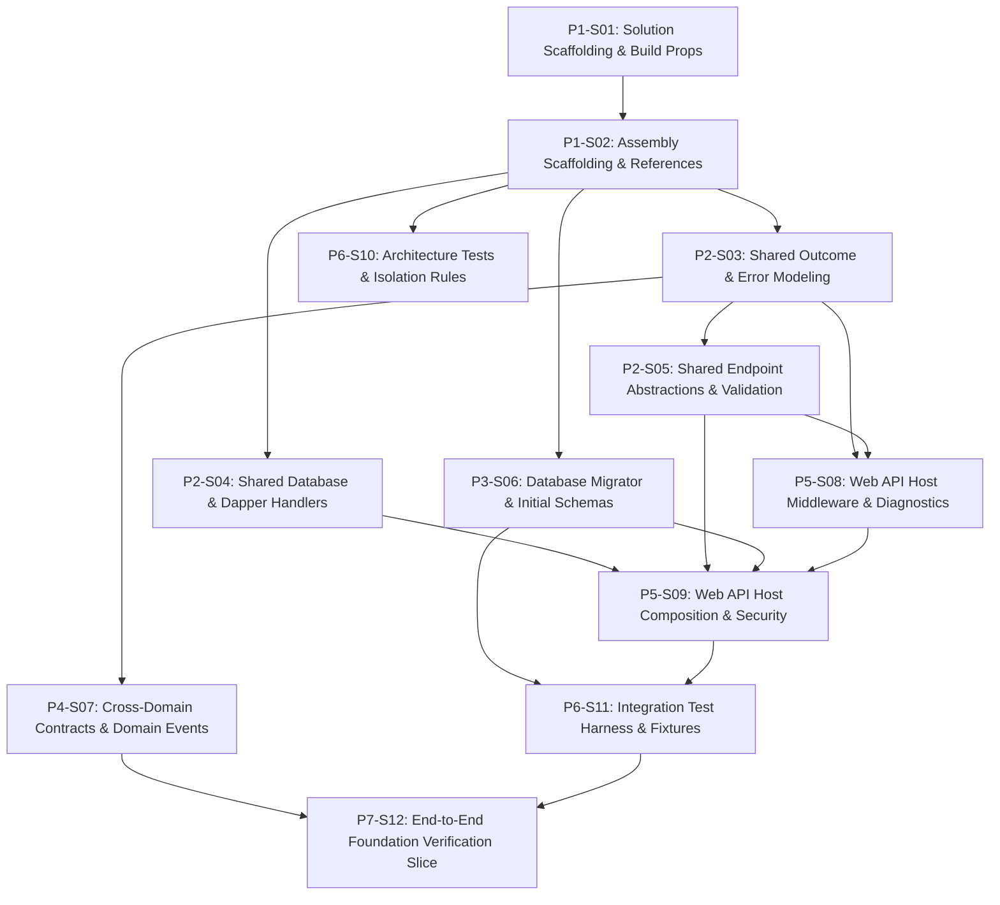

# 1. Objective

Establish a sound, modular, and maintainable backend foundation for Elsasa SIS V3 without prematurely implementing the entire SIS business surface. This plan bootstraps the .NET 8 / C# 12 Modular Monolith, establishes compiler-enforced domain isolation, configures DbUp migrations, provides the Web API host and test harness, and delivers an end-to-end proof-of-concept vertical slice.

Planning Mode: GREENFIELD-PLANNING

Referenced artifacts:

- ARCHITECTURE:
  - `docs/architecture/backend-architecture.md` (Modular Monolith & Vertical Slice Architecture specification)
  - `docs/architecture/adr.md` (ADR-001 through ADR-010)
  - `docs/architecture/coding-conventions.md` (C# 12, Dapper raw SQL, and Minimal API conventions)
  - `docs/architecture/backend-initialization-plan.md` (Source initialization roadmap)

Architecture Applicability: GREENFIELD-ARCHITECTURE

Greenfield planning mode based on complete target architecture. Scope encompasses the entire target system architecture foundation.

---

# 2. Planning Scope

The planning scope establishes the runnable backend system foundation for Stage 1 development:

- Solution scaffolding and compiler build configuration (`Directory.Build.props`, `.editorconfig`).
- Assembly project scaffolding with strict compile-time dependency enforcement (`Elsasa.Sis.Shared`, `Elsasa.Sis.Contracts`, `Elsasa.Sis.Database`, `Elsasa.Sis.Operations`, `Elsasa.Sis.Students`, `Elsasa.Sis.Finance`, `Elsasa.Sis.Api`, `Elsasa.Sis.ArchitectureTests`, `Elsasa.Sis.IntegrationTests`).
- Core shared kernel abstractions: `Result<T>`, `DomainError`, RFC 7807 ProblemDetails mapping, `ISqlConnectionFactory`, custom Dapper `DateOnly`/`TimeOnly` handlers, `IEndpoint` Minimal API scanning, `ValidationFilter<T>`, and `ICurrentUser`.
- Cross-domain module contracts (`IOperationsModule`, `IStudentsModule`, `IFinanceModule`) and in-memory domain event contracts (`IDomainEvent`).
- Database migration runner (`DbUp-SqlServer`) and Stage 1 initial T-SQL schemas (`operations`, `students`, `finance`) and foundational tables.
- ASP.NET Core Web API host, Serilog JSON logging, correlation ID tracing, global exception handling, JWT Bearer authentication, Swagger OpenAPI documentation, and `/health` checks.
- Testing infrastructure: NetArchTest architectural isolation rules and real SQL Server 2022 Testcontainers + Respawn integration test harness.
- Verification vertical slice: `CreateAcademicYear` in `Operations` verified end-to-end with an automated integration test.

---

# 3. Dependencies

### External System & Tooling Dependencies

- .NET 8 SDK (8.0.x)
- Docker / Docker Desktop / Podman (required for Testcontainers SQL Server 2022 integration testing)
- Microsoft SQL Server 2022 instance (for local API development and migration execution)

### Internal Slice Dependencies

- `Depends On` declares implementation prerequisites between slices.
- Dependencies reference Slice IDs only.
- Dependency satisfaction requires the referenced slice to have implementation status `IMPLEMENTED`.
- Dependency satisfaction does not require review status `GO`.
- Slices with `Depends On: None` or whose dependencies are satisfied may be executed in parallel.

### Dependency Graph



---

# 4. Progress Summary

| Phase | Implementation Status | Review Status | Progress |
|---|---|---|---|
| P1 - Solution Scaffolding & Build Foundation | NOT-STARTED | NOT-REVIEWED | 0/2 |
| P2 - Core Abstractions & Shared Kernel | NOT-STARTED | NOT-REVIEWED | 0/3 |
| P3 - Database & Migration Infrastructure | NOT-STARTED | NOT-REVIEWED | 0/1 |
| P4 - Cross-Domain Contracts & Domain Events | NOT-STARTED | NOT-REVIEWED | 0/1 |
| P5 - Web API Host Runtime & Middleware Pipeline | NOT-STARTED | NOT-REVIEWED | 0/2 |
| P6 - Testing Infrastructure & Architectural Governance | NOT-STARTED | NOT-REVIEWED | 0/2 |
| P7 - End-to-End Proof of Concept Vertical Slice | NOT-STARTED | NOT-REVIEWED | 0/1 |

---

# 5. Phases

## P1 - Solution Scaffolding & Build Foundation

Implementation Status: NOT-STARTED  
Review Status: NOT-REVIEWED

### P1-S01

Title: Solution File Scaffolding and Solution-Wide Build Configuration

Implementation Status: NOT-STARTED  
Review Status: NOT-REVIEWED

Objective:
Create the master .NET 8 solution file `Elsasa.Sis.sln` under `src/backend/` and configure root build properties (`Directory.Build.props`) and code conventions (`.editorconfig`) to enforce C# 12, nullable reference types, and zero compiler warnings across all projects.

Depends On: None

Repository: elsasa-sis-v3

Completion Criteria:
- `src/backend/Elsasa.Sis.sln` exists.
- `src/backend/Directory.Build.props` configures:
  - `<TargetFramework>net8.0</TargetFramework>`
  - `<LangVersion>12</LangVersion>`
  - `<Nullable>enable</Nullable>`
  - `<ImplicitUsings>enable</ImplicitUsings>`
  - `<TreatWarningsAsErrors>true</TreatWarningsAsErrors>`
- `src/backend/.editorconfig` enforces file-scoped namespaces, standard naming conventions, and formatting rules.

Notes:
- Establishes the compilation baseline for all downstream projects.

---

### P1-S02

Title: Project Assemblies Scaffolding & Compile-Time Reference Setup

Implementation Status: NOT-STARTED  
Review Status: NOT-REVIEWED

Objective:
Scaffold all Stage 1 domain, shared, infrastructure, web host, and test `.csproj` projects under `src/backend/` and `tests/backend/`, wire project references conforming strictly to ADR-001 isolation rules, and register them into `Elsasa.Sis.sln`.

Depends On: P1-S01

Repository: elsasa-sis-v3

Completion Criteria:
- The following projects exist with clean target frameworks and references:
  - `src/backend/Elsasa.Sis.Shared/Elsasa.Sis.Shared.csproj` (Class Library, no SIS project references)
  - `src/backend/Elsasa.Sis.Contracts/Elsasa.Sis.Contracts.csproj` (Class Library, references `Elsasa.Sis.Shared`)
  - `src/backend/Elsasa.Sis.Database/Elsasa.Sis.Database.csproj` (Class Library, no domain references)
  - `src/backend/Elsasa.Sis.Operations/Elsasa.Sis.Operations.csproj` (Class Library, references `Shared`, `Contracts`)
  - `src/backend/Elsasa.Sis.Students/Elsasa.Sis.Students.csproj` (Class Library, references `Shared`, `Contracts`)
  - `src/backend/Elsasa.Sis.Finance/Elsasa.Sis.Finance.csproj` (Class Library, references `Shared`, `Contracts`)
  - `src/backend/Elsasa.Sis.Api/Elsasa.Sis.Api.csproj` (Web API, references all 6 backend projects)
  - `tests/backend/Elsasa.Sis.ArchitectureTests/Elsasa.Sis.ArchitectureTests.csproj` (xUnit test project)
  - `tests/backend/Elsasa.Sis.IntegrationTests/Elsasa.Sis.IntegrationTests.csproj` (xUnit test project, references `Api`, `Shared`, `Database`, `Contracts`)
- Domain projects (`Operations`, `Students`, `Finance`) have zero references to each other.
- `dotnet build src/backend/Elsasa.Sis.sln` succeeds with 0 errors and 0 warnings.

Notes:
- Unlocks independent parallel development of `Elsasa.Sis.Shared`, `Elsasa.Sis.Database`, and `Elsasa.Sis.ArchitectureTests`.

---

## P2 - Core Abstractions & Shared Kernel

Implementation Status: NOT-STARTED  
Review Status: NOT-REVIEWED

### P2-S03

Title: Domain Outcome Modeling via Result<T> and RFC 7807 ProblemDetails Mapping

Implementation Status: NOT-STARTED  
Review Status: NOT-REVIEWED

Objective:
Implement domain outcome encapsulation types (`Result`, `Result<T>`), the error taxonomy (`DomainError`, `ErrorType`), and RFC 7807 ProblemDetails conversion extensions in `Elsasa.Sis.Shared`.

Depends On: P1-S02

Repository: elsasa-sis-v3

Completion Criteria:
- `src/backend/Elsasa.Sis.Shared/Common/ErrorType.cs` defines: `NotFound`, `Conflict`, `Validation`, `Unauthorized`, `Forbidden`, `Failure`.
- `src/backend/Elsasa.Sis.Shared/Common/DomainError.cs` defines immutable record `DomainError(string Code, string Message, ErrorType Type, IDictionary<string, string[]>? ValidationErrors = null)`.
- `src/backend/Elsasa.Sis.Shared/Common/Result.cs` and `Result<T>.cs` implement:
  - `IsSuccess`, `IsFailure`, `Value`, `Error`.
  - Static factory methods: `Result.Success()`, `Result.Failure(DomainError error)`, `Result.Success<T>(T value)`, `Result.Failure<T>(DomainError error)`.
  - Implicit conversions where ergonomic.
- `src/backend/Elsasa.Sis.Shared/Common/ResultsExtensions.cs` defines `ToProblemDetails(this DomainError error)` mapping `ErrorType` values to appropriate HTTP status codes (400, 401, 403, 404, 409, 422) and returning ASP.NET Core `IResult` ProblemDetails.
- Unit tests verify success and failure encapsulation and ProblemDetails mapping.

Notes:
- Replaces exception-based flow control with functional domain error propagation (ADR-007).

---

### P2-S04

Title: Database Connection Factory & Dapper Date/Time Type Handlers

Implementation Status: NOT-STARTED  
Review Status: NOT-REVIEWED

Objective:
Implement database connection abstraction and custom Dapper type handlers for modern .NET types (`DateOnly`, `TimeOnly`) in `Elsasa.Sis.Shared`.

Depends On: P1-S02

Repository: elsasa-sis-v3

Completion Criteria:
- Add NuGet dependencies to `Elsasa.Sis.Shared`: `Microsoft.Data.SqlClient` and `Dapper`.
- `src/backend/Elsasa.Sis.Shared/Database/ISqlConnectionFactory.cs` defines `ValueTask<DbConnection> CreateConnectionAsync(CancellationToken cancellationToken = default)`.
- `src/backend/Elsasa.Sis.Shared/Database/SqlConnectionFactory.cs` implements `ISqlConnectionFactory` using `Microsoft.Data.SqlClient.SqlConnection`.
- `src/backend/Elsasa.Sis.Shared/Database/DapperTypeHandlers.cs` implements:
  - `DateOnlyTypeHandler` mapping `DateOnly` to SQL `DbType.Date`.
  - `TimeOnlyTypeHandler` mapping `TimeOnly` to SQL `DbType.Time`.
  - `RegisterTypeHandlers()` helper method to register with `Dapper.SqlMapper`.
- Unit tests verify correct serialization and deserialization of `DateOnly` and `TimeOnly` with Dapper.

Notes:
- Prepares explicit Dapper data access foundation (ADR-004).

---

### P2-S05

Title: Minimal API Endpoint Abstractions, Assembly Discovery & FluentValidation Filter

Implementation Status: NOT-STARTED  
Review Status: NOT-REVIEWED

Objective:
Implement the `IEndpoint` interface, automatic assembly scanning extension methods, FluentValidation endpoint filter, and `ICurrentUser` abstraction in `Elsasa.Sis.Shared`.

Depends On: P2-S03

Repository: elsasa-sis-v3

Completion Criteria:
- Add NuGet dependency to `Elsasa.Sis.Shared`: `FluentValidation`.
- `src/backend/Elsasa.Sis.Shared/Endpoints/IEndpoint.cs` defines `void MapEndpoint(IEndpointRouteBuilder app)`.
- `src/backend/Elsasa.Sis.Shared/Endpoints/EndpointRouteBuilderExtensions.cs` implements `MapEndpoints(this IEndpointRouteBuilder app, params Assembly[] assemblies)` using reflection-based discovery of `IEndpoint` implementors.
- `src/backend/Elsasa.Sis.Shared/Endpoints/ValidationFilter.cs` implements `IEndpointFilter`:
  - Injects `IValidator<TRequest>?`.
  - If present, executes validation asynchronously against request payload.
  - Returns HTTP 422 ProblemDetails via `DomainError` when validation fails.
- `src/backend/Elsasa.Sis.Shared/Endpoints/RouteHandlerBuilderExtensions.cs` provides `.WithValidation<TRequest>()` extension method.
- `src/backend/Elsasa.Sis.Shared/Common/ICurrentUser.cs` defines `Guid? Id`, `string? Username`, `string? Email`, `IReadOnlyList<string> Roles`, `bool IsAuthenticated`.

Notes:
- Establishes native Minimal API vertical slice routing with automatic request validation (ADR-005).

---

## P3 - Database & Migration Infrastructure

Implementation Status: NOT-STARTED  
Review Status: NOT-REVIEWED

### P3-S06

Title: DbUp Migration Runner & Stage 1 Schemas and Initial DDL Scripts

Implementation Status: NOT-STARTED  
Review Status: NOT-REVIEWED

Objective:
Implement database migration runner using `dbup-sqlserver` and author idempotent T-SQL DDL scripts for Stage 1 domain schemas (`operations`, `students`, `finance`) and initial tables in `Elsasa.Sis.Database`.

Depends On: P1-S02

Repository: elsasa-sis-v3

Completion Criteria:
- Add NuGet dependency to `Elsasa.Sis.Database`: `dbup-sqlserver`.
- `src/backend/Elsasa.Sis.Database/DatabaseMigrator.cs` implements `UpgradeDatabase(string connectionString, ILogger? logger = null)` returning success/failure status and logging applied scripts.
- Ensure scripts are embedded in `.csproj` via `<EmbeddedResource Include="Scripts\*.sql" />`.
- Author initial embedded SQL scripts:
  - `Scripts/20261101_0001_Init_Schemas.sql`: Creates schemas `operations`, `students`, `finance` if not exists.
  - `Scripts/20261101_0101_Operations_AcademicYears.sql`: Creates table `operations.academic_years` (id, code, name, start_date, end_date, is_active, created_at, created_by).
  - `Scripts/20261101_0201_Students_Applicants.sql`: Creates table `students.applicants` (id, first_name, last_name, date_of_birth, gender, email, phone, created_at, created_by).
  - `Scripts/20261101_0202_Students_AdmissionApplications.sql`: Creates table `students.admission_applications` (id, applicant_id, academic_year_id [UUID key, no cross-schema FK], application_number, status, submitted_at, created_at, created_by).
  - `Scripts/20261101_0301_Finance_Policies.sql`: Creates table `finance.policies` (id, academic_year_id [UUID key, no cross-schema FK], policy_code, name, is_active, created_at, created_by).
- All DDL scripts adhere to ADR-002: snake_case columns and tables, UUID primary keys, zero cross-schema foreign keys.

Notes:
- Can be implemented in parallel with Phase 2 slices.

---

## P4 - Cross-Domain Contracts & Domain Events

Implementation Status: NOT-STARTED  
Review Status: NOT-REVIEWED

### P4-S07

Title: Cross-Domain Module Query Interfaces & In-Memory Domain Event Contracts

Implementation Status: NOT-STARTED  
Review Status: NOT-REVIEWED

Objective:
Define synchronous cross-domain query contract interfaces and MediatR in-memory domain event notification records in `Elsasa.Sis.Contracts`.

Depends On: P2-S03

Repository: elsasa-sis-v3

Completion Criteria:
- Add NuGet dependency to `Elsasa.Sis.Contracts`: `MediatR.Contracts`.
- `src/backend/Elsasa.Sis.Contracts/Common/IDomainEvent.cs` defines interface extending `MediatR.INotification` with `DateTimeOffset OccurredOn { get; }`.
- Synchronous module query interfaces defined under respective domain subfolders:
  - `src/backend/Elsasa.Sis.Contracts/Operations/IOperationsModule.cs` (`Task<Result<bool>> IsActiveAcademicPeriodAsync(Guid periodId, CancellationToken ct)`, `Task<Result<Guid?>> GetActiveAcademicYearIdAsync(CancellationToken ct)`).
  - `src/backend/Elsasa.Sis.Contracts/Students/IStudentsModule.cs` (`Task<Result<bool>> IsStudentEnrolledAsync(Guid studentId, CancellationToken ct)`).
  - `src/backend/Elsasa.Sis.Contracts/Finance/IFinanceModule.cs` (`Task<Result<bool>> IsEnrollmentFeePaidAsync(Guid applicantId, Guid academicYearId, CancellationToken ct)`).
- Stage 1 domain event records defined as immutable `public sealed record`:
  - `src/backend/Elsasa.Sis.Contracts/Students/Events/ApplicantAcceptedEvent.cs`
  - `src/backend/Elsasa.Sis.Contracts/Students/Events/StudentEnrolledEvent.cs`
  - `src/backend/Elsasa.Sis.Contracts/Finance/Events/ObligationAssessedEvent.cs`
  - `src/backend/Elsasa.Sis.Contracts/Finance/Events/PaymentConfirmedEvent.cs`
- `Elsasa.Sis.Contracts` compiles cleanly referencing only `Elsasa.Sis.Shared` and `MediatR.Contracts`.

Notes:
- Implements ADR-003 for decoupled cross-domain query contracts and domain event pub/sub.

---

## P5 - Web API Host Runtime & Middleware Pipeline

Implementation Status: NOT-STARTED  
Review Status: NOT-REVIEWED

### P5-S08

Title: Web API Host Observability, Correlation Tracking & Global Exception Handler

Implementation Status: NOT-STARTED  
Review Status: NOT-REVIEWED

Objective:
Configure Serilog structured JSON logging, correlation ID tracing middleware, and RFC 7807 global exception handling in `Elsasa.Sis.Api`.

Depends On: P2-S03, P2-S05

Repository: elsasa-sis-v3

Completion Criteria:
- Add NuGet dependencies to `Elsasa.Sis.Api`: `Serilog.AspNetCore`, `Serilog.Sinks.Console`, `Serilog.Enrichers.Environment`, `Serilog.Enrichers.Thread`.
- `src/backend/Elsasa.Sis.Api/Middleware/CorrelationIdMiddleware.cs` intercepts HTTP requests:
  - Extracts incoming `X-Correlation-ID` header or generates a new `Guid`.
  - Pushes correlation ID to Serilog `LogContext`.
  - Appends `X-Correlation-ID` to the outgoing response headers.
- `src/backend/Elsasa.Sis.Api/Middleware/GlobalExceptionHandler.cs` implements `Microsoft.AspNetCore.Diagnostics.IExceptionHandler`:
  - Intercepts unhandled infrastructure/system exceptions.
  - Logs the error with correlation ID and request path.
  - Returns RFC 7807 500 Internal Server Error ProblemDetails without exposing internal stack traces.
- `src/backend/Elsasa.Sis.Api/Configuration/SerilogConfiguration.cs` configures JSON console formatting and standard enrichers.

Notes:
- Ensures production-grade diagnostics and standardized error handling across all API requests.

---

### P5-S09

Title: Web API Host Runtime Composition, Security Wiring, Swagger & Startup CLI

Implementation Status: NOT-STARTED  
Review Status: NOT-REVIEWED

Objective:
Assemble the ASP.NET Core host in `Elsasa.Sis.Api`: configure JWT Bearer authentication, Swagger OpenAPI with bearer security, dependency injection registrations, endpoint auto-discovery, SQL Server health checks, and the `--migrate` CLI startup switch.

Depends On: P2-S04, P2-S05, P3-S06, P5-S08

Repository: elsasa-sis-v3

Completion Criteria:
- Add NuGet dependencies to `Elsasa.Sis.Api`:
  - `Microsoft.AspNetCore.Authentication.JwtBearer`
  - `Swashbuckle.AspNetCore`
  - `AspNetCore.HealthChecks.SqlServer`
  - `MediatR`
- `src/backend/Elsasa.Sis.Api/Services/CurrentUser.cs` implements `ICurrentUser` extracting claims (`sub`/`nameidentifier`, `name`, `email`, `role`) from `IHttpContextAccessor.HttpContext.User`.
- `src/backend/Elsasa.Sis.Api/Configuration/AuthenticationConfiguration.cs` configures JWT bearer token validation options.
- `src/backend/Elsasa.Sis.Api/Configuration/SwaggerConfiguration.cs` configures Swagger generation with JWT Bearer scheme (`Authorization: Bearer <token>`).
- `src/backend/Elsasa.Sis.Api/Configuration/DependencyInjection.cs` registers:
  - `ISqlConnectionFactory` with connection string from `ConnectionStrings:DefaultConnection`.
  - Dapper custom type handlers.
  - MediatR scanning domain assemblies.
  - FluentValidation validators scanning domain assemblies.
- `src/backend/Elsasa.Sis.Api/Program.cs`:
  - Configures middleware pipeline (CorrelationId, Serilog request logging, ExceptionHandler, Authentication, Authorization).
  - Handles CLI argument `--migrate`: executes `DatabaseMigrator.UpgradeDatabase` and exits or continues boot.
  - Calls `app.MapEndpoints(...)` scanning all Stage 1 assemblies (`Operations`, `Students`, `Finance`).
  - Maps `/health` endpoint backed by SQL Server health check.
- `dotnet build src/backend/Elsasa.Sis.Api` succeeds with 0 warnings.

Notes:
- Delivers the complete operational Web API host ready to serve HTTP requests and run migrations.

---

## P6 - Testing Infrastructure & Architectural Governance

Implementation Status: NOT-STARTED  
Review Status: NOT-REVIEWED

### P6-S10

Title: Architecture Tests Suite for Domain Isolation and Assembly Rules

Implementation Status: NOT-STARTED  
Review Status: NOT-REVIEWED

Objective:
Implement automated architecture unit tests in `Elsasa.Sis.ArchitectureTests` using `NetArchTest.Rules` to enforce compile-time domain boundary and dependency isolation rules.

Depends On: P1-S02

Repository: elsasa-sis-v3

Completion Criteria:
- Add NuGet dependency to `Elsasa.Sis.ArchitectureTests`: `NetArchTest.Rules`.
- `tests/backend/Elsasa.Sis.ArchitectureTests/AssemblyDependencyTests.cs` verifies:
  - `Elsasa.Sis.Operations` does NOT reference `Students` or `Finance`.
  - `Elsasa.Sis.Students` does NOT reference `Operations` or `Finance`.
  - `Elsasa.Sis.Finance` does NOT reference `Operations` or `Students`.
  - Domain assemblies do NOT reference `Elsasa.Sis.Api` or `Elsasa.Sis.Database`.
  - `Elsasa.Sis.Contracts` references only `Elsasa.Sis.Shared` and `MediatR.Contracts`.
  - `Elsasa.Sis.Shared` does not reference any other SIS project.
- `tests/backend/Elsasa.Sis.ArchitectureTests/NamingConventionTests.cs` verifies:
  - Handler classes adhere to `*Handler` naming and are sealed.
  - Request/Response records adhere to `*Request`/`*Response` naming.
  - Validator classes extend `AbstractValidator<T>` and adhere to `*Validator` naming.
- `dotnet test tests/backend/Elsasa.Sis.ArchitectureTests` passes with 100% green assertions.

Notes:
- Automates ADR-001 architectural governance to prevent regressions during multi-agent development.

---

### P6-S11

Title: Integration Test Harness with SQL Server Testcontainers & Respawn Fixtures

Implementation Status: NOT-STARTED  
Review Status: NOT-REVIEWED

Objective:
Establish the integration testing fixture in `Elsasa.Sis.IntegrationTests` with disposable SQL Server 2022 Testcontainers, Respawn database checkpointing, and custom `WebApplicationFactory`.

Depends On: P3-S06, P5-S09

Repository: elsasa-sis-v3

Completion Criteria:
- Add NuGet dependencies to `Elsasa.Sis.IntegrationTests`:
  - `Testcontainers.MsSql`
  - `Respawn`
  - `Microsoft.AspNetCore.Mvc.Testing`
  - `FluentAssertions`
- `tests/backend/Elsasa.Sis.IntegrationTests/Fixtures/SqlServerContainerFixture.cs`:
  - Manages `MsSqlContainer` lifecycle (SQL Server 2022).
  - Executes `DatabaseMigrator.UpgradeDatabase` against the container database on container startup.
  - Initializes `Respawner` configured to reset data in `operations`, `students`, and `finance` schemas while preserving `_SchemaVersions`.
- `tests/backend/Elsasa.Sis.IntegrationTests/Fixtures/IntegrationTestWebAppFactory.cs`:
  - Inherits `WebApplicationFactory<Program>`.
  - Replaces `DefaultConnection` configuration with container connection string.
  - Provides mock/bypass for `ICurrentUser` with customizable claims.
- `tests/backend/Elsasa.Sis.IntegrationTests/Fixtures/BaseIntegrationTest.cs`:
  - Implements `IAsyncLifetime` calling Respawn `ResetAsync` before each test execution.
  - Exposes `HttpClient` and helper methods for executing raw Dapper queries against the container database.
- `tests/backend/Elsasa.Sis.IntegrationTests/Infrastructure/SmokeTests.cs` verifies:
  - Container boots, migrations succeed, and GET `/health` returns HTTP 200 OK.
- `dotnet test tests/backend/Elsasa.Sis.IntegrationTests` completes cleanly in local development and CI environments.

Notes:
- Real-database integration test suite adhering to ADR-008.

---

## P7 - End-to-End Proof of Concept Vertical Slice

Implementation Status: NOT-STARTED  
Review Status: NOT-REVIEWED

### P7-S12

Title: End-to-End Foundation Verification Slice: CreateAcademicYear

Implementation Status: NOT-STARTED  
Review Status: NOT-REVIEWED

Objective:
Implement a complete vertical slice (`CreateAcademicYear`) in `Elsasa.Sis.Operations` and author an automated integration test in `Elsasa.Sis.IntegrationTests` to verify the full stack end-to-end against the SQL Server container.

Depends On: P4-S07, P6-S11

Repository: elsasa-sis-v3

Completion Criteria:
- In `src/backend/Elsasa.Sis.Operations/Features/CalendarPeriods/CreateAcademicYear/`:
  - `CreateAcademicYearRequest.cs`: `public sealed record CreateAcademicYearRequest(string Code, string Name, DateOnly StartDate, DateOnly EndDate);`
  - `CreateAcademicYearResponse.cs`: `public sealed record CreateAcademicYearResponse(Guid Id, string Code, string Name, DateOnly StartDate, DateOnly EndDate, bool IsActive);`
  - `CreateAcademicYearValidator.cs`: FluentValidation rules asserting Code and Name are non-empty, and `StartDate < EndDate`.
  - `CreateAcademicYearHandler.cs`:
    - Injects `ISqlConnectionFactory` and `ICurrentUser`.
    - Returns `Task<Result<CreateAcademicYearResponse>>`.
    - Executes raw multiline T-SQL via Dapper:
      ```sql
      INSERT INTO operations.academic_years (id, code, name, start_date, end_date, is_active, created_at, created_by)
      VALUES (@Id, @Code, @Name, @StartDate, @EndDate, @IsActive, @CreatedAt, @CreatedBy);
      ```
  - `CreateAcademicYearEndpoint.cs`:
    - Implements `IEndpoint`.
    - Maps `POST /api/operations/academic-years`.
    - Attaches `.WithValidation<CreateAcademicYearRequest>()`.
    - Executes handler and returns HTTP 201 Created or RFC 7807 ProblemDetails.
- In `tests/backend/Elsasa.Sis.IntegrationTests/Features/Operations/CreateAcademicYearTests.cs`:
  - Integration test verifies invalid payload returns HTTP 422 with RFC 7807 validation error structure.
  - Integration test verifies valid payload returns HTTP 201 Created with valid payload.
  - Integration test verifies record is persisted in `operations.academic_years` by inspecting database directly via Dapper.
- `dotnet test` runs all unit, architecture, and integration tests with 100% success.

Notes:
- Serves as the canonical vertical slice implementation pattern for all subsequent Stage 1 features.

---

# 6. Change Log

- 2026-11-01: Initial creation of the formal Knowledge-Centric SDLC Implementation Plan (`BACKEND-INIT-IMPLEMENTATION-PLAN.md`) by ica-architect from `docs/architecture/backend-initialization-plan.md`. Decomposed 7 monolithic tasks into 12 granular, dependency-isolated, parallelizable execution slices.
