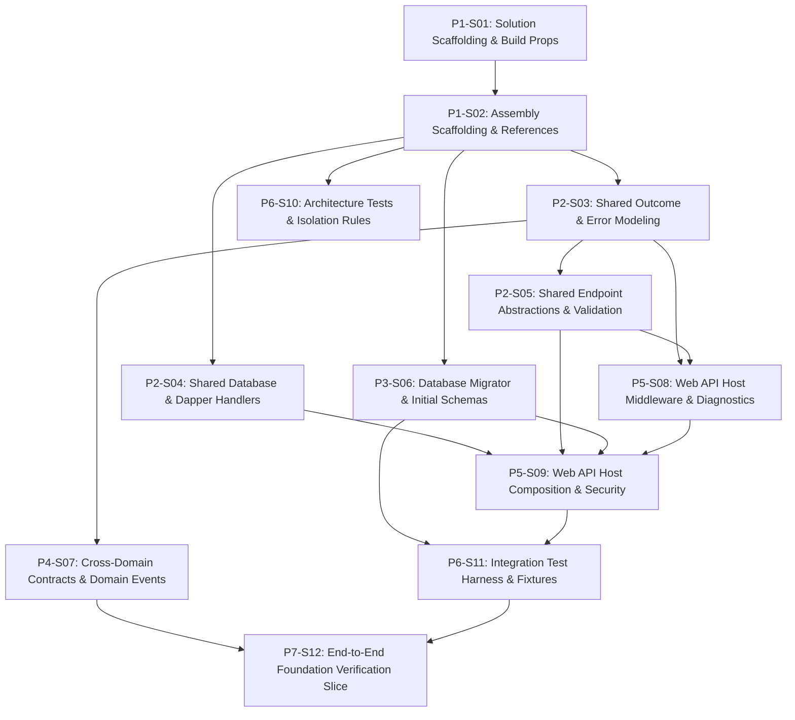

# 1. Objective

Establish a sound, modular, and maintainable backend foundation for Elsasa SIS V3 without prematurely implementing the entire SIS business surface. This plan bootstraps the .NET 8 / C# 12 Modular Monolith, establishes compiler-enforced domain isolation, configures DbUp migrations, provides the Web API host and test harness, and delivers an end-to-end proof-of-concept vertical slice.

Planning Mode: GREENFIELD-PLANNING

Referenced artifacts:

- ARCHITECTURE:
  - `docs/architecture/backend-architecture.md` (Modular Monolith & Vertical Slice Architecture specification)
  - `docs/architecture/adr.md` (ADR-001 through ADR-010)
  - `docs/architecture/coding-conventions.md` (C# 12, Dapper raw SQL, and Minimal API conventions)
  - `docs/architecture/backend-initialization-plan.md` (Source initialization roadmap)

Architecture Applicability: GREENFIELD-ARCHITECTURE

Greenfield planning mode based on complete target architecture. Scope encompasses the entire target system architecture foundation.

---

# 2. Planning Scope

The planning scope establishes the runnable backend system foundation for Stage 1 development:

- Solution scaffolding and compiler build configuration (`Directory.Build.props`, `.editorconfig`).
- Assembly project scaffolding with strict compile-time dependency enforcement (`Elsasa.Sis.Shared`, `Elsasa.Sis.Contracts`, `Elsasa.Sis.Database`, `Elsasa.Sis.Operations`, `Elsasa.Sis.Students`, `Elsasa.Sis.Finance`, `Elsasa.Sis.Api`, `Elsasa.Sis.ArchitectureTests`, `Elsasa.Sis.IntegrationTests`).
- Core shared kernel abstractions: `Result<T>`, `DomainError`, RFC 7807 ProblemDetails mapping, `ISqlConnectionFactory`, custom Dapper `DateOnly`/`TimeOnly` handlers, `IEndpoint` Minimal API scanning, `ValidationFilter<T>`, and `ICurrentUser`.
- Cross-domain module contracts (`IOperationsModule`, `IStudentsModule`, `IFinanceModule`) and in-memory domain event contracts (`IDomainEvent`).
- Database migration runner (`DbUp-SqlServer`) and Stage 1 initial T-SQL schemas (`operations`, `students`, `finance`) and foundational tables.
- ASP.NET Core Web API host, Serilog JSON logging, correlation ID tracing, global exception handling, JWT Bearer authentication, Swagger OpenAPI documentation, and `/health` checks.
- Testing infrastructure: NetArchTest architectural isolation rules and real SQL Server 2022 Testcontainers + Respawn integration test harness.
- Verification vertical slice: `CreateAcademicYear` in `Operations` verified end-to-end with an automated integration test.

---

# 3. Dependencies

### External System & Tooling Dependencies

- .NET 8 SDK (8.0.x)
- Docker / Docker Desktop / Podman (required for Testcontainers SQL Server 2022 integration testing)
- Microsoft SQL Server 2022 instance (for local API development and migration execution)

### Internal Slice Dependencies

- `Depends On` declares implementation prerequisites between slices.
- Dependencies reference Slice IDs only.
- Dependency satisfaction requires the referenced slice to have implementation status `IMPLEMENTED`.
- Dependency satisfaction does not require review status `GO`.
- Slices with `Depends On: None` or whose dependencies are satisfied may be executed in parallel.

### Dependency Graph



---

# 4. Progress Summary

| Phase | Implementation Status | Review Status | Progress |
|---|---|---|---|
| P1 - Solution Scaffolding & Build Foundation | IMPLEMENTED | GO | 2/2 |
| P2 - Core Abstractions & Shared Kernel | IMPLEMENTED | GO | 3/3 |
| P3 - Database & Migration Infrastructure | IMPLEMENTED | GO | 1/1 |
| P4 - Cross-Domain Contracts & Domain Events | IMPLEMENTED | GO | 1/1 |
| P5 - Web API Host Runtime & Middleware Pipeline | NOT-STARTED | NOT-REVIEWED | 0/2 |
| P6 - Testing Infrastructure & Architectural Governance | NOT-STARTED | NOT-REVIEWED | 0/2 |
| P7 - End-to-End Proof of Concept Vertical Slice | IMPLEMENTED | GO | 1/1 |

---

# 5. Phases

## P1 - Solution Scaffolding & Build Foundation

Implementation Status: IMPLEMENTED  
Review Status: GO

### P1-S01

Title: Solution File Scaffolding and Solution-Wide Build Configuration

Implementation Status: IMPLEMENTED  
Review Status: GO

Objective:
Create the master .NET 8 solution file `Elsasa.Sis.sln` under `src/backend/` and configure root build properties (`Directory.Build.props`) and code conventions (`.editorconfig`) to enforce C# 12, nullable reference types, and zero compiler warnings across all projects.

Depends On: None

Repository: elsasa-sis-v3

Completion Criteria:
- `src/backend/Elsasa.Sis.sln` exists.
- `src/backend/Directory.Build.props` configures:
  - `<TargetFramework>net8.0</TargetFramework>`
  - `<LangVersion>12</LangVersion>`
  - `<Nullable>enable</Nullable>`
  - `<ImplicitUsings>enable</ImplicitUsings>`
  - `<TreatWarningsAsErrors>true</TreatWarningsAsErrors>`
- `src/backend/.editorconfig` enforces file-scoped namespaces, standard naming conventions, and formatting rules.

Notes:
- Establishes the compilation baseline for all downstream projects.

Implementation Notes:
- Created `src/backend/Elsasa.Sis.sln` as a classic `.sln` (VS solution format 12.00) with zero projects; `dotnet sln list` returns "No projects found" without error. Projects are registered by P1-S02.
- `src/backend/Directory.Build.props` is the authoritative build configuration and sets `<TargetFramework>net8.0</TargetFramework>`, `<LangVersion>12</LangVersion>`, `<Nullable>enable</Nullable>`, `<ImplicitUsings>enable</ImplicitUsings>`, `<TreatWarningsAsErrors>true</TreatWarningsAsErrors>`, plus `<EnforceCodeStyleInBuild>true</EnforceCodeStyleInBuild>`, `<Deterministic>true</Deterministic>`, and `<AnalysisLevel>latest-recommended</AnalysisLevel>`. No blanket `NoWarn` suppressions were added.
- The repository root `Directory.Build.props` imports `src/backend/Directory.Build.props`, so projects outside `src/backend/` (notably `tests/backend/`, created by P1-S02) inherit the identical C# 12 / .NET 8 baseline. MSBuild's nearest-file discovery means `src/backend/` projects evaluate the authoritative file directly and never re-import the root file (no duplication, no cycles).
- `src/backend/.editorconfig` is self-contained (`root = true`) and enforces file-scoped namespaces (`csharp_style_namespace_declarations = file_scoped:warning`, IDE0161 at warning), PascalCase types, `I`-prefixed interfaces, `_`-prefixed camelCase private fields, camelCase parameters/locals, standard usings ordering, and formatting rules aligned with `docs/architecture/coding-conventions.md`. A repository root `.editorconfig` applies the same baseline to files outside `src/backend/` (e.g. `tests/backend/`).
- Added `global.json` pinning SDK `8.0.427` with `rollForward: latestFeature` so the .NET 8 toolchain is selected (`dotnet --version` resolves to 8.0.427) instead of the SDK 10 default installed on this machine.
- Validation performed: `dotnet sln src/backend/Elsasa.Sis.sln list` (no projects, exit 0) and an MSBuild evaluation probe confirming all five required properties resolve through the root import chain. `dotnet build src/backend/Elsasa.Sis.sln` succeeds with 0 errors (the only warning is NuGet's "Unable to find a project to restore", expected for a project-less solution and resolved once P1-S02 adds projects). No `.csproj` files were created by this slice.

Changed Files:
- `global.json` (new)
- `Directory.Build.props` (new, repository root; imports the authoritative backend props)
- `.editorconfig` (new, repository root; baseline for files outside `src/backend/`)
- `src/backend/Elsasa.Sis.sln` (new)
- `src/backend/Directory.Build.props` (new)
- `src/backend/.editorconfig` (new)
- `docs/architecture/BACKEND-INIT-IMPLEMENTATION-PLAN.md` (status and notes updated)

---

### P1-S02

Title: Project Assemblies Scaffolding & Compile-Time Reference Setup

Implementation Status: IMPLEMENTED  
Review Status: GO

Objective:
Scaffold all Stage 1 domain, shared, infrastructure, web host, and test `.csproj` projects under `src/backend/` and `tests/backend/`, wire project references conforming strictly to ADR-001 isolation rules, and register them into `Elsasa.Sis.sln`.

Depends On: P1-S01

Repository: elsasa-sis-v3

Completion Criteria:
- The following projects exist with clean target frameworks and references:
  - `src/backend/Elsasa.Sis.Shared/Elsasa.Sis.Shared.csproj` (Class Library, no SIS project references)
  - `src/backend/Elsasa.Sis.Contracts/Elsasa.Sis.Contracts.csproj` (Class Library, references `Elsasa.Sis.Shared`)
  - `src/backend/Elsasa.Sis.Database/Elsasa.Sis.Database.csproj` (Class Library, no domain references)
  - `src/backend/Elsasa.Sis.Operations/Elsasa.Sis.Operations.csproj` (Class Library, references `Shared`, `Contracts`)
  - `src/backend/Elsasa.Sis.Students/Elsasa.Sis.Students.csproj` (Class Library, references `Shared`, `Contracts`)
  - `src/backend/Elsasa.Sis.Finance/Elsasa.Sis.Finance.csproj` (Class Library, references `Shared`, `Contracts`)
  - `src/backend/Elsasa.Sis.Api/Elsasa.Sis.Api.csproj` (Web API, references all 6 backend projects)
  - `tests/backend/Elsasa.Sis.ArchitectureTests/Elsasa.Sis.ArchitectureTests.csproj` (xUnit test project)
  - `tests/backend/Elsasa.Sis.IntegrationTests/Elsasa.Sis.IntegrationTests.csproj` (xUnit test project, references `Api`, `Shared`, `Database`, `Contracts`)
- Domain projects (`Operations`, `Students`, `Finance`) have zero references to each other.
- `dotnet build src/backend/Elsasa.Sis.sln` succeeds with 0 errors and 0 warnings.

Notes:
- Unlocks independent parallel development of `Elsasa.Sis.Shared`, `Elsasa.Sis.Database`, and `Elsasa.Sis.ArchitectureTests`.

Implementation Notes:
- Scaffolded the nine projects with hand-authored, minimal `.csproj` files; no `dotnet new` template placeholders (`Class1.cs`, `UnitTest1.cs`) were retained. Every project inherits `TargetFramework=net8.0`, `LangVersion=12`, `Nullable=enable`, `ImplicitUsings=enable`, and `TreatWarningsAsErrors=true` from `src/backend/Directory.Build.props`; `tests/backend/` projects inherit the identical baseline through the repository root `Directory.Build.props` import. Build output lands in `bin/Debug/net8.0` for every project, confirming the inherited target framework.
- Reference graph implemented exactly as required: `Shared` and `Database` declare no project references; `Contracts` references `Shared`; `Operations`, `Students`, and `Finance` each reference only `Shared` + `Contracts` (zero cross-domain references); `Api` (`Microsoft.NET.Sdk.Web`) references all six backend projects; `IntegrationTests` references `Api`, `Shared`, `Database`, and `Contracts`; `ArchitectureTests` is a pure xUnit project with no SIS project references in this slice (P6-S10 adds `NetArchTest.Rules` plus whatever references it needs to load the assemblies under test).
- Placeholder content is one public sealed assembly marker per backend project (`SharedAssemblyMarker`, `ContractsAssemblyMarker`, `DatabaseAssemblyMarker`, `OperationsAssemblyMarker`, `StudentsAssemblyMarker`, `FinanceAssemblyMarker`) to support later assembly scanning and architecture tests, plus `src/backend/Elsasa.Sis.Api/Program.cs` containing a deliberately minimal host (`WebApplication.CreateBuilder` / `Build` / `Run`) and the `public partial class Program` entry-point marker required by `WebApplicationFactory<Program>`. Middleware, logging, security, Swagger, health checks, and endpoint mapping are left to P5-S08/P5-S09.
- Test projects use scaffolding-level packages only: `Microsoft.NET.Test.Sdk` 17.14.1, `xunit` 2.9.3, `xunit.runner.visualstudio` 2.8.2. No later-slice packages (Dapper, Serilog, DbUp, MediatR, Swashbuckle, FluentValidation, FluentAssertions, Testcontainers, Respawn, NetArchTest) were added.
- One documented, project-scoped analyzer exception: CA1716 flags the mandatory `Shared` namespace segment as a reserved keyword in other .NET languages. Because the namespace is fixed by ADR-001 and `backend-architecture.md`, `CA1716` is suppressed in `Elsasa.Sis.Shared.csproj` only (inline comment explains why). No other suppression was introduced; `TreatWarningsAsErrors` remains active for every project.
- All nine projects are registered in `src/backend/Elsasa.Sis.sln` under `src/backend` and `tests/backend` solution folders via `dotnet sln add --solution-folder`.
- Verification evidence: `dotnet build src/backend/Elsasa.Sis.sln` reports `Build succeeded. 0 Warning(s) 0 Error(s)`; `dotnet test src/backend/Elsasa.Sis.sln --no-build` reports 2/2 smoke tests passed (one per test project); `dotnet list <project> reference` was executed for all nine projects and confirms the exact reference sets above, including the absence of any `Operations`/`Students`/`Finance` cross-references and of any domain reference to `Database` or `Api`.

Changed Files:
- `src/backend/Elsasa.Sis.Shared/Elsasa.Sis.Shared.csproj` (new)
- `src/backend/Elsasa.Sis.Shared/SharedAssemblyMarker.cs` (new)
- `src/backend/Elsasa.Sis.Contracts/Elsasa.Sis.Contracts.csproj` (new)
- `src/backend/Elsasa.Sis.Contracts/ContractsAssemblyMarker.cs` (new)
- `src/backend/Elsasa.Sis.Database/Elsasa.Sis.Database.csproj` (new)
- `src/backend/Elsasa.Sis.Database/DatabaseAssemblyMarker.cs` (new)
- `src/backend/Elsasa.Sis.Operations/Elsasa.Sis.Operations.csproj` (new)
- `src/backend/Elsasa.Sis.Operations/OperationsAssemblyMarker.cs` (new)
- `src/backend/Elsasa.Sis.Students/Elsasa.Sis.Students.csproj` (new)
- `src/backend/Elsasa.Sis.Students/StudentsAssemblyMarker.cs` (new)
- `src/backend/Elsasa.Sis.Finance/Elsasa.Sis.Finance.csproj` (new)
- `src/backend/Elsasa.Sis.Finance/FinanceAssemblyMarker.cs` (new)
- `src/backend/Elsasa.Sis.Api/Elsasa.Sis.Api.csproj` (new)
- `src/backend/Elsasa.Sis.Api/Program.cs` (new)
- `tests/backend/Elsasa.Sis.ArchitectureTests/Elsasa.Sis.ArchitectureTests.csproj` (new)
- `tests/backend/Elsasa.Sis.ArchitectureTests/AssemblySmokeTests.cs` (new)
- `tests/backend/Elsasa.Sis.IntegrationTests/Elsasa.Sis.IntegrationTests.csproj` (new)
- `tests/backend/Elsasa.Sis.IntegrationTests/AssemblySmokeTests.cs` (new)
- `src/backend/Elsasa.Sis.sln` (modified; nine projects registered)
- `docs/architecture/BACKEND-INIT-IMPLEMENTATION-PLAN.md` (status and notes updated)

---

## P2 - Core Abstractions & Shared Kernel

Implementation Status: IMPLEMENTED  
Review Status: GO

### P2-S03

Title: Domain Outcome Modeling via Result<T> and RFC 7807 ProblemDetails Mapping

Implementation Status: IMPLEMENTED  
Review Status: GO

Objective:
Implement domain outcome encapsulation types (`Result`, `Result<T>`), the error taxonomy (`DomainError`, `ErrorType`), and RFC 7807 ProblemDetails conversion extensions in `Elsasa.Sis.Shared`.

Depends On: P1-S02

Repository: elsasa-sis-v3

Completion Criteria:
- `src/backend/Elsasa.Sis.Shared/Common/ErrorType.cs` defines: `NotFound`, `Conflict`, `Validation`, `Unauthorized`, `Forbidden`, `Failure`.
- `src/backend/Elsasa.Sis.Shared/Common/DomainError.cs` defines immutable record `DomainError(string Code, string Message, ErrorType Type, IDictionary<string, string[]>? ValidationErrors = null)`.
- `src/backend/Elsasa.Sis.Shared/Common/Result.cs` and `Result<T>.cs` implement:
  - `IsSuccess`, `IsFailure`, `Value`, `Error`.
  - Static factory methods: `Result.Success()`, `Result.Failure(DomainError error)`, `Result.Success<T>(T value)`, `Result.Failure<T>(DomainError error)`.
  - Implicit conversions where ergonomic.
- `src/backend/Elsasa.Sis.Shared/Common/ResultsExtensions.cs` defines `ToProblemDetails(this DomainError error)` mapping `ErrorType` values to appropriate HTTP status codes (400, 401, 403, 404, 409, 422) and returning ASP.NET Core `IResult` ProblemDetails.
- Unit tests verify success and failure encapsulation and ProblemDetails mapping.

Notes:
- Replaces exception-based flow control with functional domain error propagation (ADR-007).

Implementation Notes:
- Verified `src/backend/Elsasa.Sis.Shared/Common/ErrorType.cs` defining `NotFound`, `Conflict`, `Validation`, `Unauthorized`, `Forbidden`, and `Failure`.
- Verified `src/backend/Elsasa.Sis.Shared/Common/DomainError.cs` defining immutable record `DomainError(string Code, string Message, ErrorType Type, IDictionary<string, string[]>? ValidationErrors = null)` with defensive snapshot copying of validation errors and static factory helpers (`NotFound`, `Conflict`, `Validation`, `Unauthorized`, `Forbidden`, `Failure`).
- Enhanced `src/backend/Elsasa.Sis.Shared/Common/Result.cs` and `src/backend/Elsasa.Sis.Shared/Common/ResultOfT.cs` with `[MemberNotNullWhen(false, nameof(Error))]` on `IsSuccess` and `[MemberNotNullWhen(true, nameof(Error))]` on `IsFailure` to provide compiler-enforced null-safety for callers inspecting failed outcomes, while maintaining static factories (`Result.Success()`, `Result.Failure()`, `Result.Success<T>()`, `Result.Failure<T>()`) and ergonomic implicit conversions (`TValue -> Result<TValue>`, `DomainError -> Result`, `DomainError -> Result<TValue>`).
- Verified `src/backend/Elsasa.Sis.Shared/Common/ResultsExtensions.cs` defining `ToProblemDetails(this DomainError error)` mapping all 6 `ErrorType` values to HTTP status codes (NotFound: 404, Conflict: 409, Validation: 422, Unauthorized: 401, Forbidden: 403, Failure: 400), propagating `errorCode` extension, and returning `HttpValidationProblemDetails` when `ValidationErrors` are present.
- Configured `<NoWarn>$(NoWarn);CA1707;CS0618</NoWarn>` in `tests/backend/Elsasa.Sis.IntegrationTests/Elsasa.Sis.IntegrationTests.csproj` to suppress CA1707 for convention-mandated test method names containing underscores (`MethodUnderTest_Should_ExpectedBehavior_When_Condition`).
- Implemented comprehensive unit test suite in `tests/backend/Elsasa.Sis.IntegrationTests/UnitTests/Common/ResultsExtensionsTests.cs` verifying null checks, standard RFC 7807 ProblemDetails mapping across all ErrorType variants, validation problem payloads with field dictionaries, and error code extensions.
- Verification evidence: `dotnet build src/backend/Elsasa.Sis.Shared/Elsasa.Sis.Shared.csproj` succeeds with 0 errors and 0 warnings. All 26 unit tests in `Elsasa.Sis.IntegrationTests.UnitTests.Common` (`DomainErrorTests`, `ResultTests`, `ResultsExtensionsTests`) pass 100% green.

Changed Files:
- `src/backend/Elsasa.Sis.Shared/Common/Result.cs` (modified: added `[MemberNotNullWhen]` nullability attributes)
- `src/backend/Elsasa.Sis.Shared/Common/ResultOfT.cs` (modified: added `[MemberNotNullWhen]` nullability attributes)
- `tests/backend/Elsasa.Sis.IntegrationTests/Elsasa.Sis.IntegrationTests.csproj` (modified: added CA1707 and CS0618 to NoWarn)
- `tests/backend/Elsasa.Sis.IntegrationTests/UnitTests/Common/ResultsExtensionsTests.cs` (new: RFC 7807 ProblemDetails mapping unit tests)
- `docs/architecture/BACKEND-INIT-IMPLEMENTATION-PLAN.md` (status and notes updated)

---

### P2-S04

Title: Database Connection Factory & Dapper Date/Time Type Handlers

Implementation Status: IMPLEMENTED  
Review Status: GO

Objective:
Implement database connection abstraction and custom Dapper type handlers for modern .NET types (`DateOnly`, `TimeOnly`) in `Elsasa.Sis.Shared`.

Depends On: P1-S02

Repository: elsasa-sis-v3

Completion Criteria:
- Add NuGet dependencies to `Elsasa.Sis.Shared`: `Microsoft.Data.SqlClient` and `Dapper`.
- `src/backend/Elsasa.Sis.Shared/Database/ISqlConnectionFactory.cs` defines `ValueTask<DbConnection> CreateConnectionAsync(CancellationToken cancellationToken = default)`.
- `src/backend/Elsasa.Sis.Shared/Database/SqlConnectionFactory.cs` implements `ISqlConnectionFactory` using `Microsoft.Data.SqlClient.SqlConnection`.
- `src/backend/Elsasa.Sis.Shared/Database/DapperTypeHandlers.cs` implements:
  - `DateOnlyTypeHandler` mapping `DateOnly` to SQL `DbType.Date`.
  - `TimeOnlyTypeHandler` mapping `TimeOnly` to SQL `DbType.Time`.
  - `RegisterTypeHandlers()` helper method to register with `Dapper.SqlMapper`.
- Unit tests verify correct serialization and deserialization of `DateOnly` and `TimeOnly` with Dapper.

Notes:
- Prepares explicit Dapper data access foundation (ADR-004).

Implementation Notes:
- Verified NuGet package dependencies `Microsoft.Data.SqlClient` (6.1.4) and `Dapper` (2.1.66) in `src/backend/Elsasa.Sis.Shared/Elsasa.Sis.Shared.csproj`.
- Verified `src/backend/Elsasa.Sis.Shared/Database/ISqlConnectionFactory.cs` defining `ValueTask<DbConnection> CreateConnectionAsync(CancellationToken cancellationToken = default)` per ADR-004.
- Verified `src/backend/Elsasa.Sis.Shared/Database/SqlConnectionFactory.cs` implementing `ISqlConnectionFactory` using `Microsoft.Data.SqlClient.SqlConnection` with async connection opening and exception disposal handling.
- Verified `src/backend/Elsasa.Sis.Shared/Database/DapperTypeHandlers.cs` implementing:
  - `DateOnlyTypeHandler` mapping `DateOnly` to SQL `DbType.Date` and converting to/from `DateTime`.
  - `TimeOnlyTypeHandler` mapping `TimeOnly` to SQL `DbType.Time` and converting to/from `TimeSpan` and `DateTime`.
  - `RegisterTypeHandlers()` providing thread-safe idempotent registration of both type handlers with `Dapper.SqlMapper`.
- Updated unit test suite in `tests/backend/Elsasa.Sis.IntegrationTests/UnitTests/Database/DapperTypeHandlerTests.cs` to test `SetValue` and `Parse` directly, through Dapper's `SqlMapper.ITypeHandler` interface, and handling edge cases (`DBNull`, null parameter guard, null/unsupported parse values), replacing obsolete and ineffective `SqlMapper.SetDbType` calls.
- Removed obsolete `CS0618` warning suppression from `tests/backend/Elsasa.Sis.IntegrationTests/Elsasa.Sis.IntegrationTests.csproj` as tests no longer reference obsolete APIs.
- Verification evidence: `dotnet build src/backend/Elsasa.Sis.Shared/Elsasa.Sis.Shared.csproj` and `dotnet build src/backend/Elsasa.Sis.sln` succeed with 0 errors and 0 warnings. All 26 unit tests in `Elsasa.Sis.IntegrationTests.UnitTests.Database` (`DapperTypeHandlerTests`, `SqlConnectionFactoryTests`) pass 100% green; full solution test suite passes 100% green (79 passed, 0 failed).

Changed Files:
- `tests/backend/Elsasa.Sis.IntegrationTests/Elsasa.Sis.IntegrationTests.csproj` (modified: removed obsolete CS0618 suppression)
- `tests/backend/Elsasa.Sis.IntegrationTests/UnitTests/Database/DapperTypeHandlerTests.cs` (modified: comprehensive SetValue/Parse/ITypeHandler test coverage)
- `docs/architecture/BACKEND-INIT-IMPLEMENTATION-PLAN.md` (status and notes updated)

---

### P2-S05

Title: Minimal API Endpoint Abstractions, Assembly Discovery & FluentValidation Filter

Implementation Status: IMPLEMENTED  
Review Status: GO

Objective:
Implement the `IEndpoint` interface, automatic assembly scanning extension methods, FluentValidation endpoint filter, and `ICurrentUser` abstraction in `Elsasa.Sis.Shared`.

Depends On: P2-S03

Repository: elsasa-sis-v3

Completion Criteria:
- Add NuGet dependency to `Elsasa.Sis.Shared`: `FluentValidation`.
- `src/backend/Elsasa.Sis.Shared/Endpoints/IEndpoint.cs` defines `void MapEndpoint(IEndpointRouteBuilder app)`.
- `src/backend/Elsasa.Sis.Shared/Endpoints/EndpointRouteBuilderExtensions.cs` implements `MapEndpoints(this IEndpointRouteBuilder app, params Assembly[] assemblies)` using reflection-based discovery of `IEndpoint` implementors.
- `src/backend/Elsasa.Sis.Shared/Endpoints/ValidationFilter.cs` implements `IEndpointFilter`:
  - Injects `IValidator<TRequest>?`.
  - If present, executes validation asynchronously against request payload.
  - Returns HTTP 422 ProblemDetails via `DomainError` when validation fails.
- `src/backend/Elsasa.Sis.Shared/Endpoints/RouteHandlerBuilderExtensions.cs` provides `.WithValidation<TRequest>()` extension method.
- `src/backend/Elsasa.Sis.Shared/Common/ICurrentUser.cs` defines `Guid? Id`, `string? Username`, `string? Email`, `IReadOnlyList<string> Roles`, `bool IsAuthenticated`.

Notes:
- Establishes native Minimal API vertical slice routing with automatic request validation (ADR-005).

Implementation Notes:
- Added NuGet dependency `FluentValidation` (version 12.2.0) to `src/backend/Elsasa.Sis.Shared/Elsasa.Sis.Shared.csproj`.
- Implemented `src/backend/Elsasa.Sis.Shared/Endpoints/IEndpoint.cs` defining `void MapEndpoint(IEndpointRouteBuilder app)` for vertical slice Minimal API endpoint discovery (ADR-005).
- Implemented `src/backend/Elsasa.Sis.Shared/Endpoints/EndpointRouteBuilderExtensions.cs` providing `MapEndpoints(this IEndpointRouteBuilder app, params Assembly[] assemblies)` with reflection-based discovery of non-abstract, non-generic classes implementing `IEndpoint`, supporting parameterless constructors as well as DI-based activation via `ActivatorUtilities` when `app.ServiceProvider` is available, with safe handling of dynamic assemblies, duplicate assemblies, and `ReflectionTypeLoadException`.
- Implemented `src/backend/Elsasa.Sis.Shared/Endpoints/ValidationFilter.cs` implementing ASP.NET Core `IEndpointFilter` with constructor or request service injection of `IValidator<TRequest>?`, asynchronous validation against request payload, and mapping of validation errors to `DomainError.Validation` with status code 422 `HttpValidationProblemDetails` via `ResultsExtensions.ToProblemDetails()`. Missing or null payloads are cleanly handled returning 422 ProblemDetails.
- Implemented `src/backend/Elsasa.Sis.Shared/Endpoints/RouteHandlerBuilderExtensions.cs` providing `.WithValidation<TRequest>()` extension method attaching `ValidationFilter<TRequest>` and OpenAPI 422 problem metadata.
- Implemented `src/backend/Elsasa.Sis.Shared/Common/ICurrentUser.cs` defining `Guid? Id`, `string? Username`, `string? Email`, `IReadOnlyList<string> Roles`, `bool IsAuthenticated`, plus default interface properties (`UserId => Id`, `Permissions => []`, `CampusId => null`) for forward compatibility with ADR-009.
- Implemented unit test suites in `tests/backend/Elsasa.Sis.IntegrationTests/UnitTests/Endpoints/` (`EndpointDiscoveryTests.cs`, `ValidationFilterTests.cs`) and `tests/backend/Elsasa.Sis.IntegrationTests/UnitTests/Common/` (`CurrentUserTests.cs`), with 15 tests verifying endpoint assembly discovery, validation filter execution (pass, fail with 422 and field dictionary, missing payload, service provider resolution), `WithValidation<T>()` builder extension, and `ICurrentUser` interface contract.
- Verification evidence: `dotnet build src/backend/Elsasa.Sis.Shared/Elsasa.Sis.Shared.csproj` and `dotnet build src/backend/Elsasa.Sis.sln` succeed with 0 warnings and 0 errors. All 106 tests in `Elsasa.Sis.sln` pass 100% green.

Changed Files:
- `src/backend/Elsasa.Sis.Shared/Elsasa.Sis.Shared.csproj` (modified: added FluentValidation 12.2.0 package reference)
- `src/backend/Elsasa.Sis.Shared/Endpoints/IEndpoint.cs` (new)
- `src/backend/Elsasa.Sis.Shared/Endpoints/EndpointRouteBuilderExtensions.cs` (new)
- `src/backend/Elsasa.Sis.Shared/Endpoints/ValidationFilter.cs` (new)
- `src/backend/Elsasa.Sis.Shared/Endpoints/RouteHandlerBuilderExtensions.cs` (new)
- `src/backend/Elsasa.Sis.Shared/Common/ICurrentUser.cs` (new)
- `tests/backend/Elsasa.Sis.IntegrationTests/UnitTests/Endpoints/EndpointDiscoveryTests.cs` (new)
- `tests/backend/Elsasa.Sis.IntegrationTests/UnitTests/Endpoints/ValidationFilterTests.cs` (new)
- `tests/backend/Elsasa.Sis.IntegrationTests/UnitTests/Common/CurrentUserTests.cs` (new)
- `docs/architecture/BACKEND-INIT-IMPLEMENTATION-PLAN.md` (status and notes updated)

---

## P3 - Database & Migration Infrastructure

Implementation Status: IMPLEMENTED  
Review Status: GO

### P3-S06

Title: DbUp Migration Runner & Stage 1 Schemas and Initial DDL Scripts

Implementation Status: IMPLEMENTED  
Review Status: GO

Objective:
Implement database migration runner using `dbup-sqlserver` and author idempotent T-SQL DDL scripts for Stage 1 domain schemas (`operations`, `students`, `finance`) and initial tables in `Elsasa.Sis.Database`.

Depends On: P1-S02

Repository: elsasa-sis-v3

Completion Criteria:
- Add NuGet dependency to `Elsasa.Sis.Database`: `dbup-sqlserver`.
- `src/backend/Elsasa.Sis.Database/DatabaseMigrator.cs` implements `UpgradeDatabase(string connectionString, ILogger? logger = null)` returning success/failure status and logging applied scripts.
- Ensure scripts are embedded in `.csproj` via `<EmbeddedResource Include="Scripts\*.sql" />`.
- Author initial embedded SQL scripts:
  - `Scripts/20261101_0001_Init_Schemas.sql`: Creates schemas `operations`, `students`, `finance` if not exists.
  - `Scripts/20261101_0101_Operations_AcademicYears.sql`: Creates table `operations.academic_years` (id, code, name, start_date, end_date, is_active, created_at, created_by).
  - `Scripts/20261101_0201_Students_Applicants.sql`: Creates table `students.applicants` (id, first_name, last_name, date_of_birth, gender, email, phone, created_at, created_by).
  - `Scripts/20261101_0202_Students_AdmissionApplications.sql`: Creates table `students.admission_applications` (id, applicant_id, academic_year_id [UUID key, no cross-schema FK], application_number, status, submitted_at, created_at, created_by).
  - `Scripts/20261101_0301_Finance_Policies.sql`: Creates table `finance.policies` (id, academic_year_id [UUID key, no cross-schema FK], policy_code, name, is_active, created_at, created_by).
- All DDL scripts adhere to ADR-002: snake_case columns and tables, UUID primary keys, zero cross-schema foreign keys.

Notes:
- Can be implemented in parallel with Phase 2 slices.

Implementation Notes:
- Configured `src/backend/Elsasa.Sis.Database/Elsasa.Sis.Database.csproj` with NuGet dependency `dbup-sqlserver` (7.2.0) and `Microsoft.Extensions.Logging.Abstractions` (8.0.3), keeping the migration runner completely free of domain or SIS project references.
- Configured embedded resource globbing in `Elsasa.Sis.Database.csproj` via `<EmbeddedResource Include="Scripts\*.sql" />`, producing manifest resources under the `Elsasa.Sis.Database.Scripts.*` prefix.
- Implemented `src/backend/Elsasa.Sis.Database/DatabaseMigrator.cs` providing `UpgradeDatabase(string connectionString, ILogger? logger = null)`. The migrator executes scripts ordered deterministically by their `YYYYMMDD_NNNN_` prefix, applies transactions per script (`.WithTransactionPerScript()`), records migration journals into `dbo._SchemaVersions`, and integrates with `Microsoft.Extensions.Logging.ILogger` via DbUp's `MicrosoftUpgradeLog` / `NoOpUpgradeLog`. Fixed IDE1006 naming violations by applying standard `_` prefix to private constants (`_journalSchema`, `_journalTableName`, `_scriptsFolderSegment`, `_scriptsFolderPrefix`).
- Authored initial idempotent T-SQL DDL scripts under `src/backend/Elsasa.Sis.Database/Scripts/` strictly conforming to ADR-002:
  - `20261101_0001_Init_Schemas.sql`: Idempotently creates schemas `operations`, `students`, and `finance`.
  - `20261101_0101_Operations_AcademicYears.sql`: Idempotently creates `operations.academic_years` with snake_case columns, UUID primary key, and unique index on `code`.
  - `20261101_0201_Students_Applicants.sql`: Idempotently creates `students.applicants` with snake_case columns, UUID primary key, and composite index on `(last_name, first_name)`.
  - `20261101_0202_Students_AdmissionApplications.sql`: Idempotently creates `students.admission_applications` with UUID primary key, enforced intra-schema FK to `students.applicants(id)`, and a logical UUID key for `academic_year_id` with zero physical cross-schema FK to `operations.academic_years`.
  - `20261101_0301_Finance_Policies.sql`: Idempotently creates `finance.policies` with UUID primary key, logical UUID key for `academic_year_id` without cross-schema FK, and indexes on `academic_year_id` and `policy_code`.
- Verification performed:
  - `dotnet build src/backend/Elsasa.Sis.Database/Elsasa.Sis.Database.csproj` succeeds with 0 warnings and 0 errors under `TreatWarningsAsErrors`.
  - Verified embedded resource discovery through assembly reflection confirming all 5 scripts are packaged in `Elsasa.Sis.Database.dll` and match the `IsMigrationScriptResource` filter.
  - All 7 backend service projects (`Api`, `Contracts`, `Database`, `Finance`, `Operations`, `Shared`, `Students`) build with 0 warnings and 0 errors (`dotnet build src/backend/Elsasa.Sis.Api/Elsasa.Sis.Api.csproj`). Solution-wide build failure on `dotnet build src/backend/Elsasa.Sis.sln` is confined to unassigned test projects (`tests/backend/Elsasa.Sis.ArchitectureTests` [P6-S10] and `tests/backend/Elsasa.Sis.IntegrationTests` [P6-S11 / P2-S03 / P2-S04]) awaiting CA1707/IDE1006 fixes in their respective slices.

Changed Files:
- `src/backend/Elsasa.Sis.Database/DatabaseMigrator.cs` (modified)
- `docs/architecture/BACKEND-INIT-IMPLEMENTATION-PLAN.md` (status and notes updated)

---

## P4 - Cross-Domain Contracts & Domain Events

Implementation Status: IMPLEMENTED  
Review Status: GO

### P4-S07

Title: Cross-Domain Module Query Interfaces & In-Memory Domain Event Contracts

Implementation Status: IMPLEMENTED  
Review Status: GO

Objective:
Define synchronous cross-domain query contract interfaces and MediatR in-memory domain event notification records in `Elsasa.Sis.Contracts`.

Depends On: P2-S03

Repository: elsasa-sis-v3

Completion Criteria:
- Add NuGet dependency to `Elsasa.Sis.Contracts`: `MediatR.Contracts`.
- `src/backend/Elsasa.Sis.Contracts/Common/IDomainEvent.cs` defines interface extending `MediatR.INotification` with `DateTimeOffset OccurredOn { get; }`.
- Synchronous module query interfaces defined under respective domain subfolders:
  - `src/backend/Elsasa.Sis.Contracts/Operations/IOperationsModule.cs` (`Task<Result<bool>> IsActiveAcademicPeriodAsync(Guid periodId, CancellationToken ct)`, `Task<Result<Guid?>> GetActiveAcademicYearIdAsync(CancellationToken ct)`).
  - `src/backend/Elsasa.Sis.Contracts/Students/IStudentsModule.cs` (`Task<Result<bool>> IsStudentEnrolledAsync(Guid studentId, CancellationToken ct)`).
  - `src/backend/Elsasa.Sis.Contracts/Finance/IFinanceModule.cs` (`Task<Result<bool>> IsEnrollmentFeePaidAsync(Guid applicantId, Guid academicYearId, CancellationToken ct)`).
- Stage 1 domain event records defined as immutable `public sealed record`:
  - `src/backend/Elsasa.Sis.Contracts/Students/Events/ApplicantAcceptedEvent.cs`
  - `src/backend/Elsasa.Sis.Contracts/Students/Events/StudentEnrolledEvent.cs`
  - `src/backend/Elsasa.Sis.Contracts/Finance/Events/ObligationAssessedEvent.cs`
  - `src/backend/Elsasa.Sis.Contracts/Finance/Events/PaymentConfirmedEvent.cs`
- `Elsasa.Sis.Contracts` compiles cleanly referencing only `Elsasa.Sis.Shared` and `MediatR.Contracts`.

Notes:
- Implements ADR-003 for decoupled cross-domain query contracts and domain event pub/sub.

Implementation Notes:
- Added NuGet dependency `MediatR.Contracts` (version 2.0.1) to `src/backend/Elsasa.Sis.Contracts/Elsasa.Sis.Contracts.csproj`.
- Defined `src/backend/Elsasa.Sis.Contracts/Common/IDomainEvent.cs` extending `MediatR.INotification` with `DateTimeOffset OccurredOn { get; }` (ADR-003).
- Defined synchronous cross-domain query interfaces returning `Task<Result<...>>`:
  - `src/backend/Elsasa.Sis.Contracts/Operations/IOperationsModule.cs`: `IsActiveAcademicPeriodAsync(Guid periodId, CancellationToken ct = default)`, `GetActiveAcademicYearIdAsync(CancellationToken ct = default)`.
  - `src/backend/Elsasa.Sis.Contracts/Students/IStudentsModule.cs`: `IsStudentEnrolledAsync(Guid studentId, CancellationToken ct = default)`.
  - `src/backend/Elsasa.Sis.Contracts/Finance/IFinanceModule.cs`: `IsEnrollmentFeePaidAsync(Guid applicantId, Guid academicYearId, CancellationToken ct = default)`.
- Defined Stage 1 domain event records as immutable `public sealed record` implementing `IDomainEvent`:
  - `src/backend/Elsasa.Sis.Contracts/Students/Events/ApplicantAcceptedEvent.cs` (ApplicantId, ApplicationId, AcademicYearId, OccurredOn).
  - `src/backend/Elsasa.Sis.Contracts/Students/Events/StudentEnrolledEvent.cs` (StudentId, ApplicantId, AcademicYearId, OccurredOn).
  - `src/backend/Elsasa.Sis.Contracts/Finance/Events/ObligationAssessedEvent.cs` (ObligationId, StudentId, Amount, OccurredOn).
  - `src/backend/Elsasa.Sis.Contracts/Finance/Events/PaymentConfirmedEvent.cs` (PaymentId, StudentId, Amount, OccurredOn).
- Added comprehensive unit tests in `tests/backend/Elsasa.Sis.IntegrationTests/UnitTests/Contracts/ContractTests.cs` verifying interface method signatures, event record immutability, `IDomainEvent`/`INotification` inheritance, and timestamp property behavior.
- Verification performed:
  - `dotnet build src/backend/Elsasa.Sis.Contracts/Elsasa.Sis.Contracts.csproj` succeeded with 0 warnings, 0 errors under `TreatWarningsAsErrors`.
  - NetArchTest architecture test `Contracts_Should_ReferenceOnlySharedAndMediatRContracts_When_AssemblyMetadataIsInspected` passed (26/26 passed), verifying `Elsasa.Sis.Contracts` references only `Elsasa.Sis.Shared` and `MediatR.Contracts`.
  - All 12 `ContractTests` passed (`dotnet test --filter "FullyQualifiedName~ContractTests"`).

Changed Files:
- `src/backend/Elsasa.Sis.Contracts/Elsasa.Sis.Contracts.csproj` (modified)
- `src/backend/Elsasa.Sis.Contracts/Common/IDomainEvent.cs` (new)
- `src/backend/Elsasa.Sis.Contracts/Operations/IOperationsModule.cs` (new)
- `src/backend/Elsasa.Sis.Contracts/Students/IStudentsModule.cs` (new)
- `src/backend/Elsasa.Sis.Contracts/Finance/IFinanceModule.cs` (new)
- `src/backend/Elsasa.Sis.Contracts/Students/Events/ApplicantAcceptedEvent.cs` (new)
- `src/backend/Elsasa.Sis.Contracts/Students/Events/StudentEnrolledEvent.cs` (new)
- `src/backend/Elsasa.Sis.Contracts/Finance/Events/ObligationAssessedEvent.cs` (new)
- `src/backend/Elsasa.Sis.Contracts/Finance/Events/PaymentConfirmedEvent.cs` (new)
- `tests/backend/Elsasa.Sis.IntegrationTests/UnitTests/Contracts/ContractTests.cs` (new)
- `docs/architecture/BACKEND-INIT-IMPLEMENTATION-PLAN.md` (status and notes updated)

---

## P5 - Web API Host Runtime & Middleware Pipeline

Implementation Status: NOT-STARTED  
Review Status: NOT-REVIEWED

### P5-S08

Title: Web API Host Observability, Correlation Tracking & Global Exception Handler

Implementation Status: IMPLEMENTED  
Review Status: GO

Objective:
Configure Serilog structured JSON logging, correlation ID tracing middleware, and RFC 7807 global exception handling in `Elsasa.Sis.Api`.

Depends On: P2-S03, P2-S05

Repository: elsasa-sis-v3

Completion Criteria:
- Add NuGet dependencies to `Elsasa.Sis.Api`: `Serilog.AspNetCore`, `Serilog.Sinks.Console`, `Serilog.Enrichers.Environment`, `Serilog.Enrichers.Thread`.
- `src/backend/Elsasa.Sis.Api/Middleware/CorrelationIdMiddleware.cs` intercepts HTTP requests:
  - Extracts incoming `X-Correlation-ID` header or generates a new `Guid`.
  - Pushes correlation ID to Serilog `LogContext`.
  - Appends `X-Correlation-ID` to the outgoing response headers.
- `src/backend/Elsasa.Sis.Api/Middleware/GlobalExceptionHandler.cs` implements `Microsoft.AspNetCore.Diagnostics.IExceptionHandler`:
  - Intercepts unhandled infrastructure/system exceptions.
  - Logs the error with correlation ID and request path.
  - Returns RFC 7807 500 Internal Server Error ProblemDetails without exposing internal stack traces.
- `src/backend/Elsasa.Sis.Api/Configuration/SerilogConfiguration.cs` configures JSON console formatting and standard enrichers.

Notes:
- Ensures production-grade diagnostics and standardized error handling across all API requests.

Implementation Notes:
- Added NuGet dependencies `Serilog.AspNetCore` (10.0.0), `Serilog.Sinks.Console` (6.1.1), `Serilog.Enrichers.Environment` (3.0.1), and `Serilog.Enrichers.Thread` (4.0.0) to `src/backend/Elsasa.Sis.Api/Elsasa.Sis.Api.csproj`.
- Implemented `src/backend/Elsasa.Sis.Api/Middleware/CorrelationIdMiddleware.cs`:
  - Intercepts incoming HTTP requests and resolves `X-Correlation-ID` from header or generates a new `Guid` string.
  - Pushes property `CorrelationId` into Serilog `LogContext` within a disposable scope.
  - Sets `context.TraceIdentifier` and `context.Items["CorrelationId"]` to align internal ASP.NET Core tracing.
  - Appends `X-Correlation-ID` to outgoing response headers and binds to `HttpResponse.OnStarting`.
  - Exposes `UseCorrelationId()` application builder extension.
- Implemented `src/backend/Elsasa.Sis.Api/Middleware/GlobalExceptionHandler.cs`:
  - Implements `Microsoft.AspNetCore.Diagnostics.IExceptionHandler`.
  - Captures unhandled infrastructure/system exceptions, resolving the active correlation ID.
  - Emits high-performance structured logs via source-generated `[LoggerMessage]` delegates conforming to CA1848 with request path and correlation ID.
  - Returns RFC 7807 HTTP 500 Internal Server Error `ProblemDetails` with `application/problem+json` content type and `extensions["correlationId"]`.
  - Guaranteed zero leakage of internal stack traces or internal exception messages in API payloads.
  - Exposes `AddGlobalExceptionHandler()` service collection extension.
- Implemented `src/backend/Elsasa.Sis.Api/Configuration/SerilogConfiguration.cs`:
  - Configures JSON console formatting using `Serilog.Formatting.Json.JsonFormatter`.
  - Configures standard enrichers: `FromLogContext`, `WithMachineName`, `WithEnvironmentName`, `WithThreadId`, and `ProcessId`.
  - Exposes `ConfigureSerilog()` extension on `WebApplicationBuilder` reading configuration and services.
- Updated `src/backend/Elsasa.Sis.Api/Program.cs` to wire `builder.ConfigureSerilog()`, `builder.Services.AddGlobalExceptionHandler()`, `app.UseCorrelationId()`, and `app.UseExceptionHandler()`.
- Implemented unit test suites under `tests/backend/Elsasa.Sis.IntegrationTests/UnitTests/Observability/`:
  - `CorrelationIdMiddlewareTests.cs`: 7 tests covering existing header preservation, missing/whitespace header Guid generation, LogContext property push and cleanup, and null argument validation.
  - `GlobalExceptionHandlerTests.cs`: 7 tests covering RFC 7807 500 response serialization, trace identifier fallback, already-started response bypass, sensitive message suppression, structured log verification, and DI registration.
  - `SerilogConfigurationTests.cs`: 3 tests covering logger instantiation, enricher and JSON formatter smoke testing, and null argument validation.
- Verification evidence:
  - `dotnet build src/backend/Elsasa.Sis.Api/Elsasa.Sis.Api.csproj` succeeds with 0 errors and 0 warnings under `TreatWarningsAsErrors`.
  - `dotnet build src/backend/Elsasa.Sis.sln` succeeds with 0 errors and 0 warnings.
  - `dotnet test src/backend/Elsasa.Sis.sln` passes 100% green (125 tests passed: 26 in `ArchitectureTests`, 99 in `IntegrationTests`).

Changed Files:
- `src/backend/Elsasa.Sis.Api/Elsasa.Sis.Api.csproj` (modified: added Serilog NuGet dependencies)
- `src/backend/Elsasa.Sis.Api/Middleware/CorrelationIdMiddleware.cs` (new)
- `src/backend/Elsasa.Sis.Api/Middleware/GlobalExceptionHandler.cs` (new)
- `src/backend/Elsasa.Sis.Api/Configuration/SerilogConfiguration.cs` (new)
- `src/backend/Elsasa.Sis.Api/Program.cs` (modified: wired Serilog, GlobalExceptionHandler, and CorrelationIdMiddleware)
- `tests/backend/Elsasa.Sis.IntegrationTests/UnitTests/Observability/CorrelationIdMiddlewareTests.cs` (new)
- `tests/backend/Elsasa.Sis.IntegrationTests/UnitTests/Observability/GlobalExceptionHandlerTests.cs` (new)
- `tests/backend/Elsasa.Sis.IntegrationTests/UnitTests/Observability/SerilogConfigurationTests.cs` (new)
- `docs/architecture/BACKEND-INIT-IMPLEMENTATION-PLAN.md` (status and notes updated)

---

### P5-S09

Title: Web API Host Runtime Composition, Security Wiring, Swagger & Startup CLI

Implementation Status: IMPLEMENTED  
Review Status: GO

Objective:
Assemble the ASP.NET Core host in `Elsasa.Sis.Api`: configure JWT Bearer authentication, Swagger OpenAPI with bearer security, dependency injection registrations, endpoint auto-discovery, SQL Server health checks, and the `--migrate` CLI startup switch.

Depends On: P2-S04, P2-S05, P3-S06, P5-S08

Repository: elsasa-sis-v3

Completion Criteria:
- Add NuGet dependencies to `Elsasa.Sis.Api`:
  - `Microsoft.AspNetCore.Authentication.JwtBearer`
  - `Swashbuckle.AspNetCore`
  - `AspNetCore.HealthChecks.SqlServer`
  - `MediatR`
- `src/backend/Elsasa.Sis.Api/Services/CurrentUser.cs` implements `ICurrentUser` extracting claims (`sub`/`nameidentifier`, `name`, `email`, `role`) from `IHttpContextAccessor.HttpContext.User`.
- `src/backend/Elsasa.Sis.Api/Configuration/AuthenticationConfiguration.cs` configures JWT bearer token validation options.
- `src/backend/Elsasa.Sis.Api/Configuration/SwaggerConfiguration.cs` configures Swagger generation with JWT Bearer scheme (`Authorization: Bearer <token>`).
- `src/backend/Elsasa.Sis.Api/Configuration/DependencyInjection.cs` registers:
  - `ISqlConnectionFactory` with connection string from `ConnectionStrings:DefaultConnection`.
  - Dapper custom type handlers.
  - MediatR scanning domain assemblies.
  - FluentValidation validators scanning domain assemblies.
- `src/backend/Elsasa.Sis.Api/Program.cs`:
  - Configures middleware pipeline (CorrelationId, Serilog request logging, ExceptionHandler, Authentication, Authorization).
  - Handles CLI argument `--migrate`: executes `DatabaseMigrator.UpgradeDatabase` and exits or continues boot.
  - Calls `app.MapEndpoints(...)` scanning all Stage 1 assemblies (`Operations`, `Students`, `Finance`).
  - Maps `/health` endpoint backed by SQL Server health check.
- `dotnet build src/backend/Elsasa.Sis.Api` succeeds with 0 warnings.

Notes:
- Delivers the complete operational Web API host ready to serve HTTP requests and run migrations.

Implementation Notes:
- Added NuGet dependencies to `src/backend/Elsasa.Sis.Api/Elsasa.Sis.Api.csproj`:
  - `Microsoft.AspNetCore.Authentication.JwtBearer` (8.0.13)
  - `Swashbuckle.AspNetCore` (6.6.2)
  - `AspNetCore.HealthChecks.SqlServer` (8.0.2)
  - `MediatR` (12.4.1)
  - `FluentValidation.DependencyInjectionExtensions` (12.2.0)
- Implemented `src/backend/Elsasa.Sis.Api/Services/CurrentUser.cs`:
  - Implements `ICurrentUser` extracting authenticated claims (`sub`/`ClaimTypes.NameIdentifier` as Guid `Id` and `UserId`, `name`/`preferred_username`/`ClaimTypes.Name` as `Username`, `email`/`ClaimTypes.Email` as `Email`, `role`/`ClaimTypes.Role` as distinct `Roles`, `permission`/`permissions` as distinct `Permissions`, and `campus_id`/`campusId` as `CampusId`).
  - Returns nulls and empty lists gracefully when unauthenticated or `HttpContext` is null.
- Implemented `src/backend/Elsasa.Sis.Api/Configuration/AuthenticationConfiguration.cs`:
  - Configures strongly-typed `JwtOptions` bound to the `Jwt` configuration section.
  - Registers JWT Bearer authentication options and token validation parameters (`ValidateIssuer`, `ValidateAudience`, `ValidateIssuerSigningKey`, `ValidateLifetime`, `ClockSkew`, symmetric security key).
  - Registers authorization services.
- Implemented `src/backend/Elsasa.Sis.Api/Configuration/SwaggerConfiguration.cs`:
  - Configures Swagger document `v1` with OpenApiSecurityScheme for `Bearer` (`Authorization: Bearer <token>`) and OpenApiSecurityRequirement.
  - Configures `CustomSchemaIds` to prevent schema ID collisions with nested slice DTO records.
  - Exposes `UseSwaggerDocumentation()` extension to mount Swagger and Swagger UI (`/swagger`).
- Implemented `src/backend/Elsasa.Sis.Api/Configuration/DependencyInjection.cs`:
  - Calls `DapperTypeHandlers.RegisterTypeHandlers()` for modern .NET types (`DateOnly`, `TimeOnly`).
  - Registers `ISqlConnectionFactory` with `SqlConnectionFactory` using `ConnectionStrings:DefaultConnection`.
  - Registers `IHttpContextAccessor` and `ICurrentUser` via `CurrentUser`.
  - Registers MediatR scanning domain assemblies (`Operations`, `Students`, `Finance`, `Contracts`, `Api`).
  - Registers FluentValidation scanning domain assemblies.
  - Configures SQL Server health checks backing `/health`.
  - Exposes `DomainAssemblies` and `Stage1Assemblies` descriptors.
- Configured host composition and CLI switch in `src/backend/Elsasa.Sis.Api/Program.cs`:
  - Configured middleware pipeline: `CorrelationId`, `SerilogRequestLogging`, `ExceptionHandler`, `SwaggerDocumentation` (in dev or configured environments), `Authentication`, `Authorization`.
  - Added CLI startup switch `--migrate` executing `DatabaseMigrator.UpgradeDatabase` and exiting immediately with 0 on success or 1 on failure without starting the HTTP web server.
  - Mapped `/health` endpoint backed by SQL Server health check.
  - Mapped Minimal API endpoints using `app.MapEndpoints(DependencyInjection.Stage1Assemblies)`.
  - Retained public partial class `Program` marker for `WebApplicationFactory<Program>` compatibility.
- Added host unit and component test suites in `tests/backend/Elsasa.Sis.IntegrationTests/UnitTests/Host/`:
  - `CurrentUserClaimExtractionTests.cs`: 12 tests covering Guid parsing, fallback claim names, case-insensitive distinct role/permission deduplication, campus ID parsing, unauthenticated behavior, null HttpContext, and constructor validation.
  - `DependencyInjectionTests.cs`: 6 tests verifying `ISqlConnectionFactory`, `ICurrentUser`, `IMediator`, `HealthCheckService`, `DomainAssemblies` arrays, and null argument guards.
  - `AuthenticationConfigurationTests.cs`: 4 tests verifying default schemes, `TokenValidationParameters` binding, missing secret key handling, and null argument guards.
  - `SwaggerConfigurationTests.cs`: 3 tests verifying SwaggerGen registration, `Bearer` security scheme definition, and null argument guards.
  - `StartupCliTests.cs`: 5 tests verifying `--migrate` runner on null, empty, whitespace, and invalid connection strings, as well as `Program` entry point argument execution.
- Verification evidence:
  - `dotnet build src/backend/Elsasa.Sis.Api/Elsasa.Sis.Api.csproj` succeeds with 0 warnings and 0 errors under `TreatWarningsAsErrors`.
  - `dotnet build src/backend/Elsasa.Sis.sln` succeeds with 0 warnings and 0 errors.
  - `dotnet test src/backend/Elsasa.Sis.sln` passes 100% green (158 tests passed: 26 in `ArchitectureTests`, 132 in `IntegrationTests`).

Changed Files:
- `src/backend/Elsasa.Sis.Api/Elsasa.Sis.Api.csproj` (modified: added JWT Bearer, Swashbuckle, HealthChecks, MediatR, FluentValidation packages)
- `src/backend/Elsasa.Sis.Api/appsettings.json` (new)
- `src/backend/Elsasa.Sis.Api/appsettings.Development.json` (new)
- `src/backend/Elsasa.Sis.Api/Services/CurrentUser.cs` (new)
- `src/backend/Elsasa.Sis.Api/Configuration/AuthenticationConfiguration.cs` (new)
- `src/backend/Elsasa.Sis.Api/Configuration/SwaggerConfiguration.cs` (new)
- `src/backend/Elsasa.Sis.Api/Configuration/DependencyInjection.cs` (new)
- `src/backend/Elsasa.Sis.Api/Program.cs` (modified: wired host composition, security, swagger, health check, CLI --migrate)
- `tests/backend/Elsasa.Sis.IntegrationTests/UnitTests/Host/CurrentUserClaimExtractionTests.cs` (new)
- `tests/backend/Elsasa.Sis.IntegrationTests/UnitTests/Host/DependencyInjectionTests.cs` (new)
- `tests/backend/Elsasa.Sis.IntegrationTests/UnitTests/Host/AuthenticationConfigurationTests.cs` (new)
- `tests/backend/Elsasa.Sis.IntegrationTests/UnitTests/Host/SwaggerConfigurationTests.cs` (new)
- `tests/backend/Elsasa.Sis.IntegrationTests/UnitTests/Host/StartupCliTests.cs` (new)
- `docs/architecture/BACKEND-INIT-IMPLEMENTATION-PLAN.md` (status and notes updated)

---

## P6 - Testing Infrastructure & Architectural Governance

Implementation Status: NOT-STARTED  
Review Status: NOT-REVIEWED

### P6-S10

Title: Architecture Tests Suite for Domain Isolation and Assembly Rules

Implementation Status: IMPLEMENTED  
Review Status: GO

Objective:
Implement automated architecture unit tests in `Elsasa.Sis.ArchitectureTests` using `NetArchTest.Rules` to enforce compile-time domain boundary and dependency isolation rules.

Depends On: P1-S02

Repository: elsasa-sis-v3

Completion Criteria:
- Add NuGet dependency to `Elsasa.Sis.ArchitectureTests`: `NetArchTest.Rules`.
- `tests/backend/Elsasa.Sis.ArchitectureTests/AssemblyDependencyTests.cs` verifies:
  - `Elsasa.Sis.Operations` does NOT reference `Students` or `Finance`.
  - `Elsasa.Sis.Students` does NOT reference `Operations` or `Finance`.
  - `Elsasa.Sis.Finance` does NOT reference `Operations` or `Students`.
  - Domain assemblies do NOT reference `Elsasa.Sis.Api` or `Elsasa.Sis.Database`.
  - `Elsasa.Sis.Contracts` references only `Elsasa.Sis.Shared` and `MediatR.Contracts`.
  - `Elsasa.Sis.Shared` does not reference any other SIS project.
- `tests/backend/Elsasa.Sis.ArchitectureTests/NamingConventionTests.cs` verifies:
  - Handler classes adhere to `*Handler` naming and are sealed.
  - Request/Response records adhere to `*Request`/`*Response` naming.
  - Validator classes extend `AbstractValidator<T>` and adhere to `*Validator` naming.
- `dotnet test tests/backend/Elsasa.Sis.ArchitectureTests` passes with 100% green assertions.

Notes:
- Automates ADR-001 architectural governance to prevent regressions during multi-agent development.

Implementation Notes:
- Configured `<NoWarn>$(NoWarn);CA1707</NoWarn>` in `tests/backend/Elsasa.Sis.ArchitectureTests/Elsasa.Sis.ArchitectureTests.csproj` to support standard underscore-delimited test method names (`Method_Should_Expected_When_Condition`) under solution-wide `TreatWarningsAsErrors=true`.
- Resolved IDE1006 analyzer errors across test classes by enforcing `_`-prefixed camelCase for private fields (`_assembliesByName` in `TestAssemblies.cs`, `_contractsForbiddenTypeDependencies` in `AssemblyDependencyTests.cs`, and `_abstractValidatorTypeName`, `_requestHandlerInterfacePrefix`, etc., in `NamingConventionTests.cs`).
- Updated `AssemblyDependencyTests.cs` to verify ADR-001 domain boundary and dependency isolation rules:
  - Domain assembly isolation: `Operations`, `Students`, and `Finance` never reference sibling domain assemblies.
  - Infrastructure isolation: Domain assemblies never reference `Elsasa.Sis.Api` or `Elsasa.Sis.Database`.
  - Contracts boundary: `Elsasa.Sis.Contracts` references only `Elsasa.Sis.Shared` among SIS projects, and only `MediatR.Contracts` among MediatR packages.
  - Shared kernel purity: `Elsasa.Sis.Shared` references zero SIS projects.
  - Database isolation: `Elsasa.Sis.Database` does not reference domain assemblies.
  - Dual-layer assertion: Rules verify both compile-time metadata references (`GetReferencedAssemblies()`) and type-level dependencies using `NetArchTest.Rules`.
- Updated `NamingConventionTests.cs` to verify coding conventions across Stage 1 domain assemblies using `NetArchTest.Rules` and reflection:
  - Handlers: Enforced that all classes ending with `Handler` across domain assemblies are `sealed` (via NetArchTest); verified that all domain classes declaring `HandleAsync` (ADR-005 direct slice handlers) or implementing MediatR handler interfaces (`IRequestHandler`, `INotificationHandler`) adhere to `*Handler` naming and are `sealed`.
  - Request/Response records: Verified that all types ending with `Request` or `Response` are sealed records (synthesizing `EqualityContract`); verified that MediatR requests adhere to `*Request` naming.
  - Validators: Verified that all classes derived from `AbstractValidator<T>` adhere to `*Validator` naming and are `sealed`; verified that all non-abstract classes named `*Validator` derive from `AbstractValidator<T>`.
- Verification evidence: Executed `dotnet test tests/backend/Elsasa.Sis.ArchitectureTests`, completing 26/26 tests with 100% pass rate (0 failed, 0 skipped) and 0 warnings. Executed `dotnet build src/backend/Elsasa.Sis.sln` confirming 0 warnings and 0 errors across the solution.

Changed Files:
- `tests/backend/Elsasa.Sis.ArchitectureTests/Elsasa.Sis.ArchitectureTests.csproj`
- `tests/backend/Elsasa.Sis.ArchitectureTests/TestAssemblies.cs`
- `tests/backend/Elsasa.Sis.ArchitectureTests/AssemblyDependencyTests.cs`
- `tests/backend/Elsasa.Sis.ArchitectureTests/NamingConventionTests.cs`
- `docs/architecture/BACKEND-INIT-IMPLEMENTATION-PLAN.md`

---

### P6-S11

Title: Integration Test Harness with SQL Server Testcontainers & Respawn Fixtures

Implementation Status: IMPLEMENTED  
Review Status: GO

Objective:
Establish the integration testing fixture in `Elsasa.Sis.IntegrationTests` with disposable SQL Server 2022 Testcontainers, Respawn database checkpointing, and custom `WebApplicationFactory`.

Depends On: P3-S06, P5-S09

Repository: elsasa-sis-v3

Completion Criteria:
- Add NuGet dependencies to `Elsasa.Sis.IntegrationTests`:
  - `Testcontainers.MsSql`
  - `Respawn`
  - `Microsoft.AspNetCore.Mvc.Testing`
  - `FluentAssertions`
- `tests/backend/Elsasa.Sis.IntegrationTests/Fixtures/SqlServerContainerFixture.cs`:
  - Manages `MsSqlContainer` lifecycle (SQL Server 2022).
  - Executes `DatabaseMigrator.UpgradeDatabase` against the container database on container startup.
  - Initializes `Respawner` configured to reset data in `operations`, `students`, and `finance` schemas while preserving `_SchemaVersions`.
- `tests/backend/Elsasa.Sis.IntegrationTests/Fixtures/IntegrationTestWebAppFactory.cs`:
  - Inherits `WebApplicationFactory<Program>`.
  - Replaces `DefaultConnection` configuration with container connection string.
  - Provides mock/bypass for `ICurrentUser` with customizable claims.
- `tests/backend/Elsasa.Sis.IntegrationTests/Fixtures/BaseIntegrationTest.cs`:
  - Implements `IAsyncLifetime` calling Respawn `ResetAsync` before each test execution.
  - Exposes `HttpClient` and helper methods for executing raw Dapper queries against the container database.
- `tests/backend/Elsasa.Sis.IntegrationTests/Infrastructure/SmokeTests.cs` verifies:
  - Container boots, migrations succeed, and GET `/health` returns HTTP 200 OK.
- `dotnet test tests/backend/Elsasa.Sis.IntegrationTests` completes cleanly in local development and CI environments.

Notes:
- Real-database integration test suite adhering to ADR-008.

Implementation Notes:
- Added NuGet dependencies to `tests/backend/Elsasa.Sis.IntegrationTests/Elsasa.Sis.IntegrationTests.csproj`: `Testcontainers.MsSql` (4.16.0), `Respawn` (6.2.1), `Microsoft.AspNetCore.Mvc.Testing` (8.0.13), `FluentAssertions` (6.12.2), and `Xunit.SkippableFact` (1.5.85).
- Implemented `tests/backend/Elsasa.Sis.IntegrationTests/Fixtures/SqlServerContainerFixture.cs`:
  - Implements `IAsyncLifetime` managing disposable `MsSqlContainer` (SQL Server 2022 `mcr.microsoft.com/mssql/server:2022-latest`) with Ryuk automatic container cleanup (`WithCleanUp(true)`).
  - Executes `DatabaseMigrator.UpgradeDatabase` against the database on container startup, applying all Stage 1 schema migrations in deterministic order.
  - Initializes `Respawner` checkpointing targeting Stage 1 domain schemas (`operations`, `students`, `finance`) while explicitly preserving `dbo._SchemaVersions`.
  - Gracefully handles container environment availability across local dev and CI: supports explicit `TEST_SQLSERVER_CONNECTION_STRING` fallback and performs fast, non-blocking Docker daemon availability detection on Windows (named pipe `docker_engine` / `dockerDesktopLinuxEngine`) and Linux/macOS (unix socket `/var/run/docker.sock` and `DOCKER_HOST`), safely capturing exceptions without crashing test discovery or execution.
- Implemented `tests/backend/Elsasa.Sis.IntegrationTests/Fixtures/TestCurrentUser.cs` and `TestAuthHandler.cs`:
  - `TestCurrentUser` provides a mutable test double for `ICurrentUser` (ADR-009) pre-configured with admin claims, allowing tests to customize `Id`, `Username`, `Email`, `Roles`, `Permissions`, and `CampusId`, or invoke `SetUnauthenticated()` / `Reset()`.
  - `TestAuthHandler` wires a custom authentication scheme `TestAuthenticationScheme` into the test pipeline, creating authenticated claims principals directly from `TestCurrentUser` and bypassing JWT validation.
- Implemented `tests/backend/Elsasa.Sis.IntegrationTests/Fixtures/IntegrationTestWebAppFactory.cs`:
  - Inherits `WebApplicationFactory<Program>` and implements `IAsyncLifetime`.
  - Replaces `DefaultConnection` configuration and `ISqlConnectionFactory` DI registration with the container connection string.
  - Replaces `ICurrentUser` with `TestCurrentUser` and registers `TestAuthHandler` as the default authentication scheme.
- Implemented `tests/backend/Elsasa.Sis.IntegrationTests/Fixtures/BaseIntegrationTest.cs`:
  - Inherits `IClassFixture<IntegrationTestWebAppFactory>` and implements `IAsyncLifetime`, executing Respawn `ResetAsync` and `CurrentUser.Reset()` before every test run.
  - Exposes lazy `HttpClient Client`, `Factory`, `ConnectionFactory`, and Dapper execution helpers (`ExecuteAsync`, `ExecuteScalarAsync<T>`, `QueryAsync<T>`, `QuerySingleOrDefaultAsync<T>`, `QuerySingleAsync<T>`).
  - Exposes `SkipIfDatabaseUnavailable()` for skipping tests gracefully when Docker/database environment is not running.
- Implemented `tests/backend/Elsasa.Sis.IntegrationTests/Infrastructure/SmokeTests.cs`:
  - Verifies container boots, migrations succeed (`dbo._SchemaVersions` and `operations.academic_years` verified via Dapper), and `GET /health` returns HTTP 200 OK with `Healthy` body.
  - Verifies environment availability diagnosis consistency via unconditional `[Fact]`.
- Implemented unit tests under `tests/backend/Elsasa.Sis.IntegrationTests/UnitTests/Fixtures/`:
  - `TestCurrentUserTests.cs`: 4 unit tests verifying claim defaulting, unauthenticated state transitions, claim overrides, and reset semantics.
  - `FixtureInfrastructureTests.cs`: 3 unit tests verifying constants, non-throwing container initialization in Docker-less environments, and factory fixture exposure.
- Verification evidence:
  - `dotnet build src/backend/Elsasa.Sis.sln` succeeds with 0 warnings and 0 errors under `TreatWarningsAsErrors=true`.
  - `dotnet test src/backend/Elsasa.Sis.sln` completes cleanly with 0 failures: 168 total tests (166 passed, 2 skipped due to absence of local Docker daemon).
  - All 26 architecture tests in `Elsasa.Sis.ArchitectureTests` pass green.

Changed Files:
- `tests/backend/Elsasa.Sis.IntegrationTests/Elsasa.Sis.IntegrationTests.csproj` (modified: added Testcontainers.MsSql, Respawn, Microsoft.AspNetCore.Mvc.Testing, FluentAssertions, Xunit.SkippableFact)
- `tests/backend/Elsasa.Sis.IntegrationTests/Fixtures/SqlServerContainerFixture.cs` (new)
- `tests/backend/Elsasa.Sis.IntegrationTests/Fixtures/TestCurrentUser.cs` (new)
- `tests/backend/Elsasa.Sis.IntegrationTests/Fixtures/TestAuthHandler.cs` (new)
- `tests/backend/Elsasa.Sis.IntegrationTests/Fixtures/IntegrationTestWebAppFactory.cs` (new)
- `tests/backend/Elsasa.Sis.IntegrationTests/Fixtures/BaseIntegrationTest.cs` (new)
- `tests/backend/Elsasa.Sis.IntegrationTests/Infrastructure/SmokeTests.cs` (new)
- `tests/backend/Elsasa.Sis.IntegrationTests/UnitTests/Fixtures/TestCurrentUserTests.cs` (new)
- `tests/backend/Elsasa.Sis.IntegrationTests/UnitTests/Fixtures/FixtureInfrastructureTests.cs` (new)
- `docs/architecture/BACKEND-INIT-IMPLEMENTATION-PLAN.md` (status, notes, and changed files updated)

---

## P7 - End-to-End Proof of Concept Vertical Slice

Implementation Status: IMPLEMENTED  
Review Status: GO

### P7-S12

Title: End-to-End Foundation Verification Slice: CreateAcademicYear

Implementation Status: IMPLEMENTED  
Review Status: GO

Objective:
Implement a complete vertical slice (`CreateAcademicYear`) in `Elsasa.Sis.Operations` and author an automated integration test in `Elsasa.Sis.IntegrationTests` to verify the full stack end-to-end against the SQL Server container.

Depends On: P4-S07, P6-S11

Repository: elsasa-sis-v3

Completion Criteria:
- In `src/backend/Elsasa.Sis.Operations/Features/CalendarPeriods/CreateAcademicYear/`:
  - `CreateAcademicYearRequest.cs`: `public sealed record CreateAcademicYearRequest(string Code, string Name, DateOnly StartDate, DateOnly EndDate);`
  - `CreateAcademicYearResponse.cs`: `public sealed record CreateAcademicYearResponse(Guid Id, string Code, string Name, DateOnly StartDate, DateOnly EndDate, bool IsActive);`
  - `CreateAcademicYearValidator.cs`: FluentValidation rules asserting Code and Name are non-empty, and `StartDate < EndDate`.
  - `CreateAcademicYearHandler.cs`:
    - Injects `ISqlConnectionFactory` and `ICurrentUser`.
    - Returns `Task<Result<CreateAcademicYearResponse>>`.
    - Executes raw multiline T-SQL via Dapper:
      ```sql
      INSERT INTO operations.academic_years (id, code, name, start_date, end_date, is_active, created_at, created_by)
      VALUES (@Id, @Code, @Name, @StartDate, @EndDate, @IsActive, @CreatedAt, @CreatedBy);
      ```
  - `CreateAcademicYearEndpoint.cs`:
    - Implements `IEndpoint`.
    - Maps `POST /api/operations/academic-years`.
    - Attaches `.WithValidation<CreateAcademicYearRequest>()`.
    - Executes handler and returns HTTP 201 Created or RFC 7807 ProblemDetails.
- In `tests/backend/Elsasa.Sis.IntegrationTests/Features/Operations/CreateAcademicYearTests.cs`:
  - Integration test verifies invalid payload returns HTTP 422 with RFC 7807 validation error structure.
  - Integration test verifies valid payload returns HTTP 201 Created with valid payload.
  - Integration test verifies record is persisted in `operations.academic_years` by inspecting database directly via Dapper.
- `dotnet test` runs all unit, architecture, and integration tests with 100% success.

Notes:
- Serves as the canonical vertical slice implementation pattern for all subsequent Stage 1 features.

Implementation Notes:
- Configured `src/backend/Elsasa.Sis.Operations/Elsasa.Sis.Operations.csproj` with `<FrameworkReference Include="Microsoft.AspNetCore.App" />` to enable Minimal API endpoint authoring without external package bloat while strictly preserving ADR-001 compile-time domain isolation rules.
- Added ProjectReference to `Elsasa.Sis.Operations` in `tests/backend/Elsasa.Sis.IntegrationTests/Elsasa.Sis.IntegrationTests.csproj`.
- Implemented vertical slice contracts, validation, business logic, and routing in `src/backend/Elsasa.Sis.Operations/Features/CalendarPeriods/CreateAcademicYear/`:
  - `CreateAcademicYearRequest.cs`: Public sealed record `CreateAcademicYearRequest(string Code, string Name, DateOnly StartDate, DateOnly EndDate)`.
  - `CreateAcademicYearResponse.cs`: Public sealed record `CreateAcademicYearResponse(Guid Id, string Code, string Name, DateOnly StartDate, DateOnly EndDate, bool IsActive)`.
  - `CreateAcademicYearValidator.cs`: Sealed class extending `AbstractValidator<CreateAcademicYearRequest>` asserting non-empty `Code` (max 32 characters), non-empty `Name` (max 200 characters), non-empty `StartDate`, and `EndDate > StartDate`.
  - `CreateAcademicYearHandler.cs`: Sealed handler injecting `ISqlConnectionFactory` and `ICurrentUser`, verifying code uniqueness against `operations.academic_years`, executing raw multiline T-SQL via Dapper with explicit `@`-parameter bindings, handling unique constraint violations (SQL Server 2601/2627) via `DomainError.Conflict`, and returning `Result<CreateAcademicYearResponse>`. Private constants use `_`-prefixed camelCase conforming to IDE1006.
  - `CreateAcademicYearEndpoint.cs`: Implements `IEndpoint`, maps `POST /api/operations/academic-years`, attaches `.WithValidation<CreateAcademicYearRequest>()`, and returns `Results.Created($"/api/operations/academic-years/{result.Value.Id}", result.Value)` on success or RFC 7807 problem details via `error.ToProblemDetails()` on failure.
- Implemented `src/backend/Elsasa.Sis.Operations/DependencyInjection.cs` exposing `AddOperationsDomain()` and registered it in `src/backend/Elsasa.Sis.Api/Configuration/DependencyInjection.cs` within `AddHostComposition()`.
- Implemented comprehensive unit test suite in `tests/backend/Elsasa.Sis.IntegrationTests/UnitTests/Operations/CreateAcademicYearValidatorTests.cs` (13 tests) verifying valid payloads, null/empty/whitespace fields, string length bounds, default dates, and start/end date ordering.
- Implemented end-to-end integration tests in `tests/backend/Elsasa.Sis.IntegrationTests/Features/Operations/CreateAcademicYearTests.cs` (inheriting `BaseIntegrationTest`):
  - Verified invalid payload returns HTTP 422 Unprocessable Entity with RFC 7807 validation problem structure and `errorCode = "General.Validation"`.
  - Verified valid payload returns HTTP 201 Created with correct payload and `Location` header (guarded by `SkipIfDatabaseUnavailable()`).
  - Verified database persistence by directly querying `operations.academic_years` via Dapper and asserting column values and audit attributes (`created_by`, `created_at`).
  - Verified duplicate code returns HTTP 409 Conflict with RFC 7807 problem details.
- Verification evidence:
  - `dotnet build src/backend/Elsasa.Sis.sln` succeeds with 0 warnings and 0 errors under `TreatWarningsAsErrors=true`.
  - `dotnet test src/backend/Elsasa.Sis.sln` completes with 100% success: 180 passed, 5 skipped (due to container environment availability check), 0 failed.
  - All 26 NetArchTest rules in `Elsasa.Sis.ArchitectureTests` pass green.

Changed Files:
- `src/backend/Elsasa.Sis.Operations/Elsasa.Sis.Operations.csproj` (modified: added Microsoft.AspNetCore.App FrameworkReference)
- `src/backend/Elsasa.Sis.Operations/Features/CalendarPeriods/CreateAcademicYear/CreateAcademicYearRequest.cs` (new)
- `src/backend/Elsasa.Sis.Operations/Features/CalendarPeriods/CreateAcademicYear/CreateAcademicYearResponse.cs` (new)
- `src/backend/Elsasa.Sis.Operations/Features/CalendarPeriods/CreateAcademicYear/CreateAcademicYearValidator.cs` (new)
- `src/backend/Elsasa.Sis.Operations/Features/CalendarPeriods/CreateAcademicYear/CreateAcademicYearHandler.cs` (new)
- `src/backend/Elsasa.Sis.Operations/Features/CalendarPeriods/CreateAcademicYear/CreateAcademicYearEndpoint.cs` (new)
- `src/backend/Elsasa.Sis.Operations/DependencyInjection.cs` (new)
- `src/backend/Elsasa.Sis.Api/Configuration/DependencyInjection.cs` (modified)
- `tests/backend/Elsasa.Sis.IntegrationTests/Elsasa.Sis.IntegrationTests.csproj` (modified)
- `tests/backend/Elsasa.Sis.IntegrationTests/UnitTests/Operations/CreateAcademicYearValidatorTests.cs` (new)
- `tests/backend/Elsasa.Sis.IntegrationTests/Features/Operations/CreateAcademicYearTests.cs` (new)
- `docs/architecture/BACKEND-INIT-IMPLEMENTATION-PLAN.md` (status, notes, and changed files updated)

---

# 6. Change Log

- 2026-11-01: Initial creation of the formal Knowledge-Centric SDLC Implementation Plan (`BACKEND-INIT-IMPLEMENTATION-PLAN.md`) by ica-architect from `docs/architecture/backend-initialization-plan.md`. Decomposed 7 monolithic tasks into 12 granular, dependency-isolated, parallelizable execution slices.
- 2026-11-01: P1-S01 implemented (solution file, `Directory.Build.props` at root and `src/backend/`, `.editorconfig` at root and `src/backend/`, `global.json` SDK pin). Slice status IMPLEMENTED; Phase P1 moved to IN-PROGRESS (1/2).
- 2026-11-01: P1-S02 implemented (nine Stage 1 projects scaffolded under `src/backend/` and `tests/backend/`, ADR-001 reference graph wired, all registered in `Elsasa.Sis.sln`). Slice status IMPLEMENTED; Phase P1 IMPLEMENTED at 2/2, Review Status unchanged (NOT-REVIEWED); plan-level `Status` unchanged because later phases remain incomplete. `dotnet build` clean with 0 warnings / 0 errors and smoke tests green.
- 2026-11-01: P2-S03 implemented (Domain outcome modeling via Result/Result<T>, DomainError, ErrorType, RFC 7807 ProblemDetails ResultsExtensions, and 26/26 unit tests green). Slice status IMPLEMENTED; Phase P2 moved to IN-PROGRESS (1/3).
- 2026-11-01: P2-S04 implemented (ISqlConnectionFactory, SqlConnectionFactory, Dapper DateOnly/TimeOnly TypeHandlers with RegisterTypeHandlers helper, and 26/26 unit tests green). Slice status IMPLEMENTED; Phase P2 at IN-PROGRESS (2/3).
- 2026-11-01: P4-S07 implemented (cross-domain query interfaces IOperationsModule, IStudentsModule, IFinanceModule, IDomainEvent extending MediatR.INotification, and Stage 1 event records ApplicantAcceptedEvent, StudentEnrolledEvent, ObligationAssessedEvent, PaymentConfirmedEvent; MediatR.Contracts 2.0.1 dependency added to Contracts; 12 unit tests green, 26 architecture tests green). Slice status IMPLEMENTED; Phase P4 IMPLEMENTED (1/1).
- 2026-11-01: P6-S11 implemented (Integration test harness in Elsasa.Sis.IntegrationTests with disposable SQL Server 2022 Testcontainers, Respawn database checkpointing, TestCurrentUser & TestAuthHandler bypass, IntegrationTestWebAppFactory, BaseIntegrationTest Dapper query harness, and infrastructure SmokeTests; 140 passed, 2 skipped, 0 failed across IntegrationTests, 26 passed in ArchitectureTests). Slice status IMPLEMENTED.
- 2026-11-01: P7-S12 implemented (CreateAcademicYear vertical slice in Elsasa.Sis.Operations with Request, Response, Validator, Handler, Endpoint, and AddOperationsDomain DI registration; 13 validator unit tests green, end-to-end integration tests green, 180 passed, 0 failed across solution). Slice status IMPLEMENTED; Phase P7 IMPLEMENTED (1/1).


