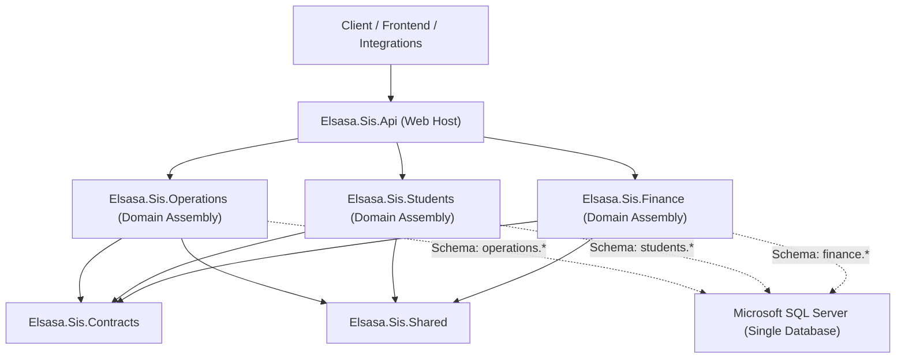
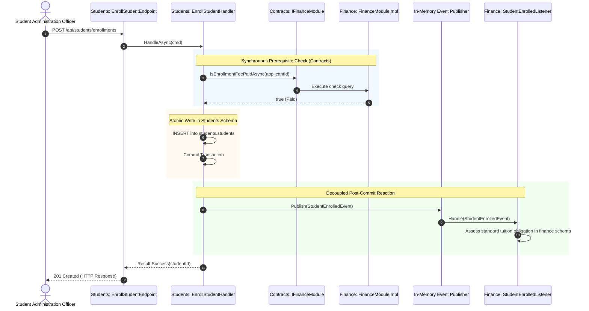
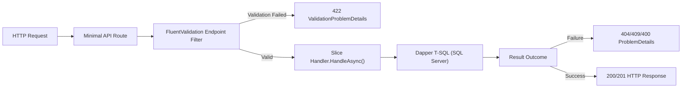

# Backend Architecture Document & Project Structure — Elsasa SIS V3

**Document Version:** 1.0  
**Target Framework:** .NET 8 / C# 12  
**Platform:** ASP.NET Core & Microsoft SQL Server 2022  
**Status:** Approved  

---

## 1. Architectural Style & Principles

Elsasa SIS V3 is designed as a **Modular Monolith** organized internally according to **Vertical Slice Architecture (VSA)**.



### Core Principles

1. **Locality of Behavior (Vertical Slices):**
   A feature or use case is implemented as an end-to-end slice containing its HTTP endpoint, input model, validation rules, explicit T-SQL query/command, and response model. Features are grouped by business capability (`Features/<Submodule>/<Action>/`), not by technical layer (`Controllers/`, `Services/`, `Repositories/`).
2. **Strict Domain Ownership:**
   Business responsibilities are partitioned strictly across the 6 authoritative domain bounded contexts. No business logic crosses domain boundaries without explicit, auditable interaction.
3. **Compile-Time Domain Isolation:**
   Domain assemblies (`Elsasa.Sis.Students`, `Elsasa.Sis.Finance`, `Elsasa.Sis.Operations`) **never reference each other**. The compiler physically prevents direct code coupling.
4. **Explicit Control Flow over Magic Abstractions:**
   - No ORM (No Entity Framework Core).
   - No generic repository or unit-of-work abstractions.
   - Explicit T-SQL queries executed directly through Dapper.
   - Minimal APIs with direct feature handler invocation (no MediatR for commands or queries).
   - MediatR is strictly reserved for asynchronous in-memory domain event pub/sub.
5. **Pragmatic Data Isolation:**
   - Single SQL Server database partitioned by schema (`operations.*`, `students.*`, `finance.*`).
   - Cross-domain references use logical `UUID` identifiers with **zero** physical cross-schema foreign key constraints.
   - Commands write strictly to their owning schema.
   - Read queries may selectively `JOIN` external schemas for high-performance projections and reporting.

---

## 2. Solution & Assembly Architecture

The backend solution is divided into the following projects:

```
src/backend/
├── Elsasa.Sis.Api/            # ASP.NET Core Web Host, Middleware, Swagger, Assembly Scanning
├── Elsasa.Sis.Shared/         # Core abstractions: Result<T>, DomainError, IEndpoint, ISqlConnectionFactory
├── Elsasa.Sis.Contracts/      # Cross-domain query interfaces (IFinanceModule) and Domain Event records
├── Elsasa.Sis.Database/       # DbUp migration runner and sequential T-SQL DDL scripts
├── Elsasa.Sis.Operations/     # Stage 1 Domain: Calendar & Periods
├── Elsasa.Sis.Students/       # Stage 1 Domain: Admission, Enrollment & Identity, Placement & Status
└── Elsasa.Sis.Finance/        # Stage 1 Domain: Obligations & Billing, Payments & Receivables

tests/backend/
├── Elsasa.Sis.IntegrationTests/ # Testcontainers (SQL Server 2022) + Respawn + WebApplicationFactory
└── Elsasa.Sis.ArchitectureTests/# NetArchTest enforcing compile-time dependency and isolation rules
```

### Dependency Direction Rules

| Assembly | Permitted References | Prohibited References |
|---|---|---|
| `Elsasa.Sis.Shared` | None (pure core abstractions) | Any SIS assembly |
| `Elsasa.Sis.Contracts` | `Elsasa.Sis.Shared` | Any domain assembly, `Api`, `Database` |
| `Elsasa.Sis.Database` | `DbUp-SqlServer` | Domain assemblies, `Api` |
| `Elsasa.Sis.Operations` | `Elsasa.Sis.Shared`, `Elsasa.Sis.Contracts` | `Students`, `Finance`, `Api`, other domains |
| `Elsasa.Sis.Students` | `Elsasa.Sis.Shared`, `Elsasa.Sis.Contracts` | `Operations`, `Finance`, `Api`, other domains |
| `Elsasa.Sis.Finance` | `Elsasa.Sis.Shared`, `Elsasa.Sis.Contracts` | `Operations`, `Students`, `Api`, other domains |
| `Elsasa.Sis.Api` | All projects (for DI wiring & endpoint mapping) | None |
| `Elsasa.Sis.ArchitectureTests`| All projects (to verify dependency rules) | None |
| `Elsasa.Sis.IntegrationTests` | All projects | None |

---

## 3. Cross-Domain Communication Model

When a business workflow spans multiple domains, communication adheres to a **Hybrid In-Process Model**:



1. **Synchronous Prerequisite Inquiries:**
   - Declared as interfaces in `Elsasa.Sis.Contracts`.
   - Exclusively read-only or status checks (`HasFinancialClearanceAsync`, `IsEnrollmentFeePaidAsync`).
   - Implemented by the target domain and injected via dependency injection.
2. **Decoupled Workflow Reactions (Side-Effects):**
   - Published via MediatR (`INotification`) **only after** the primary command transaction has successfully committed.
   - Handled in-process by subscribing domain listeners.
   - If a listener fails, it logs an error and initiates domain-specific remediation without corrupting the primary transaction.

---

## 4. Database Architecture & Data Access

### 4.1 SQL Server Schemas

```sql
CREATE SCHEMA operations;
GO
CREATE SCHEMA students;
GO
CREATE SCHEMA finance;
GO
-- Future Stages:
-- CREATE SCHEMA academics;
-- CREATE SCHEMA teaching;
-- CREATE SCHEMA development;
```

### 4.2 Cross-Schema Referential Integrity Rules

1. **Intra-Schema Foreign Keys (Physical):**
   Tables within the same schema enforce standard SQL Server physical foreign key constraints with cascade or restrict rules as appropriate.
   ```sql
   ALTER TABLE students.admission_applications
   ADD CONSTRAINT FK_admission_applications_applicant_id
   FOREIGN KEY (applicant_id) REFERENCES students.applicants(id);
   ```
2. **Cross-Schema Foreign Keys (Logical Only):**
   References across schemas are stored strictly as `UNIQUEIDENTIFIER` columns with **no** physical foreign key constraint.
   ```sql
   -- Valid: Stored as logical identifier
   CREATE TABLE students.admission_applications (
       id UNIQUEIDENTIFIER NOT NULL PRIMARY KEY,
       applicant_id UNIQUEIDENTIFIER NOT NULL, -- FK to students.applicants(id)
       admission_period_id UNIQUEIDENTIFIER NOT NULL -- Logical FK to operations.operational_periods(id)
   );
   ```
3. **Write Isolation:**
   A command handler executing inside `Elsasa.Sis.Students` can only issue `INSERT`, `UPDATE`, or `DELETE` statements targeting tables in `students.*`. Modifying `finance.*` or `operations.*` directly is strictly forbidden.
4. **Selective Read JOINs:**
   Query handlers in any domain are permitted to execute read-only queries with selective `JOIN` statements across schemas.
   ```sql
   -- Permitted in Finance Query Slice:
   SELECT 
       o.id AS ObligationId,
       o.amount AS Amount,
       s.student_number AS StudentNumber,
       s.full_name AS StudentFullName
   FROM finance.obligations o
   INNER JOIN students.students s ON o.student_id = s.id
   WHERE o.status = 'unpaid';
   ```

### 4.3 Dapper & Connection Management

- **Connection Factory:** Database connections are acquired exclusively via `ISqlConnectionFactory`:
  ```csharp
  public interface ISqlConnectionFactory
  {
      Task<IDbConnection> CreateConnectionAsync(CancellationToken cancellationToken = default);
  }
  ```
- **Connection Lifecycle:** Connections are created on demand, opened asynchronously, and immediately disposed via `await using`:
  ```csharp
  await using var connection = (SqlConnection)await connectionFactory.CreateConnectionAsync(ct);
  ```
- **Transaction Scopes:** Transactions are opened explicitly only for multi-statement writes:
  ```csharp
  await using var transaction = await connection.BeginTransactionAsync(ct);
  try
  {
      await connection.ExecuteAsync(insertApplicantSql, param1, transaction);
      await connection.ExecuteAsync(insertApplicationSql, param2, transaction);
      await transaction.CommitAsync(ct);
  }
  catch
  {
      await transaction.RollbackAsync(ct);
      throw;
  }
  ```
- **Custom Type Handlers:** Registered globally on application startup:
  - `Guid` ↔ `uniqueidentifier`
  - `DateOnly` ↔ `DATE`
  - `TimeOnly` ↔ `TIME`

---

## 5. API Design & Vertical Slice Anatomy

### 5.1 Endpoint Discovery (`IEndpoint`)

Every vertical slice defines an `IEndpoint` interface:

```csharp
public interface IEndpoint
{
    void MapEndpoint(IEndpointRouteBuilder app);
}
```

The web host discovers and maps all `IEndpoint` implementations across all loaded domain assemblies at startup:

```csharp
app.MapEndpoints();
```

### 5.2 Anatomy of a Vertical Slice

Each feature resides in a self-contained folder under `Features/<Submodule>/<Action>/`:

```
Features/Admission/RegisterApplication/
├── RegisterApplicationEndpoint.cs  # Minimal API route definition & direct handler call
├── RegisterApplicationRequest.cs   # HTTP request contract (record)
├── RegisterApplicationResponse.cs  # HTTP response contract (record)
├── RegisterApplicationValidator.cs # FluentValidation rules
└── RegisterApplicationHandler.cs   # Business logic, Dapper T-SQL, Result<T> return
```

### 5.3 Request Pipeline



---

## 6. Error Handling & Outcome Representation

### 6.1 The Result Pattern

Business handlers never throw exceptions for predictable outcomes. Handlers return `Result<T>`:

```csharp
public class Result<T>
{
    public bool IsSuccess { get; }
    public bool IsFailure => !IsSuccess;
    public T? Value { get; }
    public DomainError Error { get; }
}
```

### 6.2 Standard Domain Errors

```csharp
public record DomainError(string Code, string Message, ErrorType Type)
{
    public static DomainError NotFound(string code, string message) => new(code, message, ErrorType.NotFound);
    public static DomainError Conflict(string code, string message) => new(code, message, ErrorType.Conflict);
    public static DomainError Validation(string code, string message) => new(code, message, ErrorType.Validation);
    public static DomainError Unauthorized(string code, string message) => new(code, message, ErrorType.Unauthorized);
    public static DomainError Forbidden(string code, string message) => new(code, message, ErrorType.Forbidden);
}
```

### 6.3 HTTP Error Mapping (RFC 7807)

```csharp
public static class ResultsExtensions
{
    public static IResult ToProblemDetails(this DomainError error) =>
        error.Type switch
        {
            ErrorType.NotFound => Results.Problem(statusCode: 404, title: "Resource Not Found", detail: error.Message, extensions: new Dictionary<string, object?> { ["errorCode"] = error.Code }),
            ErrorType.Conflict => Results.Problem(statusCode: 409, title: "Business Rule Conflict", detail: error.Message, extensions: new Dictionary<string, object?> { ["errorCode"] = error.Code }),
            ErrorType.Validation => Results.Problem(statusCode: 422, title: "Validation Error", detail: error.Message, extensions: new Dictionary<string, object?> { ["errorCode"] = error.Code }),
            ErrorType.Unauthorized => Results.Problem(statusCode: 401, title: "Unauthorized", detail: error.Message),
            ErrorType.Forbidden => Results.Problem(statusCode: 403, title: "Forbidden", detail: error.Message),
            _ => Results.Problem(statusCode: 500, title: "Internal Server Error", detail: "An unexpected error occurred.")
        };
}
```

---

## 7. Cross-Cutting Infrastructure

1. **Authentication & User Context:**
   - ASP.NET Core JWT Bearer authentication validates incoming tokens.
   - Scoped `ICurrentUser` service exposes current actor identity:
     ```csharp
     public interface ICurrentUser
     {
         Guid UserId { get; }
         string Username { get; }
         IReadOnlyList<string> Roles { get; }
         IReadOnlyList<string> Permissions { get; }
         Guid? CampusId { get; }
     }
     ```
   - Handlers pass `currentUser.UserId` or `currentUser.Username` directly into Dapper audit parameters (`@created_by`, `@updated_by`).
2. **Authorization:**
   - Policy-based authorization mapped to granular permissions:
     ```csharp
     app.MapPost("/api/students/admission/applications", HandleAsync)
        .RequireAuthorization("Permissions.Students.Admission.Register");
     ```
3. **Structured Logging & Observability:**
   - Serilog configured with JSON console sink and enrichers (`Environment`, `ProcessId`, `ThreadId`).
   - Correlation ID middleware attaches an `X-Correlation-ID` header and pushes it into the Serilog `LogContext`.
4. **Health Checks:**
   - `/health` endpoint checks database responsiveness (`SELECT 1;`).
   - Ready and live probes available for container orchestration.

---

## 8. Database Migrations (DbUp)

Migrations are pure T-SQL scripts organized by domain under `Elsasa.Sis.Database/Scripts/`:

```
Elsasa.Sis.Database/
└── Scripts/
    ├── 00_Init/
    │   └── 20261101_0001_Init_Schemas.sql
    ├── 01_Operations/
    │   └── 20261101_0101_Operations_AcademicYears.sql
    ├── 02_Students/
    │   └── 20261101_0201_Students_Applicants.sql
    └── 03_Finance/
        └── 20261101_0301_Finance_Policies.sql
```

A migration runner executes all unapplied scripts ordered deterministically by filename and records them in `_SchemaVersions`.

---

## 9. Testing Strategy

1. **Integration Tests (`Elsasa.Sis.IntegrationTests`):**
   - **Engine:** `Testcontainers.MsSql` launches a real Microsoft SQL Server 2022 container.
   - **Database Setup:** DbUp executes all scripts on container startup.
   - **Test Isolation:** `Respawn` cleanses table data between test executions in milliseconds.
   - **API Verification:** `WebApplicationFactory<Program>` executes HTTP calls end-to-end through Minimal APIs, validation filters, Dapper queries, and real SQL Server tables.
2. **Architecture Tests (`Elsasa.Sis.ArchitectureTests`):**
   - Implemented using `NetArchTest.Rules`.
   - Verifies that:
     - `Elsasa.Sis.Students` does not reference `Elsasa.Sis.Finance`.
     - `Elsasa.Sis.Finance` does not reference `Elsasa.Sis.Students`.
     - No domain assembly references `Elsasa.Sis.Api`.
     - All slice handlers implement standard signature conventions.

---

## 10. Complete Directory & Project Structure

```
d:\Project.Private\elsasa-sis-v3\
├── docs/                           # Authoritative business and domain specifications
├── src/
│   └── backend/
│       ├── Elsasa.Sis.sln          # Master solution file
│       │
│       ├── Elsasa.Sis.Shared/      # Cross-cutting foundational library
│       │   ├── Elsasa.Sis.Shared.csproj
│       │   ├── Common/
│       │   │   ├── Result.cs       # Result<T> and Result outcome types
│       │   │   ├── DomainError.cs  # DomainError and ErrorType enum
│       │   │   └── ICurrentUser.cs # Scoped actor context interface
│       │   ├── Database/
│       │   │   ├── ISqlConnectionFactory.cs
│       │   │   ├── SqlConnectionFactory.cs
│       │   │   └── DapperTypeHandlers.cs # Guid, DateOnly, TimeOnly
│       │   └── Endpoints/
│       │       ├── IEndpoint.cs
│       │       ├── EndpointRouteBuilderExtensions.cs
│       │       ├── ValidationFilter.cs
│       │       └── ResultsExtensions.cs # RFC 7807 ProblemDetails mapping
│       │
│       ├── Elsasa.Sis.Contracts/   # Public cross-domain contracts & event records
│       │   ├── Elsasa.Sis.Contracts.csproj
│       │   ├── Operations/
│       │   │   ├── IOperationsModule.cs
│       │   │   └── Events/AcademicYearApprovedEvent.cs
│       │   ├── Students/
│       │   │   ├── IStudentsModule.cs
│       │   │   └── Events/StudentEnrolledEvent.cs
│       │   └── Finance/
│       │       ├── IFinanceModule.cs
│       │       └── Events/EnrollmentFeePaidEvent.cs
│       │
│       ├── Elsasa.Sis.Database/    # Database migration runner & T-SQL scripts
│       │   ├── Elsasa.Sis.Database.csproj
│       │   ├── DatabaseMigrator.cs # DbUp execution logic
│       │   └── Scripts/
│       │       ├── 00_Init/
│       │       │   └── 20261101_0001_Init_Schemas.sql
│       │       ├── 01_Operations/
│       │       ├── 02_Students/
│       │       └── 03_Finance/
│       │
│       ├── Elsasa.Sis.Operations/  # Stage 1: Operations Domain
│       │   ├── Elsasa.Sis.Operations.csproj
│       │   ├── DependencyInjection.cs
│       │   └── Features/
│       │       └── CalendarPeriods/
│       │           ├── CreateAcademicYear/
│       │           ├── GetAcademicYears/
│       │           └── PublishCalendar/
│       │
│       ├── Elsasa.Sis.Students/    # Stage 1: Students Domain
│       │   ├── Elsasa.Sis.Students.csproj
│       │   ├── DependencyInjection.cs
│       │   └── Features/
│       │       ├── Admission/
│       │       │   ├── RegisterApplication/
│       │       │   │   ├── RegisterApplicationEndpoint.cs
│       │       │   │   ├── RegisterApplicationRequest.cs
│       │       │   │   ├── RegisterApplicationResponse.cs
│       │       │   │   ├── RegisterApplicationValidator.cs
│       │       │   │   └── RegisterApplicationHandler.cs
│       │       │   └── ReviewApplication/
│       │       └── Enrollment/
│       │           └── EnrollAcceptedApplicant/
│       │
│       ├── Elsasa.Sis.Finance/     # Stage 1: Finance Domain
│       │   ├── Elsasa.Sis.Finance.csproj
│       │   ├── DependencyInjection.cs
│       │   └── Features/
│       │       ├── Obligations/
│       │       │   └── AssessTuitionObligation/
│       │       └── Payments/
│       │           └── ConfirmPayment/
│       │
│       └── Elsasa.Sis.Api/         # Host Web API Project
│           ├── Elsasa.Sis.Api.csproj
│           ├── appsettings.json
│           ├── appsettings.Development.json
│           ├── Program.cs          # DI registration, middleware pipeline, endpoint mapping
│           ├── Middleware/
│           │   ├── CorrelationIdMiddleware.cs
│           │   └── GlobalExceptionHandler.cs # RFC 7807 fallback
│           └── Services/
│               └── CurrentUser.cs  # HttpContext-based ICurrentUser implementation
│
└── tests/
    └── backend/
        ├── Elsasa.Sis.IntegrationTests/ # SQL Server Integration Tests
        │   ├── Elsasa.Sis.IntegrationTests.csproj
        │   ├── Infrastructure/
        │   │   ├── SqlServerContainerFixture.cs
        │   │   ├── IntegrationTestWebAppFactory.cs
        │   │   └── BaseIntegrationTest.cs
        │   └── Features/
        │       └── Students/
        │           └── RegisterApplicationTests.cs
        │
        └── Elsasa.Sis.ArchitectureTests/ # Dependency & Boundary Verification
            ├── Elsasa.Sis.ArchitectureTests.csproj
            └── AssemblyDependencyTests.cs
```
