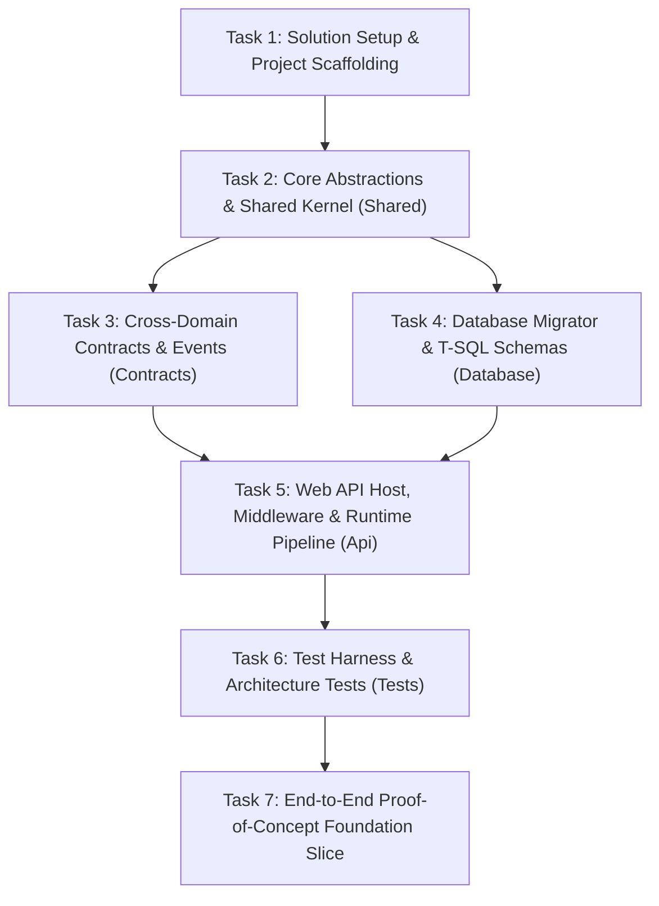

# Incremental Backend Initialization Plan — Elsasa SIS V3

**Objective:** Establish a sound, maintainable backend foundation for Elsasa SIS V3 without prematurely implementing the entire SIS business surface.  
**Platform:** ASP.NET Core (.NET 8), C# 12, Microsoft SQL Server 2022, Dapper  
**Status:** Approved  

---

## Roadmap of Initialization Tasks

---

### Task 1: Solution Setup & Project Scaffolding

- **Objective:** Create the master .NET solution and scaffold all Stage 1 active domain and infrastructure projects with clean compile-time references.
- **Scope:**
  - Create `Elsasa.Sis.sln` under `src/backend/`.
  - Scaffold `Elsasa.Sis.Shared` (Class Library, .NET 8).
  - Scaffold `Elsasa.Sis.Contracts` (Class Library, .NET 8).
  - Scaffold `Elsasa.Sis.Database` (Class Library, .NET 8).
  - Scaffold Stage 1 Domain assemblies: `Elsasa.Sis.Operations`, `Elsasa.Sis.Students`, `Elsasa.Sis.Finance` (Class Libraries, .NET 8).
  - Scaffold `Elsasa.Sis.Api` (Web API, .NET 8).
  - Scaffold `Elsasa.Sis.IntegrationTests` and `Elsasa.Sis.ArchitectureTests` under `tests/backend/`.
  - Configure solution-wide `.editorconfig` and `<Directory.Build.props>` with `<Nullable>enable</Nullable>`, `<TreatWarningsAsErrors>true</TreatWarningsAsErrors>`, and C# 12 lang version.
- **Dependencies:** None.
- **Expected Deliverables:**
  - `src/backend/Elsasa.Sis.sln`
  - All `.csproj` files with configured project references.
  - Passing `dotnet build` with zero warnings.
- **Acceptance Criteria:**
  - `dotnet build src/backend/Elsasa.Sis.sln` succeeds with 0 errors and 0 warnings.
  - Domain projects do not reference each other.
  - Only `Elsasa.Sis.Api` references all domain assemblies.

---

### Task 2: Core Abstractions & Shared Kernel (`Elsasa.Sis.Shared`)

- **Objective:** Implement core domain outcome types, database connection abstractions, Dapper type handlers, and endpoint discovery interfaces.
- **Scope:**
  - Implement `Result` and `Result<T>` types with `IsSuccess`, `Value`, and `DomainError`.
  - Implement `DomainError` record and `ErrorType` enum (`NotFound`, `Conflict`, `Validation`, `Unauthorized`, `Forbidden`).
  - Implement `ISqlConnectionFactory` and `SqlConnectionFactory` utilizing `Microsoft.Data.SqlClient`.
  - Implement and register custom Dapper `SqlMapper.TypeHandler` for `DateOnly` and `TimeOnly`.
  - Implement `IEndpoint` interface and `EndpointRouteBuilderExtensions` with reflection-based assembly scanning.
  - Implement `ValidationFilter<T>` using FluentValidation.
  - Implement `ResultsExtensions.ToProblemDetails(this DomainError error)`.
  - Define `ICurrentUser` interface.
- **Dependencies:** Task 1.
- **Expected Deliverables:**
  - `Elsasa.Sis.Shared/Common/Result.cs`, `DomainError.cs`, `ICurrentUser.cs`
  - `Elsasa.Sis.Shared/Database/ISqlConnectionFactory.cs`, `SqlConnectionFactory.cs`, `DapperTypeHandlers.cs`
  - `Elsasa.Sis.Shared/Endpoints/IEndpoint.cs`, `ValidationFilter.cs`, `ResultsExtensions.cs`
- **Acceptance Criteria:**
  - Unit tests verify that `Result<T>` encapsulates success and failure correctly.
  - Custom type handlers correctly serialize and deserialize `DateOnly` and `TimeOnly` values.

---

### Task 3: Cross-Domain Contracts & Domain Event Infrastructure (`Elsasa.Sis.Contracts`)

- **Objective:** Establish the contract interfaces for synchronous cross-domain queries and define the in-memory domain event pub/sub infrastructure.
- **Scope:**
  - Define `IOperationsModule`, `IStudentsModule`, and `IFinanceModule` contract interfaces with Stage 1 prerequisite methods (e.g., `IsEnrollmentFeePaidAsync`, `IsActiveAcademicPeriodAsync`).
  - Define base `IDomainEvent` record implementing MediatR `INotification`.
  - Define Stage 1 event records: `ApplicantAcceptedEvent`, `StudentEnrolledEvent`, `ObligationAssessedEvent`, `PaymentConfirmedEvent`.
- **Dependencies:** Task 2.
- **Expected Deliverables:**
  - Interface definitions under `Elsasa.Sis.Contracts/Operations/`, `Students/`, `Finance/`.
  - Domain event records under `Elsasa.Sis.Contracts/*/Events/`.
- **Acceptance Criteria:**
  - `Elsasa.Sis.Contracts` compiles cleanly referencing only `Elsasa.Sis.Shared`.
  - Event records are immutable `public sealed record` types.

---

### Task 4: Database Infrastructure & DbUp Migration Runner (`Elsasa.Sis.Database`)

- **Objective:** Configure DbUp-SqlServer, establish the schema creation script, and define initial Stage 1 schema DDL.
- **Scope:**
  - Add `dbup-sqlserver` NuGet dependency.
  - Implement `DatabaseMigrator` class with `MigrateDatabase(string connectionString)` returning upgrade engine result.
  - Author initial schema creation script: `20261101_0001_Init_Schemas.sql` (`operations`, `students`, `finance` schemas + `_SchemaVersions`).
  - Author foundational table scripts for Stage 1:
    - `20261101_0101_Operations_AcademicYears.sql`
    - `20261101_0201_Students_Applicants.sql`
    - `20261101_0202_Students_AdmissionApplications.sql`
    - `20261101_0301_Finance_Policies.sql`
- **Dependencies:** Task 1.
- **Expected Deliverables:**
  - `DatabaseMigrator.cs`
  - Embedded `.sql` scripts in `Elsasa.Sis.Database/Scripts/`.
- **Acceptance Criteria:**
  - Executing `DatabaseMigrator.MigrateDatabase` on an empty SQL Server database executes all scripts in sequential order and records entries in `_SchemaVersions`.

---

### Task 5: Web API Host, Middleware & Startup Wiring (`Elsasa.Sis.Api`)

- **Objective:** Configure the ASP.NET Core .NET 8 host, middleware pipeline, DI auto-registration, OpenAPI / Swagger, and health checks.
- **Scope:**
  - Configure Serilog structured logging with JSON console sink and enrichers.
  - Implement `CorrelationIdMiddleware` for `X-Correlation-ID` tracing.
  - Implement `GlobalExceptionHandler` mapping unhandled infrastructure exceptions to RFC 7807 500 ProblemDetails.
  - Implement `CurrentUser` extracting claims from `HttpContext.User`.
  - Configure ASP.NET Core JWT Bearer authentication options.
  - Configure Swagger / OpenAPI generation with JWT bearer security definition.
  - Wire up `builder.Services.AddEndpoints()` scanning all domain assemblies.
  - Wire up `/health` checks verifying SQL Server connectivity.
  - Support `--migrate` CLI argument to execute migrations on startup.
- **Dependencies:** Tasks 2, 3, 4.
- **Expected Deliverables:**
  - `Program.cs` with clean, modular extension methods.
  - `Middleware/CorrelationIdMiddleware.cs`, `GlobalExceptionHandler.cs`.
  - `Services/CurrentUser.cs`.
- **Acceptance Criteria:**
  - Application boots up without errors.
  - `/health` returns `200 OK` when SQL Server is running.
  - `/swagger` displays the interactive OpenAPI UI.
  - Invalid requests return RFC 7807 ProblemDetails.

---

### Task 6: Test Harness & Architecture Tests (`Elsasa.Sis.*Tests`)

- **Objective:** Establish the automated testing foundation with SQL Server Testcontainers, Respawn, and NetArchTest.
- **Scope:**
  - Configure `Testcontainers.MsSql` fixture to spin up a disposable SQL Server 2022 container.
  - Configure `WebApplicationFactory<Program>` to override connection strings and user context in tests.
  - Configure `Respawn` to checkpoint and reset database state between tests.
  - Implement `BaseIntegrationTest` providing helper methods for executing HTTP calls and inspecting SQL Server tables.
  - Implement `AssemblyDependencyTests` using `NetArchTest.Rules` to enforce:
    - Domain assemblies do not reference each other.
    - Domain assemblies do not reference `Elsasa.Sis.Api`.
    - Handlers adhere to naming and signature conventions.
- **Dependencies:** Tasks 1 through 5.
- **Expected Deliverables:**
  - `SqlServerContainerFixture.cs`, `IntegrationTestWebAppFactory.cs`, `BaseIntegrationTest.cs`.
  - `AssemblyDependencyTests.cs`.
- **Acceptance Criteria:**
  - Architecture tests pass, verifying domain isolation.
  - Integration test suite spins up the container, runs DbUp migrations, resets tables with Respawn, and completes in CI.

---

### Task 7: End-to-End Foundation Verification Slice

- **Objective:** Implement a single minimal vertical slice in `Operations` (e.g. `CreateAcademicYear` and `GetAcademicYears`) to prove the entire foundation end-to-end.
- **Scope:**
  - Implement `CreateAcademicYearEndpoint`, `Request`, `Response`, `Validator`, and `Handler`.
  - Handler acquires connection from `ISqlConnectionFactory`, executes explicit multiline T-SQL via Dapper, and populates `created_by` from `ICurrentUser`.
  - Validator validates date ranges and required fields via FluentValidation.
  - Write an integration test verifying:
    - FluentValidation returns 422 on invalid dates.
    - Valid request inserts row in `operations.academic_years` and returns 201 Created.
    - Data persists and is verifiable via SQL query against the container.
- **Dependencies:** Task 6.
- **Expected Deliverables:**
  - `Elsasa.Sis.Operations/Features/CalendarPeriods/CreateAcademicYear/*`
  - `Elsasa.Sis.IntegrationTests/Features/Operations/CreateAcademicYearTests.cs`
- **Acceptance Criteria:**
  - Integration test passes against real SQL Server container.
  - Full pipeline (HTTP → Minimal API → FluentValidation → Handler → Dapper → SQL Server → Result<T> → ProblemDetails / 201) functions cleanly.
