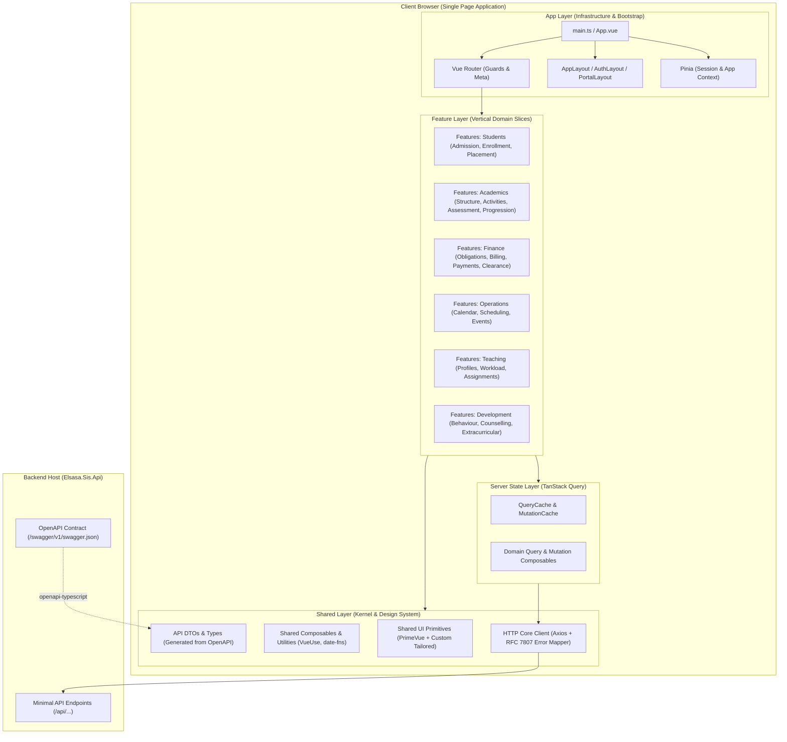
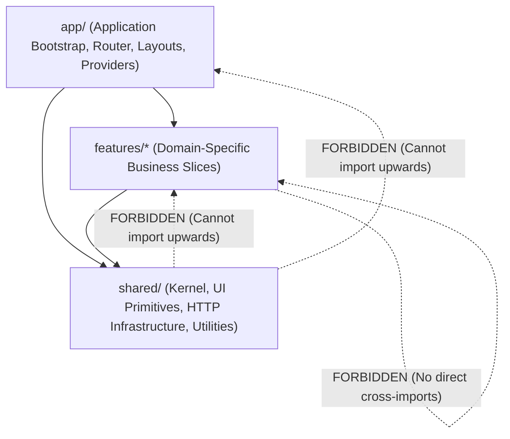
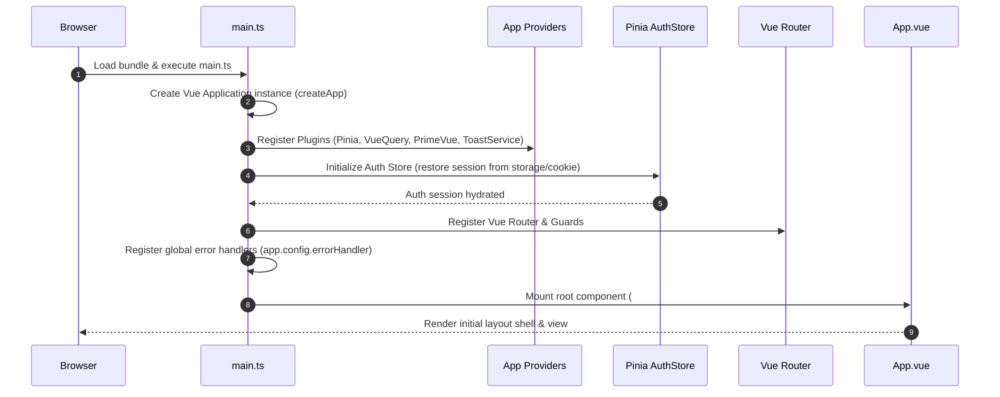
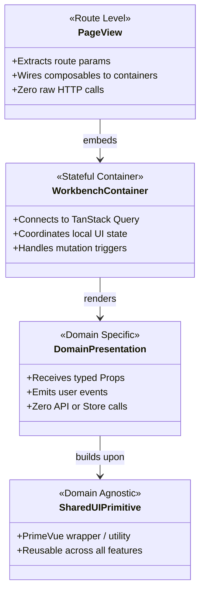
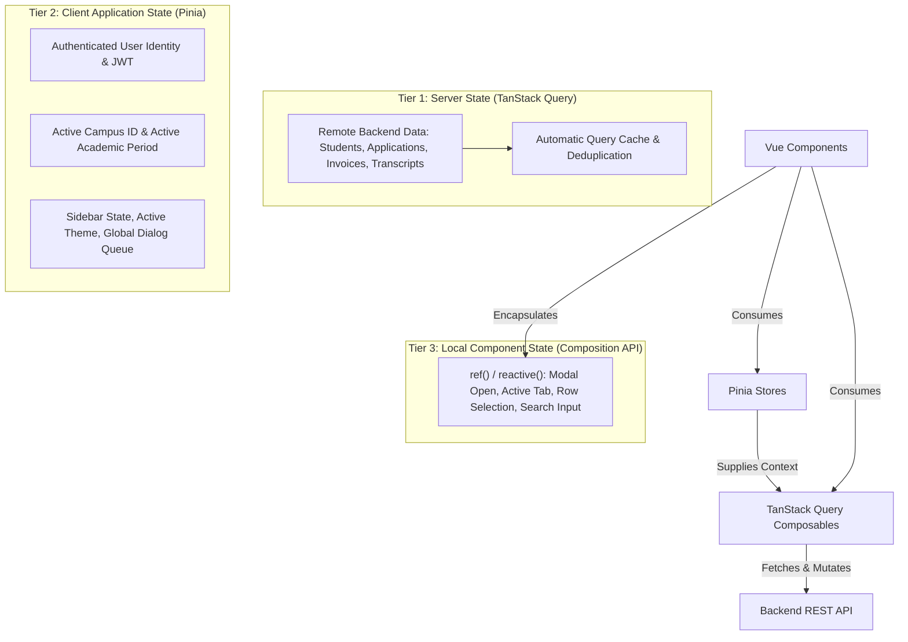
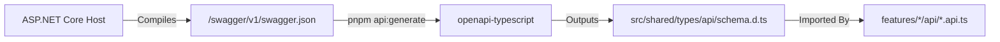
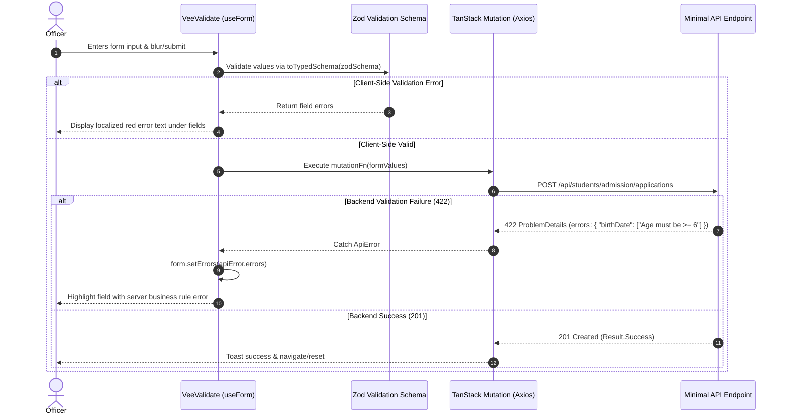
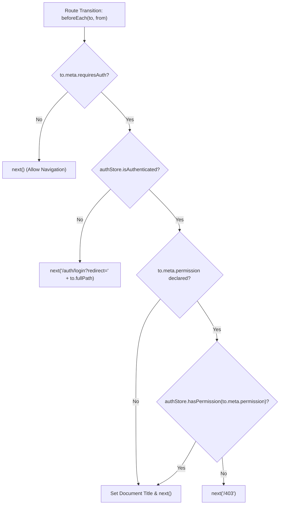
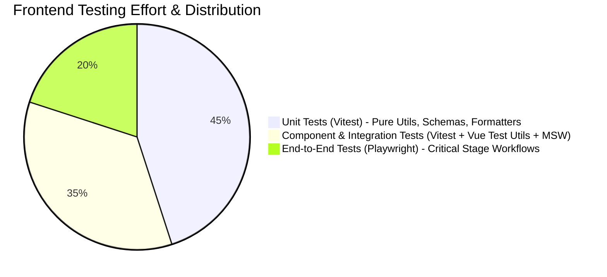

# Frontend Architecture Document & Technical Reference — Elsasa SIS V3

**Document Version:** 1.0  
**Target Ecosystem:** Vue 3 (v3.5+), TypeScript (v5.6+), Vite (v6+), Tailwind CSS (v4+), PrimeVue (v4+)  
**State Management:** TanStack Query Vue (v5+) & Pinia (v2+)  
**Status:** Approved  
**Date:** November 2026  

---

## 1. Architecture Overview

Elsasa SIS V3 is an enterprise-grade School Information System serving 6 core business domains, 20 functional modules, 87 business workflows, and 36 operational screens across three progressive development stages.

The frontend is architected as a **Feature-Oriented Modular Frontend (Domain-Driven Vertical Slices)**. It directly mirrors the backend modular monolith boundaries defined in [`docs/architecture/backend-architecture.md`](docs/architecture/backend-architecture.md), adhering to compile-time modularity, zero circular dependencies, explicit dependency direction, and strict domain ownership.



### 1.1 Architectural Objectives & Priorities

1. **Maintainability & Comprehensibility:** Code is organized by business feature rather than technical type. A developer modifying the "Student Admission Review" workflow works inside a dedicated, cohesive slice directory without jumping across global folders.
2. **Domain Isolation & Integrity:** Frontend modules do not redefine business domain ownership. Domain logic, permissions, and entity boundaries established in [`docs/domains/`](docs/domains/) are strictly preserved.
3. **Strict Separation of State Concerns:** Server state (persisted on backend) is managed exclusively by **TanStack Query**. Client session state (active user, campus context, sidebar collapse) is managed by **Pinia**. Ephemeral UI state lives in Vue's **Composition API** (`ref`/`reactive`).
4. **Predictable & Robust Error Handling:** Full alignment with backend RFC 7807 `ProblemDetails` outcome modeling, mapping domain errors (`Validation`, `NotFound`, `Conflict`, `Unauthorized`, `Forbidden`) into user-friendly UI interactions.
5. **Contract-Driven Type Safety:** Compile-time TypeScript definitions generated directly from backend OpenAPI definitions ensure zero type drift between ASP.NET Core endpoints and Vue composables.

---

## 2. Technology Stack Evaluation & Baseline

The table below summarizes the evaluated and confirmed technology stack. Each technology has been evaluated for technical suitability, team ergonomics, ecosystem maturity, and compatibility with the .NET 8 backend.

| Concern | Technology | Status | Version | Rationale & Responsibility |
|---|---|---|---|---|
| **Language** | TypeScript | Mandatory | `^5.6.0` | Strict typing, interface safety, exhaustive union checks, compile-time error catching. |
| **UI Framework** | Vue 3 | Mandatory | `^3.5.0` | High-performance reactive DOM, Composition API, SFC ergonomics, small bundle size. |
| **Component Syntax** | Single File Components (`.vue`) | Mandatory | N/A | High cohesion combining template, typed script, and scoped styles in one artifact. |
| **Script Flavor** | `<script setup lang="ts">` | Mandatory | N/A | Idiomatic Vue 3 syntax, zero boilerplate, optimal TypeScript inference, best runtime performance. |
| **Build Tool** | Vite | Mandatory | `^6.0.0` | Lightning-fast HMR, Rollup bundling, native ESM dev server, rich plugin ecosystem. |
| **CSS Framework** | Tailwind CSS | Mandatory | `^4.0.0` | Utility-first CSS engine (`@theme`, modern CSS variables), zero runtime overhead, high design velocity. |
| **UI Component Library** | PrimeVue | Mandatory | `^4.2.0` | Enterprise-grade accessible UI primitives (DataTable, TreeTable, Calendar, Select, Dialog) styled via Tailwind integration. |
| **Client Routing** | Vue Router | Mandatory | `^4.4.0` | Declarative nested routing, route-level navigation guards, dynamic imports, layout orchestration. |
| **Client State Management** | Pinia | Mandatory | `^2.2.0` | Scoped to global client-only state: authenticated user identity, active campus, sidebar toggle, toast queue. |
| **Server State Management** | TanStack Query for Vue | Mandatory | `^5.60.0` | Cache invalidation, query deduplication, optimistic updates, loading/error states, garbage collection. |
| **HTTP Client** | Axios | Mandatory | `^1.7.0` | Request/response interceptors, Bearer token injection, `X-Correlation-ID` tracing, unified error transformation. |
| **Form Management** | VeeValidate | Mandatory | `^4.14.0` | Form lifecycle management, dirty/touched state, validation triggering, server-side field error mapping. |
| **Schema Validation** | Zod | Mandatory | `^3.23.0` | Declarative TypeScript schemas, runtime input validation, integration with VeeValidate (`toTypedSchema`). |
| **Icons** | Lucide Vue Next | Mandatory | `^0.460.0` | Crisp, modern, accessible SVG icon set with complete tree-shaking support. |
| **Date Utilities** | date-fns | Mandatory | `^4.1.0` | Modular, tree-shakeable, immutable date manipulation matching backend ISO-8601, `DateOnly`, and `TimeOnly`. |
| **Utility Composables** | VueUse | Mandatory | `^11.3.0` | Battle-tested reactive composables (`useLocalStorage`, `useDebounceFn`, `useIntersectionObserver`, `onClickOutside`). |
| **API Contract Generation** | openapi-typescript | Mandatory | `^7.4.0` | Generates TypeScript definitions from backend `/swagger/v1/swagger.json`, preventing contract drift. |
| **API Mocking** | MSW (Mock Service Worker)| Mandatory | `^2.6.0` | Network-level request interception for offline development, contract prototyping, and component tests. |
| **Unit & Component Testing**| Vitest | Mandatory | `^2.1.0` | Native Vite integration, fast in-memory execution, Jest-compatible API, Vue Test Utils support. |
| **Component Test Harness** | `@vue/test-utils` | Mandatory | `^2.4.0` | Official Vue test utility library for mounting and interacting with SFCs in Vitest. |
| **End-to-End Testing** | Playwright | Mandatory | `^1.49.0` | Cross-browser automated browser testing for end-to-end user workflows with tracing and video artifacts. |
| **Code Linting** | ESLint (Flat Config) | Mandatory | `^9.15.0` | Enforces code quality, architectural boundary rules (`no-restricted-imports`), and Vue SFC standards. |
| **Code Formatting** | Prettier | Mandatory | `^3.3.0` | Automated deterministic formatting across `.vue`, `.ts`, `.css`, and `.json`. |
| **Type Checking** | vue-tsc | Mandatory | `^2.1.0` | Command-line type checking of Vue SFCs during CI verification and pre-commit checks. |
| **Package Manager** | pnpm | Mandatory | `^9.14.0` | Fast, deterministic, disk-efficient package installation with strict non-flat `node_modules`. |
| **Internationalization** | vue-i18n | Deferred | N/A | Deferred to Stage 3. Architecture provides tokenized labels ready for i18n extraction without refactoring. |
| **Component Catalog** | Storybook | Deferred | N/A | Deferred. PrimeVue documentation and living workbench screens satisfy design catalog needs in Stages 1–2. |

### 2.1 Overlap Resolution & Boundary Enforcements

- **Pinia vs TanStack Query:** Pinia **must never** store backend entity collections or cache API responses. Any data that originated on the backend server belongs in TanStack Query. Pinia is strictly restricted to ephemeral browser state and current authenticated session context.
- **VeeValidate vs Zod:** Zod owns the contract and validation schema definition (declarative rules and error messages). VeeValidate owns form lifecycle orchestration (touched, dirty, submitting states, dynamic fields, and DOM event binding).
- **PrimeVue vs Tailwind CSS:** PrimeVue provides the accessible behavioral mechanics, ARIA attributes, keyboard navigation, and complex DOM structure (e.g. popover anchoring, virtual table scrolling). Tailwind CSS 4 provides the styling layer via PrimeVue's modern PassThrough (PT) system and design tokens.

---

## 3. Architectural Principles & Dependency Direction

The frontend adopts a **Strict Layered Dependency Architecture** centered on feature cohesion and infrastructure decoupling.



### 3.1 Architectural Principles

1. **Vertical Feature Cohesion:**
   Every feature directory corresponds to a business capability (e.g., `features/students/admission`). All assets required to execute that capability—views, domain components, API queries, form schemas, and view models—reside together within that slice.
2. **Explicit Layer Boundaries:**
   - **`app/`** depends on `features/` and `shared/`.
   - **`features/`** depends strictly on `shared/`.
   - **`shared/`** has zero dependencies on `features/` or `app/`. It is completely domain-agnostic.
3. **No Cross-Feature Code Coupling:**
   Feature modules must not import internal components, composables, or schemas from other feature modules. If Feature A needs to link to Feature B, it does so through **named routes** or public identifiers. If Feature A needs shared domain models (e.g., `StudentSummary`), the type is declared in `shared/types/contracts/` derived from backend OpenAPI contracts.
4. **Thin Page Components (Views as Orchestrators):**
   Page components under `views/` act as layout orchestrators: they extract route parameters, wire feature composables to domain components, and delegate rendering to presentation components. Pages must not contain raw SQL, raw Axios calls, or monolithic 500-line templates.
5. **Separation of Presentation and Orchestration:**
   Components are categorized into:
   - **Shared UI Primitives:** Completely generic (e.g., `AppButton`, `AppDataTable`, `StatusPill`).
   - **Feature Presentation Components:** Domain-specific but pure, receiving data via props and emitting user intent via emits (e.g., `ApplicantIdentityCard.vue`).
   - **Feature Container Components / Workbenches:** Stateful feature components connected to TanStack Query and Pinia (e.g., `AdmissionReviewWorkbench.vue`).

---

## 4. Project & Directory Structure

The repository frontend source code resides under `src/frontend/` with the following authoritative directory layout:

```text
src/frontend/
├── public/                     # Static public assets (favicon, manifest)
├── src/
│   ├── app/                    # Application Layer: Bootstrap & Infrastructure
│   │   ├── config/             # Environment, PrimeVue, and runtime configurations
│   │   ├── layouts/            # Shell layouts (AppLayout, AuthLayout, FullscreenLayout)
│   │   ├── providers/          # Root Vue plugin providers (QueryClient, PrimeVue, etc.)
│   │   └── router/             # Vue Router definition, route hierarchy, navigation guards
│   │
│   ├── shared/                 # Shared Layer: Domain-Agnostic Kernel
│   │   ├── components/         # Shared presentation UI components
│   │   │   ├── feedback/       # Toast, Alert, LoadingSpinner, EmptyState
│   │   │   ├── forms/          # FormField, TextInput, SelectInput, DatePicker
│   │   │   ├── layout/         # PageHeader, ContentCard, SplitPane, WorkbenchLayout
│   │   │   └── tables/         # AppDataTable, FilterBar, PaginationControls
│   │   ├── composables/        # Generic composables (useDebounce, useConfirmModal, useBreakpoints)
│   │   ├── constants/          # Application-wide constants, regexes, route names
│   │   ├── services/           # Core infrastructure services (HTTP client, Storage, Logger)
│   │   ├── styles/             # Global styles, Tailwind @theme definitions, PrimeVue overrides
│   │   ├── types/              # Cross-cutting TypeScript types & generated API contracts
│   │   │   ├── api/            # Auto-generated OpenAPI contract types (openapi-typescript)
│   │   │   ├── common.ts       # Result, PaginatedResponse, ProblemDetails types
│   │   │   └── navigation.ts   # Navigation, breadcrumb, and menu item definitions
│   │   └── utils/              # Pure utility functions (formatters, dateUtils, currencyUtils)
│   │
│   ├── features/               # Feature Layer: Domain Bounded Contexts
│   │   ├── operations/         # Operations Domain (Stage 1 Core)
│   │   │   ├── calendar/       # Calendar & Periods submodule (SCR-OPS-01)
│   │   │   │   ├── api/        # TanStack Query hooks & API endpoints
│   │   │   │   ├── components/ # Submodule-specific components
│   │   │   │   ├── schemas/    # Zod validation schemas
│   │   │   │   ├── types/      # Submodule-specific view types
│   │   │   │   └── views/      # Route pages (CalendarWorkspaceView.vue)
│   │   │   ├── scheduling/     # Scheduling & Rooms submodule (Stage 2)
│   │   │   └── events/         # Events & Announcements submodule (Stage 3)
│   │   │
│   │   ├── students/           # Students Domain (Stage 1 Core)
│   │   │   ├── admission/      # Admission submodule (SCR-STD-01, SCR-STD-02)
│   │   │   │   ├── api/        # useAdmissionQueries.ts, useAdmissionMutations.ts
│   │   │   │   ├── components/ # ApplicantCard.vue, AdmissionReviewWorkbench.vue
│   │   │   │   ├── composables/# useAdmissionFilter.ts
│   │   │   │   ├── schemas/    # admissionApplication.schema.ts
│   │   │   │   ├── types/      # admission.types.ts
│   │   │   │   └── views/      # AdmissionQueueView.vue, ApplicationDetailView.vue
│   │   │   ├── enrollment/     # Enrollment & Identity submodule (SCR-STD-03, SCR-STD-04)
│   │   │   └── placement/      # Placement & Status submodule (SCR-STD-05, SCR-STD-06)
│   │   │
│   │   ├── finance/            # Finance Domain (Stage 1 Core)
│   │   │   ├── obligations/    # Obligations & Billing submodule (SCR-FIN-01, SCR-FIN-02)
│   │   │   ├── payments/       # Payments & Receivables submodule (SCR-FIN-03, SCR-FIN-04)
│   │   │   ├── benefits/       # Scholarships & Discounts submodule (Stage 2)
│   │   │   ├── refunds/        # Refunds & Adjustments submodule (Stage 2)
│   │   │   └── clearance/      # Financial Clearance submodule (Stage 3)
│   │   │
│   │   ├── academics/          # Academics Domain (Stage 2)
│   │   │   ├── learning-structure/
│   │   │   ├── participation/
│   │   │   ├── assessment/
│   │   │   ├── progression/
│   │   │   └── learning-plan/
│   │   │
│   │   ├── teaching/           # Teaching Domain (Stage 2)
│   │   │   ├── profile/
│   │   │   └── workload/
│   │   │
│   │   └── development/        # Development Domain (Stage 3)
│   │       ├── behaviour/
│   │       ├── counselling/
│   │       └── extracurricular/
│   │
│   ├── assets/                 # Brand assets, static images, SVG illustrations
│   ├── App.vue                 # Root component with router-view and global toast/dialogs
│   └── main.ts                 # Application bootstrap entry point
│
├── tests/                      # Global Test Configuration & E2E Suites
│   ├── e2e/                    # Playwright end-to-end test suites by stage
│   │   ├── stage1/             # Admission, Enrollment, Fee Assessment E2E tests
│   │   ├── stage2/             # Academic & Teaching workflows
│   │   └── fixtures/           # Playwright fixtures and auth helpers
│   ├── mocks/                  # MSW mock handlers and test server setup
│   │   ├── handlers/           # MSW route handlers mirroring OpenAPI endpoints
│   │   ├── browser.ts          # MSW worker for dev browser mocking
│   │   └── server.ts           # MSW server for Vitest unit/component tests
│   └── setup/                  # Vitest setup files and DOM extensions
│
├── .env.development            # Local development environment configuration
├── .env.staging                # Staging environment configuration
├── .env.production             # Production environment configuration
├── index.html                  # HTML entry point template
├── package.json                # Dependencies, scripts, and package metadata
├── pnpm-lock.yaml              # Deterministic dependency lockfile
├── playwright.config.ts        # Playwright E2E configuration
├── tailwind.config.ts          # Tailwind CSS v4 configuration
├── tsconfig.json               # Root TypeScript configuration
├── tsconfig.app.json           # Application TypeScript compilation rules
├── tsconfig.node.json          # Tooling / Vite TypeScript compilation rules
└── vite.config.ts              # Vite build, aliases, and plugin configuration
```

---

## 5. Application Layer Architecture

The Application layer (`src/app/`) bootstraps the Single Page Application, configures providers, establishes top-level routing, wraps views in persistent shells, and enforces runtime security.

### 5.1 Bootstrap Lifecycle (`main.ts`)



### 5.2 Layout Architecture (`src/app/layouts/`)

Layouts provide persistent framing across route transitions, eliminating layout reflow:

1. **`AppLayout.vue`:** Primary authenticated administrative portal shell.
   - **Top Navigation Bar:** Institutional logo, active Academic Period indicator, Campus Switcher selector, User Profile menu, and Notification trigger.
   - **Collapsible Sidebar:** Hierarchical navigation menu filtered dynamically by current actor permissions. Supports pinned and collapsed modes.
   - **Breadcrumb & Page Header:** Dynamic path navigation synced with Vue Router meta.
   - **Main Content Region:** Routed view container wrapped in `<router-view>` with `<suspense>` and accessible transitions.
2. **`AuthLayout.vue`:** Centered, distraction-free container for authentication, login, MFA challenge, and password reset.
3. **`WorkbenchLayout.vue`:** Specialized split-pane administrative shell supporting the **Work Queue** pattern (List/Queue on the left, Contextual Workbench on the right).
4. **`PrintLayout.vue`:** Clean, unstyled layout optimized for generating printables, report cards, and financial statements.

---

## 6. Feature Layer Architecture

Features represent bounded business capabilities aligned with the SIS domains. Each feature is organized into cohesive submodules following the Vertical Slice convention.

### 6.1 Anatomical Structure of a Feature Submodule

Every feature submodule (e.g. `features/students/admission`) follows a standard directory structure:

```text
features/students/admission/
├── api/
│   ├── admission.api.ts          # Raw Axios endpoints using OpenAPI DTOs
│   ├── admission.keys.ts         # Query Key factory for TanStack Query
│   ├── useAdmissionQueries.ts    # Custom query hooks (useApplicantList, useApplicantDetail)
│   └── useAdmissionMutations.ts  # Custom mutation hooks (useRegisterApplication, useSubmitDecision)
├── components/
│   ├── AdmissionFilterBar.vue    # Filter component (period, status, search)
│   ├── ApplicantCard.vue         # Presentation card for applicant summary
│   ├── ApplicationReviewWorkbench.vue # Complex workbench component
│   └── DecisionDialog.vue        # Modal dialog for accept/reject decision
├── composables/
│   └── useAdmissionWorkbench.ts  # Feature-specific state machine and UI logic
├── schemas/
│   ├── registerApplication.schema.ts # Zod validation schema
│   └── submitDecision.schema.ts  # Zod schema for decision submission
├── types/
│   └── admission.types.ts        # Extended view models and UI filter interfaces
├── views/
│   ├── AdmissionQueueView.vue    # Primary work queue page (SCR-STD-01)
│   └── ApplicationDetailView.vue # Deep-link application detail view (SCR-STD-02)
└── __tests__/
    ├── admission.schema.spec.ts  # Zod schema unit tests
    └── AdmissionQueueView.spec.ts# Component interaction tests with MSW
```

### 6.2 Component Classification & Responsibility

To prevent business logic bloat and ensure high maintainability, components are categorized according to strict responsibilities:



| Component Class | Directory | Responsibility | Allowed Dependencies | Prohibited Code |
|---|---|---|---|---|
| **Page View** | `features/*/views/` | Top-level routed views. Coordinates layout, extracts route params (`useRoute`), and renders containers. | Feature containers, shared layout components. | Inline SQL, direct Axios calls, monolithic 500-line templates. |
| **Container / Workbench** | `features/*/components/` | Stateful coordinator for a work queue or multi-step action. Calls query/mutation composables. | Custom query hooks, domain presentation components, PrimeVue dialogs. | Generic CSS styling; direct DOM mutations. |
| **Domain Presentation** | `features/*/components/` | Renders domain information (e.g. `ApplicantBadge`). Pure presentation. | Shared UI primitives, formatting utilities. | Direct store mutations, API imports, route manipulation. |
| **Shared Primitive** | `shared/components/` | Business-agnostic UI building block (e.g. `AppDataTable`, `StatusPill`). | PrimeVue primitives, Tailwind utilities. | Any domain concepts (e.g., cannot import `StudentDto`). |

---

## 7. Shared Layer Architecture

The Shared layer (`src/shared/`) contains reusable, domain-agnostic foundations.

### 7.1 Shared UI Primitives (`src/shared/components/`)

Shared components standardize common interaction patterns across all 36 screens:

- **`AppDataTable.vue`:** Standard wrapper around PrimeVue `DataTable`. Enforces uniform pagination, sorting, row selection, sticky headers, loading skeletons, and empty state slots.
- **`WorkbenchLayout.vue`:** Reusable two-pane master-detail layout powering the **Work Queue** pattern (left pane: worklist/filter, right pane: active item workbench).
- **`StatusPill.vue`:** Unified badge component mapping domain status strings to standard color palettes (e.g., `active` -> green, `pending` -> amber, `withdrawn` -> red).
- **`ConfirmActionDialog.vue`:** Standard accessible modal for confirming destructive or consequential operations (e.g., student expulsion, withdrawal, payment reversal).
- **`EmptyState.vue`:** Uniform display for empty lists, search misses, and zero-data conditions with illustrative icons and action buttons.

### 7.2 Common Services & HTTP Core (`src/shared/services/`)

- **`http.ts`:** Central Axios instance configured with base URL, timeout policies, correlation ID generator, and global interceptors.
- **`storage.ts`:** Type-safe wrapper around `localStorage` and `sessionStorage` with JSON serialization and versioned namespace keys (`elsasa:v3:session`).
- **`logger.ts`:** Client logger that formats console messages in development and dispatches structured telemetry in staging/production.

### 7.3 Shared Utilities & Formatters (`src/shared/utils/`)

- **`dateUtils.ts`:** Wraps `date-fns` to format dates consistently:
  - Display Date: `12 Nov 2026` (`format(date, 'dd MMM yyyy')`)
  - Display DateTime: `12 Nov 2026, 14:30` (`format(date, 'dd MMM yyyy, HH:mm')`)
  - Backend DateOnly: `2026-11-12` (`format(date, 'yyyy-MM-dd')`)
  - Backend TimeOnly: `14:30:00` (`format(date, 'HH:mm:ss')`)
- **`currencyUtils.ts`:** Standard Indonesian Rupiah formatting (`formatIDR(1500000)` -> `"Rp 1.500.000"`).
- **`stringUtils.ts`:** Sanitization, initials extractor, slug generation, name truncation.

---

## 8. State Management Strategy

State is strictly categorized into three distinct tiers to eliminate data duplication and synchronization bugs.



### 8.1 Server State (TanStack Query)

All asynchronous data originating from or persisted to the backend API is managed by TanStack Query (`@tanstack/vue-query`).

#### Query Key Factories
Query keys must follow deterministic, hierarchical factory patterns to enable targeted cache invalidation:

```typescript
// features/students/admission/api/admission.keys.ts
export const admissionKeys = {
  all: ['admission'] as const,
  lists: () => [...admissionKeys.all, 'list'] as const,
  list: (filters: AdmissionFilterParams) => [...admissionKeys.lists(), filters] as const,
  details: () => [...admissionKeys.all, 'detail'] as const,
  detail: (id: string) => [...admissionKeys.details(), id] as const,
  counts: () => [...admissionKeys.all, 'counts'] as const,
};
```

#### Cache & Stale Time Conventions

| Data Category | Stale Time | Garbage Collection (gcTime) | Refetch Policy | Example Entities |
|---|---|---|---|---|
| **Static / Configuration** | 30 minutes | 60 minutes | Do not refetch on window focus | Academic Years, Campuses, Grading Scales |
| **Operational Reference** | 5 minutes | 15 minutes | Refetch on window focus | Fee Policies, Room Catalog, Teacher Profiles |
| **Active Work Queues** | 30 seconds | 5 minutes | Refetch on window focus & reconnect | Admission Applications, Payment Verification |
| **Transactional Details** | 0 seconds (stale immediately) | 5 minutes | Always refetch on component mount | Invoice Balance, Clearance Determinations |

#### Mutation & Deterministic Invalidation Pattern

```typescript
// features/students/admission/api/useAdmissionMutations.ts
import { useMutation, useQueryClient } from '@tanstack/vue-query';
import { admissionApi } from './admission.api';
import { admissionKeys } from './admission.keys';
import { useToast } from 'primevue/usetoast';

export function useSubmitAdmissionDecision() {
  const queryClient = useQueryClient();
  const toast = useToast();

  return useMutation({
    mutationFn: ({ id, command }: { id: string; command: SubmitDecisionCommand }) =>
      admissionApi.submitDecision(id, command),
    onSuccess: (_, variables) => {
      // 1. Invalidate queue list so status updates immediately
      queryClient.invalidateQueries({ queryKey: admissionKeys.lists() });
      // 2. Invalidate specific item detail
      queryClient.invalidateQueries({ queryKey: admissionKeys.detail(variables.id) });
      // 3. Invalidate dashboard counter badges
      queryClient.invalidateQueries({ queryKey: admissionKeys.counts() });

      toast.add({
        severity: 'success',
        summary: 'Decision Recorded',
        detail: `Application decision has been recorded successfully.`,
        life: 4000
      });
    },
    onError: (error: ApiError) => {
      toast.add({
        severity: 'error',
        summary: 'Action Failed',
        detail: error.detail || 'Failed to submit admission decision.',
        life: 5000
      });
    }
  });
}
```

### 8.2 Client State (Pinia)

Pinia is strictly reserved for client-only, non-server-persisted state:

1. **`useAuthStore`:**
   - State: `user: UserProfile | null`, `token: string | null`, `permissions: string[]`, `roles: string[]`.
   - Getters: `isAuthenticated: boolean`, `hasPermission(perm: string): boolean`, `hasAnyRole(roles: string[]): boolean`.
   - Actions: `login(credentials)`, `logout()`, `refreshSession()`.
2. **`useAppContextStore`:**
   - State: `activeCampusId: string | null`, `activeAcademicPeriodId: string | null`.
   - Actions: `setCampus(campusId)`, `setAcademicPeriod(periodId)`.
3. **`useUIStore`:**
   - State: `isSidebarCollapsed: boolean`, `activeTheme: 'light' | 'dark'`, `activeBreadcrumbs: BreadcrumbItem[]`.
   - Actions: `toggleSidebar()`, `setTheme()`, `setBreadcrumbs()`.

### 8.3 State Ownership Rule of Law

```
┌────────────────────────────────────────────────────────┐
│ If the data exists in a database table in SQL Server,  │
│ it DOES NOT BELONG IN PINIA. It belongs in TanStack    │
│ Query.                                                 │
└────────────────────────────────────────────────────────┘
```

Manual replication of server state in Pinia stores is strictly prohibited. Storing API response arrays in Pinia causes stale data bugs, requires manual sync logic, and defeats TanStack Query's automatic caching, garbage collection, and window-focus refetching.

---

## 9. Backend API Integration & Contract Management

### 9.1 HTTP Client Infrastructure (`src/shared/services/http.ts`)

Communication with the backend ASP.NET Core API uses a centralized, pre-configured Axios instance.

```typescript
// src/shared/services/http.ts
import axios, { AxiosError, type InternalAxiosRequestConfig } from 'axios';
import { v4 as uuidv4 } from 'uuid';
import { useAuthStore } from '@/app/stores/auth.store';
import { ApiError } from '@/shared/types/common';

export const apiClient = axios.create({
  baseURL: import.meta.env.VITE_API_BASE_URL || '/api',
  timeout: 15000,
  headers: {
    'Content-Type': 'application/json',
    'Accept': 'application/json'
  }
});

// 1. Request Interceptor: Attach JWT and Tracing Header
apiClient.interceptors.request.use((config: InternalAxiosRequestConfig) => {
  const authStore = useAuthStore();
  if (authStore.token && config.headers) {
    config.headers.Authorization = `Bearer ${authStore.token}`;
  }

  // Inject correlation ID matching backend CorrelationIdMiddleware
  if (config.headers && !config.headers['X-Correlation-ID']) {
    config.headers['X-Correlation-ID'] = uuidv4();
  }

  return config;
});

// 2. Response Interceptor: RFC 7807 ProblemDetails Mapping
apiClient.interceptors.response.use(
  (response) => response.data,
  (error: AxiosError<any>) => {
    if (!error.response) {
      // Network or connection crash
      return Promise.reject(new ApiError(0, 'Network Error', 'Unable to reach the server. Please check your network connection.'));
    }

    const { status, data } = error.response;

    // Handle 401 Unauthorized globally
    if (status === 401) {
      const authStore = useAuthStore();
      authStore.handleSessionExpired();
      return Promise.reject(new ApiError(401, 'Unauthorized', 'Session has expired. Please log in again.'));
    }

    // Map RFC 7807 ProblemDetails payload
    const apiError = new ApiError(
      status,
      data?.title || 'An unexpected error occurred',
      data?.detail || error.message,
      data?.errorCode || data?.extensions?.errorCode,
      data?.errors || data?.extensions?.errors
    );

    return Promise.reject(apiError);
  }
);
```

### 9.2 RFC 7807 ProblemDetails Alignment

The backend transforms all `DomainError` instances into standard RFC 7807 `ProblemDetails` via `ResultsExtensions.ToProblemDetails()`:

| Backend ErrorType | HTTP Status | ProblemDetails Title | Frontend Handling Strategy |
|---|---|---|---|
| `Validation` | 422 Unprocessable Entity | `"Validation Error"` | Parsed by `ApiError.errors` and mapped directly onto VeeValidate form fields via `form.setErrors()`. |
| `Conflict` | 409 Conflict | `"Business Rule Conflict"` | Displayed as an inline alert or warning modal (e.g. duplicate active application or period collision). |
| `NotFound` | 404 Not Found | `"Resource Not Found"` | Renders feature-level `EmptyState` or redirects to standard `/404` page. |
| `Unauthorized` | 401 Unauthorized | `"Unauthorized"` | Redirects user to `/login` with preserved `redirect` query parameter. |
| `Forbidden` | 403 Forbidden | `"Forbidden"` | Displays accessible forbidden banner or redirects to `/403`. |
| Infrastructure Crash | 500 Internal Server Error | `"Internal Server Error"` | Triggers global toast notification: "An unexpected server error occurred." |

### 9.3 Contract Generation & Type Synchronization

To guarantee 100% type safety and eliminate manual DTO synchronization:



1. **Tooling:** We utilize `openapi-typescript` to generate strict TypeScript definitions from the backend OpenAPI schema.
2. **Generation Script:**
   ```bash
   pnpm api:generate
   ```
   Command executes: `openapi-typescript http://localhost:5000/swagger/v1/swagger.json -o src/shared/types/api/schema.d.ts`.
3. **Immutability Rule:** `src/shared/types/api/schema.d.ts` is generated code and **must never be edited manually**.
4. **Contract Testing & CI:** CI pipeline runs `pnpm api:check` against the committed schema to immediately flag any breaking backend API changes before deployment.

---

## 10. UI Architecture & Design System

The UI architecture integrates **PrimeVue v4** and **Tailwind CSS v4** to deliver an accessible, high-density administrative interface suited for academic and financial operations.

### 10.1 PrimeVue & Tailwind CSS 4 Integration Strategy

- **Styling Architecture:** PrimeVue v4 is configured with the **Aura** base preset wrapped in CSS layers, allowing Tailwind CSS utility classes to cleanly override or extend component styles without brittle `!important` declarations.
- **PassThrough (PT) System:** Custom tailoring of complex PrimeVue components (e.g., customizing table header padding or dropdown search input) is implemented using PrimeVue's native `pt` properties configured globally in `app/config/primevue.ts`.
- **CSS Precedence Layering:**
  ```css
  /* src/shared/styles/main.css */
  @import "tailwindcss";

  @layer primevue, custom;

  @theme {
    --color-elsasa-navy-900: #0f172a;
    --color-elsasa-navy-800: #1e293b;
    --color-elsasa-teal-600: #0d9488;
    --color-elsasa-teal-500: #14b8a6;
    --color-elsasa-teal-50: #f0fdfa;
    --font-sans: 'Inter', system-ui, -apple-system, sans-serif;
  }
  ```

### 10.2 Institutional Design Tokens

The SIS design language emphasizes density, legibility, and immediate status recognition:

| Token Category | Token Name | Value | Usage |
|---|---|---|---|
| **Primary Navy** | `elsasa-navy-900` | `#0f172a` | App top bar, primary text, brand headings |
| **Brand Accent** | `elsasa-teal-600` | `#0d9488` | Primary action buttons, active navigation indicator, focus rings |
| **Accent Light** | `elsasa-teal-50` | `#f0fdfa` | Selected table row background, active sidebar badge |
| **Surface Neutral**| `slate-50` / `white` | `#f8fafc` / `#ffffff` | Page background / Card workbench background |
| **Border Neutral** | `slate-200` | `#e2e8f0` | Dividers, card borders, table grid lines |
| **Status Success** | `emerald-600` | `#059669` | `Active`, `Accepted`, `Paid`, `Enrolled` |
| **Status Warning** | `amber-600` | `#d97706` | `Pending`, `UnderReview`, `Installment`, `OnLeave` |
| **Status Danger**  | `rose-600` | `#e11d48` | `Rejected`, `Overdue`, `Withdrawn`, `Expelled` |
| **Status Info**    | `sky-600` | `#0284c7` | `Draft`, `Scheduled`, `Submitted` |

### 10.3 Core Operational Screen Interaction Patterns

As cataloged in [`docs/screen-inventory.md`](docs/screen-inventory.md), all 36 SIS screens adhere to 5 consistent interaction patterns:

```mermaid
graph TD
    subgraph Pattern1["Pattern 1: Work Queue (SCR-STD-01, SCR-FIN-03)"]
        WQ_Filter["Filter & Search Bar"] --> WQ_List["Pending / Actionable Worklist"]
        WQ_List --> WQ_Bench["Contextual Workbench (Details + Primary Actions)"]
        WQ_Bench --> WQ_Secondary["Secondary Actions & Audit History"]
    end

    subgraph Pattern2["Pattern 2: Information Lookup (SCR-STD-04)"]
        IL_Search["Comprehensive Student Search"] --> IL_Results["Candidate Match List"]
        IL_Results --> IL_360["360° Student Dossier (Tabs: Bio, Academics, Finance)"]
    end

    subgraph Pattern3["Pattern 3: Schedule Management (SCR-OPS-01)"]
        SM_Calendar["Academic Year / Period Hierarchy"] --> SM_Grid["Visual Term Calendar & Break Matrix"]
        SM_Grid --> SM_Editor["Period Inspector & Exception Coordinator"]
    end

    subgraph Pattern4["Pattern 4: Monitoring (SCR-TCH-03)"]
        MO_KPI["Summary Capacity & Allocation Metrics"] --> MO_Table["Faculty Threshold Table (Drill-down)"]
        MO_Table --> MO_Action["Direct Reallocation / Substitution Drawer"]
    end
```



1. **Work Queue (Worklist + Workbench):**
   - Left Pane (40% width): Searchable, filterable list of pending queue items with status badges and timestamp.
   - Right Pane (60% width): Active item workbench displaying applicant/student summary, verified documents, decision radio buttons, and the authoritative submit action.
2. **Information Lookup (Search/List + Detail):**
   - High-speed indexed search with instant keyboard navigation (`/` or `Ctrl+K`).
   - Detailed tabbed profile (Identity, Guardians, Placements, Enrollment History) with strict audit tracking.
3. **Schedule Management (Calendar/Schedule + Workspace):**
   - Visual date picker and term hierarchy tree supporting academic years, semesters, terms, and holiday closures.
4. **Monitoring (Overview + Drill-down):**
   - High-level metric tiles with warning thresholds; clicking a threshold card automatically filters the underlying table.
5. **Planning Workspace:**
   - Multi-step builder for curriculum frameworks, learning structures, and complex financial billing cycles.

---

## 11. Form Architecture & Validation

Form handling follows a strict **Schema-First** architecture combining **Zod** and **VeeValidate**.

### 11.1 Form Lifecycle & Validation Pipeline



### 11.2 Zod Schema Definition Example

Validation schemas mirror backend FluentValidation rules declared in [`docs/architecture/backend-architecture.md`](docs/architecture/backend-architecture.md):

```typescript
// features/students/admission/schemas/registerApplication.schema.ts
import { z } from 'zod';

export const registerApplicationSchema = z.object({
  applicantId: z.string().uuid({ message: 'A valid applicant must be selected' }),
  admissionPeriodId: z.string().uuid({ message: 'Admission period is required' }),
  gradeLevelId: z.string().uuid({ message: 'Target grade level is required' }),
  applicationDate: z.string().regex(/^\d{4}-\d{2}-\d{2}$/, { message: 'Date format must be YYYY-MM-DD' }),
  previousSchoolName: z.string().trim().max(200, { message: 'Previous school name cannot exceed 200 characters' }).optional(),
  notes: z.string().trim().max(1000, { message: 'Notes cannot exceed 1000 characters' }).optional()
});

export type RegisterApplicationFormValues = z.infer<typeof registerApplicationSchema>;
```

### 11.3 Standardized Form Component Pattern

```vue
<!-- features/students/admission/components/RegisterApplicationModal.vue -->
<script setup lang="ts">
import { useForm } from 'vee-validate';
import { toTypedSchema } from '@vee-validate/zod';
import { registerApplicationSchema, type RegisterApplicationFormValues } from '../schemas/registerApplication.schema';
import { useRegisterApplication } from '../api/useAdmissionMutations';
import FormField from '@/shared/components/forms/FormField.vue';
import Dialog from 'primevue/dialog';
import Button from 'primevue/button';
import InputText from 'primevue/inputtext';

const props = defineProps<{
  visible: boolean;
  applicantId: string;
}>();

const emit = defineEmits<{
  (e: 'update:visible', value: boolean): void;
  (e: 'success', applicationId: string): void;
}>();

const { mutateAsync: registerApp, isPending } = useRegisterApplication();

const { handleSubmit, errors, defineField, setErrors, resetForm } = useForm<RegisterApplicationFormValues>({
  validationSchema: toTypedSchema(registerApplicationSchema),
  initialValues: {
    applicantId: props.applicantId,
    applicationDate: new Date().toISOString().split('T')[0],
    previousSchoolName: '',
    notes: ''
  }
});

const [previousSchoolName, previousSchoolProps] = defineField('previousSchoolName');
const [notes, notesProps] = defineField('notes');

const onSubmit = handleSubmit(async (values) => {
  try {
    const response = await registerApp(values);
    emit('success', response.applicationId);
    emit('update:visible', false);
    resetForm();
  } catch (err: any) {
    if (err.errors) {
      setErrors(err.errors);
    }
  }
});
</script>

<template>
  <Dialog :visible="visible" header="Register Admission Application" :modal="true" @update:visible="emit('update:visible', $event)">
    <form @submit.prevent="onSubmit" class="space-y-4">
      <FormField label="Previous School Name" :error="errors.previousSchoolName">
        <InputText v-model="previousSchoolName" v-bind="previousSchoolProps" class="w-full" />
      </FormField>

      <FormField label="Administrative Notes" :error="errors.notes">
        <InputText v-model="notes" v-bind="notesProps" class="w-full" />
      </FormField>

      <div class="flex justify-end gap-2 pt-4">
        <Button label="Cancel" severity="secondary" text @click="emit('update:visible', false)" />
        <Button type="submit" label="Submit Application" :loading="isPending" />
      </div>
    </form>
  </Dialog>
</template>
```

---

## 12. Routing, Navigation & Authorization Architecture

### 12.1 Route Organization & Hierarchical Naming

Routes are organized hierarchically by stage and domain using Vue Router:

```typescript
// app/router/routes.ts
import type { RouteRecordRaw } from 'vue-router';

export const routes: RouteRecordRaw[] = [
  {
    path: '/',
    redirect: '/dashboard'
  },
  {
    path: '/auth',
    component: () => import('@/app/layouts/AuthLayout.vue'),
    children: [
      {
        path: 'login',
        name: 'auth.login',
        component: () => import('@/features/auth/views/LoginView.vue'),
        meta: { requiresAuth: false, title: 'Sign In — Elsasa SIS' }
      }
    ]
  },
  {
    path: '/',
    component: () => import('@/app/layouts/AppLayout.vue'),
    meta: { requiresAuth: true },
    children: [
      {
        path: 'dashboard',
        name: 'dashboard',
        component: () => import('@/features/dashboard/views/DashboardView.vue'),
        meta: { title: 'Dashboard' }
      },
      // STAGE 1: STUDENTS DOMAIN
      {
        path: 'students',
        children: [
          {
            path: 'admission',
            name: 'students.admission.queue',
            component: () => import('@/features/students/admission/views/AdmissionQueueView.vue'),
            meta: {
              permission: 'Permissions.Students.Admission.View',
              title: 'Admission Work Queue'
            }
          },
          {
            path: 'admission/:id',
            name: 'students.admission.detail',
            component: () => import('@/features/students/admission/views/ApplicationDetailView.vue'),
            meta: {
              permission: 'Permissions.Students.Admission.Review',
              title: 'Application Review'
            }
          },
          {
            path: 'enrollment',
            name: 'students.enrollment.desk',
            component: () => import('@/features/students/enrollment/views/EnrollmentDeskView.vue'),
            meta: {
              permission: 'Permissions.Students.Enrollment.Execute',
              title: 'Student Enrollment Desk'
            }
          }
        ]
      },
      // STAGE 1: FINANCE DOMAIN
      {
        path: 'finance',
        children: [
          {
            path: 'obligations',
            name: 'finance.obligations.list',
            component: () => import('@/features/finance/obligations/views/ObligationsListView.vue'),
            meta: {
              permission: 'Permissions.Finance.Obligations.View',
              title: 'Student Obligations & Billing'
            }
          },
          {
            path: 'payments',
            name: 'finance.payments.desk',
            component: () => import('@/features/finance/payments/views/PaymentDeskView.vue'),
            meta: {
              permission: 'Permissions.Finance.Payments.Receive',
              title: 'Payment Receipt Desk'
            }
          }
        ]
      },
      // STAGE 1: OPERATIONS DOMAIN
      {
        path: 'operations',
        children: [
          {
            path: 'calendar',
            name: 'operations.calendar.workspace',
            component: () => import('@/features/operations/calendar/views/CalendarWorkspaceView.vue'),
            meta: {
              permission: 'Permissions.Operations.Calendar.Manage',
              title: 'Calendar & Periods Workspace'
            }
          }
        ]
      },
      // Error Routes
      {
        path: '403',
        name: 'forbidden',
        component: () => import('@/shared/views/ForbiddenView.vue'),
        meta: { title: 'Access Forbidden' }
      },
      {
        path: ':pathMatch(.*)*',
        name: 'not-found',
        component: () => import('@/shared/views/NotFoundView.vue'),
        meta: { title: 'Page Not Found' }
      }
    ]
  }
];
```

### 12.2 Navigation Guard Pipeline

Route transitions pass through three sequential guards:



### 12.3 Navigation Visibility vs Authoritative Authorization

- **UI Visibility (Convenience):** Sidebar items and action buttons use `v-if="authStore.hasPermission('...')"` to hide actions the current actor is not permitted to perform.
- **Navigation Guard (UX Defense):** Route guards prevent direct URL manipulation to unauthorized pages, redirecting to `/403`.
- **Backend API (Authoritative Security):** The backend ASP.NET Core endpoints enforce `.RequireAuthorization("Permissions.*")`. If a user tampers with client code, the backend returns HTTP 403 Forbidden, which is handled cleanly by the HTTP response interceptor.

---

## 13. Authentication & Security Architecture

### 13.1 JWT Token Lifecycle & Scoped User Context

The frontend authentication model maps directly to the backend JWT Bearer claims and `ICurrentUser` model defined in [`docs/architecture/backend-architecture.md`](docs/architecture/backend-architecture.md).

```typescript
// features/auth/types/auth.types.ts
export interface JwtClaims {
  sub: string;             // User GUID (UserId)
  name: string;            // Full Name
  preferred_username: string; // Username
  roles: string[];         // Assigned SIS Roles (e.g., 'AdmissionOfficer', 'FinanceOfficer')
  permissions: string[];   // Granular permissions ('Permissions.Students.Admission.Register')
  campus_id?: string;      // Campus GUID context
  exp: number;             // Expiration timestamp
}

export interface UserSession {
  userId: string;
  username: string;
  fullName: string;
  roles: string[];
  permissions: string[];
  campusId: string | null;
}
```

### 13.2 Token Storage & Session Expiration Strategy

1. **Storage Location:** 
   - **Access Token:** Maintained in-memory inside the Pinia `auth.store.ts` to defend against XSS token exfiltration.
   - **Session Persistence:** A secure, short-lived session signature or refresh token is stored in an `HttpOnly`, `Secure`, `SameSite=Strict` cookie managed by the authentication server.
   - *Fallback for Decoupled Local Development:* For isolated local dev without cookie domains, local storage is supported via configurable `VITE_AUTH_PERSISTENCE=memory|storage` switch.
2. **Session Timeout & Inactivity:**
   - Client detects token expiration using an active timeout based on the JWT `exp` claim.
   - Upon expiration, pending mutations are halted, the query cache is cleared (`queryClient.clear()`), and the user is redirected to `/auth/login` with an informative session-timeout toast.

### 13.3 Frontend Security Safeguards

- **Cross-Site Scripting (XSS) Prevention:**
  - Direct usage of `v-html` is strictly prohibited in business views.
  - User-generated content (notes, names, addresses) is rendered exclusively through standard Vue mustache bindings (`{{ value }}`) which auto-escape HTML entities.
- **Cross-Site Request Forgery (CSRF) Prevention:**
  - The API uses explicit `Authorization: Bearer <token>` headers on all mutating requests. Because Bearer tokens are not automatically attached by browsers (unlike raw cookies), CSRF attacks are fundamentally mitigated.
- **Information Leakage Prevention:**
  - Restricted counselling records (`DEV-WF-05`) and sensitive finance records display sanitized views based on explicit permissions.
  - Client code never receives or stores secrets. All `VITE_*` environment variables are treated as publicly visible.

---

## 14. Testing Strategy

The frontend testing pyramid balances fast unit feedback, reliable component verification, and automated browser workflows.



### 14.1 Unit Testing (Vitest)

- **Target:** Date formatters, currency math, Zod validation schemas, pure transformation functions, and Pinia store state transitions.
- **Execution:** Runs in-memory with sub-second execution speeds via native Vite HMR primitives.
- **Convention:** Tests live in `__tests__/*.spec.ts` adjacent to the tested unit.

### 14.2 Component & Integration Testing (Vitest + `@vue/test-utils` + MSW)

- **Target:** Domain components and Workbenches (`AdmissionReviewWorkbench.vue`, `AppDataTable.vue`).
- **Network Isolation:** **Mock Service Worker (MSW)** intercepts all HTTP calls at the network level, returning realistic mock DTOs conforming to the OpenAPI contract.
- **Assertions:** Tests verify user interactions (clicking buttons, filling inputs), form error state display, and successful emit/mutation dispatches without touching real backend databases.

### 14.3 End-to-End Testing (Playwright)

Playwright automates end-to-end user workflows against real browser engines (Chromium, Firefox, WebKit).

#### Stage 1 Priority Workflows

1. **`E2E-01` Prospective Admission to Offer:**
   Admission Officer logs in -> Opens Admission Queue (`SCR-STD-01`) -> Selects pending applicant -> Verifies identity documents -> Approves application -> Verifies status updates to `Accepted`.
2. **`E2E-02` Student Enrollment & Number Assignment:**
   Student Administration Officer logs in -> Opens Enrollment Desk (`SCR-STD-03`) -> Selects accepted applicant -> Verifies enrollment fee paid gate -> Executes enrollment -> Verifies unique Student Number assigned and `Active` status established.
3. **`E2E-03` Financial Obligation & Payment Confirmation:**
   Finance Officer logs in -> Verifies assessed tuition obligation (`SCR-FIN-01`) -> Registers cash payment receipt (`SCR-FIN-03`) -> Confirms payment allocation -> Verifies outstanding balance reduces to zero.
4. **`E2E-04` Operational Academic Calendar Initialization:**
   Operations Coordinator logs in -> Creates Academic Year 2026/2027 (`SCR-OPS-01`) -> Adds Term 1 and Term 2 -> Configures holiday break -> Publishes calendar.

### 14.4 Quality Gates & CI Checklist

All frontend code must satisfy five mandatory quality gates before PR merge:

```bash
# 1. Type Checking
pnpm typecheck       # vue-tsc --noEmit

# 2. Static Code Analysis
pnpm lint            # eslint . --max-warnings 0

# 3. Code Formatting Verification
pnpm format:check    # prettier --check .

# 4. Unit & Component Test Suite
pnpm test:unit       # vitest run --coverage

# 5. Critical E2E Test Suite
pnpm test:e2e        # playwright test
```

---

## 15. Coding Standards & Conventions

### 15.1 TypeScript Conventions

- **Strict Mode:** Enabled in `tsconfig.json` (`"strict": true`, `"noImplicitAny": true`, `"exactOptionalPropertyTypes": true`).
- **No `any`:** The use of `any` is strictly prohibited. Use `unknown` with type narrowing or generic type parameters.
- **Type Imports:** Always use explicit type-only imports:
  ```typescript
  import type { ApplicantDto } from '@/shared/types/api';
  ```

### 15.2 Naming Conventions

| Category | Format | Example |
|---|---|---|
| **Vue Single File Components** | PascalCase | `ApplicantCard.vue`, `AdmissionQueueView.vue` |
| **Component Props & Emits** | camelCase | `defineProps<{ studentId: string }>()`, `emit('changeStatus')` |
| **Composables** | camelCase with `use` prefix | `useAdmissionQueries.ts`, `useConfirmModal.ts` |
| **Zod Schemas** | camelCase with `Schema` suffix | `registerApplicationSchema.ts` |
| **TypeScript Types & Interfaces**| PascalCase | `AdmissionFilterParams`, `StudentEnrollmentStatus` |
| **Directories / Routes** | kebab-case | `features/students/learning-structure/`, `/students/admission-queue` |
| **Query Key Factories** | camelCase with `Keys` suffix | `admissionKeys`, `financeKeys`, `calendarKeys` |
| **Constants / Enums** | UPPER_SNAKE_CASE | `DEFAULT_PAGE_SIZE = 25`, `STORAGE_KEYS` |

### 15.3 SFC Template & Script Structure

Every `.vue` component must follow a standardized top-down block ordering:

```vue
<!-- 1. Script Setup Block (TypeScript) -->
<script setup lang="ts">
// 1.1 Vue & Core Library Imports
import { ref, computed } from 'vue';

// 1.2 Third-Party Library Imports (TanStack, PrimeVue, Lucide)
import { useQuery } from '@tanstack/vue-query';
import Button from 'primevue/button';
import { UserCheck } from 'lucide-vue-next';

// 1.3 Internal Project Imports (Shared -> Feature)
import { useDateFormatter } from '@/shared/composables/useDateFormatter';
import type { ApplicantDto } from '@/shared/types/api';

// 1.4 Component Props & Emits
const props = withDefaults(
  defineProps<{
    applicant: ApplicantDto;
    readonly?: boolean;
  }>(),
  {
    readonly: false
  }
);

const emit = defineEmits<{
  (e: 'select', id: string): void;
}>();

// 1.5 Local Reactive State & Composables
const isExpanded = ref(false);
const { formatDate } = useDateFormatter();

// 1.6 Computed Properties
const formattedApplicationDate = computed(() => formatDate(props.applicant.createdAt));

// 1.7 Methods / Event Handlers
function handleCardClick() {
  emit('select', props.applicant.id);
}
</script>

<!-- 2. Template Block (Semantic HTML + PrimeVue + Tailwind) -->
<template>
  <div 
    class="p-4 bg-white border border-slate-200 rounded-lg shadow-xs hover:border-slate-300 transition-colors cursor-pointer"
    @click="handleCardClick"
  >
    <div class="flex items-center justify-between">
      <div class="flex items-center gap-3">
        <UserCheck class="w-5 h-5 text-elsasa-teal-600" />
        <h4 class="text-sm font-semibold text-slate-900">{{ applicant.fullName }}</h4>
      </div>
      <span class="text-xs text-slate-500">{{ formattedApplicationDate }}</span>
    </div>
  </div>
</template>

<!-- 3. Scoped Style Block (Optional — ONLY when Tailwind classes cannot suffice) -->
<style scoped>
/* Reserved strictly for complex SVG keyframes or PrimeVue shadow DOM overrides */
</style>
```

---

## 16. Build, Environment Configuration & Deployment

### 16.1 Vite Build Configuration & Chunk Splitting

The production Vite build is tuned to prevent monolithic JavaScript bundles, ensuring high caching efficiency and sub-second initial page load times.

```typescript
// vite.config.ts
import { defineConfig } from 'vite';
import vue from '@vitejs/plugin-vue';
import tailwindcss from '@tailwindcss/vite';
import path from 'path';

export default defineConfig({
  plugins: [
    vue(),
    tailwindcss()
  ],
  resolve: {
    alias: {
      '@': path.resolve(__dirname, './src')
    }
  },
  build: {
    target: 'es2022',
    sourcemap: false,
    chunkSizeWarningLimit: 600,
    rollupOptions: {
      output: {
        manualChunks: {
          'vendor-core': ['vue', 'vue-router', 'pinia'],
          'vendor-query': ['@tanstack/vue-query', 'axios'],
          'vendor-primevue': ['primevue'],
          'vendor-utils': ['date-fns', 'zod', 'vee-validate', 'lucide-vue-next']
        }
      }
    }
  }
});
```

### 16.2 Environment Configuration

All environment variables follow Vite's `VITE_` prefix convention.

| Variable | Description | Development | Staging | Production |
|---|---|---|---|---|
| `VITE_API_BASE_URL` | Base URL for backend Minimal APIs | `http://localhost:5000/api` | `https://staging-api.elsasa.sch.id/api` | `https://api.elsasa.sch.id/api` |
| `VITE_APP_TITLE` | Browser window title prefix | `Elsasa SIS (Dev)` | `Elsasa SIS (Staging)` | `Elsasa SIS` |
| `VITE_ENABLE_MSW` | Flag to enable Mock Service Worker | `true` | `false` | `false` |
| `VITE_LOG_LEVEL` | Minimum client log level | `debug` | `warn` | `error` |

### 16.3 Production Deployment & SPA Routing Fallback

The compiled static assets under `dist/` are deployed to standard cloud static web hosting (e.g. Nginx, Cloudflare Pages, Azure Static Web Apps, or AWS S3/CloudFront).

#### Nginx SPA Fallback Configuration
```nginx
server {
    listen 80;
    server_name sis.elsasa.sch.id;
    root /usr/share/nginx/html;
    index index.html;

    # Static assets cache control
    location ~* \.(?:css|js|woff2?|svg|png|jpg|ico)$ {
        expires 1y;
        add_header Cache-Control "public, max-age=31536000, immutable";
        access_log off;
    }

    # SPA rewrite: Fall back to index.html for client-side routing
    location / {
        try_files $uri $uri/ /index.html;
        add_header Cache-Control "no-cache, no-store, must-revalidate";
    }
}
```

---

## 17. Frontend Architecture Decisions (ADRs)

| ADR ID | Decision Title | Status | Rationale Summary |
|---|---|---|---|
| **ADR-FE-001** | Feature-Oriented Vertical Slice Architecture | Confirmed | Organizes frontend code by domain capability instead of technical layers (`views/`, `components/`), maximizing cohesion and matching backend bounded contexts. |
| **ADR-FE-002** | Bifurcated State Management: TanStack Query + Pinia | Confirmed | Server state belongs in TanStack Query for automatic caching, deduplication, and background synchronization; Pinia is strictly restricted to client-only session context. |
| **ADR-FE-003** | PrimeVue v4 with Tailwind CSS v4 Styling | Confirmed | Pairs battle-tested, accessible enterprise components (DataTable, Calendar, Dialog) with modern utility-first CSS styling via PrimeVue's layer/pass-through integration. |
| **ADR-FE-004** | Schema-First Form Architecture (VeeValidate + Zod) | Confirmed | Zod provides single-source TypeScript schema definitions; VeeValidate handles form state and smoothly maps backend RFC 7807 422 errors to fields. |
| **ADR-FE-005** | OpenAPI Automated Contract Synchronization | Confirmed | Eliminates manual DTO authoring and detects contract breakages at compile time via `openapi-typescript` against ASP.NET Core `/swagger.json`. |
| **ADR-FE-006** | Mock Service Worker (MSW) for Decoupled Velocity | Confirmed | Enables frontend teams to develop and test feature views against network-level mock contracts before backend endpoints are fully provisioned. |
| **ADR-FE-007** | Strict Permission-Driven Navigation Guards | Confirmed | Enforces actor permissions at the router guard level (`beforeEach`) to prevent unauthorized view rendering, while recognizing backend endpoints as authoritative. |
| **ADR-FE-008** | In-Memory Token Storage with HttpOnly Session Refresh | Confirmed | Defends against XSS token exfiltration by storing short-lived access tokens in memory while maintaining persistent sessions via secure cookies. |
| **ADR-FE-009** | Progressive Phased Delivery Aligned to SIS Roadmap | Confirmed | Scaffolds and delivers Stage 1 core modules first (Calendar, Admission, Enrollment, Obligations, Payments), leaving clean extension points for Stages 2 and 3. |

---

## 18. Open Questions, Risks & External Dependencies

### 18.1 External Dependencies & Integration Contracts

1. **Authentication Identity Provider Contract:**
   - *Status:* Recommendation awaiting backend confirmation.
   - *Detail:* Backend ADR-009 establishes JWT Bearer authentication with claims (`sub`, `roles`, `permissions`, `campus_id`). The exact authentication flow (dedicated Identity Server / Keycloak / ASP.NET Core custom endpoint `/api/auth/login`) must be finalized to implement the login view request payload.
2. **File Storage & Document Attachment Pipeline:**
   - *Status:* Unresolved design decision.
   - *Detail:* Admission applications and student identity maintenance require uploading legal documents, birth certificates, and previous school records. The architecture must confirm whether frontend uploads directly to cloud blob storage (via pre-signed SAS/S3 URLs) or streams files through a backend multipart proxy endpoint (`/api/documents/upload`).
3. **Real-Time Notification Channel:**
   - *Status:* Deferred to Stage 2.
   - *Detail:* Operational timetable changes (`OPS-WF-09`) and emergency school closures require real-time alerts. Recommendation is to introduce an ASP.NET Core SignalR hub client in Stage 2 without altering the existing HTTP REST foundation.

---

## 19. Architecture Verification & Compliance Checklist

Developers and coding agents implementing frontend features must verify their work against the following compliance checklist:

- [ ] Does the new feature live inside its designated domain folder (`features/<domain>/<submodule>/`)?
- [ ] Are all server API requests dispatched through TanStack Query query hooks or mutation hooks?
- [ ] Is Pinia free of any cached backend database entities or API response arrays?
- [ ] Are form validation schemas declared with Zod and integrated via `toTypedSchema`?
- [ ] Does the component properly map backend 422 validation errors to form fields?
- [ ] Are all dates formatted using `shared/utils/dateUtils.ts` (handling ISO strings, `DateOnly`, and `TimeOnly`)?
- [ ] Does the view use standard design tokens and Tailwind utility classes rather than hardcoded hex colors?
- [ ] Are destructive actions confirmed using `ConfirmActionDialog` or PrimeVue ConfirmPopup?
- [ ] Does the router configuration declare `meta.requiresAuth` and `meta.permission`?
- [ ] Do unit and component tests run cleanly via `pnpm test:unit`?
- [ ] Does `pnpm typecheck` pass with zero TypeScript errors?
