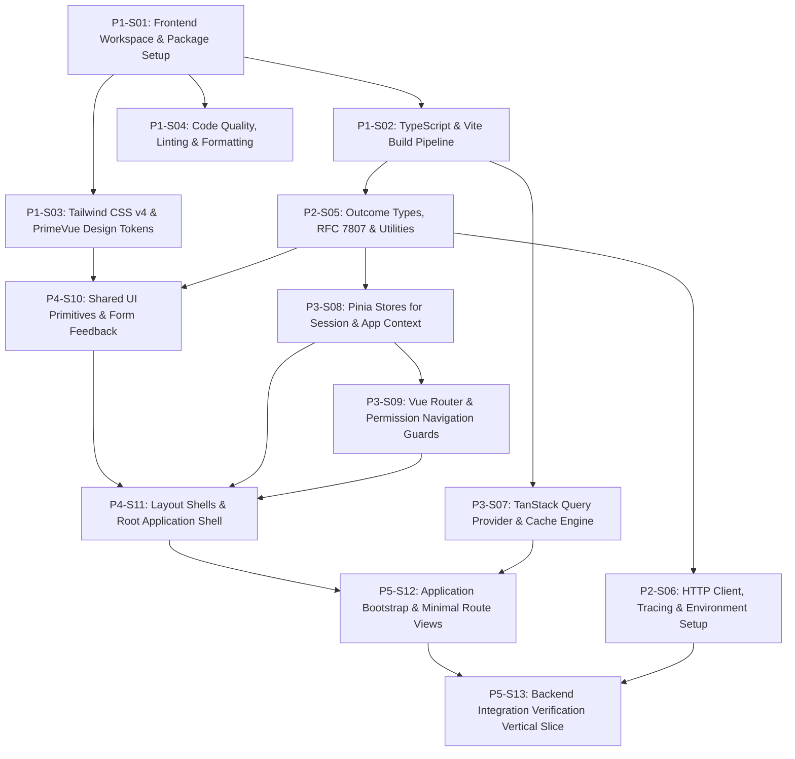

# 1. Objective

Establish an enterprise-grade, feature-oriented modular frontend foundation for Elsasa SIS V3 without prematurely implementing the entire SIS business surface. This plan bootstraps the Vue 3.5+ / TypeScript 5.6+ / Vite 6+ Single Page Application under `src/frontend/`, configures Tailwind CSS v4 and PrimeVue v4 with institutional design tokens, establishes bifurcated state management (TanStack Query for server state and Pinia for client session context), implements the centralized Axios HTTP client with RFC 7807 `ProblemDetails` error transformation and `X-Correlation-ID` tracing, configures Vue Router with permission-driven navigation guards, delivers shared UI primitives and persistent layout shells, and validates live frontend-backend integration with an end-to-end verification vertical slice communicating with the running ASP.NET Core Minimal API.

Planning Mode: GREENFIELD-PLANNING

Referenced artifacts:

- ARCHITECTURE:
  - `docs/architecture/frontend-architecture.md` (Feature-Oriented Modular Frontend & Design System specification)
  - `docs/architecture/backend-architecture.md` (Modular Monolith & Minimal API backend specification)
  - `docs/architecture/adr.md` (ADR-001 through ADR-010, ADR-FE-001 through ADR-FE-009)
  - `docs/development/frontend-initialization-plan.md` (Source initialization roadmap)

Architecture Applicability: GREENFIELD-ARCHITECTURE

Greenfield planning mode based on complete target architecture. Scope encompasses the entire target system architecture foundation.

---

# 2. Planning Scope

The planning scope establishes the runnable frontend application foundation ready for subsequent Stage 1 feature development:

- **Workspace Scaffolding & Tooling Baseline:** Scaffolding the frontend workspace under `src/frontend/`, configuring `package.json` with locked dependency versions, TypeScript composite project configuration (`tsconfig.json`, `tsconfig.app.json`, `tsconfig.node.json`), Vite 6 build pipeline with manual chunk splitting and dev server proxy forwarding `/api` to `http://localhost:5000`, ESLint flat configuration (`eslint.config.js`), Prettier formatting (`.prettierrc`), and `.editorconfig`.
- **Styling Engine & Design Tokens:** Configuring Tailwind CSS v4 via `@tailwindcss/vite`, CSS layer precedence (`@layer primevue, custom;`), institutional color palette (Navy `#0f172a`, Teal `#0d9488`, Slate neutrals, Emerald/Amber/Rose/Sky status tokens), and PrimeVue v4 Aura preset configuration with global PassThrough defaults.
- **Shared Kernel & Outcome Modeling:** Shared TypeScript definitions (`ProblemDetails`, `ApiError`, `DomainErrorType`, `Result<T>`, `PaginatedResponse<T>`, `NavigationItem`), `date-fns` formatting utilities (`formatDisplayDate`, `formatDisplayDateTime`, `formatDateOnly`, `formatTimeOnly`), Indonesian Rupiah currency formatter (`formatIDR`), type-safe namespaced `localStorage` service, and structured client logger.
- **Centralized HTTP Client & Backend Contract Alignment:** Centralized Axios instance with base URL environment resolution (`.env.development`, `.env.staging`, `.env.production`), request interceptor for Bearer token and `X-Correlation-ID` UUID tracing header injection matching backend `CorrelationIdMiddleware`, and response interceptor parsing backend RFC 7807 `ProblemDetails` into strongly-typed `ApiError` instances with 401 session expiration handling.
- **State Management & Query Infrastructure:** `@tanstack/vue-query` QueryClient configuration with cache staleness tiers (static 30m, reference 5m, active queue 30s, transactional 0s), and Pinia stores strictly restricted to client-only session state (`auth.store.ts` with in-memory JWT and permission checks, `appContext.store.ts` for active campus/period context, `ui.store.ts` for sidebar toggle and theme).
- **Client Routing & Authorization Security:** Vue Router configuration with hierarchical route definitions, HTML5 web history, lazy route chunk loading, and global navigation guards enforcing `requiresAuth` and `permission` meta against the active user's permissions, redirecting to `/auth/login` or `/403`.
- **Shared UI Primitives & Layout Shells:** Domain-agnostic reusable components (`FormField.vue`, `StatusPill.vue`, `EmptyState.vue`, `LoadingSpinner.vue`, `PageHeader.vue`, `ContentCard.vue`), persistent shell layouts (`AppLayout.vue` with collapsible sidebar, institutional topbar, breadcrumb header, and router-view; `AuthLayout.vue` for centered auth screens), and root `App.vue` with PrimeVue `Toast` and `ConfirmDialog`.
- **Minimal Application Shell & Verification Vertical Slice:** Root application bootstrap in `main.ts`, base views (`DashboardView.vue`, `LoginView.vue`, `ForbiddenView.vue`, `NotFoundView.vue`), and an end-to-end integration verification vertical slice (`CalendarWorkspaceView.vue`) probing live backend `/health` status and exercising `POST /api/operations/academic-years` with form validation (testing 201 Created and 422 ProblemDetails mapping).

---

# 3. Dependencies

### External System & Tooling Dependencies

- Node.js runtime (v22.x or LTS)
- pnpm package manager (v9.x or v11.x)
- ASP.NET Core Backend Host (`Elsasa.Sis.Api` running at `http://localhost:5000`)
- Microsoft SQL Server 2022 instance (for live backend integration execution)

### Internal Slice Dependencies

- `Depends On` declares implementation prerequisites between slices.
- Dependencies reference Slice IDs only.
- Dependency satisfaction requires the referenced slice to have implementation status `IMPLEMENTED`.
- Dependency satisfaction does not require review status `GO`.
- Slices with `Depends On: None` or whose dependencies are satisfied may be executed in parallel.

### Dependency Graph

---

# 4. Progress Summary

| Phase | Implementation Status | Review Status | Progress |
|---|---|---|---|
| P1 - Workspace Scaffolding & Tooling Foundation | NOT-STARTED | NOT-REVIEWED | 0/4 |
| P2 - Core Infrastructure & HTTP Client Integration | NOT-STARTED | NOT-REVIEWED | 0/2 |
| P3 - State Management & Application Infrastructure | NOT-STARTED | NOT-REVIEWED | 0/3 |
| P4 - Shared UI Primitives & Application Layout Shells | NOT-STARTED | NOT-REVIEWED | 0/2 |
| P5 - Minimal Application Shell & Integration Verification | NOT-STARTED | NOT-REVIEWED | 0/2 |

---

# 5. Phases

## P1 - Workspace Scaffolding & Tooling Foundation

Implementation Status: NOT-STARTED  
Review Status: NOT-REVIEWED

### P1-S01

Title: Frontend Workspace Scaffolding, Package Manifest, and Dependency Installation

Implementation Status: NOT-STARTED  
Review Status: NOT-REVIEWED

Objective:  
Establish the standalone frontend project under `src/frontend/`, configure `package.json` with all required production and development dependencies conforming to the technology stack baseline in `docs/architecture/frontend-architecture.md`, generate `pnpm-lock.yaml`, and provide index HTML and public asset entry points.

Depends On: None

Repository: elsasa-sis-v3

Completion Criteria:
- `src/frontend/package.json` exists declaring:
  - Runtime dependencies: `vue` (`^3.5.0`), `vue-router` (`^4.4.0`), `pinia` (`^2.2.0`), `@tanstack/vue-query` (`^5.60.0`), `axios` (`^1.7.0`), `primevue` (`^4.2.0`), `@primevue/themes` (`^4.2.0`), `vee-validate` (`^4.14.0`), `@vee-validate/zod` (`^4.14.0`), `zod` (`^3.23.0`), `lucide-vue-next` (`^0.460.0`), `date-fns` (`^4.1.0`), `@vueuse/core` (`^11.3.0`), `uuid` (`^10.0.0`).
  - Development dependencies: `typescript` (`^5.6.0`), `vite` (`^6.0.0`), `@vitejs/plugin-vue` (`^5.2.0`), `@tailwindcss/vite` (`^4.0.0`), `tailwindcss` (`^4.0.0`), `vue-tsc` (`^2.1.0`), `vitest` (`^2.1.0`), `@vue/test-utils` (`^2.4.0`), `msw` (`^2.6.0`), `openapi-typescript` (`^7.4.0`), `eslint` (`^9.15.0`), `prettier` (`^3.3.0`), `@types/node` (`^22.0.0`), `@types/uuid` (`^10.0.0`), `jsdom` (`^25.0.0`).
  - Scripts: `dev`, `build`, `preview`, `typecheck`, `lint`, `format:check`, `format`, `test:unit`, `api:generate`.
- `pnpm install` succeeds inside `src/frontend/`, generating `src/frontend/pnpm-lock.yaml` with zero dependency peer resolution errors.
- `src/frontend/index.html` exists with responsive viewport meta, favicon link, and ``.
- `src/frontend/public/favicon.ico` or SVG placeholder exists.

Notes:
- Establishes the foundational Node.js / pnpm package workspace for all frontend code.

---

### P1-S02

Title: TypeScript Composite Configuration and Vite 6 Build Pipeline Setup

Implementation Status: NOT-STARTED  
Review Status: NOT-REVIEWED

Objective:  
Configure TypeScript composite projects (`tsconfig.json`, `tsconfig.app.json`, `tsconfig.node.json`) with strict compiler enforcement and path aliases, configure `vite.config.ts` with Vue SFC, Tailwind CSS v4, manual chunk splitting, path aliases (`@` resolving to `src/`), and dev server API proxy forwarding `/api` to `http://localhost:5000`.

Depends On: P1-S01

Repository: elsasa-sis-v3

Completion Criteria:
- `src/frontend/tsconfig.json` exists configuring project references to `tsconfig.app.json` and `tsconfig.node.json`.
- `src/frontend/tsconfig.app.json` configures:
  - `"target": "ES2022"`, `"module": "ESNext"`, `"moduleResolution": "bundler"`
  - `"strict": true`, `"noImplicitAny": true`, `"exactOptionalPropertyTypes": true`
  - `"paths": { "@/*": ["./src/*"] }`
  - `"jsx": "preserve"`
- `src/frontend/tsconfig.node.json` configures Vite tooling compilation.
- `src/frontend/vite.config.ts` configures:
  - Plugins: `vue()`, `tailwindcss()`
  - Resolve alias: `@` -> `path.resolve(__dirname, './src')`
  - Dev server proxy: `server.proxy['/api']` pointing to `http://localhost:5000` with `changeOrigin: true`
  - Rollup manual chunk vendor splitting: `vendor-core` (`vue`, `vue-router`, `pinia`), `vendor-query` (`@tanstack/vue-query`, `axios`), `vendor-primevue` (`primevue`), `vendor-utils` (`date-fns`, `zod`, `vee-validate`, `lucide-vue-next`).
- `pnpm --dir src/frontend typecheck` executes without configuration errors.

Notes:
- Dev server proxy eliminates CORS constraints during local frontend development without modifying the ASP.NET Core backend.

---

### P1-S03

Title: Tailwind CSS v4 Styling Engine and PrimeVue Aura Design System Setup

Implementation Status: NOT-STARTED  
Review Status: NOT-REVIEWED

Objective:  
Configure the Tailwind CSS v4 modern engine with institutional design tokens and configure PrimeVue v4 with the Aura preset and CSS layer ordering (`@layer primevue, custom;`).

Depends On: P1-S01

Repository: elsasa-sis-v3

Completion Criteria:
- `src/frontend/src/shared/styles/main.css` exists containing:
  - `@import "tailwindcss";`
  - `@layer primevue, custom;`
  - `@theme` block defining:
    - Primary Navy: `--color-elsasa-navy-900: #0f172a;`, `--color-elsasa-navy-800: #1e293b;`
    - Brand Teal: `--color-elsasa-teal-600: #0d9488;`, `--color-elsasa-teal-500: #14b8a6;`, `--color-elsasa-teal-50: #f0fdfa;`
    - Surface & Border neutrals: Slate tones (`#f8fafc`, `#ffffff`, `#e2e8f0`)
    - Status colors: Emerald (`#059669`), Amber (`#d97706`), Rose (`#e11d48`), Sky (`#0284c7`)
    - Font sans: `'Inter', system-ui, -apple-system, sans-serif;`
- `src/frontend/src/app/config/primevue.ts` exists configuring PrimeVue plugin options:
  - Aura preset integration from `@primevue/themes/aura`
  - CSS layer ordering option `cssLayer: { name: 'primevue', order: 'tailwind-base, primevue, tailwind-utilities' }` or modern PassThrough unstyled base.
- Styles compile cleanly with zero CSS parse errors during Vite dev and build.

Notes:
- Conforms to Section 10 of `docs/architecture/frontend-architecture.md`.

---

### P1-S04

Title: Code Quality, Linting, Formatting, and Architectural Boundary Rules

Implementation Status: NOT-STARTED  
Review Status: NOT-REVIEWED

Objective:  
Establish deterministic code formatting and static analysis rules using ESLint (Flat Config), Prettier, and `.editorconfig`, enforcing strict TypeScript checks, Vue 3 SFC best practices, and architectural layer boundaries (preventing direct cross-feature coupling).

Depends On: P1-S01

Repository: elsasa-sis-v3

Completion Criteria:
- `src/frontend/eslint.config.js` exists configured with:
  - JavaScript, TypeScript (`typescript-eslint`), and Vue (`eslint-plugin-vue`) recommended rulesets.
  - SFC `<script setup lang="ts">` component rules.
  - Architectural restriction rules (`no-restricted-imports` preventing `shared/` from importing upwards into `features/` or `app/`, and preventing cross-imports between distinct `features/` submodules).
- `src/frontend/.prettierrc` exists configuring:
  - `singleQuote: true`, `semi: true`, `trailingComma: "all"`, `printWidth: 100`, `tabWidth: 2`.
- `src/frontend/.editorconfig` aligns with repository conventions (2 spaces, UTF-8, LF).
- `src/frontend/.gitignore` ignores `node_modules`, `dist`, `.env.local`, coverage reports.
- `pnpm --dir src/frontend lint` and `pnpm --dir src/frontend format:check` execute cleanly with exit code 0.

Notes:
- Enforces ADR-FE-001 compile-time architectural integrity across all developer contributions.

---

## P2 - Core Infrastructure & HTTP Client Integration

Implementation Status: NOT-STARTED  
Review Status: NOT-REVIEWED

### P2-S05

Title: Domain Outcome Types, RFC 7807 ProblemDetails Modeling, and Shared Utilities

Implementation Status: NOT-STARTED  
Review Status: NOT-REVIEWED

Objective:  
Implement the shared domain outcome types (`Result<T>`, `ProblemDetails`, `ApiError`), navigation/breadcrumb models, date formatting utilities matching backend `DateOnly`/`TimeOnly` representations, and currency formatters under `src/frontend/src/shared/`.

Depends On: P1-S02

Repository: elsasa-sis-v3

Completion Criteria:
- `src/frontend/src/shared/types/common.ts` exists and exports:
  - `DomainErrorType`: `'NotFound' | 'Conflict' | 'Validation' | 'Unauthorized' | 'Forbidden' | 'Failure'`
  - `ProblemDetails` interface: `type?: string; title?: string; status?: number; detail?: string; instance?: string; errorCode?: string; errors?: Record<string, string[]>;`
  - `ApiError` class: implements `Error`, encapsulates `statusCode`, `title`, `detail`, `errorCode`, `errors`, and helper `hasValidationErrors()`.
  - `Result<T>` interface: `isSuccess: boolean; isFailure: boolean; value?: T; error?: ApiError;`
  - `PaginatedResponse<T>` interface: `items: T[]; pageNumber: number; pageSize: number; totalCount: number; totalPages: number; hasPreviousPage: boolean; hasNextPage: boolean;`
- `src/frontend/src/shared/types/navigation.ts` exports `NavigationItem`, `BreadcrumbItem`, and `AppRouteMeta`.
- `src/frontend/src/shared/utils/dateUtils.ts` wraps `date-fns` and exports:
  - `formatDisplayDate(date: Date | string): string` -> e.g. "12 Nov 2026"
  - `formatDisplayDateTime(date: Date | string): string` -> e.g. "12 Nov 2026, 14:30"
  - `formatDateOnly(date: Date | string): string` -> "YYYY-MM-DD"
  - `formatTimeOnly(date: Date | string): string` -> "HH:mm:ss"
  - `parseIsoDate(dateString: string): Date`
- `src/frontend/src/shared/utils/currencyUtils.ts` exports `formatIDR(amount: number): string` -> e.g. "Rp 1.500.000".
- `src/frontend/src/shared/services/storage.ts` provides type-safe JSON `localStorage` get/set/remove with namespace prefix `elsasa:v3:`.
- `src/frontend/src/shared/services/logger.ts` provides structured logging respecting log level.
- Unit tests in `src/frontend/src/shared/utils/__tests__/dateUtils.spec.ts` and `currencyUtils.spec.ts` pass via `vitest`.

Notes:
- Completely aligns frontend error and outcome modeling with backend `ResultsExtensions.ToProblemDetails()` and C# Dapper `DateOnly`/`TimeOnly` handlers.

---

### P2-S06

Title: Centralized HTTP Client, Request Tracing Interceptors, and Environment Configuration

Implementation Status: NOT-STARTED  
Review Status: NOT-REVIEWED

Objective:  
Implement the centralized Axios client `http.ts` with request interceptors injecting JWT Bearer tokens and `X-Correlation-ID` tracing headers, and response interceptors parsing backend RFC 7807 `ProblemDetails` into typed `ApiError` instances with 401 session expiration handling, supported by environment configuration files.

Depends On: P2-S05

Repository: elsasa-sis-v3

Completion Criteria:
- Environment files exist:
  - `src/frontend/.env.development`: `VITE_API_BASE_URL=/api`, `VITE_APP_TITLE=Elsasa SIS (Dev)`, `VITE_ENABLE_MSW=false`, `VITE_LOG_LEVEL=debug`
  - `src/frontend/.env.staging`: `VITE_API_BASE_URL=https://staging-api.elsasa.sch.id/api`, `VITE_APP_TITLE=Elsasa SIS (Staging)`, `VITE_ENABLE_MSW=false`, `VITE_LOG_LEVEL=warn`
  - `src/frontend/.env.production`: `VITE_API_BASE_URL=https://api.elsasa.sch.id/api`, `VITE_APP_TITLE=Elsasa SIS`, `VITE_ENABLE_MSW=false`, `VITE_LOG_LEVEL=error`
- `src/frontend/src/shared/services/http.ts` exports `apiClient`:
  - Created with `baseURL: import.meta.env.VITE_API_BASE_URL || '/api'`, `timeout: 15000`.
  - Request interceptor:
    - Attaches `Authorization: Bearer <token>` from active auth state if token exists.
    - Attaches `X-Correlation-ID: <uuid>` using `v4 as uuidv4` if not already present.
  - Response interceptor:
    - Unwraps `response.data` on HTTP 2xx.
    - Intercepts 401 Unauthorized, notifies auth store to expire session, and rejects with `ApiError(401, 'Unauthorized', ...)`.
    - Intercepts RFC 7807 error responses (400, 403, 404, 409, 422, 500), extracts `title`, `detail`, `errorCode`, and validation `errors`, and rejects with `ApiError`.
    - Handles offline / network drop (status 0) rejecting with `ApiError(0, 'Network Error', ...)`.
- Unit tests in `src/frontend/src/shared/services/__tests__/http.spec.ts` verify header injection and RFC 7807 error transformation.

Notes:
- Establishes the authoritative communication backbone between Vue composables and ASP.NET Core endpoints.

---

## P3 - State Management & Application Infrastructure

Implementation Status: NOT-STARTED  
Review Status: NOT-REVIEWED

### P3-S07

Title: TanStack Query Provider and Cache Infrastructure Setup

Implementation Status: NOT-STARTED  
Review Status: NOT-REVIEWED

Objective:  
Configure `@tanstack/vue-query` QueryClient with deterministic caching, garbage collection, and stale time policies categorized according to Section 8.1 of `docs/architecture/frontend-architecture.md`, and establish root Vue plugin composition providers.

Depends On: P1-S02

Repository: elsasa-sis-v3

Completion Criteria:
- `src/frontend/src/app/providers/queryClient.ts` exists configuring `QueryClient` with:
  - `defaultOptions.queries.staleTime`: 30000 (30s default)
  - `defaultOptions.queries.gcTime`: 300000 (5 minutes default)
  - `defaultOptions.queries.retry`: 1
  - `defaultOptions.queries.refetchOnWindowFocus`: true
  - `defaultOptions.mutations.retry`: 0
- `src/frontend/src/app/providers/index.ts` exists exporting `registerAppProviders(app: App)` registering:
  - Pinia
  - VueQueryPlugin with configured QueryClient
  - PrimeVue with Aura preset configuration
  - PrimeVue `ToastService` and `ConfirmationService`
- Unit tests verify QueryClient default options and query behavior.

Notes:
- ADR-FE-002: Server state belongs exclusively in TanStack Query. Pinia is never used for server cache.

---

### P3-S08

Title: Pinia Stores for Client Session and Application Context

Implementation Status: NOT-STARTED  
Review Status: NOT-REVIEWED

Objective:  
Implement Pinia stores strictly scoped to browser-only and authenticated user context: `useAuthStore` for session identity and permissions, `useAppContextStore` for active campus and academic period, and `useUIStore` for sidebar collapse and theme preferences.

Depends On: P2-S05

Repository: elsasa-sis-v3

Completion Criteria:
- `src/frontend/src/app/stores/auth.store.ts` exports `useAuthStore`:
  - State: `user: UserSession | null`, `token: string | null`, `permissions: string[]`, `roles: string[]`.
  - Getters: `isAuthenticated: boolean`, `hasPermission(permission: string): boolean`, `hasAnyRole(roles: string[]): boolean`.
  - Actions: `setSession(token: string, user: UserSession)`, `logout()`, `handleSessionExpired()`.
  - Token is maintained in-memory with optional local dev persistence fallback.
- `src/frontend/src/app/stores/appContext.store.ts` exports `useAppContextStore`:
  - State: `activeCampusId: string | null`, `activeAcademicPeriodId: string | null`.
  - Actions: `setActiveCampus(id: string | null)`, `setActiveAcademicPeriod(id: string | null)`.
- `src/frontend/src/app/stores/ui.store.ts` exports `useUIStore`:
  - State: `isSidebarCollapsed: boolean`, `activeTheme: 'light' | 'dark'`, `breadcrumbs: BreadcrumbItem[]`.
  - Actions: `toggleSidebar()`, `setSidebarCollapsed(collapsed: boolean)`, `setBreadcrumbs(items: BreadcrumbItem[])`.
- Unit tests in `src/frontend/src/app/stores/__tests__/auth.store.spec.ts` verify permission checking and session lifecycle.

Notes:
- Enforces strict state ownership: No backend database entities or lists are stored in Pinia.

---

### P3-S09

Title: Vue Router Configuration, Hierarchical Routes, and Permission Navigation Guards

Implementation Status: NOT-STARTED  
Review Status: NOT-REVIEWED

Objective:  
Configure Vue Router with HTML5 web history, lazy-loaded route records organized hierarchically by stage and domain context, and global navigation guards (`beforeEach`) enforcing authentication and actor permissions.

Depends On: P3-S08

Repository: elsasa-sis-v3

Completion Criteria:
- `src/frontend/src/app/router/routes.ts` exists declaring:
  - Root redirect `/` -> `/dashboard`
  - Auth route `/auth/login` (`auth.login`) using `AuthLayout`, `meta: { requiresAuth: false, title: 'Sign In — Elsasa SIS' }`
  - Authenticated shell wrapped in `AppLayout` with `meta: { requiresAuth: true }`:
    - `/dashboard` (`dashboard`) -> `DashboardView.vue`
    - `/operations/calendar` (`operations.calendar.workspace`) -> `CalendarWorkspaceView.vue`, `meta: { permission: 'Permissions.Operations.Calendar.Manage', title: 'Calendar & Periods Workspace' }`
    - Placeholder route groups for Students (`/students/admission`, `/students/enrollment`) and Finance (`/finance/obligations`, `/finance/payments`)
    - `/403` (`forbidden`) -> `ForbiddenView.vue`
    - `/:pathMatch(.*)*` (`not-found`) -> `NotFoundView.vue`
- `src/frontend/src/app/router/guards.ts` exports `setupNavigationGuards(router)`:
  - If `to.meta.requiresAuth !== false` and `!authStore.isAuthenticated`, redirects to `/auth/login?redirect=${encodeURIComponent(to.fullPath)}`.
  - If `to.meta.permission` is specified and `!authStore.hasPermission(to.meta.permission)`, redirects to `/403`.
  - Sets browser document title to `${to.meta.title} — Elsasa SIS`.
- `src/frontend/src/app/router/index.ts` creates and exports the configured router instance.
- Unit tests in `src/frontend/src/app/router/__tests__/guards.spec.ts` verify unauthenticated redirection and permission enforcement.

Notes:
- Enforces ADR-FE-007 UX defense while backend Minimal APIs remain the authoritative security boundary.

---

## P4 - Shared UI Primitives & Application Layout Shells

Implementation Status: NOT-STARTED  
Review Status: NOT-REVIEWED

### P4-S10

Title: Shared UI Primitives and Form Feedback Components

Implementation Status: NOT-STARTED  
Review Status: NOT-REVIEWED

Objective:  
Implement reusable, domain-agnostic UI presentation primitives under `src/frontend/src/shared/components/` utilizing PrimeVue primitives styled with Tailwind CSS v4 design tokens.

Depends On: P1-S03, P2-S05

Repository: elsasa-sis-v3

Completion Criteria:
- The following reusable components exist under `src/frontend/src/shared/components/`:
  - `forms/FormField.vue`: Accessible form field wrapper providing label, optional/required indicator, help text, and red validation error message text.
  - `feedback/LoadingSpinner.vue`: Accessible animated spinner with `sm`, `md`, `lg` size props.
  - `feedback/EmptyState.vue`: Generic empty state container supporting custom icon, title, description, and action button slot.
  - `layout/PageHeader.vue`: Consistent page header displaying view title, descriptive subtitle, breadcrumb navigation, and header action button slots.
  - `layout/ContentCard.vue`: Card container styling with slate borders, white background, and optional header/footer slots.
  - `StatusPill.vue`: Status badge component mapping domain status strings (`active`, `pending`, `accepted`, `rejected`, `closed`) to Emerald, Amber, Rose, or Slate badge styles.
- Components use `<script setup lang="ts">` with typed props and zero domain business dependencies.
- Component tests in `src/frontend/src/shared/components/__tests__/FormField.spec.ts` pass via `@vue/test-utils` and Vitest.

Notes:
- Provides the uniform UI building blocks required for consistent administrative screens across all SIS domains.

---

### P4-S11

Title: Persistent Layout Shells and Root Application Shell Component

Implementation Status: NOT-STARTED  
Review Status: NOT-REVIEWED

Objective:  
Implement the primary authenticated shell `AppLayout.vue`, distraction-free `AuthLayout.vue`, and the root application shell `App.vue` hosting global PrimeVue `Toast` and `ConfirmDialog` providers.

Depends On: P4-S10, P3-S08, P3-S09

Repository: elsasa-sis-v3

Completion Criteria:
- `src/frontend/src/app/layouts/AppLayout.vue` exists containing:
  - Top Navigation Bar: Institution branding ("Elsasa SIS"), active Academic Period indicator, campus selector placeholder, user profile menu with logout trigger, and sidebar toggle button.
  - Collapsible Sidebar: Hierarchical navigation links (Dashboard, Operations, Students, Finance) filtered dynamically via `authStore.hasPermission()`. Supports expanded and collapsed mini-sidebar modes.
  - Dynamic Breadcrumbs & Page Header region.
  - Main Routed Content: `<router-view>` wrapped in transition.
- `src/frontend/src/app/layouts/AuthLayout.vue` exists providing a centered, distraction-free container for authentication workflows.
- `src/frontend/src/App.vue` exists containing:
  - `<Toast position="top-right" />`
  - `<ConfirmDialog />`
  - `<router-view />`
- Component tests verify `AppLayout.vue` sidebar toggle and menu rendering.

Notes:
- Prevents layout reflow across route transitions and provides responsive framing for desktop and tablet administrative workstations.

---

## P5 - Minimal Application Shell & Integration Verification

Implementation Status: NOT-STARTED  
Review Status: NOT-REVIEWED

### P5-S12

Title: Application Bootstrap Entry Point and Minimal Route Views

Implementation Status: NOT-STARTED  
Review Status: NOT-REVIEWED

Objective:  
Wire the Single Page Application entry point `main.ts`, register all providers, stores, and router, and implement minimal route views (`DashboardView.vue`, `LoginView.vue`, `ForbiddenView.vue`, `NotFoundView.vue`) establishing the runnable application shell.

Depends On: P4-S11, P3-S07

Repository: elsasa-sis-v3

Completion Criteria:
- `src/frontend/src/main.ts` exists and implements the complete bootstrap lifecycle:
  - Calls `createApp(App)`.
  - Registers `registerAppProviders(app)`.
  - Registers `router`.
  - Mounts root application `#app`.
- `src/frontend/src/features/dashboard/views/DashboardView.vue` exists:
  - Displays administrative dashboard with current session greeting, active campus/period indicator, system status tile, and navigation shortcuts to Operations.
- `src/frontend/src/features/auth/views/LoginView.vue` exists:
  - Provides login form (Username, Password) using VeeValidate and Zod validation.
  - Handles authentication submit (authenticating local session context or development mock) and redirects to target route.
- `src/frontend/src/shared/views/ForbiddenView.vue` exists (HTTP 403 access forbidden page with return action).
- `src/frontend/src/shared/views/NotFoundView.vue` exists (HTTP 404 page not found).
- Development server `pnpm --dir src/frontend dev` boots cleanly and serves the interactive application shell at `http://localhost:5173`.

Notes:
- Establishes the full runnable client shell ready for feature view implementation.

---

### P5-S13

Title: Backend Integration Verification Vertical Slice and Build Verification

Implementation Status: NOT-STARTED  
Review Status: NOT-REVIEWED

Objective:  
Implement an integration verification vertical slice in `features/operations/calendar/` to verify live end-to-end communication with the running ASP.NET Core backend API (`/health` and `POST /api/operations/academic-years`), verifying HTTP proxying, correlation ID header propagation, 201 Created response handling, and 422 `ProblemDetails` validation error mapping.

Depends On: P5-S12, P2-S06

Repository: elsasa-sis-v3

Completion Criteria:
- `src/frontend/src/features/operations/calendar/api/academicYear.api.ts` exists providing:
  - `checkBackendHealth(): Promise<{ status: string }>` -> calls `GET /health`.
  - `createAcademicYear(payload: CreateAcademicYearPayload): Promise<AcademicYearDto>` -> calls `POST /api/operations/academic-years`.
- `src/frontend/src/features/operations/calendar/schemas/createAcademicYear.schema.ts` exists:
  - Zod schema mirroring backend FluentValidation rules in `CreateAcademicYearValidator.cs`:
    - `code`: required, 3..50 chars
    - `name`: required, 3..100 chars
    - `startDate`: required date format YYYY-MM-DD
    - `endDate`: required date format YYYY-MM-DD, must be strictly after `startDate`
- `src/frontend/src/features/operations/calendar/views/CalendarWorkspaceView.vue` exists:
  - Displays backend health connectivity status (live `/health` check).
  - Provides interactive `Create Academic Year` test form.
  - Validates client-side constraints via VeeValidate and Zod.
  - Submits payload to backend Minimal API:
    - On HTTP 201 Created: displays success toast with created Academic Year ID.
    - On HTTP 422 ProblemDetails (e.g. invalid date range or missing code): receives `ApiError`, maps field errors onto form fields, and displays error toast.
- Automated Vitest integration test `src/frontend/src/features/operations/calendar/__tests__/academicYear.api.spec.ts` verifies:
  - Successful API payload transmission and response unboxing.
  - RFC 7807 422 validation error handling and field error unbundling.
  - Request tracing headers (`X-Correlation-ID`).
- Full quality gate verification succeeds:
  - `pnpm --dir src/frontend typecheck` passes with 0 errors.
  - `pnpm --dir src/frontend lint` passes with 0 warnings and 0 errors.
  - `pnpm --dir src/frontend test:unit` passes 100% of tests.
  - `pnpm --dir src/frontend build` produces optimized production bundle in `src/frontend/dist/`.

Notes:
- Proves end-to-end frontend-backend architecture integration without modifying backend contracts or creating throwaway dummy code.

---

# 6. Change Log

| Version | Date | Author | Description of Changes |
|---|---|---|---|
| 1.0 | 2026-11-02 | ica-architect | Initial approved frontend initialization implementation plan covering workspace scaffolding, build pipeline, styling engine, shared abstractions, HTTP client, state management, layouts, and backend integration verification vertical slice. |
