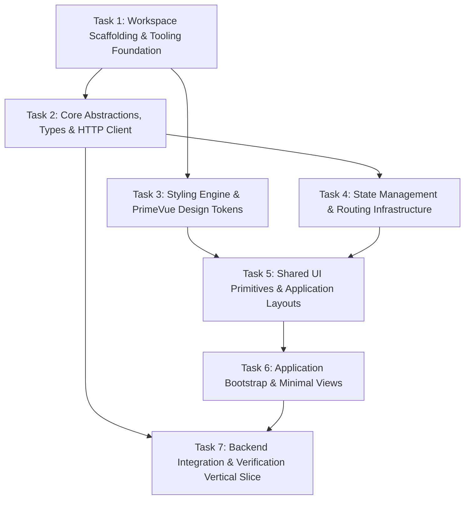

# Incremental Frontend Initialization Plan — Elsasa SIS V3

**Objective:** Establish an enterprise-grade, domain-driven frontend foundation for Elsasa SIS V3 without prematurely implementing the entire SIS business surface.  
**Platform:** Vue 3 (v3.5+), TypeScript (v5.6+), Vite (v6+), Tailwind CSS (v4+), PrimeVue (v4+)  
**State Management:** TanStack Query Vue (v5+) & Pinia (v2+)  
**Status:** Approved  
**Date:** November 2026  

---

## Roadmap of Initialization Tasks

---

### Task 1: Workspace Scaffolding & Tooling Foundation (`src/frontend/`)

- **Objective:** Establish the frontend project root under `src/frontend/`, configure `pnpm` workspace dependencies, TypeScript compilation projects, Vite build pipeline with dev server proxy, and code quality linters.
- **Scope:**
  - Create `package.json` specifying Vue 3.5, TypeScript 5.6, Vite 6, Tailwind CSS 4, PrimeVue 4, Pinia 2.2, TanStack Query 5.60, Axios 1.7, VeeValidate 4.14, Zod 3.23, date-fns 4.1, and Vitest.
  - Generate `pnpm-lock.yaml` via deterministic `pnpm install`.
  - Configure `tsconfig.json`, `tsconfig.app.json`, and `tsconfig.node.json` with strict type checking, ES2022 target, and `@/*` path alias.
  - Configure `vite.config.ts` with `@vitejs/plugin-vue`, `@tailwindcss/vite`, path aliases, manual chunk splitting (`vendor-core`, `vendor-query`, `vendor-primevue`, `vendor-utils`), and dev proxy forwarding `/api` to `http://localhost:5000`.
  - Configure ESLint (flat config `eslint.config.js`), `.prettierrc`, and `.editorconfig`.
- **Dependencies:** Node.js v22+, pnpm v9+.
- **Expected Deliverables:**
  - `src/frontend/package.json`
  - `src/frontend/pnpm-lock.yaml`
  - `src/frontend/tsconfig*.json`
  - `src/frontend/vite.config.ts`
  - `src/frontend/eslint.config.js`
  - `src/frontend/.prettierrc`
- **Acceptance Criteria:**
  - `pnpm install` succeeds with zero dependency conflicts.
  - `pnpm typecheck` and `pnpm lint` pass with 0 errors.

---

### Task 2: Core Abstractions, Outcome Types & HTTP Client (`src/frontend/src/shared/`)

- **Objective:** Implement core domain outcome types, RFC 7807 `ProblemDetails` error modeling, date/currency utilities, and the centralized Axios HTTP client with request tracing and response error transformation.
- **Scope:**
  - Create `src/frontend/src/shared/types/common.ts` defining `DomainErrorType`, `ProblemDetails`, `ApiError`, `Result<T>`, and `PaginatedResponse<T>`.
  - Create `src/frontend/src/shared/utils/dateUtils.ts` wrapping `date-fns` for display dates, backend `DateOnly` (`YYYY-MM-DD`), and backend `TimeOnly` (`HH:mm:ss`).
  - Create `src/frontend/src/shared/utils/currencyUtils.ts` formatting Indonesian Rupiah (`formatIDR`).
  - Configure environment files: `.env.development`, `.env.staging`, `.env.production`.
  - Implement `src/frontend/src/shared/services/http.ts` with Axios request interceptors (JWT injection, `X-Correlation-ID` UUID generation) and response interceptor (RFC 7807 error unbundling and 401 handling).
- **Dependencies:** Task 1.
- **Expected Deliverables:**
  - `src/frontend/src/shared/types/common.ts`
  - `src/frontend/src/shared/utils/dateUtils.ts`
  - `src/frontend/src/shared/utils/currencyUtils.ts`
  - `src/frontend/src/shared/services/http.ts`
  - `src/frontend/.env.development`
- **Acceptance Criteria:**
  - Unit tests verify date formatting, IDR currency formatting, and RFC 7807 error mapping.
  - Axios client attaches `X-Correlation-ID` header and unboxes data payloads.

---

### Task 3: Styling Engine & PrimeVue Design Tokens (`src/frontend/src/shared/styles/`)

- **Objective:** Configure Tailwind CSS v4 utility engine and PrimeVue v4 Aura design system presets with institutional brand tokens.
- **Scope:**
  - Create `src/frontend/src/shared/styles/main.css` importing `@import "tailwindcss";`, defining `@layer primevue, custom;`, and registering institutional design tokens:
    - Primary Navy (`#0f172a`, `#1e293b`)
    - Brand Teal (`#0d9488`, `#14b8a6`, `#f0fdfa`)
    - Status colors: Emerald, Amber, Rose, Sky
    - System font family (`Inter`)
  - Create `src/frontend/src/app/config/primevue.ts` configuring PrimeVue Aura preset and CSS layer ordering.
- **Dependencies:** Task 1.
- **Expected Deliverables:**
  - `src/frontend/src/shared/styles/main.css`
  - `src/frontend/src/app/config/primevue.ts`
- **Acceptance Criteria:**
  - CSS compiles without syntax errors.
  - PrimeVue components render with clean Aura styling and custom token variables.

---

### Task 4: State Management & Routing Infrastructure (`src/frontend/src/app/`)

- **Objective:** Configure TanStack Query client, Pinia client-only session stores, and Vue Router with permission-driven navigation guards.
- **Scope:**
  - Implement `src/frontend/src/app/providers/queryClient.ts` configuring QueryClient default stale times, gcTime, and refetch behaviors.
  - Implement Pinia stores:
    - `auth.store.ts`: In-memory token, user identity, permissions, roles, and login/logout actions.
    - `appContext.store.ts`: Active campus ID and active academic period ID.
    - `ui.store.ts`: Sidebar collapse toggle, theme, and breadcrumbs.
  - Implement Vue Router:
    - `src/frontend/src/app/router/routes.ts`: Hierarchical routes (`/auth/login`, `/dashboard`, `/operations/calendar`, `/403`, `/404`).
    - `src/frontend/src/app/router/guards.ts`: Global navigation guards verifying `requiresAuth` and `permission` meta against `authStore`.
- **Dependencies:** Task 2.
- **Expected Deliverables:**
  - `src/frontend/src/app/providers/queryClient.ts`
  - `src/frontend/src/app/stores/auth.store.ts`
  - `src/frontend/src/app/stores/appContext.store.ts`
  - `src/frontend/src/app/stores/ui.store.ts`
  - `src/frontend/src/app/router/routes.ts`
  - `src/frontend/src/app/router/guards.ts`
- **Acceptance Criteria:**
  - Pinia stores manage client-only session context without caching backend entity lists.
  - Router guards redirect unauthenticated users to `/auth/login` and unauthorized users to `/403`.

---

### Task 5: Shared UI Primitives & Application Layouts (`src/frontend/src/shared/` & `src/frontend/src/app/layouts/`)

- **Objective:** Build reusable presentation primitives and persistent application layout shells.
- **Scope:**
  - Implement shared primitives: `FormField.vue`, `StatusPill.vue`, `EmptyState.vue`, `LoadingSpinner.vue`, `PageHeader.vue`, `ContentCard.vue`.
  - Implement layouts:
    - `AppLayout.vue`: Topbar with branding, active period, user menu; collapsible sidebar with permission-filtered links; dynamic breadcrumb area; `<router-view>`.
    - `AuthLayout.vue`: Distraction-free authentication wrapper.
  - Create root `App.vue` registering PrimeVue `Toast` and `ConfirmDialog` providers.
- **Dependencies:** Task 3, Task 4.
- **Expected Deliverables:**
  - `src/frontend/src/shared/components/forms/FormField.vue`
  - `src/frontend/src/shared/components/StatusPill.vue`
  - `src/frontend/src/shared/components/feedback/EmptyState.vue`
  - `src/frontend/src/shared/components/feedback/LoadingSpinner.vue`
  - `src/frontend/src/shared/components/layout/PageHeader.vue`
  - `src/frontend/src/shared/components/layout/ContentCard.vue`
  - `src/frontend/src/app/layouts/AppLayout.vue`
  - `src/frontend/src/app/layouts/AuthLayout.vue`
  - `src/frontend/src/App.vue`
- **Acceptance Criteria:**
  - Components render correctly with Tailwind classes.
  - Sidebar toggles smoothly and filters menu items based on actor permissions.

---

### Task 6: Application Bootstrap & Minimal Route Views

- **Objective:** Wire application entry point `main.ts` and scaffold minimal route views.
- **Scope:**
  - Implement `src/frontend/src/main.ts` initializing Vue, registering Pinia, Vue Query, PrimeVue, ToastService, ConfirmationService, and mounting `#app`.
  - Scaffold minimal route views:
    - `src/frontend/src/features/dashboard/views/DashboardView.vue`
    - `src/frontend/src/features/auth/views/LoginView.vue` (VeeValidate + Zod login form)
    - `src/frontend/src/shared/views/ForbiddenView.vue` (403)
    - `src/frontend/src/shared/views/NotFoundView.vue` (404)
- **Dependencies:** Task 5.
- **Expected Deliverables:**
  - `src/frontend/src/main.ts`
  - `src/frontend/src/features/dashboard/views/DashboardView.vue`
  - `src/frontend/src/features/auth/views/LoginView.vue`
  - `src/frontend/src/shared/views/ForbiddenView.vue`
  - `src/frontend/src/shared/views/NotFoundView.vue`
- **Acceptance Criteria:**
  - Application mounts without runtime errors in the browser console.
  - Navigation between Dashboard, Login, and Error pages works seamlessly.

---

### Task 7: Backend Integration & Verification Vertical Slice

- **Objective:** Verify end-to-end frontend-to-backend communication against the existing ASP.NET Core API (`/health` and `POST /api/operations/academic-years`).
- **Scope:**
  - Implement `academicYear.api.ts` and `createAcademicYear.schema.ts` matching backend validation rules.
  - Implement `CalendarWorkspaceView.vue` under `features/operations/calendar/views/` containing:
    - Live `/health` connectivity probe.
    - Minimal `CreateAcademicYear` form testing 201 Created and 422 ProblemDetails validation mapping.
  - Execute full verification suite: `pnpm typecheck`, `pnpm lint`, `pnpm test:unit`, `pnpm build`.
- **Dependencies:** Task 2, Task 6.
- **Expected Deliverables:**
  - `src/frontend/src/features/operations/calendar/api/academicYear.api.ts`
  - `src/frontend/src/features/operations/calendar/schemas/createAcademicYear.schema.ts`
  - `src/frontend/src/features/operations/calendar/views/CalendarWorkspaceView.vue`
  - Unit tests verifying API client, form schema, and error handling.
- **Acceptance Criteria:**
  - Frontend scaffold successfully communicates with the backend API.
  - 422 ProblemDetails validation errors map to form fields.
  - Production build succeeds with 0 errors (`pnpm build`).
