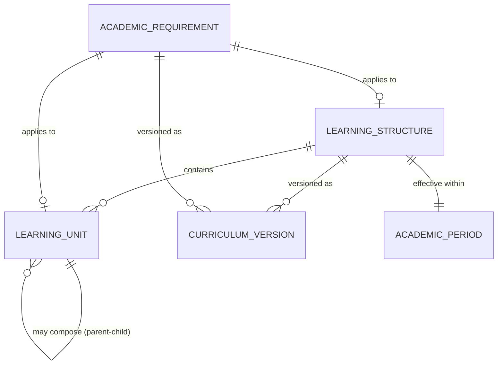
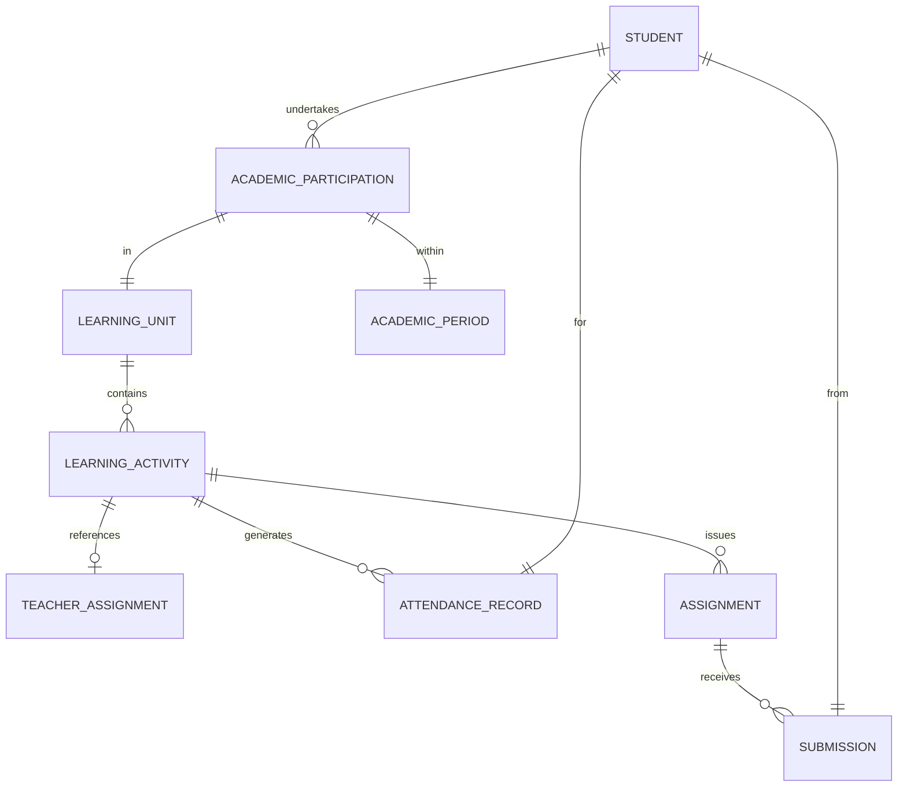
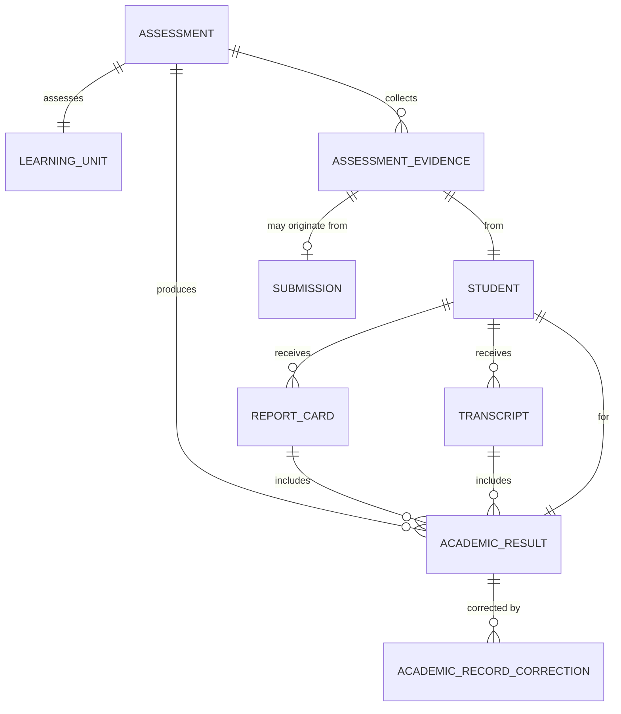
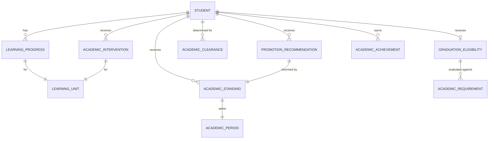
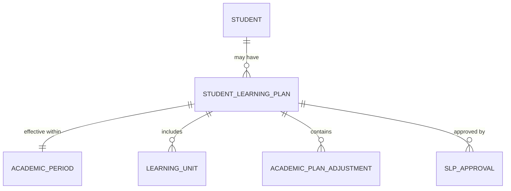
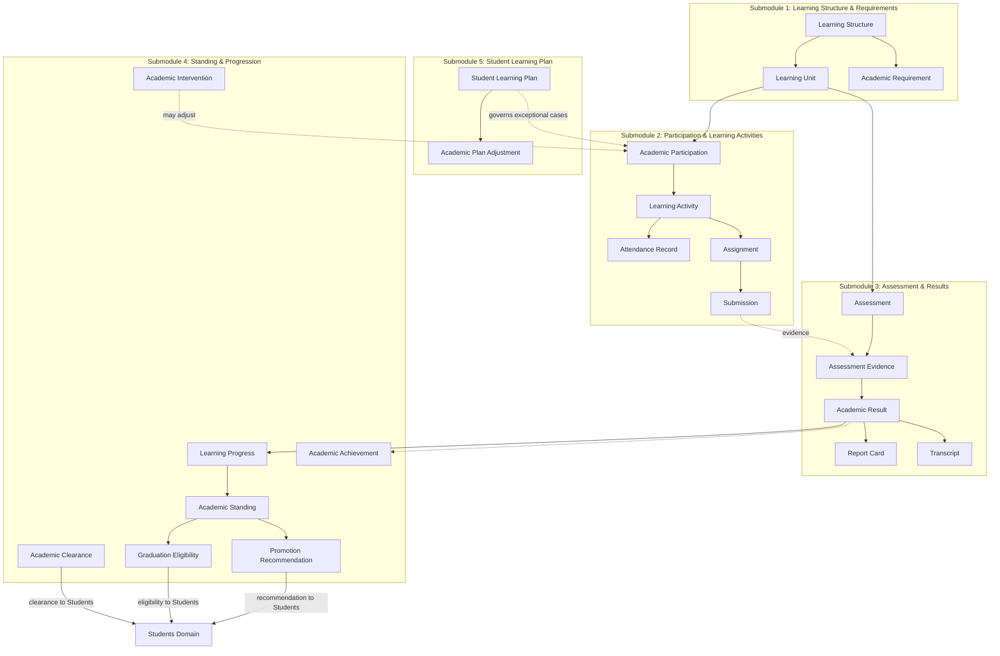

# Academic Domain — Entity Identification by Submodule

## Source Documents

- [academic-domain.md](file:///d:/Project.Private/elsasa-sis-v3/domains/academic-domain.md) — Academic Domain definition
- [sub-modul-and-development-phases.md](file:///d:/Project.Private/elsasa-sis-v3/sub-modul-and-development-phases.md) — Module decomposition and three-stage roadmap

## Domain Boundary

The Academics domain is the authoritative source for the student's learning journey: what a student is expected to learn, what learning the student participates in, attendance, evidence, assessment results, progress, academic history, standing, progression recommendations, graduation eligibility, and purpose-specific academic clearance.

The center of this domain is the **student and the student's learning journey**, not the classroom.

This domain does **not** own student identity, administrative status, teacher resources or assignments, operational schedules, behaviour or counselling, or financial obligations.

Entities identified here are strictly derived from the domain definition and module decomposition. No entity is introduced that is not supported by the source documents.

---

## Submodule 1 — Learning Structure & Requirements

**Module responsibility:** Define and maintain the curriculum-neutral learning structure, academic requirements, and versioned policies that govern learning.

**Submodules:** Learning Structure Management · Academic Requirements & Policy Versioning · Curriculum Configuration

### Entities

#### 1.1 Learning Structure *(Core Entity)*

| Aspect | Description |
|---|---|
| **Purpose** | Represents the top-level organizational container that describes the learning recognized by the school. A Learning Structure groups Learning Units into a coherent curriculum framework for a given academic context (e.g., a program, level, or school-wide curriculum). |
| **Role** | The root of the `Learning Structure → Learning Unit → Learning Activity` hierarchy defined by the domain. Provides the organizing boundary for curriculum configuration. Must be versioned or effective-dated so that changes do not silently alter historical interpretation. |
| **Example** | Learning Structure: "Kurikulum Merdeka SD 2024", effective Academic Year 2024/2025, approved by Kepala Sekolah, status Active. |

---

#### 1.2 Learning Unit *(Core Entity)*

| Aspect | Description |
|---|---|
| **Purpose** | The single curriculum-neutral abstraction for a defined body of learning that can be planned, undertaken, evaluated, or completed. May represent a subject, course, module, PACE, project, or any class-based learning element. |
| **Role** | The central building block of all academic workflows. Every academic participation, learning activity, assignment, assessment, result, and progress record traces back to a Learning Unit. Learning Units belong to a Learning Structure and may compose hierarchically (a course containing modules, a subject containing units, etc.). Must not force every learning model into a class hierarchy. |
| **Example** | Learning Unit: "Matematika Kelas 4 Semester 1", type "Subject", parent structure "Kurikulum Merdeka SD 2024", level Grade 4, credit/weight as defined by school policy. |

> [!IMPORTANT]
> Subject, course, module, PACE, and project are **not** separate root concepts — they are expressions of a Learning Unit. The domain explicitly prohibits introducing separate top-level domains for curriculum variants.

---

#### 1.3 Academic Requirement *(Core Entity)*

| Aspect | Description |
|---|---|
| **Purpose** | A rule describing the learning, evidence, completion, credit, or mastery expected for a student, program, or stage. Requirements define the "what must be satisfied" for completion, progression, and graduation. |
| **Role** | Governs academic expectations at various levels: program-wide, stage-wide, period-specific, or student-specific. Captures required and optional learning, prerequisites, expected outcomes, credit requirements, completion criteria, assessment and grading policy references, and progression/graduation requirements. Must be effective-dated or versioned — changes must not reinterpret historical results. |
| **Example** | Academic Requirement: "Grade 4 Promotion Requirements — TP 2026/2027": student must complete all required Learning Units (Matematika, Bahasa Indonesia, IPA, IPS, PKN, SBdP, PJOK), achieve minimum standing of "Kompeten" in each, effective version 2026.1. |

---

#### 1.4 Curriculum Version *(Supporting Entity)*

| Aspect | Description |
|---|---|
| **Purpose** | Records a specific version or effective-dated snapshot of a Learning Structure or set of Academic Requirements, ensuring historical results remain interpretable under the rules that applied when they were produced. |
| **Role** | Provides versioning context for learning structures and requirements. When curriculum changes, previous versions must remain accessible for interpreting historical academic records. Links a version identifier, effective period, approval, and the associated Learning Structure or requirements. |
| **Example** | Curriculum Version: "Kurikulum Merdeka SD v2024.1", effective 2024-07-01, approved 2024-06-15 by Academic Authority, supersedes v2023.2. |

> [!NOTE]
> Whether Curriculum Version is modeled as a separate entity or as version attributes on Learning Structure and Academic Requirement is an implementation decision. It is listed here because the domain explicitly requires effective dating and version preservation.

---

#### 1.5 Academic Period *(Reference Entity — from Operations)*

| Aspect | Description |
|---|---|
| **Purpose** | Defines the temporal boundary within which academic activity occurs (academic year, semester, term, quarter). Owned by Operations (Calendar & Periods); referenced by Academics. |
| **Role** | Provides essential time context for learning structures, requirements, participation, assessment, and results. Every academic workflow operates within one or more Academic Periods. |
| **Example** | Academic Period: "Semester 1 TP 2026/2027", start 2026-07-15, end 2026-12-20. |

> [!IMPORTANT]
> Academic Period is **not owned** by the Academics domain. Academics references it as external context provided by Operations.

---

### Learning Structure & Requirements — Entity Relationship Summary

---

## Submodule 2 — Participation & Learning Activities

**Module responsibility:** Manage student academic participation, learning activities, attendance, assignments, and submissions.

**Submodules:** Academic Participation · Learning Activity Conduct · Student Attendance · Assignment & Submission Management

### Entities

#### 2.1 Academic Participation *(Core Entity)*

| Aspect | Description |
|---|---|
| **Purpose** | Records the relationship between a student and a specific Learning Unit — the fact that the student is undertaking, has paused, has withdrawn from, or has completed that learning. |
| **Role** | The answer to "What learning is this student undertaking?" Tracks the student's lifecycle within each Learning Unit: start, pause, resume, withdrawal, and completion. Explicitly distinct from administrative enrollment (which is owned by Students). Multiple concurrent participations for different Learning Units are permitted. Must record participation history. |
| **Example** | Academic Participation: student Rina Kusuma (STD-2026-0108) in Learning Unit "Matematika Kelas 4 Semester 1", status "In Progress", started 2029-07-15, Academic Period "Semester 1 TP 2029/2030". |

> [!IMPORTANT]
> Administrative enrollment does **not** automatically create Academic Participation. Participation must be established through Academics. A student may be enrolled but have no active participation.

---

#### 2.2 Learning Activity *(Core Entity)*

| Aspect | Description |
|---|---|
| **Purpose** | Represents an occurrence in which learning is undertaken, supported, or demonstrated. Examples: lesson, tutorial, laboratory activity, independent work, project activity, discussion, practice, examination, remediation activity. |
| **Role** | The container for actual learning work. Belongs to a Learning Unit and provides the context for attendance, assignments, and assessment evidence. Academics owns the educational purpose, expected outcomes, student participation, and academic result of an activity. Teaching owns teacher assignment; Operations owns scheduling and room allocation. An activity may be individual, asynchronous, or group-based. |
| **Example** | Learning Activity: "Lesson — Pecahan Biasa", type "Lesson", Learning Unit "Matematika Kelas 4 Semester 1", date 2029-08-12, teacher reference (from Teaching), expected participants: all students participating in this Learning Unit. |

---

#### 2.3 Attendance Record *(Core Entity)*

| Aspect | Description |
|---|---|
| **Purpose** | Records the participation of a student in a required learning activity. |
| **Role** | Captures observed attendance status (present, absent, late, excused absence, partial participation), evidence when applicable, and correction history with authorization. Attendance must refer to a meaningful learning obligation — it does not assume classroom presence. Must support bulk entry while retaining individual outcomes per student. Corrections must preserve what changed, why, when, and who authorized it. |
| **Example** | Attendance Record: student Rina Kusuma, Learning Activity "Lesson — Pecahan Biasa" on 2029-08-12, status "Present". |

> [!NOTE]
> Academics owns **learning-activity attendance** only. General daily school attendance ownership is an open question (documented in the module decomposition). Employee attendance and event attendance are out of scope.

---

#### 2.4 Assignment *(Core Entity)*

| Aspect | Description |
|---|---|
| **Purpose** | Represents academic work requested from a student with defined expectations and, when applicable, a due date. |
| **Role** | Must always originate from a Learning Activity (the domain enforces `Learning Activity → Assignment → Submission`). Captures assignment requirements, release date, due date, applicable students, and completion status. Assignments must not exist independently of a Learning Activity. |
| **Example** | Assignment: "Latihan Pecahan Biasa — Halaman 42", Learning Activity "Lesson — Pecahan Biasa", released 2029-08-12, due 2029-08-14, applicable to all participants in "Matematika Kelas 4 Semester 1". |

---

#### 2.5 Submission *(Core Entity)*

| Aspect | Description |
|---|---|
| **Purpose** | Records a student's response to an Assignment — the work submitted, its status, and relevant metadata. |
| **Role** | Tracks what the student delivered for a given Assignment. Required statuses: Submitted, Late, Missing, Excused, Exempted. Supports resubmission. Missing submissions do **not** automatically become zero scores — grading consequences are determined by assessment policy, not by submission status. Submission and academic evaluation are separate concerns. |
| **Example** | Submission: student Rina Kusuma, Assignment "Latihan Pecahan Biasa — Halaman 42", status "Submitted", submitted 2029-08-13, on time. |

> [!NOTE]
> Whether Submission is modeled as a child entity of Assignment or as a separate entity linked to both Assignment and Student is an implementation decision. The domain requires that the `Assignment → Submission` relationship is always maintained.

---

#### 2.6 Student *(Reference Entity — from Students)*

| Aspect | Description |
|---|---|
| **Purpose** | The student identity and eligibility context. Owned by Students domain; referenced by Academics. |
| **Role** | Every Academic Participation, Attendance Record, Assignment, Submission, and downstream entity references the student. Academics does not own or redefine student identity. |
| **Example** | Student reference: Rina Kusuma (STD-2026-0108), Status Active, Placement Grade 4 Campus Utara. |

---

#### 2.7 Teacher Assignment *(Reference Entity — from Teaching)*

| Aspect | Description |
|---|---|
| **Purpose** | The authorized link between a teacher and a learning context. Owned by Teaching domain; referenced by Academics. |
| **Role** | Academics records academic work performed by an authorized teacher. The teacher must be authorized through Teaching when a teacher is required. Academics references the assignment but does not own it. |
| **Example** | Teacher Assignment reference: Ibu Dewi assigned to "Matematika Kelas 4 Semester 1", Assignment #TA-2029-088 from Teaching. |

---

### Participation & Learning Activities — Entity Relationship Summary

---

## Submodule 3 — Assessment & Results

**Module responsibility:** Manage assessment planning, evidence collection, evaluation, result approval, publication, report cards, and transcripts.

**Submodules:** Assessment Planning & Conduct · Evaluation & Scoring · Result Approval & Publication · Report Card & Transcript Production · Academic Record Correction

### Entities

#### 3.1 Assessment *(Core Entity)*

| Aspect | Description |
|---|---|
| **Purpose** | Represents a planned or conducted evaluation event designed to collect evidence of learning. Defines the assessment purpose, method, criteria, and applicable policy. |
| **Role** | The organizing concept for evidence collection and evaluation. An Assessment is linked to one or more Learning Units or Learning Activities and defines what is being assessed, how, and against which criteria. Supports different assessment types (formative, summative, diagnostic, etc.) and methods (written, oral, practical, project, portfolio, etc.). Must remain linked to the resulting evaluations. |
| **Example** | Assessment: "Ulangan Harian Pecahan — Matematika Kelas 4", type "Summative", method "Written Test", Learning Unit "Matematika Kelas 4 Semester 1", criteria "Rubrik Pecahan v2029.1", date 2029-09-10, assessor reference Ibu Dewi. |

---

#### 3.2 Assessment Evidence *(Core Entity)*

| Aspect | Description |
|---|---|
| **Purpose** | Student work, observation, response, performance, or other evidence used to evaluate learning. |
| **Role** | The raw input to evaluation. Evidence may come from submissions, examinations, observations, projects, portfolios, or other authorized sources. Evidence must remain linked to both the student and the assessment. Raw evidence, provisional evaluation, approved result, and published result must not be treated as automatically equivalent. |
| **Example** | Assessment Evidence: student Rina Kusuma, Assessment "Ulangan Harian Pecahan", evidence type "Written test paper", collected 2029-09-10. |

---

#### 3.3 Academic Result *(Core Entity)*

| Aspect | Description |
|---|---|
| **Purpose** | An authorized evaluation of learning evidence under an applicable assessment policy. The formal academic outcome for a student in a specific assessed context. |
| **Role** | The primary academic record. Supports multiple evaluation models: numeric, letter-grade, pass/fail, competency, rubric, narrative, and completion-based. Must distinguish between provisional result (teacher's initial evaluation), approved result (authorized by Academic Authority), and published result (released to authorized audiences). Approval and publication are separate concepts where policy requires. Approved results may change only through an explicit correction workflow. |
| **Example** | Academic Result: student Rina Kusuma, Assessment "Ulangan Harian Pecahan", provisional score 85/100, grade "A", evaluated by Ibu Dewi on 2029-09-12, approved by Academic Coordinator 2029-09-15, published 2029-09-16. |

> [!IMPORTANT]
> Provisional, approved, and published states have different meanings and must remain distinguishable. A provisional result must not be consumed by progression or reporting workflows as if it were approved.

---

#### 3.4 Academic Record Correction *(Core Entity)*

| Aspect | Description |
|---|---|
| **Purpose** | An explicit authorized change to academic history that preserves the prior value and reason for change. |
| **Role** | Ensures that approved records are never silently overwritten. Captures the original record, requested correction, reason, evidence, authorizing actor, correction date, and the corrected value. Applies to Academic Results, Assignments, Submissions, Submission Evaluations, Academic Standing, Promotion/Retention Recommendations, Graduation Eligibility, and Academic Clearance records. Downstream standing and eligibility must be reviewed when affected. |
| **Example** | Correction: Academic Result for Rina Kusuma in "Ulangan Harian Pecahan" corrected from 85 to 88, reason "Scoring error on question 5", authorized by Academic Authority Ibu Ratna, correction date 2029-09-20, original value preserved. |

---

#### 3.5 Report Card *(Core Entity)*

| Aspect | Description |
|---|---|
| **Purpose** | An authorized academic document communicating a student's approved results, attendance, and progress for a reporting period. |
| **Role** | Produced from operational academic records — the report card must not become the owner of grades or progress. Must be reproducible under its historical rules. Curriculum-specific presentation is configuration, not a new domain. Published to authorized audiences only. Captures report definition, reporting period, approved results, permitted attendance and progress information, and publication metadata. |
| **Example** | Report Card: student Rina Kusuma, period "Semester 1 TP 2029/2030", published 2029-12-22, containing results for 7 Learning Units, attendance summary, and teacher narrative comments. |

---

#### 3.6 Transcript *(Core Entity)*

| Aspect | Description |
|---|---|
| **Purpose** | An authorized cumulative academic document certifying a student's academic history across multiple periods or their entire enrollment. |
| **Role** | Aggregates approved academic results, credits/competencies earned, completed learning, recognized prior or transferred learning, and curriculum context across the student's academic history. Must be generated from operational academic records and remain reproducible. Distinct from a Report Card in that it spans multiple periods and is typically issued for official purposes (transfer, graduation). |
| **Example** | Transcript: student Rina Kusuma, covering Academic Years 2026/2027 through 2029/2030, listing all completed Learning Units with approved grades, credits earned, and cumulative standing. |

> [!NOTE]
> Report Card and Transcript are listed as separate entities because they serve different purposes (periodic vs. cumulative) and may have different production rules. Whether they share a common "Academic Report" abstraction is an implementation decision.

---

### Assessment & Results — Entity Relationship Summary

---

## Submodule 4 — Standing & Progression

**Module responsibility:** Determine academic standing, progression recommendations, graduation eligibility, academic clearance, and academic intervention.

**Submodules:** Learning Progress & Completion · Academic Standing Determination · Promotion & Retention Recommendation · Graduation Eligibility Determination · Academic Clearance · Academic Intervention · Academic Achievement Recognition

### Entities

#### 4.1 Learning Progress *(Core Entity)*

| Aspect | Description |
|---|---|
| **Purpose** | Records the student's current advancement toward defined learning expectations for a specific Learning Unit or Academic Requirement. |
| **Role** | Tracks progress using the Phase-2 minimal model. Required states: Not Started, In Progress, Completed. Optional states: Needs Remediation, Exempted. Progress must originate from learning work, assessment evidence, or an explicit authorized decision — it must not be entered solely to satisfy reporting needs. No percentage-based progress tracking in Phase 2. |
| **Example** | Learning Progress: student Rina Kusuma, Learning Unit "Matematika Kelas 4 Semester 1", status "In Progress", last updated 2029-10-15, based on 3 of 5 assessments completed. |

> [!NOTE]
> These progress states are business concepts, not mandatory database values. The domain prohibits inferring completion merely from the end of a calendar period, administrative placement, attendance alone, or absence of outstanding work.

---

#### 4.2 Academic Standing *(Core Entity)*

| Aspect | Description |
|---|---|
| **Purpose** | Records an academic conclusion about the student's overall academic condition. An academic determination, not grades. |
| **Role** | Minimum standing model: Good Standing, Conditional Standing, Not In Good Standing. Must identify the policy and evidence used. Serves as input to progression and graduation decisions. Does not change the student's administrative status. Produced from approved requirements and evidence. |
| **Example** | Academic Standing: student Rina Kusuma, period "TP 2029/2030", standing "Good Standing", determined 2030-06-10 by Academic Coordinator, based on completion of all required Learning Units with approved results meeting requirement thresholds. |

---

#### 4.3 Promotion Recommendation *(Core Entity)*

| Aspect | Description |
|---|---|
| **Purpose** | Records the Academics domain's recommendation regarding a student's advancement to the next level or grade. |
| **Role** | Academics owns promotion eligibility determination and issues one of: Promotion Eligible, Retention Recommended, or Conditional Promotion Recommendation. This is a recommendation, not an administrative transition — Students is the sole domain that executes official promotion or retention. Conditional recommendations must state their conditions. Individual exceptions require explicit authority and reason. |
| **Example** | Promotion Recommendation: student Rina Kusuma, Academic Period "TP 2029/2030", recommendation "Promotion Eligible", from Grade 4 recommended to Grade 5, determined 2030-06-12 by Academic Authority, supporting evidence: Good Standing + all requirements completed. |

---

#### 4.4 Graduation Eligibility *(Core Entity)*

| Aspect | Description |
|---|---|
| **Purpose** | Records the Academics domain's determination of whether a student has satisfied academic graduation requirements. |
| **Role** | Academics issues one of: Graduation Eligible, Graduation Not Eligible, or Conditional Graduation Recommendation. Students is the sole domain that executes official graduation. Eligibility must not be inferred solely from time spent at school. Must identify applicable graduation requirements, approved academic history, recognized credits/competencies, and approved exceptions. Approved eligibility is provided to Students. |
| **Example** | Graduation Eligibility: student Rina Kusuma, determination "Graduation Eligible", determined 2032-05-20 by Academic Authority / Authorized Academic Committee, applicable requirements "SD Graduation Requirements v2032.1", all requirements satisfied. |

---

#### 4.5 Academic Clearance *(Core Entity)*

| Aspect | Description |
|---|---|
| **Purpose** | A purpose-specific determination stating whether defined academic prerequisites have been satisfied for a specific purpose. |
| **Role** | Distinct from Academic Standing and from promotion/retention/graduation eligibility. Phase-2 purpose is Transfer Out only. Students requests; Academics determines; Students consumes. Permitted results: Granted, Denied, Conditional, Cannot Yet Be Determined, Expired, Revoked. Must identify: purpose, subject, applicable policy, evaluated academic facts, result, determination date, validity/expiry, and authority. Routine determination is recorded by Academic Coordinator; exception determination requires Academic Authority with a mandatory reason. Transfer-out execution requires Granted only. Additional purposes may be configured later without changing the domain model. |
| **Example** | Academic Clearance: student Ahmad Faisal, purpose "Transfer Out", result "Granted", determined 2028-02-15 by Academic Coordinator, policy "Transfer-Out Academic Clearance Policy v2028.1", blocking items: none, valid until 2028-03-15. |

---

#### 4.6 Academic Intervention *(Core Entity)*

| Aspect | Description |
|---|---|
| **Purpose** | Records an academic action taken when a student needs additional learning support or challenge. |
| **Role** | Covers remediation, reassessment, tutoring recommendation, extension work, recovery plan, learning-plan adjustment, and academic warning. Must be based on authorized academic information (attendance, assignments, assessment results, progress expectations, previous interventions). Academics owns intervention related to learning performance only — behaviour, wellbeing, counselling, and non-academic intervention belong to Development. Must not independently change official student status. |
| **Example** | Academic Intervention: student Budi Santoso, type "Remediation", Learning Unit "Matematika Kelas 4 Semester 1", trigger "Assessment result below minimum threshold (score 45/100)", plan "Additional tutoring sessions + reassessment", initiated 2029-10-01 by Academic Coordinator, status "In Progress". |

---

#### 4.7 Academic Achievement *(Core Entity)*

| Aspect | Description |
|---|---|
| **Purpose** | Records an achievement derived from academic learning or assessment. |
| **Role** | Examples: subject distinction, academic honors, mastery recognition, academic certification, curriculum-recognized academic competition achievement. Academics owns academic achievements only — Development owns extracurricular and non-academic achievements. Must be linked to the academic evidence or results that support it. |
| **Example** | Academic Achievement: student Rina Kusuma, type "Subject Distinction", subject "Matematika", period "TP 2029/2030", criteria "Highest cumulative score in cohort", recognized 2030-06-15 by Academic Authority. |

---

### Standing & Progression — Entity Relationship Summary

---

## Submodule 5 — Student Learning Plan

**Module responsibility:** Manage individualized or exceptional learning plans, accommodations, substitutions, and exemptions.

**Submodules:** SLP Creation & Revision · Academic Plan Adjustment · SLP Approval & Governance

### Entities

#### 5.1 Student Learning Plan *(Core Entity)*

| Aspect | Description |
|---|---|
| **Purpose** | The approved set or sequence of learning expectations for a student in exceptional or individualized cases — acceleration, remediation, accommodation, transfer, or individualized pathways. |
| **Role** | Optional, not mandatory — default academic operation must work without one. Phase-2 minimum scope: Student, Effective Period, Learning Units, Notes, Status. May also identify: required sequence, academic accommodations, substitutions or exemptions, plan approval, revision history. At most one Active SLP per student per Academic Period — multiple concurrent active plans are not permitted. Historical plans must be preserved. Revisions require re-approval by an Academic Authority. |
| **Example** | Student Learning Plan: student Budi Santoso (STD-2026-0205), Academic Period "Semester 1 TP 2029/2030", Learning Units [Matematika Kelas 3 (remediation), Bahasa Indonesia Kelas 4, IPA Kelas 4, ...], status "Active", notes "Student repeating Matematika at Grade 3 level per Academic Authority recommendation", approved by Ibu Ratna (Academic Authority) on 2029-07-20. |

> [!IMPORTANT]
> A learning plan is **not** the student's administrative placement. A student placed in Grade 4 may learn selected material associated with other levels via an SLP.

---

#### 5.2 Academic Plan Adjustment *(Core Entity)*

| Aspect | Description |
|---|---|
| **Purpose** | Records an accommodation, substitution, or exemption applied to a Student Learning Plan. All three types are treated as a single category. |
| **Role** | Each adjustment requires explicit Academic Authority approval. Must preserve rationale, authority, and effective dates. Does not modify administrative enrollment or student status. Authorization flow: Academic Coordinator reviews → Academic Authority approves → Student Learning Plan updated. Types include: accommodation (modified conditions for learning or assessment), substitution (replacement of one learning requirement with another), and exemption (waiver of a requirement). |
| **Example** | Academic Plan Adjustment: student Budi Santoso, type "Accommodation", description "Extended time for written assessments (50% additional)", rationale "Documented learning need assessment", approved by Ibu Ratna (Academic Authority) on 2029-07-22, effective 2029-07-22 through 2029-12-20. |

---

#### 5.3 SLP Approval *(Supporting Entity)*

| Aspect | Description |
|---|---|
| **Purpose** | Records the approval or re-approval of a Student Learning Plan or its revision by an Academic Authority. |
| **Role** | Captures who approved, when, under what authority, and the plan version approved. Any revision to an SLP requires re-approval — this entity ensures the approval chain is traceable. The Academic Coordinator creates and revises; the Academic Authority (Curriculum Lead, Academic Head, Vice Principal for Academics, or equivalent) approves. |
| **Example** | SLP Approval: Student Learning Plan for Budi Santoso, version 2 (revised to add Accommodation), approved by Ibu Ratna (Vice Principal for Academics) on 2029-07-22, previous approval version 1 on 2029-07-20. |

> [!NOTE]
> Whether SLP Approval is modeled as a separate entity or as approval attributes and history within the Student Learning Plan entity is an implementation decision. It is listed here because the domain emphasizes that every revision requires re-approval and approval history must be preserved.

---

### Student Learning Plan — Entity Relationship Summary

---

## Cross-Submodule Entity Summary

| # | Entity | Type | Submodule | Stage |
|---|---|---|---|---|
| 1.1 | Learning Structure | Core | Learning Structure & Requirements | 2 |
| 1.2 | Learning Unit | Core | Learning Structure & Requirements | 2 |
| 1.3 | Academic Requirement | Core | Learning Structure & Requirements | 2 |
| 1.4 | Curriculum Version | Supporting | Learning Structure & Requirements | 2 |
| 1.5 | Academic Period | Reference (from Operations) | Learning Structure & Requirements | 2 |
| 2.1 | Academic Participation | Core | Participation & Learning Activities | 2 |
| 2.2 | Learning Activity | Core | Participation & Learning Activities | 2 |
| 2.3 | Attendance Record | Core | Participation & Learning Activities | 2 |
| 2.4 | Assignment | Core | Participation & Learning Activities | 2 |
| 2.5 | Submission | Core | Participation & Learning Activities | 2 |
| 2.6 | Student | Reference (from Students) | Participation & Learning Activities | 2 |
| 2.7 | Teacher Assignment | Reference (from Teaching) | Participation & Learning Activities | 2 |
| 3.1 | Assessment | Core | Assessment & Results | 2 |
| 3.2 | Assessment Evidence | Core | Assessment & Results | 2 |
| 3.3 | Academic Result | Core | Assessment & Results | 2 |
| 3.4 | Academic Record Correction | Core | Assessment & Results | 2 |
| 3.5 | Report Card | Core | Assessment & Results | 2 |
| 3.6 | Transcript | Core | Assessment & Results | 2 |
| 4.1 | Learning Progress | Core | Standing & Progression | 2 (core), 3 (extended) |
| 4.2 | Academic Standing | Core | Standing & Progression | 2 |
| 4.3 | Promotion Recommendation | Core | Standing & Progression | 2 |
| 4.4 | Graduation Eligibility | Core | Standing & Progression | 3 |
| 4.5 | Academic Clearance | Core | Standing & Progression | 3 |
| 4.6 | Academic Intervention | Core | Standing & Progression | 2 |
| 4.7 | Academic Achievement | Core | Standing & Progression | 2 |
| 5.1 | Student Learning Plan | Core | Student Learning Plan | 2 |
| 5.2 | Academic Plan Adjustment | Core | Student Learning Plan | 2 |
| 5.3 | SLP Approval | Supporting | Student Learning Plan | 2 |

---

## Cross-Submodule Entity Flow

The following shows how entities relate across submodules in the student's learning journey:

---

## Resolved Questions (Closed)

The following architectural open questions from the domain document have been formally resolved using a pragmatic, minimalist, and explicit approach:

| # | Question | Resolution & Design Decision | Affected Entities | Status |
|---|---|---|---|---|
| 1 | How should competency and outcome relate to Learning Units? | **Descriptive Attributes & Hierarchical Learning Units.** In Phase 2, competencies and learning outcomes are captured as descriptive metadata on `Learning Unit` or criteria on `Academic Requirement`. When a curriculum demands independent evaluation of fine-grained competencies, the existing parent-child `Learning Unit` composition (`unit_type = 'competency'`) is used. No separate `Competency` or `LearningOutcome` entity tables are introduced in Phase 2. | Learning Unit, Academic Requirement | **Closed** |
| 2 | Which learning structures are required for the first school implementation? | **Dual-Track (Standard Subjects + Individualized Modular/PACE).** The system validates and supports both conventional grade-level subject tracks (e.g., Kurikulum Merdeka SD/SMP/SMA with `unit_type = 'subject'`) and self-paced / individual-progress modular units (e.g., ACE/PACE packets with `unit_type = 'pace'` or `'module'`) from day one, verifying the curriculum-neutral schema across both paradigms. | Learning Structure, Learning Unit | **Closed** |
| 3 | How are requirements and curriculum versions approved and activated? | **Explicit State Transition by Academic Authority.** Governed by explicit state changes (`draft` → `active` → `superseded`). Academic Coordinator drafts structures and requirements; Academic Authority explicitly approves and activates them, recording `approved_by`, `approved_date`, and `effective_date`. When a new version is activated, the superseded version receives an `end_date` and transitions to `superseded`. Avoids automated date-polling or complex multi-tier committee workflow engines. | Academic Requirement, Curriculum Version / Learning Structure | **Closed** |
| 4 | Can students select learning, or is it always assigned? | **Assigned by Default, Configurable Self-Selection for Electives/PACE.** Core learning is assigned by staff (Academic Coordinator / Teacher) based on cohort grade or Student Learning Plan. Units designated as electives or self-paced PACE units permit student/guardian selection within an open registration window. Both paths result in standard `Academic Participation` records with an origin flag (`source: 'assigned' \| 'student_selected' \| 'learning_plan'`). | Academic Participation | **Closed** |
| 5 | How are repeated, paused, transferred, and recognized learning represented? | **Unified Lifecycle in Academic Participation.** All learning variations are unified within `Academic Participation`: *Repeated learning* generates a new distinct record for the new period with `participation_type = 'repeat'` and incremented `attempt_number`; *Paused learning* is handled via `status = 'paused'`, returning to `'active'` upon resumption; *Transferred / Prior Recognized learning* creates a record with `participation_type = 'transferred_in'` (or `'recognized_prior'`), immediately set to `status = 'completed'` with external institution attribution, without generating dummy activities or attendance. | Academic Participation, Learning Progress | **Closed** |
| 6 | Is a class a learning group, an administrative group, a scheduled offering, or multiple concepts? | **Decomposed Multi-Concept Across Domains — No Standalone Class Entity in Academics.** "Class" is explicitly partitioned: (1) Administrative homeroom/cohort is owned by **Students** (`administrative_placements.homeroom`); (2) Schedule and room allocations are owned by **Operations** (`Scheduling & Rooms`); (3) Teacher authorization is owned by **Teaching** (`teacher_assignments`); (4) In Academics, learning is anchored to `Learning Unit` + `Academic Participation`. Cohort activities dynamically reference the administrative homeroom or use an optional `section_label` on activities/participations. No standalone `Learning Group` entity is introduced in Phase 2. | Academic Participation, Learning Activity | **Closed** |
| 7 | Which activities require attendance? | **Activity-Level Flag (`is_attendance_required`) with Type Defaults.** `Learning Activity` carries a boolean flag `is_attendance_required`. Defaults to `true` for synchronous activities (`lesson`, `tutorial`, `laboratory`, `examination`) and `false` for asynchronous/self-directed activities (`independent_work`, `project`, `practice`). Overridable per activity instance. Only activities with `is_attendance_required = true` prompt for roll call on teacher rosters. | Attendance Record, Learning Activity | **Closed** |
| 8 | What attendance categories and correction rules apply? | **Standard 5 Categories + Same-Day Teacher Grace Window + Formal Coordinator Correction.** Categories: `present`, `absent` (unexcused), `late`, `excused_absence` (with evidence/reason), and `partial`. Recording teacher may edit directly within a same-day 24-hour grace window. After window closure, changes require explicit reason, optional evidence, and **Academic Coordinator** authorization, logged immutably in `attendance_corrections` (`previous_status`, `new_status`, `reason`, `corrected_by`, `corrected_date`). | Attendance Record, `attendance_corrections` | **Closed** |
| 9 | How is asynchronous or individual-progress participation evidenced? | **Deliverable & Milestone Evidence (No Synthetic Attendance Rows).** Asynchronous and self-paced learning (e.g. PACE packets) sets `is_attendance_required = false`. Participation is evidenced through tangible academic deliverables: `Submission` records, assessment milestone completions, and scheduled progress check-in activities. Does not generate artificial daily roll-call records. | Attendance Record, Learning Activity, Submission | **Closed** |
| 10 | Which assessment models are required initially? | **Core 4 Models (Numeric, Letter Grade, Pass/Fail, and Narrative Feedback).** Phase 2 supports: (1) `numeric` (score out of `max_score` with optional `passing_score`); (2) `letter_grade` (discrete grades A, B, C, etc.); (3) `pass_fail` / `completion` (binary mastery check); (4) `narrative` / qualitative feedback (required for Kurikulum Merdeka *Capaian Pembelajaran* descriptive reporting). Multi-dimensional rubric matrix calculation engines are omitted in Phase 2; rubric outcomes are recorded as overall scores with narrative commentary. | Assessment, Assessment Evidence, Academic Result | **Closed** |
| 11 | Who may assess, moderate, approve, correct, and publish results? | **Role-Separated Governance Lifecycle.** Assigned **Teacher** records provisional evaluations (`status = 'provisional'`). **Academic Coordinator** reviews assessments across classes. **Academic Authority** (or Coordinator under delegated policy for routine formative work) approves results (`status = 'approved'`). Only approved results feed progression, standing, and report cards. Post-approval edits are prohibited in place; requires formal `Academic Record Correction` with mandatory reason, authorized strictly by **Academic Authority**. **Academic Authority** or authorized Coordinator releases results (`status = 'published'`). | Academic Result, Academic Record Correction | **Closed** |
| 12 | How are reassessment attempts combined or selected? | **Immutable Attempt Records Governed by Assessment Policy Strategy.** Every retake/reassessment produces a distinct `Academic Result` record (`attempt_number = 2, 3...`, referencing `replaces_result_id`). The parent `Assessment` defines `reassessment_policy`: `capped_at_passing` (standard Indonesian K-12 / KKM policy), `highest_score`, `latest_attempt`, or `average`. The operative result is flagged `is_final = true`. Preserves 100% of remediation audit history without overwriting prior attempts. | Assessment, Academic Result | **Closed** |
| 13 | Can completion occur outside academic-period boundaries? | **Yes — Evidence/Milestone-Driven Completion.** Completion of a `Learning Unit` is determined by satisfying requirements and assessment evidence, stamped with an explicit `completion_date`. It may occur mid-term (e.g. finishing a PACE booklet in October), during holidays, or post-term during remediation. Academic periods provide temporal reporting frames, but do not truncate or artificially fail learning progress. | Learning Progress, Academic Participation | **Closed** |
| 14 | How is transferred or prior learning recognized? | **Authorized Recognition Decision with External Attribution.** An **Academic Authority** reviews external transcripts and records an explicit credit recognition decision: creates `Academic Participation` (`participation_type = 'transferred_in'` / `'recognized_prior'`) and `Learning Progress` (`status = 'completed'`) with metadata: `source_institution`, `external_grade_or_credit`, `recognition_basis`, and `approved_by`. No dummy internal lessons, assignments, or teacher grades are fabricated. Displays with transfer tag `[T]` on official transcripts. | Academic Participation, Learning Progress, Transcript | **Closed** |
| 15 | What triggers an academic intervention? | **Dual-Trigger Model (System Early-Warning Alerts + Educator Referrals).** System early warnings trigger on objective criteria: assessment score below threshold (`trigger_type = 'assessment_below_threshold'`), accumulated missing submissions (`trigger_type = 'missing_work'`), attendance below policy rate (`trigger_type = 'attendance_concern'`), or standing concern (`trigger_type = 'standing_concern'`). Staff may also initiate manually based on observation or extension/gifted need (`trigger_type = 'teacher_referral'`). Managed via `Academic Intervention`. Behavioural/counselling concerns route to **Development**. | Academic Intervention | **Closed** |
| 16 | How are exceptions and committee decisions recorded? | **Embedded Governance Attributes on Decision Entities.** Decision entities (`Academic Standing`, `Promotion Recommendation`, `Graduation Eligibility`) embed explicit governance fields: `is_exception` (boolean), `exception_reason` (mandatory rationale), `conditions` (mandatory stipulations for conditional outcomes), `committee_reference` (formal decree/meeting minutes reference, e.g. *SK Dewan Guru*), and `authorized_by`. Avoids the overhead of a dedicated parliamentary committee/voting subsystem. | Academic Standing, Promotion Recommendation, Graduation Eligibility | **Closed** |
| 17 | What academic requirements determine graduation eligibility? | **Versioned Academic Requirements Evaluated Exclusively by Academics.** Academics determines `Graduation Eligibility` strictly against versioned `Academic Requirement` criteria: (1) Completion of all required `Learning Units` / PACE credits; (2) Cumulative standing of `Good Standing` with no unresolved core failures; (3) Satisfactory completion of culminating assessments (e.g. *Ujian Sekolah*, Capstone Project); or authorized Academic Committee exception. Financial clearance (Finance) and disciplinary clearance (Development) remain independent preconditions assembled by the **Students** domain before executing graduation. | Graduation Eligibility, Academic Requirement | **Closed** |
| 18 | Which report cards and transcripts are required? | **Periodic Report Suite + Cumulative Transcripts with Frozen Snapshots.** Periodic Report Cards: Mid-Term Progress Report (`mid_term`) and End-of-Semester Report Card (`end_of_term` — *Buku Rapor* supporting Kurikulum Merdeka narrative and PACE modular layouts via `template_name`). Cumulative Transcripts: Official Cumulative Transcript (`official` — certified for graduation/transfer-out) and Unofficial Advising Transcript (`unofficial`). Approved and published documents archive an immutable data payload in `content_snapshot` (JSON/PDF) to guarantee exact historical reproducibility. | Report Card, Transcript | **Closed** |
| 19 | General daily school attendance ownership is unresolved. | **Academics Owns Learning-Activity Attendance Only; Daily Homeroom Roll Call Uses Homeroom Activity; Gate Presence Belongs to Operations.** Academics strictly owns learning-activity attendance (`Attendance Record` linked to `Learning Activity`). It does not own campus gate tracking or facilities presence. In Stage 2, daily homeroom roll call is conducted as a scheduled `Learning Activity` (`activity_type = 'homeroom_session'`, `is_attendance_required = true`) to produce statutory report card day totals. Campus-wide physical presence (RFID gate turnstiles, facilities access) is assigned to **Operations** (or **Development** for pastoral tracking) in Stage 3. | Attendance Record, Learning Activity, Operations (Scheduling & Rooms) | **Closed** |

> [!NOTE]
> All 19 open questions from the domain document have been formally resolved and agreed upon. Entity designs and table definitions reflect these explicit decisions.

---

## Assumptions

1. **Curriculum Version as a separate concept:** Listed as a separate entity given the domain's repeated emphasis on effective dating and version preservation. Implementation may model versioning as attributes on Learning Structure and Academic Requirement with a version-tracking mechanism.
2. **Submission as a separate entity from Assignment:** The domain enforces the `Learning Activity → Assignment → Submission` chain and defines distinct submission statuses. Listed separately because they have independent lifecycles (an Assignment exists before any Submission; a Submission may be resubmitted).
3. **Report Card and Transcript as separate entities:** Both produce academic documents from approved records, but they differ in scope (periodic vs. cumulative) and purpose. Implementation may share a common "Academic Report" base if beneficial.
4. **Academic Record Correction as a unified entity:** The domain defines multiple correction workflows (Correct Approved Academic Record, Correct Academic Clearance, Correct Phase-2 Academic Record). A single correction entity with a record-type discriminator is used here. Implementation may specialize if the correction rules diverge significantly.
5. **Learning Group / Class not included as an entity:** The domain explicitly warns against requiring class membership for all learning models. The open question about whether a class is a learning group, administrative group, or scheduled offering remains unresolved. A Learning Group entity may be needed once this question is resolved, but introducing it now would be speculative.
6. **No Grading Policy or Rubric entity:** The domain references criteria, rubrics, and grading/evaluation policies but treats them as configuration within Academic Requirements and Assessments. A separate entity may emerge if implementation requires complex policy management, but introducing one now would exceed Phase-2 scope.
