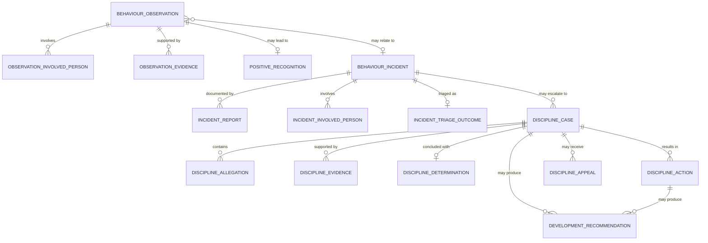
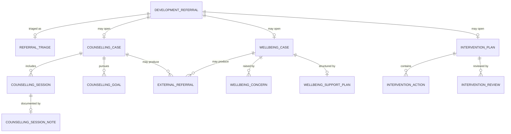
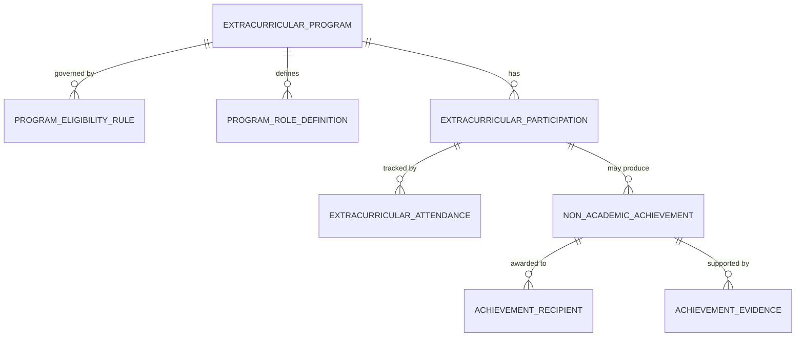

# Development Domain — Entity Identification by Submodule

## Source Documents

- [development-domain.md](file:///d:/Project.Private/elsasa-sis-v3/domains/development-domain.md) — Development Domain definition
- [sub-modul-and-development-phases.md](file:///d:/Project.Private/elsasa-sis-v3/sub-modul-and-development-phases.md) — Module decomposition and three-stage roadmap

## Domain Boundary

The Development domain is the authoritative source for observed student behaviour, positive recognition, formal discipline cases and outcomes, counselling and wellbeing support, non-academic referrals and interventions, extracurricular participation and development, non-academic achievements, and the history of authorized Development actions and decisions.

It does **not** own student identity, administrative status, academic learning or results, financial obligations, teacher resources, or operational schedules.

Entities identified here are strictly derived from the domain definition and module decomposition. No entity is introduced that is not supported by the source documents.

---

## Module 1 — Behaviour & Discipline

**Module responsibility:** Manage behaviour observations, positive recognition, incidents, and formal discipline cases.

**Submodules:** Behaviour Observation & Recognition · Incident Reporting & Triage · Discipline Case Management · Cross-Domain Recommendation

---

### Submodule 1.1 — Behaviour Observation & Recognition

---

#### 1.1.1 Behaviour Observation *(Core Entity)*

| Aspect | Description |
|---|---|
| **Purpose** | Represents a dated, factual record of a student's positive or concerning behaviour observed in a specific context. Captures what was seen, when, where, by whom, and any immediate response taken. |
| **Role** | The foundational record in the behaviour lifecycle. An observation is the starting point that may lead to recognition, a referral, an incident report, or no further action. It is explicitly **not** an incident, violation, or determination — it captures observed facts and must keep facts, interpretations, and allegations distinguishable. |
| **Example** | Observation #OBS-2026-0187: Student Ahmad Rizki observed helping a younger student during break time at the school courtyard, 2026-09-15 10:15. Observer: Bu Sari (Homeroom Advisor). Type: Positive conduct. |

> [!IMPORTANT]
> An observation must **not** automatically establish a policy violation. Facts, interpretations, and allegations must remain distinguishable per the domain's business rules.

---

#### 1.1.2 Positive Recognition *(Core Entity)*

| Aspect | Description |
|---|---|
| **Purpose** | Records authorized recognition of conduct that reflects the school's approved values or development expectations. Represents a formal acknowledgment beyond a simple observation. |
| **Role** | Serves as the official commendation, character recognition, leadership recognition, service recognition, or positive contribution record. Requires explicit recognition criteria and approval authority. Linked to one or more observations or other evidence. Is **not** an academic result. |
| **Example** | Recognition #REC-2026-0034: Student Dina Pertiwi — "Leadership Recognition" for consistently mediating peer conflicts constructively. Approved by Student Development Officer, 2026-10-01. Criteria: "Demonstrates leadership aligned with school values." |

---

#### 1.1.3 Observation Involved Person *(Supporting Entity)*

| Aspect | Description |
|---|---|
| **Purpose** | Records the people directly involved in a behaviour observation — students, staff, or other parties — and their role in the observed event (e.g., subject, witness, co-participant). |
| **Role** | Allows an observation to reference multiple students and other people without conflating their involvement. Preserves the factual record of who was present and in what capacity. |
| **Example** | Observation #OBS-2026-0187: Ahmad Rizki (subject — positive behaviour), Budi Santoso (younger student being helped). |

---

#### 1.1.4 Observation Evidence *(Supporting Entity)*

| Aspect | Description |
|---|---|
| **Purpose** | Records supporting evidence attached to an observation — photos, written notes, CCTV references, or other documentation. |
| **Role** | Provides factual substantiation for the observation record. Evidence is preserved independently so that corrections or reviews can reference original supporting material. |
| **Example** | Evidence for OBS-2026-0203: Photo of damaged classroom window, teacher's written account dated 2026-09-20. |

---

### Submodule 1.2 — Incident Reporting & Triage

---

#### 1.2.1 Behaviour Incident *(Core Entity)*

| Aspect | Description |
|---|---|
| **Purpose** | Represents an event reported because behaviour may require safety action, support, investigation, or formal review. Records date, time, location, factual description, alleged policy concern, and immediate actions taken. |
| **Role** | The central workflow object for reported behavioural events. An incident is triaged to determine whether it requires no further action, support, or escalation to a discipline case. Reporting an incident does **not** establish that a student committed a violation. Multiple related reports may be linked without erasing their original source or wording. |
| **Example** | Incident #INC-2026-0089: Reported by Pak Joko (teacher) on 2026-09-22 at 13:30. Location: classroom 3B. Description: "Two students involved in a physical altercation during class transition." Immediate action: students separated, no injuries observed. |

> [!NOTE]
> An incident may originate from one or more observations, or may be reported independently. Duplicate reports must not destroy independent source history.

---

#### 1.2.2 Incident Report *(Supporting Entity)*

| Aspect | Description |
|---|---|
| **Purpose** | Represents an individual report or statement submitted about an incident, preserving the reporter's identity, original wording, and submission time. |
| **Role** | Preserves the independent source history of each report. Multiple reports about the same event are linked to a single Behaviour Incident, but each report retains its original content. Supports fair process by keeping independent accounts distinct. |
| **Example** | Report for INC-2026-0089: Report #1 by Pak Joko (teacher), 2026-09-22 13:45 — "I saw two students pushing each other near the door." Report #2 by Bu Rina (corridor duty teacher), 2026-09-22 14:00 — "I heard shouting and arrived to find two students being separated." |

---

#### 1.2.3 Incident Involved Person *(Supporting Entity)*

| Aspect | Description |
|---|---|
| **Purpose** | Records each student or other person involved in a behaviour incident, their role (e.g., reported subject, witness, affected party), and any immediate safety or support action taken for them. |
| **Role** | Ensures that each person's involvement is individually tracked. A student may be involved in multiple incidents; an incident may involve multiple students. Role and involvement level are distinct from any determination. |
| **Example** | INC-2026-0089: Student Fajar Prasetyo (reported subject), Student Galih Wicaksono (reported subject), Student Hana Lestari (witness). |

---

#### 1.2.4 Incident Triage Outcome *(Supporting Entity)*

| Aspect | Description |
|---|---|
| **Purpose** | Records the triage decision made about a behaviour incident — whether it is accepted for further action, redirected, linked to another incident, or closed with reason. |
| **Role** | Captures the authorized reviewer's assessment of the incident: urgency, applicable concern category, disposition (no further action, support pathway, discipline pathway, referral), and rationale. Provides the transition point between reporting and response. |
| **Example** | Triage for INC-2026-0089: Triaged by Student Development Officer on 2026-09-22. Disposition: escalated to discipline review. Urgency: moderate. Rationale: "Physical altercation — school policy Section 4.2 may apply." |

---

### Submodule 1.3 — Discipline Case Management

---

#### 1.3.1 Discipline Case *(Core Entity)*

| Aspect | Description |
|---|---|
| **Purpose** | Represents the formal, policy-governed review of an alleged violation of school behaviour or discipline policy. Tracks the case from initiation through investigation, determination, action, appeal, and closure. |
| **Role** | The authoritative record for a formal discipline process. Owns the case lifecycle: initiation, applicable policy version, allegation, evidence and statements, student opportunity to respond, authorized review, determination, corrective/restorative/disciplinary action, communication to authorized parties, appeal or reconsideration, follow-up, and closure. The Development domain owns the case and its authorized determination. |
| **Example** | Case #DSC-2026-0021: Initiated 2026-09-23, linked to INC-2026-0089. Student: Fajar Prasetyo. Allegation: violation of School Behaviour Policy v2026.1 Section 4.2 (physical aggression). Status: under investigation. |

---

#### 1.3.2 Discipline Allegation *(Supporting Entity)*

| Aspect | Description |
|---|---|
| **Purpose** | Records the specific allegation(s) being reviewed in a discipline case, including the applicable policy version, section, and the factual basis for the allegation. |
| **Role** | Separates the allegation from the determination. A case may have one or more allegations. Each allegation references a specific policy provision and the supporting evidence. An allegation is **not** a finding — it is what is being reviewed. |
| **Example** | Allegation for DSC-2026-0021: "Physical aggression toward another student" per School Behaviour Policy v2026.1, Section 4.2. Basis: Incident #INC-2026-0089 reports and witness statements. |

---

#### 1.3.3 Discipline Evidence *(Supporting Entity)*

| Aspect | Description |
|---|---|
| **Purpose** | Records evidence gathered or submitted during a discipline case — statements, documents, observation records, physical evidence, or other material. |
| **Role** | Supports fair process by maintaining an auditable evidence trail. Each evidence item records its type, source, date, chain of custody or origin, and relationship to the case. Prior history may be referenced but must not substitute for evidence about the current allegation. |
| **Example** | Evidence for DSC-2026-0021: Written statement from Pak Joko (witness), incident report #1, CCTV reference (corridor camera, 13:28–13:35), student Fajar's written response. |

---

#### 1.3.4 Discipline Determination *(Core Entity)*

| Aspect | Description |
|---|---|
| **Purpose** | Records the authorized determination for a discipline case — whether the allegation is substantiated, unsubstantiated, inconclusive, or otherwise concluded under policy. |
| **Role** | The authoritative decision point. Must identify the evidence considered, the applicable policy, the authority making the determination, and the effective date. Preserves the student's response opportunity. Once recorded, a determination requires an explicit appeal, reconsideration, or correction process to change. |
| **Example** | Determination for DSC-2026-0021: Allegation substantiated. Authority: Discipline Committee, determined 2026-10-01. Finding: "Physical aggression confirmed based on witness statements and CCTV evidence. Student acknowledged pushing but claimed provocation." |

---

#### 1.3.5 Discipline Action *(Core Entity)*

| Aspect | Description |
|---|---|
| **Purpose** | Records the authorized corrective, restorative, or disciplinary action resulting from a determination. |
| **Role** | Captures what action is authorized — including corrective measures (counselling referral, behaviour contract), restorative actions (apology, mediation), or disciplinary consequences (detention, privilege restriction). When an action requires an official administrative transition (e.g., suspension status), Development provides an approved recommendation or decision reference to Students; Students executes the status change. |
| **Example** | Action for DSC-2026-0021: (1) Written warning issued, (2) 3-day suspension recommended to Students domain, (3) counselling referral for anger management, (4) restorative meeting with affected student scheduled. |

> [!IMPORTANT]
> Administrative status changes (suspension, transfer, withdrawal) are **executed by Students**, not by Development. Development issues an authorized recommendation or decision reference.

---

#### 1.3.6 Discipline Appeal *(Supporting Entity)*

| Aspect | Description |
|---|---|
| **Purpose** | Records an appeal or reconsideration request against a discipline determination or action, and its outcome. |
| **Role** | Preserves the original decision alongside the appeal submission, review authority, and subsequent outcome. The appeal authority must not be assumed to be the same actor as the original decision-maker. Ensures fair process and historical integrity. |
| **Example** | Appeal for DSC-2026-0021: Filed by parent of Fajar Prasetyo on 2026-10-05. Grounds: "Student acted in self-defense." Appeal reviewed by School Principal on 2026-10-10. Outcome: Suspension reduced to 1 day; written warning maintained. |

---

### Submodule 1.4 — Cross-Domain Recommendation

---

#### 1.4.1 Development Recommendation *(Core Entity)*

| Aspect | Description |
|---|---|
| **Purpose** | Represents an authorized Development conclusion provided to another domain for that domain's decision or execution. |
| **Role** | The formal interface between Development and other domains. A recommendation identifies its purpose, the authorized Development outcome it is based on, minimum supporting information, effective date, authority, and the target domain. The receiving domain's response may be recorded. A recommendation must **not** directly execute another domain's decision and must not disclose confidential source details unless required and authorized. |
| **Example** | Recommendation #RECD-2026-0015: From Development to Students. Purpose: "Execute suspension status change." Based on: Discipline Case #DSC-2026-0021, Determination: substantiated, Action: 1-day suspension. Effective: 2026-10-11. Authority: Discipline Committee. |

---

### Behaviour & Discipline — Entity Relationship Summary

---

## Module 2 — Counselling & Wellbeing

**Module responsibility:** Manage counselling referrals, wellbeing concerns, restricted case records, and external referrals.

**Submodules:** Development Referral · Counselling Case Management · Wellbeing Support · Non-Academic Intervention

---

### Submodule 2.1 — Development Referral

---

#### 2.1.1 Development Referral *(Core Entity)*

| Aspect | Description |
|---|---|
| **Purpose** | Represents a request for the Development domain to review or support a student. Captures the referring actor, student, reason, observed context, urgency, and requested support. |
| **Role** | The entry point for non-academic review or support. A referral is a **request**, not proof of misconduct, a diagnosis, or an authorized conclusion. It is triaged: accepted, redirected, or rejected with reason. Upon acceptance, a responsible actor is assigned and a permitted outcome may be returned to the referrer. Information shared is limited to what is permitted for the referral purpose. |
| **Example** | Referral #REF-2026-0102: Submitted by Bu Dewi (Homeroom Advisor) on 2026-09-18. Student: Lina Andari, Grade 5. Reason: "Student has been visibly withdrawn and isolated for two weeks. Peer relationships appear strained." Urgency: moderate. Requested support: counselling assessment. |

> [!NOTE]
> A referral may come from the student (self-referral), a parent/guardian, a teacher, a counselor, or another authorized actor. The referrer receives **only** information authorized for the referral purpose.

---

#### 2.1.2 Referral Triage *(Supporting Entity)*

| Aspect | Description |
|---|---|
| **Purpose** | Records the triage decision for a Development referral — whether it is accepted (and to which pathway), redirected, or closed with reason. |
| **Role** | Captures the urgency assessment, the assigned responsible actor, the pathway (counselling, wellbeing, intervention, or other), and the permitted outcome to be communicated back to the referrer. Ensures that urgent risk follows established escalation policy. |
| **Example** | Triage for REF-2026-0102: Accepted, 2026-09-19. Assigned to: Bu Ratna (Counselor). Pathway: Counselling assessment. Urgency confirmed: moderate. Permitted response to referrer: "Referral accepted and assigned." |

---

### Submodule 2.2 — Counselling Case Management

---

#### 2.2.1 Counselling Case *(Core Entity)*

| Aspect | Description |
|---|---|
| **Purpose** | Represents a restricted record of authorized counselling support provided or coordinated by the school. Tracks the case from referral or self-request through counselor assignment, sessions, goals, review, external referral (if applicable), and closure. |
| **Role** | The authoritative record for school-based counselling. Counselling content is **sensitive** — access to session notes and disclosures must be more restrictive than access to referral status or permitted support outcomes. The case manages consent (when required), urgency, counselling goals, support actions, and closure reason. Development shares the minimum information necessary for another actor to perform an authorized action. |
| **Example** | Counselling Case #CNC-2026-0048: Student Lina Andari. Opened 2026-09-20 via Referral #REF-2026-0102. Counselor: Bu Ratna. Presenting concern: social withdrawal. Consent: parent informed and consent obtained 2026-09-21. Status: active. |

> [!WARNING]
> Counselling notes require **restricted access**. Session occurrence and session content may require **different** access rules. The system must not invent clinical assessments or treatment rules.

---

#### 2.2.2 Counselling Session *(Supporting Entity)*

| Aspect | Description |
|---|---|
| **Purpose** | Records the occurrence of a counselling session — date, duration, participants, and session status. Session notes (the content of what was discussed) are stored with higher access restriction. |
| **Role** | Tracks the progression of counselling support. Session occurrence metadata (that a session happened) may have broader access than the session notes themselves. Supports review, follow-up scheduling, and workload reporting. |
| **Example** | Session for CNC-2026-0048: Session #1, 2026-09-25, 45 minutes, participants: Bu Ratna (counselor), Lina Andari (student). Status: completed. |

---

#### 2.2.3 Counselling Session Note *(Supporting Entity — Restricted)*

| Aspect | Description |
|---|---|
| **Purpose** | Records the content, observations, and professional notes from a counselling session. This is the most access-restricted record type in the Development domain. |
| **Role** | Contains the counselor's record of session content, disclosures, professional observations, and follow-up intentions. Access is restricted to authorized counselling staff. Other domains consume actionable outcomes rather than detailed notes. Disclosure must follow consent, safety, professional, legal, and school-policy requirements. |
| **Example** | Session Note for CNC-2026-0048 Session #1: [Content restricted — accessible only by authorized counselling staff.] |

> [!CAUTION]
> Session notes represent the **highest confidentiality level** in the Development domain. Other domains should consume only permitted support outcomes, not session content. Professional and legal obligations must be defined before implementation.

---

#### 2.2.4 Counselling Goal *(Supporting Entity)*

| Aspect | Description |
|---|---|
| **Purpose** | Records an authorized goal established within a counselling case — what the counselling aims to achieve for the student. |
| **Role** | Structures the counselling process around specific, understandable objectives. Goals are set, reviewed for progress, and eventually marked as achieved, revised, or closed. May inform support actions and review decisions. |
| **Example** | Goal for CNC-2026-0048: "Student will demonstrate improved peer interaction in classroom and break-time settings within 8 weeks." Status: in progress. |

---

#### 2.2.5 External Referral *(Supporting Entity)*

| Aspect | Description |
|---|---|
| **Purpose** | Records a referral made from the school to an external provider (psychologist, therapist, social worker, or other professional) when school-based support is insufficient or external expertise is required. |
| **Role** | Tracks that a referral was made, to whom, when, for what purpose, and with what consent. The school does not manage the external provider's case — this entity records the school's referral action and any permitted outcome communicated back. |
| **Example** | External Referral for CNC-2026-0048: Referred to Dr. Andi Wijaya (child psychologist), 2026-10-15. Purpose: clinical assessment of social anxiety. Parent consent obtained. Outcome received: "Professional assessment recommends continued school-based support with weekly check-ins." |

> [!NOTE]
> The domain document explicitly states that Development does not own medical diagnosis, clinical treatment, or external case management. This entity captures the **referral action** only.

---

### Submodule 2.3 — Wellbeing Support

---

#### 2.3.1 Wellbeing Case *(Core Entity)*

| Aspect | Description |
|---|---|
| **Purpose** | Represents a coordinated school response to an identified social, emotional, personal, or other non-academic wellbeing concern for a student. |
| **Role** | Manages the school's wellbeing support workflow: concern intake, needs or risk review, immediate support, wellbeing support plan, family engagement (when permitted), internal or external referral, review, and closure. Distinct from a Counselling Case in that it may involve multiple actors and a broader support plan, not exclusively counsellor-led sessions. School-based support must **not** be represented as medical diagnosis. |
| **Example** | Wellbeing Case #WBC-2026-0031: Student Reza Firmansyah, Grade 7. Concern raised by Homeroom Advisor: "Student frequently absent, appears fatigued, and mentions family difficulties." Opened 2026-10-02. Assigned: Student Development Officer. |

---

#### 2.3.2 Wellbeing Concern *(Supporting Entity)*

| Aspect | Description |
|---|---|
| **Purpose** | Records the initial concern that triggers a wellbeing response — who raised it, what was observed or reported, and the immediate context. |
| **Role** | Preserves the original concern as reported, before any assessment or plan is established. A concern may come from the student, an observation, a referral from another actor, or a domain referral. Multiple concerns may be associated with the same wellbeing case over time. |
| **Example** | Concern for WBC-2026-0031: Raised by Pak Budi (Homeroom Advisor), 2026-10-01. "Student absent 6 of last 10 school days. When present, appears tired and disengaged. Student mentioned 'things are hard at home' during informal conversation." |

---

#### 2.3.3 Wellbeing Support Plan *(Supporting Entity)*

| Aspect | Description |
|---|---|
| **Purpose** | Records the authorized plan of support actions, goals, responsibilities, and review schedule established in response to a wellbeing concern. |
| **Role** | Structures the school's wellbeing response. Identifies what support will be provided, by whom, with what goals, and when it will be reviewed. May include family engagement, reasonable support recommendations, and coordination between multiple actors. |
| **Example** | Support Plan for WBC-2026-0031: Goals: (1) improve attendance regularity, (2) provide emotional support. Actions: weekly check-in with Homeroom Advisor, bi-weekly counselling sessions, parent meeting scheduled 2026-10-10. Review date: 2026-11-01. Responsible: Student Development Officer (coordinator). |

---

### Submodule 2.4 — Non-Academic Intervention

---

#### 2.4.1 Intervention Plan *(Core Entity)*

| Aspect | Description |
|---|---|
| **Purpose** | Represents an authorized set of non-academic goals, actions, responsibilities, and reviews intended to improve or support behaviour, wellbeing, social participation, personal responsibility, or other non-academic development. |
| **Role** | The primary workflow object for structured non-academic interventions. Includes types such as behaviour improvement plan, mentoring, restorative action, social integration support, personal development plan, attendance-related non-academic support, and coordinated student support. Every plan must have an owner, purpose, review date, and outcome. Goals and actions must be understandable to authorized participants. |
| **Example** | Intervention Plan #INT-2026-0019: Student Fajar Prasetyo. Type: Behaviour Improvement Plan. Reason: following discipline case DSC-2026-0021. Goals: (1) No physical altercations for 6 weeks, (2) Complete anger management sessions. Owner: Student Development Officer. Start: 2026-10-12. Review: 2026-11-23. |

> [!NOTE]
> **Academics** owns interventions whose primary purpose is improving learning performance. Development owns **non-academic** interventions. The boundary must remain clear.

---

#### 2.4.2 Intervention Action *(Supporting Entity)*

| Aspect | Description |
|---|---|
| **Purpose** | Records a specific planned action within an intervention plan — what will be done, by whom, and by when. |
| **Role** | Breaks down the intervention plan into trackable actions. Each action has a responsible actor, a description, a target date, and a completion status. Actions may include mentoring sessions, restorative meetings, family engagement activities, and behavioural check-ins. |
| **Example** | Action for INT-2026-0019: (1) "Attend weekly anger management sessions with Bu Ratna (counselor)" — target: every Wednesday, status: in progress. (2) "Restorative meeting with Galih Wicaksono" — target: 2026-10-15, status: completed. |

---

#### 2.4.3 Intervention Review *(Supporting Entity)*

| Aspect | Description |
|---|---|
| **Purpose** | Records a scheduled or ad-hoc review of an intervention plan's progress — assessment of goal achievement, actions completed, remaining concerns, and decisions about continuation. |
| **Role** | Provides the periodic checkpoint for an intervention. Records who reviewed, when, what progress was observed, and the decision (continue, revise, complete, refer, or close). Revisions and closure preserve history. |
| **Example** | Review for INT-2026-0019: Review #1, 2026-11-23, conducted by Student Development Officer. Progress: Goal 1 — no incidents in 6 weeks (achieved). Goal 2 — 4 of 6 sessions completed (in progress). Decision: continue plan, extend review to 2026-12-20. |

---

### Counselling & Wellbeing — Entity Relationship Summary

---

## Module 3 — Extracurricular & Achievement

**Module responsibility:** Manage extracurricular programs, participation, and non-academic achievements.

**Submodules:** Extracurricular Program Management · Extracurricular Participation · Non-Academic Achievement Recognition

---

### Submodule 3.1 — Extracurricular Program Management

---

#### 3.1.1 Extracurricular Program *(Core Entity)*

| Aspect | Description |
|---|---|
| **Purpose** | Represents an organized non-academic activity intended to provide participation or development opportunities. |
| **Role** | The authoritative record for a school-offered extracurricular activity. Development owns the program's purpose, expected development outcomes, participation requirements, eligibility rules (approved by policy), capacity or selection rules, participant roles, and completion or recognition criteria. Operations owns the calendar, event, room, and schedule context — Development **consumes** that context. Examples include clubs, sports, arts, student organizations, leadership activities, community service, camps, and non-academic competitions. |
| **Example** | Program #EXT-2026-0008: "Robotics Club". Purpose: STEM interest development and teamwork. Eligibility: Grades 5–8, no prerequisites. Capacity: 30 students. Schedule: [from Operations]. Recognition criteria: completion of semester + project presentation. |

> [!IMPORTANT]
> An activity **formally assessed** as part of the student's learning belongs to Academics even when it resembles an extracurricular activity.

---

#### 3.1.2 Program Eligibility Rule *(Supporting Entity)*

| Aspect | Description |
|---|---|
| **Purpose** | Records the explicit eligibility criteria for participating in an extracurricular program — grade level, prerequisites, academic standing requirements, capacity limits, and selection criteria. |
| **Role** | Ensures that participation follows explicit policy. Eligibility rules must be approved — agents must never invent them. Rules may include academic, behavioural, or other criteria as defined by school policy. |
| **Example** | Eligibility for EXT-2026-0008: Grade level 5–8, active student status, no current disciplinary restriction. Selection: first-come-first-served up to capacity of 30. |

---

#### 3.1.3 Program Role Definition *(Supporting Entity)*

| Aspect | Description |
|---|---|
| **Purpose** | Defines the roles that participants may hold within an extracurricular program (e.g., member, team captain, president, secretary). |
| **Role** | Provides structure for recording participant responsibilities within a program. Roles are defined at the program level and assigned to individual participants. |
| **Example** | Roles for EXT-2026-0008: Member (default), Team Leader, Project Coordinator. |

---

### Submodule 3.2 — Extracurricular Participation

---

#### 3.2.1 Extracurricular Participation *(Core Entity)*

| Aspect | Description |
|---|---|
| **Purpose** | Represents a student's authorized involvement in an extracurricular program — from application or nomination through participation, roles, progress, completion, or withdrawal. |
| **Role** | Tracks the student's lifecycle within a program: application/nomination/invitation/assignment → selection/approval → active participation → role or responsibility → participation progress → completion or withdrawal/removal. Participation is **not** administrative enrollment and is **not** academic participation. Selection and removal reasons must be recorded when policy requires. |
| **Example** | Participation #PRT-2026-0156: Student Maya Putri, Program: Robotics Club (EXT-2026-0008). Applied 2026-08-15. Approved 2026-08-20. Role: Member → promoted to Team Leader 2026-10-01. Status: active. |

---

#### 3.2.2 Extracurricular Attendance *(Supporting Entity)*

| Aspect | Description |
|---|---|
| **Purpose** | Records a student's attendance at extracurricular program sessions or activities where attendance tracking is required by the program. |
| **Role** | Provides participation evidence for programs that require attendance as a criterion for completion or recognition. Learning-activity attendance (Academics) must **not** be duplicated as extracurricular attendance. |
| **Example** | Attendance for PRT-2026-0156: Session 2026-09-05 — present, Session 2026-09-12 — absent (excused), Session 2026-09-19 — present. |

> [!NOTE]
> **Attendance Scope:** Development strictly owns extracurricular attendance. General daily school attendance is out of scope for Development (managed under Academics learning activities or separate institutional attendance).

---

### Submodule 3.3 — Non-Academic Achievement Recognition

---

#### 3.3.1 Non-Academic Achievement *(Core Entity)*

| Aspect | Description |
|---|---|
| **Purpose** | Represents authorized recognition of extracurricular, character, leadership, service, or other non-academic development and accomplishment. |
| **Role** | The authoritative record for non-academic recognition. Identifies the achievement category, source, evidence, date, approving authority, and publication status. Examples: sports awards, arts awards, leadership recognition, community-service recognition, character awards, extracurricular competition results, approved participation certificates. Development must **not** duplicate academic achievements. External claims retain their source and verification status. |
| **Example** | Achievement #ACH-2026-0045: Student Maya Putri. Category: Extracurricular Competition Result. Description: "1st Place, Regional Robotics Competition 2026." Evidence: competition certificate, event program. Date: 2026-10-20. Approved by: Student Development Officer. Publication status: approved for school announcement. |

---

#### 3.3.2 Achievement Evidence *(Supporting Entity)*

| Aspect | Description |
|---|---|
| **Purpose** | Records the evidence supporting a non-academic achievement — certificates, competition results, photos, recommendation letters, or other documentation. |
| **Role** | Substantiates the achievement record. Particularly important for external awards where verification status must be tracked. Evidence is linked to the achievement and preserved for audit. |
| **Example** | Evidence for ACH-2026-0045: Regional Robotics Competition 2026 certificate (verified), event program listing participant and result (verified), photo of award ceremony (supplementary). |

---

#### 3.3.3 Achievement Recipient *(Supporting Entity)*

| Aspect | Description |
|---|---|
| **Purpose** | Records an individual student recipient of a non-academic achievement, along with their role in the achievement (e.g., solo winner, team captain, team member, contributor). |
| **Role** | Enables both individual and team-based achievements without duplicating the achievement record or its evidence. A single non-academic achievement is awarded to one or more student recipients. |
| **Example** | Recipients for ACH-2026-0045 ("1st Place, Regional Robotics Competition"): (1) Student Maya Putri (Role: Team Captain), (2) Student Kevin Sanjaya (Role: Team Member), (3) Student Siti Rahma (Role: Team Member). |

---

### Extracurricular & Achievement — Entity Relationship Summary

---

## Cross-Cutting Entities

These entities serve the Development domain as a whole, spanning all three modules.

---

#### C.1 Development Record Correction *(Cross-Cutting Entity)*

| Aspect | Description |
|---|---|
| **Purpose** | Represents an authorized, auditable correction to any approved Development record. Preserves the original record, corrected information, reason, authority, and time of correction. |
| **Role** | Ensures historical integrity across the entire domain. Approved records must **never** be silently overwritten. A correction is distinct from an appeal or changed professional judgment. When a correction affects a recommendation already issued to another domain, the affected recommendation must be reviewed. |
| **Example** | Correction #COR-2026-0009: Original record: Observation #OBS-2026-0203 stated location as "Classroom 3A." Corrected to: "Classroom 3B." Reason: observer confirmed error in room identification. Authority: Student Development Officer. Corrected: 2026-10-05. |

---

#### C.2 Confidentiality Classification *(Cross-Cutting Reference Entity)*

| Aspect | Description |
|---|---|
| **Purpose** | Defines the approved access and disclosure treatment applicable to a Development record. |
| **Role** | Provides the framework for access control across all Development records. Classification does **not** replace actor, purpose, consent, legal, or case-specific authorization checks — it works alongside them. Different record types carry different default classifications (e.g., counselling session notes are more restricted than observation records). |
| **Example** | Classifications: "Standard" (behaviour observations, incidents — accessible to authorized Development staff and relevant teachers), "Restricted" (counselling cases — limited to assigned counselor and designated authority), "Highly Restricted" (counselling session notes — accessible only to the assigned counselor). |

> [!NOTE]
> The domain explicitly states that confidentiality and disclosure are **part of the workflow**, not merely technical permissions added later. Specific classification categories, access rules, and exceptions must come from approved school policy.

---

## Referenced Entities from Other Domains

These entities are **not owned** by the Development domain. They are referenced as external context provided by their owning domains.

| Referenced Entity | Owning Domain | Usage in Development |
|---|---|---|
| **Student Identity** | Students | Universal subject reference — every Development record references a student |
| **Parent/Guardian Relationship** | Students | Consent, communication, and participation in support planning |
| **Student Administrative Status** | Students | Context for enrollment status, leave, transfer, withdrawal, graduation |
| **Administrative Placement** | Students | Context for campus, level, program, cohort |
| **Academic Year / Period** | Operations | Temporal context for programs, cases, and records |
| **School Calendar** | Operations | Scheduling context for extracurricular programs and events |
| **Room / Location** | Operations | Location context for extracurricular activities |
| **Teacher Identity** | Teaching | Observer reference, reporter reference, assigned support action |
| **Teaching Assignment** | Teaching | Context for teacher-originated observations and referrals |
| **Academic Concern Referral** | Academics | Input referral from Academics requesting non-academic support |
| **Financial Context** | Finance | Authorized financial context for specific eligibility workflows only |

---

## Resolved Open Questions & Architectural Decisions

The open questions identified from the domain source documents have been formally resolved through architectural alignment:

1. **General daily attendance ownership** — **Resolved.**
   - **Decision:** Extracurricular only.
   - **Resolution:** Development strictly owns `Extracurricular Attendance`. General daily school attendance is excluded from Development (either derived from Academics curricular learning attendance or treated as institutional administrative attendance). No daily attendance entity is added.

2. **Suspension and expulsion workflow** — **Resolved.**
   - **Decision:** Recommendation / Decision Reference to Students.
   - **Resolution:** Development determines disciplinary outcomes and issues an authorized `Development Recommendation` referencing the substantiated case and determination. The `Students` domain executes the actual administrative status transition (`Suspended` or `Withdrawn/Expelled`).

3. **Safeguarding scope** — **Resolved.**
   - **Decision:** Out of scope for SIS / Deferred.
   - **Resolution:** Dedicated statutory safeguarding and child-protection entities are excluded from the SIS scope to avoid unvalidated legal liability. Urgent risks are handled off-system per child-protection laws, or logged as high-urgency `Wellbeing Concern` / `External Referral` records without dedicated safeguarding entities.

4. **Counselling consent and disclosure rules** — **Resolved.**
   - **Decision:** Offline consent verification and strict role isolation.
   - **Resolution:** Consent is assumed to be verified and maintained offline; `Counselling Case` records counselor assignments and case lifecycle status without storing consent tracking fields. Strict role-based isolation ensures `Counselling Session Note` is accessible exclusively to authorized counseling staff; only high-level outcomes/goals are exposed across domains.

5. **Behaviour categories and recognition criteria** — **Resolved.**
   - **Decision:** Application configuration / Code enums.
   - **Resolution:** Categories and criteria are modeled as standard string codes/enums validated at the application/config level, avoiding extra reference entities or tables.

6. **Discipline policies, findings, and authority levels** — **Resolved.**
   - **Decision:** Explicit reference strings & standard finding enums.
   - **Resolution:** Policy version and clause references are stored as explicit string attributes on `Discipline Allegation`; findings use standard enums (`SUBSTANTIATED`, `UNSUBSTANTIATED`, `INCONCLUSIVE`, `DISMISSED`) on `Discipline Determination`; authority level is captured as a role attribute on determinations and appeals without dynamic policy-engine entities.

7. **Record retention and deletion** — **Resolved.**
   - **Decision:** Explicit lifecycle/sealing attributes.
   - **Resolution:** Sensitive entities support record lifecycle attributes (`record_status`: `ACTIVE`, `SEALED`, `ARCHIVED`, `EXPUNGED` with `sealed_reason`, `sealed_at`, `sealed_by`). Sealed records are excluded from normal queries and exports while preserving audit integrity, avoiding complex retention-engine entities.

8. **Team achievements** — **Resolved.**
   - **Decision:** `Achievement Recipient` supporting entity.
   - **Resolution:** Added `Achievement Recipient` supporting entity linking one or more students to a single `Non-Academic Achievement`, capturing `team_role` (e.g., Captain, Member, Solo). Prevents duplicating award details and evidence across team members.

---

## Assumptions

1. **Policy-driven reference data** — Behaviour categories, recognition criteria, discipline violation types, discipline consequence types, and extracurricular program types are treated as **configuration** governed by school policy, not as separate database entities. If these require their own lifecycle management (versioning, approval, deprecation), they would need to be promoted to reference entities.
2. **No safeguarding entities** — No entities for safeguarding or child-protection are proposed, consistent with the domain document's explicit deferral.
3. **No medical/health entities** — Development does not own medical diagnosis, clinical treatment, or general health records. External Referral captures the referral action only.
4. **Attendance boundary** — Extracurricular Attendance is included. General daily school attendance is excluded from Development scope.

---

## Entity Summary by Module

| Module | Submodule | Core Entities | Supporting Entities |
|---|---|---|---|
| **Behaviour & Discipline** | Observation & Recognition | Behaviour Observation, Positive Recognition | Observation Involved Person, Observation Evidence |
| | Incident Reporting & Triage | Behaviour Incident | Incident Report, Incident Involved Person, Incident Triage Outcome |
| | Discipline Case Management | Discipline Case, Discipline Determination, Discipline Action | Discipline Allegation, Discipline Evidence, Discipline Appeal |
| | Cross-Domain Recommendation | Development Recommendation | — |
| **Counselling & Wellbeing** | Development Referral | Development Referral | Referral Triage |
| | Counselling Case Management | Counselling Case | Counselling Session, Counselling Session Note, Counselling Goal, External Referral |
| | Wellbeing Support | Wellbeing Case | Wellbeing Concern, Wellbeing Support Plan |
| | Non-Academic Intervention | Intervention Plan | Intervention Action, Intervention Review |
| **Extracurricular & Achievement** | Program Management | Extracurricular Program | Program Eligibility Rule, Program Role Definition |
| | Participation | Extracurricular Participation | Extracurricular Attendance |
| | Achievement Recognition | Non-Academic Achievement | Achievement Evidence, Achievement Recipient |
| **Cross-Cutting** | — | Development Record Correction, Confidentiality Classification | — |

**Total: 13 Core Entities, 19 Supporting Entities, 2 Cross-Cutting Entities = 34 entities**
