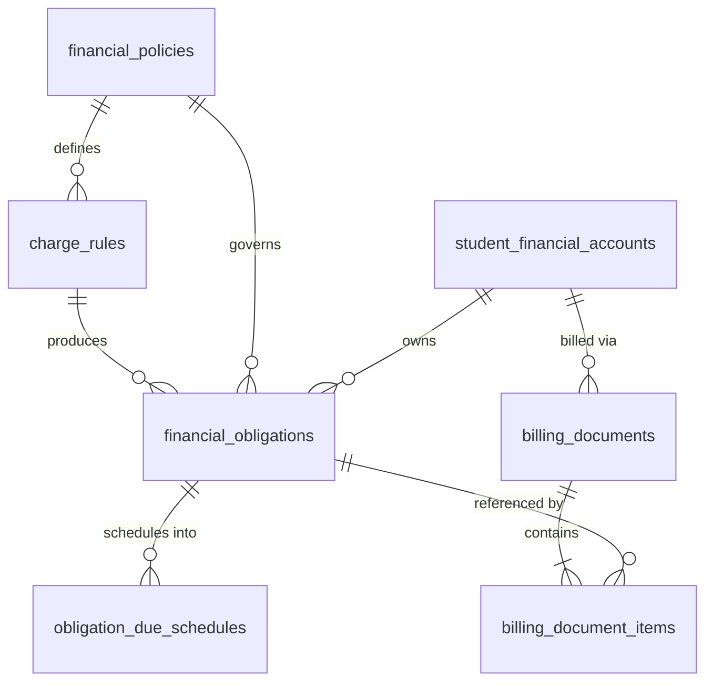
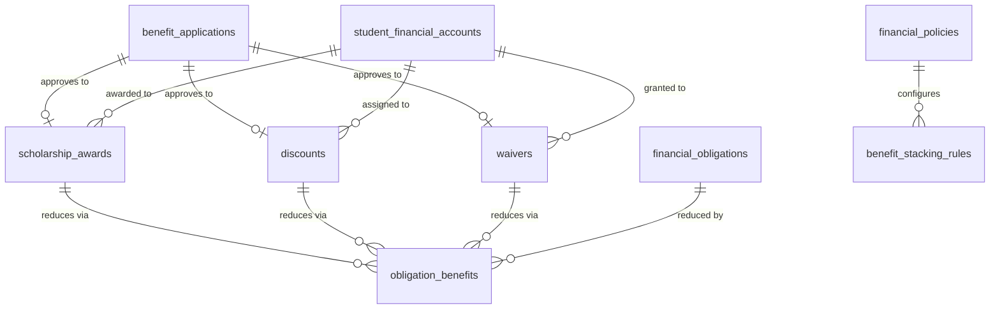
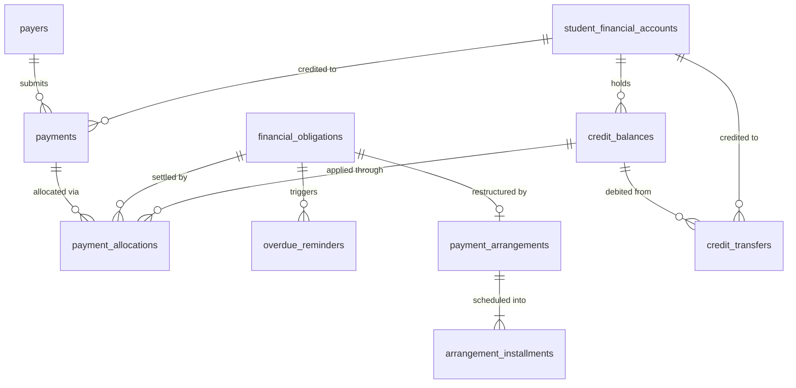
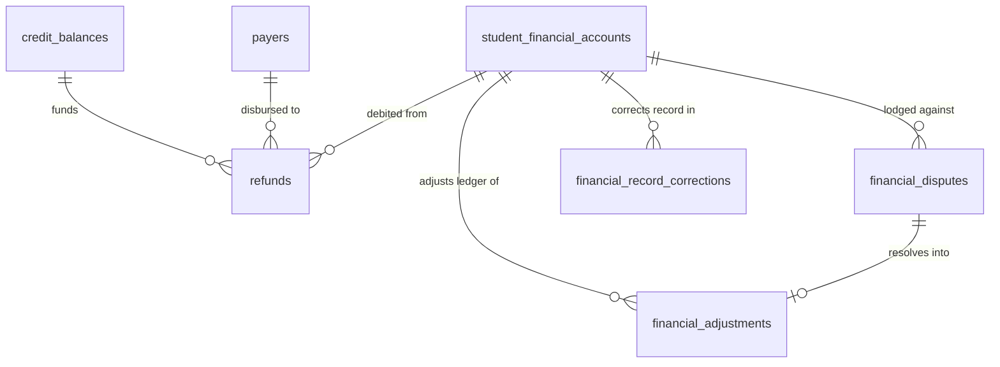
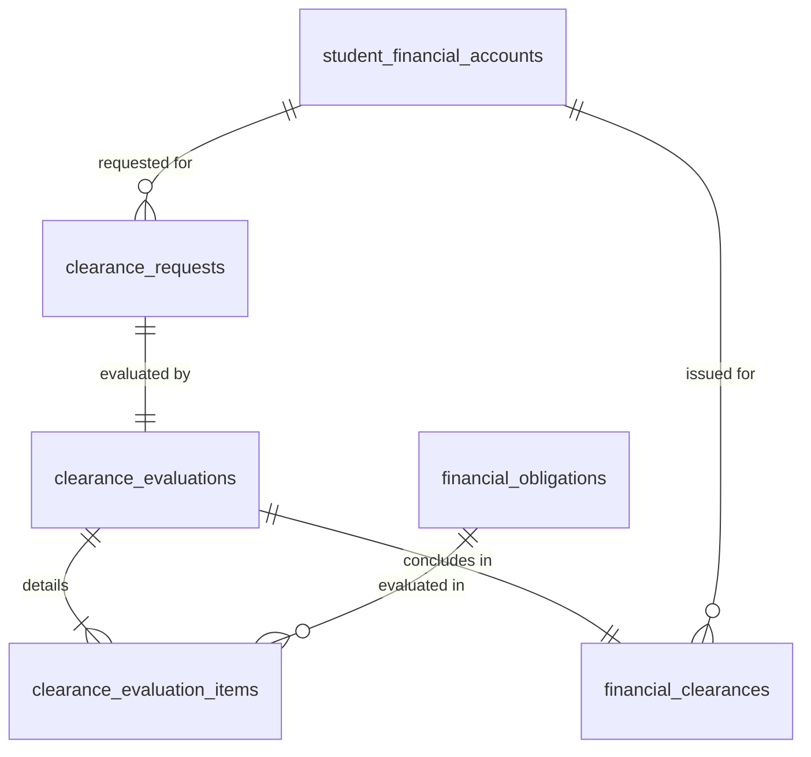

# Finance Domain — Database Tables by Submodule

## Source Documents

- [finance-domain.md](file:///d:/Project.Private/elsasa-sis-v3/domains/finance-domain.md) — Finance Domain definition
- [finance-entities.md](file:///d:/Project.Private/elsasa-sis-v3/entities/finance-entities.md) — Entity identification by submodule and resolved architectural decisions
- [sub-modul-and-development-phases.md](file:///d:/Project.Private/elsasa-sis-v3/sub-modul-and-development-phases.md) — Module decomposition and three-stage implementation roadmap

## Conventions

- **PK** — Primary Key
- **FK** — Foreign Key (logical; referencing another table in this domain or an external domain)
- **UQ** — Unique constraint
- All tables include `created_at`, `updated_at`, and `created_by` audit columns (omitted from key-column listings for brevity)
- **UUID** is used as the primary key type throughout to support distributed scaling and consistency across domains
- **Monetary Amounts & Currency:** All monetary columns store exact integer amounts in Indonesian Rupiah (IDR) using `BIGINT` (zero decimal places), accompanied by an explicit `currency_code VARCHAR NOT NULL DEFAULT 'IDR'` column per Resolved Decision 6
- Columns marked *(nullable)* support progressive information collection and optional attributes
- External domain references (Students, Operations, Academics, Development) are stored as opaque identifiers; this domain does not own or modify those tables
- Entity status values and type discriminators are stored as `VARCHAR` with application-level validation, consistent with Student and Academic domain conventions

---

## Submodule 1 — Obligations & Billing

**Module responsibility:** Manage financial policies, charge rules, student financial accounts, obligation assessment, due schedules, and billing/statement communications.

### 1.1 `financial_policies` — Main Table

| Aspect | Description |
|---|---|
| **Purpose** | Stores approved statements governing financial decisions, obligation assessment rules, due schedules, refunds, clearances, and exceptions. Serves as the authoritative legal/administrative anchor for all financial actions. |
| **Type** | Core |

**Key Columns:**

| Column | Type | Constraint | Description |
|---|---|---|---|
| `id` | UUID | PK | Unique policy identifier |
| `policy_code` | VARCHAR | UQ, NOT NULL | Human-readable traceable code (e.g., `FP-2026-001`) |
| `name` | VARCHAR | NOT NULL | Official policy title |
| `category` | VARCHAR | NOT NULL | Category: `tuition`, `admission_fee`, `scholarship_guideline`, `refund_rule`, `clearance_rule`, `general_fee` |
| `business_purpose` | TEXT | NOT NULL | Objective and policy rationale |
| `applicable_context` | VARCHAR | nullable | Scope context (e.g., "SD Reguler", "All Campuses") |
| `effective_date` | DATE | NOT NULL | Date this policy becomes effective |
| `end_date` | DATE | nullable | Expiration date (`NULL` = currently indefinite) |
| `policy_version` | VARCHAR | NOT NULL, default '1.0' | Policy version identifier |
| `status` | VARCHAR | NOT NULL | Lifecycle state: `draft`, `active`, `superseded`, `retired` |
| `approving_authority` | VARCHAR | NOT NULL | Entity or official who approved the policy (e.g., "Finance Authority / Direktur Keuangan") |
| `approved_date` | DATE | NOT NULL | Date formal approval was granted |
| `supersedes_policy_id` | UUID | FK → `financial_policies.id`, nullable | Reference to previous version this policy replaces |
| `notes` | TEXT | nullable | Internal administrative annotations |

**Example:**

| policy_code | name | category | effective_date | policy_version | status | approving_authority |
|---|---|---|---|---|---|---|
| FP-2026-001 | Kebijakan Uang Pangkal dan SPP TP 2026/2027 | tuition | 2026-07-01 | 1.0 | active | Direktur Keuangan |

> [!NOTE]
> A policy must be formally approved before use. Policies may be superseded or retired, but financial history is never silently rewritten. Historical obligations continue to reference the policy version effective at their issuance date.

---

### 1.2 `charge_rules` — Main Table

| Aspect | Description |
|---|---|
| **Purpose** | Operationalizes a Financial Policy into concrete criteria for assessing student financial obligations. Defines charge types, base amounts, recurrence schedules, and eligibility filters. |
| **Type** | Core |

**Key Columns:**

| Column | Type | Constraint | Description |
|---|---|---|---|
| `id` | UUID | PK | Unique charge rule identifier |
| `rule_code` | VARCHAR | UQ, NOT NULL | Human-readable rule reference (e.g., `CR-2026-SPP-SD`) |
| `policy_id` | UUID | FK → `financial_policies.id`, NOT NULL | Parent governing financial policy |
| `name` | VARCHAR | NOT NULL | Rule description (e.g., "SPP Bulanan SD Reguler TP 2026/2027") |
| `charge_type` | VARCHAR | NOT NULL | Charge category: `tuition`, `admission_fee`, `enrollment_fee`, `activity_fee`, `exam_fee`, `course_fee`, `deposit`, `financial_penalty`, `other` |
| `is_mandatory` | BOOLEAN | NOT NULL, default true | Flag indicating if non-settlement blocks clearance workflows |
| `determination_method` | VARCHAR | NOT NULL | Method: `fixed_amount`, `tier_based`, `credit_based` |
| `base_amount` | BIGINT | NOT NULL | Base charge value in IDR |
| `currency_code` | VARCHAR | NOT NULL, default 'IDR' | Base currency identifier |
| `recurrence_pattern` | VARCHAR | NOT NULL | Timing: `one_time`, `monthly`, `per_semester`, `per_term`, `annual` |
| `due_rule_type` | VARCHAR | NOT NULL | Rule basis: `fixed_day_of_month`, `days_after_issuance`, `fixed_calendar_date` |
| `due_rule_value` | VARCHAR | NOT NULL | Parameter value (e.g., "10" for 10th of every month; "14" for 14 days) |
| `applicable_grade` | VARCHAR | nullable | Applicable grade level (e.g., "Grade 1") |
| `applicable_program` | VARCHAR | nullable | Target academic program (e.g., "SD Reguler") |
| `status` | VARCHAR | NOT NULL | Operational status: `active`, `archived` |
| `notes` | TEXT | nullable | Configuration notes |

**Example:**

| rule_code | policy_id | name | charge_type | is_mandatory | base_amount | currency_code | recurrence_pattern | due_rule_value | status |
|---|---|---|---|---|---|---|---|---|---|
| CR-2026-SPP-SD | `fp-001...` | SPP Bulanan SD Reguler | tuition | true | 750000 | IDR | monthly | 10 | active |
| CR-2026-UP-SD | `fp-001...` | Uang Pangkal Siswa Baru SD | admission_fee | true | 15000000 | IDR | one_time | 14 | active |

---

### 1.3 `student_financial_accounts` — Main Table

| Aspect | Description |
|---|---|
| **Purpose** | The central anchor entity representing the coherent financial position and history of a student with the school. Maintains a strict 1:1 relationship with the external Student identity (Resolved Decision 5). |
| **Type** | Core |

**Key Columns:**

| Column | Type | Constraint | Description |
|---|---|---|---|
| `id` | UUID | PK | Unique account identifier |
| `account_number` | VARCHAR | UQ, NOT NULL | Traceable human-readable account code (e.g., `ACC-2026-0108`) |
| `student_id` | UUID | FK → external `students.id`, UQ, NOT NULL | Authoritative student identity reference (strictly 1:1) |
| `currency_code` | VARCHAR | NOT NULL, default 'IDR' | Base currency for this account |
| `account_status` | VARCHAR | NOT NULL | Account status: `active`, `suspended`, `closed` |
| `opened_date` | DATE | NOT NULL | Date financial account was established |
| `closed_date` | DATE | nullable | Date account was formally terminated |
| `notes` | TEXT | nullable | Administrative notes |

**Example:**

| account_number | student_id | currency_code | account_status | opened_date |
|---|---|---|---|---|
| ACC-2026-0108 | `std-2026-0108...` | IDR | active | 2026-07-01 |

> [!IMPORTANT]
> The account balance is **not** an independently editable column. Balance is always a derived result dynamically computed from obligations, benefits, payments, credits, and adjustments. Accounts are strictly student-centric; no multi-student pooled ledgers exist.

---

### 1.4 `financial_obligations` — Main Table

| Aspect | Description |
|---|---|
| **Purpose** | Represents an amount the student is required to pay to the school under an approved policy, rule, or authorized administrative decision. |
| **Type** | Core |

**Key Columns:**

| Column | Type | Constraint | Description |
|---|---|---|---|
| `id` | UUID | PK | Unique obligation identifier |
| `obligation_number` | VARCHAR | UQ, NOT NULL | Human-readable traceable code (e.g., `OBL-2026-0108-001`) |
| `student_account_id` | UUID | FK → `student_financial_accounts.id`, NOT NULL | Student financial account bearing the liability |
| `student_id` | UUID | FK → external `students.id`, NOT NULL | Denormalized student reference for fast indexing |
| `charge_rule_id` | UUID | FK → `charge_rules.id`, nullable | Generating charge rule (`NULL` for authorized ad-hoc manual charges) |
| `policy_id` | UUID | FK → `financial_policies.id`, NOT NULL | Governing financial policy anchor |
| `description` | VARCHAR | NOT NULL | Descriptive title (e.g., "SPP Bulan Juli 2026") |
| `charge_type` | VARCHAR | NOT NULL | Classification: `tuition`, `admission_fee`, `enrollment_fee`, `activity_fee`, `exam_fee`, `course_fee`, `deposit`, `financial_penalty`, `other` |
| `is_mandatory` | BOOLEAN | NOT NULL, default true | Whether this obligation blocks clearance workflows |
| `original_amount` | BIGINT | NOT NULL | Original assessed liability amount in IDR |
| `currency_code` | VARCHAR | NOT NULL, default 'IDR' | Base currency |
| `issue_date` | DATE | NOT NULL | Date obligation was generated and issued |
| `due_date` | DATE | NOT NULL | Primary settlement deadline |
| `academic_period_id` | UUID | FK → external (Operations), NOT NULL | Academic period context |
| `academic_period_label` | VARCHAR | NOT NULL | Human-readable period label (e.g., "TP 2026/2027 - S1") |
| `status` | VARCHAR | NOT NULL | State: `assessed`, `issued`, `partially_settled`, `settled`, `cancelled`, `adjusted` |
| `authorized_by` | VARCHAR | NOT NULL | Official or process that authorized issuance |
| `notes` | TEXT | nullable | Internal notes |

**Example:**

| obligation_number | student_account_id | charge_type | is_mandatory | original_amount | due_date | academic_period_label | status |
|---|---|---|---|---|---|---|---|
| OBL-2026-0108-001 | `acc-0108...` | tuition | true | 4500000 | 2026-08-01 | TP 2026/2027 - S1 | issued |
| OBL-2026-0108-002 | `acc-0108...` | activity_fee | false | 250000 | 2026-08-15 | TP 2026/2027 - S1 | issued |

---

### 1.5 `obligation_due_schedules` — Supporting Table

| Aspect | Description |
|---|---|
| **Purpose** | Stores scheduled installment dates and split amounts attached to an obligation upon issuance (initial standard schedule under policy). |
| **Type** | Supporting |

**Key Columns:**

| Column | Type | Constraint | Description |
|---|---|---|---|
| `id` | UUID | PK | Unique due schedule identifier |
| `obligation_id` | UUID | FK → `financial_obligations.id`, NOT NULL | Parent obligation |
| `installment_sequence` | INT | NOT NULL | Sequence index (e.g., 1, 2, 3) |
| `due_date` | DATE | NOT NULL | Due date for this installment |
| `scheduled_amount` | BIGINT | NOT NULL | Amount due in this installment in IDR |
| `currency_code` | VARCHAR | NOT NULL, default 'IDR' | Base currency |
| `status` | VARCHAR | NOT NULL | Status: `pending`, `settled`, `overdue`, `revised` |
| `notes` | TEXT | nullable | Schedule notes |

**Example:**

| obligation_id | installment_sequence | due_date | scheduled_amount | status |
|---|---|---|---|---|
| `obl-001...` | 1 | 2026-08-01 | 2250000 | settled |
| `obl-001...` | 2 | 2026-11-01 | 2250000 | pending |

> [!NOTE]
> `obligation_due_schedules` represents the *initial* payment timetable assigned at obligation issuance. If a family later experiences hardship and renegotiates an overdue obligation, that process is handled separately via `payment_arrangements` in Submodule 3.

---

### 1.6 `billing_documents` — Main Table

| Aspect | Description |
|---|---|
| **Purpose** | Represents an authorized point-in-time bill (invoice) or periodic financial statement delivered to an authorized recipient (Resolved Decision 1). |
| **Type** | Core |

**Key Columns:**

| Column | Type | Constraint | Description |
|---|---|---|---|
| `id` | UUID | PK | Unique document identifier |
| `document_number` | VARCHAR | UQ, NOT NULL | Traceable reference (e.g., `BIL-2026-0108-001` or `STM-2026-0108-Q3`) |
| `student_account_id` | UUID | FK → `student_financial_accounts.id`, NOT NULL | Associated student account |
| `student_id` | UUID | FK → external `students.id`, NOT NULL | Associated student |
| `document_type` | VARCHAR | NOT NULL | Type discriminator: `bill`, `statement` |
| `recipient_name` | VARCHAR | NOT NULL | Name of recipient (parent/guardian/sponsor) |
| `recipient_relationship` | VARCHAR | NOT NULL | Relationship: `mother`, `father`, `guardian`, `corporate_sponsor`, `self`, `other` |
| `recipient_contact` | VARCHAR | NOT NULL | Email, phone, or physical address used for dispatch |
| `billing_period_start` | DATE | nullable | Scope start date (mandatory for statements) |
| `billing_period_end` | DATE | nullable | Scope end date (mandatory for statements) |
| `issue_date` | DATE | NOT NULL | Date document was created and approved |
| `payment_due_date` | DATE | nullable | Payment deadline (applicable to bills) |
| `total_billed_amount` | BIGINT | NOT NULL | Total gross amount presented in IDR |
| `currency_code` | VARCHAR | NOT NULL, default 'IDR' | Base currency |
| `delivery_channel` | VARCHAR | NOT NULL | Channel: `email`, `portal`, `whatsapp`, `printed` |
| `delivery_status` | VARCHAR | NOT NULL | State: `draft`, `issued`, `sent`, `delivered`, `failed` |
| `sent_at` | TIMESTAMP | nullable | Timestamp of delivery transmission |
| `notes` | TEXT | nullable | Communication notes |

**Example:**

| document_number | document_type | recipient_name | total_billed_amount | payment_due_date | delivery_channel | delivery_status |
|---|---|---|---|---|---|---|
| BIL-2026-0108-001 | bill | Ibu Sari Kusuma Wijaya | 4500000 | 2026-08-01 | email | delivered |
| STM-2026-0108-Q3 | statement | Ibu Sari Kusuma Wijaya | 12500000 | *(null)* | portal | delivered |

---

### 1.7 `billing_document_items` — Supporting Table

| Aspect | Description |
|---|---|
| **Purpose** | Preserves the frozen, immutable line items rendered inside a billing document, linking to underlying obligations, benefits, payments, or adjustments. |
| **Type** | Supporting |

**Key Columns:**

| Column | Type | Constraint | Description |
|---|---|---|---|
| `id` | UUID | PK | Unique item identifier |
| `billing_document_id` | UUID | FK → `billing_documents.id`, NOT NULL | Parent billing document |
| `line_sequence` | INT | NOT NULL | Display order on the document |
| `item_type` | VARCHAR | NOT NULL | Classification: `obligation`, `benefit_reduction`, `payment_credit`, `adjustment` |
| `reference_entity_type` | VARCHAR | NOT NULL | Target table: `financial_obligations`, `obligation_benefits`, `payment_allocations`, `financial_adjustments` |
| `reference_entity_id` | UUID | NOT NULL | Primary key of referenced transaction record |
| `description` | VARCHAR | NOT NULL | Frozen text snapshot (e.g., "SPP Semester 1 TP 2026/2027") |
| `amount` | BIGINT | NOT NULL | Amount in IDR (negative for reductions/credits, positive for obligations) |
| `currency_code` | VARCHAR | NOT NULL, default 'IDR' | Base currency |

**Example:**

| billing_document_id | line_sequence | item_type | description | amount |
|---|---|---|---|---|
| `bil-001...` | 1 | obligation | SPP Semester 1 TP 2026/2027 | 4500000 |
| `bil-001...` | 2 | benefit_reduction | Diskon Kakak-Adik (10%) | -450000 |

---

## Submodule 2 — Benefits

**Module responsibility:** Manage scholarships, discounts, and waivers — intake applications, award grants, benefit stacking, reductions on obligations, renewal, and revocation.

### 2.1 `benefit_applications` — Supporting Table

| Aspect | Description |
|---|---|
| **Purpose** | Serves as the intake and workflow entry point for benefit requests, nominations, and assistance proposals prior to approval. |
| **Type** | Supporting |

**Key Columns:**

| Column | Type | Constraint | Description |
|---|---|---|---|
| `id` | UUID | PK | Unique application identifier |
| `application_number` | VARCHAR | UQ, NOT NULL | Traceable reference (e.g., `BNA-2026-0042`) |
| `student_id` | UUID | FK → external `students.id`, NOT NULL | Target student |
| `student_account_id` | UUID | FK → `student_financial_accounts.id`, NOT NULL | Student financial account |
| `applicant_name` | VARCHAR | NOT NULL | Nominator/applicant name |
| `applicant_role` | VARCHAR | NOT NULL | Role: `parent_guardian`, `teacher`, `student`, `school_staff`, `sponsor` |
| `benefit_category` | VARCHAR | NOT NULL | Category: `scholarship`, `discount`, `waiver` |
| `requested_benefit_name` | VARCHAR | NOT NULL | Desired benefit title |
| `justification_reason` | TEXT | NOT NULL | Detailed justification narrative |
| `supporting_evidence_reference` | VARCHAR | nullable | Document attachment storage key or reference |
| `academic_recommendation_ref` | VARCHAR | nullable | External recommendation reference from Academics domain |
| `development_recommendation_ref` | VARCHAR | nullable | External recommendation reference from Development domain |
| `submission_date` | DATE | NOT NULL | Date application was logged |
| `status` | VARCHAR | NOT NULL | Workflow state: `submitted`, `under_review`, `approved`, `rejected`, `withdrawn` |
| `reviewed_by` | VARCHAR | nullable | Reviewing officer |
| `review_date` | DATE | nullable | Date of review decision |
| `review_notes` | TEXT | nullable | Internal committee or officer comments |

**Example:**

| application_number | student_id | benefit_category | requested_benefit_name | submission_date | status | reviewed_by |
|---|---|---|---|---|---|---|
| BNA-2026-0042 | `std-0108...` | scholarship | Beasiswa Prestasi Akademik | 2026-05-10 | approved | Tim Beasiswa |

---

### 2.2 `scholarship_awards` — Main Table

| Aspect | Description |
|---|---|
| **Purpose** | Represents an approved scholarship grant reducing student obligations for a defined period and purpose. Tracks renewal and revocation lifecycles. |
| **Type** | Core |

**Key Columns:**

| Column | Type | Constraint | Description |
|---|---|---|---|
| `id` | UUID | PK | Unique award identifier |
| `award_number` | VARCHAR | UQ, NOT NULL | Human-readable traceable code (e.g., `SCH-2026-0042`) |
| `benefit_application_id` | UUID | FK → `benefit_applications.id`, nullable | Originating application (`NULL` if executive award) |
| `student_id` | UUID | FK → external `students.id`, NOT NULL | Beneficiary student |
| `student_account_id` | UUID | FK → `student_financial_accounts.id`, NOT NULL | Beneficiary student financial account |
| `policy_id` | UUID | FK → `financial_policies.id`, NOT NULL | Governing scholarship policy |
| `scholarship_name` | VARCHAR | NOT NULL | Award title (e.g., "Beasiswa Prestasi Akademik") |
| `scholarship_type` | VARCHAR | NOT NULL | Type: `academic_merit`, `need_based`, `sports_arts`, `staff_benefit`, `founder_special` |
| `amount_type` | VARCHAR | NOT NULL | Value model: `percentage`, `fixed_amount` |
| `award_value` | DECIMAL(12,2) | NOT NULL | Value (e.g., `50.00` for 50%, or `2500000` for Rp 2.500.000) |
| `currency_code` | VARCHAR | NOT NULL, default 'IDR' | Base currency |
| `applicable_charge_type` | VARCHAR | NOT NULL, default 'tuition' | Target charge category eligible for reduction |
| `academic_period_id` | UUID | FK → external (Operations), NOT NULL | Academic period validity |
| `academic_period_label` | VARCHAR | NOT NULL | Period label (e.g., "TP 2026/2027") |
| `effective_date` | DATE | NOT NULL | Award start date |
| `expiry_date` | DATE | NOT NULL | Award end date |
| `is_renewable` | BOOLEAN | NOT NULL, default false | Whether the award can be extended upon review |
| `renewal_review_date` | DATE | nullable | Scheduled review date for continuation |
| `status` | VARCHAR | NOT NULL | State: `active`, `renewed`, `suspended`, `revoked`, `expired` |
| `authorized_by` | VARCHAR | NOT NULL | Finance authority who approved the grant |
| `award_date` | DATE | NOT NULL | Formal award date |
| `revocation_reason` | TEXT | nullable | Reason if revoked |
| `revoked_by` | VARCHAR | nullable | Authority who ordered revocation |
| `revoked_at` | DATE | nullable | Date of revocation |
| `notes` | TEXT | nullable | Administrative notes |

**Example:**

| award_number | scholarship_name | amount_type | award_value | applicable_charge_type | is_renewable | status | authorized_by |
|---|---|---|---|---|---|---|---|
| SCH-2026-0042 | Beasiswa Prestasi Akademik | percentage | 50.00 | tuition | true | active | Direktur Keuangan |

> [!NOTE]
> Academics or Development provides evidence and recommendations only. Finance owns the financial decision and monetary reduction. The scholarship award must not alter academic grades or behavioural outcomes.

---

### 2.3 `discounts` — Main Table

| Aspect | Description |
|---|---|
| **Purpose** | Represents an approved reduction of an obligation calculated under policy criteria (e.g., sibling discount, early bird discount, corporate rate). |
| **Type** | Core |

**Key Columns:**

| Column | Type | Constraint | Description |
|---|---|---|---|
| `id` | UUID | PK | Unique discount identifier |
| `discount_number` | VARCHAR | UQ, NOT NULL | Traceable reference (e.g., `DSC-2026-0108-001`) |
| `benefit_application_id` | UUID | FK → `benefit_applications.id`, nullable | Originating application (if applicable) |
| `student_id` | UUID | FK → external `students.id`, NOT NULL | Beneficiary student |
| `student_account_id` | UUID | FK → `student_financial_accounts.id`, NOT NULL | Associated student account |
| `policy_id` | UUID | FK → `financial_policies.id`, NOT NULL | Governing discount policy |
| `discount_name` | VARCHAR | NOT NULL | Descriptive name (e.g., "Diskon Kakak-Adik (Sibling Discount)") |
| `discount_type` | VARCHAR | NOT NULL | Type: `sibling`, `early_bird`, `corporate_partnership`, `alumni_family`, `promotional` |
| `calculation_type` | VARCHAR | NOT NULL | Formula: `percentage`, `fixed_amount` |
| `discount_value` | DECIMAL(12,2) | NOT NULL | Value (e.g., `10.00` for 10%, or `500000` for Rp 500.000) |
| `currency_code` | VARCHAR | NOT NULL, default 'IDR' | Base currency |
| `applicable_charge_type` | VARCHAR | NOT NULL | Target charge type (e.g., `tuition`, `admission_fee`) |
| `academic_period_id` | UUID | FK → external (Operations), NOT NULL | Academic period context |
| `effective_date` | DATE | NOT NULL | Start date |
| `expiry_date` | DATE | NOT NULL | Expiry date |
| `is_renewable` | BOOLEAN | NOT NULL, default true | Auto-renewal eligibility |
| `status` | VARCHAR | NOT NULL | Status: `active`, `revoked`, `expired` |
| `authorized_by` | VARCHAR | NOT NULL | Approving authority |
| `notes` | TEXT | nullable | Discount notes |

**Example:**

| discount_number | discount_name | calculation_type | discount_value | applicable_charge_type | status | authorized_by |
|---|---|---|---|---|---|---|
| DSC-2026-0108-001 | Diskon Kakak-Adik | percentage | 10.00 | tuition | active | Finance Officer |

---

### 2.4 `waivers` — Main Table

| Aspect | Description |
|---|---|
| **Purpose** | Represents an authorized release of some or all of an obligation under explicit authority (e.g., staff child fee release, executive emergency waiver). |
| **Type** | Core |

**Key Columns:**

| Column | Type | Constraint | Description |
|---|---|---|---|
| `id` | UUID | PK | Unique waiver identifier |
| `waiver_number` | VARCHAR | UQ, NOT NULL | Traceable reference (e.g., `WVR-2026-0108-001`) |
| `benefit_application_id` | UUID | FK → `benefit_applications.id`, nullable | Originating application (if applicable) |
| `student_id` | UUID | FK → external `students.id`, NOT NULL | Beneficiary student |
| `student_account_id` | UUID | FK → `student_financial_accounts.id`, NOT NULL | Associated student account |
| `financial_obligation_id` | UUID | FK → `financial_obligations.id`, NOT NULL | Specific target obligation released |
| `policy_id` | UUID | FK → `financial_policies.id`, nullable | Policy reference (if routine staff waiver) |
| `waiver_name` | VARCHAR | NOT NULL | Title (e.g., "Pembebasan Biaya Pendaftaran Guru/Karyawan") |
| `waiver_type` | VARCHAR | NOT NULL | Type: `staff_dependent`, `hardship_release`, `executive_discretion`, `statutory_waiver` |
| `release_type` | VARCHAR | NOT NULL | Scope: `full`, `partial` |
| `waived_amount` | BIGINT | NOT NULL | Amount released in IDR |
| `currency_code` | VARCHAR | NOT NULL, default 'IDR' | Base currency |
| `waiver_reason` | TEXT | NOT NULL | Mandatory explicit reason for release |
| `effective_date` | DATE | NOT NULL | Effective date of waiver |
| `authorized_by` | VARCHAR | NOT NULL | Authority granting the waiver |
| `authority_role` | VARCHAR | NOT NULL | Role: `finance_authority`, `school_principal`, `foundation_board` |
| `status` | VARCHAR | NOT NULL | Status: `active`, `revoked` |
| `notes` | TEXT | nullable | Waiver notes |

**Example:**

| waiver_number | financial_obligation_id | waiver_type | release_type | waived_amount | authorized_by | authority_role | status |
|---|---|---|---|---|---|---|---|
| WVR-2026-0108-001 | `obl-001...` | staff_dependent | full | 500000 | Dr. Hendra Wijaya | foundation_board | active |

---

### 2.5 `obligation_benefits` — Supporting Table (Application Junction)

| Aspect | Description |
|---|---|
| **Purpose** | Records the exact monetary deduction applied to a specific obligation from an approved scholarship award, discount, or waiver, preserving stacking order and audit traceability. |
| **Type** | Supporting |

**Key Columns:**

| Column | Type | Constraint | Description |
|---|---|---|---|
| `id` | UUID | PK | Unique application identifier |
| `obligation_id` | UUID | FK → `financial_obligations.id`, NOT NULL | Obligation being reduced |
| `benefit_type` | VARCHAR | NOT NULL | Type: `scholarship`, `discount`, `waiver` |
| `scholarship_award_id` | UUID | FK → `scholarship_awards.id`, nullable | Originating scholarship award |
| `discount_id` | UUID | FK → `discounts.id`, nullable | Originating discount rule |
| `waiver_id` | UUID | FK → `waivers.id`, nullable | Originating waiver decision |
| `stacking_order` | INT | NOT NULL, default 1 | Execution sequence (1 = applied first) |
| `deducted_amount` | BIGINT | NOT NULL | Actual monetary reduction in IDR |
| `currency_code` | VARCHAR | NOT NULL, default 'IDR' | Base currency |
| `applied_date` | DATE | NOT NULL | Date reduction was applied |
| `applied_by` | VARCHAR | NOT NULL | System process or actor |
| `status` | VARCHAR | NOT NULL | Status: `active`, `reversed` |
| `notes` | TEXT | nullable | Audit notes |

**Example:**

| obligation_id | benefit_type | scholarship_award_id | discount_id | stacking_order | deducted_amount | status |
|---|---|---|---|---|---|---|
| `obl-001...` | scholarship | `sch-0042...` | *(null)* | 1 | 2250000 | active |
| `obl-001...` | discount | *(null)* | `dsc-001...` | 2 | 225000 | active |

---

### 2.6 `benefit_stacking_rules` — Reference / Policy Table

| Aspect | Description |
|---|---|
| **Purpose** | Configures approved rules governing whether and how multiple benefit categories can be combined on a single obligation and their calculation order. |
| **Type** | Reference / Configuration |

**Key Columns:**

| Column | Type | Constraint | Description |
|---|---|---|---|
| `id` | UUID | PK | Unique rule identifier |
| `policy_id` | UUID | FK → `financial_policies.id`, NOT NULL | Governing policy |
| `primary_benefit_type` | VARCHAR | NOT NULL | First benefit type: `scholarship`, `discount`, `waiver` |
| `secondary_benefit_type` | VARCHAR | NOT NULL | Second benefit type: `scholarship`, `discount`, `waiver` |
| `is_stackable` | BOOLEAN | NOT NULL | Whether both benefits may coexist |
| `priority_order` | INT | NOT NULL | Execution priority sequence |
| `calculation_basis` | VARCHAR | NOT NULL | Base: `original_amount`, `remaining_balance_after_prior_benefit` |
| `notes` | TEXT | nullable | Rule explanation |

**Example:**

| policy_id | primary_benefit_type | secondary_benefit_type | is_stackable | priority_order | calculation_basis |
|---|---|---|---|---|---|
| `fp-001...` | scholarship | discount | true | 2 | remaining_balance_after_prior_benefit |
| `fp-001...` | scholarship | scholarship | false | 1 | original_amount |

---

## Submodule 3 — Payments & Receivables

**Module responsibility:** Manage payers, payment intake and confirmation, allocation and reallocation, receivables aging views, overdue reminders, payment arrangements, credits, and credit transfers.

### 3.1 `payers` — Supporting Table (Shared Entity)

| Aspect | Description |
|---|---|
| **Purpose** | Shared entity representing the legal person or organization making payments. Authoritative for receipt issuance, refund routing, and cross-student sponsor payments (Resolved Decision 4). |
| **Type** | Supporting / Shared |

**Key Columns:**

| Column | Type | Constraint | Description |
|---|---|---|---|
| `id` | UUID | PK | Unique payer identifier |
| `payer_number` | VARCHAR | UQ, NOT NULL | Traceable payer code (e.g., `PYR-2026-0089`) |
| `payer_name` | VARCHAR | NOT NULL | Official name of payer |
| `payer_type` | VARCHAR | NOT NULL | Category: `parent_guardian`, `corporate_sponsor`, `government_embassy`, `foundation`, `other` |
| `identification_number` | VARCHAR | nullable | NIK, NPWP, or corporate registration number |
| `email` | VARCHAR | nullable | Contact email |
| `phone_number` | VARCHAR | nullable | Contact phone number |
| `billing_address` | TEXT | nullable | Physical mailing address |
| `bank_account_name` | VARCHAR | nullable | Default bank account name for refunds |
| `bank_account_number` | VARCHAR | nullable | Default bank account number for refunds |
| `bank_name` | VARCHAR | nullable | Default bank name for refunds |
| `notes` | TEXT | nullable | Sponsor notes or company contacts |

**Example:**

| payer_number | payer_name | payer_type | identification_number | email |
|---|---|---|---|---|
| PYR-2026-0089 | PT Maju Bersama | corporate_sponsor | 01.234.567.8-012.000 | finance@majubersama.com |
| PYR-2026-0108 | Ibu Sari Kusuma Wijaya | parent_guardian | 3201235503820002 | sari.kusuma@gmail.com |

---

### 3.2 `payments` — Main Table

| Aspect | Description |
|---|---|
| **Purpose** | Records payment value submitted and confirmed by the school for student obligations, maintaining separation between submission and confirmation. |
| **Type** | Core |

**Key Columns:**

| Column | Type | Constraint | Description |
|---|---|---|---|
| `id` | UUID | PK | Unique payment identifier |
| `payment_number` | VARCHAR | UQ, NOT NULL | Traceable payment receipt number (e.g., `PAY-2026-0108-001`) |
| `student_account_id` | UUID | FK → `student_financial_accounts.id`, NOT NULL | Student financial account receiving the funds |
| `student_id` | UUID | FK → external `students.id`, NOT NULL | Student reference |
| `payer_id` | UUID | FK → `payers.id`, NOT NULL | Entity that submitted the payment |
| `payment_amount` | BIGINT | NOT NULL | Gross received amount in IDR |
| `currency_code` | VARCHAR | NOT NULL, default 'IDR' | Base currency |
| `payment_method` | VARCHAR | NOT NULL | Method: `bank_transfer`, `cash`, `pos_card`, `qris`, `virtual_account`, `cheque`, `other` |
| `external_reference` | VARCHAR | nullable | Bank transaction reference or gateway code |
| `payment_date` | DATE | NOT NULL | Date payment occurred in banking channel |
| `submission_date` | TIMESTAMP | NOT NULL | Timestamp payment was entered into the system |
| `confirmation_status` | VARCHAR | NOT NULL | Status: `submitted`, `confirmed`, `rejected`, `reversed` |
| `confirmation_date` | TIMESTAMP | nullable | Timestamp of verification |
| `confirmed_by` | VARCHAR | nullable | Cashier or payment officer who validated funds |
| `receipt_number` | VARCHAR | UQ, nullable | Official sequential receipt voucher code |
| `receipt_issued_at` | TIMESTAMP | nullable | Timestamp receipt was generated |
| `notes` | TEXT | nullable | Payment notes |

**Example:**

| payment_number | student_account_id | payer_id | payment_amount | payment_method | external_reference | confirmation_status | confirmed_by |
|---|---|---|---|---|---|---|---|
| PAY-2026-0108-001 | `acc-0108...` | `pyr-0108...` | 2000000 | bank_transfer | BCA-TRF-20260805-1234 | confirmed | Kasir Budi |

---

### 3.3 `payment_allocations` — Main Table

| Aspect | Description |
|---|---|
| **Purpose** | Records the consumption of confirmed payment value or credit against a specific obligation. Supports partial settlement, split allocation, and auditable reallocation. |
| **Type** | Core |

**Key Columns:**

| Column | Type | Constraint | Description |
|---|---|---|---|
| `id` | UUID | PK | Unique allocation identifier |
| `allocation_number` | VARCHAR | UQ, NOT NULL | Traceable allocation code (e.g., `ALC-2026-0108-001`) |
| `student_account_id` | UUID | FK → `student_financial_accounts.id`, NOT NULL | Associated student account |
| `obligation_id` | UUID | FK → `financial_obligations.id`, NOT NULL | Obligation being settled |
| `source_type` | VARCHAR | NOT NULL | Source: `payment`, `credit_balance` |
| `payment_id` | UUID | FK → `payments.id`, nullable | Originating payment (`NULL` if funded from credit) |
| `credit_balance_id` | UUID | FK → `credit_balances.id`, nullable | Originating credit (`NULL` if funded directly from payment) |
| `allocated_amount` | BIGINT | NOT NULL | Amount applied in IDR |
| `currency_code` | VARCHAR | NOT NULL, default 'IDR' | Base currency |
| `allocation_date` | TIMESTAMP | NOT NULL | Timestamp allocation took effect |
| `allocated_by` | VARCHAR | NOT NULL | Officer who executed allocation |
| `status` | VARCHAR | NOT NULL | State: `active`, `reversed`, `superseded` |
| `superseded_by_id` | UUID | FK → `payment_allocations.id`, nullable | Replacement allocation upon reallocation |
| `reversal_reason` | TEXT | nullable | Reason if allocation is reversed |
| `notes` | TEXT | nullable | Allocation notes |

**Example:**

| allocation_number | obligation_id | source_type | payment_id | allocated_amount | status | allocated_by |
|---|---|---|---|---|---|---|
| ALC-2026-0108-001 | `obl-001...` | payment | `pay-001...` | 2000000 | active | Kasir Budi |

---

### 3.4 `v_student_receivables` — Derived Database View (Dynamic Projection)

| Aspect | Description |
|---|---|
| **Purpose** | Dynamic database view computing outstanding student balances, overdue status, and aging brackets directly from obligations, benefits, payments, and adjustments (Resolved Decision 2). |
| **Type** | Derived Database View |

**Projected Columns:**

| Column | Type | Expression / Derivation | Description |
|---|---|---|---|
| `obligation_id` | UUID | `fo.id` | Obligation identifier |
| `obligation_number` | VARCHAR | `fo.obligation_number` | Obligation reference code |
| `student_account_id` | UUID | `fo.student_account_id` | Student financial account |
| `student_id` | UUID | `fo.student_id` | Student identifier |
| `charge_type` | VARCHAR | `fo.charge_type` | Charge category |
| `is_mandatory` | BOOLEAN | `fo.is_mandatory` | Mandatory flag for clearance |
| `due_date` | DATE | `fo.due_date` | Settlement deadline |
| `original_amount` | BIGINT | `fo.original_amount` | Gross assessed liability |
| `total_benefits` | BIGINT | `COALESCE(SUM(ob.deducted_amount), 0)` | Total active scholarship, discount, and waiver deductions |
| `total_adjustments`| BIGINT | `COALESCE(SUM(fa.delta_amount), 0)` | Net monetary adjustments |
| `net_obligation` | BIGINT | `(fo.original_amount - total_benefits + total_adjustments)` | Effective liability amount |
| `total_paid` | BIGINT | `COALESCE(SUM(pa.allocated_amount), 0)` | Total confirmed allocations |
| `outstanding_amount`| BIGINT | `GREATEST(0, net_obligation - total_paid)` | Remaining unsettled balance |
| `is_overdue` | BOOLEAN | `(CURRENT_DATE > fo.due_date AND outstanding_amount > 0)` | Overdue flag |
| `days_overdue` | INT | `GREATEST(0, CURRENT_DATE - fo.due_date)` | Number of elapsed overdue days |
| `aging_bracket` | VARCHAR | `CASE WHEN days_overdue = 0 THEN 'Current' WHEN days_overdue <= 30 THEN '1-30 Days' WHEN days_overdue <= 60 THEN '31-60 Days' WHEN days_overdue <= 90 THEN '61-90 Days' ELSE '90+ Days' END` | Aging category |
| `receivable_status` | VARCHAR | `CASE WHEN outstanding_amount = 0 THEN 'settled' WHEN CURRENT_DATE > fo.due_date THEN 'overdue' ELSE 'current' END` | Operational classification |

**Example Projection:**

| obligation_number | original_amount | total_benefits | net_obligation | total_paid | outstanding_amount | due_date | days_overdue | aging_bracket | receivable_status |
|---|---|---|---|---|---|---|---|---|---|
| OBL-2026-0108-001 | 4500000 | 2475000 | 2025000 | 2000000 | 25000 | 2026-08-01 | 92 | 90+ Days | overdue |

> [!NOTE]
> Maintaining Receivable as a derived view guarantees single-source-of-truth reliability, completely eliminating balance desynchronization between separate tables while providing full aging reporting for school leadership.

---

### 3.5 `overdue_reminders` — Supporting Table

| Aspect | Description |
|---|---|
| **Purpose** | Records authorized overdue notifications delivered to parents, guardians, or financial contacts at various policy stages. |
| **Type** | Supporting |

**Key Columns:**

| Column | Type | Constraint | Description |
|---|---|---|---|
| `id` | UUID | PK | Unique reminder identifier |
| `reminder_number` | VARCHAR | UQ, NOT NULL | Traceable reminder reference (e.g., `REM-2026-0108-001`) |
| `obligation_id` | UUID | FK → `financial_obligations.id`, NOT NULL | Targeted overdue obligation |
| `student_account_id` | UUID | FK → `student_financial_accounts.id`, NOT NULL | Student financial account |
| `reminder_stage` | VARCHAR | NOT NULL | Policy stage: `pre_due`, `shortly_after_due`, `escalated_overdue` |
| `recipient_name` | VARCHAR | NOT NULL | Recipient name |
| `recipient_contact` | VARCHAR | NOT NULL | Destination phone number or email address |
| `delivery_channel` | VARCHAR | NOT NULL | Channel: `email`, `whatsapp`, `letter`, `portal` |
| `outstanding_snapshot` | BIGINT | NOT NULL | Outstanding balance snapshot at dispatch time |
| `currency_code` | VARCHAR | NOT NULL, default 'IDR' | Base currency |
| `sent_at` | TIMESTAMP | NOT NULL | Timestamp message was sent |
| `delivery_status` | VARCHAR | NOT NULL | State: `sent`, `delivered`, `failed` |
| `escalation_level` | INT | NOT NULL, default 1 | Escalation tier (1, 2, 3) |
| `notes` | TEXT | nullable | Delivery remarks |

**Example:**

| reminder_number | obligation_id | reminder_stage | recipient_name | outstanding_snapshot | sent_at | delivery_status |
|---|---|---|---|---|---|---|
| REM-2026-0108-001 | `obl-001...` | shortly_after_due | Ibu Sari Kusuma Wijaya | 25000 | 2026-08-15 09:00:00 | delivered |

---

### 3.6 `payment_arrangements` — Main Table

| Aspect | Description |
|---|---|
| **Purpose** | Represents an approved renegotiation modifying the settlement schedule of an outstanding obligation via installments without reducing the debt amount. |
| **Type** | Core |

**Key Columns:**

| Column | Type | Constraint | Description |
|---|---|---|---|
| `id` | UUID | PK | Unique arrangement identifier |
| `arrangement_number` | VARCHAR | UQ, NOT NULL | Traceable code (e.g., `ARR-2026-0108-001`) |
| `obligation_id` | UUID | FK → `financial_obligations.id`, NOT NULL | Parent obligation being restructured |
| `student_account_id` | UUID | FK → `student_financial_accounts.id`, NOT NULL | Associated student account |
| `total_rescheduled_amount` | BIGINT | NOT NULL | Total principal restructured in IDR |
| `currency_code` | VARCHAR | NOT NULL, default 'IDR' | Base currency |
| `number_of_installments` | INT | NOT NULL | Total agreed installment milestones |
| `reason` | TEXT | NOT NULL | Documented justification for restructuring |
| `requested_date` | DATE | NOT NULL | Date arrangement was proposed |
| `approved_date` | DATE | NOT NULL | Date authorized by Finance Authority |
| `approved_by` | VARCHAR | NOT NULL | Approving Finance Authority |
| `status` | VARCHAR | NOT NULL | State: `active`, `delinquent`, `completed`, `cancelled` |
| `cancellation_reason` | TEXT | nullable | Reason if cancelled |
| `notes` | TEXT | nullable | Arrangement notes |

**Example:**

| arrangement_number | obligation_id | total_rescheduled_amount | number_of_installments | status | approved_by |
|---|---|---|---|---|---|
| ARR-2026-0108-001 | `obl-001...` | 2050000 | 2 | active | Finance Authority |

---

### 3.7 `arrangement_installments` — Supporting Table

| Aspect | Description |
|---|---|
| **Purpose** | Stores individual scheduled milestone payments under an approved Payment Arrangement. A missed milestone triggers arrangement delinquency. |
| **Type** | Supporting |

**Key Columns:**

| Column | Type | Constraint | Description |
|---|---|---|---|
| `id` | UUID | PK | Unique installment identifier |
| `arrangement_id` | UUID | FK → `payment_arrangements.id`, NOT NULL | Parent payment arrangement |
| `installment_sequence` | INT | NOT NULL | Milestone sequence number (e.g., 1, 2) |
| `due_date` | DATE | NOT NULL | Due date for this milestone |
| `scheduled_amount` | BIGINT | NOT NULL | Amount due in IDR |
| `currency_code` | VARCHAR | NOT NULL, default 'IDR' | Base currency |
| `status` | VARCHAR | NOT NULL | Status: `pending`, `paid`, `missed` |
| `settled_at` | TIMESTAMP | nullable | Settlement timestamp |
| `notes` | TEXT | nullable | Milestone remarks |

**Example:**

| arrangement_id | installment_sequence | due_date | scheduled_amount | status |
|---|---|---|---|---|
| `arr-001...` | 1 | 2026-09-15 | 1025000 | paid |
| `arr-001...` | 2 | 2026-10-15 | 1025000 | pending |

---

### 3.8 `credit_balances` — Main Table

| Aspect | Description |
|---|---|
| **Purpose** | Tracks confirmed, unconsumed monetary value belonging to a student account resulting from overpayments, adjustments, or credit transfers. |
| **Type** | Core |

**Key Columns:**

| Column | Type | Constraint | Description |
|---|---|---|---|
| `id` | UUID | PK | Unique credit identifier |
| `credit_number` | VARCHAR | UQ, NOT NULL | Traceable credit code (e.g., `CRD-2026-0108-001`) |
| `student_account_id` | UUID | FK → `student_financial_accounts.id`, NOT NULL | Owning student financial account |
| `source_type` | VARCHAR | NOT NULL | Origin: `overpayment`, `payment_reversal`, `charge_adjustment`, `credit_transfer` |
| `source_entity_type` | VARCHAR | NOT NULL | Table: `payments`, `financial_adjustments`, `credit_transfers` |
| `source_entity_id` | UUID | NOT NULL | Primary key of generating transaction |
| `initial_amount` | BIGINT | NOT NULL | Original credit value in IDR |
| `remaining_amount` | BIGINT | NOT NULL | Available unconsumed credit value in IDR |
| `currency_code` | VARCHAR | NOT NULL, default 'IDR' | Base currency |
| `status` | VARCHAR | NOT NULL | State: `active`, `partially_used`, `exhausted`, `refunded`, `transferred` |
| `created_date` | DATE | NOT NULL | Date credit was recognized |
| `notes` | TEXT | nullable | Credit origin notes |

**Example:**

| credit_number | student_account_id | source_type | initial_amount | remaining_amount | status |
|---|---|---|---|---|---|
| CRD-2026-0108-001 | `acc-0108...` | overpayment | 500000 | 500000 | active |

---

### 3.9 `credit_transfers` — Supporting Table

| Aspect | Description |
|---|---|
| **Purpose** | Atomically records an authorized bilateral transfer of credit value from one student's account to another (e.g., between siblings) (Resolved Decision 8). |
| **Type** | Supporting |

**Key Columns:**

| Column | Type | Constraint | Description |
|---|---|---|---|
| `id` | UUID | PK | Unique transfer identifier |
| `transfer_number` | VARCHAR | UQ, NOT NULL | Traceable code (e.g., `CTF-2026-0001`) |
| `source_credit_balance_id` | UUID | FK → `credit_balances.id`, NOT NULL | Debited credit record |
| `source_student_account_id` | UUID | FK → `student_financial_accounts.id`, NOT NULL | Originating student account |
| `target_student_account_id` | UUID | FK → `student_financial_accounts.id`, NOT NULL | Receiving student account |
| `transfer_amount` | BIGINT | NOT NULL | Value transferred in IDR |
| `currency_code` | VARCHAR | NOT NULL, default 'IDR' | Base currency |
| `relationship_reference` | VARCHAR | NOT NULL | Documented justification (e.g., "Sibling - KK #3201...") |
| `justification` | TEXT | NOT NULL | Approval explanation |
| `authorized_by` | VARCHAR | NOT NULL | Approving Finance Authority |
| `transfer_date` | DATE | NOT NULL | Date transfer was executed |
| `status` | VARCHAR | NOT NULL | Status: `completed`, `cancelled` |
| `resulting_target_credit_id`| UUID | FK → `credit_balances.id`, nullable | Created credit balance record on target account |
| `notes` | TEXT | nullable | Transfer remarks |

**Example:**

| transfer_number | source_student_account_id | target_student_account_id | transfer_amount | relationship_reference | status | authorized_by |
|---|---|---|---|---|---|---|
| CTF-2026-0001 | `acc-0108...` (Rina) | `acc-0109...` (Budi) | 500000 | Sibling - KK #3201... | completed | Finance Authority |

---

## Submodule 4 — Refunds & Adjustments

**Module responsibility:** Manage refund requests, approval, disbursement execution, financial value adjustments, transaction reversals, dispute workflows, and metadata corrections.

### 4.1 `refunds` — Main Table

| Aspect | Description |
|---|---|
| **Purpose** | Manages the authorized return of refundable credit value to an eligible recipient (default: original payer). |
| **Type** | Core |

**Key Columns:**

| Column | Type | Constraint | Description |
|---|---|---|---|
| `id` | UUID | PK | Unique refund identifier |
| `refund_number` | VARCHAR | UQ, NOT NULL | Traceable reference (e.g., `REF-2026-0108-001`) |
| `credit_balance_id` | UUID | FK → `credit_balances.id`, NOT NULL | Source credit balance providing refundable funds |
| `student_account_id` | UUID | FK → `student_financial_accounts.id`, NOT NULL | Associated student account |
| `payer_id` | UUID | FK → `payers.id`, NOT NULL | Authoritative recipient entity |
| `gross_refund_amount` | BIGINT | NOT NULL | Gross claimed credit amount in IDR |
| `deduction_amount` | BIGINT | NOT NULL, default 0 | Administrative or policy deductions in IDR |
| `net_refund_amount` | BIGINT | NOT NULL | Net funds to disburse in IDR |
| `currency_code` | VARCHAR | NOT NULL, default 'IDR' | Base currency |
| `refund_method` | VARCHAR | NOT NULL | Disbursement channel: `bank_transfer`, `cash`, `original_payment_method` |
| `destination_bank_name` | VARCHAR | NOT NULL | Recipient bank name |
| `destination_account_number` | VARCHAR | NOT NULL | Recipient bank account number |
| `destination_account_name` | VARCHAR | NOT NULL | Recipient bank account holder name |
| `request_date` | DATE | NOT NULL | Date refund was requested |
| `requested_by` | VARCHAR | NOT NULL | Requester identity |
| `approval_date` | DATE | nullable | Date approved by Finance Authority |
| `approved_by` | VARCHAR | nullable | Approving Finance Authority |
| `execution_date` | DATE | nullable | Date disbursement was executed |
| `executed_by` | VARCHAR | nullable | Cashier/disbursement officer |
| `disbursement_reference`| VARCHAR | nullable | Bank transfer reference code |
| `status` | VARCHAR | NOT NULL | Lifecycle: `requested`, `under_review`, `approved`, `rejected`, `processing`, `completed`, `failed`, `cancelled` |
| `rejection_or_cancellation_reason` | TEXT | nullable | Reason if rejected or aborted |
| `notes` | TEXT | nullable | Refund notes |

**Example:**

| refund_number | credit_balance_id | payer_id | gross_refund_amount | deduction_amount | net_refund_amount | destination_bank_name | status | approved_by |
|---|---|---|---|---|---|---|---|---|
| REF-2026-0108-001 | `crd-001...` | `pyr-0108...` | 500000 | 25000 | 475000 | Bank Central Asia | completed | Finance Authority |

> [!IMPORTANT]
> Refundable value belongs to the original Payer by default. Approval and execution are distinct stages; approving a refund reserves the credit balance, while execution debits it and logs actual monetary disbursement.

---

### 4.2 `financial_adjustments` — Main Table

| Aspect | Description |
|---|---|
| **Purpose** | Unified entity altering financial balances through partial delta changes (`adjustment`) or complete transaction cancellations (`reversal`) with full auditability (Resolved Decision 3). |
| **Type** | Core |

**Key Columns:**

| Column | Type | Constraint | Description |
|---|---|---|---|
| `id` | UUID | PK | Unique adjustment identifier |
| `adjustment_number` | VARCHAR | UQ, NOT NULL | Traceable code (e.g., `ADJ-2026-0108-001`) |
| `student_account_id` | UUID | FK → `student_financial_accounts.id`, NOT NULL | Targeted student financial account |
| `adjustment_type` | VARCHAR | NOT NULL | Type discriminator: `adjustment` (delta value), `reversal` (full negation) |
| `target_entity_type` | VARCHAR | NOT NULL | Entity type: `financial_obligations`, `payments`, `payment_allocations`, `scholarship_awards`, `discounts`, `waivers` |
| `target_entity_id` | UUID | NOT NULL | Primary key of adjusted record |
| `delta_amount` | BIGINT | NOT NULL | Signed balance impact in IDR (negative for reductions, positive for additions) |
| `currency_code` | VARCHAR | NOT NULL, default 'IDR' | Base currency |
| `reason` | TEXT | NOT NULL | Documented justification |
| `policy_reference` | VARCHAR | nullable | Policy anchor (if applicable) |
| `effective_date` | DATE | NOT NULL | Accounting effective date |
| `authorized_by` | VARCHAR | NOT NULL | Approving Finance Authority |
| `authority_role` | VARCHAR | NOT NULL | Role of authorizer |
| `status` | VARCHAR | NOT NULL | State: `applied`, `cancelled` |
| `notes` | TEXT | nullable | Adjustment remarks |

**Example:**

| adjustment_number | adjustment_type | target_entity_type | target_entity_id | delta_amount | reason | authorized_by | status |
|---|---|---|---|---|---|---|---|
| ADJ-2026-0108-001 | adjustment | financial_obligations | `obl-002...` | -250000 | Keringanan biaya kegiatan | Finance Authority | applied |
| ADJ-2026-0108-002 | reversal | payments | `pay-003...` | -1000000 | Cek bank ditolak / dana kurang | Payment Officer | applied |

---

### 4.3 `financial_disputes` — Main Table

| Aspect | Description |
|---|---|
| **Purpose** | Records formal challenges raised by students, parents, or payers against financial records, tracking investigation through resolution. |
| **Type** | Core |

**Key Columns:**

| Column | Type | Constraint | Description |
|---|---|---|---|
| `id` | UUID | PK | Unique dispute identifier |
| `dispute_number` | VARCHAR | UQ, NOT NULL | Traceable dispute code (e.g., `DIS-2026-0108-001`) |
| `student_account_id` | UUID | FK → `student_financial_accounts.id`, NOT NULL | Student financial account |
| `target_entity_type` | VARCHAR | NOT NULL | Target table: `financial_obligations`, `payments`, `payment_allocations`, `credit_balances` |
| `target_entity_id` | UUID | NOT NULL | Primary key of disputed record |
| `raised_by_name` | VARCHAR | NOT NULL | Claimant name |
| `raised_by_role` | VARCHAR | NOT NULL | Role: `parent_guardian`, `student`, `payer`, `finance_officer` |
| `dispute_reason` | TEXT | NOT NULL | Detailed grounds for dispute |
| `requested_outcome` | VARCHAR | NOT NULL | Desired result: `charge_cancellation`, `charge_reduction`, `reallocation`, `refund`, `other` |
| `evidence_reference` | VARCHAR | nullable | Attachment reference key |
| `submission_date` | DATE | NOT NULL | Date dispute was lodged |
| `status` | VARCHAR | NOT NULL | Status: `submitted`, `under_review`, `accepted`, `partially_accepted`, `rejected`, `withdrawn` |
| `resolved_date` | DATE | nullable | Date determination was finalized |
| `resolved_by` | VARCHAR | nullable | Officer who conducted investigation |
| `resolution_notes` | TEXT | nullable | Investigation findings and explanation |
| `resulting_adjustment_id` | UUID | FK → `financial_adjustments.id`, nullable | Resulting monetary adjustment (if accepted) |

**Example:**

| dispute_number | target_entity_type | raised_by_name | requested_outcome | status | resulting_adjustment_id |
|---|---|---|---|---|---|
| DIS-2026-0108-001 | financial_obligations | Ibu Sari Kusuma Wijaya | charge_cancellation | accepted | `adj-001...` |

---

### 4.4 `financial_record_corrections` — Supporting Table

| Aspect | Description |
|---|---|
| **Purpose** | Preserves auditable corrections of inaccurate non-monetary metadata (names, dates, typo fixes) in approved financial records without changing monetary values. |
| **Type** | Supporting |

**Key Columns:**

| Column | Type | Constraint | Description |
|---|---|---|---|
| `id` | UUID | PK | Unique correction identifier |
| `correction_number` | VARCHAR | UQ, NOT NULL | Traceable reference (e.g., `COR-2026-0108-001`) |
| `student_account_id` | UUID | FK → `student_financial_accounts.id`, NOT NULL | Associated student account |
| `target_entity_type` | VARCHAR | NOT NULL | Entity modified: `payments`, `payers`, `billing_documents`, `financial_obligations` |
| `target_entity_id` | UUID | NOT NULL | Primary key of modified record |
| `field_name` | VARCHAR | NOT NULL | Name of corrected database column |
| `original_value` | TEXT | NOT NULL | Historical value before correction |
| `corrected_value` | TEXT | NOT NULL | Updated value |
| `reason` | TEXT | NOT NULL | Reason for correction |
| `corrected_by` | VARCHAR | NOT NULL | Billing Officer or Cashier |
| `correction_date` | TIMESTAMP | NOT NULL | Timestamp of record change |
| `notes` | TEXT | nullable | Audit remarks |

**Example:**

| correction_number | target_entity_type | field_name | original_value | corrected_value | reason | corrected_by |
|---|---|---|---|---|---|---|
| COR-2026-0108-001 | payers | payer_name | Sari Kusuma | Sari Kusuma Wijaya | Perbaikan nama sesuai KTP | Billing Officer |

---

## Submodule 5 — Financial Clearance

**Module responsibility:** Evaluate and grant purpose-specific financial clearances for student lifecycle transitions (Transfer Out, Graduation, Re-enrollment).

### 5.1 `clearance_requests` — Supporting Table

| Aspect | Description |
|---|---|
| **Purpose** | Represents a formal request from an authorized lifecycle workflow (primarily Student domain) asking Finance to evaluate financial prerequisites. |
| **Type** | Supporting |

**Key Columns:**

| Column | Type | Constraint | Description |
|---|---|---|---|
| `id` | UUID | PK | Unique request identifier |
| `request_number` | VARCHAR | UQ, NOT NULL | Traceable code (e.g., `CLRQ-2026-0108-001`) |
| `student_account_id` | UUID | FK → `student_financial_accounts.id`, NOT NULL | Student financial account |
| `student_id` | UUID | FK → external `students.id`, NOT NULL | Target student |
| `clearance_purpose` | VARCHAR | NOT NULL | Purpose: `transfer_out`, `graduation`, `re_enrollment`, `other_configurable` |
| `requesting_domain` | VARCHAR | NOT NULL, default 'student' | Originating domain |
| `requesting_actor` | VARCHAR | NOT NULL | Staff member who initiated the transition |
| `request_date` | DATE | NOT NULL | Date request was lodged |
| `context_description` | TEXT | nullable | Academic or lifecycle context |
| `status` | VARCHAR | NOT NULL | Workflow state: `requested`, `under_evaluation`, `completed`, `cancelled` |
| `notes` | TEXT | nullable | Request notes |

**Example:**

| request_number | student_id | clearance_purpose | requesting_domain | request_date | status |
|---|---|---|---|---|---|
| CLRQ-2026-0108-001 | `std-0108...` | graduation | student | 2026-11-10 | completed |

---

### 5.2 `clearance_evaluations` — Supporting Table

| Aspect | Description |
|---|---|
| **Purpose** | Preserves the comprehensive evaluation work, obligation counts, blocker balances, and rationale behind a clearance determination. |
| **Type** | Supporting |

**Key Columns:**

| Column | Type | Constraint | Description |
|---|---|---|---|
| `id` | UUID | PK | Unique evaluation identifier |
| `clearance_request_id` | UUID | FK → `clearance_requests.id`, NOT NULL | Parent clearance request |
| `student_account_id` | UUID | FK → `student_financial_accounts.id`, NOT NULL | Student financial account |
| `evaluation_date` | TIMESTAMP | NOT NULL | Timestamp evaluation was conducted |
| `evaluated_by` | VARCHAR | NOT NULL | Evaluating Finance Officer |
| `total_obligations_evaluated`| INT | NOT NULL | Count of all obligations checked |
| `total_mandatory_evaluated` | INT | NOT NULL | Count of mandatory obligations checked |
| `unsettled_mandatory_count` | INT | NOT NULL | Count of unsettled mandatory obligations |
| `total_blocking_amount` | BIGINT | NOT NULL | Sum of outstanding mandatory obligations in IDR |
| `currency_code` | VARCHAR | NOT NULL, default 'IDR' | Base currency |
| `is_eligible` | BOOLEAN | NOT NULL | Algorithmic eligibility flag (`true` if `total_blocking_amount == 0`) |
| `evaluation_notes` | TEXT | nullable | Evaluator comments |

**Example:**

| clearance_request_id | evaluated_by | total_mandatory_evaluated | unsettled_mandatory_count | total_blocking_amount | is_eligible |
|---|---|---|---|---|---|
| `clrq-001...` | Staf Keuangan Dewi | 5 | 1 | 150000 | false |

---

### 5.3 `clearance_evaluation_items` — Supporting Table (Junction)

| Aspect | Description |
|---|---|
| **Purpose** | Granular breakdown linking an evaluation to each evaluated obligation, preserving its settlement state and whether it acts as a blocking item. |
| **Type** | Supporting |

**Key Columns:**

| Column | Type | Constraint | Description |
|---|---|---|---|
| `id` | UUID | PK | Unique evaluation item identifier |
| `clearance_evaluation_id` | UUID | FK → `clearance_evaluations.id`, NOT NULL | Parent evaluation record |
| `obligation_id` | UUID | FK → `financial_obligations.id`, NOT NULL | Evaluated obligation |
| `is_mandatory` | BOOLEAN | NOT NULL | Whether policy marks this obligation mandatory for clearance |
| `obligation_status` | VARCHAR | NOT NULL | Obligation status at evaluation time |
| `outstanding_amount` | BIGINT | NOT NULL | Outstanding balance at evaluation time in IDR |
| `currency_code` | VARCHAR | NOT NULL, default 'IDR' | Base currency |
| `is_blocking` | BOOLEAN | NOT NULL | Whether this item actively blocks clearance |

**Example:**

| clearance_evaluation_id | obligation_id | is_mandatory | outstanding_amount | is_blocking |
|---|---|---|---|---|
| `clre-001...` | `obl-001...` | true | 0 | false |
| `clre-001...` | `obl-007...` | true | 150000 | true |
| `clre-001...` | `obl-002...` | false | 250000 | false |

> [!IMPORTANT]
> Clearance is blocked **only** by outstanding mandatory obligations. Optional fees, credit balances, pending refunds, and non-mandatory activities do not block clearance. Every blocker must be explicitly identifiable and explainable.

---

### 5.4 `financial_clearances` — Main Table

| Aspect | Description |
|---|---|
| **Purpose** | Authoritative purpose-specific clearance determination consumed by other domains (Transfer Out, Graduation). |
| **Type** | Core |

**Key Columns:**

| Column | Type | Constraint | Description |
|---|---|---|---|
| `id` | UUID | PK | Unique clearance identifier |
| `clearance_number` | VARCHAR | UQ, NOT NULL | Traceable reference (e.g., `CLR-2026-0108-001`) |
| `clearance_request_id` | UUID | FK → `clearance_requests.id`, NOT NULL | Originating request |
| `clearance_evaluation_id` | UUID | FK → `clearance_evaluations.id`, NOT NULL | Supporting evaluation rationale |
| `student_account_id` | UUID | FK → `student_financial_accounts.id`, NOT NULL | Student financial account |
| `student_id` | UUID | FK → external `students.id`, NOT NULL | Target student |
| `clearance_purpose` | VARCHAR | NOT NULL | Purpose: `transfer_out`, `graduation`, `re_enrollment`, `other_configurable` |
| `clearance_result` | VARCHAR | NOT NULL | Result: `granted`, `denied`, `conditional`, `cannot_yet_be_determined`, `expired`, `revoked` |
| `determination_date` | DATE | NOT NULL | Date decision was rendered |
| `valid_until` | DATE | nullable | Expiry date of determination |
| `is_exception` | BOOLEAN | NOT NULL, default false | True if clearance was granted via executive waiver |
| `exception_reason` | TEXT | nullable | Mandatory justification if granted by exception |
| `conditions` | TEXT | nullable | Specific requirements if `conditional` |
| `authorized_by` | VARCHAR | NOT NULL | Authorizing official |
| `authority_role` | VARCHAR | NOT NULL | Role: `finance_officer`, `finance_authority` |
| `notes` | TEXT | nullable | Determination notes |

**Example:**

| clearance_number | student_id | clearance_purpose | clearance_result | determination_date | is_exception | authorized_by |
|---|---|---|---|---|---|---|
| CLR-2026-0108-001 | `std-0108...` | graduation | denied | 2026-11-12 | false | Finance Officer |
| CLR-2026-0108-002 | `std-0108...` | graduation | granted | 2026-11-15 | false | Finance Officer |

---

## Cross-Cutting — Financial Event History

### H.1 `financial_events` — Cross-Cutting Supporting Table (Append-Only Log)

| Aspect | Description |
|---|---|
| **Purpose** | Unified append-only chronological log of every material financial action across a student's entire account lifecycle (Resolved Decision 7). |
| **Type** | Cross-Cutting Supporting / Audit Log |

**Key Columns:**

| Column | Type | Constraint | Description |
|---|---|---|---|
| `id` | UUID | PK | Unique event identifier |
| `event_number` | VARCHAR | UQ, NOT NULL | Traceable event code (e.g., `FEV-2026-0108-0047`) |
| `student_account_id` | UUID | FK → `student_financial_accounts.id`, NOT NULL | Associated student account |
| `student_id` | UUID | FK → external `students.id`, NOT NULL | Associated student |
| `event_type` | VARCHAR | NOT NULL | Action category: `policy_applied`, `obligation_issued`, `benefit_awarded`, `benefit_applied`, `bill_issued`, `statement_issued`, `payment_submitted`, `payment_confirmed`, `payment_reversed`, `allocation_created`, `allocation_reversed`, `overdue_reminder_sent`, `arrangement_approved`, `arrangement_delinquent`, `credit_created`, `credit_transferred`, `refund_approved`, `refund_executed`, `dispute_opened`, `dispute_resolved`, `adjustment_applied`, `record_corrected`, `clearance_granted`, `clearance_denied` |
| `entity_type` | VARCHAR | NOT NULL | Database table modified |
| `entity_id` | UUID | NOT NULL | Primary key of subject record |
| `actor_id` | VARCHAR | NOT NULL | Identifier of actor or system user |
| `actor_role` | VARCHAR | NOT NULL | Role: `cashier`, `billing_officer`, `finance_authority`, `parent`, `system` |
| `financial_effect` | VARCHAR | NOT NULL | Accounting effect: `debit`, `credit`, `neutral` |
| `monetary_amount` | BIGINT | nullable | Transaction amount involved in IDR |
| `currency_code` | VARCHAR | NOT NULL, default 'IDR' | Base currency |
| `event_timestamp` | TIMESTAMP | NOT NULL | System recording timestamp |
| `effective_date` | DATE | NOT NULL | Accounting effective date |
| `notes` | TEXT | nullable | Event description |

**Example:**

| event_number | student_account_id | event_type | entity_type | financial_effect | monetary_amount | actor_role | effective_date |
|---|---|---|---|---|---|---|---|
| FEV-2026-0108-0047 | `acc-0108...` | payment_confirmed | payments | credit | 2000000 | cashier | 2026-08-06 |
| FEV-2026-0108-0048 | `acc-0108...` | allocation_created | payment_allocations | neutral | 2000000 | cashier | 2026-08-06 |

---

## Database Schema Relationships & Entity-Relationship Diagrams

### High-Level Domain Architecture

```mermaid
graph TD
    subgraph Obligations_Billing ["1. Obligations & Billing"]
        FP[financial_policies] --> CR[charge_rules]
        CR --> FO[financial_obligations]
        SFA[student_financial_accounts] --> FO
        FO --> ODS[obligation_due_schedules]
        SFA --> BD[billing_documents]
        BD --> BDI[billing_document_items]
        FO -.-> BDI
    end

    subgraph Benefits ["2. Benefits"]
        BA[benefit_applications] --> SA[scholarship_awards]
        BA --> DSC[discounts]
        BA --> WVR[waivers]
        FP --> BSR[benefit_stacking_rules]
        SA --> OB[obligation_benefits]
        DSC --> OB
        WVR --> OB
        FO --> OB
        SFA --> SA
        SFA --> DSC
        SFA --> WVR
    end

    subgraph Payments_Receivables ["3. Payments & Receivables"]
        PYR[payers] --> PAY[payments]
        SFA --> PAY
        PAY --> PA[payment_allocations]
        FO --> PA
        FO -.-> VR[v_student_receivables - View]
        FO --> REM[overdue_reminders]
        FO --> ARR[payment_arrangements]
        ARR --> AI[arrangement_installments]
        SFA --> CB[credit_balances]
        CB --> PA
        CB --> CT[credit_transfers]
        SFA --> CT
    end

    subgraph Refunds_Adjustments ["4. Refunds & Adjustments"]
        CB --> REF[refunds]
        PYR --> REF
        SFA --> REF
        SFA --> ADJ[financial_adjustments]
        SFA --> DIS[financial_disputes]
        DIS -.-> ADJ
        FO -.-> ADJ
        PAY -.-> ADJ
        PA -.-> ADJ
        SFA --> COR[financial_record_corrections]
    end

    subgraph Financial_Clearance ["5. Financial Clearance"]
        CLR_REQ[clearance_requests] --> CLR_EV[clearance_evaluations]
        CLR_EV --> CLR_ITEM[clearance_evaluation_items]
        FO -.-> CLR_ITEM
        CLR_EV --> FC[financial_clearances]
        SFA --> CLR_REQ
        SFA --> FC
    end

    subgraph Cross_Cutting ["Audit History"]
        FE[financial_events]
    end

    SFA -.-> FE
```

---

### Detailed Submodule Relationships

#### Module 1: Obligations & Billing

#### Module 2: Benefits

#### Module 3: Payments & Receivables

#### Module 4: Refunds & Adjustments

#### Module 5: Financial Clearance

---

## Database Tables Summary

| # | Table Name | Submodule | Table Type | Primary Key | Key Foreign Keys | Purpose Summary |
|---|---|---|---|---|---|---|
| 1 | `financial_policies` | Obligations & Billing | Core | `id` | `supersedes_policy_id` | Governing policies, validity periods, and authorities |
| 2 | `charge_rules` | Obligations & Billing | Core | `id` | `policy_id` | Operational criteria for calculating student charges |
| 3 | `student_financial_accounts` | Obligations & Billing | Core | `id` | `student_id` (ext) | 1:1 anchor ledger account per student |
| 4 | `financial_obligations` | Obligations & Billing | Core | `id` | `student_account_id`, `charge_rule_id`, `policy_id`, `academic_period_id` (ext) | Quantified student financial liabilities |
| 5 | `obligation_due_schedules` | Obligations & Billing | Supporting | `id` | `obligation_id` | Standard installment due schedules upon issuance |
| 6 | `billing_documents` | Obligations & Billing | Core | `id` | `student_account_id`, `student_id` (ext) | Unified bills and financial statements sent to contacts |
| 7 | `billing_document_items` | Obligations & Billing | Supporting | `id` | `billing_document_id`, `reference_entity_id` | Frozen line-item snapshot rendered on billing docs |
| 8 | `benefit_applications` | Benefits | Supporting | `id` | `student_id` (ext), `student_account_id` | Workflow intake for scholarships, discounts, waivers |
| 9 | `scholarship_awards` | Benefits | Core | `id` | `benefit_application_id`, `student_account_id`, `policy_id`, `academic_period_id` (ext) | Approved scholarship awards and renewal tracking |
| 10 | `discounts` | Benefits | Core | `id` | `benefit_application_id`, `student_account_id`, `policy_id`, `academic_period_id` (ext) | Policy-driven calculated reductions (e.g. sibling) |
| 11 | `waivers` | Benefits | Core | `id` | `benefit_application_id`, `student_account_id`, `financial_obligation_id` | Authorized releases of obligations (e.g. staff child) |
| 12 | `obligation_benefits` | Benefits | Supporting | `id` | `obligation_id`, `scholarship_award_id`, `discount_id`, `waiver_id` | Application junction deducting value from obligations |
| 13 | `benefit_stacking_rules` | Benefits | Reference | `id` | `policy_id` | Priority and stacking rules between benefit types |
| 14 | `payers` | Payments & Receivables | Supporting | `id` | — | Independent entities making payments and receiving refunds |
| 15 | `payments` | Payments & Receivables | Core | `id` | `student_account_id`, `student_id` (ext), `payer_id` | Received money records from submission to verification |
| 16 | `payment_allocations` | Payments & Receivables | Core | `id` | `student_account_id`, `obligation_id`, `payment_id`, `credit_balance_id` | Settlement matching payment/credit to an obligation |
| 17 | `v_student_receivables` | Payments & Receivables | View | `obligation_id` | `student_account_id`, `obligation_id` | Computed view of balances, overdue aging, and status |
| 18 | `overdue_reminders` | Payments & Receivables | Supporting | `id` | `obligation_id`, `student_account_id` | Traceable reminder dispatch history |
| 19 | `payment_arrangements` | Payments & Receivables | Core | `id` | `obligation_id`, `student_account_id` | Debt restructuring agreement via installments |
| 20 | `arrangement_installments` | Payments & Receivables | Supporting | `id` | `arrangement_id` | Milestone due dates and amounts under arrangement |
| 21 | `credit_balances` | Payments & Receivables | Core | `id` | `student_account_id`, `source_entity_id` | Unconsumed monetary credit available on student account |
| 22 | `credit_transfers` | Payments & Receivables | Supporting | `id` | `source_credit_balance_id`, `source_student_account_id`, `target_student_account_id` | Bilateral credit movement between students (siblings) |
| 23 | `refunds` | Refunds & Adjustments | Core | `id` | `credit_balance_id`, `student_account_id`, `payer_id` | Disbursement returning refundable funds to payer |
| 24 | `financial_adjustments` | Refunds & Adjustments | Core | `id` | `student_account_id`, `target_entity_id` | Unified partial delta changes and full reversals |
| 25 | `financial_disputes` | Refunds & Adjustments | Core | `id` | `student_account_id`, `target_entity_id`, `resulting_adjustment_id` | Customer challenges against financial entries |
| 26 | `financial_record_corrections` | Refunds & Adjustments | Supporting | `id` | `student_account_id`, `target_entity_id` | Non-monetary metadata corrections with audit trail |
| 27 | `clearance_requests` | Financial Clearance | Supporting | `id` | `student_account_id`, `student_id` (ext) | External request to evaluate financial prerequisites |
| 28 | `clearance_evaluations` | Financial Clearance | Supporting | `id` | `clearance_request_id`, `student_account_id` | Detailed evaluation breakdown and blocker analysis |
| 29 | `clearance_evaluation_items`| Financial Clearance | Supporting | `id` | `clearance_evaluation_id`, `obligation_id` | Per-obligation check indicating blocking status |
| 30 | `financial_clearances` | Financial Clearance | Core | `id` | `clearance_request_id`, `clearance_evaluation_id`, `student_account_id` | Authoritative clearance determination consumed by SIS |
| 31 | `financial_events` | Cross-Cutting | Supporting | `id` | `student_account_id`, `student_id` (ext), `entity_id` | Append-only chronological audit log of all actions |

---

## External Domain References

The Finance domain maintains strict boundaries and does **not** take ownership of concepts belonging to other domains:

| External Concept | Owning Domain | Referenced By (Finance Tables) | How Referenced | Boundary Constraint |
|---|---|---|---|---|
| Student Identity | Students | `student_financial_accounts`, `financial_obligations`, `billing_documents`, `benefit_applications`, `scholarship_awards`, `discounts`, `waivers`, `payments`, `clearance_requests`, `financial_clearances`, `financial_events` | FK → external `students.id` | Finance references student identity; it does not own personal data, NIK, contact addresses, or student status. |
| Parent & Guardian Relationship | Students | `billing_documents.recipient_name`, `overdue_reminders.recipient_name` | Stored as communication contact snapshot | Students owns official guardian relationships. Finance captures communication destination snapshot for document delivery. |
| Academic Periods | Operations | `charge_rules`, `financial_obligations`, `scholarship_awards`, `discounts` | FK → external `academic_periods.id` + label string | Operations owns school calendar and terms. Finance uses periods solely as temporal liability contexts. |
| Academic / Development Recommendations | Academics / Development | `benefit_applications.academic_recommendation_ref`, `benefit_applications.development_recommendation_ref` | String reference code / document key | Academics/Development provide recommendation evidence. Finance evaluates and grants financial assistance decisions. |
| Student Placement Transitions | Students | `clearance_requests.clearance_purpose` | Workflow trigger string (`transfer_out`, `graduation`) | Finance does not execute student status changes. Students consumes Finance Clearance and executes the administrative transition. |

---

## Resolved Business Decisions & Database Realization

All 8 architectural open questions resolved in [finance-entities.md](file:///d:/Project.Private/elsasa-sis-v3/entities/finance-entities.md) are realized in the database schema as follows:

| # | Resolved Decision | Database Realization & Technical Implementation | Affected Table(s) | Status |
|---|---|---|---|---|
| 1 | **Unified Billing Document** (Bill vs Statement) | Unified `billing_documents` table with `document_type VARCHAR NOT NULL` (`bill` \| `statement`). Reuses recipient dispatch and immutable line-item snapshot structures. | `billing_documents`, `billing_document_items` | **Closed & Aligned** |
| 2 | **Receivable Entity Nature** (Derived View) | Modeled as dynamic SQL view `v_student_receivables` computing outstanding balance, overdue days, and aging brackets directly from obligations, benefits, payments, and adjustments. No redundant state table. | `v_student_receivables` (View) | **Closed & Aligned** |
| 3 | **Financial Adjustment and Reversal Consolidation** | Unified `financial_adjustments` table with `adjustment_type VARCHAR NOT NULL` (`adjustment` \| `reversal`) and signed `delta_amount`. Reversal negates full original transaction; adjustment modifies partial delta. | `financial_adjustments` | **Closed & Aligned** |
| 4 | **Payer Structure for Multi-Student Payers** | Independent, shared `payers` table. Payments and refunds reference `payer_id`. Supports corporate sponsors or single parents paying for multiple students without duplicating payer records. | `payers`, `payments`, `refunds` | **Closed & Aligned** |
| 5 | **Family-Level vs Student-Centric Billing** | Strictly 1:1 `student_financial_accounts` linked to `student_id`. No pooled family ledgers. Multi-sibling consolidation is handled purely at the communication/presentation layer. | `student_financial_accounts` | **Closed & Aligned** |
| 6 | **Currency Support & Modeling** | Single base currency (`IDR`) with zero decimals. All monetary columns use `BIGINT` and are paired with explicit `currency_code VARCHAR NOT NULL DEFAULT 'IDR'`. | All monetary tables | **Closed & Aligned** |
| 7 | **Financial Event History Architecture** | Single centralized, append-only `financial_events` table capturing an immutable timeline of debit, credit, and administrative events across the entire student account lifecycle. | `financial_events` | **Closed & Aligned** |
| 8 | **Inter-Student Credit Transfers** | Dedicated `credit_transfers` table atomically recording source account debit, target account credit, transfer amount, approval authority, and sibling justification reference. | `credit_transfers`, `credit_balances` | **Closed & Aligned** |

---

## Architectural Assumptions

1. **UUID Primary Keys** — All tables utilize UUID primary keys for cross-system uniqueness, seamless multi-campus operations, and decoupling from database sequence generators.
2. **Strict Integer Currency (IDR)** — Indonesian Rupiah operates without fractional cents. Storing monetary amounts as `BIGINT` prevents floating-point precision loss and eliminates rounding ambiguity.
3. **VARCHAR Enumerations with App-Level Validation** — Status fields, charge types, and document discriminators are stored as `VARCHAR` rather than database ENUMs. This maintains database engine portability and enables evolutionary additions without schema rebuilds.
4. **Frozen Billing Snapshots** — `billing_document_items` preserves an immutable snapshot of line items and amounts as communicated to parents. Subsequent ledger adjustments never silently mutate an already issued invoice.
5. **Separation of Submission and Confirmation** — `payments` maintains distinct fields for `submission_date` vs `confirmation_date` and `confirmed_by`. Unverified bank slips or unconfirmed gateway webhooks never prematurely settle obligations.
6. **Separation of Approval and Execution in Refunds** — `refunds` separates `approved_by`/`approval_date` from `executed_by`/`execution_date` to enforce internal financial controls and prevent unauthorized disbursements.
7. **No Pooled Multi-Student Debt** — Financial obligations are strictly personal to the student's legal academic record. Cross-student settlement occurs exclusively via explicit multi-allocation of a single payment or via explicit `credit_transfers`.
8. **Clearance Is Restricted to Mandatory Obligations** — Non-mandatory fees (extracurricular clubs, optional merchandise) and pending refunds cannot block academic lifecycle progression (Graduation, Transfer Out).
