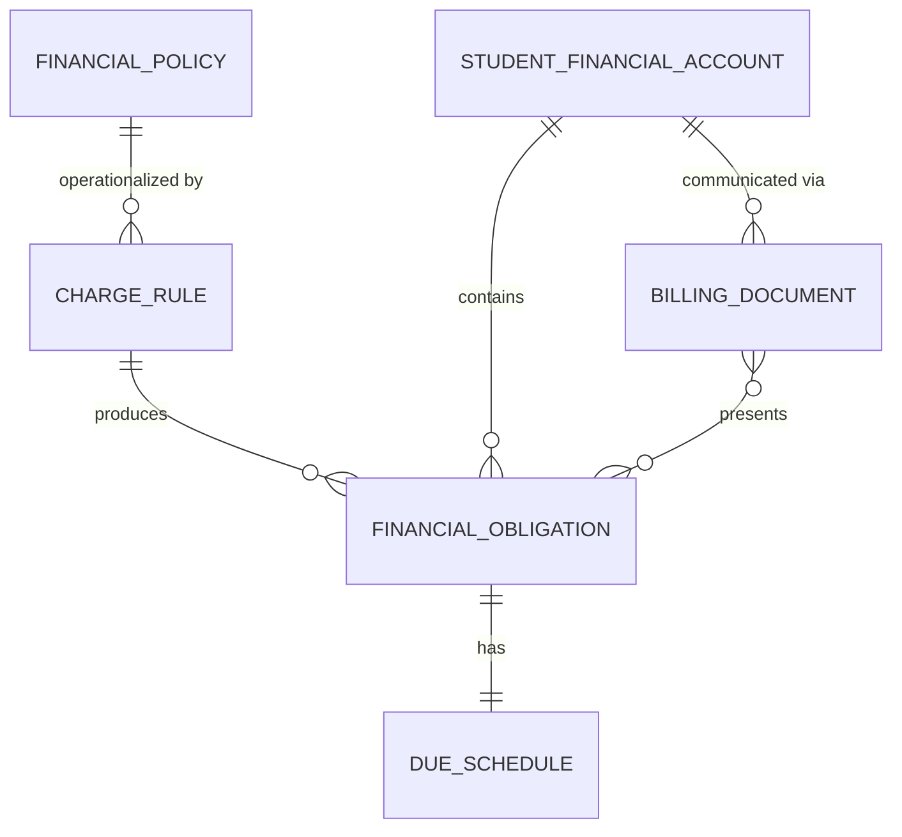
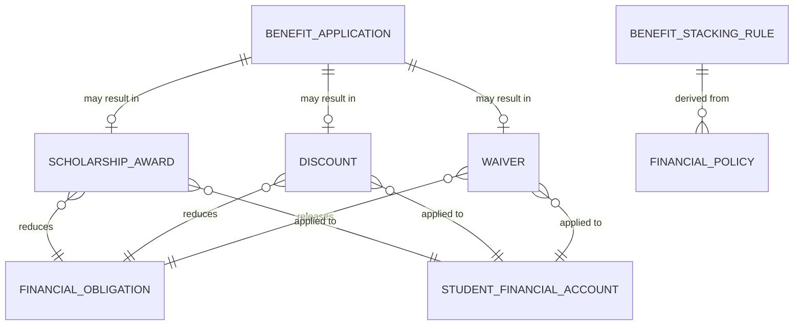
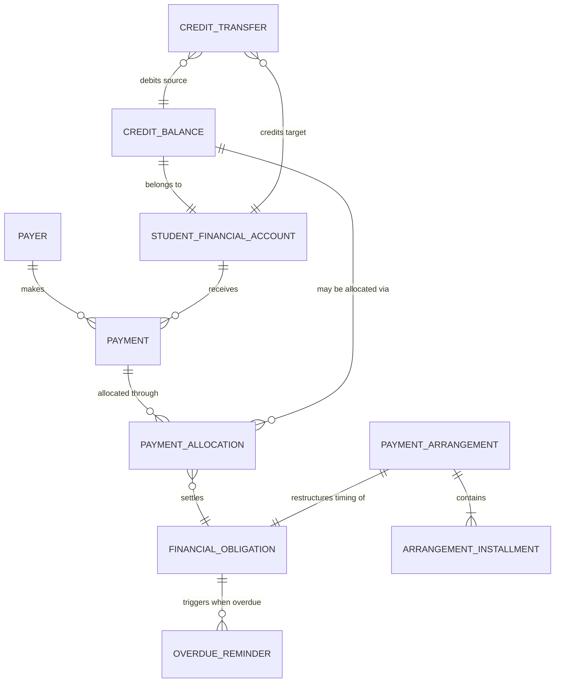
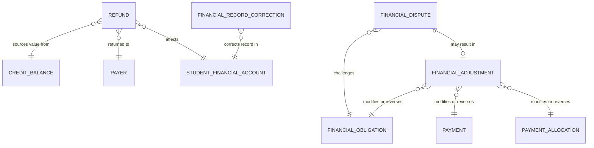
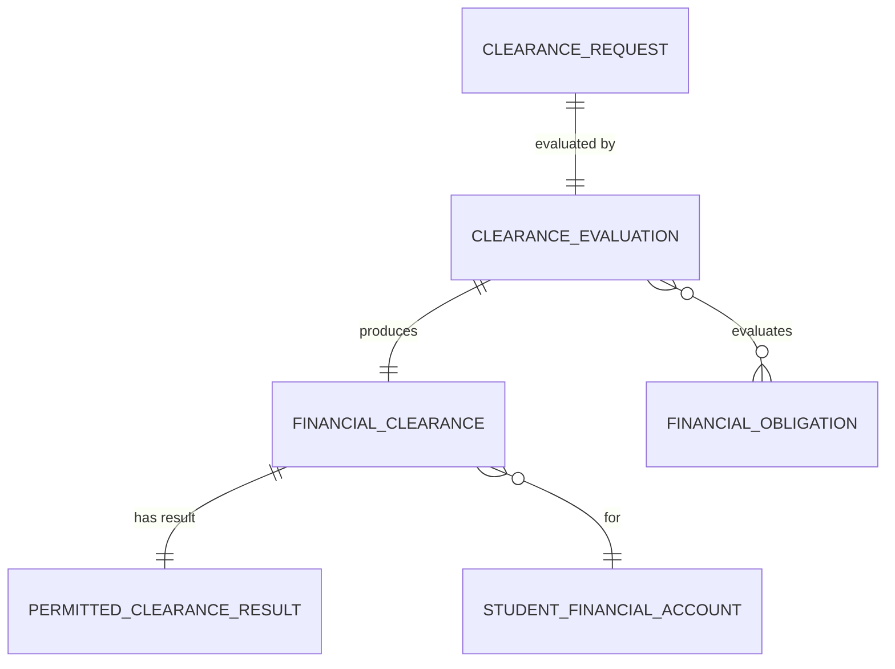

# Finance Domain — Entity Identification by Submodule

## Source Documents

- [finance-domain.md](file:///d:/Project.Private/elsasa-sis-v3/domains/finance-domain.md) — Finance Domain definition
- [sub-modul-and-development-phases.md](file:///d:/Project.Private/elsasa-sis-v3/sub-modul-and-development-phases.md) — Module decomposition and three-stage roadmap

## Domain Boundary

The Finance domain is the authoritative source for student financial obligations, benefits, payments, allocations, receivables, credits, refunds, adjustments, clearances, and financial history between students and the school. It does **not** own student identity, academic results, development outcomes, teaching, operations, or general-ledger accounting.

Entities identified here are strictly derived from the domain definition and module decomposition. No entity is introduced that is not supported by the source documents.

---

## Submodule 1 — Obligations & Billing

**Module responsibility:** Manage financial policies, charge rules, obligation assessment, billing, and statements.

**Submodules:** Financial Policy & Charge Rules · Student Financial Account · Obligation Assessment & Issuance · Billing & Statement Communication

### Entities

#### 1.1 Financial Policy *(Core Entity)*

| Aspect | Description |
|---|---|
| **Purpose** | Represents an approved statement governing a financial decision, obligation, benefit, due schedule, allocation, refund, clearance, or exception. Defines the rules under which the school creates and manages student financial obligations. |
| **Role** | The governing authority behind every financial action. No obligation, benefit, or clearance may be created without a traceable policy. Carries business purpose, applicability criteria, effective period, approving authority, and policy version. A policy must be approved before use and may be superseded or retired but never silently rewritten. |
| **Example** | Policy FP-2026-001: "Uang Pangkal SD Reguler TP 2026/2027", amount Rp 15.000.000, applicable to new enrollment in SD Reguler program, effective 2026-07-01 to 2027-06-30, approved by Finance Authority 2026-05-15, version 1. |

---

#### 1.2 Charge Rule *(Core Entity)*

| Aspect | Description |
|---|---|
| **Purpose** | Represents an approved rule that determines when and how a specific student obligation may be assessed. Operationalizes a Financial Policy into concrete charging criteria. |
| **Role** | Links a Financial Policy to the conditions that trigger obligation creation. Defines the charge type, amount or determination method, currency, due-date rule, and applicability criteria (student placement, period, participation context, etc.). Multiple Charge Rules may exist under one policy for different charge types or applicability conditions. |
| **Example** | Charge Rule under FP-2026-001: "Tuition SD Reguler Semester 1", amount Rp 4.500.000 per semester, applicable to active students in SD Reguler program, due 2026-08-01, currency IDR. |

> [!NOTE]
> The domain document explicitly states that the school determines actual amounts, categories, applicability, approval authority, and effective dates. Agents must never invent them. Charge Rules encode approved school policy — they are not invented by the system.

---

#### 1.3 Student Financial Account *(Core Entity)*

| Aspect | Description |
|---|---|
| **Purpose** | Represents the coherent financial position and history of a student in relation to the school. Provides an interpretable view of obligations, benefits, payments, allocations, credits, adjustments, and refunds. |
| **Role** | The anchor entity connecting all financial transactions for a student. Every obligation, payment, benefit, credit, and clearance is associated with a Student Financial Account. Balance is a derived result — not an independently editable number. The student is the subject of the obligation, but is not necessarily the payer. |
| **Example** | Account for Student STD-2026-0108 (Rina Kusuma): Total obligations Rp 19.500.000, benefits applied Rp 3.000.000, payments received Rp 12.000.000, outstanding receivable Rp 4.500.000, credit balance Rp 0. |

> [!IMPORTANT]
> This is not a general-ledger account. The Students domain owns student identity; Finance owns the financial account and references student identity. Balance must always be explainable through traceable obligations, benefits, payments, allocations, and adjustments. Accounts are strictly student-centric (1:1 with Student); no family-level or corporate-level pooled ledger accounts exist. Consolidated presentation across siblings is handled at the communication/document layer, not the account ledger.

---

#### 1.4 Financial Obligation *(Core Entity)*

| Aspect | Description |
|---|---|
| **Purpose** | Represents an amount the student is required to pay to the school under an approved policy or authorized decision. The fundamental unit of what the student owes and why. |
| **Role** | The central financial record that drives billing, payment allocation, receivables, and clearance. Preserves student reference, reason and source, original amount, currency, issue date, due date or schedule, applicable period, policy or decision reference, current financial position, and adjustments/settlement history. Original amount and later adjustments must remain distinguishable. |
| **Example** | Obligation OBL-2026-0108-003: Tuition SD Reguler Semester 1, student STD-2026-0108, amount Rp 4.500.000, currency IDR, issued 2026-07-15, due 2026-08-01, policy reference FP-2026-001, status: partially settled (Rp 2.000.000 paid, Rp 2.500.000 outstanding). |

> [!NOTE]
> A charge must not be created merely because data exists in another domain. Enrollment, placement, or participation provides context; an approved Finance rule or authorized Finance decision determines the financial consequence.

---

#### 1.5 Due Schedule *(Supporting Entity)*

| Aspect | Description |
|---|---|
| **Purpose** | Represents the approved dates and amounts by which an obligation is expected to be settled. May define a single due date or a scheduled installment plan attached to an obligation at issuance. |
| **Role** | Governs when payment is expected. Provides the basis for overdue determination and receivables management. A Due Schedule may define a single lump-sum due date or split an obligation into time-based installment entries. Revised due dates and temporary deferments modify the schedule while preserving the original obligation amount. |
| **Example** | Due Schedule for OBL-2026-0108-003: Single due date 2026-08-01, full amount Rp 4.500.000. Alternatively: Installment 1 — Rp 2.250.000 due 2026-08-01, Installment 2 — Rp 2.250.000 due 2026-11-01. |

---

#### 1.6 Billing Document *(Core Entity)*

| Aspect | Description |
|---|---|
| **Purpose** | Represents an authorized financial communication presenting obligations, payments, benefits, credits, and balances for a defined scope, date, or period — issued to an authorized recipient. Unifies both point-in-time bills (invoices) and periodic financial statements. |
| **Role** | Communicates the student's financial position to payers, parents, guardians, or financial contacts. Characterized by a `document_type` discriminator (`BILL` or `STATEMENT`). A `BILL` scopes specific payable obligations for a billing cycle or due date; a `STATEMENT` provides a comprehensive ledger summary over a defined date range. Tracks issuance date, document type, authorized recipient, delivery status, and content scope. It is an authorized communication snapshot — it must not become the sole source of underlying obligations or payments. Reissuing must not silently rewrite financial history. |
| **Example** | `BILL`: Doc BIL-2026-0108-001, type `BILL`, issued 2026-07-20, recipient Ibu Sari Kusuma (parent), covering obligations for Semester 1 TP 2026/2027, total billed Rp 16.500.000, delivered via email.  `STATEMENT`: Doc STM-2026-0108-Q3, type `STATEMENT`, issued 2026-09-30, period 2026-07-01 to 2026-09-30, showing all obligations, payments received, benefits applied, and outstanding balance. |

> [!NOTE]
> Unified modeling avoids duplicating delivery tracking, recipient management, line-item presentation structures, and audit trail tables, while preserving explicit business semantics via the `document_type` discriminator.

---

### Obligations & Billing — Entity Relationship Summary

---

## Submodule 2 — Benefits

**Module responsibility:** Manage scholarships, discounts, waivers — application, approval, benefit stacking, renewal, and revocation.

**Submodules:** Scholarship Processing · Discount & Waiver Processing · Benefit Stacking & Priority · Renewal & Revocation

### Entities

#### 2.1 Scholarship Award *(Core Entity)*

| Aspect | Description |
|---|---|
| **Purpose** | Represents an approved financial benefit applied to eligible obligations for a defined period and purpose. Manages the full lifecycle from application/nomination through approval, application to obligations, renewal, and potential revocation. |
| **Role** | Reduces a student's financial obligation under an approved scholarship policy. Preserves the application or nomination source, eligibility criteria evaluated, evidence received, approval or rejection decision, amount or percentage, applicable obligations, effective period, and renewal or revocation history. Finance owns the financial decision; Academics or Development may provide recommendation or evidence only. |
| **Example** | Scholarship SCH-2026-0042: "Beasiswa Prestasi Akademik", student STD-2026-0108, 50% tuition reduction for TP 2026/2027, approved 2026-06-20 by Scholarship Committee, based on academic recommendation from Academics domain, renewable, next review date 2027-06-01. |

> [!NOTE]
> Benefit Type is configurable by school policy. Phase-2 must not hard-code scholarship categories into the domain model. The entity captures the financial decision and application — not the category taxonomy.

---

#### 2.2 Discount *(Core Entity)*

| Aspect | Description |
|---|---|
| **Purpose** | Represents an approved reduction of an obligation calculated under a financial policy. A discount reduces what the student owes according to explicit rules. |
| **Role** | Applied to eligible obligations under an approved policy. Preserves reason, authority, applicable obligation, amount or calculation method, effective date, supporting policy or decision, and reversal/correction history. A discount is not a payment. May be renewable or non-renewable per policy. May be revoked under policy. |
| **Example** | Discount DSC-2026-0108-001: "Diskon Kakak-Adik", student STD-2026-0108, 10% reduction on tuition, applicable to OBL-2026-0108-003 (Rp 450.000 reduction), policy reference FP-2026-DISC-002, effective TP 2026/2027, approved by Finance Authority. |

---

#### 2.3 Waiver *(Core Entity)*

| Aspect | Description |
|---|---|
| **Purpose** | Represents an authorized release of some or all of an obligation under explicit authority. A waiver releases the student from paying part or all of an obligation. |
| **Role** | Distinguished from Discount by its nature: a waiver is an authorized release rather than a calculated reduction. Preserves reason, authority, applicable obligation, amount or method (partial or full), effective date, supporting policy or decision, and reversal/correction history. A waiver is not a payment. May be renewable or non-renewable. May be revoked. |
| **Example** | Waiver WVR-2026-0108-001: Full waiver of application fee for student STD-2026-0108, obligation OBL-2026-0108-001 (Rp 500.000 released), reason: "Staff dependent", authority: Finance Authority, decision date 2026-07-01. |

---

#### 2.4 Benefit Application *(Supporting Entity)*

| Aspect | Description |
|---|---|
| **Purpose** | Represents the request or proposal through which a scholarship, discount, or waiver is initiated. Captures the application, nomination, or recommendation that enters the benefit processing workflow. |
| **Role** | The workflow entry point for benefit processing. Tracks the applicant or nominator, benefit type requested, supporting evidence submitted, academic or Development recommendation (when applicable), and processing status (submitted → under review → decided). Enables traceability from request to decision. |
| **Example** | Benefit Application BNA-2026-0042: Scholarship application by Ibu Sari Kusuma for student STD-2026-0108, type "Beasiswa Prestasi", evidence: academic report card (attached), recommendation from Academics (reference REC-2026-015), submitted 2026-05-10, status: approved 2026-06-20. |

---

#### 2.5 Benefit Stacking Rule *(Reference Entity — from Policy)*

| Aspect | Description |
|---|---|
| **Purpose** | Represents the policy-driven rule governing whether and how multiple benefits (scholarships, discounts, waivers) may be combined on a single obligation or student. |
| **Role** | Determines whether stacking is permitted (Allow Stacking = Yes / No per benefit type or policy) and, when permitted, the priority order in which benefits are applied. Ensures the system does not assume mutual exclusivity and does not assume all benefits may always be combined. Priority rules require explicit policy. |
| **Example** | Stacking Rule: "Beasiswa Prestasi" + "Diskon Kakak-Adik" → Stacking Allowed = Yes, priority: Scholarship applied first, then Discount on remaining obligation. "Beasiswa Prestasi" + "Beasiswa Ekonomi" → Stacking Allowed = No. |

> [!NOTE]
> Benefit Stacking Rules may be modeled as attributes of the Financial Policy or Benefit Type configuration rather than a separate entity. They are identified here because the domain document explicitly requires stacking to be policy-driven with explicit eligibility and priority rules.

---

### Benefits — Entity Relationship Summary

---

## Submodule 3 — Payments & Receivables

**Module responsibility:** Manage payment receipt, confirmation, allocation, reallocation, receivables, overdue status, reminders, and payment arrangements.

**Submodules:** Payment Receipt & Confirmation · Payment Allocation & Reallocation · Receivables & Overdue Management · Payment Arrangement · Credit & Overpayment Management

### Entities

#### 3.1 Payment *(Core Entity)*

| Aspect | Description |
|---|---|
| **Purpose** | Represents value submitted and, when verified, received by the school for a student financial purpose. Captures the complete lifecycle from submission through confirmation to potential reversal. |
| **Role** | Records who paid, how much, when, by which method, and the current confirmation status. Preserves student reference, payer identity, amount and currency, payment date, payment method, external/internal reference, confirmation status, receipt or acknowledgement, and reversal or correction. Submission and confirmation are distinct stages. An external or internally reported payment is not necessarily a confirmed payment. |
| **Example** | Payment PAY-2026-0108-001: Payer Ibu Sari Kusuma, amount Rp 2.000.000, currency IDR, date 2026-08-05, method bank transfer, reference "BCA-TRF-20260805-1234", status: confirmed 2026-08-06, student STD-2026-0108. |

> [!IMPORTANT]
> The payer may be the student, parent, guardian, sponsor, employer, external organization, or another authorized party. The payer is not necessarily the student. Making a payment does not automatically grant access to the student's complete financial or school record.

---

#### 3.2 Payer *(Supporting Entity)*

| Aspect | Description |
|---|---|
| **Purpose** | Represents a person or organization that provides payment for a student. Captures payer information required for financial transactions. |
| **Role** | Distinguished from student identity and financial contact relationship (both owned by Students domain). Finance owns payer information required for the financial transaction itself. Modeled as an independent shared entity: a single Payer (individual parent, corporate sponsor, embassy, foundation) may make payments allocated across multiple students. Payer identity is authoritative for payment receipt, refund destination/ownership by default, and transaction tracing. |
| **Example** | Payer: PT Maju Bersama (employer sponsor), type: CORPORATE_SPONSOR, contact: HR Dept (hr@majubersama.com), reference: "SPO-2026-MB-0012", pays for 3 sponsored students STD-2026-0108, STD-2026-0109, and STD-2026-0110. |

> [!NOTE]
> The Students domain owns the identity of the student and the official relationship of parents, guardians, and financial contacts. Finance owns payer information required for a financial transaction and the transaction itself. The Payer entity captures only what Finance needs — not the full identity or relationship record.

---

#### 3.3 Payment Allocation *(Core Entity)*

| Aspect | Description |
|---|---|
| **Purpose** | Represents the application of confirmed payment value or credit to a particular obligation. Records how confirmed value is consumed against what the student owes. |
| **Role** | Links a payment (or credit) to one or more obligations and records the allocated amount. Supports full settlement, partial settlement, split payments across obligations, and multiple payments to one obligation. Allocation and reallocation history must be preserved. Reallocation must reverse or supersede the prior allocation auditably. |
| **Example** | Allocation ALC-2026-0108-001: Payment PAY-2026-0108-001 (Rp 2.000.000) allocated to obligation OBL-2026-0108-003, allocated amount Rp 2.000.000, allocation date 2026-08-06, allocated by Payment Officer. |

---

#### 3.4 Receivable *(Derived View / Dynamic Projection)*

| Aspect | Description |
|---|---|
| **Purpose** | Represents the portion of a valid obligation that remains unsettled and owed to the school. Tracks the outstanding amount after accounting for payments, benefits, and adjustments. |
| **Role** | Modeled as a **derived projection/view** computed directly from `FinancialObligation` and its associated `PaymentAllocation` and `FinancialAdjustment` records (not a separate persisted entity/table). Eliminates data desynchronization risks. Dynamically exposes: original amount, settled amount, outstanding balance, overdue status, aging bracket (e.g., 30/60/90 days past due date), reminder status, and write-off status. Overdue status is financial information only — Finance does not automatically apply administrative sanctions. |
| **Example** | Receivable projection for OBL-2026-0108-003: Original Rp 4.500.000, benefit applied Rp 450.000, payments allocated Rp 2.000.000, computed outstanding Rp 2.050.000, status: overdue (due date was 2026-08-01), aging: 45 days past due. |

> [!NOTE]
> Resolving Receivable as a computed view guarantees a single source of truth for student balances while fulfilling all receivables workflow and aging reporting requirements without redundant data synchronization.

---

#### 3.5 Overdue Reminder *(Supporting Entity)*

| Aspect | Description |
|---|---|
| **Purpose** | Represents an authorized communication reminding the student, parent, guardian, or financial contact of an outstanding overdue obligation. |
| **Role** | Triggered by an overdue `FinancialObligation`. Tracks reminder stage, timing, recipient, delivery status, and escalation level. Conceptual model: Reminder Before Due Date → Reminder Shortly After Due Date → Escalated Overdue Reminder. Specific day counts and communication rules remain school-policy configuration — not hard-coded. Must follow communication authority and policy. |
| **Example** | Reminder REM-2026-0108-003-02: Second reminder for OBL-2026-0108-003, stage "Overdue – Shortly After Due Date", sent 2026-08-15 to Ibu Sari Kusuma, delivery: email sent successfully. |

---

#### 3.6 Payment Arrangement *(Core Entity)*

| Aspect | Description |
|---|---|
| **Purpose** | Represents an approved agreement changing the expected timing of settlement without erasing the original obligation or reducing the original obligation amount. Phase-2 supports a single concept: Payment Arrangement with Installment Schedule. |
| **Role** | Modifies how and when an outstanding obligation is expected to be paid. Requires explicit Finance approval (Requester → Finance Officer → Finance Authority → Approved Arrangement). Never auto-approved. Tracks arrangement states: Active, Delinquent, Completed, Cancelled. A missed installment moves the arrangement to Delinquent. Delinquent arrangements remain valid unless explicitly cancelled by Finance action. Historical installment obligations and arrangement history must be preserved. |
| **Example** | Arrangement ARR-2026-0108-001: For outstanding obligation OBL-2026-0108-003, approved installment schedule — Installment 1: Rp 1.025.000 due 2026-09-15, Installment 2: Rp 1.025.000 due 2026-10-15, status: Active, approved by Finance Authority 2026-08-20. |

---

#### 3.7 Arrangement Installment *(Supporting Entity)*

| Aspect | Description |
|---|---|
| **Purpose** | Represents a single scheduled payment within a Payment Arrangement. Each installment has its own due date, amount, and payment status. |
| **Role** | Provides the granular settlement schedule within an arrangement. Tracks installment sequence, amount, due date, and payment status (pending, paid, missed). A missed installment triggers the arrangement's transition to Delinquent status. Historical installment records must be preserved even after arrangement cancellation. |
| **Example** | Installment ARR-2026-0108-001-I1: Installment 1 of arrangement ARR-2026-0108-001, amount Rp 1.025.000, due 2026-09-15, status: paid (payment PAY-2026-0108-002 allocated 2026-09-14). |

---

#### 3.8 Credit Balance *(Core Entity)*

| Aspect | Description |
|---|---|
| **Purpose** | Represents confirmed value available to the student's financial account that is not currently consumed by an obligation. May arise from overpayment, reversed charge, reduced obligation after payment, approved transfer, or other authorized correction. |
| **Role** | Tracks available credit amount, source (payment or adjustment), and usage status. Default flow: Overpayment → Credit Balance → Future Allocation. Credit remains traceable to its source. May be allocated to eligible obligations, transferred between students (via Credit Transfer), or marked refundable (through a separate refund process). Refund is not automatic. Credit must not be consumed more than once. |
| **Example** | Credit CRD-2026-0108-001: Source — overpayment from PAY-2026-0108-005 (Rp 500.000 excess), available balance Rp 500.000, status: retained for future allocation, student STD-2026-0108. |

---

#### 3.9 Credit Transfer *(Supporting Entity)*

| Aspect | Description |
|---|---|
| **Purpose** | Represents an authorized, bilateral transaction transferring credit value from one student's financial account to another student's account (e.g., between siblings). |
| **Role** | Atomically debits the source student's Credit Balance and creates an equivalent credited value on the target Student Financial Account. Requires explicit Finance Authority approval and documented relationship justification. Preserves source account, target account, amount, currency (IDR), approval authority, justification reference, and effective date, ensuring non-repudiable bilateral traceability. |
| **Example** | Credit Transfer CTF-2026-0001: Source student STD-2026-0108 (Rina Kusuma), target student STD-2026-0109 (Budi Kusuma - sibling), amount Rp 500.000, currency IDR, authorized by Finance Authority 2026-10-10, reason: "Excess admission fee transferred to younger sibling's tuition". |

---

### Payments & Receivables — Entity Relationship Summary

---

## Submodule 4 — Refunds & Adjustments

**Module responsibility:** Manage refund requests, approval, execution, financial adjustments, reversals, disputes, and record correction.

**Submodules:** Refund Processing · Financial Adjustment & Reversal · Dispute Management · Financial Record Correction

### Entities

#### 4.1 Refund *(Core Entity)*

| Aspect | Description |
|---|---|
| **Purpose** | Represents the authorized return of refundable value to an eligible recipient. Manages the full lifecycle from request through approval, execution, and potential failure or reversal. |
| **Role** | Tracks refund request, validation of available refundable value, authorized recipient, approval or rejection, execution status, failure/cancellation/reversal, and communication of outcome. Requires explicit Finance approval (Finance Officer reviews → Finance Authority approves → Refund Executed). Never automatically generated. Approval and execution are always distinct. Refundable value belongs to the original payer by default — not determined by student identity or financial contact identity alone. |
| **Example** | Refund REF-2026-0108-001: Source — Credit CRD-2026-0108-001 (Rp 500.000), recipient: Ibu Sari Kusuma (original payer), requested 2026-10-01, approved by Finance Authority 2026-10-05, executed via bank transfer 2026-10-07, status: completed. |

> [!IMPORTANT]
> A charge reversal is not itself a refund. A refund is not complete merely because it was approved. Refund eligibility, deductions, authority, destination, and timing must follow explicit policy.

---

#### 4.2 Financial Adjustment *(Core Entity)*

| Aspect | Description |
|---|---|
| **Purpose** | Represents an authorized action that alters or completely negates the financial effect of an earlier record while preserving full audit history. Unifies partial value modifications and total transaction reversals under an explicit type discriminator. |
| **Role** | Corrects, modifies, or reverses a prior financial record (`target_type`: Obligation, Payment, Allocation, Benefit) while maintaining a strict immutable audit trail. Characterized by an `adjustment_type` discriminator (`ADJUSTMENT` for partial delta changes vs. `REVERSAL` for complete negations). Captures target reference, delta amount, reason, authorized authority, and effective date. Financial adjustments that affect monetary balance require Finance Authority approval; history is never rewritten. |
| **Example** | `ADJUSTMENT`: ADJ-2026-0108-001, type `ADJUSTMENT`, targets OBL-2026-0108-002, original amount Rp 500.000 adjusted by -Rp 250.000, reason: "Special fee concession", authority: Finance Authority.  `REVERSAL`: ADJ-2026-0108-002, type `REVERSAL`, targets Payment PAY-2026-0108-003 (Rp 1.000.000), reason: "Bank returned — insufficient funds", authority: Payment Officer, downstream allocations automatically reversed. |

> [!NOTE]
> Unified modeling avoids redundant schema structures between adjustments and reversals since both require identical metadata (target reference, financial delta, reason, authority, effective date), while preserving semantic clarity through the `adjustment_type` discriminator.

---

#### 4.3 Financial Dispute *(Core Entity)*

| Aspect | Description |
|---|---|
| **Purpose** | Represents a formal challenge or questioning of a financial record by a student, payer, finance actor, or authorized source. |
| **Role** | Tracks the disputed record, reason and supporting information, applicable policy, requested outcome, processing status, and determination (accepted, rejected, partially accepted, withdrawn, escalated). A dispute does not make the disputed record invalid — the original record and decision history must remain traceable. Dispute determination may result in an adjustment, reversal, or no change. |
| **Example** | Dispute DIS-2026-0108-001: Student STD-2026-0108 disputes OBL-2026-0108-004 (Activity Fee Rp 250.000), reason: "Student did not participate in the activity", raised 2026-09-20, status: under review, requested outcome: charge reversal. |

---

#### 4.4 Financial Record Correction *(Supporting Entity)*

| Aspect | Description |
|---|---|
| **Purpose** | Represents an auditable correction to inaccurate or incomplete financial information in an approved record. Distinguished from adjustment (which changes financial value) and dispute (which challenges a record). |
| **Role** | Corrects factual errors such as wrong student reference, incorrect date, wrong payer name, or missing metadata — without changing financial value. Preserves what changed, why, when, and who authorized it. Original information and correction history remain auditable. Affected downstream records (allocations, refunds, clearances) may require reevaluation. |
| **Example** | Correction COR-2026-0108-001: Correction to PAY-2026-0108-001 — payer name corrected from "Sari Kusuma" to "Sari Kusuma Wijaya", reason: "Name entry error at receipt", corrected by Billing Officer 2026-08-10, no financial value change. |

> [!NOTE]
> The domain document distinguishes between corrections that affect financial value (requiring Finance Authority via Financial Adjustment) and administrative/metadata corrections (permitted by Billing Officer via Financial Record Correction).

---

### Refunds & Adjustments — Entity Relationship Summary

---

## Submodule 5 — Financial Clearance

**Module responsibility:** Determine purpose-specific financial clearance for transfer-out, graduation, and configurable purposes.

**Submodules:** Clearance Request & Evaluation · Clearance Determination & Exception · Clearance Correction

### Entities

#### 5.1 Financial Clearance *(Core Entity)*

| Aspect | Description |
|---|---|
| **Purpose** | Represents a purpose-specific Finance determination stating whether defined financial prerequisites have been satisfied for a defined purpose. |
| **Role** | The authoritative financial prerequisite record consumed by other domains. Identifies purpose, subject (student), applicable policy, evaluated obligations, result, determination date, validity/expiry (when applicable), and authority. Clearance is purpose-specific — a student may satisfy one prerequisite while retaining unrelated obligations. Phase-2 mandatory purposes: Transfer Out and Graduation. Other purposes are configurable. |
| **Example** | Clearance CLR-2026-0108-001: Purpose "Transfer Out", student STD-2026-0108, evaluated mandatory obligations: OBL-2026-0108-003 (settled), OBL-2026-0108-005 (settled), result: Granted, determination date 2026-11-15, determined by Finance Officer, valid until 2026-12-15. |

> [!IMPORTANT]
> Clearance is blocked only by outstanding mandatory obligations. Pending refunds, future installments, credit balances, optional charges, and non-mandatory fees do not block clearance. Schools configure which obligation categories are mandatory. Blocking obligations must be identifiable and explainable.

---

#### 5.2 Clearance Request *(Supporting Entity)*

| Aspect | Description |
|---|---|
| **Purpose** | Represents a formal request from an authorized workflow (typically Students domain) asking Finance to evaluate a purpose-specific financial prerequisite. |
| **Role** | Initiates the clearance evaluation process. Captures the requesting domain, purpose, student reference, request date, and applicable context. Students requests Financial Clearance for Transfer Out or Graduation; Finance determines it; Students consumes the result. |
| **Example** | Request CLRQ-2026-0108-001: Requested by Students domain for student STD-2026-0108, purpose "Graduation", request date 2026-11-10, context: student completing Grade 6 SD Reguler, graduation ceremony scheduled 2026-12-20. |

---

#### 5.3 Clearance Evaluation *(Supporting Entity)*

| Aspect | Description |
|---|---|
| **Purpose** | Represents the evaluation work performed by Finance to determine a clearance result. Captures which obligations were evaluated and the rationale for the determination. |
| **Role** | Provides the transparency and explainability required by the domain — blocking obligations must be identified and the evaluation must be explainable. Links the Clearance Request to the resulting Financial Clearance determination. Records evaluated obligations, identified blockers, conditions (when result is Conditional), and the evaluating officer/authority. Exception determinations require Finance Authority and a mandatory reason. |
| **Example** | Evaluation for CLRQ-2026-0108-001: Evaluated 5 mandatory obligations, 4 fully settled, 1 outstanding (OBL-2026-0108-007, Rp 150.000 — Examination Fee), result: Denied, blocker identified: OBL-2026-0108-007, evaluated by Finance Officer 2026-11-12. |

---

#### 5.4 Permitted Clearance Result *(Reference Entity — Enumeration)*

| Aspect | Description |
|---|---|
| **Purpose** | Defines the permitted results for a Financial Clearance determination in Phase-2. |
| **Role** | Constrains clearance outcomes to explicit, documented values. Students may execute Transfer Out or required Graduation only when the result is Granted. Conditional is a valid recorded result but is not executable for Transfer Out or Graduation. |
| **Example** | Values: Granted, Denied, Conditional, Cannot Yet Be Determined, Expired, Revoked. |

> [!NOTE]
> This is a value enumeration, not necessarily a standalone entity. It is documented here because the domain explicitly defines and constrains these values with specific behavioral implications for consuming domains.

---

### Financial Clearance — Entity Relationship Summary

---

## Cross-Submodule Reference Entities

These entities are not owned by the Finance domain but are referenced across multiple submodules as inputs from other domains.

#### R.1 Student Reference *(Reference Entity — from Students)*

| Aspect | Description |
|---|---|
| **Purpose** | The student identity reference used to associate all financial transactions with a specific student. |
| **Role** | Every Financial Obligation, Account, Payment, Benefit, Clearance, and financial action references a student. Finance references student identity but does not own or redefine it. The Students domain is the authoritative source. |
| **Example** | Student STD-2026-0108 (Rina Kusuma). |

---

#### R.2 Academic Period Reference *(Reference Entity — from Operations)*

| Aspect | Description |
|---|---|
| **Purpose** | Provides temporal context (academic year, semester, term) for financial policies, obligations, and billing periods. |
| **Role** | Referenced by Financial Policy (effective period), Financial Obligation (applicable period), Billing (billing period), and Benefit (effective period). Owned by Operations (Calendar & Periods). |
| **Example** | Academic Year "TP 2026/2027", Semester 1 (2026-07-01 to 2026-12-31). |

---

#### R.3 Parent/Guardian/Financial Contact Reference *(Reference Entity — from Students)*

| Aspect | Description |
|---|---|
| **Purpose** | Identifies the authorized person(s) associated with the student for financial communication, billing, and payment authority purposes. |
| **Role** | Referenced by Billing (authorized recipient), Overdue Reminders (communication recipient), and Benefit Applications (contact/applicant). Students domain owns the official relationship and authority context. Finance must verify the authority required for each financial action or disclosure. |
| **Example** | Financial Contact: Ibu Sari Kusuma Wijaya (mother), authority: may receive bills, make payments, and request refunds for student STD-2026-0108. |

---

#### R.4 Academic/Development Recommendation Reference *(Reference Entity — from Academics/Development)*

| Aspect | Description |
|---|---|
| **Purpose** | An academic achievement, academic recommendation, or non-academic achievement/support context provided as evidence for a scholarship or financial-assistance workflow. |
| **Role** | Referenced by Benefit Application and Scholarship Award as supporting evidence. Owned by Academics or Development respectively. Finance does not alter academic or development outcomes. Recommendations and evidence remain owned by their originating domains. |
| **Example** | Academic Recommendation REC-2026-015: "Student ranked 1st in class for Semester 2 TP 2025/2026, recommended for academic scholarship", issued by Academics domain. |

---

## Cross-Submodule Entity — Financial Event History

#### H.1 Financial Event *(Cross-Cutting Supporting Entity)*

| Aspect | Description |
|---|---|
| **Purpose** | Represents a single recorded event in the student's financial history. Captures every material financial action — policy application, obligation issuance, benefit decision, bill issuance, payment, allocation, overdue status, arrangement, credit, refund, clearance, dispute, adjustment, and correction. |
| **Role** | Provides the interpretable historical audit trail required by the domain. Preserves event type, associated entity, event date, transaction date, decision date, effective date, recording date (all potentially different and distinguishable), actor, authority, and effect. Corrections must preserve what changed, why, when, and who authorized it. Financial history must never be rewritten — corrections occur through new events. |
| **Example** | Event FEV-2026-0108-0047: Type "PaymentConfirmed", payment PAY-2026-0108-001, event date 2026-08-06, actor: Payment Officer (Budi), amount Rp 2.000.000, recording date 2026-08-06T10:23:00+07:00. |

> [!NOTE]
> **Resolved Decision:** Financial Event History is implemented as a unified append-only `Financial Event` log. All event types share a consistent audit envelope (`student_account_id`, `event_type`, `entity_type`, `entity_id`, `actor_id`, `actor_role`, `financial_effect`, `effective_date`, `recorded_at`), delivering complete chronological auditability across the student's entire account lifecycle without requiring multi-table UNION queries.

---

## Entity Summary by Submodule

| Submodule | Core Entities | Supporting Entities / Derived Views | Reference Entities |
|---|---|---|---|
| **Obligations & Billing** | Financial Policy, Charge Rule, Student Financial Account, Financial Obligation, Billing Document | Due Schedule | Academic Period Reference |
| **Benefits** | Scholarship Award, Discount, Waiver | Benefit Application | Benefit Stacking Rule, Academic/Development Recommendation Reference |
| **Payments & Receivables** | Payment, Payment Allocation, Payment Arrangement, Credit Balance | Payer, Overdue Reminder, Arrangement Installment, Credit Transfer, *Receivable (Derived View)* | Student Reference, Parent/Guardian/Financial Contact Reference |
| **Refunds & Adjustments** | Refund, Financial Adjustment, Financial Dispute | Financial Record Correction | — |
| **Financial Clearance** | Financial Clearance | Clearance Request, Clearance Evaluation | Permitted Clearance Result |
| **Cross-Cutting** | — | Financial Event | — |

---

## Resolved Domain Decisions (Closed Open Questions)

The open questions identified from the domain source documents have been formally resolved through architectural alignment following a pragmatic, minimalist, and explicit approach:

1. **Bill vs. Financial Statement Modeling** — **Resolved (Unified `Billing Document`).**
   - **Decision:** Unified `Billing Document` entity with a `document_type` enum (`BILL` | `STATEMENT`).
   - **Resolution:** Point-in-time billing notices (invoices scoping specific due obligations) and periodic financial statements (comprehensive ledger summaries) share identical delivery tracking, recipient management, period scoping, and line-item presentation structures. Unifying them into a single entity avoids duplicate tables and shared logic while keeping business semantics explicit via the type discriminator.

2. **Receivable Entity Nature** — **Resolved (Derived View / Dynamic Projection).**
   - **Decision:** Derived view computed directly from `FinancialObligation` and settlement records (no standalone table).
   - **Resolution:** Outstanding balance and overdue status are mathematically derived from obligation amount minus allocations/adjustments. Maintaining a standalone `Receivable` table would introduce data synchronization risks and redundant state. Receivables workflows (aging brackets, overdue tracking, reminder triggers) are executed against this dynamic projection with single-source-of-truth reliability.

3. **Financial Adjustment and Reversal Consolidation** — **Resolved (Unified `Financial Adjustment`).**
   - **Decision:** Unified `Financial Adjustment` entity with an `adjustment_type` discriminator (`ADJUSTMENT` | `REVERSAL`).
   - **Resolution:** Partial value adjustments and total transaction reversals share the exact same structural columns (`target_type`, `target_id`, `delta_amount`, `reason`, `authorized_by`, `effective_date`). Consolidating them into one entity avoids schema duplication while preserving strict semantic distinction and requiring Finance Authority approval for financial balance impacts.

4. **Payer Structure for Multi-Student Payers** — **Resolved (Global/Shared Payer Entity).**
   - **Decision:** Independent, shared `Payer` entity referenced by `Payment` transactions.
   - **Resolution:** A `Payer` (individual parent, corporate sponsor, embassy, foundation) exists independently of any single student account. A single Payer can submit payments allocated across multiple students, and refundable values route unambiguously to this authoritative Payer by default without duplicating payer records or requiring complex join tables.

5. **Family-Level vs. Student-Centric Billing Accounts** — **Resolved (Strictly Student-Centric Accounts).**
   - **Decision:** Strictly Student-level financial accounts only; no family-level or corporate-level pooled ledger accounts.
   - **Resolution:** Every financial obligation, credit, payment allocation, and clearance belongs exclusively to an individual student (`Student Financial Account` 1:1 with `Student`). A single payer can settle multiple students in one payment, and `Billing Document` can present sibling summaries, but the underlying financial ledger remains strictly per-student, avoiding complex pooled-liability edge cases.

6. **Currency Support & Modeling** — **Resolved (Single Base Currency with Explicit Currency Code).**
   - **Decision:** Single base currency (`IDR`) with explicit `currency_code` column and integer precision.
   - **Resolution:** All transactions operate natively in Indonesian Rupiah (IDR) without runtime FX conversions or exchange rate tables. To ensure clarity and forward-compatibility, all monetary columns explicitly carry `currency_code = 'IDR'` and integer amounts (zero decimal places for Rupiah).

7. **Financial Event History Architecture** — **Resolved (Unified Append-Only Event Log).**
   - **Decision:** Single append-only `Financial Event` table.
   - **Resolution:** A centralized event log (`student_account_id`, `event_type`, `entity_type`, `entity_id`, `actor_id`, `actor_role`, `financial_effect`, `effective_date`, `recorded_at`) provides an immutable, chronological timeline of the student's complete financial account history. This satisfies all audit and timeline inspection requirements without requiring complex multi-table UNION queries across disparate entities.

8. **Inter-Student Credit Transfers** — **Resolved (Explicit `Credit Transfer` Entity).**
   - **Decision:** Dedicated `Credit Transfer` entity linking source and target student accounts.
   - **Resolution:** Transferring credit between students (e.g., siblings) moves monetary value across distinct legal subjects. An explicit `Credit Transfer` entity atomically records the source account debit, target account credit, transfer amount, approving authority, justification, and relationship reference, ensuring non-repudiable bilateral traceability.

---

### Validated Architectural Assumptions

1. **Benefit Application as a separate entity** — The domain document describes scholarship "application, nomination, or recommendation" as inputs to the benefit workflow. A `Benefit Application` entity captures this workflow entry point, providing traceability from request to decision.
2. **Clearance Request and Clearance Evaluation as separate entities** — The domain describes an auditable request-evaluate-determine flow. Dedicated supporting entities preserve the evaluation rationale, evaluated obligation list, and blocking items independently of the final prerequisite result.
3. **Arrangement Installment as a separate entity** — A child entity under `Payment Arrangement` represents individual installment milestones, tracking granular amounts, due dates, and missed-installment delinquency triggers.
4. **Payer as a Finance-owned entity** — Finance owns payer information required for financial transactions and refund ownership, distinct from the Students-owned parent/guardian/contact relationship.

> [!NOTE]
> All open questions for the Finance Domain entity model are formally closed. Entity models, relationships, and summaries reflect these decisions with zero speculative or redundant entities.
