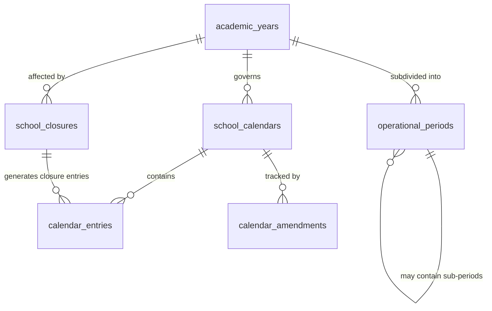
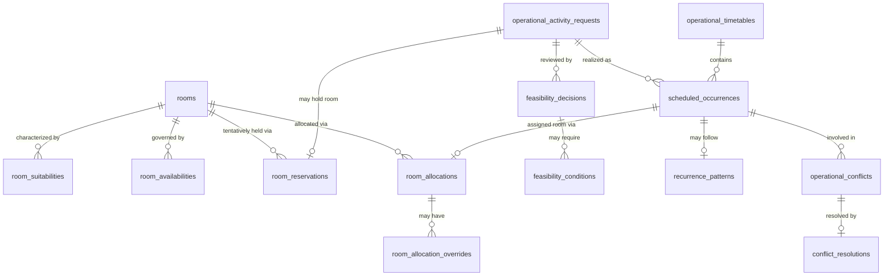
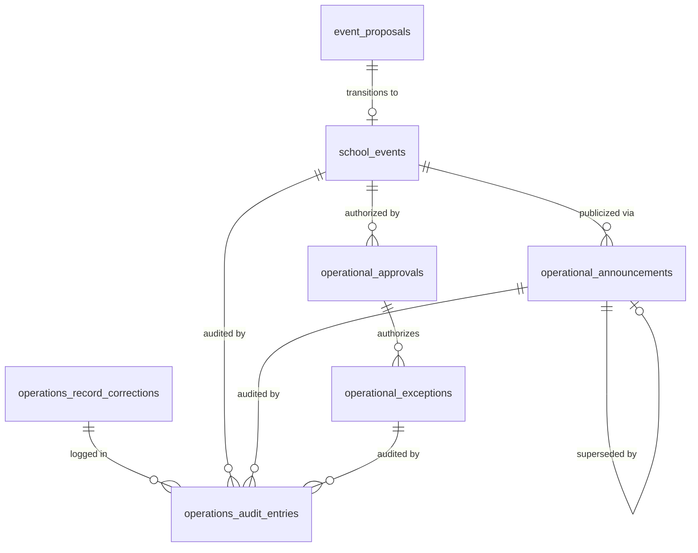
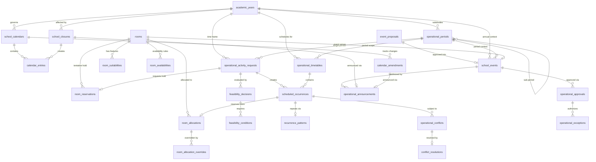
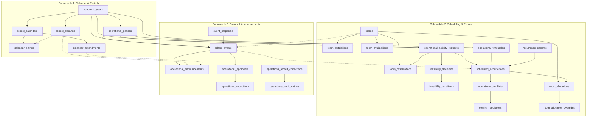

# Operations Domain — Database Tables by Submodule

## Source Documents

- [operational-domain.md](file:///d:/Project.Private/elsasa-sis-v3/domains/operational-domain.md) — Operations Domain definition
- [operational-entities.md](file:///d:/Project.Private/elsasa-sis-v3/entities/operational-entities.md) — Entity identification by submodule and resolved architectural decisions
- [sub-modul-and-development-phases.md](file:///d:/Project.Private/elsasa-sis-v3/sub-modul-and-development-phases.md) — Module decomposition and three-stage implementation roadmap

## Conventions

- **PK** — Primary Key
- **FK** — Foreign Key (logical; referencing another table in this domain or an external domain)
- **UQ** — Unique constraint
- All tables include `created_at`, `updated_at`, and `created_by` audit columns (omitted from key-column listings for brevity)
- **UUID** is used as the primary key type throughout to support distributed scaling and consistency across domains
- Columns marked *(nullable)* support progressive information collection and optional attributes
- External domain references (Students, Academics, Teaching, Development, Finance) are stored as opaque identifiers; this domain does not own or modify those tables
- Entity status values, categories, and type discriminators are stored as `VARCHAR` with application-level validation, consistent with Student, Academic, and Finance domain conventions

---

## Submodule 1 — Calendar & Periods

**Module responsibility:** Manage academic year, operational periods, school calendar, holidays, closures, and shared date context across all domains.

**Submodules:** Academic Year Management · Operational Period Management · School Calendar Management · Closure Coordination  
**Stage:** Stage 1 (Foundation) — foundational time context for all school operations.

---

### 1.1 `academic_years` — Main Table

| Aspect | Description |
|---|---|
| **Purpose** | Authoritative container for the approved annual school operating cycle. Provides the highest-level temporal boundary within which all domains operate. |
| **Type** | Core |

**Key Columns:**

| Column | Type | Constraint | Description |
|---|---|---|---|
| `id` | UUID | PK | Unique academic year identifier |
| `name` | VARCHAR | NOT NULL | Human-readable academic year title (e.g., "Tahun Pelajaran 2026/2027") |
| `code` | VARCHAR | UQ, NOT NULL | Machine-readable unique code (e.g., "AY-2026-2027") |
| `start_date` | DATE | NOT NULL | Official starting date of the academic year |
| `end_date` | DATE | NOT NULL | Official concluding date of the academic year |
| `status` | VARCHAR | NOT NULL | Lifecycle state: `draft`, `approved`, `active`, `completed`, `archived` |
| `approved_by` | VARCHAR | nullable | Authority granting formal approval (e.g., "Kepala Sekolah") |
| `approved_date` | DATE | nullable | Date formal approval was granted |
| `notes` | TEXT | nullable | Institutional notes and policies |

**Example:**

| id | code | name | start_date | end_date | status | approved_by | approved_date |
|---|---|---|---|---|---|---|---|
| `ay-2026...` | AY-2026-2027 | Tahun Pelajaran 2026/2027 | 2026-07-15 | 2027-06-30 | approved | Kepala Sekolah | 2026-05-01 |

> [!NOTE]
> Period names and structures are school-policy questions. Operations does not enforce rigid nomenclature, but guarantees explicit effective dates (`start_date < end_date`).

---

### 1.2 `operational_periods` — Main Table

| Aspect | Description |
|---|---|
| **Purpose** | Subdivides an academic year into bounded coordination windows for specific operational purposes (terms, semesters, quarters, admission windows, assessment windows, reporting periods, and event periods). |
| **Type** | Core |

**Key Columns:**

| Column | Type | Constraint | Description |
|---|---|---|---|
| `id` | UUID | PK | Unique operational period identifier |
| `academic_year_id` | UUID | FK → `academic_years.id`, NOT NULL | Parent academic year |
| `period_code` | VARCHAR | NOT NULL | Machine-readable period code (e.g., "SEM-1-2026") |
| `name` | VARCHAR | NOT NULL | Period title (e.g., "Semester 1 TP 2026/2027") |
| `period_type` | VARCHAR | NOT NULL | Period category: `semester`, `term`, `quarter`, `admission_window`, `assessment_window`, `reporting_period`, `re_enrollment_window`, `event_period`, `custom` |
| `start_date` | DATE | NOT NULL | Period commencement date |
| `end_date` | DATE | NOT NULL | Period completion date |
| `parent_period_id` | UUID | FK → `operational_periods.id`, nullable | Parent period for hierarchical composition (e.g., Midterm Assessment Window within Semester 1) |
| `campus_context` | VARCHAR | nullable | Scope context (e.g., "All Campuses", "Campus Utara") |
| `status` | VARCHAR | NOT NULL | Lifecycle state: `draft`, `approved`, `active`, `closed` |
| `notes` | TEXT | nullable | Administrative notes |

**Example:**

| period_code | name | period_type | start_date | end_date | academic_year_id | status |
|---|---|---|---|---|---|---|
| SEM-1-2026 | Semester 1 TP 2026/2027 | semester | 2026-07-15 | 2026-12-20 | `ay-2026...` | approved |
| ADM-2026-W1 | Pendaftaran Gelombang 1 | admission_window | 2026-01-10 | 2026-03-31 | `ay-2026...` | closed |

> [!IMPORTANT]
> An Operational Period is a **coordination** context. It defines when something may occur, not the internal academic, financial, or developmental meaning of what occurs within it.

---

### 1.3 `school_calendars` — Main Table

| Aspect | Description |
|---|---|
| **Purpose** | Represents an approved calendar container that supplies shared operating date context. Supports institution-wide or campus/program-specific scoping per Resolved Decision 5. |
| **Type** | Core |

**Key Columns:**

| Column | Type | Constraint | Description |
|---|---|---|---|
| `id` | UUID | PK | Unique calendar identifier |
| `academic_year_id` | UUID | FK → `academic_years.id`, NOT NULL | Parent academic year |
| `name` | VARCHAR | NOT NULL | Calendar title (e.g., "Kalender SD Elsasa TP 2026/2027") |
| `scope_type` | VARCHAR | NOT NULL | Operational scope level: `institution`, `campus`, `program` |
| `scope_reference` | VARCHAR | NOT NULL, default 'All' | Specific target scope (e.g., "All Campuses", "Campus Utara", "Primary School") |
| `version` | VARCHAR | NOT NULL, default '1.0' | Calendar release version |
| `status` | VARCHAR | NOT NULL | Administrative status: `draft`, `approved`, `superseded`, `archived` |
| `publication_status` | VARCHAR | NOT NULL, default 'draft' | Public visibility state: `draft`, `published`, `withdrawn` |
| `published_at` | TIMESTAMP WITH TIME ZONE | nullable | Timestamp of public release |
| `published_by` | VARCHAR | nullable | Communications officer or authority publishing the calendar |
| `approved_by` | VARCHAR | nullable | Authority granting formal approval |
| `approved_date` | DATE | nullable | Date formal approval was granted |
| `notes` | TEXT | nullable | Internal notes |

**Example:**

| name | academic_year_id | scope_type | scope_reference | version | publication_status | approved_by |
|---|---|---|---|---|---|---|
| Kalender Elsasa 2026/2027 - Campus Utara | `ay-2026...` | campus | Campus Utara | 1.0 | published | Calendar Authority |

---

### 1.4 `calendar_entries` — Main Table

| Aspect | Description |
|---|---|
| **Purpose** | Granular date designations within a School Calendar (instructional days, holidays, closures, staff-only days, exam windows, significant school dates). |
| **Type** | Core |

**Key Columns:**

| Column | Type | Constraint | Description |
|---|---|---|---|
| `id` | UUID | PK | Unique calendar entry identifier |
| `calendar_id` | UUID | FK → `school_calendars.id`, NOT NULL | Parent school calendar |
| `entry_date` | DATE | NOT NULL | Commencement date of the designated entry |
| `end_date` | DATE | nullable | Concluding date for multi-day spans (null = single day) |
| `designation` | VARCHAR | NOT NULL | Day type: `instructional_day`, `holiday`, `school_closure`, `staff_only_day`, `exam_day`, `significant_date`, `domain_window` |
| `name` | VARCHAR | NOT NULL | Descriptive name (e.g., "Hari Kemerdekaan RI", "Penilaian Akhir Semester 1") |
| `description` | TEXT | nullable | Detailed context or guidelines |
| `is_instructional` | BOOLEAN | NOT NULL, default false | Flag indicating whether standard teaching/instruction takes place |
| `closure_id` | UUID | FK → `school_closures.id`, nullable | Reference to formal closure decision if created due to emergency closure |
| `applies_to` | VARCHAR | nullable | Sub-audience filter if narrower than calendar scope (e.g., "Teachers Only", "Grade 6 Only") |

**Example:**

| calendar_id | entry_date | end_date | designation | name | is_instructional | applies_to |
|---|---|---|---|---|---|---|
| `cal-01...` | 2026-08-17 | *(null)* | holiday | Hari Kemerdekaan RI | false | All |
| `cal-01...` | 2026-12-07 | 2026-12-11 | exam_day | Penilaian Akhir Semester 1 | true | All Students |

---

### 1.5 `school_closures` — Supporting Table

| Aspect | Description |
|---|---|
| **Purpose** | Records an authorized administrative or emergency decision to suspend school operations for a campus, population, or period (e.g., flood, infrastructure failure, health mandate). Distinct from scheduled holidays. |
| **Type** | Supporting |

**Key Columns:**

| Column | Type | Constraint | Description |
|---|---|---|---|
| `id` | UUID | PK | Unique school closure identifier |
| `academic_year_id` | UUID | FK → `academic_years.id`, NOT NULL | Applicable academic year |
| `closure_number` | VARCHAR | UQ, NOT NULL | Human-readable tracking code (e.g., "CLS-2026-001") |
| `reason_category` | VARCHAR | NOT NULL | Category: `weather_disaster`, `infrastructure_hazard`, `health_safety`, `government_mandate`, `institutional_policy`, `emergency` |
| `reason_details` | TEXT | NOT NULL | Authoritative explanation for the closure |
| `start_date` | DATE | NOT NULL | Effective starting date of closure |
| `end_date` | DATE | NOT NULL | Effective concluding date of closure |
| `affected_campus` | VARCHAR | NOT NULL | Campus scope (e.g., "Campus Utara", "All") |
| `affected_population` | VARCHAR | NOT NULL, default 'all' | Population scope: `all`, `students_only`, `staff_and_students` |
| `status` | VARCHAR | NOT NULL | Lifecycle state: `proposed`, `authorized`, `in_effect`, `lifted`, `cancelled` |
| `authorized_by` | VARCHAR | NOT NULL | Leadership actor authorizing closure (e.g., "Kepala Sekolah") |
| `authorized_date` | DATE | NOT NULL | Date formal authorization was granted |
| `communication_status` | VARCHAR | NOT NULL, default 'pending' | Notification status: `pending`, `announced`, `not_required` |
| `announcement_id` | UUID | FK → external/Module 3 `operational_announcements.id`, nullable | Linked public announcement |
| `recovery_plan_notes` | TEXT | nullable | Make-up day or instructional recovery strategy notes |

**Example:**

| closure_number | reason_category | affected_campus | start_date | end_date | authorized_by | status |
|---|---|---|---|---|---|---|
| CLS-2026-001 | weather_disaster | Campus Utara | 2026-11-25 | 2026-11-26 | Kepala Sekolah | in_effect |

---

### 1.6 `calendar_amendments` — Supporting Table

| Aspect | Description |
|---|---|
| **Purpose** | Preserves historical auditability of approved modifications made to a published School Calendar, preventing silent calendar rewrites. |
| **Type** | Supporting |

**Key Columns:**

| Column | Type | Constraint | Description |
|---|---|---|---|
| `id` | UUID | PK | Unique amendment identifier |
| `calendar_id` | UUID | FK → `school_calendars.id`, NOT NULL | Parent calendar being amended |
| `amendment_number` | VARCHAR | UQ, NOT NULL | Traceable amendment code (e.g., "AMD-CAL-2026-001") |
| `from_version` | VARCHAR | NOT NULL | Pre-amendment calendar version (e.g., "1.0") |
| `to_version` | VARCHAR | NOT NULL | Post-amendment calendar version (e.g., "1.1") |
| `amendment_type` | VARCHAR | NOT NULL | Nature of amendment: `add_entry`, `modify_entry`, `remove_entry`, `closure_addition`, `period_adjustment` |
| `affected_entry_id` | UUID | FK → `calendar_entries.id`, nullable | Specific calendar entry altered |
| `change_summary` | TEXT | NOT NULL | Human-readable explanation of what changed |
| `previous_value` | JSONB | nullable | Snapshot of entry prior to change |
| `new_value` | JSONB | nullable | Snapshot of entry post-change |
| `reason` | TEXT | NOT NULL | Justification for amendment |
| `effective_date` | DATE | NOT NULL | Date the amendment becomes effective |
| `authorized_by` | VARCHAR | NOT NULL | Authority granting amendment |
| `authorized_date` | DATE | NOT NULL | Date approval was recorded |
| `downstream_impact_reviewed` | BOOLEAN | NOT NULL, default false | Confirmation that scheduling/timetabling impacts were assessed |

**Example:**

| amendment_number | calendar_id | from_version | to_version | amendment_type | reason | authorized_by |
|---|---|---|---|---|---|---|
| AMD-CAL-2026-001 | `cal-01...` | 1.0 | 1.1 | modify_entry | Pergeseran Libur Nasional Maulid Nabi | Calendar Authority |

---

### Calendar & Periods — Entity Relationship Diagram

---

## Submodule 2 — Scheduling & Rooms

**Module responsibility:** Manage operational activity requests, feasibility review, timetable compilation, scheduled occurrences, room context/suitability, tentative reservations, and conflict resolution.

**Submodules:** Room & Location Context · Room Availability & Allocation · Operational Activity Request · Operational Feasibility Review · Timetable & Scheduled Occurrences · Conflict & Disruption Management  
**Stage:** Stage 2 (Learning & Teaching) — coordinates learning activities, exams, and homerooms into physical/temporal space.

---

### 2A. Room & Location Context

#### 2.1 `rooms` — Main Table

| Aspect | Description |
|---|---|
| **Purpose** | Holds the minimum identifiable location context required for operational allocation decisions. Phase-2 simplified room model focuses on type, capacity, and active status. |
| **Type** | Core |

**Key Columns:**

| Column | Type | Constraint | Description |
|---|---|---|---|
| `id` | UUID | PK | Unique room identifier |
| `room_code` | VARCHAR | UQ, NOT NULL | Standard room code (e.g., "R-201", "LAB-IPA-1") |
| `name` | VARCHAR | NOT NULL | Human-readable room title (e.g., "Ruang Kelas 201") |
| `campus` | VARCHAR | NOT NULL | Campus location (e.g., "Campus Utara") |
| `building` | VARCHAR | nullable | Building identifier (e.g., "Gedung A") |
| `floor` | VARCHAR | nullable | Floor level (e.g., "Lantai 2") |
| `room_type` | VARCHAR | NOT NULL | Standard classification: `classroom`, `laboratory`, `hall`, `meeting_room`, `sports_facility`, `other` |
| `capacity` | INTEGER | NOT NULL | Maximum occupancy limit |
| `status` | VARCHAR | NOT NULL, default 'active' | Operational state: `active`, `maintenance`, `inactive`, `decommissioned` |
| `effective_start_date` | DATE | NOT NULL | Date room became operationally available |
| `effective_end_date` | DATE | nullable | Date room was decommissioned or closed indefinitely |
| `notes` | TEXT | nullable | Physical and operational characteristics notes |

**Example:**

| room_code | name | campus | building | room_type | capacity | status |
|---|---|---|---|---|---|---|
| R-201 | Ruang Kelas 201 | Campus Utara | Gedung A | classroom | 35 | active |
| LAB-IPA-1 | Laboratorium IPA 1 | Campus Utara | Gedung B | laboratory | 30 | active |
| HALL-01 | Aula Utama | Campus Utara | Gedung Serbaguna | hall | 300 | active |

---

#### 2.2 `room_suitabilities` — Supporting Table

| Aspect | Description |
|---|---|
| **Purpose** | Records specific equipment, facility features, and accessibility characteristics of a room to enable automated suitability matching against activity requirements. |
| **Type** | Supporting |

**Key Columns:**

| Column | Type | Constraint | Description |
|---|---|---|---|
| `id` | UUID | PK | Unique suitability feature identifier |
| `room_id` | UUID | FK → `rooms.id`, NOT NULL | Parent room |
| `feature_key` | VARCHAR | NOT NULL | Normalized characteristic key (e.g., `projector`, `computer_lab`, `lab_equipment`, `accessible`, `sound_system`, `air_conditioner`) |
| `feature_value` | VARCHAR | nullable | Specific descriptive attribute (e.g., "HDMI Ceiling Projector", "30 Workstations", "Ground Floor Ramp") |
| `is_available` | BOOLEAN | NOT NULL, default true | Flag indicating if feature is currently functional and available |

**Example:**

| room_id | feature_key | feature_value | is_available |
|---|---|---|---|
| `room-201...` | projector | HDMI Ceiling Mounted | true |
| `room-201...` | accessible | Wheelchair Accessible (Ground Floor) | true |
| `room-lab1...` | lab_equipment | Physics & Biology Apparatus (30 sets) | true |

> [!NOTE]
> A unique constraint on `(room_id, feature_key)` ensures each feature key is defined only once per room, avoiding duplicate matching criteria.

---

### 2B. Room Availability & Allocation

#### 2.3 `room_availabilities` — Main Table

| Aspect | Description |
|---|---|
| **Purpose** | Represents the operational windows, restrictions, and scheduled closures under which a room may be allocated. |
| **Type** | Core |

**Key Columns:**

| Column | Type | Constraint | Description |
|---|---|---|---|
| `id` | UUID | PK | Unique availability window identifier |
| `room_id` | UUID | FK → `rooms.id`, NOT NULL | Parent room |
| `availability_type` | VARCHAR | NOT NULL | Window classification: `regular_window`, `temporary_restriction`, `maintenance_closure` |
| `day_of_week` | INTEGER | nullable | Day of week for recurring regular window (1=Monday ... 7=Sunday) |
| `start_time` | TIME | nullable | Daily available opening time |
| `end_time` | TIME | nullable | Daily available closing time |
| `start_date` | DATE | nullable | Starting date for date-specific restriction/closure |
| `end_date` | DATE | nullable | Concluding date for date-specific restriction/closure |
| `is_available` | BOOLEAN | NOT NULL, default true | True = open for booking; False = restricted / closed |
| `restriction_reason` | TEXT | nullable | Justification for restriction (e.g., "Staff cleaning", "AC repair") |
| `authorized_by` | VARCHAR | nullable | Actor authorizing temporary closure or restriction |

**Example:**

| room_id | availability_type | day_of_week | start_time | end_time | is_available | restriction_reason |
|---|---|---|---|---|---|---|
| `room-201...` | regular_window | 1 *(Mon)* | 07:00:00 | 16:00:00 | true | Regular School Hours |
| `room-201...` | temporary_restriction | *(null)* | 08:00:00 | 12:00:00 | false | Perbaikan AC Ruangan (2026-09-10) |

---

#### 2.4 `room_reservations` — Main Table

| Aspect | Description |
|---|---|
| **Purpose** | Represents a tentative hold or temporary booking on a room before final allocation approval. Enforces an automated 48-hour expiration policy. |
| **Type** | Core |

**Key Columns:**

| Column | Type | Constraint | Description |
|---|---|---|---|
| `id` | UUID | PK | Unique reservation identifier |
| `reservation_number` | VARCHAR | UQ, NOT NULL | Traceable reservation number (e.g., "RSV-2026-0042") |
| `room_id` | UUID | FK → `rooms.id`, NOT NULL | Room held |
| `activity_request_id` | UUID | FK → `operational_activity_requests.id`, nullable | Originating activity request |
| `reserved_by` | VARCHAR | NOT NULL | Person or actor placing the hold |
| `purpose_summary` | VARCHAR | NOT NULL | Concise description of purpose |
| `start_timestamp` | TIMESTAMP WITH TIME ZONE | NOT NULL | Scheduled start date and time |
| `end_timestamp` | TIMESTAMP WITH TIME ZONE | NOT NULL | Scheduled end date and time |
| `hold_status` | VARCHAR | NOT NULL, default 'active_hold' | State: `active_hold`, `converted_to_allocation`, `expired`, `released`, `cancelled` |
| `hold_expires_at` | TIMESTAMP WITH TIME ZONE | NOT NULL | Expiry threshold (defaults to creation time + 48 hours) |
| `notes` | TEXT | nullable | Reservation notes |

**Example:**

| reservation_number | room_id | purpose_summary | start_timestamp | end_timestamp | hold_status | hold_expires_at |
|---|---|---|---|---|---|---|
| RSV-2026-0042 | `room-201...` | Hold for OAR-2026-0112 | 2026-09-15 08:00+07 | 2026-09-15 09:30+07 | active_hold | 2026-09-12 14:00+07 |

---

#### 2.5 `room_allocations` — Main Table

| Aspect | Description |
|---|---|
| **Purpose** | Records the authoritative approved assignment of a Room to a Scheduled Occurrence for a specific date, time, and recurrence. |
| **Type** | Core |

**Key Columns:**

| Column | Type | Constraint | Description |
|---|---|---|---|
| `id` | UUID | PK | Unique allocation identifier |
| `room_id` | UUID | FK → `rooms.id`, NOT NULL | Allocated room |
| `scheduled_occurrence_id` | UUID | FK → `scheduled_occurrences.id`, NOT NULL | Target scheduled occurrence |
| `allocation_number` | VARCHAR | UQ, NOT NULL | Traceable allocation code (e.g., "RA-2026-0345") |
| `effective_start_date` | DATE | NOT NULL | Start date of allocation span |
| `effective_end_date` | DATE | NOT NULL | End date of allocation span |
| `start_time` | TIME | NOT NULL | Scheduled daily start time |
| `end_time` | TIME | NOT NULL | Scheduled daily end time |
| `day_of_week` | INTEGER | nullable | Day of week for recurring allocations (1=Monday ... 7=Sunday) |
| `status` | VARCHAR | NOT NULL | Allocation status: `proposed`, `approved`, `released`, `cancelled`, `overridden` |
| `allocated_by` | VARCHAR | NOT NULL | Scheduler or coordinator actor |
| `allocated_at` | TIMESTAMP WITH TIME ZONE | NOT NULL | Timestamp when allocation was authorized |
| `allocation_condition` | TEXT | nullable | Special conditions or usage rules |
| `notes` | TEXT | nullable | Internal notes |

**Example:**

| allocation_number | room_id | scheduled_occurrence_id | start_time | end_time | day_of_week | status | allocated_by |
|---|---|---|---|---|---|---|---|
| RA-2026-0345 | `room-201...` | `so-345...` | 08:00:00 | 09:30:00 | 1 *(Mon)* | approved | Scheduler Pak Dedi |

---

### 2C. Operational Activity Request

#### 2.6 `operational_activity_requests` — Main Table

| Aspect | Description |
|---|---|
| **Purpose** | The standardized intake entry point where other domains request scheduling of their authorized work into operational time and space. |
| **Type** | Core |

**Key Columns:**

| Column | Type | Constraint | Description |
|---|---|---|---|
| `id` | UUID | PK | Unique request identifier |
| `request_number` | VARCHAR | UQ, NOT NULL | Human-readable tracking reference (e.g., "OAR-2026-0112") |
| `source_domain` | VARCHAR | NOT NULL | Originating domain: `academics`, `development`, `students`, `finance`, `teaching`, `operations` |
| `source_activity_type` | VARCHAR | NOT NULL | Source work type: `learning_activity`, `assessment_session`, `homeroom_advisory`, `extracurricular`, `school_assembly`, `entrance_test` |
| `source_activity_reference` | VARCHAR | NOT NULL | External identifier of source activity (e.g., learning unit code, exam ID, club ID) |
| `source_activity_approved` | BOOLEAN | NOT NULL, default true | Confirmation that source work has approved status in owning domain |
| `requested_by_actor` | VARCHAR | NOT NULL | Responsible requesting actor |
| `academic_year_id` | UUID | FK → `academic_years.id`, NOT NULL | Context academic year |
| `operational_period_id` | UUID | FK → `operational_periods.id`, nullable | Target operational period (e.g., Semester 1) |
| `requested_time_description` | TEXT | NOT NULL | Stated timing preference (e.g., "Every Monday & Wednesday 08:00-09:30") |
| `duration_minutes` | INTEGER | NOT NULL | Duration of each occurrence in minutes |
| `preferred_campus` | VARCHAR | nullable | Preferred campus location |
| `preferred_room_id` | UUID | FK → `rooms.id`, nullable | Specific room requested |
| `required_room_type` | VARCHAR | NOT NULL | Required room classification (e.g., `classroom`, `laboratory`, `hall`) |
| `minimum_capacity` | INTEGER | NOT NULL | Minimum participant seating required |
| `assigned_teacher_reference` | VARCHAR | nullable | Teacher identifier from Teaching domain (tentative scheduling permitted if empty; final allocation requires approved teacher) |
| `participant_group_reference` | VARCHAR | nullable | Cohort, class section, or group ID from Students or Academics |
| `requirements_and_constraints` | JSONB | nullable | Structured requirements (e.g., `{"projector": true, "ground_floor": true}`) |
| `request_priority` | VARCHAR | NOT NULL, default 'academic' | Priority class: `academic`, `assessment`, `administrative`, `event`, `other` per Resolved Rules |
| `status` | VARCHAR | NOT NULL, default 'received' | Lifecycle state: `received`, `clarification_required`, `actionable`, `under_review`, `scheduled`, `rejected`, `withdrawn` |
| `clarification_notes` | TEXT | nullable | Returned feedback if missing required information |
| `submission_timestamp` | TIMESTAMP WITH TIME ZONE | NOT NULL | Timestamp of formal submission (used for tie-breaking) |

**Example:**

| request_number | source_domain | source_activity_reference | required_room_type | minimum_capacity | request_priority | status |
|---|---|---|---|---|---|---|
| OAR-2026-0112 | academics | MAT-4-S1 (Matematika 4A) | classroom | 35 | academic | actionable |

---

### 2D. Operational Feasibility Review

#### 2.7 `feasibility_decisions` — Main Table

| Aspect | Description |
|---|---|
| **Purpose** | Records the formal operational determination of whether a requested arrangement can be accommodated without violating constraints or resource rules. |
| **Type** | Core |

**Key Columns:**

| Column | Type | Constraint | Description |
|---|---|---|---|
| `id` | UUID | PK | Unique feasibility decision identifier |
| `activity_request_id` | UUID | FK → `operational_activity_requests.id`, NOT NULL | Subject activity request |
| `decision_number` | VARCHAR | UQ, NOT NULL | Traceable decision code (e.g., "FD-2026-0089") |
| `outcome` | VARCHAR | NOT NULL | Evaluation outcome: `feasible`, `conditionally_feasible`, `infeasible`, `unresolved` |
| `reviewed_by` | VARCHAR | NOT NULL | Operations reviewer or scheduler |
| `review_date` | DATE | NOT NULL | Date review was completed |
| `calendar_compatibility_checked` | BOOLEAN | NOT NULL, default true | Verification against holidays and closures |
| `room_availability_checked` | BOOLEAN | NOT NULL, default true | Verification against existing bookings and holds |
| `capacity_checked` | BOOLEAN | NOT NULL, default true | Verification that room capacity satisfies minimum required |
| `teacher_availability_checked` | BOOLEAN | NOT NULL, default true | Verification against Teaching domain availability |
| `evaluation_notes` | TEXT | NOT NULL | Detailed review findings |
| `infeasibility_reason` | TEXT | nullable | Specific rationale if infeasible or unresolved |

**Example:**

| decision_number | activity_request_id | outcome | reviewed_by | review_date | evaluation_notes |
|---|---|---|---|---|---|
| FD-2026-0089 | `oar-112...` | conditionally_feasible | Operations Coordinator | 2026-08-20 | Room R-201 available; requires Teacher Assignment finalization |

---

#### 2.8 `feasibility_conditions` — Supporting Table

| Aspect | Description |
|---|---|
| **Purpose** | Tracks specific prerequisites or dependencies that must be resolved by owning domains before a conditionally feasible activity can proceed to allocation. |
| **Type** | Supporting |

**Key Columns:**

| Column | Type | Constraint | Description |
|---|---|---|---|
| `id` | UUID | PK | Unique condition identifier |
| `feasibility_decision_id` | UUID | FK → `feasibility_decisions.id`, NOT NULL | Parent feasibility decision |
| `condition_description` | TEXT | NOT NULL | Specific condition to satisfy |
| `condition_owner_domain` | VARCHAR | NOT NULL | Domain responsible for resolution: `teaching`, `academics`, `operations`, `finance`, `students`, `development` |
| `condition_owner_actor` | VARCHAR | NOT NULL | Named actor or role owning satisfaction |
| `deadline` | DATE | nullable | Required satisfaction deadline |
| `status` | VARCHAR | NOT NULL, default 'pending' | State: `pending`, `satisfied`, `waived`, `expired` |
| `satisfied_at` | TIMESTAMP WITH TIME ZONE | nullable | Timestamp when condition was met |
| `satisfied_by` | VARCHAR | nullable | Actor verifying satisfaction |
| `resolution_notes` | TEXT | nullable | Explanatory notes on resolution |

**Example:**

| feasibility_decision_id | condition_description | condition_owner_domain | condition_owner_actor | deadline | status |
|---|---|---|---|---|---|
| `fd-089...` | Teaching Assignment Ibu Ani must be finalized | teaching | Teaching Coordinator | 2026-08-25 | pending |

---

### 2E. Timetable & Scheduled Occurrences

#### 2.9 `operational_timetables` — Main Table

| Aspect | Description |
|---|---|
| **Purpose** | The authoritative published timetable aggregating scheduled occurrences for a specific scope (Academic Year, Period, Campus). There is only one authoritative timetable per scope. |
| **Type** | Core |

**Key Columns:**

| Column | Type | Constraint | Description |
|---|---|---|---|
| `id` | UUID | PK | Unique timetable identifier |
| `academic_year_id` | UUID | FK → `academic_years.id`, NOT NULL | Context academic year |
| `operational_period_id` | UUID | FK → `operational_periods.id`, NOT NULL | Target period (e.g., Semester 1) |
| `timetable_code` | VARCHAR | UQ, NOT NULL | Unique timetable code (e.g., "TT-2026-S1-UTARA") |
| `title` | VARCHAR | NOT NULL | Human-readable title (e.g., "Jadwal Pelajaran Semester 1 TP 2026/2027 - Campus Utara") |
| `campus` | VARCHAR | NOT NULL | Campus applicability |
| `version` | VARCHAR | NOT NULL, default '1.0' | Release version |
| `status` | VARCHAR | NOT NULL | State: `draft`, `approved`, `published`, `superseded`, `archived` |
| `publication_status` | VARCHAR | NOT NULL, default 'draft' | Visibility state: `draft`, `published`, `withdrawn` |
| `approved_by` | VARCHAR | nullable | Operations authority approving timetable |
| `approved_at` | TIMESTAMP WITH TIME ZONE | nullable | Approval timestamp |
| `published_at` | TIMESTAMP WITH TIME ZONE | nullable | Timestamp of release |
| `notes` | TEXT | nullable | Administrative notes |

**Example:**

| timetable_code | title | campus | version | status | publication_status | approved_by |
|---|---|---|---|---|---|---|
| TT-2026-S1-UTARA | Jadwal Pelajaran S1 2026/2027 - Campus Utara | Campus Utara | 1.0 | approved | published | Operations Authority |

---

#### 2.10 `recurrence_patterns` — Supporting Table

| Aspect | Description |
|---|---|
| **Purpose** | Defines the repetition rules, cadence, and holiday exclusions for recurring scheduled occurrences. |
| **Type** | Supporting |

**Key Columns:**

| Column | Type | Constraint | Description |
|---|---|---|---|
| `id` | UUID | PK | Unique recurrence pattern identifier |
| `frequency` | VARCHAR | NOT NULL | Repetition frequency: `weekly`, `biweekly`, `daily`, `custom` |
| `days_of_week` | INTEGER[] | NOT NULL | Array of applicable days (e.g., `[1, 3]` for Monday and Wednesday) |
| `start_date` | DATE | NOT NULL | Start date of series |
| `end_date` | DATE | NOT NULL | End date of series |
| `exception_dates` | DATE[] | nullable | Array of specific dates excluded from recurrence (e.g., holidays) |
| `description` | VARCHAR | nullable | Readable description (e.g., "Setiap Senin & Rabu 08:00 - 09:30") |

**Example:**

| id | frequency | days_of_week | start_date | end_date | exception_dates |
|---|---|---|---|---|---|
| `rc-001...` | weekly | `[1, 3]` | 2026-07-20 | 2026-12-18 | `{2026-08-17}` |

---

#### 2.11 `scheduled_occurrences` — Main Table

| Aspect | Description |
|---|---|
| **Purpose** | The granular scheduling unit representing an approved placement of work into date, time, and room. Handles both recurring series and discrete single-date occurrences. |
| **Type** | Core |

**Key Columns:**

| Column | Type | Constraint | Description |
|---|---|---|---|
| `id` | UUID | PK | Unique occurrence identifier |
| `timetable_id` | UUID | FK → `operational_timetables.id`, NOT NULL | Parent master timetable |
| `activity_request_id` | UUID | FK → `operational_activity_requests.id`, nullable | Originating activity request |
| `occurrence_code` | VARCHAR | NOT NULL | Tracking code (e.g., "SO-2026-0345") |
| `title` | VARCHAR | NOT NULL | Readable occurrence title (e.g., "Matematika Kelas 4A") |
| `source_domain` | VARCHAR | NOT NULL | Domain owning work: `academics`, `development`, `students`, `operations`, etc. |
| `source_activity_reference` | VARCHAR | NOT NULL | Reference to source activity (e.g., learning unit code, event ID, homeroom ID) |
| `delivery_mode` | VARCHAR | NOT NULL, default 'in_person' | Delivery modality: `in_person`, `online`, `hybrid` |
| `assigned_room_id` | UUID | FK → `rooms.id`, nullable | Physical room assigned |
| `start_time` | TIME | NOT NULL | Scheduled start time |
| `end_time` | TIME | NOT NULL | Scheduled end time |
| `specific_date` | DATE | nullable | Specific date if single occurrence (null if managed via recurrence) |
| `recurrence_pattern_id` | UUID | FK → `recurrence_patterns.id`, nullable | Linked recurring pattern |
| `assigned_teacher_reference` | VARCHAR | nullable | Teacher identifier from Teaching domain |
| `participant_group_reference` | VARCHAR | nullable | Cohort, class section, or homeroom group identifier |
| `status` | VARCHAR | NOT NULL, default 'proposed' | State: `proposed`, `approved`, `rescheduled`, `relocated`, `cancelled`, `completed` |
| `publication_status` | VARCHAR | NOT NULL, default 'draft' | Visibility: `draft`, `published`, `withdrawn` |
| `cancellation_reason` | TEXT | nullable | Explanation if cancelled |
| `rescheduled_from_id` | UUID | FK → `scheduled_occurrences.id`, nullable | Historical predecessor if rescheduled |
| `notes` | TEXT | nullable | Operational notes |

**Example:**

| occurrence_code | title | source_domain | assigned_room_id | start_time | end_time | recurrence_pattern_id | status |
|---|---|---|---|---|---|---|---|
| SO-2026-0345 | Matematika Kelas 4A | academics | `room-201...` | 08:00:00 | 09:30:00 | `rc-001...` | approved |

---

### 2F. Conflict & Disruption Management

#### 2.12 `operational_conflicts` — Main Table

| Aspect | Description |
|---|---|
| **Purpose** | Records detected incompatibilities between requests, existing schedules, room availability, or closures, classifying them into Prohibited or Warning. |
| **Type** | Core |

**Key Columns:**

| Column | Type | Constraint | Description |
|---|---|---|---|
| `id` | UUID | PK | Unique conflict identifier |
| `conflict_code` | VARCHAR | UQ, NOT NULL | Human-readable tracking code (e.g., "OC-2026-0018") |
| `conflict_classification` | VARCHAR | NOT NULL | Severity class: `prohibited` (blocks approval) or `warning` (advisory only) |
| `conflict_type` | VARCHAR | NOT NULL | Conflict nature: `double_booking`, `room_unavailable`, `capacity_exceeded`, `preferred_room_unavailable`, `near_capacity_threshold`, `teacher_unavailable`, `closure_conflict` |
| `severity` | VARCHAR | NOT NULL, default 'blocking' | Operational impact: `blocking`, `advisory` |
| `primary_occurrence_id` | UUID | FK → `scheduled_occurrences.id`, nullable | Primary affected scheduled occurrence |
| `conflicting_occurrence_id` | UUID | FK → `scheduled_occurrences.id`, nullable | Competing scheduled occurrence (for double booking) |
| `room_id` | UUID | FK → `rooms.id`, nullable | Room in conflict |
| `conflict_date` | DATE | nullable | Date conflict occurs |
| `conflict_description` | TEXT | NOT NULL | Clear explanation of the incompatibility |
| `status` | VARCHAR | NOT NULL, default 'detected' | Lifecycle: `detected`, `under_review`, `resolved`, `waived_by_override`, `dismissed` |
| `detected_at` | TIMESTAMP WITH TIME ZONE | NOT NULL | Timestamp when conflict was detected |

**Example:**

| conflict_code | conflict_classification | conflict_type | room_id | status | conflict_description |
|---|---|---|---|---|---|
| OC-2026-0018 | prohibited | double_booking | `room-201...` | under_review | Room R-201 requested by SO-0345 and SO-0351 simultaneously |

---

#### 2.13 `conflict_resolutions` — Supporting Table

| Aspect | Description |
|---|---|
| **Purpose** | Records the action taken to resolve an operational conflict under approved priority policies (Academic > Assessment > Administrative > Event > Other; First Approved Wins). |
| **Type** | Supporting |

**Key Columns:**

| Column | Type | Constraint | Description |
|---|---|---|---|
| `id` | UUID | PK | Unique resolution identifier |
| `conflict_id` | UUID | FK → `operational_conflicts.id`, NOT NULL | Parent operational conflict |
| `resolution_action` | VARCHAR | NOT NULL | Action taken: `reschedule`, `relocate`, `condition`, `reject_request`, `override`, `cancelled_conflicting` |
| `decision_basis` | VARCHAR | NOT NULL | Legal/policy rule applied: `priority_order`, `first_approved_wins`, `operations_authority_override`, `mutual_agreement` |
| `priority_applied` | VARCHAR | nullable | Priority hierarchy applied (e.g., "Academic Activity wins over School Event") |
| `authorized_by` | VARCHAR | NOT NULL | Authorized scheduler or authority actor |
| `resolved_at` | TIMESTAMP WITH TIME ZONE | NOT NULL | Timestamp resolution was executed |
| `resolution_details` | TEXT | NOT NULL | Specific steps executed |
| `affected_arrangement_actions` | TEXT | nullable | Downstream actions triggered for affected occurrences |

**Example:**

| conflict_id | resolution_action | decision_basis | priority_applied | authorized_by |
|---|---|---|---|---|
| `oc-018...` | relocate | priority_order | Academic Activity wins over School Event | Scheduler Pak Dedi |

---

#### 2.14 `room_allocation_overrides` — Supporting Table

| Aspect | Description |
|---|---|
| **Purpose** | Records an authorized exception granted by Operations Authority allowing a room allocation contrary to standard rules (e.g., near-capacity threshold, emergency relocation). |
| **Type** | Supporting |

**Key Columns:**

| Column | Type | Constraint | Description |
|---|---|---|---|
| `id` | UUID | PK | Unique override identifier |
| `room_allocation_id` | UUID | FK → `room_allocations.id`, NOT NULL | Affected room allocation |
| `override_code` | VARCHAR | UQ, NOT NULL | Traceable override reference (e.g., "OVR-2026-0012") |
| `conflict_id` | UUID | FK → `operational_conflicts.id`, nullable | Related conflict if overriding a detected warning |
| `override_reason` | TEXT | NOT NULL | Clear business/operational justification |
| `authorized_by` | VARCHAR | NOT NULL | High-level authority granting override (e.g., "Kepala Sekolah") |
| `authorized_at` | TIMESTAMP WITH TIME ZONE | NOT NULL | Timestamp of authorization |
| `effective_start_date` | DATE | NOT NULL | Effective starting date of override |
| `effective_end_date` | DATE | NOT NULL | Effective concluding date of override |
| `notes` | TEXT | nullable | Special stipulations |

**Example:**

| override_code | room_allocation_id | override_reason | authorized_by | authorized_at |
|---|---|---|---|---|
| OVR-2026-0012 | `ra-088...` | Hall-01 allocated despite Near Capacity Threshold for rehearsal | Kepala Sekolah | 2026-09-01 10:00+07 |

---

### Scheduling & Rooms — Entity Relationship Diagram

---

## Submodule 3 — Events & Announcements

**Module responsibility:** Manage school event operational lifecycle, event proposals, authorized operational announcements, operational approvals, exceptions, and history/correction preservation.

**Submodules:** School Event Coordination · Announcement Publication & Withdrawal · Operational Approval & Exception · Operations History & Correction  
**Stage:** Stage 3 (Development & Completion) — full school operational maturity.

---

### 3A. School Event Coordination

#### 3.1 `event_proposals` — Supporting Table

| Aspect | Description |
|---|---|
| **Purpose** | Intake record for proposed milestone, cross-cohort, or ceremonial school events before formal operational authorization and publication. Supports revision cycles. |
| **Type** | Supporting |

**Key Columns:**

| Column | Type | Constraint | Description |
|---|---|---|---|
| `id` | UUID | PK | Unique proposal identifier |
| `proposal_number` | VARCHAR | UQ, NOT NULL | Traceable proposal code (e.g., "PRP-EVT-2026-0015") |
| `title` | VARCHAR | NOT NULL | Event title (e.g., "Perayaan Hari Guru 2026") |
| `purpose_owner_domain` | VARCHAR | NOT NULL | Sponsoring domain: `academics`, `development`, `students`, `finance`, `operations` |
| `organizer_actor` | VARCHAR | NOT NULL | Lead organizer name/role (e.g., "OSIS Coordinator", "Wakasek Kesiswaan") |
| `event_category` | VARCHAR | NOT NULL | Category: `assembly`, `celebration`, `graduation_ceremony`, `sports_day`, `exhibition`, `competition`, `parent_meeting`, `other` |
| `target_audience` | VARCHAR | NOT NULL | Target participants (e.g., "All Students, Teachers, Parents") |
| `proposed_start_date` | DATE | NOT NULL | Proposed start date |
| `proposed_end_date` | DATE | NOT NULL | Proposed end date |
| `proposed_start_time` | TIME | NOT NULL | Proposed daily start time |
| `proposed_end_time` | TIME | NOT NULL | Proposed daily end time |
| `preferred_location_type` | VARCHAR | NOT NULL | Venue type: `hall`, `sports_field`, `classroom`, `external` |
| `preferred_room_id` | UUID | FK → `rooms.id`, nullable | Specific room requested |
| `expected_participant_count` | INTEGER | NOT NULL | Projected attendance count |
| `operational_requirements` | TEXT | nullable | Physical setup requirements (sound, stage, seating) |
| `required_clearances` | TEXT | nullable | Cross-domain or security clearances needed |
| `status` | VARCHAR | NOT NULL, default 'submitted' | State: `draft`, `submitted`, `under_review`, `revision_requested`, `approved`, `rejected`, `withdrawn` |
| `submitted_at` | TIMESTAMP WITH TIME ZONE | nullable | Timestamp of submission |
| `review_feedback` | TEXT | nullable | Evaluator feedback for revision |

**Example:**

| proposal_number | title | purpose_owner_domain | organizer_actor | expected_participant_count | status |
|---|---|---|---|---|---|
| PRP-EVT-2026-0015 | Perayaan Hari Guru 2026 | development | OSIS Coordinator | 300 | approved |

---

#### 3.2 `school_events` — Main Table

| Aspect | Description |
|---|---|
| **Purpose** | Represents an approved school event with a defined operational lifecycle. Operations coordinates the operational staging (date, time, venue, publication), while the purpose domain owns content and participants. |
| **Type** | Core |

**Key Columns:**

| Column | Type | Constraint | Description |
|---|---|---|---|
| `id` | UUID | PK | Unique school event identifier |
| `event_proposal_id` | UUID | FK → `event_proposals.id`, nullable | Originating event proposal |
| `event_code` | VARCHAR | UQ, NOT NULL | Machine-readable unique event code (e.g., "EVT-2026-0015") |
| `title` | VARCHAR | NOT NULL | Official event title (e.g., "Perayaan Hari Guru") |
| `academic_year_id` | UUID | FK → `academic_years.id`, NOT NULL | Context academic year |
| `operational_period_id` | UUID | FK → `operational_periods.id`, nullable | Context operational period |
| `purpose_owner_domain` | VARCHAR | NOT NULL | Domain owning the business purpose |
| `organizer_name` | VARCHAR | NOT NULL | Responsible organizer |
| `event_category` | VARCHAR | NOT NULL | Classification category |
| `target_audience` | VARCHAR | NOT NULL | Intended audience description |
| `start_date` | DATE | NOT NULL | Official event start date |
| `end_date` | DATE | NOT NULL | Official event end date |
| `start_time` | TIME | NOT NULL | Official start time |
| `end_time` | TIME | NOT NULL | Official end time |
| `primary_room_id` | UUID | FK → `rooms.id`, nullable | Allocated primary room/venue |
| `location_name` | VARCHAR | NOT NULL | Location label (e.g., "Aula Utama (Hall-01)") |
| `capacity` | INTEGER | NOT NULL | Venue capacity allocated |
| `status` | VARCHAR | NOT NULL, default 'approved' | Operational lifecycle: `approved`, `published`, `in_progress`, `postponed`, `relocated`, `completed`, `cancelled` |
| `publication_status` | VARCHAR | NOT NULL, default 'draft' | Public visibility: `draft`, `published`, `withdrawn` |
| `postponed_to_date` | DATE | nullable | Target date if postponed |
| `postponed_reason` | TEXT | nullable | Reason if postponed |
| `cancellation_reason` | TEXT | nullable | Authoritative explanation if cancelled |
| `completion_timestamp` | TIMESTAMP WITH TIME ZONE | nullable | Timestamp event was marked completed |
| `notes` | TEXT | nullable | Operational notes |

**Example:**

| event_code | title | purpose_owner_domain | primary_room_id | start_date | status | publication_status |
|---|---|---|---|---|---|---|
| EVT-2026-0015 | Perayaan Hari Guru | development | `room-hall1...` | 2026-11-25 | approved | published |

> [!NOTE]
> Routine syllabus classes and club meetings are **not** School Events; they are modeled directly as `scheduled_occurrences` referencing Academics or Development activities per Resolved Decision 1.

---

### 3B. Announcement Publication & Withdrawal

#### 3.3 `operational_announcements` — Main Table

| Aspect | Description |
|---|---|
| **Purpose** | Authoritative publication of operational communications to designated school audiences across communication channels. Operations manages publication status, not technical delivery receipts. |
| **Type** | Core |

**Key Columns:**

| Column | Type | Constraint | Description |
|---|---|---|---|
| `id` | UUID | PK | Unique announcement identifier |
| `announcement_number` | VARCHAR | UQ, NOT NULL | Traceable reference (e.g., "OA-2026-0043") |
| `title` | VARCHAR | NOT NULL | Headline/title of announcement |
| `content` | TEXT | NOT NULL | Official announcement body text |
| `content_format` | VARCHAR | NOT NULL, default 'plain_text' | Text formatting: `plain_text`, `markdown`, `html` |
| `source_domain` | VARCHAR | NOT NULL | Originating domain: `operations`, `academics`, `students`, `finance`, `development`, `teaching` |
| `source_reference_type` | VARCHAR | nullable | Entity type that triggered announcement (e.g., `calendar_amendment`, `school_closure`, `school_event`, `timetable_change`) |
| `source_reference_id` | UUID | nullable | Logical ID of source entity |
| `author_actor` | VARCHAR | NOT NULL | Person drafting announcement |
| `published_by` | VARCHAR | nullable | Communications officer publishing the announcement |
| `target_audience` | VARCHAR | NOT NULL | Audience category: `all_school`, `parents_only`, `students_only`, `teachers_only`, `specific_campus`, `specific_cohort` |
| `audience_scope_reference` | VARCHAR | nullable | Sub-filter identifier (e.g., "Campus Utara", "Grade 4") |
| `channel` | VARCHAR | NOT NULL | Primary communication channel: `school_app`, `bulletin_board`, `email`, `multi_channel` |
| `status` | VARCHAR | NOT NULL, default 'draft' | Lifecycle state: `draft`, `approved_for_pub`, `published`, `withdrawn`, `expired`, `superseded` |
| `published_at` | TIMESTAMP WITH TIME ZONE | nullable | Timestamp of public transmission |
| `expires_at` | TIMESTAMP WITH TIME ZONE | nullable | Expiration timestamp when announcement ceases to display |
| `withdrawal_timestamp` | TIMESTAMP WITH TIME ZONE | nullable | Timestamp when prematurely withdrawn |
| `withdrawal_reason` | TEXT | nullable | Justification for withdrawal |
| `superseded_by_id` | UUID | FK → `operational_announcements.id`, nullable | Successor announcement if replaced |

**Example:**

| announcement_number | title | source_domain | target_audience | channel | status | published_at |
|---|---|---|---|---|---|---|
| OA-2026-0043 | Perubahan Jadwal Libur Semester | operations | parents_only | school_app | published | 2026-09-16 08:30+07 |

---

### 3C. Operational Approval & Exception

#### 3.4 `operational_approvals` — Main Table

| Aspect | Description |
|---|---|
| **Purpose** | Records formal operational decisions concerning feasibility, event staging readiness, calendar amendments, room overrides, or emergency closures. |
| **Type** | Core |

**Key Columns:**

| Column | Type | Constraint | Description |
|---|---|---|---|
| `id` | UUID | PK | Unique approval identifier |
| `approval_code` | VARCHAR | UQ, NOT NULL | Traceable code (e.g., "AP-2026-0071") |
| `subject_type` | VARCHAR | NOT NULL | Subject type: `school_event`, `activity_request`, `room_allocation`, `calendar_amendment`, `closure`, `exception` |
| `subject_id` | UUID | NOT NULL | Logical identifier of subject record |
| `decision` | VARCHAR | NOT NULL | Formal outcome: `approved`, `conditionally_approved`, `rejected` |
| `approving_authority_role` | VARCHAR | NOT NULL | Role of authorizer (e.g., "Operations Coordinator", "Calendar Authority", "Kepala Sekolah") |
| `approved_by` | VARCHAR | NOT NULL | Specific actor name |
| `decision_date` | DATE | NOT NULL | Date formal decision was reached |
| `effective_date` | DATE | NOT NULL | Date decision takes operational effect |
| `conditions_imposed` | TEXT | nullable | Explicit stipulations or conditions |
| `decision_rationale` | TEXT | NOT NULL | Grounding justification |
| `notes` | TEXT | nullable | Internal notes |

**Example:**

| approval_code | subject_type | decision | approving_authority_role | approved_by | decision_date |
|---|---|---|---|---|---|
| AP-2026-0071 | school_event | conditionally_approved | Operations Coordinator | Pak Ahmad | 2026-11-10 |

---

#### 3.5 `operational_exceptions` — Main Table

| Aspect | Description |
|---|---|
| **Purpose** | Formally documents an authorized departure from standard operational rules (e.g., allocating an auditorium for exams, capacity threshold waivers, out-of-schedule bookings). |
| **Type** | Core |

**Key Columns:**

| Column | Type | Constraint | Description |
|---|---|---|---|
| `id` | UUID | PK | Unique exception identifier |
| `exception_code` | VARCHAR | UQ, NOT NULL | Machine-readable tracking code (e.g., "OE-2026-0009") |
| `exception_category` | VARCHAR | NOT NULL | Rule departure category: `room_use_restriction`, `timetable_rule`, `calendar_schedule`, `capacity_threshold`, `booking_window` |
| `description` | TEXT | NOT NULL | Detailed description of the exception |
| `justification` | TEXT | NOT NULL | Clear business/operational reason |
| `scope_affected` | VARCHAR | NOT NULL | Scope of exception (e.g., "Hall-01 during Midterm Assessment Week") |
| `start_date` | DATE | NOT NULL | Effective start date of exception |
| `end_date` | DATE | NOT NULL | Effective concluding date of exception |
| `status` | VARCHAR | NOT NULL, default 'requested' | Lifecycle: `requested`, `authorized`, `in_effect`, `expired`, `revoked` |
| `authorized_by` | VARCHAR | NOT NULL | Authority granting exception |
| `authorized_date` | DATE | NOT NULL | Date authorized |
| `approval_id` | UUID | FK → `operational_approvals.id`, nullable | Formal approval link |
| `review_notes` | TEXT | nullable | Compliance review notes |

**Example:**

| exception_code | exception_category | scope_affected | start_date | end_date | authorized_by | status |
|---|---|---|---|---|---|---|
| OE-2026-0009 | room_use_restriction | Hall-01 during Midterm Week | 2026-10-14 | 2026-10-18 | Kepala Sekolah | in_effect |

---

### 3D. Operations History & Correction

#### 3.6 `operations_record_corrections` — Main Table

| Aspect | Description |
|---|---|
| **Purpose** | Preserves historical auditability and data integrity when an approved Operations record is corrected due to human or data-entry error (distinct from a planned operational change). |
| **Type** | Core |

**Key Columns:**

| Column | Type | Constraint | Description |
|---|---|---|---|
| `id` | UUID | PK | Unique correction record identifier |
| `correction_code` | VARCHAR | UQ, NOT NULL | Traceable correction code (e.g., "RC-2026-0005") |
| `target_table_name` | VARCHAR | NOT NULL | Table of altered record (e.g., "scheduled_occurrences", "room_allocations", "calendar_entries") |
| `target_record_id` | UUID | NOT NULL | Primary key of altered record |
| `original_data` | JSONB | NOT NULL | Snapshot of record before correction |
| `corrected_data` | JSONB | NOT NULL | Snapshot of record after correction |
| `error_evidence` | TEXT | NOT NULL | Documentation proving original data was incorrect |
| `reason_for_correction` | TEXT | NOT NULL | Justification for retroactive adjustment |
| `authorized_by` | VARCHAR | NOT NULL | Authority approving correction |
| `corrected_at` | TIMESTAMP WITH TIME ZONE | NOT NULL | Timestamp when correction was applied |
| `downstream_impact_assessed` | BOOLEAN | NOT NULL, default true | Confirmation of downstream impact review |
| `affected_parties_notified` | BOOLEAN | NOT NULL, default false | Flag indicating whether affected consumers were informed |
| `notification_reference` | VARCHAR | nullable | Reference to notice or communication |

**Example:**

| correction_code | target_table_name | target_record_id | reason_for_correction | authorized_by | affected_parties_notified |
|---|---|---|---|---|---|
| RC-2026-0005 | scheduled_occurrences | `so-345...` | Typo in room assignment: R-201 entered instead of R-202 | Operations Coordinator | true |

---

#### 3.7 `operations_audit_entries` — Supporting Table

| Aspect | Description |
|---|---|
| **Purpose** | Cross-cutting immutable audit log tracking all operational lifecycle actions (proposals, approvals, publications, reschedules, relocations, cancellations, and notifications). |
| **Type** | Supporting |

**Key Columns:**

| Column | Type | Constraint | Description |
|---|---|---|---|
| `id` | UUID | PK | Unique audit entry identifier |
| `entity_type` | VARCHAR | NOT NULL | Subject entity type: `academic_year`, `calendar`, `calendar_entry`, `activity_request`, `timetable`, `occurrence`, `room_allocation`, `event`, `announcement`, `exception` |
| `entity_id` | UUID | NOT NULL | Primary key of subject record |
| `action_type` | VARCHAR | NOT NULL | Action executed: `proposed`, `approved`, `published`, `rescheduled`, `relocated`, `postponed`, `cancelled`, `withdrawn`, `corrected` |
| `action_timestamp` | TIMESTAMP WITH TIME ZONE | NOT NULL | Exact time of action |
| `actor` | VARCHAR | NOT NULL | User or system actor responsible |
| `effective_date` | DATE | NOT NULL | Operational date when action takes effect |
| `reason` | TEXT | nullable | Stated reason or context |
| `notified_parties` | VARCHAR | nullable | Summary of stakeholders notified (e.g., "Teachers of Grade 4, Parents") |
| `payload_snapshot` | JSONB | nullable | Minimal snapshot of relevant payload fields |

**Example:**

| entity_type | entity_id | action_type | actor | effective_date | reason |
|---|---|---|---|---|---|
| occurrence | `so-345...` | rescheduled | Scheduler Pak Dedi | 2026-10-01 | Teacher availability conflict |

---

### Events & Announcements — Entity Relationship Diagram

---

## Comprehensive Cross-Module ER Diagram

---

## Cross-Module Table Summary

| # | Table Name | Type | Submodule | Primary Purpose & Key Relationships |
|---|---|---|---|---|
| **1.1** | `academic_years` | Main | Calendar & Periods | Highest-level temporal container for all school operations. |
| **1.2** | `operational_periods` | Main | Calendar & Periods | Coordination windows (semesters, terms, admission/exam windows). |
| **1.3** | `school_calendars` | Main | Calendar & Periods | Approved calendar supplying shared operational date context. |
| **1.4** | `calendar_entries` | Main | Calendar & Periods | Granular date designations (instructional day, holiday, closure, etc.). |
| **1.5** | `school_closures` | Supporting | Calendar & Periods | Emergency/administrative suspension of operations. |
| **1.6** | `calendar_amendments` | Supporting | Calendar & Periods | Versioned audit log of modifications to published calendars. |
| **2.1** | `rooms` | Main | Scheduling & Rooms | Physical location context (type, capacity, campus, building). |
| **2.2** | `room_suitabilities` | Supporting | Scheduling & Rooms | Feature/capability matching criteria (projector, lab kit, ramp). |
| **2.3** | `room_availabilities` | Main | Scheduling & Rooms | Operating hours, recurring windows, and temporary closures. |
| **2.4** | `room_reservations` | Main | Scheduling & Rooms | Tentative holds with automated 48-hour expiration rule. |
| **2.5** | `room_allocations` | Main | Scheduling & Rooms | Authoritative approved assignment of a room to an occurrence. |
| **2.6** | `operational_activity_requests` | Main | Scheduling & Rooms | Standardized intake for scheduling requests from all domains. |
| **2.7** | `feasibility_decisions` | Main | Scheduling & Rooms | Formal feasibility review outcome (feasible, conditional, infeasible). |
| **2.8** | `feasibility_conditions` | Supporting | Scheduling & Rooms | Tracks prerequisites required before conditional activity can proceed. |
| **2.9** | `operational_timetables` | Main | Scheduling & Rooms | Master timetable container aggregating scheduled occurrences. |
| **2.10** | `recurrence_patterns` | Supporting | Scheduling & Rooms | Cadence and repetition rules for recurring occurrences. |
| **2.11** | `scheduled_occurrences` | Main | Scheduling & Rooms | Discrete operational placement of work into time and room. |
| **2.12** | `operational_conflicts` | Main | Scheduling & Rooms | Incompatibilities classified into Prohibited and Warning. |
| **2.13** | `conflict_resolutions` | Supporting | Scheduling & Rooms | Actions taken to resolve conflicts under priority policies. |
| **2.14** | `room_allocation_overrides` | Supporting | Scheduling & Rooms | Authorized exceptions to room allocation rules with audit trail. |
| **3.1** | `event_proposals` | Supporting | Events & Announcements | Intake proposal and revision tracking for school events. |
| **3.2** | `school_events` | Main | Events & Announcements | Coordinated milestone events with full operational lifecycle. |
| **3.3** | `operational_announcements` | Main | Events & Announcements | Official publication of school announcements across channels. |
| **3.4** | `operational_approvals` | Main | Events & Announcements | Formal operational decisions, conditions, and authorizations. |
| **3.5** | `operational_exceptions` | Main | Events & Announcements | Authorized departures from standard operational rules. |
| **3.6** | `operations_record_corrections` | Main | Events & Announcements | Retroactive error corrections preserving historical audit integrity. |
| **3.7** | `operations_audit_entries` | Supporting | Events & Announcements | Cross-cutting immutable audit log of all operational changes. |

**Total: 27 tables** (18 Main / Core, 9 Supporting, 0 Reference)

> [!NOTE]
> Consistent with Student, Academic, and Finance domain conventions, no separate reference tables are created for static status enumerations or event categories. Values are stored as `VARCHAR` with application-level validation.

---

## Cross-Module Relationship Overview

---

## Resolved Architectural Decisions & Technical Realization (Closed)

The architectural questions from `domains/operational-domain.md` and `entities/operational-entities.md` are resolved and mapped into the table design as follows:

| # | Architectural Question | Business Decision & Resolution | Database Realization & Technical Implementation | Status |
|---|---|---|---|---|
| **1** | **Event vs. Learning Activity boundary** | **Clear operational separation.** Routine syllabus classes and club meetings are *not* School Events; they are modeled directly as `scheduled_occurrences`. `school_events` is reserved strictly for milestone, one-off, or cross-cohort gatherings with distinct operational lifecycles. | Sourced directly: `scheduled_occurrences` carries `source_domain` (`academics`, `development`, etc.) and `source_activity_reference`. `school_events` is isolated in Module 3 with links to `event_proposals`. | **Closed** |
| **2** | **Event attendance ownership** | **Out of scope for SIS Operations.** SIS tracks student attendance strictly for curricular learning activities in the `Academics` domain. General school event attendance is excluded. | No event attendance tables exist in Operations. `school_events` tracks only operational lifecycle status (`approved`, `published`, `completed`, `cancelled`). | **Closed** |
| **3** | **Announcement delivery tracking** | **Publication lifecycle only.** Operations manages publication states (`draft`, `published`, `withdrawn`, `expired`). Dedicated recipient acknowledgement and gateway delivery receipts are out of domain scope. | `operational_announcements` contains publication metadata (`status`, `published_at`, `expires_at`, `withdrawal_reason`). Gateway delivery tracking is delegated to external notification infrastructure. | **Closed** |
| **4** | **Non-room schedulable resources** | **Out of scope for Phase-2.** Standalone inventory/resource booking is deferred. Resource needs are modeled strictly as room capabilities or request constraints. | Modeled via `room_suitabilities` (e.g., `feature_key = 'projector'`) and `operational_activity_requests.requirements_and_constraints` JSONB column. No standalone `resources` table. | **Closed** |
| **5** | **Multiple campus calendars** | **Calendar per Campus/Program scope.** Multiple calendars may exist within an Academic Year, scoped either institution-wide or to a specific campus/program. | `school_calendars` contains `scope_type` (`institution`, `campus`, `program`) and `scope_reference` (`All`, `Campus Utara`, `Primary`). `calendar_entries` inherits scope from parent calendar. | **Closed** |
| **6** | **Homeroom room assignment** | **Handled via standard scheduling.** Homeroom room assignment is represented as a period-scoped `scheduled_occurrences` record allocated to a room via `room_allocations`. | No custom room attributes or dedicated homeroom tables. Homeroom assignment is a `scheduled_occurrence` with `source_activity_type = 'homeroom_advisory'`. | **Closed** |
| **7** | **Tentative hold duration** | **48-Hour Expiry Rule.** Tentative room holds allow temporary reservation while awaiting final approval or teacher assignment. Default expiry is 48 hours unless confirmed. | Enforced in `room_reservations` via `hold_expires_at TIMESTAMP WITH TIME ZONE NOT NULL` and `hold_status = 'active_hold' \| 'expired'`. | **Closed** |
| **8** | **Scheduling priority order** | **Explicit 5-tier policy:** 1. Academic Activities, 2. Assessment Activities, 3. Student Administrative Activities, 4. School Events, 5. Other. Tie-breaker: First Approved Wins. | Modeled in `operational_activity_requests.request_priority` and enforced in `conflict_resolutions.decision_basis = 'priority_order'` with `submission_timestamp` comparison. | **Closed** |
| **9** | **Prohibited vs. Warning conflicts** | **Distinct conflict categorization.** Prohibited conflicts (Double Booking, Room Unavailable, Capacity Exceeded) block approval. Warning conflicts (Preferred Unavailable, Near Capacity) do not block. | Modeled in `operational_conflicts.conflict_classification` (`prohibited` vs `warning`) and `severity` (`blocking` vs `advisory`). | **Closed** |

---

## Assumptions & Architectural Guardrails

1. **UUID Primary Keys** — All tables use UUID primary keys for distributed scalability, zero-collision ID generation across campuses, and alignment with Student, Academic, and Finance domains.
2. **Standard Audit Columns** — All tables inherit `created_at TIMESTAMP WITH TIME ZONE DEFAULT NOW()`, `updated_at TIMESTAMP WITH TIME ZONE DEFAULT NOW()`, and `created_by VARCHAR` (omitted from key column listings for brevity).
3. **No Premature Reference Tables** — Status codes, categories, and priority classes are modeled as validated `VARCHAR` columns with application-level validation. This prevents database schema bloat while supporting future enum migrations if required.
4. **Preservation of Operations History** — Approved records are never silently updated or overwritten. Changes to published calendars produce `calendar_amendments`; operational record corrections produce `operations_record_corrections`; and all major transitions are logged in `operations_audit_entries`.
5. **Separation of Operational Context from Domain Business Logic** — Operations determines *when* and *where* school work occurs, not *who is eligible*, *what is learned*, *who is qualified to teach*, or *what fees are charged*. External entities (students, courses, teachers, bills) are strictly referenced by opaque identifiers.
