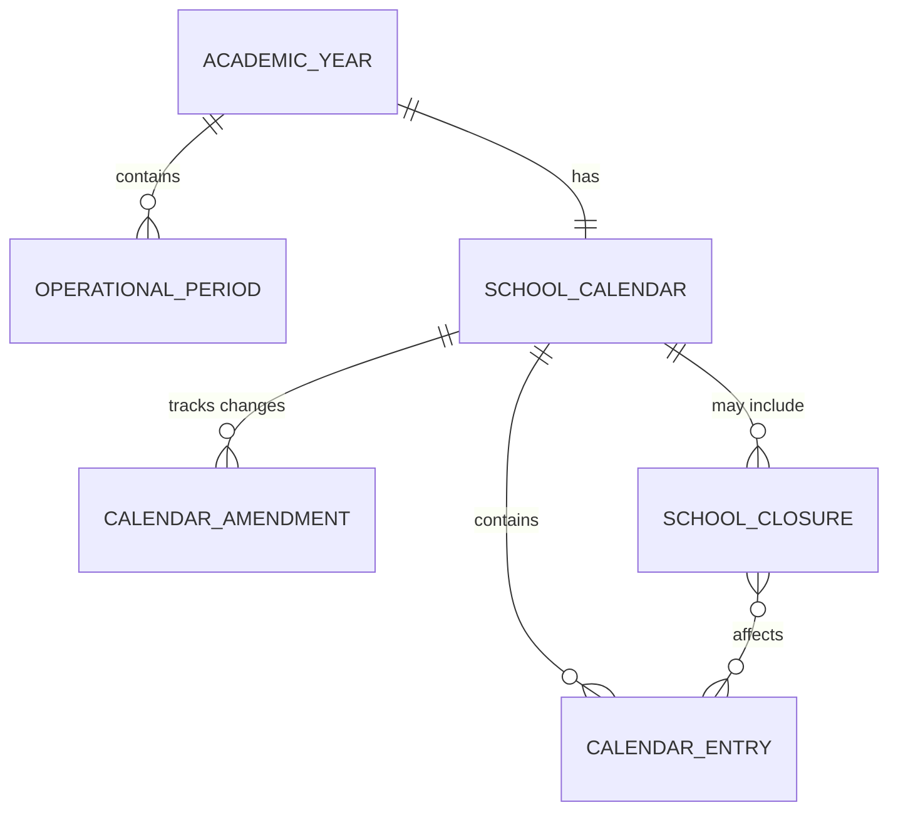
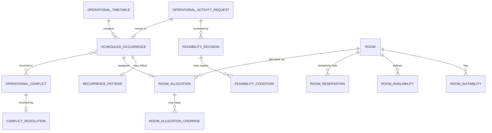
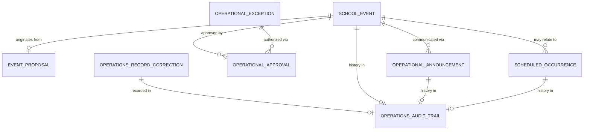

# Operations Domain — Entity Identification by Submodule

## Source Documents

- [operational-domain.md](file:///d:/Project.Private/elsasa-sis-v3/domains/operational-domain.md) — Operations Domain definition
- [sub-modul-and-development-phases.md](file:///d:/Project.Private/elsasa-sis-v3/sub-modul-and-development-phases.md) — Module decomposition and three-stage roadmap

## Domain Boundary

The Operations domain is the authoritative source for academic year and operational period context, school calendar, operational timetable and scheduled occurrences, room context and allocation, school event operational lifecycle, announcement publication, operational feasibility and exception decisions, conflict and disruption management, and operations history and correction.

Operations determines **when**, **where**, and **under what operational authorization** school activities occur.

It does **not** own student identity or status, learning structure or results, behaviour or development outcomes, financial obligations or clearance, or teaching authorization and assignment. Those responsibilities belong to Students, Academics, Development, Finance, and Teaching respectively.

Entities identified here are strictly derived from the domain definition and module decomposition. No entity is introduced that is not supported by the source documents.

---

## Submodule 1 — Calendar & Periods

**Module responsibility:** Manage academic year, operational periods, school calendar, holidays, closures, and shared date context.

**Submodules:** Academic Year Management · Operational Period Management · School Calendar Management · Closure Coordination

**Stage:** Stage 1 (Foundation) — no prerequisites.

### Entities

#### 1.1 Academic Year *(Core Entity)*

| Aspect | Description |
|---|---|
| **Purpose** | Represents the approved common period used to organize school operations. Provides the highest-level temporal boundary within which all domains operate. |
| **Role** | The foundational time context for all school work. Every operational period, calendar, timetable, and period-scoped activity references an Academic Year. An Academic Year has explicit effective dates and progresses through a lifecycle (proposed → approved → active → completed). |
| **Example** | Academic Year "Tahun Pelajaran 2026/2027": start 2026-07-15, end 2027-06-30, status Approved, approved by Kepala Sekolah 2026-05-01. |

> [!NOTE]
> Period names and structures are school-policy questions. Operations must not assume every school uses the same naming convention.

---

#### 1.2 Operational Period *(Core Entity)*

| Aspect | Description |
|---|---|
| **Purpose** | Represents a bounded period with an approved coordination purpose within an Academic Year. Covers terms, semesters, quarters, admission windows, assessment windows, reporting periods, event periods, campus-specific operating periods, and other approved periods. |
| **Role** | Subdivides the Academic Year into meaningful coordination windows. Other domains reference Operational Periods to scope their work temporally (e.g., Finance references it for billing cycles, Academics for assessment windows, Students for admission windows). Each period has a type, effective dates, and approval status. |
| **Example** | Operational Period: type "Semester", name "Semester 1 TP 2026/2027", start 2026-07-15, end 2026-12-20, Academic Year "TP 2026/2027", status Approved. |

> [!IMPORTANT]
> An Operational Period is a **coordination** context — it defines when something may occur. It does not define the academic, financial, or administrative meaning of what occurs within it. The owning domain determines what its work means within the period.

---

#### 1.3 School Calendar *(Core Entity)*

| Aspect | Description |
|---|---|
| **Purpose** | Represents the approved set of dates and designations that supply shared operating context to all domains. |
| **Role** | The authoritative source of common date context. Provides instructional/non-instructional day designations, holidays, closures, staff-only days, significant school dates, and domain-requested windows. A School Calendar is scoped to an Academic Year, may have campus or program applicability, and has a publication status. Amendments are versioned. |
| **Example** | School Calendar "Kalender SD Elsasa TP 2026/2027": Academic Year "TP 2026/2027", campus "All Campuses", version 1.0, publication status "Published", approved 2026-06-01. |

---

#### 1.4 Calendar Entry *(Core Entity)*

| Aspect | Description |
|---|---|
| **Purpose** | Represents a single date or date range within the School Calendar with its designation and applicable context. |
| **Role** | The granular unit of the School Calendar. Each entry designates a date (or range) as an instructional day, holiday, closure, staff-only day, significant date, or domain-requested window. Entries carry campus/program applicability and may reference amendment history. |
| **Example** | Calendar Entry: date 2026-08-17, designation "Holiday", description "Hari Kemerdekaan RI", applicability "All Campuses". |

---

#### 1.5 School Closure *(Supporting Entity)*

| Aspect | Description |
|---|---|
| **Purpose** | Records an authorized decision to close school operations for a campus, population, or period. Distinct from a scheduled holiday because it may arise from unplanned circumstances (emergency, natural disaster, policy). |
| **Role** | Captures closure authority, reason, affected campus/population, effective period, communication requirements, and recovery actions. Links to affected Calendar Entries and triggers review of affected operational arrangements (schedules, events, allocations). |
| **Example** | School Closure: campus "Campus Utara", period 2026-11-25 to 2026-11-26, reason "Banjir", authorized by Kepala Sekolah, notification published 2026-11-24. |

---

#### 1.6 Calendar Amendment *(Supporting Entity)*

| Aspect | Description |
|---|---|
| **Purpose** | Records an approved change to a previously approved School Calendar. |
| **Role** | Preserves history of what the calendar looked like before and after the change. Captures what was changed, when, why, by whom, the effective date, and the impact on affected domains. Ensures amendments do not silently rewrite previously approved context. |
| **Example** | Calendar Amendment: School Calendar "TP 2026/2027" v1.0 → v1.1, changed entry 2026-10-28 from "Instructional" to "Holiday (Maulid Nabi)", effective immediately, approved by Calendar Authority 2026-09-15. |

---

### Calendar & Periods — Entity Relationship Summary

---

## Submodule 2 — Scheduling & Rooms

**Module responsibility:** Manage operational activity requests, feasibility review, timetable, scheduled occurrences, and room context/allocation (including homeroom room assignment).

**Submodules:** Room & Location Context (incl. homeroom room assignment) · Room Availability & Allocation · Operational Activity Request · Operational Feasibility Review · Timetable & Scheduled Occurrences · Conflict & Disruption Management

**Stage:** Stage 2 (Learning & Teaching) — depends on Calendar & Periods, Teaching Assignment & Workload, Academic Participation & Learning Activities.

### Entities

---

### 2A. Room & Location Context

#### 2.1 Room *(Core Entity)*

| Aspect | Description |
|---|---|
| **Purpose** | Represents an operationally identifiable location that may be allocated for school activities. Holds the minimum room information required for operational allocation decisions. |
| **Role** | The central location entity for scheduling and allocation. Carries room type (Classroom, Laboratory, Hall, Meeting Room, Other), capacity (maximum occupancy), suitability characteristics (Projector Available, Computer Available, Laboratory Equipment Available, Accessible), campus/site reference, active/unavailable status, and effective dates. Operations maintains room identity when no separate facilities capability exists. |
| **Example** | Room: code "R-201", name "Ruang Kelas 201", campus "Campus Utara", type "Classroom", capacity 35, suitability ["Projector Available", "Accessible"], status "Active". |

> [!NOTE]
> Phase-2 uses a simplified room model. Room allocation decisions use only room type, capacity, and suitability. Building management, asset management, safety compliance, maintenance management, and facility engineering are explicitly out of scope.

---

#### 2.2 Room Suitability *(Supporting Entity)*

| Aspect | Description |
|---|---|
| **Purpose** | Records the suitability characteristics of a room that inform allocation decisions. |
| **Role** | Defines what equipment, features, or accessibility characteristics a room offers. Used during feasibility review and allocation to match room capabilities against activity requirements. Characteristics are configurable per school. |
| **Example** | Room "R-201" suitability: "Projector Available" = Yes, "Computer Available" = No, "Accessible" = Yes. |

> [!NOTE]
> Whether Room Suitability is modeled as a separate entity or as attributes/tags on Room is an implementation decision. It is listed separately because the domain document identifies suitability as a distinct matching criterion in allocation decisions.

---

### 2B. Room Availability & Allocation

#### 2.3 Room Availability *(Core Entity)*

| Aspect | Description |
|---|---|
| **Purpose** | Represents the time and conditions under which a room may be considered for allocation. |
| **Role** | Defines when a room is open for booking and when it is restricted or closed. Captures availability windows, temporary restrictions, closure periods, and reasons. Allocation decisions consult Room Availability before proposing or approving a room. |
| **Example** | Room "R-201" availability: available Monday–Friday 07:00–16:00, restricted Saturday 07:00–12:00 (staff-only), unavailable Sunday. |

---

#### 2.4 Room Reservation *(Core Entity)*

| Aspect | Description |
|---|---|
| **Purpose** | Represents a request or tentative hold to use a room for a specific date/time, pending final approval or allocation. |
| **Role** | Distinguishes a requested or tentatively held room from an approved allocation. A Tentative Hold has a default expiry of 48 hours unless converted into an approved reservation or allocation. Expired holds are automatically released. Captures the requesting source, requested date/time, room, purpose reference, hold status, and expiry. |
| **Example** | Room Reservation: Room "R-201", date 2026-09-15 08:00–09:30, status "Tentative Hold", source "Activity Request #OAR-2026-0112", expires 2026-09-12 14:00. |

> [!IMPORTANT]
> A request, tentative hold, reservation, and approved allocation are different business meanings. They must remain distinguishable.

---

#### 2.5 Room Allocation *(Core Entity)*

| Aspect | Description |
|---|---|
| **Purpose** | Records the approved use of a room by a Scheduled Occurrence for a specific date/time. |
| **Role** | The authoritative record that a room has been assigned to an activity. Links a Room to a Scheduled Occurrence. Captures allocation status (proposed, approved, released, cancelled), conditions, approving authority, and change history. Overrides require Operations Authority approval with recorded reason. |
| **Example** | Room Allocation: Room "R-201" allocated to Scheduled Occurrence #SO-2026-0345 (Matematika Kelas 1A), Monday 2026-09-15 08:00–09:30, status "Approved", allocated by Scheduler Pak Dedi. |

---

### 2C. Operational Activity Request

#### 2.6 Operational Activity Request *(Core Entity)*

| Aspect | Description |
|---|---|
| **Purpose** | Represents a request from a domain to place its owned work into operational time and space. This is the entry point for all scheduling coordination. |
| **Role** | The primary intake entity for scheduling. An actionable request must contain: Source Owner (requesting domain and responsible actor), Purpose (source activity reference), Requested Time or Period, Responsible Actor, and Operational Requirements or Constraints. May also include duration, campus/delivery mode/room/capacity requirement, participant context, accessibility/safety/confidentiality constraints, assigned teacher context, priority/flexibility, and dependencies. Progresses through states: received → clarification required → actionable → under review → scheduled/rejected/withdrawn. |
| **Example** | Operational Activity Request #OAR-2026-0112: source "Academics — Matematika Kelas 1A", requested by Guru Matematika Ibu Ani, requested time "Semester 1, Monday & Wednesday 08:00–09:30", room type "Classroom", capacity ≥ 35, requirement "Projector Available". |

> [!NOTE]
> The request is **not** the underlying activity and does not transfer ownership of it to Operations. Requests missing required information must be returned for clarification.

---

### 2D. Operational Feasibility Review

#### 2.7 Feasibility Decision *(Core Entity)*

| Aspect | Description |
|---|---|
| **Purpose** | Records the determination of whether a proposed operational arrangement can be supported. |
| **Role** | The output of the feasibility review process. Captures the outcome (Feasible, Conditionally Feasible, Infeasible, Unresolved), the evidence considered (calendar compatibility, room availability, capacity, teacher availability, conflicts, dependencies), conditions that must be satisfied and who owns their satisfaction, and the reviewer. Each Operational Activity Request may have one or more Feasibility Decisions as circumstances change. |
| **Example** | Feasibility Decision for #OAR-2026-0112: outcome "Conditionally Feasible", condition "Room R-201 available only if Science Lab session is relocated", condition owner "Scheduler", reviewed by Operations Coordinator 2026-08-20. |

---

#### 2.8 Feasibility Condition *(Supporting Entity)*

| Aspect | Description |
|---|---|
| **Purpose** | Records a specific condition that must be satisfied for a conditionally feasible arrangement to proceed. |
| **Role** | Captures what must be resolved, who owns the resolution, the deadline (if any), and current satisfaction status. Linked to a Feasibility Decision. Ensures conditions are tracked explicitly rather than buried in notes. |
| **Example** | Condition: "Teaching Assignment for Ibu Ani must be finalized by Teaching domain before final allocation", owner "Teaching", status "Pending", deadline 2026-08-25. |

---

### 2E. Timetable & Scheduled Occurrences

#### 2.9 Operational Timetable *(Core Entity)*

| Aspect | Description |
|---|---|
| **Purpose** | Represents the approved collection of scheduled occurrences for a given scope (academic year, period, campus) that constitutes the operational schedule. |
| **Role** | The authoritative published schedule. Aggregates Scheduled Occurrences into a coherent, published view. Carries a scope (Academic Year, Operational Period, campus), version, approval status, and publication status. There is one authoritative timetable per scope — other domains must not independently publish a conflicting timetable. |
| **Example** | Operational Timetable: "Jadwal Semester 1 TP 2026/2027 — Campus Utara", scope Semester 1, campus "Campus Utara", version 1.0, status "Published", published 2026-07-20. |

---

#### 2.10 Scheduled Occurrence *(Core Entity)*

| Aspect | Description |
|---|---|
| **Purpose** | Represents an approved operational placement of source-owned work into a specific date, time, and (where applicable) location. |
| **Role** | The individual scheduling unit. Links to a source activity reference, date/time, duration, recurrence pattern, campus/room, delivery mode, applicable participant/audience reference, assigned teaching-resource reference (when needed), approved status, conditions/exceptions, publication status, and change/cancellation history. A Scheduled Occurrence is an operational arrangement — it is not a learning structure, Student Learning Plan, Teaching Assignment, or Development program. |
| **Example** | Scheduled Occurrence #SO-2026-0345: source "Matematika Kelas 1A", date Monday 2026-09-15, time 08:00–09:30, room "R-201", delivery mode "In-Person", teacher reference "Ibu Ani (TA-2026-078)", status "Approved", publication "Published". |

---

#### 2.11 Recurrence Pattern *(Supporting Entity)*

| Aspect | Description |
|---|---|
| **Purpose** | Defines the repetition rule for a Scheduled Occurrence that recurs over a period. |
| **Role** | Captures frequency (weekly, bi-weekly, etc.), applicable days, start/end dates, and any individual exceptions or overrides within the recurring series. Ensures recurring schedules preserve individual exceptions and changes. |
| **Example** | Recurrence: Scheduled Occurrence #SO-2026-0345 recurs weekly on Monday and Wednesday, effective 2026-07-22 to 2026-12-13, except 2026-08-17 (Holiday). |

---

### 2F. Conflict & Disruption Management

#### 2.12 Operational Conflict *(Core Entity)*

| Aspect | Description |
|---|---|
| **Purpose** | Records an incompatibility between requests, constraints, or approved arrangements that requires action. |
| **Role** | Captures what is in conflict (competing room requests, overlapping commitments, room unavailability, capacity exceedance, dependency not satisfied, etc.), the conflict classification (Prohibited or Warning), affected arrangements, and resolution status. Prohibited conflicts (Double Booking, Room Unavailable, Capacity Exceeded) block allocation approval. Warning conflicts (Preferred Room Unavailable, Near Capacity Threshold, Alternative Room Recommended, Scheduling Preference Conflict) inform decision-making but do not block. |
| **Example** | Operational Conflict #OC-2026-0018: type "Double Booking" (Prohibited), Room "R-201" requested by both #SO-2026-0345 and #SO-2026-0351 on Monday 2026-09-15 08:00–09:30, status "Unresolved". |

---

#### 2.13 Conflict Resolution *(Supporting Entity)*

| Aspect | Description |
|---|---|
| **Purpose** | Records how an Operational Conflict was resolved. |
| **Role** | Captures the resolution action (reschedule, relocate, condition, reject, escalate, override), the decision basis (priority policy, Operations Authority approval), affected arrangements, and the authorizing actor. Priority order when resources are insufficient: 1) Academic Activities, 2) Assessment Activities, 3) Student Administrative Activities, 4) School Events, 5) Other Activities. Tie-breaker: First Approved Request Wins (by approval timestamp). |
| **Example** | Conflict Resolution for #OC-2026-0018: action "Relocate #SO-2026-0351 to Room R-203", basis "Priority — Academic Activity wins over School Event", authorized by Scheduler Pak Dedi, resolved 2026-08-22. |

---

#### 2.14 Room Allocation Override *(Supporting Entity)*

| Aspect | Description |
|---|---|
| **Purpose** | Records an authorized override of normal room allocation rules by Operations Authority. |
| **Role** | Captures reason, approving authority, affected allocations, and effective period. Required when allocation would violate normal rules but is authorized by exception. Ensures historical traceability of non-standard allocation decisions. |
| **Example** | Override: Room "Hall-01" allocated to School Event despite Near Capacity Threshold, reason "Only hall available for graduation rehearsal", approved by Kepala Sekolah, affected allocation #RA-2026-0088. |

---

### Scheduling & Rooms — Entity Relationship Summary

---

## Submodule 3 — Events & Announcements

**Module responsibility:** Manage school event operational lifecycle, operational announcements, and operational approval/exception workflows.

**Submodules:** School Event Coordination · Announcement Publication & Withdrawal · Operational Approval & Exception · Operations History & Correction

**Stage:** Stage 3 (Development & Completion) — depends on Calendar & Periods, Scheduling & Rooms.

### Entities

---

### 3A. School Event Coordination

#### 3.1 School Event *(Core Entity)*

| Aspect | Description |
|---|---|
| **Purpose** | Represents a coordinated school occurrence with an operational lifecycle and a clearly identified purpose owner. |
| **Role** | The central entity for event coordination. Carries purpose owner (the domain that owns the event's business purpose), organizer, audience, proposed/approved date-time-location, capacity requirements, operational dependencies, feasibility decision, approval and publication status, and lifecycle state (Proposed → Approved → Published → Postponed/Relocated/Cancelled → Completed). A School Event may relate to one or more Scheduled Occurrences but retains its distinct meaning. |
| **Example** | School Event #SE-2026-0015: name "Perayaan Hari Guru", purpose owner "Development — Extracurricular", organizer "OSIS Coordinator", audience "All Students, Teachers, Parents", date 2026-11-25, location "Hall-01", capacity 300, status "Approved". |

> [!NOTE]
> Operations owns the event as an operational occurrence. The purpose domain (Academics, Development, Students, etc.) owns the event's purpose, participation, and outcomes. Operational approval does not approve academic, Development, Students, Finance, or Teaching outcomes.

---

#### 3.2 Event Proposal *(Supporting Entity)*

| Aspect | Description |
|---|---|
| **Purpose** | Records the initial request to hold a school event, including all information needed for operational review. |
| **Role** | The intake form for event coordination. Captures purpose owner, organizer, intended audience, proposed time/place, capacity and operational requirements, dependencies and clearances needed, and communication needs. An Event Proposal that is approved transitions the School Event to "Approved" status. A proposal may be returned for revision, conditionally approved, or rejected. |
| **Example** | Event Proposal for "Perayaan Hari Guru": submitted by OSIS Coordinator, proposed date 2026-11-25, requested location "Hall", capacity needed 300, requires sound system and stage setup, dependency "Approval from Kepala Sekolah". |

> [!NOTE]
> Whether Event Proposal is a separate entity or an initial state of School Event is an implementation decision. It is listed separately because the domain document distinguishes the proposal from the approved event, and a single event may go through multiple revision cycles before approval.

---

### 3B. Announcement Publication & Withdrawal

#### 3.3 Operational Announcement *(Core Entity)*

| Aspect | Description |
|---|---|
| **Purpose** | Represents an authorized publication of information for a defined audience, purpose, channel, and period. |
| **Role** | The core entity for managed communications. Carries source domain, authorized publisher, approved content or content reference, target audience, publication channel, publication and expiry time, and correction/replacement/withdrawal status. Operations owns publication status (Draft, Published, Withdrawn), not the underlying business fact. Technical delivery receipts and acknowledgement tracking are out of domain scope. |
| **Example** | Operational Announcement #OA-2026-0043: source "Operations — Calendar Amendment", publisher "Communications Officer Ibu Dewi", content "Perubahan jadwal libur semester — see Calendar v1.1", audience "All Parents, All Teachers", channel "School App + Email", published 2026-09-16, expiry 2026-10-01, status "Published". |

> [!IMPORTANT]
> An announcement must not become an alternative student decision, academic result, Development case record, financial statement, or Teaching Assignment. Operations publishes on behalf of the source domain.

---

### 3C. Operational Approval & Exception

#### 3.4 Operational Approval *(Core Entity)*

| Aspect | Description |
|---|---|
| **Purpose** | Records an explicit operational decision concerning feasibility, coordination, or authorization of an operational arrangement. |
| **Role** | Captures what was approved or rejected (time/location suitability, room capacity, schedule exception, event readiness, publication, conflict resolution, emergency action), the decision type (approved, conditionally approved, rejected), authority, conditions, effective date, and scope. Operational approval is distinct from source-domain approval and financial clearance. Operations may record approval steps for cross-domain coordination, but the business decision remains with its owning domain. |
| **Example** | Operational Approval #AP-2026-0071: subject "School Event #SE-2026-0015 — Perayaan Hari Guru", decision "Conditionally Approved", condition "Sound system availability confirmed by 2026-11-20", authority "Operations Coordinator Pak Ahmad". |

---

#### 3.5 Operational Exception *(Core Entity)*

| Aspect | Description |
|---|---|
| **Purpose** | Records an authorized departure from an approved operational rule or arrangement. |
| **Role** | Captures what rule or arrangement is being excepted, scope, reason, authorizing authority, effective period, and conditions for expiry or review. Exceptions are distinct from corrections (correcting an error) and from new decisions caused by changed circumstances. |
| **Example** | Operational Exception #OE-2026-0009: "Allow scheduling of Remedial Class in Hall-01 (normally reserved for events only)", reason "All classrooms at capacity during assessment week", authority "Kepala Sekolah", effective 2026-10-14 to 2026-10-18. |

---

### 3D. Operations History & Correction

#### 3.6 Operations Record Correction *(Core Entity)*

| Aspect | Description |
|---|---|
| **Purpose** | Records an authorized correction of an inaccurate or incomplete approved Operations record. |
| **Role** | Preserves the original record alongside the corrected information. Captures what was wrong, the corrected value, evidence of error, reason, authority, effective meaning, downstream impact, and notification status. A correction is distinct from a new operational decision caused by changed circumstances. Approved records must never be silently overwritten. |
| **Example** | Record Correction #RC-2026-0005: original "Scheduled Occurrence #SO-2026-0345 recorded as Room R-201", correction "Actual room was R-202 (data entry error)", evidence "Scheduler confirmation", authority "Operations Coordinator", affected consumers notified 2026-09-20. |

---

#### 3.7 Operations Audit Trail *(Supporting Entity)*

| Aspect | Description |
|---|---|
| **Purpose** | Preserves the history of all operational decisions, changes, and their effective dates across all Operations entities. |
| **Role** | The cross-cutting historical record. Tracks what was proposed, approved, published, changed, when changes became effective, who authorized them, why, and which parties were notified. Enables historical interpretability of past arrangements including what audiences were told at the time. Applies to calendars, schedules, allocations, events, announcements, exceptions, cancellations, and corrections. |
| **Example** | Audit entry: "Scheduled Occurrence #SO-2026-0345 rescheduled from Monday 08:00 to Tuesday 10:00, effective 2026-10-01, authorized by Scheduler Pak Dedi, reason 'Teacher availability conflict', parents notified 2026-09-28." |

> [!NOTE]
> Whether the Operations Audit Trail is modeled as a single entity, per-entity history tables, or an event sourcing pattern is an implementation decision. The domain document's requirement is that history must distinguish what was proposed, approved, published, changed, when, by whom, why, and who was notified.

---

### Events & Announcements — Entity Relationship Summary

---

## Cross-Submodule Entity Summary

### Entity Classification

| # | Entity | Submodule | Classification | Justification |
|---|---|---|---|---|
| 1.1 | Academic Year | Calendar & Periods | Core | Foundational time context for all domains |
| 1.2 | Operational Period | Calendar & Periods | Core | Subdivides academic year into coordination windows |
| 1.3 | School Calendar | Calendar & Periods | Core | Authoritative shared date context |
| 1.4 | Calendar Entry | Calendar & Periods | Core | Granular date designation |
| 1.5 | School Closure | Calendar & Periods | Supporting | Unplanned closure coordination |
| 1.6 | Calendar Amendment | Calendar & Periods | Supporting | Calendar change traceability |
| 2.1 | Room | Scheduling & Rooms | Core | Location for allocation |
| 2.2 | Room Suitability | Scheduling & Rooms | Supporting | Room-capability matching |
| 2.3 | Room Availability | Scheduling & Rooms | Core | When a room may be used |
| 2.4 | Room Reservation | Scheduling & Rooms | Core | Tentative hold before approval |
| 2.5 | Room Allocation | Scheduling & Rooms | Core | Approved room use |
| 2.6 | Operational Activity Request | Scheduling & Rooms | Core | Entry point for scheduling |
| 2.7 | Feasibility Decision | Scheduling & Rooms | Core | Operational feasibility determination |
| 2.8 | Feasibility Condition | Scheduling & Rooms | Supporting | Condition tracking for conditional feasibility |
| 2.9 | Operational Timetable | Scheduling & Rooms | Core | Authoritative published schedule |
| 2.10 | Scheduled Occurrence | Scheduling & Rooms | Core | Individual time-place placement |
| 2.11 | Recurrence Pattern | Scheduling & Rooms | Supporting | Repetition rules for recurring occurrences |
| 2.12 | Operational Conflict | Scheduling & Rooms | Core | Incompatibility requiring action |
| 2.13 | Conflict Resolution | Scheduling & Rooms | Supporting | Resolution record |
| 2.14 | Room Allocation Override | Scheduling & Rooms | Supporting | Authorized exception to normal allocation |
| 3.1 | School Event | Events & Announcements | Core | Event with operational lifecycle |
| 3.2 | Event Proposal | Events & Announcements | Supporting | Event intake and review |
| 3.3 | Operational Announcement | Events & Announcements | Core | Authorized publication |
| 3.4 | Operational Approval | Events & Announcements | Core | Operational decision record |
| 3.5 | Operational Exception | Events & Announcements | Core | Authorized rule departure |
| 3.6 | Operations Record Correction | Events & Announcements | Core | Error correction with traceability |
| 3.7 | Operations Audit Trail | Events & Announcements | Supporting | Cross-cutting historical record |

**Totals:** 27 entities — 18 Core, 9 Supporting.

---

## Entities Referenced from Other Domains (Not Owned by Operations)

Operations consumes minimum information from other domains as scheduling constraints and coordination context. These are **not** Operations entities — they are listed here to clarify cross-domain references.

| Referenced Concept | Source Domain | How Operations Uses It |
|---|---|---|
| Student identity reference | Students | Participant reference in scheduled occurrences and events |
| Administrative Placement / campus context | Students | Campus applicability for calendar, timetable, room |
| Learning Activity (source activity) | Academics | Source purpose for scheduling requests |
| Assessment Period need | Academics | Scheduling window for assessment occurrences |
| Teaching Assignment (approved) | Teaching | Teacher reference in scheduled occurrences |
| Teacher Availability constraint | Teaching | Constraint during feasibility review |
| Extracurricular Activity request | Development | Source purpose for event/scheduling requests |
| Financial Clearance (purpose-specific) | Finance | Consumed only when policy requires clearance for event |
| External holiday/closure direction | External | Evidence for closure decisions |

---

## Resolved Open Questions & Architectural Decisions

The open questions identified from the domain source documents have been formally resolved through architectural alignment:

1. **Event vs. Learning Activity boundary** — **Resolved.**
   - **Decision:** Clear operational distinction. A `School Event` is strictly reserved for milestone, one-off, or cross-cohort gatherings (e.g., graduation ceremonies, sports days, whole-school assemblies, exam periods) that carry their own operational coordination lifecycle (Event Proposal, operational approval, public staging).
   - **Resolution:** Routine syllabus classes and recurring extracurricular club meetings are **not** School Events; they are modeled directly as `Scheduled Occurrences` referencing their owning domain's activities (`Academics` for learning activities, `Development` for extracurricular programs).

2. **Event attendance ownership** — **Resolved.**
   - **Decision:** Out of scope for SIS. The SIS tracks participant/student attendance strictly for curricular learning activities within the `Academics` domain.
   - **Resolution:** Attendance tracking for general school events is entirely out of scope. Operations tracks only the operational lifecycle status of the event itself (Proposed → Approved → Published → Occurred/Completed → Cancelled). No event attendance entities exist in Operations.

3. **Announcement delivery tracking** — **Resolved.**
   - **Decision:** Publication lifecycle only. Operations manages the operational status of announcements (Draft, Published, Withdrawn, Expired).
   - **Resolution:** Dedicated recipient acknowledgement tracking (`Announcement Acknowledgement`) and low-level communication gateway delivery receipts (queued, sent, delivered, bounced, failed) are eliminated from the Operations domain. Transport and delivery tracking are delegated entirely to communication/notification infrastructure.

4. **Non-room schedulable resources** — **Resolved.**
   - **Decision:** Out of scope for Phase 2. Standalone resource booking is deferred to a future facilities and inventory capability.
   - **Resolution:** No standalone `Resource` entity is introduced. Equipment needs (e.g., projectors, lab kits) are modeled strictly as `Room Suitability` characteristics (e.g., "Projector Available") or operational constraints on `Operational Activity Request`.

5. **Multiple campus calendars** — **Resolved.**
   - **Decision:** Calendar per Campus/Program scope.
   - **Resolution:** Multiple `School Calendar` entities are supported within an `Academic Year`, each scoped either to the entire institution ("All Campuses") or to a specific campus/program (e.g., "Campus Utara", "Primary School"). All `Calendar Entries` within a given calendar inherit that calendar's defined operational scope.

6. **Homeroom room assignment** — **Resolved.**
   - **Decision:** Handled via standard scheduling entities.
   - **Resolution:** Homeroom room assignment is achieved without custom room attributes or dedicated entities. It is represented as a period-scoped `Scheduled Occurrence` (sourced from Students homeroom placement) allocated to a room via `Room Allocation`.

> [!NOTE]
> All open questions for the Operations Domain are closed. Entity models, relationships, and totals reflect these decisions without speculative or redundant entities.
