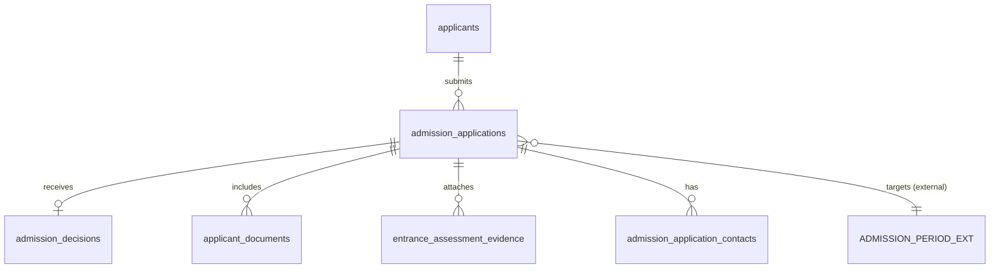
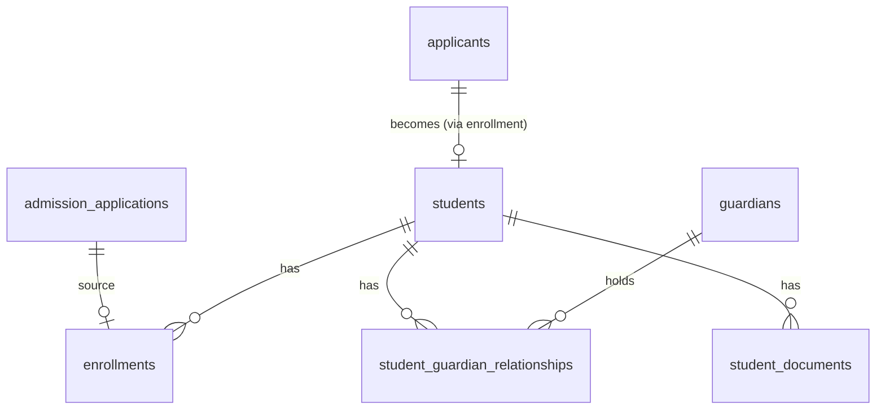
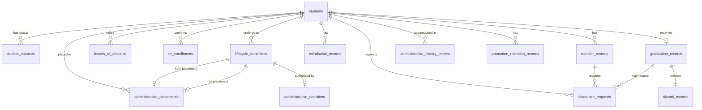
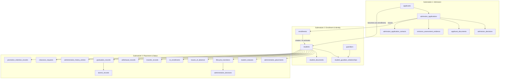

# Student Domain — Database Tables by Submodule

## Source Documents

- [student-domain.md](file:///d:/Project.Private/elsasa-sis-v3/domains/student-domain.md) — Student Domain definition
- [student-entities.md](file:///d:/Project.Private/elsasa-sis-v3/entities/student-entities.md) — Entity identification by submodule
- [sub-modul-and-development-phases.md](file:///d:/Project.Private/elsasa-sis-v3/sub-modul-and-development-phases.md) — Module decomposition and roadmap

## Conventions

- **PK** — Primary Key
- **FK** — Foreign Key (logical; referencing another table in this domain or an external domain)
- **UQ** — Unique constraint
- All tables include `created_at`, `updated_at`, and `created_by` audit columns (omitted from key-column listings for brevity)
- UUID is used as the primary key type throughout
- Columns marked *(nullable)* are not required at creation time, supporting progressive information collection
- External domain references (Operations, Academics, Finance) are stored as opaque identifiers; this domain does not own or define those tables

---

## Submodule 1 — Admission

### 1.1 `applicants` — Main Table

| Aspect | Description |
|---|---|
| **Purpose** | Stores the identity of a person who has applied or is being prepared to apply to the school. This is the person record before they become a student. |
| **Type** | Core |

**Key Columns:**

| Column | Type | Constraint | Description |
|---|---|---|---|
| `id` | UUID | PK | Unique applicant identifier |
| `full_name` | VARCHAR | NOT NULL | Full legal name |
| `preferred_name` | VARCHAR | nullable | Preferred/called name |
| `date_of_birth` | DATE | nullable | Date of birth |
| `place_of_birth` | VARCHAR | nullable | Place of birth |
| `gender` | VARCHAR | nullable | Gender |
| `nationality` | VARCHAR | nullable | Nationality |
| `government_id_type` | VARCHAR | nullable | Type of government-issued ID (e.g., NIK, passport) |
| `government_id_number` | VARCHAR | nullable, UQ | Government-issued ID number |
| `address` | TEXT | nullable | Home address |
| `previous_school_name` | VARCHAR | nullable | Name of previous school attended |
| `previous_school_address` | VARCHAR | nullable | Address of previous school |
| `notes` | TEXT | nullable | Internal administrative notes |

**Example:**

| id | full_name | date_of_birth | gender | nationality | government_id_number |
|---|---|---|---|---|---|
| `a1b2...` | Rina Kusuma | 2015-03-12 | Female | Indonesian | 3201234503150001 |

> [!NOTE]
> An Applicant is **not** a Student. The `applicants` table exists independently; upon enrollment, a corresponding `students` record is created with a reference back. One person should have only one Applicant record — duplicate detection is a business-layer concern, not enforced purely at the table level beyond the `government_id_number` unique constraint.

---

### 1.2 `admission_applications` — Main Table

| Aspect | Description |
|---|---|
| **Purpose** | Records each formal admission application submitted by an applicant for a specific admission period and intended placement. |
| **Type** | Core |

**Key Columns:**

| Column | Type | Constraint | Description |
|---|---|---|---|
| `id` | UUID | PK | Unique application identifier |
| `application_number` | VARCHAR | UQ, NOT NULL | Human-readable traceable reference (e.g., ADM-2026-0042) |
| `applicant_id` | UUID | FK → `applicants.id`, NOT NULL | The applicant submitting this application |
| `admission_period_id` | UUID | FK → external (Operations), NOT NULL | Target admission period |
| `application_type` | VARCHAR | NOT NULL, default 'new' | Intake pipeline type: `new`, `transfer_in` |
| `requested_entry_level` | VARCHAR | NOT NULL | Intended grade or level (e.g., "Grade 1") |
| `requested_campus` | VARCHAR | nullable | Intended campus |
| `requested_program` | VARCHAR | nullable | Intended program (e.g., "Reguler", "Bilingual") |
| `registration_date` | DATE | NOT NULL | Date application was registered |
| `status` | VARCHAR | NOT NULL | Application lifecycle state: `registered`, `under_review`, `decided`, `withdrawn` |
| `notes` | TEXT | nullable | Internal notes |

**Example:**

| application_number | applicant_id | admission_period_id | application_type | requested_entry_level | requested_campus | registration_date | status |
|---|---|---|---|---|---|---|---|
| ADM-2026-0042 | `a1b2...` | `per-001...` | new | Grade 1 | Campus Utara | 2026-02-15 | decided |

> [!NOTE]
> - **Single Intake Pipeline:** All incoming students (new or external transfer-in) pass through this admission pipeline (`application_type: 'new' | 'transfer_in'`), ensuring unified identity verification and review prior to enrollment.
> - **Single Active Application Constraint:** An applicant can have only one active application per admission period (enforced via partial unique index on `(applicant_id, admission_period_id)` WHERE `status NOT IN ('withdrawn', 'decided')`). If preferences change, the applicant must update requested placement or withdraw and reapply.

---

### 1.3 `admission_decisions` — Main Table

| Aspect | Description |
|---|---|
| **Purpose** | Records the official admission outcome for a specific application. One decision per application. |
| **Type** | Core |

**Key Columns:**

| Column | Type | Constraint | Description |
|---|---|---|---|
| `id` | UUID | PK | Unique decision identifier |
| `application_id` | UUID | FK → `admission_applications.id`, UQ, NOT NULL | The application this decision applies to (one-to-one) |
| `decision_type` | VARCHAR | NOT NULL | Outcome: `accepted`, `rejected`, `waitlisted`, `withdrawn`, `expired`, `deferred` |
| `decision_date` | DATE | NOT NULL | Date the decision was made |
| `effective_date` | DATE | NOT NULL | Date the decision takes effect |
| `decided_by` | VARCHAR | NOT NULL | Person or committee that made the decision |
| `reason` | TEXT | nullable | Reason or notes supporting the decision |
| `supporting_reference` | VARCHAR | nullable | Reference to supporting document or process |
| `deferred_admission_period_id` | UUID | FK → external (Operations), nullable | Target admission period if enrollment is deferred (up to 1 academic year) |

**Example:**

| application_id | decision_type | decision_date | effective_date | decided_by |
|---|---|---|---|---|
| `app-042...` | accepted | 2026-03-20 | 2026-03-20 | Admission Committee |

> [!NOTE]
> Deferral of enrollment (up to 1 academic year) is handled minimally by setting `decision_type = 'deferred'` and recording or updating the target period via `deferred_admission_period_id` (and updating the target admission period on the application) without creating redundant entities.

---

### 1.4 `applicant_documents` — Supporting Table

| Aspect | Description |
|---|---|
| **Purpose** | Tracks documents required or submitted as part of an admission application. |
| **Type** | Supporting |

**Key Columns:**

| Column | Type | Constraint | Description |
|---|---|---|---|
| `id` | UUID | PK | Unique document record identifier |
| `application_id` | UUID | FK → `admission_applications.id`, NOT NULL | The application this document belongs to |
| `document_type` | VARCHAR | NOT NULL | Type of document (e.g., "Birth Certificate", "Previous School Report") |
| `submission_status` | VARCHAR | NOT NULL | Status: `not_submitted`, `submitted`, `verified`, `rejected` |
| `submitted_date` | DATE | nullable | Date submitted |
| `verified_date` | DATE | nullable | Date verified |
| `verified_by` | VARCHAR | nullable | Person who verified |
| `file_reference` | VARCHAR | nullable | Reference to stored file (path, URL, or storage key) |
| `notes` | TEXT | nullable | Notes (e.g., reason for rejection) |

**Example:**

| application_id | document_type | submission_status | submitted_date | verified_date |
|---|---|---|---|---|
| `app-042...` | Birth Certificate | verified | 2026-02-15 | 2026-02-20 |
| `app-042...` | Previous School Report | submitted | 2026-02-15 | *(null)* |
| `app-042...` | Family Card | not_submitted | *(null)* | *(null)* |

---

### 1.5 `entrance_assessment_evidence` — Supporting Table

| Aspect | Description |
|---|---|
| **Purpose** | Records entrance assessment results attached to an application. Students does not conduct the assessment — only records the evidence provided by Academics or an external source. |
| **Type** | Supporting |

**Key Columns:**

| Column | Type | Constraint | Description |
|---|---|---|---|
| `id` | UUID | PK | Unique record identifier |
| `application_id` | UUID | FK → `admission_applications.id`, NOT NULL | The application this evidence belongs to |
| `assessment_type` | VARCHAR | NOT NULL | Type of assessment (e.g., "Reading Readiness", "Math Readiness") |
| `score` | VARCHAR | nullable | Score or result (stored as text to accommodate varied formats) |
| `source` | VARCHAR | NOT NULL | Who provided the assessment (e.g., "External Assessment Center", "Academics Domain") |
| `assessment_date` | DATE | nullable | Date assessment was conducted |
| `notes` | TEXT | nullable | Additional notes |

**Example:**

| application_id | assessment_type | score | source | assessment_date |
|---|---|---|---|---|
| `app-042...` | Reading Readiness | 78/100 | External Assessment Center | 2026-03-10 |
| `app-042...` | Math Readiness | 82/100 | External Assessment Center | 2026-03-10 |

---

### 1.6 `admission_application_contacts` — Supporting Table

| Aspect | Description |
|---|---|
| **Purpose** | Records the contact person(s) associated with an admission application — typically the parent or guardian who submitted the application. |
| **Type** | Supporting |

**Key Columns:**

| Column | Type | Constraint | Description |
|---|---|---|---|
| `id` | UUID | PK | Unique record identifier |
| `application_id` | UUID | FK → `admission_applications.id`, NOT NULL | The application this contact belongs to |
| `full_name` | VARCHAR | NOT NULL | Contact person's name |
| `relationship` | VARCHAR | NOT NULL | Relationship to the applicant (e.g., "Mother", "Father", "Guardian") |
| `phone` | VARCHAR | nullable | Phone number |
| `email` | VARCHAR | nullable | Email address |
| `address` | TEXT | nullable | Mailing address |

**Example:**

| application_id | full_name | relationship | phone | email |
|---|---|---|---|---|
| `app-042...` | Sari Kusuma | Mother | 0812-3456-7890 | sari.kusuma@email.com |

---

### Admission — Table Relationships

---

## Submodule 2 — Enrollment & Identity

### 2.1 `students` — Main Table

| Aspect | Description |
|---|---|
| **Purpose** | The authoritative student identity record. Created upon enrollment completion. Referenced by all other domains. Identity remains stable across all status changes. |
| **Type** | Core |

**Key Columns:**

| Column | Type | Constraint | Description |
|---|---|---|---|
| `id` | UUID | PK | Unique student identifier (internal) |
| `student_number` | VARCHAR | UQ, NOT NULL | School-issued student number (e.g., STD-2026-0108). Never reused. |
| `applicant_id` | UUID | FK → `applicants.id`, UQ, NOT NULL | Link back to the applicant identity (one-to-one, ensuring identity continuity) |
| `full_name` | VARCHAR | NOT NULL | Full legal name (initially copied from applicant, maintained independently) |
| `preferred_name` | VARCHAR | nullable | Preferred/called name |
| `date_of_birth` | DATE | nullable | Date of birth |
| `place_of_birth` | VARCHAR | nullable | Place of birth |
| `gender` | VARCHAR | nullable | Gender |
| `nationality` | VARCHAR | nullable | Nationality |
| `government_id_type` | VARCHAR | nullable | Government ID type |
| `government_id_number` | VARCHAR | nullable, UQ | Government-issued ID number |
| `address` | TEXT | nullable | Home address |
| `phone` | VARCHAR | nullable | Student's phone (if applicable) |
| `email` | VARCHAR | nullable | Student's email (if applicable) |
| `current_status` | VARCHAR | NOT NULL | Current administrative status: `enrolled`, `active`, `on_leave`, `leave_expired`, `transferred`, `withdrawn`, `graduated`, `alumni` |
| `enrollment_date` | DATE | NOT NULL | Date enrollment was completed |
| `notes` | TEXT | nullable | Internal notes |

**Example:**

| student_number | full_name | date_of_birth | current_status | enrollment_date |
|---|---|---|---|---|
| STD-2026-0108 | Rina Kusuma | 2015-03-12 | active | 2026-07-01 |

> [!IMPORTANT]
> `current_status` is a denormalized current-state field for operational convenience. The authoritative status history is in `student_statuses`. Any status change must update both the history table and this field atomically.

> [!NOTE]
> - **Global Organization-Wide Identity:** Student identity and `student_number` are organization-wide across all campuses (never local or campus-scoped). Moving between campuses is an Internal Transfer of placement, preserving complete academic and administrative history.
> - **Student Re-enrollment After Withdrawal:** A withdrawn student who returns to the school keeps their original Student identity and `student_number` (preserving past records and transcripts). They complete re-admission review, and a new `enrollments` record re-activates their status.
> - `student_number` is modeled as an attribute of `students` with a dedicated uniqueness constraint, satisfying the unique assignment and cross-domain reference requirements.

---

### 2.2 `enrollments` — Main Table

| Aspect | Description |
|---|---|
| **Purpose** | Records the administrative act that transforms an accepted applicant into an official student, or re-activates a returning student after withdrawal. Each record represents one enrollment event. |
| **Type** | Core |

**Key Columns:**

| Column | Type | Constraint | Description |
|---|---|---|---|
| `id` | UUID | PK | Unique enrollment identifier |
| `student_id` | UUID | FK → `students.id`, NOT NULL | The student linked to this enrollment (a student may have multiple enrollments over time upon re-admission) |
| `application_id` | UUID | FK → `admission_applications.id`, NOT NULL | Source admission application |
| `enrollment_type` | VARCHAR | NOT NULL, default 'initial' | Type of enrollment: `initial`, `re_admission` |
| `enrollment_date` | DATE | NOT NULL | Date enrollment was completed |
| `initial_campus` | VARCHAR | NOT NULL | Campus assigned at enrollment |
| `initial_level` | VARCHAR | NOT NULL | Level/grade assigned at enrollment (e.g., "Grade 1") |
| `initial_academic_year` | VARCHAR | NOT NULL | Academic year assigned at enrollment (e.g., "2026/2027") |
| `initial_program` | VARCHAR | nullable | Program assigned at enrollment (e.g., "Reguler") |
| `initial_cohort` | VARCHAR | nullable | Cohort assigned at enrollment (e.g., "1A") |
| `approved_by` | VARCHAR | NOT NULL | Person who approved enrollment |
| `enrollment_payment_confirmed` | BOOLEAN | nullable | Whether enrollment payment was confirmed (when policy requires it) |
| `payment_reference` | VARCHAR | nullable | Reference to payment receipt/transaction from Finance or external source |
| `payment_waived` | BOOLEAN | NOT NULL, default false | Whether enrollment payment requirement was waived |
| `waiver_reference` | VARCHAR | nullable | Reference to scholarship or authorized fee waiver decision |
| `notes` | TEXT | nullable | Notes |

**Example:**

| student_id | application_id | enrollment_type | enrollment_date | initial_campus | initial_level | initial_academic_year | approved_by | enrollment_payment_confirmed |
|---|---|---|---|---|---|---|---|---|
| `std-108...` | `app-042...` | initial | 2026-07-01 | Campus Utara | Grade 1 | 2026/2027 | Pak Budi | true |

> [!NOTE]
> - **Policy-Driven Payment Confirmation:** Governed by school policy flag. When required, enrollment requires either a confirmed payment reference (`enrollment_payment_confirmed = true` and `payment_reference IS NOT NULL`) or an authorized waiver/scholarship flag (`payment_waived = true` and `waiver_reference IS NOT NULL`). In Stage 1, this is recorded manually; in automated stages, it is verified against Finance.
> - **Re-admission of Withdrawn Students:** A returning student keeps their original `students` record and `student_number`. A new record with `enrollment_type = 're_admission'` is created to re-activate the student.

---

### 2.3 `guardians` — Main Table

| Aspect | Description |
|---|---|
| **Purpose** | Stores the identity and contact information of parents, legal guardians, and other persons officially associated with students. A guardian is a person independent of any specific student relationship. |
| **Type** | Core |

**Key Columns:**

| Column | Type | Constraint | Description |
|---|---|---|---|
| `id` | UUID | PK | Unique guardian identifier |
| `full_name` | VARCHAR | NOT NULL | Full name |
| `government_id_type` | VARCHAR | nullable | Government ID type |
| `government_id_number` | VARCHAR | nullable, UQ | Government-issued ID number (for deduplication) |
| `phone` | VARCHAR | nullable | Primary phone |
| `email` | VARCHAR | nullable | Email address |
| `address` | TEXT | nullable | Mailing address |
| `occupation` | VARCHAR | nullable | Occupation |
| `notes` | TEXT | nullable | Notes |

**Example:**

| full_name | phone | email | occupation |
|---|---|---|---|
| Sari Kusuma | 0812-3456-7890 | sari.kusuma@email.com | Teacher |
| Arif Kusuma | 0813-9876-5432 | arif.kusuma@email.com | Engineer |

---

### 2.4 `student_guardian_relationships` — Supporting Table

| Aspect | Description |
|---|---|
| **Purpose** | Links a student to a guardian with a specific relationship type and assigned responsibilities. A student may have multiple guardians; a guardian may be associated with multiple students. |
| **Type** | Supporting |

**Key Columns:**

| Column | Type | Constraint | Description |
|---|---|---|---|
| `id` | UUID | PK | Unique relationship identifier |
| `student_id` | UUID | FK → `students.id`, NOT NULL | The student |
| `guardian_id` | UUID | FK → `guardians.id`, NOT NULL | The guardian |
| `relationship_type` | VARCHAR | NOT NULL | Relationship: `mother`, `father`, `legal_guardian`, `grandparent`, `sibling`, `other` |
| `is_primary_contact` | BOOLEAN | NOT NULL, default false | Whether this guardian is the primary contact for this student |
| `is_emergency_contact` | BOOLEAN | NOT NULL, default false | Emergency contact |
| `is_financial_contact` | BOOLEAN | NOT NULL, default false | Financial contact (referenced by Finance domain) |
| `is_authorized_pickup` | BOOLEAN | NOT NULL, default false | Authorized to pick up the student |
| `is_active` | BOOLEAN | NOT NULL, default true | Whether this relationship is currently active |

**Example:**

| student_id | guardian_id | relationship_type | is_primary_contact | is_emergency_contact | is_financial_contact |
|---|---|---|---|---|---|
| `std-108...` | `grd-sari...` | mother | true | false | true |
| `std-108...` | `grd-arif...` | father | false | true | false |

---

### 2.5 `student_documents` — Supporting Table

| Aspect | Description |
|---|---|
| **Purpose** | Tracks official supporting documents associated with the student identity (as opposed to applicant documents submitted during admission). |
| **Type** | Supporting |

**Key Columns:**

| Column | Type | Constraint | Description |
|---|---|---|---|
| `id` | UUID | PK | Unique document record identifier |
| `student_id` | UUID | FK → `students.id`, NOT NULL | The student this document belongs to |
| `document_type` | VARCHAR | NOT NULL | Type (e.g., "Birth Certificate", "Family Card", "Student Photo") |
| `submission_status` | VARCHAR | NOT NULL | Status: `not_submitted`, `submitted`, `verified` |
| `submitted_date` | DATE | nullable | Date submitted |
| `verified_date` | DATE | nullable | Date verified |
| `verified_by` | VARCHAR | nullable | Person who verified |
| `file_reference` | VARCHAR | nullable | Reference to stored file |
| `valid_until` | DATE | nullable | Expiration date, if applicable |
| `notes` | TEXT | nullable | Notes |

**Example:**

| student_id | document_type | submission_status | submitted_date | verified_date |
|---|---|---|---|---|
| `std-108...` | Birth Certificate | verified | 2026-06-28 | 2026-06-30 |
| `std-108...` | Student Photo 3×4 | submitted | 2026-07-01 | *(null)* |

---

### Enrollment & Identity — Table Relationships

---

## Submodule 3 — Placement & Status

### 3.1 `administrative_placements` — Main Table

| Aspect | Description |
|---|---|
| **Purpose** | Records each placement period of a student within the school's organizational structure. A new row is created whenever placement changes — history is preserved by retaining previous rows. |
| **Type** | Core |

**Key Columns:**

| Column | Type | Constraint | Description |
|---|---|---|---|
| `id` | UUID | PK | Unique placement record identifier |
| `student_id` | UUID | FK → `students.id`, NOT NULL | The student |
| `campus` | VARCHAR | NOT NULL | Campus name or identifier (mandatory) |
| `school_level` | VARCHAR | NOT NULL | School level (e.g., "SD", "SMP", "SMA") (mandatory) |
| `grade` | VARCHAR | NOT NULL | Grade or year level (e.g., "Grade 1", "Grade 2") (mandatory) |
| `academic_year` | VARCHAR | NOT NULL | Academic year (e.g., "2026/2027") (mandatory) |
| `effective_date` | DATE | NOT NULL | Date this placement becomes effective (mandatory) |
| `program` | VARCHAR | nullable | Program (e.g., "Reguler", "Bilingual") (optional) |
| `stream` | VARCHAR | nullable | Stream, if applicable (optional) |
| `cohort` | VARCHAR | nullable | Cohort (e.g., "1A") (optional) |
| `homeroom` | VARCHAR | nullable | Homeroom or administrative group (e.g., "Kelas 1A") (optional) |
| `end_date` | DATE | nullable | Date this placement ended (null = current) |
| `is_current` | BOOLEAN | NOT NULL, default true | Whether this is the active placement |
| `reason` | VARCHAR | nullable | Reason for this placement (e.g., "Initial enrollment", "Promotion", "Transfer") |

**Example:**

| student_id | campus | school_level | grade | academic_year | cohort | homeroom | effective_date | end_date | is_current |
|---|---|---|---|---|---|---|---|---|---|
| `std-108...` | Campus Utara | SD | Grade 1 | 2026/2027 | 1A | Kelas 1A | 2026-07-15 | 2027-06-30 | false |
| `std-108...` | Campus Utara | SD | Grade 2 | 2027/2028 | 2A | Kelas 2A | 2027-07-01 | *(null)* | true |

> [!IMPORTANT]
> **Single Active Campus Placement Constraint:** A student has at most one active Administrative Placement across all campuses at any point in time (enforced via partial unique index on `(student_id) WHERE is_current = true`). Concurrent active placements across campuses are strictly prohibited.
>
> **Placement Minimal Model:** Follows the core mandatory (`campus`, `school_level`, `grade`, `academic_year`, `effective_date`) plus optional extension model (`homeroom`, `cohort`, `program`, `stream`), enabling placement upon enrollment before homeroom assignments are finalized.

---

### 3.2 `student_statuses` — Main Table

| Aspect | Description |
|---|---|
| **Purpose** | Records each status period of a student. A new row is created on every status change. This is the authoritative status history — `students.current_status` is a denormalized convenience field. |
| **Type** | Core |

**Key Columns:**

| Column | Type | Constraint | Description |
|---|---|---|---|
| `id` | UUID | PK | Unique status record identifier |
| `student_id` | UUID | FK → `students.id`, NOT NULL | The student |
| `status` | VARCHAR | NOT NULL | Status value: `enrolled`, `active`, `on_leave`, `leave_expired`, `transferred`, `withdrawn`, `graduated`, `alumni` |
| `effective_date` | DATE | NOT NULL | Date this status takes effect |
| `end_date` | DATE | nullable | Date this status ended (null = current) |
| `is_current` | BOOLEAN | NOT NULL, default true | Whether this is the current status |
| `reason` | TEXT | nullable | Reason for this status |
| `transition_id` | UUID | FK → `lifecycle_transitions.id`, nullable | The transition that caused this status change |

**Example:**

| student_id | status | effective_date | end_date | is_current |
|---|---|---|---|---|
| `std-108...` | enrolled | 2026-07-01 | 2026-07-15 | false |
| `std-108...` | active | 2026-07-15 | *(null)* | true |

> [!NOTE]
> A student has at most one current status record at any point in time, enforced via partial unique index on `(student_id) WHERE is_current = true`.

---

### 3.3 `lifecycle_transitions` — Main Table

| Aspect | Description |
|---|---|
| **Purpose** | Records each approved change from one administrative state or placement to another. This is the fundamental unit that drives administrative history. |
| **Type** | Core |

**Key Columns:**

| Column | Type | Constraint | Description |
|---|---|---|---|
| `id` | UUID | PK | Unique transition identifier |
| `student_id` | UUID | FK → `students.id`, NOT NULL | The student |
| `transition_type` | VARCHAR | NOT NULL | Type: `enrollment`, `re_admission`, `activation`, `leave_start`, `leave_return`, `leave_expiry`, `promotion`, `retention`, `internal_transfer`, `external_transfer_out`, `external_transfer_in`, `withdrawal`, `graduation`, `alumni_activation`, `placement_change`, `re_enrollment` |
| `previous_status` | VARCHAR | nullable | Status before transition |
| `new_status` | VARCHAR | nullable | Status after transition |
| `previous_placement_id` | UUID | FK → `administrative_placements.id`, nullable | Placement before (if placement changed) |
| `new_placement_id` | UUID | FK → `administrative_placements.id`, nullable | Placement after (if placement changed) |
| `effective_date` | DATE | NOT NULL | When the transition takes effect |
| `decision_id` | UUID | FK → `administrative_decisions.id`, nullable | The decision authorizing this transition |
| `notes` | TEXT | nullable | Additional information |

**Example:**

| student_id | transition_type | previous_status | new_status | effective_date | decision_id |
|---|---|---|---|---|---|
| `std-108...` | promotion | active | active | 2027-07-01 | `dec-012...` |

---

### 3.4 `administrative_decisions` — Supporting Table

| Aspect | Description |
|---|---|
| **Purpose** | Records a decision that authorizes one or more lifecycle transitions. Captures who decided, when, why, and on what basis. |
| **Type** | Supporting |

**Key Columns:**

| Column | Type | Constraint | Description |
|---|---|---|---|
| `id` | UUID | PK | Unique decision identifier |
| `decision_type` | VARCHAR | NOT NULL | Type: `enrollment_approval`, `re_admission_approval`, `activation`, `leave_approval`, `leave_return_approval`, `promotion_approval`, `retention_approval`, `transfer_approval`, `withdrawal_approval`, `graduation_approval` |
| `decision_date` | DATE | NOT NULL | Date decision was made |
| `effective_date` | DATE | NOT NULL | Date decision takes effect |
| `decided_by` | VARCHAR | NOT NULL | Person or authority who made the decision |
| `reason` | TEXT | nullable | Reason or justification |
| `supporting_reference` | VARCHAR | nullable | External reference (e.g., academic recommendation number) |

**Example:**

| decision_type | decision_date | effective_date | decided_by | supporting_reference |
|---|---|---|---|---|
| promotion_approval | 2027-06-20 | 2027-07-01 | Kepala Sekolah Ibu Ratna | Recommendation #PR-2027-045 |

---

### 3.5 `leaves_of_absence` — Main Table

| Aspect | Description |
|---|---|
| **Purpose** | Records each leave of absence taken by a student. Manages the leave lifecycle from start to return or expiry. |
| **Type** | Core |

**Key Columns:**

| Column | Type | Constraint | Description |
|---|---|---|---|
| `id` | UUID | PK | Unique leave record identifier |
| `student_id` | UUID | FK → `students.id`, NOT NULL | The student |
| `start_date` | DATE | NOT NULL | Effective start of leave |
| `expected_return_date` | DATE | nullable | Expected return date (max 1 academic year from start) |
| `actual_return_date` | DATE | nullable | Actual return date (null if not yet returned) |
| `reason` | TEXT | NOT NULL | Reason for leave |
| `status` | VARCHAR | NOT NULL | Leave status: `active`, `returned`, `expired` |
| `approved_by` | VARCHAR | NOT NULL | Person who approved the leave |
| `approval_date` | DATE | NOT NULL | Date leave was approved |
| `supporting_info` | TEXT | nullable | Supporting information or document references |
| `return_approved_by` | VARCHAR | nullable | Person who approved the return |
| `transition_id` | UUID | FK → `lifecycle_transitions.id`, nullable | Associated lifecycle transition |

**Example:**

| student_id | start_date | expected_return_date | actual_return_date | reason | status | approved_by |
|---|---|---|---|---|---|---|
| `std-108...` | 2027-09-01 | 2027-12-01 | 2027-11-15 | Family relocation (temporary) | returned | Pak Budi |

---

### 3.6 `re_enrollments` — Main Table

| Aspect | Description |
|---|---|
| **Purpose** | Records the administrative confirmation that an active student continues enrollment into the next academic period. |
| **Type** | Core |

**Key Columns:**

| Column | Type | Constraint | Description |
|---|---|---|---|
| `id` | UUID | PK | Unique re-enrollment identifier |
| `student_id` | UUID | FK → `students.id`, NOT NULL | The student |
| `academic_period_id` | UUID | FK → external (Operations), NOT NULL | The academic period being re-enrolled into |
| `academic_period_label` | VARCHAR | NOT NULL | Human-readable period label (e.g., "TP 2027/2028") |
| `confirmation_date` | DATE | NOT NULL | Date re-enrollment was confirmed |
| `confirmed_by` | VARCHAR | NOT NULL | Person who confirmed (e.g., Parent name) |
| `notes` | TEXT | nullable | Notes |

**Example:**

| student_id | academic_period_label | confirmation_date | confirmed_by |
|---|---|---|---|
| `std-108...` | TP 2027/2028 | 2027-05-10 | Ibu Sari Kusuma (Parent) |

---

### 3.7 `transfer_records` — Main Table

| Aspect | Description |
|---|---|
| **Purpose** | Records all types of transfers: internal (campus/program/stream change), external transfer out (leaving to another school), and external transfer in (arriving from another school). |
| **Type** | Core |

**Key Columns:**

| Column | Type | Constraint | Description |
|---|---|---|---|
| `id` | UUID | PK | Unique transfer record identifier |
| `student_id` | UUID | FK → `students.id`, NOT NULL | The student |
| `transfer_type` | VARCHAR | NOT NULL | Type: `internal`, `external_out`, `external_in` |
| `admission_application_id` | UUID | FK → `admission_applications.id`, nullable | Associated admission application for external transfer-in (single intake pipeline) |
| `effective_date` | DATE | NOT NULL | Date the transfer takes effect |
| `previous_campus` | VARCHAR | nullable | Previous campus |
| `previous_program` | VARCHAR | nullable | Previous program |
| `previous_stream` | VARCHAR | nullable | Previous stream |
| `previous_group` | VARCHAR | nullable | Previous administrative group |
| `destination_campus` | VARCHAR | nullable | Destination campus (internal/external-in) |
| `destination_program` | VARCHAR | nullable | Destination program (internal/external-in) |
| `destination_stream` | VARCHAR | nullable | Destination stream (internal/external-in) |
| `destination_institution` | VARCHAR | nullable | Destination school name (external-out) |
| `source_institution` | VARCHAR | nullable | Source school name (external-in) |
| `reason` | TEXT | NOT NULL | Reason for transfer |
| `approved_by` | VARCHAR | NOT NULL | Person who approved the transfer |
| `supporting_documents` | TEXT | nullable | References to supporting documents |
| `transition_id` | UUID | FK → `lifecycle_transitions.id`, nullable | Associated lifecycle transition |

**Example (internal):**

| student_id | transfer_type | effective_date | previous_campus | destination_campus | reason | approved_by |
|---|---|---|---|---|---|---|
| `std-108...` | internal | 2028-01-15 | Campus Utara | Campus Selatan | Family moved to South Jakarta | Kepala Sekolah |

> [!NOTE]
> **Single Intake Pipeline for External Transfers:** All incoming students (including external transfer-in) pass through Admission (`admission_applications` with `application_type = 'transfer_in'`). When enrolled, `transfer_records` captures the external transfer details (e.g., `source_institution`) and links to `admission_application_id`.

---

### 3.8 `withdrawal_records` — Main Table

| Aspect | Description |
|---|---|
| **Purpose** | Records the formal ending of a student's enrollment before graduation. |
| **Type** | Core |

**Key Columns:**

| Column | Type | Constraint | Description |
|---|---|---|---|
| `id` | UUID | PK | Unique withdrawal record identifier |
| `student_id` | UUID | FK → `students.id`, NOT NULL | The student |
| `effective_date` | DATE | NOT NULL | Date withdrawal takes effect |
| `reason_category` | VARCHAR | NOT NULL | Category: `voluntary`, `relocation`, `prolonged_absence`, `disciplinary_expulsion`, `financial`, `medical_personal`, `other` |
| `reason` | TEXT | NOT NULL | Detailed explanation or narrative reason for withdrawal |
| `authorized_by` | VARCHAR | NOT NULL | Person or authority who authorized the withdrawal (school leadership for expulsion) |
| `supporting_reference` | VARCHAR | nullable | Reference to supporting document, parent request, or disciplinary decision from Development domain |
| `notes` | TEXT | nullable | Additional notes |
| `transition_id` | UUID | FK → `lifecycle_transitions.id`, nullable | Associated lifecycle transition |

**Example:**

| student_id | effective_date | reason_category | reason | authorized_by | supporting_reference |
|---|---|---|---|---|---|
| `std-faisal...` | 2028-03-01 | relocation | Family relocation abroad | Kepala Sekolah Ibu Ratna | Parent request letter 2028-02-20 |

> [!NOTE]
> **Expulsion via Withdrawal Workflow:** Expulsion is executed using this standard `withdrawal_records` table with `reason_category = 'disciplinary_expulsion'`. It requires school leadership authorization in `authorized_by` and references the Development domain's disciplinary decision in `supporting_reference`. No redundant expulsion entity or table is created.

---

### 3.9 `graduation_records` — Main Table

| Aspect | Description |
|---|---|
| **Purpose** | Records the official completion of a student's enrollment. Immutable except through explicit correction process. |
| **Type** | Core |

**Key Columns:**

| Column | Type | Constraint | Description |
|---|---|---|---|
| `id` | UUID | PK | Unique graduation record identifier |
| `student_id` | UUID | FK → `students.id`, UQ, NOT NULL | The student (one graduation per student) |
| `graduation_date` | DATE | NOT NULL | Date of graduation |
| `completion_level` | VARCHAR | NOT NULL | Level completed (e.g., "SD", "SMP", "SMA") |
| `certificate_number` | VARCHAR | nullable | Certificate/diploma number (e.g., "Ijazah SD No. 12345") |
| `certificate_type` | VARCHAR | nullable | Type of certificate (e.g., "Ijazah SD") |
| `graduation_cohort` | VARCHAR | nullable | Graduation cohort (e.g., "Angkatan 2032") |
| `final_campus` | VARCHAR | NOT NULL | Campus at graduation |
| `final_grade` | VARCHAR | NOT NULL | Final grade at graduation |
| `final_program` | VARCHAR | nullable | Final program at graduation |
| `approval_reference` | VARCHAR | nullable | Reference to approval decision |
| `transition_id` | UUID | FK → `lifecycle_transitions.id`, nullable | Associated lifecycle transition |

**Example:**

| student_id | graduation_date | completion_level | certificate_number | graduation_cohort | final_campus |
|---|---|---|---|---|---|
| `std-108...` | 2032-06-15 | SD | Ijazah SD No. 12345 | Angkatan 2032 | Campus Utara |

---

### 3.10 `alumni_records` — Main Table

| Aspect | Description |
|---|---|
| **Purpose** | Maintains the student's administrative identity after graduation. Automatically created when graduation succeeds. Intentionally minimal. |
| **Type** | Core |

**Key Columns:**

| Column | Type | Constraint | Description |
|---|---|---|---|
| `id` | UUID | PK | Unique alumni record identifier |
| `student_id` | UUID | FK → `students.id`, UQ, NOT NULL | The student (one alumni record per student) |
| `graduation_record_id` | UUID | FK → `graduation_records.id`, UQ, NOT NULL | The graduation that created this alumni status |
| `graduation_cohort` | VARCHAR | nullable | Graduation cohort (denormalized for convenience) |
| `current_email` | VARCHAR | nullable | Current contact email |
| `current_phone` | VARCHAR | nullable | Current contact phone |
| `current_address` | TEXT | nullable | Current mailing address |
| `communication_consent` | BOOLEAN | NOT NULL, default false | Whether the alumni consents to communication |
| `activation_date` | DATE | NOT NULL | Date alumni status was activated |

**Example:**

| student_id | graduation_cohort | current_email | communication_consent | activation_date |
|---|---|---|---|---|
| `std-108...` | Angkatan 2032 | rina.kusuma@email.com | true | 2032-06-15 |

---

### 3.11 `administrative_history_entries` — Main Table

| Aspect | Description |
|---|---|
| **Purpose** | The immutable audit trail of every significant administrative event in a student's lifecycle. Must not be silently overwritten — corrections preserve what changed, when, and who authorized the correction. |
| **Type** | Core |

**Key Columns:**

| Column | Type | Constraint | Description |
|---|---|---|---|
| `id` | UUID | PK | Unique history entry identifier |
| `student_id` | UUID | FK → `students.id`, NOT NULL | The student |
| `event_type` | VARCHAR | NOT NULL | Event: `application_submitted`, `application_accepted`, `application_rejected`, `application_deferred`, `enrollment_completed`, `re_admission_completed`, `student_activated`, `placement_changed`, `leave_started`, `leave_returned`, `leave_expired`, `re_enrollment_confirmed`, `student_promoted`, `student_retained`, `internal_transfer`, `external_transfer_out`, `external_transfer_in`, `student_withdrawn`, `student_expelled`, `student_graduated`, `alumni_activated`, `identity_corrected` |
| `event_date` | DATE | NOT NULL | Date the event occurred |
| `detail` | TEXT | nullable | Human-readable detail (e.g., "Grade 1 → Grade 2") |
| `authorized_by` | VARCHAR | nullable | Person who authorized the event |
| `decision_reference` | VARCHAR | nullable | Reference to the decision or transition that caused this entry |
| `transition_id` | UUID | FK → `lifecycle_transitions.id`, nullable | Associated lifecycle transition, if applicable |
| `is_correction` | BOOLEAN | NOT NULL, default false | Whether this entry is a correction of a previous entry |
| `corrects_entry_id` | UUID | FK → `administrative_history_entries.id`, nullable | The history entry being corrected (if is_correction = true) |

**Example:**

| student_id | event_type | event_date | detail | authorized_by | decision_reference |
|---|---|---|---|---|---|
| `std-108...` | enrollment_completed | 2026-07-01 | Enrolled at Campus Utara Grade 1 | Pak Budi | Enrollment #ENR-2026-108 |
| `std-108...` | student_promoted | 2027-07-01 | Grade 1 → Grade 2 | Kepala Sekolah | Promotion Decision #PD-2027-012 |

---

### 3.12 `clearance_requests` — Supporting Table

| Aspect | Description |
|---|---|
| **Purpose** | Records requests from Students to another domain (Academics or Finance) for purpose-specific clearance. Students requests; the owning domain determines; Students consumes the result. |
| **Type** | Supporting |

**Key Columns:**

| Column | Type | Constraint | Description |
|---|---|---|---|
| `id` | UUID | PK | Unique clearance request identifier |
| `student_id` | UUID | FK → `students.id`, NOT NULL | The student |
| `clearance_domain` | VARCHAR | NOT NULL | Domain being requested: `academics`, `finance` |
| `clearance_purpose` | VARCHAR | NOT NULL | Purpose: `transfer_out`, `graduation` |
| `requested_date` | DATE | NOT NULL | Date request was initiated |
| `needed_by_date` | DATE | nullable | Deadline, if applicable |
| `result` | VARCHAR | nullable | Result from owning domain: `granted`, `denied`, `conditional`, `cannot_yet_be_determined`, `expired`, `revoked` (null = pending) |
| `result_date` | DATE | nullable | Date result was received |
| `result_reference` | VARCHAR | nullable | Reference from the owning domain (e.g., "AC-2028-015") |
| `notes` | TEXT | nullable | Notes |

**Example:**

| student_id | clearance_domain | clearance_purpose | requested_date | result | result_reference |
|---|---|---|---|---|---|
| `std-108...` | academics | transfer_out | 2028-02-10 | granted | AC-2028-015 |
| `std-108...` | finance | transfer_out | 2028-02-10 | granted | FC-2028-022 |

> [!IMPORTANT]
> Students does **not** grant, deny, or determine clearance. This table only records the request and consumes the result provided by the owning domain (Academics or Finance).

---

### 3.13 `promotion_retention_records` — Supporting Table

| Aspect | Description |
|---|---|
| **Purpose** | Records the execution of a promotion or retention based on an academic recommendation consumed from Academics. |
| **Type** | Supporting |

**Key Columns:**

| Column | Type | Constraint | Description |
|---|---|---|---|
| `id` | UUID | PK | Unique record identifier |
| `student_id` | UUID | FK → `students.id`, NOT NULL | The student |
| `recommendation_type` | VARCHAR | NOT NULL | What Academics recommended: `promote`, `retain`, `conditional_promote` |
| `recommendation_reference` | VARCHAR | NOT NULL | Reference to the academic recommendation (e.g., "#PR-2027-045") |
| `conditions` | TEXT | nullable | Conditions recorded for conditional promotion |
| `execution_outcome` | VARCHAR | NOT NULL | What was executed: `promoted`, `retained` |
| `previous_grade` | VARCHAR | NOT NULL | Grade before execution |
| `new_grade` | VARCHAR | NOT NULL | Grade after execution |
| `effective_date` | DATE | NOT NULL | Date execution takes effect |
| `approved_by` | VARCHAR | NOT NULL | Person who approved execution |
| `transition_id` | UUID | FK → `lifecycle_transitions.id`, nullable | Associated lifecycle transition |
| `batch_id` | VARCHAR | nullable | Batch identifier for bulk promotion processing |

**Example:**

| student_id | recommendation_type | recommendation_reference | execution_outcome | previous_grade | new_grade | effective_date |
|---|---|---|---|---|---|---|
| `std-108...` | promote | #PR-2027-045 | promoted | Grade 1 | Grade 2 | 2027-07-01 |

> [!NOTE]
> `batch_id` supports the business rule that bulk promotion must preserve individual outcomes — failures are identifiable by `batch_id` without rerunning successes.

---

### Placement & Status — Table Relationships

---

## Cross-Module Table Summary

| # | Table | Type | Submodule | Notes |
|---|---|---|---|---|
| 1.1 | `applicants` | Main | Admission | Applicant identity; precursor to `students` |
| 1.2 | `admission_applications` | Main | Admission | One active application per applicant per period; single intake pipeline |
| 1.3 | `admission_decisions` | Main | Admission | One per application (one-to-one); supports deferral |
| 1.4 | `applicant_documents` | Supporting | Admission | Documents for admission review |
| 1.5 | `entrance_assessment_evidence` | Supporting | Admission | Assessment results from external sources |
| 1.6 | `admission_application_contacts` | Supporting | Admission | Contact persons during admission |
| 2.1 | `students` | Main | Enrollment & Identity | Authoritative global student identity |
| 2.2 | `enrollments` | Main | Enrollment & Identity | Enrollment act linking admission → student; supports initial and re-admission |
| 2.3 | `guardians` | Main | Enrollment & Identity | Parent/guardian identity |
| 2.4 | `student_guardian_relationships` | Supporting | Enrollment & Identity | Student ↔ Guardian link with roles |
| 2.5 | `student_documents` | Supporting | Enrollment & Identity | Student-linked official documents |
| 3.1 | `administrative_placements` | Main | Placement & Status | Historical placement records with mandatory academic year |
| 3.2 | `student_statuses` | Main | Placement & Status | Historical status records |
| 3.3 | `lifecycle_transitions` | Main | Placement & Status | All state/placement changes |
| 3.4 | `administrative_decisions` | Supporting | Placement & Status | Decisions authorizing transitions |
| 3.5 | `leaves_of_absence` | Main | Placement & Status | Leave lifecycle records |
| 3.6 | `re_enrollments` | Main | Placement & Status | Annual re-enrollment confirmations |
| 3.7 | `transfer_records` | Main | Placement & Status | Internal + external transfers (links to admission intake) |
| 3.8 | `withdrawal_records` | Main | Placement & Status | Pre-graduation enrollment endings (including disciplinary expulsion) |
| 3.9 | `graduation_records` | Main | Placement & Status | Official graduation records |
| 3.10 | `alumni_records` | Main | Placement & Status | Post-graduation identity |
| 3.11 | `administrative_history_entries` | Main | Placement & Status | Immutable audit trail |
| 3.12 | `clearance_requests` | Supporting | Placement & Status | Cross-domain clearance tracking |
| 3.13 | `promotion_retention_records` | Supporting | Placement & Status | Promotion/retention execution |

**Total: 19 tables** (14 Main, 5 Supporting, 0 Reference)

> [!NOTE]
> No reference tables are created within this domain. `Admission Period` and `Academic Period` are owned by Operations and referenced via foreign keys to external identifiers. Student status values and other enumerations are stored as VARCHAR columns with application-level validation, avoiding premature reference-table proliferation.

---

## Cross-Module Relationship Overview

---

## Resolved Questions & Technical Realization (Closed)

The architectural open questions from the domain and entity definitions have been formally resolved and implemented across the database tables as follows:

| # | Question | Business Decision & Resolution | Database Realization & Technical Implementation | Status |
|---|---|---|---|---|
| 1 | Is admission required for every student, including transferred students? | **Yes — Single Intake Pipeline.** All incoming students (new or external transfer-in) pass through Admission. Ensures a single, explicit intake pipeline for identity verification and acceptance before enrollment. | Added `application_type VARCHAR NOT NULL` (values: `new`, `transfer_in`, default `new`) to `admission_applications`. In `transfer_records`, added nullable `admission_application_id` linking external transfer-in records to their intake application. | **Closed** |
| 2 | Can one applicant apply to multiple campuses/programs/levels simultaneously? | **Single Active Application.** An applicant can have only one active application per admission period. If preference changes, they update requested placement or withdraw and reapply. Avoids duplicate review states and complex multi-offer handling. | Documented and enforced via partial unique index on `admission_applications (applicant_id, admission_period_id) WHERE status NOT IN ('withdrawn', 'decided')`. | **Closed** |
| 3 | Is payment confirmation required before enrollment? | **Policy-Driven with Explicit Clearance/Waiver.** Governed by school policy flag. When required, Enrollment requires a valid payment confirmation reference or an authorized waiver/scholarship flag. | Added `payment_reference VARCHAR nullable`, `payment_waived BOOLEAN NOT NULL default false`, and `waiver_reference VARCHAR nullable` alongside `enrollment_payment_confirmed` in `enrollments`. | **Closed** |
| 4 | Can an accepted applicant defer enrollment? | **Yes, via Target Period Update.** An accepted applicant can defer enrollment up to 1 academic year. Modeled minimally by setting status to `Deferred` on the Admission Decision and updating the target Admission Period, without creating redundant entities. | Added `deferred` to `admission_decisions.decision_type` and added `deferred_admission_period_id UUID nullable` to track the updated target period without adding redundant tables. | **Closed** |
| 5 | Is student identity global across all campuses or local to one campus? | **Global Identity & Global Student Number.** Student identity and Student Number are organization-wide. A person has exactly one persistent Student record and identifier. Moving between campuses is an Internal Transfer of placement, preserving complete history. | Preserved global unique constraint (`UQ`) on `students.student_number` organization-wide. Inter-campus movements are modeled as `administrative_placements` changes and `transfer_records` (type `internal`), retaining the same student identity. | **Closed** |
| 6 | Can a student be active in more than one campus? | **Exactly One Active Campus Placement.** A student has at most one active Administrative Placement (one campus, grade, homeroom) at any point in time. Concurrent active placements across campuses are not permitted. | Enforced via partial unique index on `administrative_placements (student_id) WHERE is_current = true`, guaranteeing a student can never have more than one active placement across all campuses concurrently. | **Closed** |
| 7 | Does expulsion use the withdrawal workflow or a separate process? | **Uses Withdrawal Workflow.** Expulsion is executed via standard Withdrawal Record with reason category `Disciplinary / Expulsion`, requiring school leadership authorization and referencing the Development domain's disciplinary decision. Avoids redundant entities. | Added `reason_category VARCHAR NOT NULL` (including `disciplinary_expulsion`) to `withdrawal_records`. Expulsion uses `authorized_by` for school leadership and `supporting_reference` for the Development domain's disciplinary reference. | **Closed** |
| 8 | Can a withdrawn student later re-enroll using the same identity? | **Yes, Reuses Existing Identity & Student Number.** The returning student keeps their original Student identity and Student Number (preserving past transcripts and history). They complete re-admission review to confirm placement/eligibility, and a new Enrollment record re-activates status. | Configured `enrollments` with non-unique `student_id` (enabling multiple enrollments over time), added `enrollment_type VARCHAR NOT NULL` (`initial`, `re_admission`), and updated table cardinality to `students ||--o{ enrollments`. | **Closed** |
| 9 | What is the minimum administrative placement model? | **Core Mandatory + Optional Extensions.** Mandatory: Campus, School Level, Grade Level, Academic Year, and Effective Date. Optional/Nullable: Homeroom/Administrative Group and Program/Stream. Enables enrollment placement before class/homeroom divisions are finalized. | Added mandatory `academic_year VARCHAR NOT NULL` to `administrative_placements` and `initial_academic_year VARCHAR NOT NULL` to `enrollments`. Maintained `campus`, `school_level`, `grade`, `academic_year`, `effective_date` as NOT NULL while keeping `homeroom`, `cohort`, `program`, `stream` nullable. | **Closed** |

---

## Assumptions

1. **UUID Primary Keys** — All tables use UUID as primary key for consistency and to support future multi-campus/multi-tenant scenarios.
2. **Student Number as Attribute** — Modeled as a column on `students` with a unique constraint rather than a separate table, per entity document recommendation.
3. **No Separate Reference Tables for Enums** — Status values, decision types, and event types are stored as VARCHAR with application-level validation. Reference tables can be introduced later if configuration-driven status models are needed.
4. **Denormalized `current_status` on `students`** — Added for operational query convenience. The authoritative history remains in `student_statuses`.
5. **Single `transfer_records` Table** — All three transfer types (internal, external-out, external-in) share one table distinguished by `transfer_type`, since they share most columns.
6. **Applicant Documents vs Student Documents** — Kept as separate tables because they belong to different submodules and lifecycle phases. The transition mechanism (copy, reference, or promotion) is left as an implementation decision per the entity document.
7. **`clearance_requests` as Single Table** — One table covers both Academic and Financial clearance requests, distinguished by `clearance_domain`, consistent with entity document assumption 4.
