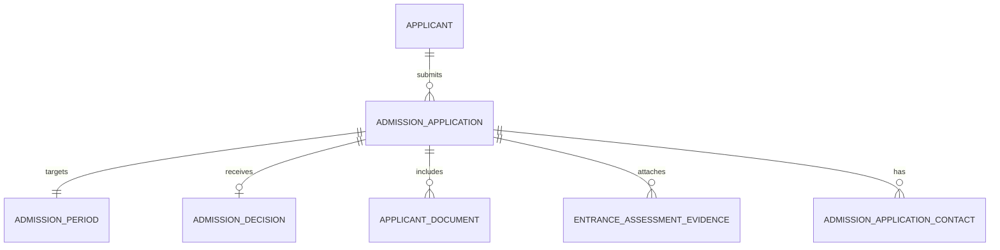
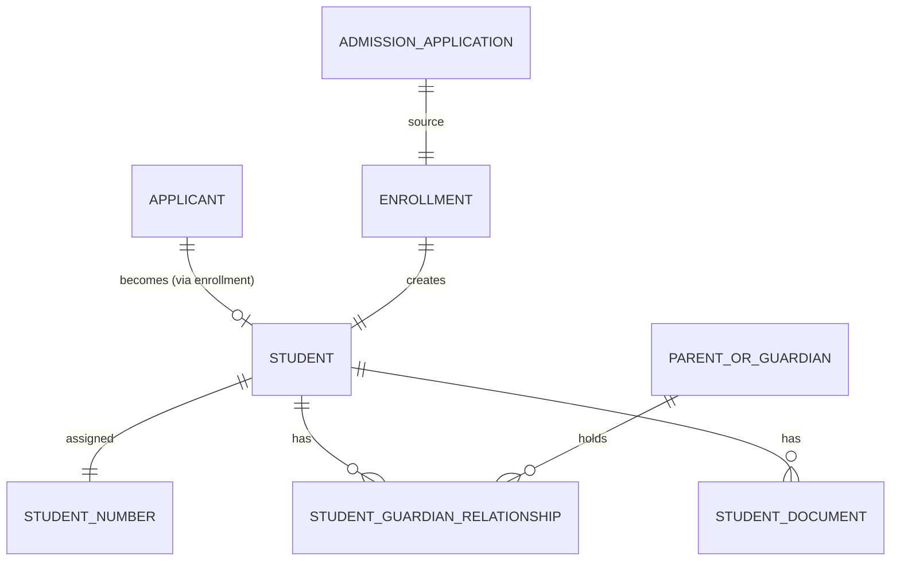
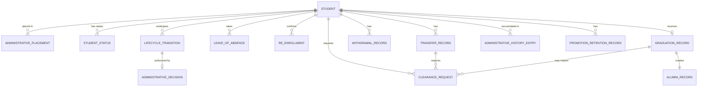
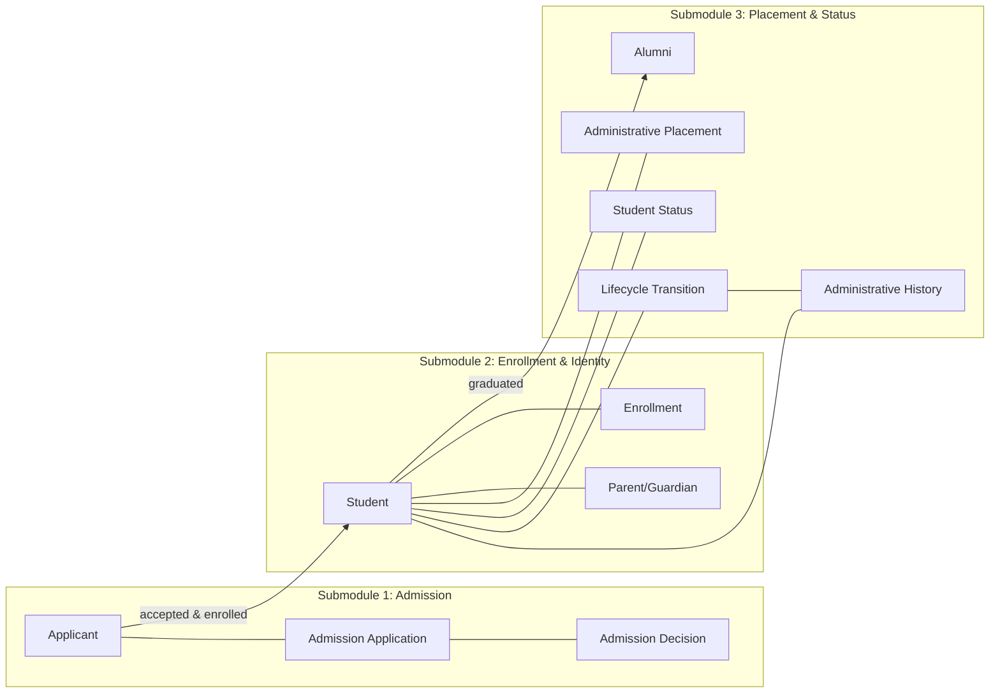

# Student Domain — Entity Identification by Submodule

## Source Documents

- [student-domain.md](file:///d:/Project.Private/elsasa-sis-v3/domains/student-domain.md) — Student Domain definition
- [sub-modul-and-development-phases.md](file:///d:/Project.Private/elsasa-sis-v3/sub-modul-and-development-phases.md) — Module decomposition and three-stage roadmap

## Domain Boundary

The Students domain is the authoritative source for student identity, admission, enrollment, administrative placement, lifecycle status, and administrative history. It does **not** own academics, behaviour, counselling, finance, teaching, or operations.

Entities identified here are strictly derived from the domain definition and module decomposition. No entity is introduced that is not supported by the source documents.

---

## Submodule 1 — Admission

**Module responsibility:** Manage applicant identity and the admission lifecycle from application to acceptance or rejection.

**Submodules:** Application Registration · Document & Identity Verification · Admission Review & Decision · Entrance Assessment Evidence Intake

### Entities

#### 1.1 Applicant *(Core Entity)*

| Aspect | Description |
|---|---|
| **Purpose** | Represents a person who has submitted or is being prepared to submit an admission application. Holds the applicant's identity information before they become a student. |
| **Role** | The central subject of the admission process. Every admission application belongs to exactly one Applicant. The Applicant identity is the precursor to Student identity — upon enrollment, identity continuity must be preserved. |
| **Example** | Applicant: Rina Kusuma, born 2015-03-12, nationality Indonesian, applying to SD Elsasa Campus Utara for Grade 1. |

> [!NOTE]
> An Applicant is **not** a Student. A person may have multiple applications over time, but should have only one Applicant identity within the school scope. Duplicate detection is required.

---

#### 1.2 Admission Application *(Core Entity)*

| Aspect | Description |
|---|---|
| **Purpose** | Represents a formal request by an Applicant to join the school for a specific admission period and intended placement. Carries a traceable reference throughout its lifecycle. |
| **Role** | The primary workflow object in the admission process. Progresses through states (registered → under review → decided). One Applicant may have multiple applications over time, but each application is independently identifiable and historically preserved. |
| **Example** | Application #ADM-2026-0042: Rina Kusuma applying for Admission Period "TP 2026/2027", requested entry level Grade 1, Campus Utara, registered 2026-02-15. |

---

#### 1.3 Admission Period *(Reference Entity — from Operations)*

| Aspect | Description |
|---|---|
| **Purpose** | Defines the time window during which admission applications are accepted. Owned by Operations (Calendar & Periods); referenced by Students. |
| **Role** | Provides temporal context for an application — every application must target one admission period. Used to organize admission cohorts and enforce application windows. |
| **Example** | Admission Period "Penerimaan TP 2026/2027", open 2026-01-15 to 2026-04-30. |

> [!IMPORTANT]
> Admission Period is **not owned** by the Students domain. Students references it as external context provided by Operations.

---

#### 1.4 Admission Decision *(Core Entity)*

| Aspect | Description |
|---|---|
| **Purpose** | Records the official outcome of an admission review for a specific application. |
| **Role** | Represents the authoritative determination of whether an applicant may proceed to enrollment. Captures the decision type (accepted, rejected, waitlisted, withdrawn, expired), decision date, decision maker, reason, and effective date. A decision, once finalized, requires an explicit correction or reconsideration process to change. |
| **Example** | Decision for Application #ADM-2026-0042: Accepted, decided 2026-03-20 by Admission Committee, effective immediately. |

---

#### 1.5 Applicant Document *(Supporting Entity)*

| Aspect | Description |
|---|---|
| **Purpose** | Represents a document submitted or required as part of the admission process (identity documents, previous school records, certificates, etc.). |
| **Role** | Supports identity verification and admission review. Tracks document type, submission status, and verification outcome. Required documents may vary by school policy. |
| **Example** | Birth certificate (submitted, verified), Previous school report (submitted, under review), Family card (not yet submitted). |

---

#### 1.6 Entrance Assessment Evidence *(Supporting Entity)*

| Aspect | Description |
|---|---|
| **Purpose** | Records entrance assessment results attached to an admission application. In Stage 1 this is manual/external input; in Stage 2 it is integrated from Academics. |
| **Role** | Provides supplementary evidence for admission review. Does not determine the admission decision by itself — the decision remains with the admission review process. Students does not conduct the assessment; it only records the evidence. |
| **Example** | Assessment evidence for Application #ADM-2026-0042: Reading readiness score 78/100, Math readiness score 82/100, source "External Assessment Center", date 2026-03-10. |

> [!NOTE]
> The domain document explicitly states entrance assessment is provided by Academics (or external sources in Stage 1). This entity captures the **evidence intake** only — the assessment itself is out of scope.

---

#### 1.7 Admission Application Contact *(Supporting Entity)*

| Aspect | Description |
|---|---|
| **Purpose** | Records the contact person(s) associated with the admission application (typically the parent or guardian submitting the application). |
| **Role** | Identifies who to communicate with during the admission process. May become the basis for the formal Parent/Guardian relationship upon enrollment. |
| **Example** | Contact for Application #ADM-2026-0042: Ibu Sari Kusuma (mother), phone 0812-3456-7890, email sari.kusuma@email.com. |

---

### Admission — Entity Relationship Summary

---

## Submodule 2 — Enrollment & Identity

**Module responsibility:** Establish official student identity, assign student number, complete enrollment, and maintain ongoing identity records.

**Submodules:** Enrollment Execution · Student Number Assignment · Student Identity Maintenance · Parent & Guardian Management

### Entities

#### 2.1 Student *(Core Entity)*

| Aspect | Description |
|---|---|
| **Purpose** | Represents a person who has completed enrollment and has an official administrative relationship with the school. The Student entity is the authoritative source of student identity referenced by all other domains. |
| **Role** | The central entity of the entire Students domain. Every lifecycle transition, placement, and status change is anchored to this entity. Identity remains stable across all status changes (active, on leave, transferred, graduated, alumni). |
| **Example** | Student: Rina Kusuma, Student Number STD-2026-0108, enrolled 2026-07-01, Campus Utara, Grade 1, Program Reguler, Status Active. |

> [!IMPORTANT]
> Student identity must maintain continuity from the Applicant identity. One person = one Student identity within the school scope. Other domains reference but do not redefine student identity.

---

#### 2.2 Student Number *(Core Entity — Identifier)*

| Aspect | Description |
|---|---|
| **Purpose** | The school's official unique identifier for a student. Format and assignment policy vary by school. |
| **Role** | Serves as the persistent reference used across all domains. Assigned during enrollment and must never be reused for a different person. Remains stable regardless of status changes. |
| **Example** | STD-2026-0108 (format: prefix + year + sequential number). |

> [!NOTE]
> Whether Student Number is modeled as a separate entity or as an attribute of Student is an implementation decision. It is listed separately here because the domain document emphasizes its unique assignment rules and cross-domain reference role.

---

#### 2.3 Enrollment *(Core Entity)*

| Aspect | Description |
|---|---|
| **Purpose** | Represents the administrative act that transforms an accepted Applicant into an official Student. Records when and how enrollment was completed. |
| **Role** | The bridge between admission and active student life. Captures enrollment date, initial placement, enrollment approval, source admission application, and conditions satisfied (including payment confirmation if required by policy). Enrollment is distinct from yearly academic participation. |
| **Example** | Enrollment for Rina Kusuma: enrollment date 2026-07-01, source Application #ADM-2026-0042, initial placement Campus Utara Grade 1, enrollment approved by Admin Officer Pak Budi, enrollment payment confirmed. |

---

#### 2.4 Parent or Guardian *(Core Entity)*

| Aspect | Description |
|---|---|
| **Purpose** | Represents a person officially associated with the student — parent, legal guardian, emergency contact, authorized pickup, or financial contact. |
| **Role** | Records the identity and contact information of people responsible for the student. A person may hold multiple responsibilities simultaneously. The relationship type and authority level are captured. Other domains (especially Finance) may reference guardian information but do not own it. |
| **Example** | Ibu Sari Kusuma: relationship "Mother", roles [Parent, Primary Contact, Financial Contact], phone 0812-3456-7890, address Jl. Merdeka 45, Jakarta Selatan. |

---

#### 2.5 Student-Guardian Relationship *(Supporting Entity)*

| Aspect | Description |
|---|---|
| **Purpose** | Records the specific relationship between a Student and a Parent/Guardian, including the type of relationship and the responsibilities held. |
| **Role** | A student may have multiple guardians; a guardian may be associated with multiple students. This entity captures each unique link, the relationship type (parent, legal guardian, etc.), and the responsibility roles (emergency contact, financial contact, authorized pickup, primary contact). |
| **Example** | Rina Kusuma ↔ Ibu Sari Kusuma: relationship type "Mother", responsibilities [Primary Contact, Financial Contact]. Rina Kusuma ↔ Pak Arif Kusuma: relationship type "Father", responsibilities [Emergency Contact, Authorized Pickup]. |

---

#### 2.6 Student Document *(Supporting Entity)*

| Aspect | Description |
|---|---|
| **Purpose** | Represents official supporting documents associated with the student identity (birth certificate, family card, identity photos, medical records, etc.). |
| **Role** | Supports identity maintenance, enrollment completion, and ongoing administrative requirements. Documents may be required at enrollment or collected progressively. Tracks document type, submission date, and validity. |
| **Example** | Birth certificate (verified, submitted 2026-06-28), Family card (verified, submitted 2026-06-28), Student photo 3×4 (submitted 2026-07-01). |

> [!NOTE]
> Applicant Documents (from Admission) may transition into Student Documents upon enrollment. The exact mechanism (copy, reference, or promotion) is an implementation decision.

---

### Enrollment & Identity — Entity Relationship Summary

---

## Submodule 3 — Placement & Status

**Module responsibility:** Own the student's administrative placement, official lifecycle status, and all lifecycle transitions including re-enrollment, leave, promotion/retention execution, transfer, withdrawal, graduation, and alumni.

**Submodules:** Administrative Placement (incl. homeroom cohort) · Student Status Management · Re-enrollment · Leave of Absence · Promotion & Retention Execution · Internal Transfer · External Transfer (Out & In) · Withdrawal · Graduation Execution · Alumni · Administrative History

### Entities

#### 3.1 Administrative Placement *(Core Entity)*

| Aspect | Description |
|---|---|
| **Purpose** | Records where the student is officially registered within the school's organizational structure at a given point in time. |
| **Role** | Defines the student's administrative location: campus, school level, grade/year, program, stream, cohort, and homeroom/administrative group. Placement may change over time (promotion, transfer, etc.) and each placement period must be historically preserved. Administrative placement is **not** the same as a student's learning plan. |
| **Example** | Rina Kusuma: Campus Utara, Level SD, Grade 1, Program Reguler, Cohort "1A", Homeroom "Kelas 1A", effective 2026-07-15 → current. |

---

#### 3.2 Student Status *(Core Entity)*

| Aspect | Description |
|---|---|
| **Purpose** | Represents the student's current official administrative relationship with the school. |
| **Role** | The authoritative lifecycle state of the student. Only the Students domain may change this. Minimum conceptual statuses: Applicant, Accepted, Enrolled, Active, On Leave, Leave Expired, Transferred, Withdrawn, Graduated, Alumni. Each status period is historically traceable. |
| **Example** | Rina Kusuma: current status "Active", effective since 2026-07-15. Previous: "Enrolled" (2026-07-01 → 2026-07-15). |

---

#### 3.3 Lifecycle Transition *(Core Entity)*

| Aspect | Description |
|---|---|
| **Purpose** | Records an approved change from one administrative state or placement to another. |
| **Role** | The fundamental unit of administrative history. Every significant change (activation, leave, promotion, transfer, withdrawal, graduation, etc.) is captured as a transition with: transition type, previous state/placement, new state/placement, effective date, decision reference, and authorization. This entity is what makes administrative history possible. |
| **Example** | Transition: type "Promotion", from Grade 1 to Grade 2, effective 2027-07-01, decision reference "Academic Recommendation #PR-2027-045", approved by Ibu Kepala Sekolah. |

---

#### 3.4 Administrative Decision *(Supporting Entity)*

| Aspect | Description |
|---|---|
| **Purpose** | Records a decision authorizing a lifecycle transition. Captures who decided, when, why, and on what basis. |
| **Role** | Provides the authorization anchor for transitions. A transition should reference its authorizing decision. Decisions may originate from internal authority (school leadership) or reference external inputs (academic recommendation, financial clearance, development recommendation). |
| **Example** | Decision: type "Promotion Approval", date 2027-06-20, decision maker "Kepala Sekolah Ibu Ratna", reason "Academic recommendation received", supporting reference "Recommendation #PR-2027-045", effective date 2027-07-01. |

---

#### 3.5 Leave of Absence *(Core Entity)*

| Aspect | Description |
|---|---|
| **Purpose** | Records a temporary interruption of the student's active administrative participation. |
| **Role** | Manages the leave lifecycle: request → approval → active leave → return or expiry. Captures effective start date, expected return date, reason, approval, supporting information, and actual return date. Leave does not end the student's relationship with the school. Maximum duration is 1 academic year. Leave expiry transitions to "Leave Expired" — return requires an explicit administrative action. |
| **Example** | Leave: Rina Kusuma, start 2027-09-01, expected return 2027-12-01, reason "Family relocation (temporary)", approved by Pak Budi 2027-08-25, actual return 2027-11-15. |

---

#### 3.6 Re-enrollment *(Core Entity)*

| Aspect | Description |
|---|---|
| **Purpose** | Records the administrative confirmation that an active student continues enrollment into the next academic period. |
| **Role** | Answers "Is this student continuing next year?" — an administrative question owned by Students. Distinct from initial enrollment and from academic course selection (which belongs to Academics). May trigger a financial event (re-enrollment fee) when school policy requires it. History must be preserved. |
| **Example** | Re-enrollment: Rina Kusuma, for Academic Period "TP 2027/2028", confirmed 2027-05-10, confirmed by Parent Ibu Sari Kusuma. |

> [!NOTE]
> The domain document originally listed annual re-enrollment as an open question. The module decomposition document resolves it: re-enrollment belongs to Students (Placement & Status), implemented in Stage 2.

---

#### 3.7 Transfer Record *(Core Entity)*

| Aspect | Description |
|---|---|
| **Purpose** | Records a change in the student's administrative placement (internal) or school relationship (external transfer in/out). |
| **Role** | Captures previous placement, destination placement or institution, effective date, reason, approval, and supporting documents. Three variants exist: internal transfer (campus/program/stream/group change), external transfer in (enrollment of a student from another school), and external transfer out (release to another school — requires academic and financial clearance with result Granted). Must not erase previous history. |
| **Example** | Internal Transfer: Rina Kusuma, from Campus Utara to Campus Selatan, effective 2028-01-15, reason "Family moved to South Jakarta", approved by Kepala Sekolah. |

---

#### 3.8 Withdrawal Record *(Core Entity)*

| Aspect | Description |
|---|---|
| **Purpose** | Records the formal ending of a student's enrollment before graduation. |
| **Role** | Captures the reason, effective date, authorizing authority, and supporting information. Reasons may include voluntary withdrawal, relocation, prolonged absence, disciplinary or financial decision, medical/personal circumstances, etc. Other domains may provide supporting information or recommendations, but only Students executes the withdrawal. Must not delete the student record. |
| **Example** | Withdrawal: Ahmad Faisal, effective 2028-03-01, reason "Family relocation abroad", authorized by Kepala Sekolah Ibu Ratna, supporting reference "Parent request letter dated 2028-02-20". |

---

#### 3.9 Graduation Record *(Core Entity)*

| Aspect | Description |
|---|---|
| **Purpose** | Records the official completion of the student's enrollment. |
| **Role** | Captures graduation date, completion level, certificate/diploma information, approval reference, final administrative placement, and graduation cohort. Requires academic eligibility (from Academics) and financial clearance (from Finance, when policy requires). Graduation records are immutable except through an explicit correction process. Successful graduation automatically establishes alumni status. |
| **Example** | Graduation: Rina Kusuma, graduation date 2032-06-15, completion level "SD", certificate "Ijazah SD No. 12345", graduation cohort "Angkatan 2032", final placement Campus Utara Grade 6 Program Reguler. |

---

#### 3.10 Alumni Record *(Core Entity)*

| Aspect | Description |
|---|---|
| **Purpose** | Maintains the student's administrative identity after graduation. |
| **Role** | Preserves identity continuity between the former student and their alumni status. Intentionally minimal in scope: alumni status, graduation cohort, current contact information, and communication consent. Extended alumni engagement (CRM, fundraising, events, networking) is explicitly out of scope. Automatically created upon successful graduation. |
| **Example** | Alumni: Rina Kusuma (STD-2026-0108), graduation cohort "Angkatan 2032", current email rina.kusuma@email.com, communication consent granted. |

---

#### 3.11 Administrative History Entry *(Core Entity)*

| Aspect | Description |
|---|---|
| **Purpose** | An individual historical record of a significant administrative event in the student's lifecycle. |
| **Role** | The immutable audit trail of the student's entire administrative lifecycle. Each entry records what happened, when, who authorized it, and what changed. Must not be silently overwritten — corrections must preserve what changed, when, and who authorized the correction. Examples: application submitted, accepted, enrolled, activated, placement changed, leave started/ended, promoted, retained, transferred, withdrawn, graduated, alumni activated. |
| **Example** | History entry: student Rina Kusuma, event "StudentPromoted", date 2027-07-01, detail "Grade 1 → Grade 2", authorized by "Kepala Sekolah", decision reference "Promotion Decision #PD-2027-012". |

> [!NOTE]
> Whether Administrative History is modeled as a dedicated entity or as an event-sourced log of Lifecycle Transitions is an implementation decision. The domain requires that history is preserved, traceable, and not silently overwritten.

---

#### 3.12 Clearance Request *(Supporting Entity)*

| Aspect | Description |
|---|---|
| **Purpose** | Records a request from Students to another domain (Academics or Finance) for purpose-specific clearance. |
| **Role** | Students **requests** clearance; the owning domain **determines** it; Students **consumes** the result. Used for external transfer-out (requires both Academic Clearance and Financial Clearance with result Granted) and for graduation (Financial Clearance when policy requires). Captures student identity, clearance purpose (Transfer Out or Graduation), requested date, and the returned result and reference. |
| **Example** | Clearance Request: student Rina Kusuma, purpose "Transfer Out", requested 2028-02-10, Academic Clearance result "Granted" (ref AC-2028-015), Financial Clearance result "Granted" (ref FC-2028-022). |

> [!IMPORTANT]
> Students does **not** grant, deny, or determine clearance. The clearance result is owned by the respective domain (Academics or Finance). Students only records the request and consumes the result.

---

#### 3.13 Promotion/Retention Execution Record *(Supporting Entity)*

| Aspect | Description |
|---|---|
| **Purpose** | Records the execution of a promotion or retention based on an academic recommendation. |
| **Role** | Captures the academic recommendation consumed (Promote, Retain, or Conditional Promote with conditions), the administrative transition applied, previous and new placement, effective date, and approval reference. Students executes; Academics recommends. Bulk promotion must preserve individual outcomes — failures must be identifiable without rerunning successes. |
| **Example** | Promotion Execution: Rina Kusuma, recommendation "Promote" (ref #PR-2027-045 from Academics), from Grade 1 to Grade 2, effective 2027-07-01, approved by Kepala Sekolah. |

> [!NOTE]
> This entity may be modeled as a specialized Lifecycle Transition with additional fields for academic recommendation reference and conditions. Listed separately for clarity because the domain document gives it distinct business rules (e.g., bulk processing, conditional promotion).

---

### Placement & Status — Entity Relationship Summary

---

## Cross-Submodule Entity Summary

| # | Entity | Type | Submodule | Stage |
|---|---|---|---|---|
| 1.1 | Applicant | Core | Admission | 1 |
| 1.2 | Admission Application | Core | Admission | 1 |
| 1.3 | Admission Period | Reference (from Operations) | Admission | 1 |
| 1.4 | Admission Decision | Core | Admission | 1 |
| 1.5 | Applicant Document | Supporting | Admission | 1 |
| 1.6 | Entrance Assessment Evidence | Supporting | Admission | 1 (manual), 2 (integrated) |
| 1.7 | Admission Application Contact | Supporting | Admission | 1 |
| 2.1 | Student | Core | Enrollment & Identity | 1 |
| 2.2 | Student Number | Core (Identifier) | Enrollment & Identity | 1 |
| 2.3 | Enrollment | Core | Enrollment & Identity | 1 |
| 2.4 | Parent or Guardian | Core | Enrollment & Identity | 1 |
| 2.5 | Student-Guardian Relationship | Supporting | Enrollment & Identity | 1 |
| 2.6 | Student Document | Supporting | Enrollment & Identity | 1 |
| 3.1 | Administrative Placement | Core | Placement & Status | 1 (core), 2–3 (extended) |
| 3.2 | Student Status | Core | Placement & Status | 1 (core), 2–3 (extended) |
| 3.3 | Lifecycle Transition | Core | Placement & Status | 1 (core), 2–3 (extended) |
| 3.4 | Administrative Decision | Supporting | Placement & Status | 1 (core), 2–3 (extended) |
| 3.5 | Leave of Absence | Core | Placement & Status | 2 |
| 3.6 | Re-enrollment | Core | Placement & Status | 2 |
| 3.7 | Transfer Record | Core | Placement & Status | 2 (internal), 3 (external) |
| 3.8 | Withdrawal Record | Core | Placement & Status | 3 |
| 3.9 | Graduation Record | Core | Placement & Status | 3 |
| 3.10 | Alumni Record | Core | Placement & Status | 3 |
| 3.11 | Administrative History Entry | Core | Placement & Status | 1 (core), 2–3 (extended) |
| 3.12 | Clearance Request | Supporting | Placement & Status | 3 |
| 3.13 | Promotion/Retention Execution Record | Supporting | Placement & Status | 2 |

---

## Entity Identity Flow

The following shows how identity flows across submodules:

---

## Resolved Questions (Closed)

The following architectural open questions from the domain document have been formally resolved using a pragmatic, minimalist, and explicit approach:

| # | Question | Resolution & Design Decision | Affected Entities | Status |
|---|---|---|---|---|
| 1 | Is admission required for every student, including transferred students? | **Yes — Single Intake Pipeline.** All incoming students (new or external transfer-in) pass through Admission (e.g. `ApplicationType: New \| Transfer-In`). Ensures a single, explicit intake pipeline for identity verification and acceptance before enrollment. | Applicant, Admission Application, Transfer Record | **Closed** |
| 2 | Can one applicant apply to multiple campuses/programs/levels simultaneously? | **Single Active Application.** An applicant can have only one active application per admission period. If preference changes, they update requested placement or withdraw and reapply. Avoids duplicate review states and complex multi-offer handling. | Admission Application | **Closed** |
| 3 | Is payment confirmation required before enrollment? | **Policy-Driven with Explicit Clearance/Waiver.** Governed by school policy flag. When required, Enrollment requires a valid payment confirmation reference or an authorized waiver/scholarship flag. Recorded manually in Stage 1, verified against Finance in automated stages. | Enrollment (conditions) | **Closed** |
| 4 | Can an accepted applicant defer enrollment? | **Yes, via Target Period Update.** An accepted applicant can defer enrollment up to 1 academic year. Modeled minimally by setting status to `Deferred` on the Admission Decision and updating the target Admission Period, without creating redundant entities. | Enrollment, Admission Decision | **Closed** |
| 5 | Is student identity global across all campuses or local to one campus? | **Global Identity & Global Student Number.** Student identity and Student Number are organization-wide. A person has exactly one persistent Student record and identifier. Moving between campuses is an Internal Transfer of placement, preserving complete history. | Student, Student Number | **Closed** |
| 6 | Can a student be active in more than one campus? | **Exactly One Active Campus Placement.** A student has at most one active Administrative Placement (one campus, grade, homeroom) at any point in time. Concurrent active placements across campuses are not permitted. | Administrative Placement | **Closed** |
| 7 | Does expulsion use the withdrawal workflow or a separate process? | **Uses Withdrawal Workflow.** Expulsion is executed via standard Withdrawal Record with reason category `Disciplinary / Expulsion`, requiring school leadership authorization and referencing the Development domain's disciplinary decision. Avoids redundant entities. | Withdrawal Record | **Closed** |
| 8 | Can a withdrawn student later re-enroll using the same identity? | **Yes, Reuses Existing Identity & Student Number.** The returning student keeps their original Student identity and Student Number (preserving past transcripts and history). They complete re-admission review to confirm placement/eligibility, and a new Enrollment record re-activates status. | Student, Enrollment | **Closed** |
| 9 | What is the minimum administrative placement model? | **Core Mandatory + Optional Extensions.** Mandatory: Campus, School Level, Grade Level, Academic Year, and Effective Date. Optional/Nullable: Homeroom/Administrative Group and Program/Stream. Enables enrollment placement before class/homeroom divisions are finalized. | Administrative Placement | **Closed** |

---

## Assumptions

1. **Student Number as a distinct concept:** Listed as a separate entity given the domain's emphasis on unique assignment rules. Implementation may model it as a Student attribute with dedicated assignment logic.
2. **Administrative History Entry vs. Lifecycle Transition:** These are listed as separate entities because the domain distinguishes between "transitions" (approved state changes) and "history" (the full audit trail including corrections). Implementation may unify them if a single event-sourced model suffices.
3. **Admission Application Contact:** Derived from the domain's mention that Parent/Guardian may submit applications and provide information during admission. The exact relationship to the post-enrollment Parent/Guardian entity is an implementation decision.
4. **Clearance Request:** Modeled as a single entity covering both Academic and Financial clearance requests, since the domain defines a uniform request-determine-consume pattern for both.
