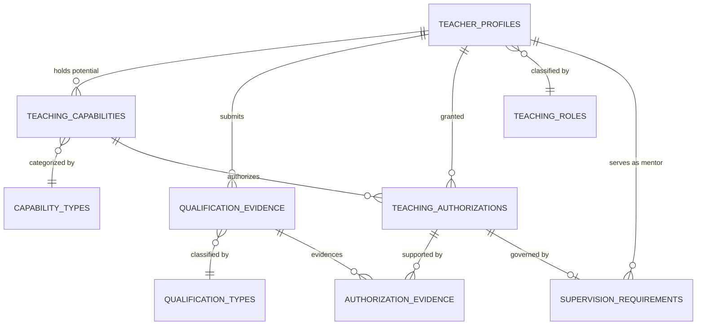
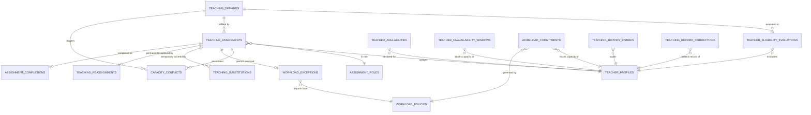

# Teaching Domain — Database Tables by Submodule

## Source Documents

- [teaching-domain.md](file:///d:/Project.Private/elsasa-sis-v3/domains/teaching-domain.md) — Teaching Domain definition
- [teaching-entities.md](file:///d:/Project.Private/elsasa-sis-v3/entities/teaching-entities.md) — Entity identification by submodule and resolved architectural decisions
- [sub-modul-and-development-phases.md](file:///d:/Project.Private/elsasa-sis-v3/sub-modul-and-development-phases.md) — Module decomposition and three-stage implementation roadmap

## Conventions

- **PK** — Primary Key
- **FK** — Foreign Key (logical; referencing another table in this domain or an external domain)
- **UQ** — Unique constraint
- All tables include `created_at`, `updated_at`, and `created_by` audit columns (omitted from key-column listings for brevity)
- **UUID** is used as the primary key type throughout to guarantee zero collisions across distributed multi-campus deployments and seamless cross-domain interoperability
- Columns marked *(nullable)* are not required at creation time, supporting progressive information collection and conditional workflows
- External domain references (Students, Academics, Operations, Development, Finance, HR) are stored as opaque identifiers; this domain does not own, define, or modify those external tables
- Entity lifecycle states, role codes, and classification types are stored as `VARCHAR` with application-level validation, matching the established conventions of Student, Academic, Finance, and Operations domains

---

## Module 1 — Teacher Profile & Authorization

**Module responsibility:** Manage the teaching profile, capabilities, qualification evidence, verification, and teaching authorization lifecycle.

**Submodules:** Teaching Profile Management · Teaching Capability · Qualification Evidence & Verification · Teaching Authorization Lifecycle  
**Stage:** Stage 2 (Academic Learning, Teaching, and Expanded Finance)

---

### Submodule 1.1 — Teaching Profile Management

#### 1.1 `teacher_profiles` — Main Table

| Aspect | Description |
|---|---|
| **Purpose** | Authoritative record representing the school's recognized relationship with a person as a teaching resource. Contains minimal identity, display/professional name, teaching role, organizational affiliation, standing, and effective dates. |
| **Type** | Core |

**Key Columns:**

| Column | Type | Constraint | Description |
|---|---|---|---|
| `id` | UUID | PK | Unique teaching profile identifier |
| `teacher_number` | VARCHAR | UQ, NOT NULL | Traceable institutional teacher code (e.g., "TCH-2026-0012") |
| `full_name` | VARCHAR | NOT NULL | Full legal name of the teacher |
| `display_name` | VARCHAR | nullable | Professional display name with academic titles (e.g., "Budi Hartono, M.Pd.") |
| `employee_ref` | VARCHAR | nullable | Opaque reference to HR/Employee domain when an HR system exists; nullable for non-employee teachers |
| `national_id_or_external_ref` | VARCHAR | nullable, UQ | Government identity number (e.g., NIK, passport) for verification and duplicate prevention |
| `email` | VARCHAR | nullable | Official institutional contact email |
| `phone` | VARCHAR | nullable | Contact phone number |
| `teaching_role_id` | UUID | FK → `teaching_roles.id`, NOT NULL | Configurable teaching category (e.g., Guru Tetap, Guru Kontrak, Guru Tamu) |
| `campus_affiliation` | VARCHAR | NOT NULL default 'All' | Campus location scope (e.g., "Kampus Utama", "Kampus Utara", "All") |
| `department` | VARCHAR | nullable | Subject department or faculty affiliation (e.g., "Matematika & IPA", "Bahasa") |
| `standing` | VARCHAR | NOT NULL default 'active' | Standing lifecycle state: `active`, `restricted`, `suspended`, `inactive` |
| `effective_from` | DATE | NOT NULL | Date when recognized teaching relationship becomes effective |
| `effective_to` | DATE | nullable | Date when teaching relationship concludes (null for open-ended) |
| `standing_reason` | TEXT | nullable | Justification for restricted, suspended, or inactive standing |
| `approved_by` | VARCHAR | NOT NULL | School authority establishing or approving the profile (e.g., "Kepala Sekolah") |
| `approved_date` | DATE | NOT NULL | Date formal approval was granted |
| `notes` | TEXT | nullable | Administrative notes |

**Example:**

| id | teacher_number | full_name | display_name | employee_ref | teaching_role_id | campus_affiliation | standing | effective_from | approved_by |
|---|---|---|---|---|---|---|---|---|---|
| `tp-001...` | TCH-2026-0012 | Budi Hartono | Budi Hartono, M.Pd. | EMP-2026-042 | `role-perm...` | Kampus Utama | active | 2026-07-01 | Kepala Sekolah |
| `tp-002...` | TCH-2026-0015 | John Miller | John Miller, B.Ed. | *(null)* | `role-visit...` | Kampus Utara | active | 2026-07-15 | Kepala Sekolah |

> [!IMPORTANT]
> - **Not an HR Employee Record:** A Teaching Profile holds only the minimum identity and affiliation information needed for teaching workflows. It does not own employment contracts, compensation, payroll, or benefits.
> - **Non-Employee Resource Support:** Non-employee teaching resources (visiting teachers, external specialists, contract staff, volunteers) are fully supported by keeping `employee_ref` nullable while preserving authoritative identity via `national_id_or_external_ref`.

---

#### 1.2 `teaching_roles` — Reference Table

| Aspect | Description |
|---|---|
| **Purpose** | Defines configurable categories of teaching relationships recognized by the school (e.g., permanent teacher, contract teacher, visiting teacher, volunteer, external assessor, learning facilitator). |
| **Type** | Reference |

**Key Columns:**

| Column | Type | Constraint | Description |
|---|---|---|---|
| `id` | UUID | PK | Unique teaching role identifier |
| `code` | VARCHAR | UQ, NOT NULL | System code (e.g., "PERMANENT", "CONTRACT", "VISITING", "VOLUNTEER", "EXTERNAL_ASSESSOR", "FACILITATOR") |
| `name` | VARCHAR | NOT NULL | Human-readable role title (e.g., "Guru Tetap", "Guru Kontrak", "Guru Tamu", "Relawan", "Penilai Eksternal", "Fasilitator") |
| `description` | TEXT | nullable | Scope and institutional policy definition of this teaching role |
| `requires_qualification_check` | BOOLEAN | NOT NULL default TRUE | Flag indicating whether this role mandates verified qualification evidence |
| `is_active` | BOOLEAN | NOT NULL default TRUE | Operational status flag |

**Example:**

| id | code | name | requires_qualification_check | is_active |
|---|---|---|---|---|
| `role-perm...` | PERMANENT | Guru Tetap | true | true |
| `role-cont...` | CONTRACT | Guru Kontrak | true | true |
| `role-visit...` | VISITING | Guru Tamu | true | true |
| `role-facil...` | FACILITATOR | Fasilitator | false | true |

> [!NOTE]
> Teaching roles are school-configurable policies, not hard-coded application categories. The school determines which categories of teaching resources are recognized and whether qualification checks are mandatory.

---

### Submodule 1.2 — Teaching Capability

#### 1.3 `capability_types` — Reference Table

| Aspect | Description |
|---|---|
| **Purpose** | Defines the recognized categories or taxonomy of teaching capabilities used by the school (e.g., subject area, level/stage, delivery mode, language of instruction, specialist activity). |
| **Type** | Reference |

**Key Columns:**

| Column | Type | Constraint | Description |
|---|---|---|---|
| `id` | UUID | PK | Unique capability type identifier |
| `code` | VARCHAR | UQ, NOT NULL | Machine code (e.g., "SUBJECT", "STAGE_LEVEL", "DELIVERY_MODE", "LANGUAGE", "SPECIALIST") |
| `name` | VARCHAR | NOT NULL | Human-readable category title (e.g., "Mata Pelajaran", "Jenjang/Tingkat", "Mode Pembelajaran", "Bahasa Pengantar", "Aktivitas Spesialis") |
| `description` | TEXT | nullable | Category scope description |
| `is_active` | BOOLEAN | NOT NULL default TRUE | Operational status flag |

**Example:**

| id | code | name | is_active |
|---|---|---|---|
| `captype-subj...` | SUBJECT | Mata Pelajaran | true |
| `captype-lvl...` | STAGE_LEVEL | Jenjang/Tingkat | true |
| `captype-mode...` | DELIVERY_MODE | Mode Pembelajaran | true |
| `captype-lang...` | LANGUAGE | Bahasa Pengantar | true |

---

#### 1.4 `teaching_capabilities` — Main Table

| Aspect | Description |
|---|---|
| **Purpose** | Records a category of teaching work a person may potentially be suitable to perform. Describes potential suitability across learning areas, stages, modes, or languages, independent of curriculum structure. |
| **Type** | Core |

**Key Columns:**

| Column | Type | Constraint | Description |
|---|---|---|---|
| `id` | UUID | PK | Unique teaching capability identifier |
| `teacher_profile_id` | UUID | FK → `teacher_profiles.id`, NOT NULL | Teacher holding this potential capability |
| `capability_type_id` | UUID | FK → `capability_types.id`, NOT NULL | Taxonomy category for this capability |
| `capability_code` | VARCHAR | NOT NULL | Normalized capability code (e.g., "MATH_PRIMARY", "IPA_JUNIOR", "ENG_IMMERSION") |
| `capability_name` | VARCHAR | NOT NULL | Human-readable capability name (e.g., "Matematika SD", "IPA SMP", "English Immersion") |
| `applicable_level` | VARCHAR | nullable | Educational stage or grade range (e.g., "SD Kelas 4–6", "SMP Kelas 7–9") |
| `delivery_mode` | VARCHAR | nullable | Instructional mode (e.g., "Tatap Muka", "Online", "Hybrid", "All") |
| `language_of_instruction` | VARCHAR | nullable | Instructional language (e.g., "Bahasa Indonesia", "English") |
| `status` | VARCHAR | NOT NULL default 'active' | Status: `active`, `inactive` |
| `notes` | TEXT | nullable | Internal administrative remarks |

**Example:**

| id | teacher_profile_id | capability_type_id | capability_code | capability_name | applicable_level | delivery_mode | status |
|---|---|---|---|---|---|---|---|
| `cap-001...` | `tp-001...` | `captype-subj...` | MATH_PRIMARY | Matematika SD | SD Kelas 4–6 | Tatap Muka | active |
| `cap-002...` | `tp-001...` | `captype-subj...` | IPA_PRIMARY | IPA SD | SD Kelas 4–6 | Tatap Muka | active |
| `cap-003...` | `tp-002...` | `captype-lang...` | ENG_IMMERSION | English Immersion | All | Tatap Muka | active |

> [!NOTE]
> A Capability describes **potential suitability** only. It does not by itself authorize a teacher to teach or create an assignment. Unique constraint is enforced on `(teacher_profile_id, capability_code, applicable_level, delivery_mode)`.

---

### Submodule 1.3 — Qualification Evidence & Verification

#### 1.5 `qualification_types` — Reference Table

| Aspect | Description |
|---|---|
| **Purpose** | Defines categories of qualifications or certifications recognized by the school for teaching purposes, including renewal requirements and default validity durations. |
| **Type** | Reference |

**Key Columns:**

| Column | Type | Constraint | Description |
|---|---|---|---|
| `id` | UUID | PK | Unique qualification type identifier |
| `code` | VARCHAR | UQ, NOT NULL | Category code (e.g., "TEACHER_CERT", "DEGREE_S1", "DEGREE_S2", "FIRST_AID", "CHILD_PROTECTION") |
| `name` | VARCHAR | NOT NULL | Qualification title (e.g., "Sertifikat Pendidik (Serdik)", "Ijazah Sarjana (S1)", "Sertifikat P3K", "Sertifikat Perlindungan Anak") |
| `description` | TEXT | nullable | Category definition and regulatory context |
| `requires_renewal` | BOOLEAN | NOT NULL | Whether certificates in this category expire and require re-verification (e.g., true for First Aid, false for S1) |
| `default_validity_months` | INTEGER | nullable | Standard validity duration in months (e.g., 24 for First Aid, 60 for Serdik; null if permanent) |
| `is_active` | BOOLEAN | NOT NULL default TRUE | Operational status flag |

**Example:**

| id | code | name | requires_renewal | default_validity_months | is_active |
|---|---|---|---|---|---|
| `qtype-serdik...` | TEACHER_CERT | Sertifikat Pendidik (Serdik) | true | 60 | true |
| `qtype-s1...` | DEGREE_S1 | Ijazah Sarjana (S1) | false | *(null)* | true |
| `qtype-p3k...` | FIRST_AID | Sertifikat Pertolongan Pertama (P3K) | true | 24 | true |

---

#### 1.6 `qualification_evidence` — Main Table

| Aspect | Description |
|---|---|
| **Purpose** | Stores evidence used to support a teacher's teaching capabilities or authorizations, tracking its verification lifecycle from claim to submission, verification, expiry, or revocation. |
| **Type** | Core |

**Key Columns:**

| Column | Type | Constraint | Description |
|---|---|---|---|
| `id` | UUID | PK | Unique qualification evidence identifier |
| `teacher_profile_id` | UUID | FK → `teacher_profiles.id`, NOT NULL | Teacher who submitted the evidence |
| `qualification_type_id` | UUID | FK → `qualification_types.id`, NOT NULL | Category of qualification |
| `title` | VARCHAR | NOT NULL | Specific title of certificate or degree (e.g., "Sertifikat Pendidik Matematika", "S1 Pendidikan Matematika") |
| `issuing_authority` | VARCHAR | NOT NULL | External issuing body (e.g., "Kemendikbudristek", "Universitas Pendidikan Indonesia") |
| `credential_identifier` | VARCHAR | nullable | Certificate number or diploma registration code (e.g., "SERDIK-2020-098234") |
| `issue_date` | DATE | NOT NULL | Date when credential was awarded |
| `expiry_date` | DATE | nullable | Expiry date for renewable credentials (null for permanent academic degrees) |
| `document_reference` | VARCHAR | nullable | Secure archive reference, file path, or verification URL |
| `verification_state` | VARCHAR | NOT NULL default 'claimed' | Lifecycle state: `claimed`, `submitted`, `verified`, `rejected`, `expired`, `revoked` |
| `verified_by` | VARCHAR | nullable | Qualification Verifier identity (e.g., "Staff Akademik — Bpk. Hendra") |
| `verified_date` | DATE | nullable | Date when verification outcome was recorded |
| `verification_notes` | TEXT | nullable | Verifier comments or validation details |
| `rejection_reason` | TEXT nullable | Reason for rejection if verification failed |
| `restrictions_or_conditions` | TEXT | nullable | Scope conditions attached to this evidence |

**Example:**

| id | teacher_profile_id | qualification_type_id | title | issuing_authority | credential_identifier | issue_date | expiry_date | verification_state | verified_by | verified_date |
|---|---|---|---|---|---|---|---|---|---|---|
| `qev-001...` | `tp-001...` | `qtype-serdik...` | Sertifikat Pendidik Matematika | Kemendikbudristek | SERDIK-2020-098234 | 2020-03-15 | 2025-03-15 | verified | Staff Verifikasi | 2026-07-10 |
| `qev-002...` | `tp-001...` | `qtype-s1...` | S1 Pendidikan Matematika | UPI Bandung | IJZ-UPI-2018-4421 | 2018-08-20 | *(null)* | verified | Staff Verifikasi | 2026-07-10 |

> [!IMPORTANT]
> **Separation of Verification and Authorization:** A verified qualification confirms authenticity and acceptance of evidence. It does **not** automatically grant a Teaching Authorization or create a Teaching Assignment. Authorization remains a distinct school decision.

---

### Submodule 1.4 — Teaching Authorization Lifecycle

#### 1.7 `teaching_authorizations` — Main Table

| Aspect | Description |
|---|---|
| **Purpose** | Records the school's official permission for a teaching resource to perform specified teaching work under defined scope, conditions, and effective dates. Establishes teacher eligibility. |
| **Type** | Core |

**Key Columns:**

| Column | Type | Constraint | Description |
|---|---|---|---|
| `id` | UUID | PK | Unique teaching authorization identifier |
| `authorization_number` | VARCHAR | UQ, NOT NULL | Traceable authorization reference (e.g., "AUTH-2026-0045") |
| `teacher_profile_id` | UUID | FK → `teacher_profiles.id`, NOT NULL | Teacher receiving the authorization |
| `authorized_capability_id` | UUID | FK → `teaching_capabilities.id`, nullable | Specific capability being authorized |
| `scope_description` | TEXT | NOT NULL | Clear human-readable statement of authorized teaching scope (e.g., "Matematika SD Kelas 4–6 Tatap Muka") |
| `campus_scope` | VARCHAR | NOT NULL default 'All' | Campus boundary: specific campus or "All" |
| `program_scope` | VARCHAR | nullable | Program boundary (e.g., "Reguler", "Bilingual", "All") |
| `level_scope` | VARCHAR | nullable | Stage/level boundary (e.g., "SD Kelas 4–6") |
| `delivery_mode_scope` | VARCHAR | nullable | Authorized delivery mode (e.g., "Tatap Muka", "Online", "All") |
| `status` | VARCHAR | NOT NULL default 'active' | Lifecycle state: `active`, `authorized_under_supervision`, `restricted`, `suspended`, `revoked`, `expired` |
| `effective_start_date` | DATE | NOT NULL | Date when authorization becomes legally active |
| `effective_end_date` | DATE | nullable | Date when authorization expires (null for indefinite or until academic year end) |
| `conditions_or_restrictions` | TEXT | nullable | Special operational conditions or boundary limits |
| `decision_authority` | VARCHAR | NOT NULL | Authority granting authorization (e.g., "Kepala Sekolah") |
| `approved_date` | DATE | NOT NULL | Date approval was officially granted |
| `suspension_or_revocation_reason` | TEXT | nullable | Formal justification if authorization is suspended or revoked |
| `notes` | TEXT | nullable | Administrative notes |

**Example:**

| id | authorization_number | teacher_profile_id | authorized_capability_id | scope_description | campus_scope | status | effective_start_date | effective_end_date | decision_authority | approved_date |
|---|---|---|---|---|---|---|---|---|---|---|
| `auth-0045...` | AUTH-2026-0045 | `tp-001...` | `cap-001...` | Matematika SD Kelas 4–6 | Kampus Utama | active | 2026-07-01 | 2027-06-30 | Kepala Sekolah | 2026-06-25 |
| `auth-0046...` | AUTH-2026-0046 | `tp-002...` | `cap-003...` | English Immersion | Kampus Utara | authorized_under_supervision | 2026-07-15 | 2027-06-30 | Kepala Sekolah | 2026-07-01 |

> [!NOTE]
> - **Workflow:** Qualification Verified → Teaching Coordinator Review → Teaching Authority Approval → Teaching Authorization Granted.
> - **Eligibility, Not Capacity:** An authorization establishes that the person is qualified and legally permitted to teach. It does **not** reserve capacity or assign work.
> - **Impact of Suspension/Revocation:** Transitioning status to `suspended` or `revoked` immediately alerts the Teaching Coordinator and flags all active assignments for that teacher as conflicted.

---

#### 1.8 `authorization_evidence` — Supporting / Junction Table

| Aspect | Description |
|---|---|
| **Purpose** | Explicit M:N junction table recording the verified qualification evidence that officially supports a Teaching Authorization decision. |
| **Type** | Supporting / Junction |

**Key Columns:**

| Column | Type | Constraint | Description |
|---|---|---|---|
| `authorization_id` | UUID | FK → `teaching_authorizations.id`, NOT NULL | Parent teaching authorization |
| `qualification_evidence_id` | UUID | FK → `qualification_evidence.id`, NOT NULL | Supporting verified qualification evidence |
| `notes` | VARCHAR | nullable | Contextual remark (e.g., "Primary subject evidence", "Renewed certification") |

**Primary Key:** `(authorization_id, qualification_evidence_id)`

**Example:**

| authorization_id | qualification_evidence_id | notes |
|---|---|---|
| `auth-0045...` | `qev-001...` | Primary teacher certification (Serdik) |
| `auth-0045...` | `qev-002...` | Academic degree requirement (S1) |

---

#### 1.9 `supervision_requirements` — Supporting Table

| Aspect | Description |
|---|---|
| **Purpose** | Records the specific supervision conditions, required mentoring activities, and designated supervising teacher when a Teaching Authorization is granted with status `authorized_under_supervision`. |
| **Type** | Supporting |

**Key Columns:**

| Column | Type | Constraint | Description |
|---|---|---|---|
| `id` | UUID | PK | Unique supervision requirement identifier |
| `authorization_id` | UUID | FK → `teaching_authorizations.id`, NOT NULL | The conditional authorization requiring supervision |
| `supervising_teacher_id` | UUID | FK → `teacher_profiles.id`, nullable | Designated senior mentor or supervising teacher |
| `supervision_type` | VARCHAR | NOT NULL | Type: `co_teaching`, `periodic_observation`, `lesson_plan_review`, `general_mentorship` |
| `description` | TEXT | NOT NULL | Explicit requirements (e.g., "Wajib co-teaching pada semester 1 dan observasi kelas bulanan") |
| `start_date` | DATE | NOT NULL | Effective start date of supervision |
| `end_date` | DATE | nullable | Scheduled completion or evaluation date |
| `status` | VARCHAR | NOT NULL default 'active' | Lifecycle: `active`, `completed`, `waived`, `escalated` |
| `resolution_notes` | TEXT | nullable | Final assessment outcome notes |

**Example:**

| id | authorization_id | supervising_teacher_id | supervision_type | description | start_date | end_date | status |
|---|---|---|---|---|---|---|---|
| `sup-001...` | `auth-0046...` | `tp-001...` | co_teaching | Co-teaching dengan guru senior semester 1 | 2026-07-15 | 2026-12-20 | active |

---

### Module 1 Table Relationships Diagram

---

## Module 2 — Assignment & Workload

**Module responsibility:** Receive teaching demand, evaluate eligibility, approve teaching assignments (including homeroom advisory assignments), manage workload, and handle substitution and reassignment.

**Submodules:** Teaching Demand Intake · Teacher Eligibility Evaluation · Teaching Assignment Approval (incl. homeroom advisory) · Workload & Capacity Management · Substitution & Reassignment · Assignment Completion · Teaching History  
**Stage:** Stage 2 (Academic Learning, Teaching, and Expanded Finance)

---

### Submodule 2.1 — Teaching Demand Intake

#### 2.1 `teaching_demands` — Main Table

| Aspect | Description |
|---|---|
| **Purpose** | Represents a formal request from an owning domain (Academics, Development, Operations) for qualified teaching capacity to perform defined work. The entry point for all staffing workflows. |
| **Type** | Core |

**Key Columns:**

| Column | Type | Constraint | Description |
|---|---|---|---|
| `id` | UUID | PK | Unique teaching demand identifier |
| `demand_code` | VARCHAR | UQ, NOT NULL | Traceable demand code (e.g., "DEM-2026-001") |
| `source_domain` | VARCHAR | NOT NULL | Requesting domain: `academics`, `development`, `operations` |
| `source_work_reference` | UUID | NOT NULL | Opaque identifier referencing external work item (e.g., `learning_units.id` or `extracurricular_programs.id`) |
| `source_work_label` | VARCHAR | NOT NULL | Human-readable title of work (e.g., "Matematika Kelas 4 Semester 1", "Pramuka Siaga") |
| `academic_period_id` | UUID | FK → external (Operations), NOT NULL | Academic period within which the work will take place |
| `required_capability_code` | VARCHAR | NOT NULL | Required capability code (e.g., "MATH_PRIMARY") |
| `required_assignment_role_id` | UUID | FK → `assignment_roles.id`, NOT NULL | Requested staffing role (e.g., Guru Utama, Guru Pendamping, Wali Kelas) |
| `expected_workload_hours` | DECIMAL(5,2) | NOT NULL | Estimated workload effort (e.g., 5.00 hours/week) |
| `workload_unit` | VARCHAR | NOT NULL default 'Teaching Hours' | Measurement basis (default: "Teaching Hours") |
| `requires_assessment_authority` | BOOLEAN | NOT NULL default TRUE | Whether the assigned teacher must have authority to submit student grades |
| `requested_start_date` | DATE | NOT NULL | Requested start of assignment |
| `requested_end_date` | DATE | NOT NULL | Requested end of assignment |
| `campus_scope` | VARCHAR | NOT NULL default 'Kampus Utama' | Target campus location |
| `required_teachers_count` | INTEGER | NOT NULL default 1 | Number of teaching resources required |
| `status` | VARCHAR | NOT NULL default 'received' | Lifecycle: `received`, `accepted_for_staffing`, `returned_for_clarification`, `changed`, `cancelled`, `declined`, `staffed` |
| `requested_by` | VARCHAR | NOT NULL | Originating coordinator (e.g., "Academic Coordinator — Matematika") |
| `requested_at` | TIMESTAMP WITH TIME ZONE | NOT NULL | Timestamp when demand was submitted |
| `decline_reason` | TEXT | nullable | Explanation if demand is declined |
| `clarification_notes` | TEXT | nullable | Feedback if returned for clarification |

**Example:**

| id | demand_code | source_domain | source_work_reference | source_work_label | academic_period_id | required_capability_code | required_assignment_role_id | expected_workload_hours | status |
|---|---|---|---|---|---|---|---|---|---|
| `dem-001...` | DEM-2026-001 | academics | `lu-mat4-s1...` | Matematika Kelas 4 Semester 1 | `per-s1-2026...` | MATH_PRIMARY | `role-primary...` | 5.00 | accepted_for_staffing |
| `dem-002...` | DEM-2026-002 | students | `cohort-4a...` | Kelas 4A (Wali Kelas) | `per-s1-2026...` | GENERAL_ADVISING | `role-homeroom...` | 2.00 | accepted_for_staffing |

> [!NOTE]
> - **Traceability Without Encroachment:** `source_domain`, `source_work_reference`, and `source_work_label` preserve complete traceability without copying student lists or curriculum plans. Teaching staffs the work; Academics/Development owns the outcome.
> - **Planning-First Intake:** Demands are initiated during academic planning *before* student rosters are finalized, decoupling teacher staffing from student enrollment lists.

---

### Submodule 2.2 — Teacher Eligibility Evaluation

#### 2.2 `teacher_eligibility_evaluations` — Main Table

| Aspect | Description |
|---|---|
| **Purpose** | Persists the explicit and explainable evaluation of candidate teachers against a specific Teaching Demand, evaluating profile standing, authorizations, availability, and capacity. |
| **Type** | Core |

**Key Columns:**

| Column | Type | Constraint | Description |
|---|---|---|---|
| `id` | UUID | PK | Unique evaluation identifier |
| `teaching_demand_id` | UUID | FK → `teaching_demands.id`, NOT NULL | Demand being evaluated |
| `teacher_profile_id` | UUID | FK → `teacher_profiles.id`, NOT NULL | Candidate teacher being evaluated |
| `evaluation_date` | DATE | NOT NULL | Date when evaluation was executed |
| `evaluated_by` | VARCHAR | NOT NULL | Actor conducting evaluation (e.g., "Teaching Coordinator") |
| `is_eligible` | BOOLEAN | NOT NULL | Final binary eligibility outcome |
| `eligibility_status` | VARCHAR | NOT NULL | Evaluation state: `eligible`, `eligible_under_supervision`, `ineligible_unqualified`, `ineligible_conflicted`, `ineligible_capacity_exceeded` |
| `profile_active_check` | BOOLEAN | NOT NULL | Verification that teacher profile standing is Active |
| `authorization_check_passed` | BOOLEAN | NOT NULL | Verification of matching active Teaching Authorization |
| `qualification_check_passed` | BOOLEAN | NOT NULL | Verification of required verified qualification evidence |
| `availability_check_passed` | BOOLEAN | NOT NULL | Verification that teacher is available during requested schedule |
| `capacity_check_passed` | BOOLEAN | NOT NULL | Verification that assignment will not breach prohibited workload limits |
| `explanation` | TEXT | NOT NULL | Human-readable explainable basis of the eligibility determination |
| `notes` | TEXT | nullable | Coordinator remarks |

**Primary / Unique Constraint:** `(teaching_demand_id, teacher_profile_id, evaluation_date)`

**Example:**

| id | teaching_demand_id | teacher_profile_id | is_eligible | eligibility_status | authorization_check_passed | capacity_check_passed | explanation |
|---|---|---|---|---|---|---|---|
| `eval-001...` | `dem-001...` | `tp-001...` | true | eligible | true | true | Memiliki otorisasi aktif Matematika SD, ketersediaan mencukupi, beban saat ini 17 jam (maks 24 jam). |
| `eval-002...` | `dem-001...` | `tp-002...` | false | ineligible_conflicted | false | true | Otorisasi mengajar Matematika telah berakhir per 2026-06-30. |

> [!NOTE]
> Eligibility evaluation is strictly policy-driven and explainable. Persisting evaluations satisfies audit requirements and ensures non-arbitrary staffing decisions.

---

### Submodule 2.3 — Teaching Assignment Approval (incl. homeroom advisory)

#### 2.3 `assignment_roles` — Reference Table

| Aspect | Description |
|---|---|
| **Purpose** | Defines the teacher's authorized responsibility within a Teaching Assignment (e.g., primary teacher, co-teacher, assistant, assessor, homeroom advisor, academic advisor, extracurricular facilitator, substitute). |
| **Type** | Reference |

**Key Columns:**

| Column | Type | Constraint | Description |
|---|---|---|---|
| `id` | UUID | PK | Unique assignment role identifier |
| `code` | VARCHAR | UQ, NOT NULL | Machine code (e.g., "PRIMARY_TEACHER", "CO_TEACHER", "ASSISTANT", "ASSESSOR", "HOMEROOM_ADVISOR", "ACADEMIC_ADVISOR", "FACILITATOR", "SUBSTITUTE") |
| `name` | VARCHAR | NOT NULL | Role name (e.g., "Guru Utama", "Guru Pendamping", "Asisten Guru", "Penilai", "Wali Kelas", "Pembimbing Akademik", "Fasilitator Ekstrakurikuler", "Guru Pengganti") |
| `description` | TEXT | nullable | Institutional definition of responsibility and authority |
| `is_lead_role` | BOOLEAN | NOT NULL default FALSE | Flag indicating primary instructional lead responsibility |
| `counts_toward_workload` | BOOLEAN | NOT NULL default TRUE | Flag indicating whether assignments under this role consume workload capacity |
| `is_active` | BOOLEAN | NOT NULL default TRUE | Operational status flag |

**Example:**

| id | code | name | is_lead_role | counts_toward_workload | is_active |
|---|---|---|---|---|---|
| `role-primary...` | PRIMARY_TEACHER | Guru Utama | true | true | true |
| `role-coteach...` | CO_TEACHER | Guru Pendamping | false | true | true |
| `role-homeroom...` | HOMEROOM_ADVISOR | Wali Kelas | false | true | true |
| `role-facil...` | FACILITATOR | Fasilitator Ekstrakurikuler | false | true | true |

---

#### 2.4 `teaching_assignments` — Main Table

| Aspect | Description |
|---|---|
| **Purpose** | Central operational entity connecting an eligible teacher to a defined teaching responsibility with explicit role, scope, authority, effective dates, and workload commitment. Supports academic classes, homeroom advisory, and extracurricular facilitation. |
| **Type** | Core |

**Key Columns:**

| Column | Type | Constraint | Description |
|---|---|---|---|
| `id` | UUID | PK | Unique teaching assignment identifier |
| `assignment_number` | VARCHAR | UQ, NOT NULL | Traceable assignment code (e.g., "ASN-2026-0045") |
| `teaching_demand_id` | UUID | FK → `teaching_demands.id`, NOT NULL | Originating staffing demand |
| `teacher_profile_id` | UUID | FK → `teacher_profiles.id`, NOT NULL | Assigned teacher |
| `assignment_role_id` | UUID | FK → `assignment_roles.id`, NOT NULL | Teacher's role (Guru Utama, Wali Kelas, etc.) |
| `assignment_scope` | VARCHAR | NOT NULL | Scope category: `learning_unit`, `cohort_group`, `individual_student`, `extracurricular_group` |
| `scope_reference_id` | UUID | NOT NULL | Opaque identifier of assigned work item (e.g., `learning_units.id` or `cohort_groups.id`) |
| `scope_label` | VARCHAR | NOT NULL | Human-readable scope label (e.g., "Matematika Kelas 4A", "Kelas 4A (Wali Kelas)") |
| `academic_period_id` | UUID | FK → external (Operations), NOT NULL | Temporal period of assignment |
| `effective_start_date` | DATE | NOT NULL | Assignment start date |
| `effective_end_date` | DATE | NOT NULL | Assignment end date |
| `workload_commitment_value` | DECIMAL(5,2) | NOT NULL | Committed capacity (e.g., 5.00 hours/week) |
| `workload_unit` | VARCHAR | NOT NULL default 'Teaching Hours' | Measurement unit |
| `status` | VARCHAR | NOT NULL default 'proposed' | Lifecycle: `proposed`, `approved`, `rejected`, `withdrawn`, `returned_for_revision`, `suspended`, `cancelled`, `completed` |
| `approved_by` | VARCHAR | nullable | School Teaching Authority (e.g., "Kepala Sekolah") |
| `approved_date` | DATE | nullable | Date formal approval was granted |
| `teacher_acknowledged` | BOOLEAN | NOT NULL default FALSE | Acknowledgement by assigned teacher |
| `teacher_acknowledged_date` | DATE | nullable | Date teacher acknowledged assignment |
| `predecessor_assignment_id` | UUID | FK → `teaching_assignments.id`, nullable | Previous assignment this replaces (for reassignments) |
| `notes` | TEXT | nullable | Internal notes |

**Example:**

| id | assignment_number | teacher_profile_id | assignment_role_id | scope_label | effective_start_date | effective_end_date | workload_commitment_value | status | approved_by |
|---|---|---|---|---|---|---|---|---|---|
| `asn-0045...` | ASN-2026-0045 | `tp-001...` | `role-primary...` | Matematika Kelas 4A | 2026-07-15 | 2026-12-20 | 5.00 | approved | Kepala Sekolah |
| `asn-0046...` | ASN-2026-0046 | `tp-001...` | `role-homeroom...` | Kelas 4A (Wali Kelas) | 2026-07-15 | 2027-06-30 | 2.00 | approved | Kepala Sekolah |

> [!IMPORTANT]
> - **Commitment of Capacity:** Teaching capacity is committed only when the assignment reaches status `approved`.
> - **Shared Responsibility & Co-Teaching:** Multiple teachers can share responsibility for the same learning unit by creating **separate individual `teaching_assignments`** referencing the same `teaching_demand_id` and `scope_reference_id`, each with its distinct `assignment_role_id` and individual workload.
> - **Homeroom Advisory Integration:** Homeroom responsibilities are represented as standard `teaching_assignments` with `assignment_role_id = 'HOMEROOM_ADVISOR'`. Teaching manages the teacher staffing, availability, and workload; Student Domain owns the cohort placement.

---

#### 2.5 `capacity_conflicts` — Supporting Table

| Aspect | Description |
|---|---|
| **Purpose** | Records specific capacity, authorization, availability, or operational conflict conditions that require resolution or approved exceptions before or during an assignment. |
| **Type** | Supporting |

**Key Columns:**

| Column | Type | Constraint | Description |
|---|---|---|---|
| `id` | UUID | PK | Unique conflict identifier |
| `teaching_assignment_id` | UUID | FK → `teaching_assignments.id`, nullable | Related assignment if conflict occurred during assignment processing |
| `teaching_demand_id` | UUID | FK → `teaching_demands.id`, nullable | Related demand if conflict detected during eligibility evaluation |
| `teacher_profile_id` | UUID | FK → `teacher_profiles.id`, NOT NULL | Affected teacher |
| `conflict_type` | VARCHAR | NOT NULL | Type: `missing_authorization`, `expired_authorization`, `unverified_qualification`, `teacher_unavailable`, `workload_limit_exceeded`, `schedule_overlap`, `campus_incompatible`, `missing_supervision` |
| `conflict_classification` | VARCHAR | NOT NULL | Severity classification: `warning`, `prohibited` |
| `severity` | VARCHAR | NOT NULL | Impact: `advisory` (can proceed with notice), `blocking` (blocks assignment approval without authorized exception) |
| `description` | TEXT | NOT NULL | Explicit description of the conflict |
| `detected_date` | DATE | NOT NULL | Date conflict was flagged |
| `status` | VARCHAR | NOT NULL default 'unresolved' | Lifecycle: `unresolved`, `resolved`, `waived_with_exception` |
| `resolution_action` | VARCHAR | nullable | Resolution action: `workload_exception_approved`, `substitute_assigned`, `reassigned`, `cancelled`, `schedule_adjusted` |
| `resolved_by` | VARCHAR | nullable | Actor resolving conflict |
| `resolved_date` | DATE | nullable | Date resolution was finalized |
| `resolution_notes` | TEXT | nullable | Resolution remarks |

**Example:**

| id | teaching_assignment_id | teacher_profile_id | conflict_type | conflict_classification | severity | description | status | resolution_action |
|---|---|---|---|---|---|---|---|---|
| `cnf-001...` | `asn-0045...` | `tp-001...` | workload_limit_exceeded | prohibited | blocking | Beban total mencapai 25 jam (batas maksimal 24 jam) | resolved | workload_exception_approved |
| `cnf-002...` | *(null)* | `tp-002...` | expired_authorization | prohibited | blocking | Otorisasi mengajar IPA SD kedaluwarsa 2026-06-30 | unresolved | *(null)* |

---

### Submodule 2.4 — Workload & Capacity Management

#### 2.6 `workload_policies` — Reference / Policy Table

| Aspect | Description |
|---|---|
| **Purpose** | Defines versioned school policies governing teaching workload measurement units, capacity limits (warning and prohibited thresholds), included activities, and calculation rules. |
| **Type** | Reference / Policy |

**Key Columns:**

| Column | Type | Constraint | Description |
|---|---|---|---|
| `id` | UUID | PK | Unique workload policy identifier |
| `code` | VARCHAR | UQ, NOT NULL | Policy code (e.g., "WPOL-2026-2027") |
| `name` | VARCHAR | NOT NULL | Human-readable title (e.g., "Kebijakan Beban Mengajar TP 2026/2027") |
| `academic_year_id` | UUID | FK → external (Operations), NOT NULL | Academic year governed by this policy |
| `version` | VARCHAR | NOT NULL | Policy version (e.g., "1.0") |
| `workload_unit` | VARCHAR | NOT NULL default 'Teaching Hours' | Measurement unit (e.g., "Teaching Hours", "Periods", "Credits") |
| `max_standard_capacity` | DECIMAL(5,2) | NOT NULL | Baseline full-time teaching capacity (e.g., 24.00 hours/week) |
| `warning_threshold` | DECIMAL(5,2) | NOT NULL | Warning limit (e.g., 20.00 hours/week) — assignment still permitted |
| `prohibited_threshold` | DECIMAL(5,2) | NOT NULL | Prohibited ceiling (e.g., 24.00 hours/week) — blocks assignment without approved exception |
| `includes_assessment_effort` | BOOLEAN | NOT NULL default TRUE | Whether grading/assessment commitments count toward workload |
| `includes_advising_effort` | BOOLEAN | NOT NULL default TRUE | Whether homeroom/academic advising commitments count toward workload |
| `includes_preparation_time` | BOOLEAN | NOT NULL default FALSE | Whether non-contact prep time is counted |
| `calculation_rules_summary` | TEXT | NOT NULL | Summary of calculation formulas and rules |
| `effective_start_date` | DATE | NOT NULL | Policy effective start |
| `effective_end_date` | DATE | nullable | Policy effective end |
| `status` | VARCHAR | NOT NULL default 'active' | Status: `draft`, `active`, `superseded`, `archived` |
| `approved_by` | VARCHAR | NOT NULL | Authority approving policy (e.g., "Kepala Sekolah") |
| `approved_date` | DATE | NOT NULL | Date approved |

**Example:**

| id | code | name | version | workload_unit | warning_threshold | prohibited_threshold | status | approved_by |
|---|---|---|---|---|---|---|---|---|
| `wpol-001...` | WPOL-2026-2027 | Kebijakan Beban Mengajar TP 2026/2027 | 1.0 | Teaching Hours | 20.00 | 24.00 | active | Kepala Sekolah |

> [!NOTE]
> Workload policies are effective-dated and versioned to ensure all historical workload snapshots remain reproducible.

---

#### 2.7 `teacher_availabilities` — Main Table

| Aspect | Description |
|---|---|
| **Purpose** | Records baseline teaching capacity (maximum weekly hours) and availability conditions (campus, delivery modes, recurring available slots) for a teacher within an academic period. |
| **Type** | Core |

**Key Columns:**

| Column | Type | Constraint | Description |
|---|---|---|---|
| `id` | UUID | PK | Unique availability identifier |
| `teacher_profile_id` | UUID | FK → `teacher_profiles.id`, NOT NULL | Teacher whose availability is declared |
| `academic_period_id` | UUID | FK → external (Operations), NOT NULL | Academic period for this availability |
| `max_available_hours` | DECIMAL(5,2) | NOT NULL | Maximum weekly teaching hours available (e.g., 24.00) |
| `campus_scope` | VARCHAR | NOT NULL default 'All' | Campus where teacher is available |
| `available_delivery_modes` | VARCHAR | NOT NULL default 'All' | Permitted delivery modes (e.g., "Tatap Muka, Hybrid") |
| `recurring_available_schedule` | JSONB | nullable | Weekly recurring availability windows (e.g., `[{"day":"Senin","start":"07:00","end":"14:00"}, ...]`) |
| `effective_start_date` | DATE | NOT NULL | Effective start date |
| `effective_end_date` | DATE | NOT NULL | Effective end date |
| `status` | VARCHAR | NOT NULL default 'active' | Lifecycle: `active`, `revoked`, `superseded` |
| `notes` | TEXT | nullable | Availability remarks |

**Primary / Unique Constraint:** Partial unique index on `(teacher_profile_id, academic_period_id)` WHERE `status = 'active'`

**Example:**

| id | teacher_profile_id | academic_period_id | max_available_hours | campus_scope | effective_start_date | effective_end_date | status |
|---|---|---|---|---|---|---|---|
| `tav-001...` | `tp-001...` | `per-s1-2026...` | 24.00 | Kampus Utama | 2026-07-15 | 2026-12-20 | active |

> [!IMPORTANT]
> **Availability vs. Operational Timetable:** Availability represents potential capacity and scheduling constraints. It is **not** an operational timetable. Operations consumes availability constraints to generate scheduled occurrences.

---

#### 2.8 `teacher_unavailability_windows` — Supporting Table

| Aspect | Description |
|---|---|
| **Purpose** | Records explicit temporary unavailability windows (leave, illness, medical, training, blackout dates) that restrict a teacher's assignment capacity for specific date ranges. |
| **Type** | Supporting |

**Key Columns:**

| Column | Type | Constraint | Description |
|---|---|---|---|
| `id` | UUID | PK | Unique unavailability identifier |
| `teacher_profile_id` | UUID | FK → `teacher_profiles.id`, NOT NULL | Affected teacher |
| `start_date` | DATE | NOT NULL | Start date of unavailability |
| `end_date` | DATE | NOT NULL | End date of unavailability |
| `start_time` | TIME | nullable | Start time for partial-day unavailability |
| `end_time` | TIME | nullable | End time for partial-day unavailability |
| `unavailability_type` | VARCHAR | NOT NULL | Reason: `medical_leave`, `official_training`, `personal_leave`, `blackout` |
| `external_source_reference` | VARCHAR | nullable | External leave reference (e.g., HR leave reference `HR-LV-2026-081` when available) |
| `reason` | TEXT | NOT NULL | Detailed reason |
| `status` | VARCHAR | NOT NULL default 'active' | Lifecycle: `active`, `cancelled`, `expired` |
| `notes` | TEXT | nullable | Administrative remarks |

**Example:**

| id | teacher_profile_id | start_date | end_date | unavailability_type | reason | status |
|---|---|---|---|---|---|---|
| `unav-001...` | `tp-001...` | 2026-09-15 | 2026-09-19 | medical_leave | Sakit dan rawat inap rumah sakit | active |

> [!NOTE]
> Unavailability does **not** silently cancel or suspend active assignments. Overlapping assignments trigger `capacity_conflicts`, prompting human intervention via `teaching_substitutions` or `teaching_reassignments`.

---

#### 2.9 `workload_commitments` — Main Table

| Aspect | Description |
|---|---|
| **Purpose** | Tracks planned, committed, and remaining teaching capacity for a teacher within an academic period under active workload policy. Provides historical reproducibility of workload snapshots. |
| **Type** | Core |

**Key Columns:**

| Column | Type | Constraint | Description |
|---|---|---|---|
| `id` | UUID | PK | Unique workload commitment identifier |
| `teacher_profile_id` | UUID | FK → `teacher_profiles.id`, NOT NULL | Teacher whose workload is tracked |
| `academic_period_id` | UUID | FK → external (Operations), NOT NULL | Governed academic period |
| `workload_policy_id` | UUID | FK → `workload_policies.id`, NOT NULL | Policy governing calculations |
| `planned_workload_hours` | DECIMAL(5,2) | NOT NULL default 0.00 | Hours from proposed assignments |
| `committed_workload_hours` | DECIMAL(5,2) | NOT NULL default 0.00 | Total hours from approved assignments |
| `max_capacity_limit_hours` | DECIMAL(5,2) | NOT NULL | Policy maximum capacity limit |
| `remaining_capacity_hours` | DECIMAL(5,2) | NOT NULL | Available uncommitted capacity (`max_capacity - committed`) |
| `status` | VARCHAR | NOT NULL default 'normal' | Status: `normal`, `under_allocated`, `approaching_limit`, `overloaded_with_exception`, `breached` |
| `active_assignment_count` | INTEGER | NOT NULL default 0 | Number of concurrent active assignments |
| `approved_exception_count` | INTEGER | NOT NULL default 0 | Number of approved workload exceptions active |
| `as_of_timestamp` | TIMESTAMP WITH TIME ZONE | NOT NULL | Timestamp when snapshot was calculated |

**Primary / Unique Constraint:** `(teacher_profile_id, academic_period_id)`

**Example:**

| id | teacher_profile_id | academic_period_id | workload_policy_id | committed_workload_hours | max_capacity_limit_hours | remaining_capacity_hours | status | active_assignment_count |
|---|---|---|---|---|---|---|---|---|
| `wcom-001...` | `tp-001...` | `per-s1-2026...` | `wpol-001...` | 22.00 | 24.00 | 2.00 | approaching_limit | 4 |

---

#### 2.10 `workload_exceptions` — Supporting Table

| Aspect | Description |
|---|---|
| **Purpose** | Records an authorized departure from a workload rule or limit, permitting an assignment that would otherwise breach the prohibited capacity threshold. |
| **Type** | Supporting |

**Key Columns:**

| Column | Type | Constraint | Description |
|---|---|---|---|
| `id` | UUID | PK | Unique workload exception identifier |
| `exception_number` | VARCHAR | UQ, NOT NULL | Traceable exception code (e.g., "WEX-2026-0012") |
| `teaching_assignment_id` | UUID | FK → `teaching_assignments.id`, NOT NULL | Assignment causing the excess workload |
| `teacher_profile_id` | UUID | FK → `teacher_profiles.id`, NOT NULL | Teacher receiving the exception |
| `workload_policy_id` | UUID | FK → `workload_policies.id`, NOT NULL | Governed policy |
| `exceeded_hours` | DECIMAL(5,2) | NOT NULL | Excess capacity above prohibited limit (e.g., 3.00 hours) |
| `justification` | TEXT | NOT NULL | Formal reason (e.g., "Tidak ada guru pengganti berkualifikasi untuk IPS Kelas 6") |
| `recommended_by` | VARCHAR | NOT NULL | Teaching Coordinator recommending exception |
| `recommended_date` | DATE | NOT NULL | Recommendation date |
| `approved_by` | VARCHAR | nullable | School Teaching Authority (e.g., "Kepala Sekolah") |
| `approved_date` | DATE | nullable | Date formal approval was granted |
| `effective_start_date` | DATE | NOT NULL | Exception effective start |
| `effective_end_date` | DATE | NOT NULL | Exception effective end |
| `status` | VARCHAR | NOT NULL default 'requested' | Lifecycle: `requested`, `recommended`, `approved`, `rejected` |
| `decision_remarks` | TEXT | nullable | Approver remarks |

**Example:**

| id | exception_number | teaching_assignment_id | teacher_profile_id | exceeded_hours | justification | recommended_by | approved_by | status |
|---|---|---|---|---|---|---|---|---|
| `wex-001...` | WEX-2026-0012 | `asn-0045...` | `tp-001...` | 3.00 | Ketiadaan guru matematika cadangan | Teaching Coordinator | Kepala Sekolah | approved |

> [!IMPORTANT]
> **No Self-Approval:** Teachers may never self-approve workload exceptions. Exceptions require explicit Teaching Authority approval following the workflow: Coordinator Recommendation → Teaching Authority Approval → Exception Granted.

---

### Submodule 2.5 — Substitution & Reassignment

#### 2.11 `teaching_substitutions` — Main Table

| Aspect | Description |
|---|---|
| **Purpose** | Records a temporary assignment of an eligible substitute teacher to cover an existing teaching responsibility when the originally assigned teacher cannot perform work. |
| **Type** | Core |

**Key Columns:**

| Column | Type | Constraint | Description |
|---|---|---|---|
| `id` | UUID | PK | Unique substitution identifier |
| `substitution_number` | VARCHAR | UQ, NOT NULL | Traceable reference (e.g., "SUB-2026-0018") |
| `original_assignment_id` | UUID | FK → `teaching_assignments.id`, NOT NULL | Original assignment being temporarily covered |
| `original_teacher_id` | UUID | FK → `teacher_profiles.id`, NOT NULL | Originally assigned teacher |
| `substitute_teacher_id` | UUID | FK → `teacher_profiles.id`, NOT NULL | Eligible substitute teacher |
| `coverage_start_date` | DATE | NOT NULL | First day of temporary coverage |
| `coverage_end_date` | DATE | NOT NULL | Last day of temporary coverage |
| `coverage_scope_type` | VARCHAR | NOT NULL default 'full' | Scope: `full`, `partial` |
| `partial_scope_details` | TEXT | nullable | Details if coverage is partial (e.g., "Hanya pertemuan hari Selasa dan Kamis") |
| `reason` | VARCHAR | NOT NULL | Reason: `medical_leave`, `personal_leave`, `official_assignment`, `emergency` |
| `workload_impact_hours` | DECIMAL(5,2) | NOT NULL | Workload hours transferred or credited to substitute |
| `status` | VARCHAR | NOT NULL default 'proposed' | Lifecycle: `proposed`, `approved`, `active`, `completed`, `cancelled` |
| `handover_notes` | TEXT | nullable | Lesson plans and handover briefing notes |
| `approved_by` | VARCHAR | NOT NULL | Approving authority (Teaching Coordinator / Teaching Authority) |
| `approved_date` | DATE | NOT NULL | Approval date |

**Example:**

| id | substitution_number | original_assignment_id | original_teacher_id | substitute_teacher_id | coverage_start_date | coverage_end_date | workload_impact_hours | status | approved_by |
|---|---|---|---|---|---|---|---|---|---|
| `sub-001...` | SUB-2026-0018 | `asn-0045...` | `tp-001...` | `tp-003...` | 2026-09-15 | 2026-09-19 | 5.00 | approved | Teaching Coordinator |

> [!NOTE]
> - **Preserves Original Assignment:** A temporary substitution does **not** terminate or modify the original assignment record.
> - **Substitute Eligibility:** The substitute teacher must be verified for eligibility and capacity for the covered work before approval.

---

#### 2.12 `teaching_reassignments` — Main Table

| Aspect | Description |
|---|---|
| **Purpose** | Records a permanent or materially changed transfer of teaching responsibility from one teacher to another (or change of responsibility), preserving predecessor links and handover state. |
| **Type** | Core |

**Key Columns:**

| Column | Type | Constraint | Description |
|---|---|---|---|
| `id` | UUID | PK | Unique reassignment identifier |
| `reassignment_number` | VARCHAR | UQ, NOT NULL | Traceable reference (e.g., "REA-2026-0005") |
| `original_assignment_id` | UUID | FK → `teaching_assignments.id`, NOT NULL | Assignment being permanently transferred |
| `predecessor_teacher_id` | UUID | FK → `teacher_profiles.id`, NOT NULL | Teacher relinquishing responsibility |
| `new_teacher_id` | UUID | FK → `teacher_profiles.id`, NOT NULL | Teacher receiving responsibility |
| `replacement_assignment_id` | UUID | FK → `teaching_assignments.id`, nullable | New assignment record generated for the new teacher |
| `effective_date` | DATE | NOT NULL | Date when responsibility permanently transfers |
| `reassignment_type` | VARCHAR | NOT NULL | Type: `permanent_transfer`, `curriculum_restructure`, `authorization_revocation`, `workload_rebalancing` |
| `reason` | TEXT | NOT NULL | Formal justification for reassignment |
| `requires_handover` | BOOLEAN | NOT NULL default TRUE | Whether formal syllabus and grading handover is required |
| `handover_status` | VARCHAR | NOT NULL default 'pending' | Handover state: `pending`, `completed`, `waived` |
| `handover_completed_date` | DATE | nullable | Date handover was formally confirmed |
| `handover_notes` | TEXT | nullable | Handover details and student progress documentation |
| `status` | VARCHAR | NOT NULL default 'proposed' | Lifecycle: `proposed`, `approved`, `executed`, `cancelled` |
| `approved_by` | VARCHAR | NOT NULL | Teaching Authority granting approval (e.g., "Kepala Sekolah") |
| `approved_date` | DATE | NOT NULL | Date approval was granted |

**Example:**

| id | reassignment_number | original_assignment_id | predecessor_teacher_id | new_teacher_id | effective_date | reassignment_type | handover_status | status | approved_by |
|---|---|---|---|---|---|---|---|---|---|
| `rea-001...` | REA-2026-0005 | `asn-0080...` | `tp-002...` | `tp-004...` | 2026-10-01 | authorization_revocation | completed | executed | Kepala Sekolah |

> [!IMPORTANT]
> **Preserving Academic History:** Reassignment takes effect prospectively from `effective_date`. It does **not** alter or erase student attendance, assessment results, or grades already recorded by the predecessor teacher prior to the reassignment.

---

### Submodule 2.6 — Assignment Completion

#### 2.13 `assignment_completions` — Supporting Table

| Aspect | Description |
|---|---|
| **Purpose** | Records that an assigned teaching responsibility has reached its authorized end or completion condition, confirming handover, resolving outstanding items, and formally releasing teacher capacity. |
| **Type** | Supporting |

**Key Columns:**

| Column | Type | Constraint | Description |
|---|---|---|---|
| `id` | UUID | PK | Unique assignment completion identifier |
| `teaching_assignment_id` | UUID | FK → `teaching_assignments.id`, UQ, NOT NULL | Completed teaching assignment |
| `completion_date` | DATE | NOT NULL | Date when responsibility concluded |
| `academic_confirmation_received` | BOOLEAN | NOT NULL default TRUE | Confirmation from Academics that learning activities and grade submissions are concluded |
| `academic_confirmation_source` | VARCHAR | nullable | Originating academic confirmation (e.g., "Academic Coordinator sign-off") |
| `handover_confirmed` | BOOLEAN | NOT NULL default TRUE | Whether all final academic deliverables are handed over |
| `unresolved_items_status` | VARCHAR | NOT NULL default 'none' | Status: `none`, `resolved`, `escalated` |
| `unresolved_items_description` | TEXT | nullable | Details of any unresolved items (e.g., incomplete remedial grades) |
| `capacity_released_date` | DATE | NOT NULL | Date when workload capacity is formally released back to available pool |
| `completed_by` | VARCHAR | NOT NULL | Authority finalizing completion (e.g., "Teaching Coordinator") |
| `status` | VARCHAR | NOT NULL default 'completed' | Status: `completed`, `completed_with_exceptions` |
| `notes` | TEXT | nullable | Completion remarks |

**Example:**

| id | teaching_assignment_id | completion_date | academic_confirmation_received | handover_confirmed | unresolved_items_status | capacity_released_date | status | completed_by |
|---|---|---|---|---|---|---|---|---|
| `acmp-001...` | `asn-0045...` | 2026-12-20 | true | true | none | 2026-12-20 | completed | Teaching Coordinator |

> [!NOTE]
> Completion of a teaching assignment is distinct from student course completion. Capacity release must use the correct effective date and never erase assignment or workload history.

---

### Submodule 2.7 — Teaching History

#### 2.14 `teaching_history_entries` — Main Table (Append-Only Log)

| Aspect | Description |
|---|---|
| **Purpose** | Preserves an immutable, auditable log of all significant decisions, status changes, and events across a person's teaching relationship and responsibilities over time. |
| **Type** | Core / Append-Only Log |

**Key Columns:**

| Column | Type | Constraint | Description |
|---|---|---|---|
| `id` | UUID | PK | Unique history entry identifier |
| `teacher_profile_id` | UUID | FK → `teacher_profiles.id`, NOT NULL | Teacher whose history is logged |
| `event_type` | VARCHAR | NOT NULL | Domain event type (e.g., `TeachingProfileEstablished`, `TeachingAuthorizationGranted`, `TeachingAssignmentApproved`, `TeachingSubstitutionAssigned`, `WorkloadExceptionApproved`) |
| `entity_type` | VARCHAR | NOT NULL | Target table name (e.g., `teacher_profiles`, `teaching_authorizations`, `teaching_assignments`) |
| `entity_id` | UUID | NOT NULL | ID of affected entity record |
| `effective_date` | DATE | NOT NULL | Date when event took business effect |
| `event_timestamp` | TIMESTAMP WITH TIME ZONE | NOT NULL default NOW() | System audit timestamp |
| `actor_role` | VARCHAR | NOT NULL | Role of actor triggering event (e.g., `Teaching Authority`, `Teaching Coordinator`, `Qualification Verifier`) |
| `actor_id` | VARCHAR | NOT NULL | Username or ID of actor |
| `event_summary` | TEXT | NOT NULL | Human-readable explanation of event |
| `change_payload` | JSONB | nullable | Snapshot of attributes before and after the transition |
| `notes` | TEXT | nullable | Contextual remarks |

**Example:**

| id | teacher_profile_id | event_type | entity_type | entity_id | effective_date | actor_role | actor_id | event_summary |
|---|---|---|---|---|---|---|---|---|
| `hist-001...` | `tp-001...` | TeachingAssignmentApproved | teaching_assignments | `asn-0045...` | 2026-07-15 | Teaching Authority | Kepala Sekolah | Disetujui sebagai Guru Utama untuk Matematika Kelas 4A (5 jam/minggu) |
| `hist-002...` | `tp-001...` | WorkloadExceptionApproved | workload_exceptions | `wex-001...` | 2026-07-15 | Teaching Authority | Kepala Sekolah | Pengecualian beban mengajar disetujui (+3 jam) |

---

#### 2.15 `teaching_record_corrections` — Supporting Table

| Aspect | Description |
|---|---|
| **Purpose** | Formally records authorized corrections to approved Teaching records, preserving the original data, justification, approving authority, and downstream impact assessment. |
| **Type** | Supporting |

**Key Columns:**

| Column | Type | Constraint | Description |
|---|---|---|---|
| `id` | UUID | PK | Unique record correction identifier |
| `correction_number` | VARCHAR | UQ, NOT NULL | Traceable correction reference (e.g., "TRC-2026-0003") |
| `target_table_name` | VARCHAR | NOT NULL | Affected table (e.g., `teaching_authorizations`, `teaching_assignments`) |
| `target_record_id` | UUID | NOT NULL | Primary key of record being corrected |
| `teacher_profile_id` | UUID | FK → `teacher_profiles.id`, nullable | Associated teacher profile |
| `field_name` | VARCHAR | NOT NULL | Field name corrected |
| `original_value` | TEXT | NOT NULL | Value prior to correction |
| `corrected_value` | TEXT | NOT NULL | Corrected value |
| `reason_for_correction` | TEXT | NOT NULL | Detailed explanation and evidence for correction |
| `supporting_evidence` | TEXT | nullable | Reference to supporting document or communication |
| `downstream_impact_reviewed` | BOOLEAN | NOT NULL default TRUE | Confirmation that downstream impact on eligibility/workload was assessed |
| `effective_date_implications` | TEXT | nullable | Notes regarding retroactive effective date impact |
| `requested_by` | VARCHAR | NOT NULL | Requester of correction |
| `requested_date` | DATE | NOT NULL | Request date |
| `approved_by` | VARCHAR | NOT NULL | School Teaching Authority (e.g., "Kepala Sekolah") |
| `approved_date` | DATE | NOT NULL | Approval date |
| `status` | VARCHAR | NOT NULL default 'requested' | Lifecycle: `requested`, `approved`, `rejected`, `applied` |

**Example:**

| id | correction_number | target_table_name | target_record_id | field_name | original_value | corrected_value | reason_for_correction | approved_by | status |
|---|---|---|---|---|---|---|---|---|---|
| `trc-001...` | TRC-2026-0003 | teaching_authorizations | `auth-0045...` | scope_description | IPA SD Kelas 1–6 | IPA SD Kelas 4–6 | Koreksi cakupan jenjang yang salah ketik pada SK awal | Kepala Sekolah | applied |

> [!IMPORTANT]
> **No Silent Overwrites:** Approved Teaching records are never updated in place without traceability. Corrections preserve the original values and require explicit Teaching Authority approval.

---

### Module 2 Table Relationships Diagram

---

## Complete Domain Database Schema Diagram

```mermaid
erDiagram
    %% MODULE 1: TEACHER PROFILE & AUTHORIZATION
    TEACHING_ROLES ||--o{ TEACHER_PROFILES : "classifies"
    CAPABILITY_TYPES ||--o{ TEACHING_CAPABILITIES : "categorizes"
    QUALIFICATION_TYPES ||--o{ QUALIFICATION_EVIDENCE : "classifies"

    TEACHER_PROFILES ||--o{ TEACHING_CAPABILITIES : "holds potential"
    TEACHER_PROFILES ||--o{ QUALIFICATION_EVIDENCE : "submits"
    TEACHER_PROFILES ||--o{ TEACHING_AUTHORIZATIONS : "granted"
    TEACHER_PROFILES ||--o{ SUPERVISION_REQUIREMENTS : "mentors"

    QUALIFICATION_EVIDENCE ||--o{ AUTHORIZATION_EVIDENCE : "proves"
    TEACHING_AUTHORIZATIONS ||--o{ AUTHORIZATION_EVIDENCE : "supported by"
    TEACHING_AUTHORIZATIONS ||--o| SUPERVISION_REQUIREMENTS : "stipulates"
    TEACHING_CAPABILITIES ||--o{ TEACHING_AUTHORIZATIONS : "authorizes"

    %% MODULE 2: ASSIGNMENT & WORKLOAD
    ASSIGNMENT_ROLES ||--o{ TEACHING_ASSIGNMENTS : "designates"
    ASSIGNMENT_ROLES ||--o{ TEACHING_DEMANDS : "requests"
    WORKLOAD_POLICIES ||--o{ WORKLOAD_COMMITMENTS : "calculates"
    WORKLOAD_POLICIES ||--o{ WORKLOAD_EXCEPTIONS : "limits"

    TEACHER_PROFILES ||--o{ TEACHER_AVAILABILITIES : "declares"
    TEACHER_PROFILES ||--o{ TEACHER_UNAVAILABILITY_WINDOWS : "subject to"
    TEACHER_PROFILES ||--o{ WORKLOAD_COMMITMENTS : "consumes"
    TEACHER_PROFILES ||--o{ TEACHING_ASSIGNMENTS : "assigned to"
    TEACHER_PROFILES ||--o{ TEACHER_ELIGIBILITY_EVALUATIONS : "evaluated"
    TEACHER_PROFILES ||--o{ CAPACITY_CONFLICTS : "flags"
    TEACHER_PROFILES ||--o{ TEACHING_SUBSTITUTIONS : "substitutes"
    TEACHER_PROFILES ||--o{ TEACHING_REASSIGNMENTS : "reassigned"
    TEACHER_PROFILES ||--o{ TEACHING_HISTORY_ENTRIES : "audited in"

    TEACHING_DEMANDS ||--o{ TEACHER_ELIGIBILITY_EVALUATIONS : "evaluated by"
    TEACHING_DEMANDS ||--o{ TEACHING_ASSIGNMENTS : "staffed by"
    TEACHING_DEMANDS ||--o{ CAPACITY_CONFLICTS : "causes"

    TEACHING_ASSIGNMENTS ||--o{ CAPACITY_CONFLICTS : "produces"
    TEACHING_ASSIGNMENTS ||--o| WORKLOAD_EXCEPTIONS : "granted"
    TEACHING_ASSIGNMENTS ||--o{ TEACHING_SUBSTITUTIONS : "covered by"
    TEACHING_ASSIGNMENTS ||--o| TEACHING_REASSIGNMENTS : "transferred by"
    TEACHING_ASSIGNMENTS ||--o| ASSIGNMENT_COMPLETIONS : "concluded by"
```

---

## Entity-to-Table Mapping Summary Table

| # | Entity in `teaching-entities.md` | Category | Submodule | Mapped Database Table | Table Type |
|---|---|---|---|---|---|
| **1.1.1** | Teaching Profile | Core | Teaching Profile Management | `teacher_profiles` | Main Table |
| **1.1.2** | Teaching Role | Reference | Teaching Profile Management | `teaching_roles` | Reference Table |
| **1.1.3** | Person Identity Reference | Reference (Ext) | Teaching Profile Management | *(Embedded in `teacher_profiles` via `employee_ref` & identity attributes)* | Embedded Reference |
| **1.2.1** | Teaching Capability | Core | Teaching Capability | `teaching_capabilities` | Main Table |
| **1.2.2** | Capability Type | Reference | Teaching Capability | `capability_types` | Reference Table |
| **1.3.1** | Qualification Evidence | Core | Qualification Evidence & Verification | `qualification_evidence` | Main Table |
| **1.3.2** | Qualification Type | Reference | Qualification Evidence & Verification | `qualification_types` | Reference Table |
| **1.4.1** | Teaching Authorization | Core | Teaching Authorization Lifecycle | `teaching_authorizations` | Main Table |
| **—** | Authorization Evidence Junction | Supporting | Teaching Authorization Lifecycle | `authorization_evidence` | Supporting / Junction Table |
| **1.4.2** | Supervision Requirement | Supporting | Teaching Authorization Lifecycle | `supervision_requirements` | Supporting Table |
| **2.1.1** | Teaching Demand | Core | Teaching Demand Intake | `teaching_demands` | Main Table |
| **2.1.2** | Demand Source Reference | Reference (Ext) | Teaching Demand Intake | *(Embedded in `teaching_demands` via `source_domain`, `source_work_reference`)* | Embedded Reference |
| **2.2.1** | Eligibility Evaluation | Core | Teacher Eligibility Evaluation | `teacher_eligibility_evaluations` | Main Table |
| **2.3.1** | Teaching Assignment | Core | Teaching Assignment Approval | `teaching_assignments` | Main Table |
| **2.3.2** | Assignment Role | Reference | Teaching Assignment Approval | `assignment_roles` | Reference Table |
| **2.3.3** | Capacity Conflict | Supporting | Teaching Assignment Approval | `capacity_conflicts` | Supporting Table |
| **2.4.1** | Teacher Availability | Core | Workload & Capacity Management | `teacher_availabilities` | Main Table |
| **—** | Teacher Unavailability Windows | Supporting | Workload & Capacity Management | `teacher_unavailability_windows` | Supporting Table |
| **2.4.2** | Workload Commitment | Core | Workload & Capacity Management | `workload_commitments` | Main Table |
| **2.4.3** | Workload Exception | Supporting | Workload & Capacity Management | `workload_exceptions` | Supporting Table |
| **2.4.4** | Workload Policy | Reference | Workload & Capacity Management | `workload_policies` | Reference Table |
| **2.5.1** | Substitution | Core | Substitution & Reassignment | `teaching_substitutions` | Main Table |
| **2.5.2** | Reassignment | Core | Substitution & Reassignment | `teaching_reassignments` | Main Table |
| **2.6.1** | Assignment Completion | Supporting | Assignment Completion | `assignment_completions` | Supporting Table |
| **2.7.1** | Teaching History Entry | Core | Teaching History | `teaching_history_entries` | Main Table (Append-Only Log) |
| **2.7.2** | Teaching Record Correction | Supporting | Teaching History | `teaching_record_corrections` | Supporting Table |

**Summary Metrics:**
- **Total Entities Mapped:** 24/24 entities from `teaching-entities.md` (plus 2 essential relational supporting/junction tables: `authorization_evidence` and `teacher_unavailability_windows`).
- **Total Persisted Tables:** 21 database tables (11 Main/Core, 5 Reference/Policy, 5 Supporting/Junction).
- **Embedded External References:** 2 entities (`Person Identity Reference` and `Demand Source Reference`) implemented cleanly as validated opaque references, adhering strictly to domain boundary rules.

---

## Resolved Architectural Decisions & Technical Realization

The architectural decisions resolved in `entities/teaching-entities.md` are mapped into the physical database design as follows:

| # | Domain Decision | Business Resolution | Database Schema Realization | Status |
|---|---|---|---|---|
| **1** | **Teacher and Employee Boundary** | Not every teacher is a conventional employee (e.g., visiting teachers, volunteers, external assessors). Teaching holds minimal identity; it does not manage HR contracts or payroll. | Modeled in `teacher_profiles`: `employee_ref` is nullable; minimal identity (`full_name`, `email`, `phone`, `national_id_or_external_ref`) is stored directly. No external employee table stub required. | **Resolved & Realized** |
| **2** | **Availability Model & Assignment Impact** | Baseline availability is recurring per period; temporary leaves/illnesses are exception windows. Availability changes never silently cancel active assignments; they raise human review flags. | Modeled via `teacher_availabilities` (baseline capacity/schedule) and `teacher_unavailability_windows` (temporary leave). Overlaps generate `capacity_conflicts` without auto-deleting `teaching_assignments`. | **Resolved & Realized** |
| **3** | **Teaching Demand Timing & Lifecycle** | Demand is initiated during academic planning *before* learning activities and operational room scheduling begin, decoupled from student rosters. | `teaching_demands` requires only `source_work_reference` (`learning_units.id`), period, and expected workload basis. No foreign keys to student rosters or timetable entries. | **Resolved & Realized** |
| **4** | **Assignment Scope & Shared Responsibility** | Co-teaching, assistant roles, and shared responsibility are represented as independent assignments, avoiding compound "team" entities. | Represented by multiple `teaching_assignments` referencing the same `teaching_demand_id` and `scope_reference_id`, each with its own `assignment_role_id` and individual `workload_commitment_value`. | **Resolved & Realized** |
| **5** | **Homeroom and Advising Boundary** | Homeroom Advisory and Academic Advising are staffed through Teaching to manage teacher capacity, while student pastoral/academic guidance records stay in their respective owning domains. | Modeled in `teaching_assignments` with dedicated roles in `assignment_roles` (`HOMEROOM_ADVISOR`, `ACADEMIC_ADVISOR`). Workload is tracked in `workload_commitments`. No pastoral tables in Teaching. | **Resolved & Realized** |
| **6** | **Development and Extracurricular Boundary** | Extracurricular activities utilizing teaching resources submit a `teaching_demands` record to ensure workload accounting and qualification verification. | `teaching_demands.source_domain = 'development'` generates `teaching_assignments` with role `FACILITATOR`. Non-teaching coaches without workload impact bypass Teaching. | **Resolved & Realized** |

---

## Assumptions & Architectural Guardrails

1. **UUID Primary Keys & Distributed Integrity:** All primary keys utilize UUID to support multi-campus school environments, zero-collision distributed data synchronization, and uniform interoperability with Student, Academic, Operations, and Finance domains.
2. **Explicit Effective Dating:** All core entities (`teacher_profiles`, `teaching_authorizations`, `teacher_availabilities`, `teaching_assignments`, `workload_policies`) enforce explicit start and end dates. Record entry dates are decoupled from business effective dates.
3. **Auditable Append-Only History:** Decisions, assignments, exceptions, and corrections are recorded in immutable logs (`teaching_history_entries`, `teaching_record_corrections`). Approved records are never silently updated or overwritten.
4. **Decoupled Workload Units:** Workload capacity is governed by `workload_policies` and measured in configurable units (default: Teaching Hours), allowing schools to adapt without altering underlying assignment schemas.
5. **Strict Domain Boundary Enforcement:**
   - Teaching does **not** define student identity, curriculum structures, lesson attendance, or report cards (owned by Students and Academics).
   - Teaching does **not** own timetables or physical room reservations (owned by Operations).
   - Teaching does **not** manage employment contracts, payroll, compensation, or benefits (owned by future HR domain).
   - External dependencies are referenced strictly through opaque identifiers (`UUID` / `VARCHAR`), preventing cross-domain schema coupling.
