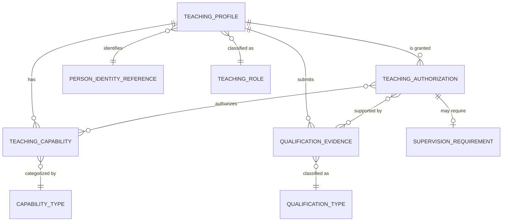
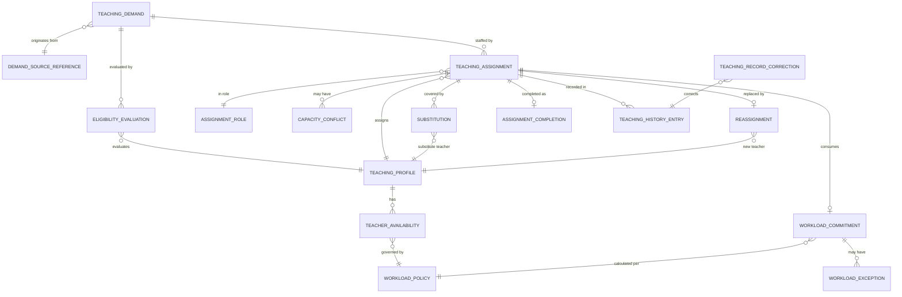
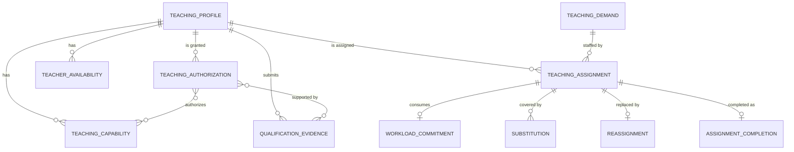

# Teaching Domain — Entity Identification by Submodule

## Source Documents

- [teaching-domain.md](file:///d:/Project.Private/elsasa-sis-v3/domains/teaching-domain.md) — Teaching Domain definition
- [sub-modul-and-development-phases.md](file:///d:/Project.Private/elsasa-sis-v3/sub-modul-and-development-phases.md) — Module decomposition and three-stage roadmap

## Domain Boundary

The Teaching domain is the authoritative source for who is recognized by the school as a teaching resource, what teaching capabilities and qualifications the person has, what teaching work the person is authorized to perform, when the person is available, what teaching responsibility has been assigned, how much teaching capacity has been committed or remains available, how substitutions and reassignments are handled, and the history of teaching authorizations and assignments.

It does **not** own student identity, curriculum or learning structure, lesson content, academic attendance, assessment results, student behaviour or counselling, financial obligations, operational timetable or room allocation, employee contracts, payroll, or general personnel records.

Entities identified here are strictly derived from the domain definition and module decomposition. No entity is introduced that is not supported by the source documents.

---

## Module 1 — Teacher Profile & Authorization

**Module responsibility:** Manage the teaching profile, capabilities, qualification evidence, verification, and teaching authorization lifecycle.

**Submodules:** Teaching Profile Management · Teaching Capability · Qualification Evidence & Verification · Teaching Authorization Lifecycle

---

### Submodule 1.1 — Teaching Profile Management

---

#### 1.1.1 Teaching Profile *(Core Entity)*

| Aspect | Description |
|---|---|
| **Purpose** | Represents the school's recognized relationship with a person as a teaching resource. Contains the minimum identity, professional information, teaching role, organizational affiliation, and standing required to identify and assign a teacher. |
| **Role** | The root entity of the Teaching domain. Every capability, qualification, authorization, availability, and assignment traces back to a Teaching Profile. A person must have an established Teaching Profile before any teaching workflow can proceed. Tracks standing (active, restricted, suspended, inactive) with effective dates. Must support non-employee teaching resources (contract teachers, visiting teachers, external assessors, volunteers, specialist instructors, learning facilitators) when school policy permits. |
| **Example** | Teaching Profile: Budi Hartono, teaching role "Guru Tetap", campus "Kampus Utama", department "Matematika", standing "Active", effective from 2026-07-01, approved by Kepala Sekolah. |

> [!IMPORTANT]
> A Teaching Profile is **not** a complete employee record. It holds only the minimum identity information required for teaching workflows. Employment contracts, payroll, benefits, and general personnel administration belong to a future Employee/HR domain.

---

#### 1.1.2 Teaching Role *(Reference Entity)*

| Aspect | Description |
|---|---|
| **Purpose** | Defines a category of teaching relationship recognized by the school (e.g., permanent teacher, contract teacher, visiting teacher, volunteer, external assessor, learning facilitator). |
| **Role** | Provides configurable classification for Teaching Profiles. Determines what categories of teaching resources the school permits and may influence authorization and assignment rules. The school defines which roles are permitted — these are not hard-coded system categories. |
| **Example** | Teaching Role: "Guru Tetap" (Permanent Teacher), "Guru Kontrak" (Contract Teacher), "Guru Tamu" (Visiting Teacher), "Fasilitator" (Learning Facilitator). |

> [!NOTE]
> Whether Teaching Role is modeled as a separate reference entity or as a configurable attribute on Teaching Profile is an implementation decision. It is listed here because the domain explicitly names teaching role as a profile attribute and requires support for multiple categories of teaching resources.

---

#### 1.1.3 Person Identity Reference *(Reference Entity — External)*

| Aspect | Description |
|---|---|
| **Purpose** | References the authoritative identity of the person behind the Teaching Profile. Currently may be a minimal identity held within Teaching; eventually owned by an Employee/HR domain. |
| **Role** | Ensures each Teaching Profile is linked to exactly one identifiable person. Teaching does not redefine the person's identity — it references the minimum necessary information (name, identity number, contact). When an Employee/HR domain exists, Teaching consumes the employee identity reference rather than maintaining its own. |
| **Example** | Person Identity Reference: employee ID "EMP-2026-042" or, in the absence of an HR system, name "Budi Hartono", national ID reference. |

> [!IMPORTANT]
> Until an Employee/HR domain is defined, Teaching may hold minimum identity information. It must not become the owner of employment-wide personal data merely because that person is a teacher.

---

### Submodule 1.2 — Teaching Capability

---

#### 1.2.1 Teaching Capability *(Core Entity)*

| Aspect | Description |
|---|---|
| **Purpose** | Represents a category of teaching work the person may potentially be suitable to perform. Describes potential suitability — not authorization or assignment. |
| **Role** | Connects a Teaching Profile to the kinds of work the teacher may be considered for. Capabilities may relate to subject/learning area, level/stage, program, delivery mode, language of instruction, specialist activity, or assessment/moderation responsibility. The capability structure must remain curriculum-independent — it must not assume every school organizes learning by class and subject. Multiple capabilities per teacher are permitted. |
| **Example** | Teaching Capability: teacher Budi Hartono, capability "Matematika", level "SD Kelas 4–6", delivery mode "Tatap Muka" (In-Person). |

> [!NOTE]
> Capability describes **potential suitability**. It does not by itself authorize a teacher or create an assignment. The school determines which capabilities are recognized (school configuration).

---

#### 1.2.2 Capability Type *(Reference Entity)*

| Aspect | Description |
|---|---|
| **Purpose** | Defines the recognized categories of teaching capability the school uses (e.g., subject, level, delivery mode, specialist activity). |
| **Role** | Provides a configurable taxonomy for Teaching Capabilities. The school determines which capability categories are recognized and how they are structured. Must not hard-code a universal taxonomy. Enables eligibility matching when demands specify required capabilities. |
| **Example** | Capability Type: "Mata Pelajaran" (Subject), "Jenjang" (Level/Stage), "Mode Pembelajaran" (Delivery Mode), "Bahasa Pengantar" (Language of Instruction). |

---

### Submodule 1.3 — Qualification Evidence & Verification

---

#### 1.3.1 Qualification Evidence *(Core Entity)*

| Aspect | Description |
|---|---|
| **Purpose** | Records evidence used to support a person's teaching capability or authorization. Tracks the lifecycle from claim through submission, verification, and potential expiry or revocation. |
| **Role** | The domain's record of a teacher's professional evidence. Maintains distinct states: claimed, submitted, verified, rejected, expired, revoked. Each piece of evidence records qualification/certification type, issuing authority, issue date, expiry date (when applicable), evidence reference, verification actor and date, and restrictions/conditions. Must distinguish claim, evidence, verification outcome, and the school's authorization decision as separate concerns. Expired or revoked evidence must remain historical. |
| **Example** | Qualification Evidence: teacher Budi Hartono, qualification "Sertifikat Pendidik Matematika", issuing authority "Kemendikbud", issued 2020-03-15, no expiry, state "Verified", verified by Qualification Verifier on 2026-07-10. |

> [!IMPORTANT]
> A verified qualification does **not** automatically create a Teaching Authorization or Teaching Assignment. Verification confirms authenticity and acceptance — the authorization decision is a separate workflow step.

---

#### 1.3.2 Qualification Type *(Reference Entity)*

| Aspect | Description |
|---|---|
| **Purpose** | Defines a category of qualification or certification recognized by the school for teaching purposes (e.g., academic degree, teaching certification, safety certification, first aid). |
| **Role** | Provides configurable classification for Qualification Evidence. Determines renewal requirements per type — some qualifications expire and require renewal (e.g., child protection certification, first aid), others remain permanently valid (e.g., academic degrees). Recognized qualification issuers are configurable school policy; the system must not hard-code recognized issuers. |
| **Example** | Qualification Type: "Sertifikat Pendidik" (Teaching Certificate, requires renewal), "S1 Pendidikan Matematika" (Bachelor's Degree in Math Education, permanently valid), "Sertifikat P3K" (First Aid Certificate, expires and requires renewal). |

---

### Submodule 1.4 — Teaching Authorization Lifecycle

---

#### 1.4.1 Teaching Authorization *(Core Entity)*

| Aspect | Description |
|---|---|
| **Purpose** | Records the school's explicit permission for a teaching resource to perform specified teaching work under stated conditions. An authorization establishes eligibility — it does not reserve capacity or assign work. |
| **Role** | The central decision entity connecting a verified teacher to permitted work categories. Defines: authorized capability or role, applicable scope (campus, program, level, delivery mode), effective period, required supervision (if "Authorized Under Supervision"), restrictions or conditions, decision authority, and supporting qualification evidence. Lifecycle states: Active, Restricted, Suspended, Revoked, Expired, plus conditional state "Authorized Under Supervision". Follows the workflow: Qualification Verified → Teaching Coordinator Review → Teaching Authority Approval → Teaching Authorization Granted. Suspension or revocation triggers review of affected current and future assignments. |
| **Example** | Teaching Authorization: teacher Budi Hartono, authorized capability "Matematika SD Kelas 4–6", scope "Kampus Utama", state "Active", effective 2026-07-01 to 2027-06-30, approved by Teaching Authority, supporting evidence "Sertifikat Pendidik Matematika (Verified)". |

> [!NOTE]
> Authorization scope and effective dates must be explicit. An authorization must **not** automatically create an assignment. Formal appeal workflows for adverse decisions are out of scope for Phase-2.

---

#### 1.4.2 Supervision Requirement *(Supporting Entity)*

| Aspect | Description |
|---|---|
| **Purpose** | Records the supervision conditions attached to a Teaching Authorization when the authorization state is "Authorized Under Supervision". |
| **Role** | Captures what supervision is required, and may record the supervising teacher reference. Phase-2 records supervision requirements and the supervising teacher reference but does not require a complex supervision workflow. Links to the Teaching Authorization and optionally to the supervising teacher's Teaching Profile. |
| **Example** | Supervision Requirement: authorization for Siti Nurhaliza teaching "IPA SD Kelas 5", supervising teacher "Budi Hartono", requirement "Must co-teach with supervising teacher for first semester". |

> [!NOTE]
> Phase-2 supports recording supervision requirements without implementing a full supervision tracking workflow. Whether this is a separate entity or attributes on Teaching Authorization is an implementation decision.

---

### Teacher Profile & Authorization — Entity Relationship Summary

---

## Module 2 — Assignment & Workload

**Module responsibility:** Receive teaching demand, evaluate eligibility, approve teaching assignments (including homeroom advisory assignments), manage workload, and handle substitution and reassignment.

**Submodules:** Teaching Demand Intake · Teacher Eligibility Evaluation · Teaching Assignment Approval (incl. homeroom advisory) · Workload & Capacity Management · Substitution & Reassignment · Assignment Completion · Teaching History

---

### Submodule 2.1 — Teaching Demand Intake

---

#### 2.1.1 Teaching Demand *(Core Entity)*

| Aspect | Description |
|---|---|
| **Purpose** | Represents a request from an owning domain (Academics, Development, or another authorized domain) for qualified teaching capacity to perform defined work. |
| **Role** | The entry point for all assignment workflows. An academic demand may include: learning unit/activity reference, student/learning-group context, academic period, required teaching capability, required assignment role, expected effort/workload basis, required assessment authorization, campus/delivery constraints, requested effective period, and number of teaching resources required. A development demand may request a teacher/facilitator for an authorized non-academic responsibility. Teaching owns staffing the demand — it does not redefine the purpose, content, participants, or outcome of the underlying work. Demand states include: received, accepted for staffing, returned for clarification, changed, cancelled, declined with reason. Duplicate demand must be identified without erasing either source request. |
| **Example** | Teaching Demand: from Academic Coordinator, learning unit "Matematika Kelas 4 Semester 1", required capability "Matematika SD", role "Guru Utama" (Primary Teacher), academic period "Semester 1 TP 2026/2027", expected workload "5 jam/minggu", campus "Kampus Utama", status "Received". |

> [!IMPORTANT]
> Demand does **not** reserve teacher capacity until policy says it does. Teaching must not invent missing academic or Development requirements. The source domain owns cancellation or material redefinition of its work.

---

#### 2.1.2 Demand Source Reference *(Reference Entity — External)*

| Aspect | Description |
|---|---|
| **Purpose** | References the external work item that generated the teaching demand — e.g., a Learning Unit, Learning Activity, or Development program from the owning domain. |
| **Role** | Preserves traceability from the Teaching Demand back to the domain that owns the underlying work. Teaching does not copy the full academic or development record — it holds only the reference needed to identify what work requires staffing and to communicate assignment outcomes back to the requesting domain. |
| **Example** | Demand Source Reference: Learning Unit "Matematika Kelas 4 Semester 1" (from Academics), or Extracurricular Program "Pramuka" (from Development). |

---

### Submodule 2.2 — Teacher Eligibility Evaluation

---

#### 2.2.1 Eligibility Evaluation *(Core Entity)*

| Aspect | Description |
|---|---|
| **Purpose** | Records the result of evaluating one or more teachers against the requirements of a specific Teaching Demand. Determines whether a teacher may be considered for the requested work. |
| **Role** | The bridge between demand and assignment. Eligibility evaluation considers: active Teaching Profile, required Teaching Authorization, verified qualification (when required), effective dates, availability, current workload and remaining capacity, campus or delivery restriction, required supervision, and unresolved conflicts. Produces a list of eligible candidates and identifies any unresolved conflicts or required exceptions. The evaluation basis must be explainable. Eligibility does not guarantee assignment — it is one input to an authorized assignment decision. Eligibility rules must come from approved school policy. |
| **Example** | Eligibility Evaluation: for Teaching Demand "Matematika Kelas 4 Semester 1 — Guru Utama", evaluated teachers: Budi Hartono (eligible, no conflicts), Siti Nurhaliza (eligible, authorized under supervision), Ahmad Fauzi (ineligible — authorization expired). |

> [!NOTE]
> Suitability recommendation and eligibility decision are distinct. Lack of recorded information must not be treated as confirmed eligibility. Whether Eligibility Evaluation is persisted as a first-class entity or as a transient process result is an implementation decision — it is listed here because the domain defines Teacher Eligibility as a core business concept with explicit evaluation criteria.

---

### Submodule 2.3 — Teaching Assignment Approval (incl. homeroom advisory)

---

#### 2.3.1 Teaching Assignment *(Core Entity)*

| Aspect | Description |
|---|---|
| **Purpose** | Represents the authorized connection between a teacher and defined teaching responsibility. A business authorization with scope, role, authority, and effective dates — not merely a name displayed beside a class. |
| **Role** | The domain's central operational entity. Identifies: assigned teacher (Teaching Profile), source demand or work reference, assignment role, scope of responsibility, student/learning group/learning context (when applicable), effective start and end, expected workload commitment, relevant authorization and qualification checks, assignment authority, assignment state, and predecessor/replacement/related assignment (when applicable). Assignment states include: proposed, approved, rejected, withdrawn, returned for revision, suspended, cancelled, completed. When approval becomes effective, capacity is committed. Academics and Operations receive the authorized assignment. Must be distinct from academic assignments issued to students — the qualified term **Teaching Assignment** must be used. Supports homeroom advisory assignments as a valid assignment type. |
| **Example** | Teaching Assignment: teacher Budi Hartono, demand "Matematika Kelas 4 Semester 1", role "Guru Utama" (Primary Teacher), scope "All participating students in Matematika Kelas 4", effective 2026-07-15 to 2026-12-20, workload commitment "5 jam/minggu", state "Approved", approved by Teaching Authority 2026-07-10. |

---

#### 2.3.2 Assignment Role *(Reference Entity)*

| Aspect | Description |
|---|---|
| **Purpose** | Defines the teacher's authorized responsibility within a Teaching Assignment (e.g., primary teacher, co-teacher, assistant, facilitator, assessor, moderator, supervisor, substitute, homeroom advisor). |
| **Role** | Provides configurable classification for the responsibility a teacher holds within an assignment. The school's approved roles and their authority must be explicit. These are not mandatory universal categories — they are school-defined. A teacher may hold different roles in different assignments. The role determines the scope of authority and responsibility. |
| **Example** | Assignment Role: "Guru Utama" (Primary Teacher), "Guru Pendamping" (Co-Teacher), "Asisten" (Assistant), "Penilai" (Assessor), "Wali Kelas" (Homeroom Advisor), "Pengganti" (Substitute). |

---

#### 2.3.3 Capacity Conflict *(Supporting Entity)*

| Aspect | Description |
|---|---|
| **Purpose** | Records a condition that may prevent or question an assignment — a conflict requiring resolution before or during assignment approval. |
| **Role** | Captures specific conflicts identified during eligibility evaluation or assignment processing. Examples: missing or expired authorization, unverified required qualification, teacher unavailable during required period, workload limit exceeded, overlapping commitments, incompatible campus or delivery requirement, inactive Teaching Profile, missing supervision, unresolved operational schedule conflict. Distinguishes between conflict, warning, exception, and rejection as different business meanings. The system must not automatically reject or approve an exception unless explicit policy authorizes that result. Links to the relevant Teaching Assignment, Teaching Demand, or Eligibility Evaluation. |
| **Example** | Capacity Conflict: teacher Ahmad Fauzi, assignment proposal "IPA Kelas 5 Semester 1", conflict type "Authorization Expired", detail "Teaching Authorization for IPA SD expired 2026-06-30", resolution required before assignment approval. |

---

### Submodule 2.4 — Workload & Capacity Management

---

#### 2.4.1 Teacher Availability *(Core Entity)*

| Aspect | Description |
|---|---|
| **Purpose** | Records when and under what conditions a teacher may be considered for teaching work. Availability indicates potential capacity — it is not an operational timetable. |
| **Role** | Captures: effective date range, available days or periods, campus availability, delivery-mode availability, temporary unavailability, recurring restrictions, maximum available teaching capacity, reason and source. Teaching states whether capacity may be assigned — Operations decides when and where an assigned activity is operationally scheduled. Employment leave, working hours, or contractual limits may eventually come from an Employee/HR domain; Teaching consumes their effect on teaching availability without redefining the source decision. |
| **Example** | Teacher Availability: teacher Budi Hartono, effective Semester 1 TP 2026/2027, available Monday–Friday, campus "Kampus Utama", maximum available capacity "25 jam/minggu", unavailable "Every Wednesday 13:00–15:00" (recurring restriction). |

> [!IMPORTANT]
> Availability and operational schedule are distinct. Source-owned employment decisions (e.g., approved leave) must not be re-decided by Teaching. Unavailability must not silently cancel an assignment.

---

#### 2.4.2 Workload Commitment *(Core Entity)*

| Aspect | Description |
|---|---|
| **Purpose** | Records the teaching capacity reserved or consumed by assignments under approved policy. Tracks planned, committed, and remaining capacity for a teacher within an effective period. |
| **Role** | Derived from approved Teaching Assignments and explicit workload policy. Captures: planned workload, committed workload, remaining capacity, direct teaching effort, assessment or moderation responsibility, approved non-contact effort, overload or under-allocation status, approved exceptions, and workload by effective period. Workload Unit is configurable school policy (default: Teaching Hours). Phase-2 focuses on assignment capacity, workload visibility, and assignment planning — not payroll or performance evaluation. Capacity limits support Warning (approaching limit — assignment permitted) and Prohibited (capacity exceeded — requires approved exception). Workload must be reproducible for its policy version and effective period. |
| **Example** | Workload Commitment: teacher Budi Hartono, period "Semester 1 TP 2026/2027", committed workload "22 jam/minggu", capacity limit "24 jam/minggu", remaining capacity "2 jam/minggu", status "Warning — Approaching Limit". |

> [!NOTE]
> The school determines which activities count, the unit of measurement, calculation rules, limits, and approval authority. Agents must not assume workload is always measured in classroom hours. Whether Workload Commitment is a separate entity or a computed view is an implementation decision — it is listed here because the domain defines Workload Commitment as a core business concept that must be persisted and historically interpretable.

---

#### 2.4.3 Workload Exception *(Supporting Entity)*

| Aspect | Description |
|---|---|
| **Purpose** | Records an authorized departure from a workload rule or limit — an explicit decision permitting an assignment that would otherwise violate capacity policy. |
| **Role** | Follows the workflow: Teaching Coordinator recommends → Teaching Authority approves → Workload Exception Granted. Teachers may not self-approve workload exceptions. Records: affected assignment, applicable workload rule/limit, exception justification, recommending actor, approving authority, effective period, and decision. Exception decisions must be auditable. An overload must not be approved merely because work has already begun. Warning, policy breach, and approved exception are distinct business meanings. |
| **Example** | Workload Exception: teacher Budi Hartono, assignment "IPS Kelas 6 Semester 1" exceeds capacity limit by 3 jam/minggu, recommended by Teaching Coordinator, approved by Kepala Sekolah, effective Semester 1 TP 2026/2027, reason "No qualified alternative available for IPS Kelas 6". |

---

#### 2.4.4 Workload Policy *(Reference Entity)*

| Aspect | Description |
|---|---|
| **Purpose** | Defines the rules, units, limits, and calculation methods that govern how teaching workload is measured and constrained. |
| **Role** | Provides the configurable policy context for all workload calculations. Defines: workload unit (default: Teaching Hours), which activities count toward workload, capacity limits and their categories (Warning vs. Prohibited), calculation rules, and effective period/version. Workload reports must state the policy version, measurement basis, and period. Must be versioned or effective-dated so historical workload calculations remain reproducible. |
| **Example** | Workload Policy: "Kebijakan Beban Mengajar TP 2026/2027", unit "Jam Mengajar" (Teaching Hours), warning threshold 22 jam/minggu, prohibited threshold 24 jam/minggu, includes direct teaching and assessment responsibility, excludes non-contact preparation time, effective 2026-07-01. |

> [!NOTE]
> Whether Workload Policy is a separate entity or part of a broader policy configuration framework is an implementation decision. It is listed here because the domain explicitly requires that workload be derived from approved rules and that policy versions be preserved.

---

### Submodule 2.5 — Substitution & Reassignment

---

#### 2.5.1 Substitution *(Core Entity)*

| Aspect | Description |
|---|---|
| **Purpose** | Records a temporary assignment of another eligible person to cover an existing teaching responsibility when the originally assigned teacher cannot perform all or part of the responsibility. |
| **Role** | Captures: affected original assignment, coverage period and responsibility, reason, eligible substitute teacher, workload and schedule impact, required approval, and effective dates. Substitute eligibility must be evaluated for the covered work. A temporary substitution must not silently terminate the original assignment. Overlapping responsibility must be explicit. Retroactive substitution requires authority and must not falsify academic history. The original assignment and all changes must remain historically interpretable. |
| **Example** | Substitution: original assignment of Budi Hartono for "Matematika Kelas 4 Semester 1", substitute teacher Dewi Anggraeni, coverage period 2026-09-15 to 2026-09-19, reason "Teacher illness", approved by Teaching Coordinator. |

---

#### 2.5.2 Reassignment *(Core Entity)*

| Aspect | Description |
|---|---|
| **Purpose** | Records a permanent or materially changed allocation of teaching responsibility — distinct from a temporary substitution. |
| **Role** | Captures: original assignment, new teacher or changed responsibility, reason, effective date, required approval, handover requirement, and workload impact. The predecessor/related assignment link must be preserved. May represent permanent transfer of responsibility, partial transfer, or material scope change. A scheduling change does not automatically change a Teaching Assignment. An assignment change does not automatically alter academic records already produced by the previous authorized teacher. |
| **Example** | Reassignment: teaching responsibility for "IPA Kelas 5 Semester 1" permanently transferred from Ahmad Fauzi to Siti Nurhaliza, effective 2026-10-01, reason "Ahmad Fauzi authorization revoked", handover required, approved by Teaching Authority. |

> [!NOTE]
> Whether Substitution and Reassignment are separate entities or specialized states/subtypes of Teaching Assignment is an implementation decision. They are listed separately here because the domain defines them as distinct business concepts with different rules (temporary vs. permanent, different approval requirements, different effects on the original assignment).

---

### Submodule 2.6 — Assignment Completion

---

#### 2.6.1 Assignment Completion *(Supporting Entity)*

| Aspect | Description |
|---|---|
| **Purpose** | Records that an assigned teaching responsibility has reached its authorized end or completion condition. |
| **Role** | Captures: end of effective assignment period, completion information from Academics or Development, unresolved responsibilities, required handover status, approval or confirmation, and completion date. Completion of a Teaching Assignment is distinct from completion of student learning — Academics owns whether learning, assessment, or academic requirements were completed. Capacity is released according to policy using the correct effective date. Assignment completion must not be inferred solely from timetable end when policy requires confirmation. Completion must not erase the assignment or its workload history. |
| **Example** | Assignment Completion: teacher Budi Hartono, assignment "Matematika Kelas 4 Semester 1", completed 2026-12-20, source confirmation from Academic Coordinator (learning activities concluded), no unresolved responsibilities, capacity released. |

> [!NOTE]
> Whether Assignment Completion is a separate entity or a terminal state on Teaching Assignment with completion attributes is an implementation decision. It is listed here because the domain defines specific completion considerations (handover, unresolved items, source-domain confirmation) that go beyond a simple status change.

---

### Submodule 2.7 — Teaching History

---

#### 2.7.1 Teaching History Entry *(Core Entity)*

| Aspect | Description |
|---|---|
| **Purpose** | Preserves an auditable record of all significant decisions, changes, and events in a person's teaching relationship and responsibilities over time. |
| **Role** | Records events including: profile established or changed, qualification submitted/verified/expired/rejected/revoked, authorization granted/restricted/suspended/expired/revoked, availability changed, assignment proposed/approved/changed/completed/cancelled, substitution or reassignment, workload exception approved, and record corrected. Teaching history answers what the person was authorized and assigned to do — it does not duplicate lesson activity, attendance, assessment, student results, or employee-performance records. Must support historical interpretability: past work must be interpreted using the authorization and assignment effective when the work occurred. |
| **Example** | Teaching History Entry: teacher Budi Hartono, event "TeachingAssignmentApproved", detail "Assigned as Guru Utama for Matematika Kelas 4 Semester 1", effective date 2026-07-15, recorded 2026-07-10, actor "Teaching Authority — Kepala Sekolah". |

> [!NOTE]
> Whether Teaching History is modeled as a dedicated history/audit entity or emerges from event sourcing / domain events is an implementation decision. The domain explicitly defines a comprehensive list of domain events (e.g., TeachingProfileEstablished, QualificationEvidenceVerified, TeachingAssignmentApproved) that constitute the conceptual history. The key requirement is that history must remain interpretable and must not be silently overwritten.

---

#### 2.7.2 Teaching Record Correction *(Supporting Entity)*

| Aspect | Description |
|---|---|
| **Purpose** | Records an authorized, auditable correction to an approved Teaching record — preserving the original record and the reason for change. |
| **Role** | Captures: original record reference, requested correction, reason and evidence, effective date implications, authorization, correcting actor, and correction date. Correction is distinct from a new decision or changed circumstance. Approved records must never be silently overwritten. Retroactive correction must identify downstream impact on eligibility, workload, assignments, and integrations. Academic and operational records must not be rewritten by Teaching without their owning domain's workflows. |
| **Example** | Teaching Record Correction: original record "Teaching Authorization for Budi Hartono — IPA SD effective 2026-07-01", correction "Scope changed from IPA SD Kelas 1–6 to IPA SD Kelas 4–6", reason "Original authorization scope recorded incorrectly", corrected by Teaching Authority 2026-08-15, original record preserved. |

---

### Assignment & Workload — Entity Relationship Summary

---

## Cross-Module Entity Relationship Summary

---

## Entity Summary Table

| # | Entity | Category | Module | Submodule |
|---|---|---|---|---|
| 1.1.1 | Teaching Profile | Core | Teacher Profile & Authorization | Teaching Profile Management |
| 1.1.2 | Teaching Role | Reference | Teacher Profile & Authorization | Teaching Profile Management |
| 1.1.3 | Person Identity Reference | Reference (External) | Teacher Profile & Authorization | Teaching Profile Management |
| 1.2.1 | Teaching Capability | Core | Teacher Profile & Authorization | Teaching Capability |
| 1.2.2 | Capability Type | Reference | Teacher Profile & Authorization | Teaching Capability |
| 1.3.1 | Qualification Evidence | Core | Teacher Profile & Authorization | Qualification Evidence & Verification |
| 1.3.2 | Qualification Type | Reference | Teacher Profile & Authorization | Qualification Evidence & Verification |
| 1.4.1 | Teaching Authorization | Core | Teacher Profile & Authorization | Teaching Authorization Lifecycle |
| 1.4.2 | Supervision Requirement | Supporting | Teacher Profile & Authorization | Teaching Authorization Lifecycle |
| 2.1.1 | Teaching Demand | Core | Assignment & Workload | Teaching Demand Intake |
| 2.1.2 | Demand Source Reference | Reference (External) | Assignment & Workload | Teaching Demand Intake |
| 2.2.1 | Eligibility Evaluation | Core | Assignment & Workload | Teacher Eligibility Evaluation |
| 2.3.1 | Teaching Assignment | Core | Assignment & Workload | Teaching Assignment Approval |
| 2.3.2 | Assignment Role | Reference | Assignment & Workload | Teaching Assignment Approval |
| 2.3.3 | Capacity Conflict | Supporting | Assignment & Workload | Teaching Assignment Approval |
| 2.4.1 | Teacher Availability | Core | Assignment & Workload | Workload & Capacity Management |
| 2.4.2 | Workload Commitment | Core | Assignment & Workload | Workload & Capacity Management |
| 2.4.3 | Workload Exception | Supporting | Assignment & Workload | Workload & Capacity Management |
| 2.4.4 | Workload Policy | Reference | Assignment & Workload | Workload & Capacity Management |
| 2.5.1 | Substitution | Core | Assignment & Workload | Substitution & Reassignment |
| 2.5.2 | Reassignment | Core | Assignment & Workload | Substitution & Reassignment |
| 2.6.1 | Assignment Completion | Supporting | Assignment & Workload | Assignment Completion |
| 2.7.1 | Teaching History Entry | Core | Assignment & Workload | Teaching History |
| 2.7.2 | Teaching Record Correction | Supporting | Assignment & Workload | Teaching History |

**Totals:** 24 entities — 14 Core, 6 Reference (including 2 External), 4 Supporting

---

## Assumptions and Resolved Domain Decisions

> [!WARNING]
> The following assumptions were made during entity identification. They should be validated before implementation.

### Assumptions

1. **Teaching Role as a reference entity** — The domain mentions "teaching role" as a profile attribute and lists multiple categories of teaching resources (contract, visiting, volunteer, etc.). This is modeled as a separate reference entity for configurability. It could alternatively be a simple attribute on Teaching Profile.

2. **Capability Type as a reference entity** — The domain describes capabilities relating to subject, level, delivery mode, language, etc. These are modeled as a configurable taxonomy. The school determines recognized categories.

3. **Eligibility Evaluation as a persisted entity** — The domain defines Teacher Eligibility as a core business concept with explicit evaluation criteria and requires that the evaluation basis be "explainable". Whether this is persisted or transient depends on auditability requirements.

4. **Workload Policy as a reference entity** — The domain repeatedly states that workload must be "derived from approved rules", "reproducible for policy version and period", and that "reports must state the policy version". This implies a first-class reference entity, though it could be part of a broader policy framework.

5. **Substitution and Reassignment as separate entities** — The domain defines these as distinct business concepts with different rules. They could alternatively be modeled as specialized states of Teaching Assignment.

### Resolved Domain Decisions (Closed Open Questions)

The open questions from the Teaching Domain document affecting entity design have been formally resolved following a pragmatic, minimalist, and explicit approach:

1. **Teacher and Employee Boundary** — *Is every teacher an employee? Who owns authoritative personal identity before an Employee domain exists?*
   - **Resolution:** **Resolved (Pragmatic & Embedded).** Not every teacher is an employee (the domain explicitly supports contract teachers, visiting teachers, volunteers, and external assessors). In the absence of an HR domain, `Teaching Profile` directly holds minimal identity attributes (`full_name`, `contact_email`, `contact_phone`, optional `national_id_or_external_ref`) alongside an optional nullable `employee_ref`. No standalone employee or person registry stub entity is required in Phase-2. When an HR domain is introduced later, `employee_ref` links to the authoritative personnel record without disrupting non-employee teaching profiles.

2. **Availability Model & Assignment Impact** — *How are recurring and exceptional availability represented? What happens to active assignments when availability changes?*
   - **Resolution:** **Resolved (Pragmatic Conflict-Flagging).** `Teacher Availability` defines the baseline capacity (e.g., maximum weekly hours) and recurring available slots/restrictions per academic period. Temporary unavailabilities (leave, illness, blackout dates) are recorded as explicit date-range exception entries. Crucially, changes in availability **never silently or automatically cancel or suspend active assignments**. Instead, overlapping assignments generate an explicit `Capacity Conflict` flag, alerting the Teaching Coordinator to take authoritative human action via `Substitution` (temporary) or `Reassignment` (permanent).

3. **Teaching Demand Timing & Lifecycle** — *Does Academics request capacity before or after learning is offered? What minimum prerequisite triggers it?*
   - **Resolution:** **Resolved (Planning-First, Decoupled from Rosters).** Academics initiates a `Teaching Demand` during academic/curriculum planning **before** learning activities and operational scheduling begin. A demand requires only the target `Learning Unit`, academic period, role, and expected workload basis—it does not wait for student enrollments or finalized student rosters. Once Teaching approves the assignment, Operations schedules occurrences and Academics conducts learning. Ad-hoc or mid-term staffing demands follow the same explicit lifecycle (`Received` → `Accepted for Staffing` → `Staffed` / `Declined` / `Returned`).

4. **Assignment Scope & Shared Responsibility** — *Can an assignment apply to one student, multiple groups, or only a learning unit? How are co-teaching and shared responsibility represented?*
   - **Resolution:** **Resolved (Independent Granular Assignments).** The assignment scope is anchored to the work item defined by the `Teaching Demand` (by default a `Learning Unit`, with optional student-group or individual context). Co-teaching, assistant roles, and shared responsibility are represented by issuing **multiple distinct `Teaching Assignment` records** for the same demand/unit, each with its own `Assignment Role` (e.g., Primary Teacher, Co-Teacher, Assistant), independent workload commitment, effective dates, and substitution lifecycle. This avoids compound "team" entities and maintains clean, individual auditability.

5. **Homeroom and Advising Boundary** — *Is homeroom responsibility a Teaching Assignment? Is academic advising an Academic responsibility, Teaching Assignment role, or both?*
   - **Resolution:** **Resolved (Dual Separation: Staffing in Teaching, Work in Owning Domains).** Both Homeroom Advisory and Academic Advising are staffed through the Teaching domain via `Teaching Assignment` records with dedicated `Assignment Role` classifications (e.g., `"Wali Kelas"` / Homeroom Advisor, `"Pembimbing Akademik"` / Academic Advisor). This ensures all teacher capacity, workload limits, eligibility, and substitution remain centralized and accounted for in Teaching. However, the substantive guidance workflows (academic monitoring, course selection approvals, pastoral referrals) remain strictly owned by Academics and Development; Teaching does not hold advising logs or student pastoral records.

6. **Development and Extracurricular Boundary** — *When is extracurricular facilitation a Teaching Assignment? Does Development request capacity through Teaching Demand or directly appoint a facilitator?*
   - **Resolution:** **Resolved (Demand-Driven for Teaching Staff & Workload).** Whenever an extracurricular program utilizes school teaching resources (impacting teacher availability/workload) or requires teaching authorization, Development submits a `Teaching Demand` to Teaching, resulting in a `Teaching Assignment` with role `"Fasilitator Ekstrakurikuler"`. External coaches or guest instructors with zero teaching workload impact and no academic responsibilities can be managed directly within Development without requiring a formal Teaching Profile, unless school policy explicitly mandates teacher qualification verification for safety/accreditation.
