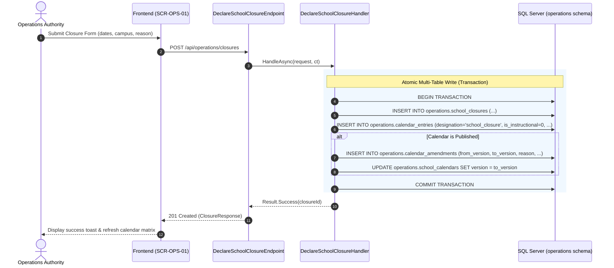
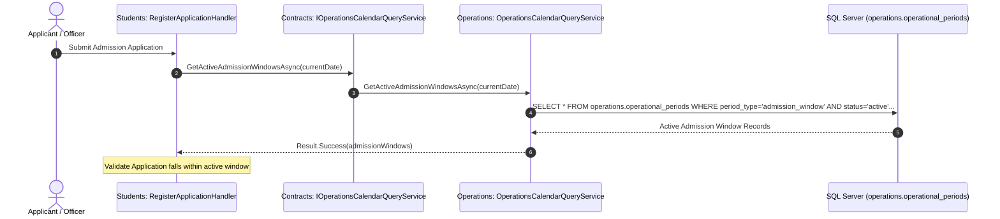
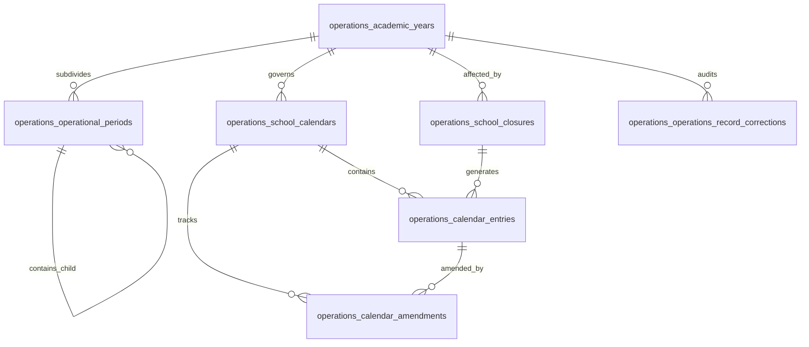

# 1. Overview

This target architecture defines the technical realization for Stage 1 "Calendar & Periods — full scope" under the Operations domain, fulfilling change request intake `CR-OPS-CALENDAR-PERIODS` ([`IS001 - OPS-CALENDAR-PERIODS-ISSUE.md`](file:///d:/Project.Private/elsasa-sis-v3/docs/issues/IS001%20-%20OPS-CALENDAR-PERIODS-ISSUE.md)).

The architecture establishes the authoritative temporal and scheduling foundation for the Elsasa School Information System (SIS) V3:
1. **Academic Year Management:** Transitioning from the POC boolean flag to a full lifecycle state machine (`draft` -> `approved` -> `active` -> `completed` -> `archived`) with explicit approval auditing.
2. **Operational Period Management:** Establishing hierarchical coordination periods (`operational_periods`) supporting primary terms/semesters and specialized operational windows (admission, assessment, reporting).
3. **School Calendar & Date Entries:** Managing school calendar containers (`school_calendars`) and exception-based granular date entries (`calendar_entries`) for holidays, instructional days, and staff-only days.
4. **Campus Closure Coordination:** Providing emergency and planned school closure tracking (`school_closures`) with automated calendar entry propagation and published calendar version amendments.
5. **Calendar Amendments & Corrections:** Auditing alterations to published calendars (`calendar_amendments`) and recording justified corrections to approved operational records (`operations_record_corrections`, `UC-OPS-13`).
6. **Cross-Domain Consumption Contracts:** Exposing strongly-typed synchronous query services in `Elsasa.Sis.Contracts` (`IOperationsCalendarQueryService`) for downstream consumption by Student Admission and Finance Billing.
7. **Schedule Management Workspace (`SCR-OPS-01`):** Implementing a cohesive 3-tab user interface in `src/frontend/src/features/operations/calendar/views/CalendarWorkspaceView.vue`.

---

# 2. Architectural Basis

## Business Context

This architecture realizes the business outcomes and operational workflows specified in:
- **DOMAIN:** [`operational-domain.md`](file:///d:/Project.Private/elsasa-sis-v3/docs/domains/operational-domain.md)
  - Workflow 1: Establish or Amend Academic Year and School Calendar (`OPS-WF-01`)
  - Workflow 10: Coordinate School or Campus Closure (`OPS-WF-10`)
  - Workflow 12: Correct Approved Operations Record (`OPS-WF-12`)
- **FEATURE & ROADMAP:** [`sub-modul-and-development-phases.md`](file:///d:/Project.Private/elsasa-sis-v3/docs/sub-modul-and-development-phases.md)
  - Stage 1 Foundation: Calendar & Periods — full scope
  - Stage 1 Completion Criterion 1: *"An academic year with at least one term/semester and a school calendar (including holidays) is approved and published."*
- **USE CASES:** [`use-cases.md`](file:///d:/Project.Private/elsasa-sis-v3/docs/use-cases.md)
  - `UC-OPS-11`: Establish School Calendar and Periods
  - `UC-OPS-12`: Declare Campus Closure (Stage 1 calendar declaration scope)
  - `UC-OPS-13`: Correct Approved Operations Record (calendar and operational period records)
- **SCREEN INVENTORY:** [`screen-inventory.md`](file:///d:/Project.Private/elsasa-sis-v3/docs/screen-inventory.md)
  - `SCR-OPS-01`: Calendar & Periods Workspace (Schedule Management pattern)

## Analysis Input

This architecture consumes the approved gap-closure decisions and technical trade-offs recorded in:
- **FEASIBILITY ASSESSMENT:** [`IS001 - OPS-CALENDAR-PERIODS-FEASIBILITY-ASSESSMENT.md`](file:///d:/Project.Private/elsasa-sis-v3/docs/issues/IS001%20-%20OPS-CALENDAR-PERIODS-FEASIBILITY-ASSESSMENT.md)
  - Gap closures: GAP-001 through GAP-007
  - Resolved open questions: OQ-001 through OQ-007
  - Evaluation: Approach 1 (Full Lifecycle & Domain Model Alignment)

```text
DOMAIN (operational-domain.md) + FEATURE (use-cases.md, screen-inventory.md)
                        +
        FEASIBILITY-ASSESSMENT (OPS-CALENDAR-PERIODS)
                        ↓
            TARGET ARCHITECTURE (OPS-CALENDAR-PERIODS)
```

---

# 3. Scope

## Included

1. **Database Schema & Migrations:**
   - DbUp migration `20261102_0101_Operations_CalendarPeriods_Tables.sql` in `src/backend/Elsasa.Sis.Database/Scripts/`.
   - Non-destructive evolution of `operations.academic_years` to full status lifecycle, migrating `is_active` to `status = 'active'` and adding `approved_by`, `approved_date`, `notes`.
   - Creation of 5 new domain tables in `operations`: `operational_periods`, `school_calendars`, `calendar_entries`, `school_closures`, `calendar_amendments`.
   - Creation of 1 auditable correction table in `operations`: `operations_record_corrections`.
   - Proper indexing on foreign keys, period codes, date ranges, and statuses.

2. **Backend Vertical Slices (`Elsasa.Sis.Operations`):**
   - **Academic Years:** Refactored `CreateAcademicYear`, `UpdateAcademicYear`, `ApproveAcademicYear`, `ActivateAcademicYear`, `GetAcademicYearsList`, `GetAcademicYearById`.
   - **Operational Periods:** `CreateOperationalPeriod`, `UpdateOperationalPeriod`, `CloseOperationalPeriod`, `GetOperationalPeriodsByAcademicYear`.
   - **School Calendars:** `CreateSchoolCalendar`, `PublishSchoolCalendar`, `WithdrawSchoolCalendar`, `GetActiveSchoolCalendar`.
   - **Calendar Entries:** `CreateCalendarEntry`, `DeleteCalendarEntry`, `GetCalendarMatrixProjection` (dynamic monthly/term instructional grid).
   - **School Closures:** `DeclareSchoolClosure`, `LiftSchoolClosure`, `GetSchoolClosuresList`.
   - **Amendments & Corrections:** `GetCalendarAmendmentsList`, `CorrectOperationsRecord`, `GetRecordCorrectionHistory`.
   - **Setup Presets:** Indonesian standard 2-semester preset generator (`Semester 1 Jul–Dec`, `Semester 2 Jan–Jun`).

3. **Cross-Domain Contracts (`Elsasa.Sis.Contracts`):**
   - Declaration of `IOperationsCalendarQueryService` interface and strongly typed query DTOs (`ActiveAcademicYearDto`, `OperationalPeriodDto`).
   - Implementation `OperationsCalendarQueryService` in `Elsasa.Sis.Operations` registered as scoped service in DI.

4. **Frontend Schedule Management Workspace (`SCR-OPS-01`):**
   - Evolution of `src/frontend/src/features/operations/calendar/views/CalendarWorkspaceView.vue` into a 3-tab workspace conforming to [`screen-inventory.md`](file:///d:/Project.Private/elsasa-sis-v3/docs/screen-inventory.md) and [`frontend-architecture.md`](file:///d:/Project.Private/elsasa-sis-v3/docs/architecture/frontend-architecture.md).
   - Tab 1: Visual Calendar Matrix & Entries (interactive grid, holiday highlights, entry authoring modal).
   - Tab 2: Academic Years & Operational Periods (lifecycle management, hierarchical period tree/table).
   - Tab 3: Closures & Amendment History (closure declaration modal, amendment audit timeline).
   - Typed API client and TanStack Query composables for all operations slices.
   - Zod validation schemas for all user inputs.

## Excluded

1. **Timetable Disruption Analysis & Class Rescheduling:**
   - Identifying affected class timetable sessions, releasing teacher assignments, and bulk room rescheduling upon school closure are strictly gated to Stage 2 (`SCR-OPS-02` Scheduling Workbench).
   - In Stage 1, school closures update calendar dates and non-instructional day designations only.
2. **Student Attendance & Fee Consequences:**
   - Automated attendance adjustments and tuition obligation recalculations resulting from closures or calendar changes are owned strictly by Students and Finance domains.
3. **Arbitrary RRule Recurrence Engine:**
   - Calendar entries use explicit dates and date ranges (`entry_date`, `end_date`). Complex recurrent rule expansion is excluded to remain minimalist and deterministic.

---

# 4. Technical Decisions

## TD-01: Persistence Evolution & Deterministic Migration Strategy

- **Decision:** Execute a single, sequential, idempotent DbUp migration script `20261102_0101_Operations_CalendarPeriods_Tables.sql` targeting SQL Server 2022.
- **Realization:**
  - `operations.academic_years` is altered in-place:
    - Add `status NVARCHAR(32) NOT NULL CONSTRAINT df_academic_years_status DEFAULT ('draft')`.
    - Add `approved_by NVARCHAR(100) NULL`, `approved_date DATE NULL`, `notes NVARCHAR(MAX) NULL`.
    - Migrate existing data: `UPDATE operations.academic_years SET status = 'active' WHERE is_active = 1`.
    - Drop default constraint on `is_active` and drop column `is_active`.
  - Create all remaining 5 domain tables and 1 correction table with explicit schema qualification `operations.*` (ADR-002, ADR-006).
  - All primary keys are `UNIQUEIDENTIFIER` (`NEWID()` or client-assigned `Guid.NewGuid()`).
  - Intra-schema foreign keys use physical constraints with `ON DELETE NO ACTION` to guarantee historical data retention.

## TD-02: Backend Vertical Slice Organization & Minimal API Endpoints

- **Decision:** Organize feature slices by capability in `src/backend/Elsasa.Sis.Operations/Features/CalendarPeriods/` following the vertical slice structure in [`coding-conventions.md`](file:///d:/Project.Private/elsasa-sis-v3/docs/architecture/coding-conventions.md) and ADR-005.
- **Directory Layout:**
  ```text
  src/backend/Elsasa.Sis.Operations/Features/CalendarPeriods/
  ├── AcademicYears/
  │   ├── CreateAcademicYear/        # Refactored from POC
  │   ├── UpdateAcademicYear/
  │   ├── ApproveAcademicYear/
  │   ├── ActivateAcademicYear/
  │   └── GetAcademicYears/
  ├── OperationalPeriods/
  │   ├── CreateOperationalPeriod/
  │   ├── UpdateOperationalPeriod/
  │   ├── CloseOperationalPeriod/
  │   └── GetOperationalPeriods/
  ├── SchoolCalendars/
  │   ├── CreateSchoolCalendar/
  │   ├── PublishSchoolCalendar/
  │   └── GetActiveSchoolCalendar/
  ├── CalendarEntries/
  │   ├── CreateCalendarEntry/
  │   ├── DeleteCalendarEntry/
  │   └── GetCalendarMatrixProjection/
  ├── SchoolClosures/
  │   ├── DeclareSchoolClosure/
  │   ├── LiftSchoolClosure/
  │   └── GetSchoolClosures/
  └── RecordCorrections/
      ├── CorrectOperationsRecord/
      └── GetRecordCorrections/
  ```
- **Endpoint Structure:** Each slice contains an `IEndpoint` implementation registered automatically via assembly scanning (`Elsasa.Sis.Api`). Native Minimal APIs return typed `IResult` using `Results.Ok`, `Results.Created`, or `result.Error.ToProblemDetails()`.

## TD-03: Cross-Domain Synchronous Contract (`IOperationsCalendarQueryService`)

- **Decision:** Declare `IOperationsCalendarQueryService` in `Elsasa.Sis.Contracts/Operations/` and implement it in `Elsasa.Sis.Operations` to satisfy ADR-001 (compile-time encapsulation) and ADR-003 (strongly-typed synchronous contracts).
- **Interface Definition:**
  ```csharp
  namespace Elsasa.Sis.Contracts.Operations;

  public interface IOperationsCalendarQueryService
  {
      Task<Result<ActiveAcademicYearDto?>> GetActiveAcademicYearAsync(CancellationToken ct = default);
      Task<Result<OperationalPeriodDto?>> GetOperationalPeriodByIdAsync(Guid periodId, CancellationToken ct = default);
      Task<Result<IReadOnlyList<OperationalPeriodDto>>> GetActiveAdmissionWindowsAsync(DateOnly date, CancellationToken ct = default);
      Task<Result<bool>> IsInstructionalDayAsync(DateOnly date, string campus = "All", CancellationToken ct = default);
  }

  public sealed record ActiveAcademicYearDto(Guid Id, string Code, string Name, DateOnly StartDate, DateOnly EndDate, string Status);
  public sealed record OperationalPeriodDto(Guid Id, Guid AcademicYearId, string PeriodCode, string Name, string PeriodType, DateOnly StartDate, DateOnly EndDate, Guid? ParentPeriodId, string Status);
  ```
- **Registration:** Scoped service registered in `Elsasa.Sis.Operations/DependencyInjection.cs`:
  `services.AddScoped<IOperationsCalendarQueryService, OperationsCalendarQueryService>();`.
- **Note on `IOperationsModule`:** Existing `IOperationsModule` is retained for backwards compatibility and internally delegates to `IOperationsCalendarQueryService`.

## TD-04: Exception-Based Calendar Modeling & Dynamic Matrix Projection

- **Decision:** Realize calendar days as milestone and exception entries in `operations.calendar_entries` rather than populating 365 static daily rows per year (GAP-003 / OQ-003).
- **Projection Logic:**
  - Query slice `GetCalendarMatrixProjection` accepts `calendarId`, `startDate`, and `endDate`.
  - It generates a continuous sequence of dates across the requested range.
  - Standard weekdays (Monday through Friday) that fall within an active term/period are projected as `instructional_day` (`is_instructional = true`).
  - Explicit entries in `operations.calendar_entries` (e.g. `holiday`, `school_closure`, `staff_only_day`, `exam_day`) overlay and override the dynamic weekday baseline.
  - Returns a unified daily projection matrix for frontend calendar rendering.

## TD-05: Closure Declaration & Versioned Amendment Transaction

- **Decision:** Execute campus closure coordination (`UC-OPS-12`) as an atomic multi-table transaction within the `operations` schema (ADR-002, ADR-004).
- **Transactional Workflow (`DeclareSchoolClosureHandler`):**
  1. Open explicit connection and begin transaction: `await using var transaction = await connection.BeginTransactionAsync(ct);`.
  2. Insert formal closure record into `operations.school_closures`.
  3. Insert corresponding non-instructional entry into `operations.calendar_entries` (`designation = 'school_closure'`, `is_instructional = 0`, `closure_id = @ClosureId`).
  4. If the parent calendar's `publication_status == 'published'`:
     - Calculate new version: e.g. `1.0` -> `1.1`.
     - Insert audit record into `operations.calendar_amendments` (`amendment_type = 'closure_addition'`, `from_version = '1.0'`, `to_version = '1.1'`).
     - Update `operations.school_calendars` setting `version = @NewVersion`.
  5. Commit transaction atomically: `await transaction.CommitAsync(ct);`.

## TD-06: Frontend Schedule Management Workspace (`SCR-OPS-01`)

- **Decision:** Replace the POC form in `CalendarWorkspaceView.vue` with a structured, 3-tab Schedule Management workspace adhering to [`screen-inventory.md`](file:///d:/Project.Private/elsasa-sis-v3/docs/screen-inventory.md) and [`frontend-architecture.md`](file:///d:/Project.Private/elsasa-sis-v3/docs/architecture/frontend-architecture.md).
- **Structural Composition:**
  - **Header Bar:**
    - Academic Year selector dropdown (switches active calendar context).
    - Lifecycle badges (`StatusPill` for Academic Year status and Calendar publication status).
    - Primary action buttons: `Approve Year`, `Publish Calendar`, `Declare Closure`, `Add Period`.
  - **Tab 1: Visual Calendar Matrix & Entries:**
    - Monthly interactive date grid (`FullCalendar` or custom PrimeVue-based date matrix).
    - Visual indicators for holidays (red), closures (amber/red alert), exam days (purple), instructional days (standard).
    - Entry management modal to add/edit holidays and significant dates.
  - **Tab 2: Academic Years & Operational Periods:**
    - Master-detail hierarchical table/tree managing Academic Years, Semesters, Terms, and specialized windows (Admission, Assessment).
    - Modals for creating and editing operational periods with parent period containment validation.
  - **Tab 3: Closures & Amendment History:**
    - Listing of active and lifted school closures with detailed reason categories.
    - Historical audit timeline of `calendar_amendments` with version numbers and justification reasons.
- **State Management:**
  - TanStack Query Vue (`@tanstack/vue-query`) for all server-side entity queries and mutations.
  - Form state and client-side validation managed with VeeValidate and Zod (`toTypedSchema`).
  - Ephemeral UI state (active tab, selected date range, modal visibility) managed via Vue Composition API `ref()`.

## TD-07: Accelerated Setup via Institutional Presets (OQ-007)

- **Decision:** Provide an institutional preset endpoint and UI action (`POST /api/operations/academic-years/{id}/apply-preset`) to scaffold standard academic period structures in one click.
- **Preset Options:**
  - Standard Semester Structure (Indonesian 2-semester baseline):
    - Semester 1 (Ganjil): July 15 – December 20
    - Semester 2 (Genap): January 5 – June 25
  - Custom periods can be added or adjusted freely after preset application.

---

# 5. Component Responsibilities

| Component | Layer / Assembly | Responsibility |
|---|---|---|
| `CreateAcademicYearHandler` | `Elsasa.Sis.Operations` | Validates code uniqueness, creates academic year in `draft` status. |
| `ApproveAcademicYearHandler` | `Elsasa.Sis.Operations` | Validates date ranges and transitions academic year from `draft` to `approved` with formal approver identity. |
| `ActivateAcademicYearHandler` | `Elsasa.Sis.Operations` | Sets academic year to `active`, archiving or concluding previously active years. |
| `CreateOperationalPeriodHandler` | `Elsasa.Sis.Operations` | Validates period date containment within parent academic year / parent period; persists `operations.operational_periods`. |
| `CreateSchoolCalendarHandler` | `Elsasa.Sis.Operations` | Creates calendar container for academic year with scope context (`institution`, `campus`). |
| `PublishSchoolCalendarHandler` | `Elsasa.Sis.Operations` | Validates calendar completeness, sets `publication_status = 'published'`, records publisher and publication timestamp. |
| `CreateCalendarEntryHandler` | `Elsasa.Sis.Operations` | Inserts holiday, staff day, or instructional milestone into `operations.calendar_entries`. If calendar is published, logs `calendar_amendments`. |
| `GetCalendarMatrixProjectionHandler` | `Elsasa.Sis.Operations` | Computes daily instructional and exception status for a date range by projecting entries onto the school calendar. |
| `DeclareSchoolClosureHandler` | `Elsasa.Sis.Operations` | Atomically creates closure record, generates non-instructional calendar entries, and logs calendar amendment if published. |
| `CorrectOperationsRecordHandler` | `Elsasa.Sis.Operations` | Executes auditable corrections to approved academic years or periods, recording old/new values and justification in `operations_record_corrections`. |
| `OperationsCalendarQueryService` | `Elsasa.Sis.Operations` | Implements `IOperationsCalendarQueryService` to serve synchronous queries to other domains. |
| `IOperationsCalendarQueryService` | `Elsasa.Sis.Contracts` | Declares public cross-domain query methods for active academic years, operational periods, and admission windows. |
| `CalendarWorkspaceView.vue` | `src/frontend` | Orchestrates `SCR-OPS-01` schedule management workspace, coordinating the 3 tabs, modals, and header actions. |
| `CalendarMatrixTab.vue` | `src/frontend` | Renders visual calendar grid, exception highlights, and entry creation triggers. |
| `PeriodsTreeTab.vue` | `src/frontend` | Renders academic year details and hierarchical operational periods tree. |
| `ClosuresAmendmentsTab.vue` | `src/frontend` | Displays campus closure log and calendar amendment audit history. |
| `academicYear.api.ts` / `calendar.api.ts` | `src/frontend` | Axios HTTP client functions calling Operations Minimal API endpoints. |
| `useCalendarQueries.ts` | `src/frontend` | TanStack Query composables for reactive caching, background refetching, and cache invalidation. |

---

# 6. Integration Design

## Collaboration Between Components

| Source | Target | Purpose | Mechanism |
|---|---|---|---|
| `Elsasa.Sis.Api` | `Elsasa.Sis.Operations` | Discover and map Minimal API endpoints at application bootstrap. | `IEndpoint` assembly scanning (`app.MapEndpoints()`). |
| `Frontend (SCR-OPS-01)` | `Elsasa.Sis.Api` | Execute calendar actions, query periods, and fetch matrix projections. | HTTPS REST calls with JSON payloads, JWT Bearer token, and `X-Correlation-ID`. |
| `Elsasa.Sis.Students` | `Elsasa.Sis.Contracts` | Verify applicant admission date falls within an active admission period window. | Synchronous invocation of `IOperationsCalendarQueryService.GetActiveAdmissionWindowsAsync()`. |
| `Elsasa.Sis.Finance` | `Elsasa.Sis.Contracts` | Retrieve active academic year and term boundaries for billing schedule generation. | Synchronous invocation of `IOperationsCalendarQueryService.GetActiveAcademicYearAsync()`. |
| `DeclareSchoolClosureHandler` | `operations.school_closures` | Persist authorized closure event. | Atomic T-SQL INSERT within Dapper transaction. |
| `DeclareSchoolClosureHandler` | `operations.calendar_entries` | Mark affected dates as non-instructional school closure entries. | Atomic T-SQL INSERT within Dapper transaction. |
| `DeclareSchoolClosureHandler` | `operations.calendar_amendments` | Audit versioned calendar change if calendar is published. | Atomic T-SQL INSERT within Dapper transaction. |

## Sequence Diagram: Declare School Closure (`UC-OPS-12`)



## Sequence Diagram: Cross-Domain Admission Window Query



---

# 7. Data Ownership

| Data Entity | Primary Schema | Owning Domain Assembly | Allowed Cross-Domain Access |
|---|---|---|---|
| `academic_years` | `operations` | `Elsasa.Sis.Operations` | Read-only via `IOperationsCalendarQueryService` or selective SQL JOIN. |
| `operational_periods` | `operations` | `Elsasa.Sis.Operations` | Read-only via `IOperationsCalendarQueryService` or selective SQL JOIN. |
| `school_calendars` | `operations` | `Elsasa.Sis.Operations` | Read-only via `IOperationsCalendarQueryService`. |
| `calendar_entries` | `operations` | `Elsasa.Sis.Operations` | Read-only projection queries. |
| `school_closures` | `operations` | `Elsasa.Sis.Operations` | Read-only queries. |
| `calendar_amendments` | `operations` | `Elsasa.Sis.Operations` | Internal audit access. |
| `operations_record_corrections` | `operations` | `Elsasa.Sis.Operations` | Internal audit access. |

### Domain Boundary Invariants:
1. No external domain (`Students`, `Finance`) can write to any table in `operations.*`.
2. Cross-domain references in `students.*` (e.g. `students.admission_applications.admission_period_id`) store the `UUID` logically without physical cross-schema foreign keys (ADR-002).
3. Operations domain does not store student admissions, fees, or course schedules.

---

# 8. Database Design

## Modified Tables

### `operations.academic_years`

| Column | Data Type | Nullability | Constraint / Default | Purpose |
|---|---|---|---|---|
| `id` | `UNIQUEIDENTIFIER` | NOT NULL | PRIMARY KEY | Unique identifier. |
| `code` | `NVARCHAR(32)` | NOT NULL | UNIQUE (`ux_academic_years_code`) | Machine-readable identifier (e.g. `AY-2026-2027`). |
| `name` | `NVARCHAR(200)` | NOT NULL | | Human-readable title (e.g. `Tahun Pelajaran 2026/2027`). |
| `start_date` | `DATE` | NOT NULL | | Academic year commencement date. |
| `end_date` | `DATE` | NOT NULL | | Academic year conclusion date (`start_date < end_date`). |
| `status` | `NVARCHAR(32)` | NOT NULL | DEFAULT `'draft'` | Lifecycle state: `draft`, `approved`, `active`, `completed`, `archived`. |
| `approved_by` | `NVARCHAR(100)` | NULL | | Username/identity granting approval. |
| `approved_date` | `DATE` | NULL | | Formal approval date. |
| `notes` | `NVARCHAR(MAX)` | NULL | | Administrative notes and policy references. |
| `created_at` | `DATETIMEOFFSET(7)`| NOT NULL | | Audit creation timestamp (UTC). |
| `created_by` | `NVARCHAR(100)` | NULL | | Identity creating the record. |
| `updated_at` | `DATETIMEOFFSET(7)`| NULL | | Audit last update timestamp (UTC). |
| `updated_by` | `NVARCHAR(100)` | NULL | | Identity updating the record. |

*Modification:* Drop `is_active BIT` column after backfilling to `status = 'active'`.

---

## New Tables

### 1. `operations.operational_periods`

Subdivides an academic year into bounded coordination windows.

| Column | Data Type | Nullability | Constraint / Default | Purpose |
|---|---|---|---|---|
| `id` | `UNIQUEIDENTIFIER` | NOT NULL | PRIMARY KEY | Unique identifier. |
| `academic_year_id` | `UNIQUEIDENTIFIER` | NOT NULL | FK → `operations.academic_years(id)` | Parent academic year. |
| `period_code` | `NVARCHAR(64)` | NOT NULL | | Machine-readable code (e.g. `SEM-1-2026`). |
| `name` | `NVARCHAR(200)` | NOT NULL | | Period name (e.g. `Semester 1 2026/2027`). |
| `period_type` | `NVARCHAR(32)` | NOT NULL | | Category: `semester`, `term`, `quarter`, `admission_window`, `assessment_window`, `reporting_period`, `event_period`, `custom`. |
| `start_date` | `DATE` | NOT NULL | | Period start date. |
| `end_date` | `DATE` | NOT NULL | | Period end date (`start_date <= end_date`). |
| `parent_period_id` | `UNIQUEIDENTIFIER` | NULL | FK → `operations.operational_periods(id)` | Parent period for nested hierarchy. |
| `campus_context` | `NVARCHAR(100)` | NOT NULL | DEFAULT `'All'` | Campus applicability scope. |
| `status` | `NVARCHAR(32)` | NOT NULL | DEFAULT `'draft'` | Lifecycle state: `draft`, `approved`, `active`, `closed`. |
| `notes` | `NVARCHAR(MAX)` | NULL | | Administrative notes. |
| `created_at` | `DATETIMEOFFSET(7)`| NOT NULL | | Audit creation timestamp (UTC). |
| `created_by` | `NVARCHAR(100)` | NULL | | Identity creating the record. |
| `updated_at` | `DATETIMEOFFSET(7)`| NULL | | Audit last update timestamp (UTC). |
| `updated_by` | `NVARCHAR(100)` | NULL | | Identity updating the record. |

**Indexes:**
- `ux_operations_operational_periods_code` ON (`academic_year_id`, `period_code`)
- `ix_operations_operational_periods_dates` ON (`start_date`, `end_date`, `status`)

---

### 2. `operations.school_calendars`

Authoritative calendar container providing shared date context.

| Column | Data Type | Nullability | Constraint / Default | Purpose |
|---|---|---|---|---|
| `id` | `UNIQUEIDENTIFIER` | NOT NULL | PRIMARY KEY | Unique identifier. |
| `academic_year_id` | `UNIQUEIDENTIFIER` | NOT NULL | FK → `operations.academic_years(id)` | Parent academic year. |
| `name` | `NVARCHAR(200)` | NOT NULL | | Calendar name (e.g. `Kalender Sekolah TP 2026/2027`). |
| `scope_type` | `NVARCHAR(32)` | NOT NULL | DEFAULT `'institution'` | Scope level: `institution`, `campus`, `program`. |
| `scope_reference` | `NVARCHAR(100)` | NOT NULL | DEFAULT `'All'` | Specific target scope. |
| `version` | `NVARCHAR(16)` | NOT NULL | DEFAULT `'1.0'` | Calendar release version. |
| `status` | `NVARCHAR(32)` | NOT NULL | DEFAULT `'draft'` | Status: `draft`, `approved`, `superseded`, `archived`. |
| `publication_status`| `NVARCHAR(32)` | NOT NULL | DEFAULT `'draft'` | Visibility: `draft`, `published`, `withdrawn`. |
| `published_at` | `DATETIMEOFFSET(7)`| NULL | | Timestamp of publication. |
| `published_by` | `NVARCHAR(100)` | NULL | | Identity publishing the calendar. |
| `approved_by` | `NVARCHAR(100)` | NULL | | Authority granting approval. |
| `approved_date` | `DATE` | NULL | | Date approval was granted. |
| `notes` | `NVARCHAR(MAX)` | NULL | | Internal notes. |
| `created_at` | `DATETIMEOFFSET(7)`| NOT NULL | | Audit creation timestamp (UTC). |
| `created_by` | `NVARCHAR(100)` | NULL | | Identity creating the record. |
| `updated_at` | `DATETIMEOFFSET(7)`| NULL | | Audit last update timestamp (UTC). |
| `updated_by` | `NVARCHAR(100)` | NULL | | Identity updating the record. |

**Indexes:**
- `ix_operations_school_calendars_ay` ON (`academic_year_id`, `publication_status`)

---

### 3. `operations.calendar_entries`

Granular date designations and exception days.

| Column | Data Type | Nullability | Constraint / Default | Purpose |
|---|---|---|---|---|
| `id` | `UNIQUEIDENTIFIER` | NOT NULL | PRIMARY KEY | Unique identifier. |
| `calendar_id` | `UNIQUEIDENTIFIER` | NOT NULL | FK → `operations.school_calendars(id)` | Parent school calendar. |
| `entry_date` | `DATE` | NOT NULL | | Commencement date of entry. |
| `end_date` | `DATE` | NULL | | Concluding date for multi-day spans (null = single day). |
| `designation` | `NVARCHAR(32)` | NOT NULL | | Day type: `instructional_day`, `holiday`, `school_closure`, `staff_only_day`, `exam_day`, `significant_date`, `domain_window`. |
| `name` | `NVARCHAR(200)` | NOT NULL | | Descriptive title (e.g. `Hari Kemerdekaan RI`). |
| `description` | `NVARCHAR(MAX)` | NULL | | Detailed context or guidelines. |
| `is_instructional`| `BIT` | NOT NULL | DEFAULT `0` | Flag: does standard teaching occur on this date? |
| `closure_id` | `UNIQUEIDENTIFIER` | NULL | FK → `operations.school_closures(id)` | Linked closure record if generated via closure. |
| `applies_to` | `NVARCHAR(100)` | NOT NULL | DEFAULT `'All'` | Target audience filter. |
| `created_at` | `DATETIMEOFFSET(7)`| NOT NULL | | Audit creation timestamp (UTC). |
| `created_by` | `NVARCHAR(100)` | NULL | | Identity creating the record. |

**Indexes:**
- `ix_operations_calendar_entries_date` ON (`calendar_id`, `entry_date`, `end_date`)

---

### 4. `operations.school_closures`

Administrative or emergency campus closures (`UC-OPS-12`).

| Column | Data Type | Nullability | Constraint / Default | Purpose |
|---|---|---|---|---|
| `id` | `UNIQUEIDENTIFIER` | NOT NULL | PRIMARY KEY | Unique identifier. |
| `academic_year_id` | `UNIQUEIDENTIFIER` | NOT NULL | FK → `operations.academic_years(id)` | Parent academic year. |
| `closure_number` | `NVARCHAR(64)` | NOT NULL | UNIQUE (`ux_school_closures_number`) | Tracking code (e.g. `CLS-2026-001`). |
| `reason_category` | `NVARCHAR(32)` | NOT NULL | | Category: `weather_disaster`, `infrastructure_hazard`, `health_safety`, `government_mandate`, `institutional_policy`, `emergency`. |
| `reason_details` | `NVARCHAR(MAX)` | NOT NULL | | Authoritative explanation. |
| `start_date` | `DATE` | NOT NULL | | Closure starting date. |
| `end_date` | `DATE` | NOT NULL | | Closure concluding date (`start_date <= end_date`). |
| `affected_campus` | `NVARCHAR(100)` | NOT NULL | DEFAULT `'All'` | Scope of affected campus. |
| `affected_population`| `NVARCHAR(32)`| NOT NULL | DEFAULT `'all'` | Population: `all`, `students_only`, `staff_and_students`. |
| `status` | `NVARCHAR(32)` | NOT NULL | DEFAULT `'authorized'` | Status: `proposed`, `authorized`, `in_effect`, `lifted`, `cancelled`. |
| `authorized_by` | `NVARCHAR(100)` | NOT NULL | | Authority approving closure. |
| `authorized_date` | `DATE` | NOT NULL | | Date authorization granted. |
| `communication_status`| `NVARCHAR(32)`| NOT NULL | DEFAULT `'pending'` | Notification status: `pending`, `announced`, `not_required`. |
| `recovery_plan_notes`| `NVARCHAR(MAX)` | NULL | | Instructional make-up notes. |
| `created_at` | `DATETIMEOFFSET(7)`| NOT NULL | | Audit creation timestamp (UTC). |
| `created_by` | `NVARCHAR(100)` | NULL | | Identity creating the record. |
| `updated_at` | `DATETIMEOFFSET(7)`| NULL | | Audit last update timestamp (UTC). |
| `updated_by` | `NVARCHAR(100)` | NULL | | Identity updating the record. |

---

### 5. `operations.calendar_amendments`

Audits modifications to published School Calendars, preventing silent rewrites.

| Column | Data Type | Nullability | Constraint / Default | Purpose |
|---|---|---|---|---|
| `id` | `UNIQUEIDENTIFIER` | NOT NULL | PRIMARY KEY | Unique identifier. |
| `calendar_id` | `UNIQUEIDENTIFIER` | NOT NULL | FK → `operations.school_calendars(id)` | Amended calendar. |
| `amendment_number`| `NVARCHAR(64)` | NOT NULL | UNIQUE (`ux_calendar_amendments_number`) | Traceable code (e.g. `AMD-CAL-2026-001`). |
| `from_version` | `NVARCHAR(16)` | NOT NULL | | Pre-amendment version. |
| `to_version` | `NVARCHAR(16)` | NOT NULL | | Post-amendment version. |
| `amendment_type` | `NVARCHAR(32)` | NOT NULL | | Type: `add_entry`, `modify_entry`, `remove_entry`, `closure_addition`, `period_adjustment`. |
| `affected_entry_id`| `UNIQUEIDENTIFIER`| NULL | FK → `operations.calendar_entries(id)` | Specific calendar entry altered. |
| `change_summary` | `NVARCHAR(MAX)` | NOT NULL | | Plain language summary of change. |
| `previous_value` | `NVARCHAR(MAX)` | NULL | | JSON snapshot prior to change. |
| `new_value` | `NVARCHAR(MAX)` | NULL | | JSON snapshot post change. |
| `reason` | `NVARCHAR(MAX)` | NOT NULL | | Mandatory justification. |
| `effective_date` | `DATE` | NOT NULL | | Effective date of amendment. |
| `authorized_by` | `NVARCHAR(100)` | NOT NULL | | Authority approving amendment. |
| `authorized_date` | `DATE` | NOT NULL | | Date approval was recorded. |
| `downstream_impact_reviewed`| `BIT` | NOT NULL | DEFAULT `0` | Confirmation that schedule impacts were assessed. |
| `created_at` | `DATETIMEOFFSET(7)`| NOT NULL | | Audit creation timestamp (UTC). |
| `created_by` | `NVARCHAR(100)` | NULL | | Identity creating the record. |

---

### 6. `operations.operations_record_corrections`

Captures authorized corrections to approved operational records (`UC-OPS-13`).

| Column | Data Type | Nullability | Constraint / Default | Purpose |
|---|---|---|---|---|
| `id` | `UNIQUEIDENTIFIER` | NOT NULL | PRIMARY KEY | Unique identifier. |
| `academic_year_id` | `UNIQUEIDENTIFIER` | NOT NULL | FK → `operations.academic_years(id)` | Parent academic year. |
| `target_table_name`| `NVARCHAR(64)` | NOT NULL | | Target table (e.g. `academic_years`, `operational_periods`). |
| `target_record_id` | `UNIQUEIDENTIFIER` | NOT NULL | | Primary key of corrected record. |
| `field_name` | `NVARCHAR(64)` | NOT NULL | | Specific attribute corrected. |
| `old_value` | `NVARCHAR(MAX)` | NULL | | Previous value. |
| `new_value` | `NVARCHAR(MAX)` | NULL | | Corrected value. |
| `justification_reason`| `NVARCHAR(MAX)`| NOT NULL | | Mandatory audit justification. |
| `authorized_by` | `NVARCHAR(100)` | NOT NULL | | Operations Authority approving correction. |
| `authorized_at` | `DATETIMEOFFSET(7)`| NOT NULL | | Timestamp of correction authorization. |
| `created_at` | `DATETIMEOFFSET(7)`| NOT NULL | | Audit creation timestamp (UTC). |
| `created_by` | `NVARCHAR(100)` | NULL | | Identity creating the record. |

---

## Entity Relationship Diagram



## Migration Considerations

1. **Idempotency & Safety:** Script `20261102_0101_Operations_CalendarPeriods_Tables.sql` uses `IF OBJECT_ID(...) IS NULL` and `IF NOT EXISTS (SELECT 1 FROM sys.columns ...)` checks to execute deterministically without data loss.
2. **Backfill Execution:**
   - Existing active rows in `operations.academic_years` (`is_active = 1`) are updated to `status = 'active'`.
   - The default constraint on `is_active` is identified dynamically and dropped prior to dropping the column.
3. **Rollback Resilience:** Intra-schema foreign keys use explicit named constraints (`fk_operations_*`) to simplify potential diagnostic drops during testing.

---

# 9. Cross-Cutting Concerns

## Security & Policy-Based Authorization

Following ADR-009, all endpoints enforce declarative permission requirements:

| Action | Required Permission | Allowed Roles |
|---|---|---|
| View Calendar & Periods | `Permissions.Operations.Calendar.View` | Coordinator, Authority, Staff |
| Create / Edit Academic Year | `Permissions.Operations.Calendar.Manage` | Operations Coordinator, Operations Authority |
| Approve / Activate Academic Year | `Permissions.Operations.Calendar.Approve` | Operations Authority |
| Create / Edit Operational Period | `Permissions.Operations.Calendar.Manage` | Operations Coordinator, Operations Authority |
| Publish School Calendar | `Permissions.Operations.Calendar.Publish` | Operations Authority |
| Declare / Lift School Closure | `Permissions.Operations.Closure.Declare` | Operations Authority |
| Correct Operations Record | `Permissions.Operations.Records.Correct` | Operations Authority |

## Auditability & History

1. **Immutability of Published Calendars:** Once `publication_status == 'published'`, direct in-place edits to calendar dates are blocked by handler validation. Any change must pass through the `calendar_amendments` workflow.
2. **Operations Record Correction (`UC-OPS-13`):** Approved academic years and active operational periods cannot be silently edited. Edits require `justification_reason`, which writes an immutable entry into `operations_record_corrections`.

## Concurrency & Data Integrity

1. **Academic Year Code Uniqueness:** Enforced by unique index `ux_operations_academic_years_code` and validated in `AbstractValidator`.
2. **Hierarchical Date Containment:**
   - Handlers validate that `start_date < end_date`.
   - Handlers validate that all child operational periods fall within their parent period's date range and the academic year's date range.
3. **Single Active Academic Year:** Activating an academic year atomically marks any previously `active` academic year as `completed` within the activation handler transaction.

---

# 10. Implementation Constraints

Implementers must strictly adhere to the following rules derived from foundational architecture documents:

1. **C# 12 & .NET 8 Idioms ([`coding-conventions.md`](file:///d:/Project.Private/elsasa-sis-v3/docs/architecture/coding-conventions.md)):**
   - File-scoped namespaces throughout.
   - Primary constructors for dependency injection.
   - `public sealed record` for all DTOs, requests, and responses.
   - Pass `CancellationToken` explicitly down to all Dapper and database calls via `CommandDefinition`.
2. **Explicit Dapper & T-SQL (ADR-004):**
   - No ORM (No EF Core).
   - Multiline C# raw string literals (`""" ... """`) with uppercase T-SQL keywords.
   - Explicit schema qualification (`operations.academic_years`, `operations.operational_periods`).
   - Explicit column enumeration (No `SELECT *`).
3. **Domain Outcome Modeling (ADR-007):**
   - Handlers must return `Task<Result<T>>` or `Task<Result>`.
   - Never throw business exceptions; return `Result.Failure(DomainError.Conflict(...))` or `Result.Failure(DomainError.Validation(...))`.
4. **Compile-Time Domain Isolation (ADR-001):**
   - `Elsasa.Sis.Operations` must never reference `Elsasa.Sis.Students` or `Elsasa.Sis.Finance`.
   - Cross-domain queries pass exclusively through `Elsasa.Sis.Contracts`.
5. **Frontend Conventions ([`frontend-architecture.md`](file:///d:/Project.Private/elsasa-sis-v3/docs/architecture/frontend-architecture.md)):**
   - Single File Components (`.vue`) using `<script setup lang="ts">`.
   - TanStack Query Vue for all server state (no entities in Pinia).
   - PrimeVue UI primitives styled via Tailwind CSS classes.
   - VeeValidate + Zod for form validation.

---

# 11. Acceptance Conditions

The implementation is architecturally complete when all of the following conditions are verified:

1. **Migration Execution:** Migration `20261102_0101_Operations_CalendarPeriods_Tables.sql` runs cleanly on a fresh database and upgrades the existing POC database without errors or data loss.
2. **Lifecycle Transitions:**
   - Academic years transition through `draft` -> `approved` -> `active` with proper authorization audit trails recorded.
   - An active academic year can be queried synchronously via `IOperationsCalendarQueryService.GetActiveAcademicYearAsync()`.
3. **Hierarchical Operational Periods:**
   - Operational periods (terms, semesters, admission windows) can be created, linked to parent periods, and validated against date containment boundaries.
   - Student admission windows can be queried by date via `IOperationsCalendarQueryService.GetActiveAdmissionWindowsAsync(date)`.
4. **Calendar Matrix & Holidays:**
   - A school calendar can be created, populated with holidays/milestones, and published.
   - `GetCalendarMatrixProjection` accurately projects instructional days vs non-instructional days across term dates.
5. **Closure & Amendment Automation:**
   - Declaring a school closure atomically creates the closure record, adds a non-instructional day entry to `calendar_entries`, creates a `calendar_amendments` entry, and bumps the published calendar minor version (`1.0` -> `1.1`).
6. **Auditable Record Corrections (`UC-OPS-13`):**
   - Corrections to approved academic years or periods create traceable rows in `operations_record_corrections` with justification.
7. **Single Workspace Compliance (`SCR-OPS-01`):**
   - `CalendarWorkspaceView.vue` renders the 3 tabs (Calendar Matrix, Academic Years & Periods, Closures & Amendments) without client-side console errors.
8. **Automated Test Coverage:**
   - Unit tests covering all validators and projection algorithms.
   - Integration tests executing real SQL Server Testcontainers verifying multi-table transactions, DbUp migration, and contract services.
