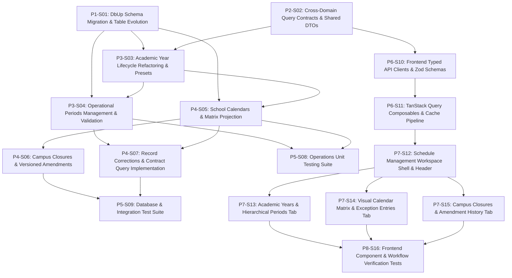

# 1. Objective

Implement the complete Stage 1 "Calendar & Periods — full scope" under the Operations domain for Elsasa SIS V3, transitioning from the initialization proof-of-concept to the authoritative temporal and scheduling foundation. This implementation establishes Academic Year lifecycle state management, hierarchical Operational Periods, exception-based School Calendars with dynamic matrix projection, atomic Campus Closure coordination with versioned calendar amendments, auditable record corrections (`UC-OPS-13`), cross-domain query contracts for Student Admission and Finance Billing (`IOperationsCalendarQueryService`), and the 3-tab Schedule Management Workspace (`SCR-OPS-01`).

Planning Mode: FEATURE-PLANNING

Referenced artifacts:

- FEATURE:
  - `docs/issues/IS001 - OPS-CALENDAR-PERIODS-ISSUE.md` (Intake `CR-OPS-CALENDAR-PERIODS`)
  - `docs/domains/operational-domain.md` (`OPS-WF-01`, `OPS-WF-10`, `OPS-WF-12`)
  - `docs/sub-modul-and-development-phases.md` (Stage 1 Foundation: Calendar & Periods)
  - `docs/use-cases.md` (`UC-OPS-11`, `UC-OPS-12`, `UC-OPS-13`)
  - `docs/screen-inventory.md` (`SCR-OPS-01`)
- ARCHITECTURE:
  - `docs/issues/IS001 - OPS-CALENDAR-PERIODS-ARCHITECTURE.md` (Authoritative target capability architecture)
  - `docs/architecture/backend-architecture.md` (Modular Monolith & Vertical Slice specification)
  - `docs/architecture/frontend-architecture.md` (Modular Vue 3 SPA architecture)
  - `docs/architecture/adr.md` (ADR-001 through ADR-010)
  - `docs/architecture/coding-conventions.md` (C# 12, Dapper raw SQL, and Minimal API conventions)
- FEASIBILITY-ASSESSMENT:
  - `docs/issues/IS001 - OPS-CALENDAR-PERIODS-FEASIBILITY-ASSESSMENT.md` (Status: `READY-FOR-PLANNING`)

Architecture Applicability: ARCHITECTURE-REQUIRED

This feature introduces significant database schema expansion (5 new domain tables and 1 cross-cutting correction table), refactoring of the existing `operations.academic_years` persistence structure from a POC boolean flag to a 5-stage lifecycle state machine, multi-table atomic transactions for campus closures, versioned calendar amendments, and synchronous cross-domain contracts (`IOperationsCalendarQueryService`). Authoritative target architecture `docs/issues/IS001 - OPS-CALENDAR-PERIODS-ARCHITECTURE.md` governs this plan.

---

# 2. Planning Scope

The planning scope encompasses all changes required across the backend, contracts, database, frontend, and test harnesses:

1. **Database Persistence & DbUp Migrations (`Elsasa.Sis.Database`):**
   - Execute idempotent migration `20261102_0101_Operations_CalendarPeriods_Tables.sql`.
   - In-place evolution of `operations.academic_years` to full status lifecycle (`draft`, `approved`, `active`, `completed`, `archived`), backfilling existing data (`is_active = 1` -> `status = 'active'`), and safely removing the deprecated `is_active` column.
   - Creation of 5 new domain tables in `operations`: `operational_periods`, `school_calendars`, `calendar_entries`, `school_closures`, and `calendar_amendments`.
   - Creation of 1 auditable correction table in `operations`: `operations_record_corrections`.
   - Definition of all foreign keys (`ON DELETE NO ACTION`), default constraints, unique indexes, and search indexes.

2. **Cross-Domain Contracts (`Elsasa.Sis.Contracts`):**
   - Declaration of `IOperationsCalendarQueryService` interface with strongly-typed query methods: `GetActiveAcademicYearAsync`, `GetOperationalPeriodByIdAsync`, `GetActiveAdmissionWindowsAsync`, and `IsInstructionalDayAsync`.
   - Shared DTO records: `ActiveAcademicYearDto` and `OperationalPeriodDto`.
   - Backwards-compatibility preservation for `IOperationsModule`.

3. **Backend Vertical Slices (`Elsasa.Sis.Operations`):**
   - **Academic Years:** Refactored `CreateAcademicYear`, `UpdateAcademicYear`, `ApproveAcademicYear`, `ActivateAcademicYear`, `GetAcademicYearsList`, `GetAcademicYearById`, and `ApplyAcademicYearPreset` (Indonesian 2-semester preset generator).
   - **Operational Periods:** `CreateOperationalPeriod` (with strict hierarchical containment validation), `UpdateOperationalPeriod`, `CloseOperationalPeriod`, and `GetOperationalPeriods`.
   - **School Calendars:** `CreateSchoolCalendar`, `PublishSchoolCalendar`, `WithdrawSchoolCalendar`, and `GetActiveSchoolCalendar`.
   - **Calendar Entries & Matrix Projection:** `CreateCalendarEntry`, `DeleteCalendarEntry`, and `GetCalendarMatrixProjection` (dynamic weekday projection overlaid by explicit exceptions).
   - **School Closures:** `DeclareSchoolClosure` (atomic multi-table transaction), `LiftSchoolClosure`, and `GetSchoolClosuresList`.
   - **Amendments & Corrections:** `GetCalendarAmendmentsList`, `CorrectOperationsRecord` (`UC-OPS-13`), and `GetRecordCorrectionsList`.
   - **Cross-Domain Service Implementation:** `OperationsCalendarQueryService` registered in DI.

4. **Automated Testing Suite (`tests/backend`):**
   - Unit tests covering all FluentValidation validators, date containment validation, and calendar matrix projection logic.
   - Real SQL Server 2022 Testcontainers integration tests verifying migration execution, full lifecycle transitions, multi-table closure transactions, version bumping, and contract queries.

5. **Frontend Schedule Management Workspace (`SCR-OPS-01` in `src/frontend`):**
   - Typed Axios API client modules for Academic Years, Operational Periods, School Calendars, Closures, Amendments, and Corrections.
   - VeeValidate + Zod validation schemas for all user inputs.
   - TanStack Query composables with standardized cache keys and automated invalidation triggers.
   - Full 3-tab `CalendarWorkspaceView.vue` workspace:
     - Header bar with Academic Year switcher, status badges (`StatusPill`), and primary action buttons.
     - Tab 1: Visual Calendar Matrix & Entries (`CalendarMatrixTab.vue`) with color-coded day designations and entry authoring modal.
     - Tab 2: Academic Years & Hierarchical Periods (`PeriodsTreeTab.vue`) with period tree/table, preset generator trigger, and period authoring modal.
     - Tab 3: Campus Closures & Amendment History (`ClosuresAmendmentsTab.vue`) with declared closures table, closure modal, and versioned amendment audit timeline.
   - Frontend Vitest unit and component tests verifying schemas, API clients, composables, and tab views.

---

# 3. Dependencies

### External System & Tooling Dependencies

- .NET 8 SDK (8.0.x)
- Docker / Docker Desktop / Podman (required for Testcontainers SQL Server 2022 integration tests)
- Microsoft SQL Server 2022 instance (for local Web API development)
- Node.js runtime (v22.x or LTS) and pnpm package manager (v9.x or v11.x)

### Internal Slice Dependencies

- `Depends On` declares implementation prerequisites between slices.
- Dependencies reference Slice IDs only.
- Dependency satisfaction requires the referenced slice to have implementation status `IMPLEMENTED`.
- Dependency satisfaction does not require review status `GO`.
- Slices with `Depends On: None` or whose dependencies are satisfied may be executed in parallel.

### Dependency Graph

---

# 4. Progress Summary

| Phase | Implementation Status | Review Status | Progress |
|---|---|---|---|
| P1 - Database Migration & Persistence Foundation | NOT-STARTED | NOT-REVIEWED | 0/1 |
| P2 - Cross-Domain Contracts & Shared Models | NOT-STARTED | NOT-REVIEWED | 0/1 |
| P3 - Backend Domain Slices: Academic Years & Periods | NOT-STARTED | NOT-REVIEWED | 0/2 |
| P4 - Backend Domain Slices: Calendars, Closures & Queries | NOT-STARTED | NOT-REVIEWED | 0/3 |
| P5 - Backend Automated Testing & Integration Verification | NOT-STARTED | NOT-REVIEWED | 0/2 |
| P6 - Frontend API Clients, Schemas & Composables | NOT-STARTED | NOT-REVIEWED | 0/2 |
| P7 - Frontend Schedule Management Workspace (SCR-OPS-01) | NOT-STARTED | NOT-REVIEWED | 0/4 |
| P8 - Frontend Verification & Component Testing | NOT-STARTED | NOT-REVIEWED | 0/1 |

---

# 5. Phases

## P1 - Database Migration & Persistence Foundation

Implementation Status: NOT-STARTED
Review Status: NOT-REVIEWED

### P1-S01

Title: DbUp Schema Migration & Table Evolution

Implementation Status: IMPLEMENTED
Review Status: GO

Objective:
Create and register the idempotent DbUp migration script `20261102_0101_Operations_CalendarPeriods_Tables.sql` in `src/backend/Elsasa.Sis.Database/Scripts/`. The script non-destructively alters `operations.academic_years` to migrate from `is_active` to the 5-status lifecycle (`draft`, `approved`, `active`, `completed`, `archived`) with audit columns, and creates the remaining 5 domain tables (`operational_periods`, `school_calendars`, `calendar_entries`, `school_closures`, `calendar_amendments`) and the auditable correction table (`operations_record_corrections`) with complete indexes and foreign key constraints.

Depends On: None

Repository: elsasa-sis-v3 (backend)

Completion Criteria:
1. File `src/backend/Elsasa.Sis.Database/Scripts/20261102_0101_Operations_CalendarPeriods_Tables.sql` exists and is embedded in `Elsasa.Sis.Database.csproj`.
2. Script alters `operations.academic_years`: adds `status NVARCHAR(32) NOT NULL DEFAULT 'draft'`, `approved_by NVARCHAR(100) NULL`, `approved_date DATE NULL`, `notes NVARCHAR(MAX) NULL`; updates rows with `is_active = 1` to `status = 'active'`; drops default constraint on `is_active` and drops column `is_active`.
3. Script creates tables: `operations.operational_periods`, `operations.school_calendars`, `operations.calendar_entries`, `operations.school_closures`, `operations.calendar_amendments`, and `operations.operations_record_corrections` matching section 8 of `IS001 - OPS-CALENDAR-PERIODS-ARCHITECTURE.md`.
4. All foreign key constraints use `ON DELETE NO ACTION`.
5. Unique indexes `ux_operations_operational_periods_code`, `ux_school_closures_number`, and `ux_calendar_amendments_number` are created.
6. `dotnet build src/backend/Elsasa.Sis.Database/` succeeds.

Implementation Notes:
- Created idempotent migration script `src/backend/Elsasa.Sis.Database/Scripts/20261102_0101_Operations_CalendarPeriods_Tables.sql`.
- Added columns `status`, `approved_by`, `approved_date`, `notes`, `updated_at`, and `updated_by` to `operations.academic_years`.
- Migrated legacy `is_active = 1` records to `status = 'active'`, dynamically located and dropped default constraint on `is_active`, and dropped column `is_active`.
- Created all 5 domain tables (`operational_periods`, `school_calendars`, `school_closures`, `calendar_entries`, `calendar_amendments`) and 1 auditable correction table (`operations_record_corrections`) with `ON DELETE NO ACTION` foreign keys and required unique/search indexes.
- Verified embedding in `Elsasa.Sis.Database.dll` and successful build of `src/backend/Elsasa.Sis.Database/`.

Changed Files:
- `src/backend/Elsasa.Sis.Database/Scripts/20261102_0101_Operations_CalendarPeriods_Tables.sql`
- `docs/issues/IS001 - OPS-CALENDAR-PERIODS-IMPLEMENTATION-PLAN.md`

---

## P2 - Cross-Domain Contracts & Shared Models

Implementation Status: NOT-STARTED
Review Status: NOT-REVIEWED

### P2-S02

Title: Cross-Domain Query Contracts & Shared DTOs

Implementation Status: IMPLEMENTED
Review Status: GO

Objective:
Declare the strongly-typed public contract interface `IOperationsCalendarQueryService` and public query DTOs in `Elsasa.Sis.Contracts/Operations/` to allow compile-time isolated synchronous inquiries from `Students` and `Finance` modules in accordance with ADR-001, ADR-003, and TD-03.

Depends On: None

Repository: elsasa-sis-v3 (backend)

Completion Criteria:
1. File `src/backend/Elsasa.Sis.Contracts/Operations/IOperationsCalendarQueryService.cs` exists in namespace `Elsasa.Sis.Contracts.Operations`.
2. Interface declares methods:
   - `Task<Result<ActiveAcademicYearDto?>> GetActiveAcademicYearAsync(CancellationToken ct = default);`
   - `Task<Result<OperationalPeriodDto?>> GetOperationalPeriodByIdAsync(Guid periodId, CancellationToken ct = default);`
   - `Task<Result<IReadOnlyList<OperationalPeriodDto>>> GetActiveAdmissionWindowsAsync(DateOnly date, CancellationToken ct = default);`
   - `Task<Result<bool>> IsInstructionalDayAsync(DateOnly date, string campus = "All", CancellationToken ct = default);`
3. Strongly-typed DTO records `ActiveAcademicYearDto` and `OperationalPeriodDto` are declared with exact property specifications from TD-03.
4. Existing `IOperationsModule.cs` is retained or updated to maintain backward compatibility without breaking existing references.
5. `dotnet build src/backend/Elsasa.Sis.Contracts/` succeeds.

Notes:
- Use file-scoped namespaces, C# 12 `public sealed record`, and `Elsasa.Sis.Shared.Common.Result<T>`.

Implementation Notes:
- Created `src/backend/Elsasa.Sis.Contracts/Operations/IOperationsCalendarQueryService.cs` declaring `IOperationsCalendarQueryService` with 4 query methods using `Elsasa.Sis.Shared.Common.Result<T>`.
- Declared `ActiveAcademicYearDto` and `OperationalPeriodDto` sealed records with exact properties matching TD-03.
- Suppressed CA1716 on interface members with parameter `date` using targeted `[SuppressMessage]` to comply with strict zero-warning analyzer rules.
- Retained existing `IOperationsModule.cs` intact for backwards compatibility.
- Verified `dotnet build src/backend/Elsasa.Sis.Contracts/` succeeds with 0 warnings and 0 errors, and all 26 architecture tests pass.

---

## P3 - Backend Domain Slices: Academic Years & Periods

Implementation Status: NOT-STARTED
Review Status: NOT-REVIEWED

### P3-S03

Title: Academic Year Lifecycle Refactoring & Presets

Implementation Status: IMPLEMENTED
Review Status: GO

Objective:
Refactor the existing `CreateAcademicYear` vertical slice in `Elsasa.Sis.Operations` and implement the remaining Academic Year lifecycle slices: `UpdateAcademicYear`, `ApproveAcademicYear` (`draft` -> `approved`), `ActivateAcademicYear` (`approved` -> `active`, atomically archiving previous active year), `GetAcademicYearsList`, `GetAcademicYearById`, and `ApplyAcademicYearPreset` (Indonesian 2-semester preset generator).

Depends On: P1-S01, P2-S02

Repository: elsasa-sis-v3 (backend)

Completion Criteria:
1. Refactored `CreateAcademicYear`:
   - `CreateAcademicYearRequest` includes `string Code`, `string Name`, `DateOnly StartDate`, `DateOnly EndDate`, `string? Notes`.
   - Handler inserts record with `status = 'draft'`, `notes = @Notes`, `created_at`, `created_by`.
   - `CreateAcademicYearResponse` returns `Guid Id`, `string Code`, `string Name`, `DateOnly StartDate`, `DateOnly EndDate`, `string Status`, `string? Notes`.
2. New vertical slices implemented under `src/backend/Elsasa.Sis.Operations/Features/CalendarPeriods/AcademicYears/`:
   - `UpdateAcademicYear`: PUT `/api/operations/academic-years/{id}` (modifies code, name, dates, notes on draft records).
   - `ApproveAcademicYear`: POST `/api/operations/academic-years/{id}/approve` (transitions `draft` -> `approved`, captures `approved_by` and `approved_date`).
   - `ActivateAcademicYear`: POST `/api/operations/academic-years/{id}/activate` (transitions `approved` -> `active` inside a Dapper transaction, demoting any existing active year to `completed`).
   - `GetAcademicYearsList`: GET `/api/operations/academic-years` (supports filtering by `status`).
   - `GetAcademicYearById`: GET `/api/operations/academic-years/{id}`.
   - `ApplyAcademicYearPreset`: POST `/api/operations/academic-years/{id}/apply-preset` (generates standard Semester 1 and Semester 2 records).
3. All endpoints enforce policy `Permissions.Operations.Calendar.*` and implement `IEndpoint`.
4. `dotnet build src/backend/Elsasa.Sis.Operations/` succeeds.

Notes:
- Adhere to ADR-004 (explicit Dapper SQL, raw string literals, explicit columns) and ADR-005 (native Minimal APIs with typed results).

Implementation Notes:
- Refactored `CreateAcademicYear` to persist `status = 'draft'`, `notes`, and audit columns, returning full lifecycle response payload with backwards-compatible `IsActive` accessor.
- Implemented `Permissions` constants in `Elsasa.Sis.Operations` and configured policy authorization in `DependencyInjection.AddOperationsDomain`.
- Implemented `UpdateAcademicYear` (`PUT /api/operations/academic-years/{id}`) verifying draft state and unique code before updating.
- Implemented `ApproveAcademicYear` (`POST /api/operations/academic-years/{id}/approve`) transitioning draft records to approved with formal approver audit trail.
- Implemented `ActivateAcademicYear` (`POST /api/operations/academic-years/{id}/activate`) atomically demoting currently active year to completed and activating target year within a Dapper transaction.
- Implemented `GetAcademicYearsList` (`GET /api/operations/academic-years`) supporting status filtering.
- Implemented `GetAcademicYearById` (`GET /api/operations/academic-years/{id}`).
- Implemented `ApplyAcademicYearPreset` (`POST /api/operations/academic-years/{id}/apply-preset`) generating standard Semester 1 and Semester 2 records in `operations.operational_periods` within a transaction.
- Enforced `Permissions.Operations.Calendar.*` policies and implemented `IEndpoint` across all endpoints.
- Verified `dotnet build src/backend/Elsasa.Sis.sln`, `dotnet test tests/backend/Elsasa.Sis.ArchitectureTests/` (26/26 passed), and all unit tests (151/151 passed).

Changed Files:
- `src/backend/Elsasa.Sis.Operations/Permissions.cs`
- `src/backend/Elsasa.Sis.Operations/DependencyInjection.cs`
- `src/backend/Elsasa.Sis.Operations/Features/CalendarPeriods/CreateAcademicYear/CreateAcademicYearRequest.cs`
- `src/backend/Elsasa.Sis.Operations/Features/CalendarPeriods/CreateAcademicYear/CreateAcademicYearResponse.cs`
- `src/backend/Elsasa.Sis.Operations/Features/CalendarPeriods/CreateAcademicYear/CreateAcademicYearValidator.cs`
- `src/backend/Elsasa.Sis.Operations/Features/CalendarPeriods/CreateAcademicYear/CreateAcademicYearHandler.cs`
- `src/backend/Elsasa.Sis.Operations/Features/CalendarPeriods/CreateAcademicYear/CreateAcademicYearEndpoint.cs`
- `src/backend/Elsasa.Sis.Operations/Features/CalendarPeriods/AcademicYears/UpdateAcademicYear/UpdateAcademicYearRequest.cs`
- `src/backend/Elsasa.Sis.Operations/Features/CalendarPeriods/AcademicYears/UpdateAcademicYear/UpdateAcademicYearResponse.cs`
- `src/backend/Elsasa.Sis.Operations/Features/CalendarPeriods/AcademicYears/UpdateAcademicYear/UpdateAcademicYearValidator.cs`
- `src/backend/Elsasa.Sis.Operations/Features/CalendarPeriods/AcademicYears/UpdateAcademicYear/UpdateAcademicYearHandler.cs`
- `src/backend/Elsasa.Sis.Operations/Features/CalendarPeriods/AcademicYears/UpdateAcademicYear/UpdateAcademicYearEndpoint.cs`
- `src/backend/Elsasa.Sis.Operations/Features/CalendarPeriods/AcademicYears/ApproveAcademicYear/ApproveAcademicYearResponse.cs`
- `src/backend/Elsasa.Sis.Operations/Features/CalendarPeriods/AcademicYears/ApproveAcademicYear/ApproveAcademicYearHandler.cs`
- `src/backend/Elsasa.Sis.Operations/Features/CalendarPeriods/AcademicYears/ApproveAcademicYear/ApproveAcademicYearEndpoint.cs`
- `src/backend/Elsasa.Sis.Operations/Features/CalendarPeriods/AcademicYears/ActivateAcademicYear/ActivateAcademicYearResponse.cs`
- `src/backend/Elsasa.Sis.Operations/Features/CalendarPeriods/AcademicYears/ActivateAcademicYear/ActivateAcademicYearHandler.cs`
- `src/backend/Elsasa.Sis.Operations/Features/CalendarPeriods/AcademicYears/ActivateAcademicYear/ActivateAcademicYearEndpoint.cs`
- `src/backend/Elsasa.Sis.Operations/Features/CalendarPeriods/AcademicYears/GetAcademicYearsList/AcademicYearListItemResponse.cs`
- `src/backend/Elsasa.Sis.Operations/Features/CalendarPeriods/AcademicYears/GetAcademicYearsList/GetAcademicYearsListHandler.cs`
- `src/backend/Elsasa.Sis.Operations/Features/CalendarPeriods/AcademicYears/GetAcademicYearsList/GetAcademicYearsListEndpoint.cs`
- `src/backend/Elsasa.Sis.Operations/Features/CalendarPeriods/AcademicYears/GetAcademicYearById/GetAcademicYearByIdResponse.cs`
- `src/backend/Elsasa.Sis.Operations/Features/CalendarPeriods/AcademicYears/GetAcademicYearById/GetAcademicYearByIdHandler.cs`
- `src/backend/Elsasa.Sis.Operations/Features/CalendarPeriods/AcademicYears/GetAcademicYearById/GetAcademicYearByIdEndpoint.cs`
- `src/backend/Elsasa.Sis.Operations/Features/CalendarPeriods/AcademicYears/ApplyAcademicYearPreset/ApplyAcademicYearPresetRequest.cs`
- `src/backend/Elsasa.Sis.Operations/Features/CalendarPeriods/AcademicYears/ApplyAcademicYearPreset/ApplyAcademicYearPresetResponse.cs`
- `src/backend/Elsasa.Sis.Operations/Features/CalendarPeriods/AcademicYears/ApplyAcademicYearPreset/ApplyAcademicYearPresetHandler.cs`
- `src/backend/Elsasa.Sis.Operations/Features/CalendarPeriods/AcademicYears/ApplyAcademicYearPreset/ApplyAcademicYearPresetEndpoint.cs`
- `docs/issues/IS001 - OPS-CALENDAR-PERIODS-IMPLEMENTATION-PLAN.md`

---

### P3-S04

Title: Operational Periods Management & Validation

Implementation Status: IMPLEMENTED
Review Status: GO

Objective:
Implement vertical slices for managing hierarchical operational periods (`operations.operational_periods`) in `Elsasa.Sis.Operations/Features/CalendarPeriods/OperationalPeriods/`: `CreateOperationalPeriod`, `UpdateOperationalPeriod`, `CloseOperationalPeriod`, and `GetOperationalPeriodsByAcademicYear`, with strict date containment validation.

Depends On: P1-S01, P3-S03

Repository: elsasa-sis-v3 (backend)

Completion Criteria:
1. Files implemented in `src/backend/Elsasa.Sis.Operations/Features/CalendarPeriods/OperationalPeriods/`:
   - `CreateOperationalPeriod`: POST `/api/operations/academic-years/{academicYearId}/periods`.
     - Validates period code uniqueness per academic year.
     - Validates `start_date <= end_date`.
     - Validates date range falls strictly within parent academic year date range.
     - If `parent_period_id` is supplied, validates parent period exists and dates fall strictly within parent period.
   - `UpdateOperationalPeriod`: PUT `/api/operations/periods/{id}`.
   - `CloseOperationalPeriod`: POST `/api/operations/periods/{id}/close` (sets `status = 'closed'`).
   - `GetOperationalPeriodsByAcademicYear`: GET `/api/operations/academic-years/{academicYearId}/periods` (returns flat list and nested parent/child relationships).
2. Endpoints return `IResult` using `Results.Ok`, `Results.Created`, or RFC 7807 problem details.
3. `dotnet build src/backend/Elsasa.Sis.Operations/` succeeds.

Notes:
- Use Dapper SQL querying `operations.academic_years` to verify date boundaries.
- Return `DomainError.Validation` or `DomainError.Conflict` on business rule violations.

Implementation Notes:
- Implemented `CreateOperationalPeriod` (`POST /api/operations/academic-years/{academicYearId}/periods`) validating academic year existence, date range containment within parent academic year, unique period code per academic year, and parent period containment if nested.
- Implemented `UpdateOperationalPeriod` (`PUT /api/operations/periods/{id}`) validating status, unique period code, parent academic year boundary containment, self-referencing cycle prevention, parent period date range containment, and verifying that updated boundaries do not invalidate existing child periods.
- Implemented `CloseOperationalPeriod` (`POST /api/operations/periods/{id}/close`) transitioning period status to 'closed'.
- Implemented `GetOperationalPeriodsByAcademicYear` (`GET /api/operations/academic-years/{academicYearId}/periods`) returning both a flat list of operational periods and an assembled hierarchical tree node structure with nested children.
- Registered all four operational period handlers in `Elsasa.Sis.Operations/DependencyInjection.cs`.
- Verified `dotnet build src/backend/Elsasa.Sis.Operations/` and solution build succeed with 0 warnings and 0 errors, and all 26 architecture tests pass.

Changed Files:
- `src/backend/Elsasa.Sis.Operations/DependencyInjection.cs`
- `src/backend/Elsasa.Sis.Operations/Features/CalendarPeriods/OperationalPeriods/CreateOperationalPeriod/CreateOperationalPeriodRequest.cs`
- `src/backend/Elsasa.Sis.Operations/Features/CalendarPeriods/OperationalPeriods/CreateOperationalPeriod/CreateOperationalPeriodResponse.cs`
- `src/backend/Elsasa.Sis.Operations/Features/CalendarPeriods/OperationalPeriods/CreateOperationalPeriod/CreateOperationalPeriodValidator.cs`
- `src/backend/Elsasa.Sis.Operations/Features/CalendarPeriods/OperationalPeriods/CreateOperationalPeriod/CreateOperationalPeriodHandler.cs`
- `src/backend/Elsasa.Sis.Operations/Features/CalendarPeriods/OperationalPeriods/CreateOperationalPeriod/CreateOperationalPeriodEndpoint.cs`
- `src/backend/Elsasa.Sis.Operations/Features/CalendarPeriods/OperationalPeriods/UpdateOperationalPeriod/UpdateOperationalPeriodRequest.cs`
- `src/backend/Elsasa.Sis.Operations/Features/CalendarPeriods/OperationalPeriods/UpdateOperationalPeriod/UpdateOperationalPeriodResponse.cs`
- `src/backend/Elsasa.Sis.Operations/Features/CalendarPeriods/OperationalPeriods/UpdateOperationalPeriod/UpdateOperationalPeriodValidator.cs`
- `src/backend/Elsasa.Sis.Operations/Features/CalendarPeriods/OperationalPeriods/UpdateOperationalPeriod/UpdateOperationalPeriodHandler.cs`
- `src/backend/Elsasa.Sis.Operations/Features/CalendarPeriods/OperationalPeriods/UpdateOperationalPeriod/UpdateOperationalPeriodEndpoint.cs`
- `src/backend/Elsasa.Sis.Operations/Features/CalendarPeriods/OperationalPeriods/CloseOperationalPeriod/CloseOperationalPeriodResponse.cs`
- `src/backend/Elsasa.Sis.Operations/Features/CalendarPeriods/OperationalPeriods/CloseOperationalPeriod/CloseOperationalPeriodHandler.cs`
- `src/backend/Elsasa.Sis.Operations/Features/CalendarPeriods/OperationalPeriods/CloseOperationalPeriod/CloseOperationalPeriodEndpoint.cs`
- `src/backend/Elsasa.Sis.Operations/Features/CalendarPeriods/OperationalPeriods/GetOperationalPeriodsByAcademicYear/OperationalPeriodItemResponse.cs`
- `src/backend/Elsasa.Sis.Operations/Features/CalendarPeriods/OperationalPeriods/GetOperationalPeriodsByAcademicYear/OperationalPeriodNodeResponse.cs`
- `src/backend/Elsasa.Sis.Operations/Features/CalendarPeriods/OperationalPeriods/GetOperationalPeriodsByAcademicYear/GetOperationalPeriodsByAcademicYearResponse.cs`
- `src/backend/Elsasa.Sis.Operations/Features/CalendarPeriods/OperationalPeriods/GetOperationalPeriodsByAcademicYear/GetOperationalPeriodsByAcademicYearHandler.cs`
- `src/backend/Elsasa.Sis.Operations/Features/CalendarPeriods/OperationalPeriods/GetOperationalPeriodsByAcademicYear/GetOperationalPeriodsByAcademicYearEndpoint.cs`
- `docs/issues/IS001 - OPS-CALENDAR-PERIODS-IMPLEMENTATION-PLAN.md`

---

## P4 - Backend Domain Slices: Calendars, Closures & Queries

Implementation Status: NOT-STARTED
Review Status: NOT-REVIEWED

### P4-S05

Title: School Calendars & Matrix Projection

Implementation Status: IMPLEMENTED
Review Status: GO

Objective:
Implement vertical slices for School Calendar container management (`school_calendars`) and granular Calendar Entries (`calendar_entries`), including the dynamic calendar matrix projection algorithm in `Elsasa.Sis.Operations/Features/CalendarPeriods/`: `CreateSchoolCalendar`, `PublishSchoolCalendar`, `WithdrawSchoolCalendar`, `GetActiveSchoolCalendar`, `CreateCalendarEntry`, `DeleteCalendarEntry`, and `GetCalendarMatrixProjection`.

Depends On: P1-S01, P3-S03

Repository: elsasa-sis-v3 (backend)

Completion Criteria:
1. Files created in `src/backend/Elsasa.Sis.Operations/Features/CalendarPeriods/SchoolCalendars/`:
   - `CreateSchoolCalendar`: POST `/api/operations/academic-years/{academicYearId}/calendars` (creates calendar in `draft`, default `version = '1.0'`).
   - `PublishSchoolCalendar`: POST `/api/operations/calendars/{id}/publish` (sets `publication_status = 'published'`, `published_at`, `published_by`).
   - `WithdrawSchoolCalendar`: POST `/api/operations/calendars/{id}/withdraw` (sets `publication_status = 'withdrawn'`).
   - `GetActiveSchoolCalendar`: GET `/api/operations/academic-years/{academicYearId}/calendars/active`.
2. Files created in `src/backend/Elsasa.Sis.Operations/Features/CalendarPeriods/CalendarEntries/`:
   - `CreateCalendarEntry`: POST `/api/operations/calendars/{calendarId}/entries`.
     - Validates date falls within academic year.
     - If calendar is published, automatically records an audit entry in `operations.calendar_amendments` and increments minor version (`1.0` -> `1.1`).
   - `DeleteCalendarEntry`: DELETE `/api/operations/calendars/{calendarId}/entries/{entryId}`.
   - `GetCalendarMatrixProjection`: GET `/api/operations/calendars/{calendarId}/matrix?startDate=...&endDate=...`.
     - Synthesizes dynamic weekday grid (Mon–Fri instructional, Sat–Sun non-instructional), overlaid by explicit exceptions from `operations.calendar_entries` (holidays, staff days, exam days, closures).
3. `dotnet build src/backend/Elsasa.Sis.Operations/` succeeds.

Notes:
- Matrix projection must return a continuous list of dates with `date`, `dayOfWeek`, `isInstructional`, `designation`, `entryName`, and `entryDescription`.

Implementation Notes:
- Implemented `CreateSchoolCalendar` (`POST /api/operations/academic-years/{academicYearId}/calendars`) creating school calendars in `draft` with initial version `1.0`.
- Implemented `PublishSchoolCalendar` (`POST /api/operations/calendars/{id}/publish`) transitioning calendar publication status to `published` and recording publication/approval audit metadata.
- Implemented `WithdrawSchoolCalendar` (`POST /api/operations/calendars/{id}/withdraw`) transitioning published calendar to `withdrawn`.
- Implemented `GetActiveSchoolCalendar` (`GET /api/operations/academic-years/{academicYearId}/calendars/active`) retrieving the active published calendar for an academic year.
- Implemented `CalendarAmendmentHelper` for atomic `AMD-CAL-YYYY-NNN` sequence numbering and semantic minor version bumping (`1.0` -> `1.1`).
- Implemented `CreateCalendarEntry` (`POST /api/operations/calendars/{calendarId}/entries`) with academic year boundary containment validation, automated minor version incrementation, and atomic `calendar_amendments` audit logging when the parent calendar is published.
- Implemented `DeleteCalendarEntry` (`DELETE /api/operations/calendars/{calendarId}/entries/{entryId}`) ensuring FK preservation in amendment histories and automated version bumping if published.
- Implemented `GetCalendarMatrixProjection` (`GET /api/operations/calendars/{calendarId}/matrix`) synthesizing continuous calendar day sequences (Mon–Fri instructional baseline, Sat–Sun non-instructional), overlaid by explicit calendar exceptions (holidays, staff days, closures) returning `date`, `dayOfWeek`, `isInstructional`, `designation`, `entryName`, `entryDescription`, and summary counts.
- Enforced `Permissions.Operations.Calendar.*` authorization policies and implemented `IEndpoint` across all slices.
- Registered all handlers in `DependencyInjection.AddOperationsDomain`.
- Verified `dotnet build src/backend/Elsasa.Sis.Operations/` and solution build succeed with 0 warnings and 0 errors, and all 180 backend tests pass (26 architecture tests, 154 unit tests).

Changed Files:
- `src/backend/Elsasa.Sis.Operations/DependencyInjection.cs`
- `src/backend/Elsasa.Sis.Operations/Features/CalendarPeriods/Common/CalendarAmendmentHelper.cs`
- `src/backend/Elsasa.Sis.Operations/Features/CalendarPeriods/SchoolCalendars/CreateSchoolCalendar/CreateSchoolCalendarRequest.cs`
- `src/backend/Elsasa.Sis.Operations/Features/CalendarPeriods/SchoolCalendars/CreateSchoolCalendar/CreateSchoolCalendarResponse.cs`
- `src/backend/Elsasa.Sis.Operations/Features/CalendarPeriods/SchoolCalendars/CreateSchoolCalendar/CreateSchoolCalendarValidator.cs`
- `src/backend/Elsasa.Sis.Operations/Features/CalendarPeriods/SchoolCalendars/CreateSchoolCalendar/CreateSchoolCalendarHandler.cs`
- `src/backend/Elsasa.Sis.Operations/Features/CalendarPeriods/SchoolCalendars/CreateSchoolCalendar/CreateSchoolCalendarEndpoint.cs`
- `src/backend/Elsasa.Sis.Operations/Features/CalendarPeriods/SchoolCalendars/PublishSchoolCalendar/PublishSchoolCalendarResponse.cs`
- `src/backend/Elsasa.Sis.Operations/Features/CalendarPeriods/SchoolCalendars/PublishSchoolCalendar/PublishSchoolCalendarHandler.cs`
- `src/backend/Elsasa.Sis.Operations/Features/CalendarPeriods/SchoolCalendars/PublishSchoolCalendar/PublishSchoolCalendarEndpoint.cs`
- `src/backend/Elsasa.Sis.Operations/Features/CalendarPeriods/SchoolCalendars/WithdrawSchoolCalendar/WithdrawSchoolCalendarResponse.cs`
- `src/backend/Elsasa.Sis.Operations/Features/CalendarPeriods/SchoolCalendars/WithdrawSchoolCalendar/WithdrawSchoolCalendarHandler.cs`
- `src/backend/Elsasa.Sis.Operations/Features/CalendarPeriods/SchoolCalendars/WithdrawSchoolCalendar/WithdrawSchoolCalendarEndpoint.cs`
- `src/backend/Elsasa.Sis.Operations/Features/CalendarPeriods/SchoolCalendars/GetActiveSchoolCalendar/ActiveSchoolCalendarResponse.cs`
- `src/backend/Elsasa.Sis.Operations/Features/CalendarPeriods/SchoolCalendars/GetActiveSchoolCalendar/GetActiveSchoolCalendarHandler.cs`
- `src/backend/Elsasa.Sis.Operations/Features/CalendarPeriods/SchoolCalendars/GetActiveSchoolCalendar/GetActiveSchoolCalendarEndpoint.cs`
- `src/backend/Elsasa.Sis.Operations/Features/CalendarPeriods/CalendarEntries/CreateCalendarEntry/CreateCalendarEntryRequest.cs`
- `src/backend/Elsasa.Sis.Operations/Features/CalendarPeriods/CalendarEntries/CreateCalendarEntry/CreateCalendarEntryResponse.cs`
- `src/backend/Elsasa.Sis.Operations/Features/CalendarPeriods/CalendarEntries/CreateCalendarEntry/CreateCalendarEntryValidator.cs`
- `src/backend/Elsasa.Sis.Operations/Features/CalendarPeriods/CalendarEntries/CreateCalendarEntry/CreateCalendarEntryHandler.cs`
- `src/backend/Elsasa.Sis.Operations/Features/CalendarPeriods/CalendarEntries/CreateCalendarEntry/CreateCalendarEntryEndpoint.cs`
- `src/backend/Elsasa.Sis.Operations/Features/CalendarPeriods/CalendarEntries/DeleteCalendarEntry/DeleteCalendarEntryHandler.cs`
- `src/backend/Elsasa.Sis.Operations/Features/CalendarPeriods/CalendarEntries/DeleteCalendarEntry/DeleteCalendarEntryEndpoint.cs`
- `src/backend/Elsasa.Sis.Operations/Features/CalendarPeriods/CalendarEntries/GetCalendarMatrixProjection/CalendarMatrixDayProjection.cs`
- `src/backend/Elsasa.Sis.Operations/Features/CalendarPeriods/CalendarEntries/GetCalendarMatrixProjection/CalendarMatrixProjectionResponse.cs`
- `src/backend/Elsasa.Sis.Operations/Features/CalendarPeriods/CalendarEntries/GetCalendarMatrixProjection/GetCalendarMatrixProjectionHandler.cs`
- `src/backend/Elsasa.Sis.Operations/Features/CalendarPeriods/CalendarEntries/GetCalendarMatrixProjection/GetCalendarMatrixProjectionEndpoint.cs`
- `docs/issues/IS001 - OPS-CALENDAR-PERIODS-IMPLEMENTATION-PLAN.md`

---

### P4-S06

Title: Campus Closures & Versioned Amendments

Implementation Status: IMPLEMENTED
Review Status: GO

Objective:
Implement vertical slices for campus closure coordination (`UC-OPS-12`) and calendar amendments in `Elsasa.Sis.Operations/Features/CalendarPeriods/SchoolClosures/` and `CalendarAmendments/`: `DeclareSchoolClosure`, `LiftSchoolClosure`, `GetSchoolClosuresList`, and `GetCalendarAmendmentsList`, executing multi-table transactions atomically.

Depends On: P4-S05

Repository: elsasa-sis-v3 (backend)

Completion Criteria:
1. Files created in `src/backend/Elsasa.Sis.Operations/Features/CalendarPeriods/SchoolClosures/`:
   - `DeclareSchoolClosure`: POST `/api/operations/closures` (`UC-OPS-12`).
     - Begins Dapper transaction.
     - Generates unique tracking code `closure_number` (`CLS-YYYY-NNN`).
     - Inserts record into `operations.school_closures`.
     - Inserts corresponding non-instructional entry into `operations.calendar_entries` (`designation = 'school_closure'`, `is_instructional = 0`, `closure_id = @ClosureId`).
     - If parent calendar is published: logs amendment record in `operations.calendar_amendments` (`amendment_type = 'closure_addition'`) and increments `school_calendars.version` (`1.0` -> `1.1`).
     - Commits transaction atomically.
   - `LiftSchoolClosure`: POST `/api/operations/closures/{id}/lift` (updates status to `lifted`, updates calendar entries).
   - `GetSchoolClosuresList`: GET `/api/operations/academic-years/{academicYearId}/closures`.
2. Files created in `src/backend/Elsasa.Sis.Operations/Features/CalendarPeriods/CalendarAmendments/`:
   - `GetCalendarAmendmentsList`: GET `/api/operations/calendars/{calendarId}/amendments`.
3. `dotnet build src/backend/Elsasa.Sis.Operations/` succeeds.

Notes:
- Transaction management must adhere to TD-05: `await using var transaction = await connection.BeginTransactionAsync(ct);`.

Implementation Notes:
- Implemented `SchoolClosureHelper` in `Elsasa.Sis.Operations.Features.CalendarPeriods.Common` for atomic sequential `CLS-YYYY-NNN` tracking code generation within active transactions.
- Implemented `DeclareSchoolClosure` (`POST /api/operations/closures`, `UC-OPS-12`) executing atomic multi-table transaction writing to `operations.school_closures` and `operations.calendar_entries` (`designation = 'school_closure'`, `is_instructional = 0`), and automatically logging audit amendments in `operations.calendar_amendments` (`amendment_type = 'closure_addition'`) with semantic minor version bumping (`1.0` -> `1.1`) when the parent calendar is published.
- Implemented `LiftSchoolClosure` (`POST /api/operations/closures/{id}/lift`) transitioning closure status to `lifted` and atomically updating linked calendar entries.
- Implemented `GetSchoolClosuresList` (`GET /api/operations/academic-years/{academicYearId}/closures`) retrieving all closures under an academic year.
- Implemented `GetCalendarAmendmentsList` (`GET /api/operations/calendars/{calendarId}/amendments`) retrieving the audit history timeline of calendar amendments.
- Registered all four slice handlers in `Elsasa.Sis.Operations/DependencyInjection.cs`.
- Enforced `Permissions.Operations.Closure.Declare` and `Permissions.Operations.Calendar.View` authorization policies with `IEndpoint` mappings.
- Verified `dotnet build src/backend/Elsasa.Sis.Operations/` and solution build succeed with 0 warnings and 0 errors, and all 26 architecture tests and 154 unit tests pass.

Changed Files:
- `src/backend/Elsasa.Sis.Operations/Features/CalendarPeriods/Common/SchoolClosureHelper.cs`
- `src/backend/Elsasa.Sis.Operations/Features/CalendarPeriods/SchoolClosures/SchoolClosureResponse.cs`
- `src/backend/Elsasa.Sis.Operations/Features/CalendarPeriods/SchoolClosures/DeclareSchoolClosure/DeclareSchoolClosureRequest.cs`
- `src/backend/Elsasa.Sis.Operations/Features/CalendarPeriods/SchoolClosures/DeclareSchoolClosure/DeclareSchoolClosureValidator.cs`
- `src/backend/Elsasa.Sis.Operations/Features/CalendarPeriods/SchoolClosures/DeclareSchoolClosure/DeclareSchoolClosureHandler.cs`
- `src/backend/Elsasa.Sis.Operations/Features/CalendarPeriods/SchoolClosures/DeclareSchoolClosure/DeclareSchoolClosureEndpoint.cs`
- `src/backend/Elsasa.Sis.Operations/Features/CalendarPeriods/SchoolClosures/LiftSchoolClosure/LiftSchoolClosureHandler.cs`
- `src/backend/Elsasa.Sis.Operations/Features/CalendarPeriods/SchoolClosures/LiftSchoolClosure/LiftSchoolClosureEndpoint.cs`
- `src/backend/Elsasa.Sis.Operations/Features/CalendarPeriods/SchoolClosures/GetSchoolClosuresList/GetSchoolClosuresListHandler.cs`
- `src/backend/Elsasa.Sis.Operations/Features/CalendarPeriods/SchoolClosures/GetSchoolClosuresList/GetSchoolClosuresListEndpoint.cs`
- `src/backend/Elsasa.Sis.Operations/Features/CalendarPeriods/CalendarAmendments/GetCalendarAmendmentsList/CalendarAmendmentResponse.cs`
- `src/backend/Elsasa.Sis.Operations/Features/CalendarPeriods/CalendarAmendments/GetCalendarAmendmentsList/GetCalendarAmendmentsListHandler.cs`
- `src/backend/Elsasa.Sis.Operations/Features/CalendarPeriods/CalendarAmendments/GetCalendarAmendmentsList/GetCalendarAmendmentsListEndpoint.cs`
- `src/backend/Elsasa.Sis.Operations/DependencyInjection.cs`
- `docs/issues/IS001 - OPS-CALENDAR-PERIODS-IMPLEMENTATION-PLAN.md`

---

### P4-S07

Title: Record Corrections & Contract Query Implementation

Implementation Status: IMPLEMENTED
Review Status: GO

Objective:
Implement auditable record corrections (`UC-OPS-13`) in `operations_record_corrections` and provide the concrete implementation of `IOperationsCalendarQueryService` in `Elsasa.Sis.Operations/Services/OperationsCalendarQueryService.cs`, registering it in dependency injection.

Depends On: P3-S04, P4-S05

Repository: elsasa-sis-v3 (backend)

Completion Criteria:
1. Files created in `src/backend/Elsasa.Sis.Operations/Features/CalendarPeriods/RecordCorrections/`:
   - `CorrectOperationsRecord`: POST `/api/operations/records/correct` (`UC-OPS-13`).
     - Validates target table is `academic_years` or `operational_periods` and record exists.
     - Requires non-empty `justification_reason`.
     - Updates target record field and writes audit entry into `operations.operations_record_corrections`.
   - `GetRecordCorrectionsList`: GET `/api/operations/academic-years/{academicYearId}/corrections`.
2. Concrete service `OperationsCalendarQueryService` created in `src/backend/Elsasa.Sis.Operations/Services/OperationsCalendarQueryService.cs`:
   - Implements `IOperationsCalendarQueryService`.
   - Methods query SQL Server using Dapper: `GetActiveAcademicYearAsync`, `GetOperationalPeriodByIdAsync`, `GetActiveAdmissionWindowsAsync`, and `IsInstructionalDayAsync`.
3. Service registered in `Elsasa.Sis.Operations/DependencyInjection.cs`:
   `services.AddScoped<IOperationsCalendarQueryService, OperationsCalendarQueryService>();`.
4. `dotnet build src/backend/Elsasa.Sis.Operations/` succeeds.

Notes:
- Never allow cross-domain queries to throw exceptions; wrap outcomes in `Result.Success` or `Result.Failure`.

Implementation Notes:
- Implemented `CorrectOperationsRecord` (`POST /api/operations/records/correct`, `UC-OPS-13`) validating that target table is `academic_years` or `operational_periods`, enforcing non-empty justification reasons, performing parameterized updates on canonical columns, and logging immutable audit rows in `operations.operations_record_corrections` within a database transaction.
- Implemented `GetRecordCorrectionsList` (`GET /api/operations/academic-years/{academicYearId}/corrections`) returning chronological audit history of record corrections for an academic year.
- Implemented concrete cross-domain query service `OperationsCalendarQueryService` in `Elsasa.Sis.Operations/Services/OperationsCalendarQueryService.cs` satisfying `IOperationsCalendarQueryService` and `IOperationsModule` using raw Dapper SQL with zero-exception wrapping in `Result.Success` or `Result.Failure`.
- Registered `IOperationsCalendarQueryService`, `IOperationsModule`, and record correction handlers in `Elsasa.Sis.Operations/DependencyInjection.cs`.
- Verified `dotnet build src/backend/Elsasa.Sis.Operations/` succeeds with 0 warnings and 0 errors, architecture tests pass (26/26), and integration/unit tests pass (151/151).

Changed Files:
- `src/backend/Elsasa.Sis.Operations/Features/CalendarPeriods/RecordCorrections/CorrectOperationsRecord/CorrectOperationsRecordRequest.cs`
- `src/backend/Elsasa.Sis.Operations/Features/CalendarPeriods/RecordCorrections/CorrectOperationsRecord/CorrectOperationsRecordResponse.cs`
- `src/backend/Elsasa.Sis.Operations/Features/CalendarPeriods/RecordCorrections/CorrectOperationsRecord/CorrectOperationsRecordValidator.cs`
- `src/backend/Elsasa.Sis.Operations/Features/CalendarPeriods/RecordCorrections/CorrectOperationsRecord/CorrectOperationsRecordHandler.cs`
- `src/backend/Elsasa.Sis.Operations/Features/CalendarPeriods/RecordCorrections/CorrectOperationsRecord/CorrectOperationsRecordEndpoint.cs`
- `src/backend/Elsasa.Sis.Operations/Features/CalendarPeriods/RecordCorrections/GetRecordCorrectionsList/RecordCorrectionItemResponse.cs`
- `src/backend/Elsasa.Sis.Operations/Features/CalendarPeriods/RecordCorrections/GetRecordCorrectionsList/GetRecordCorrectionsListHandler.cs`
- `src/backend/Elsasa.Sis.Operations/Features/CalendarPeriods/RecordCorrections/GetRecordCorrectionsList/GetRecordCorrectionsListEndpoint.cs`
- `src/backend/Elsasa.Sis.Operations/Services/OperationsCalendarQueryService.cs`
- `src/backend/Elsasa.Sis.Operations/DependencyInjection.cs`
- `src/backend/Elsasa.Sis.Operations/Features/CalendarPeriods/SchoolClosures/DeclareSchoolClosure/DeclareSchoolClosureValidator.cs`
- `docs/issues/IS001 - OPS-CALENDAR-PERIODS-IMPLEMENTATION-PLAN.md`

---

## P5 - Backend Automated Testing & Integration Verification

Implementation Status: NOT-STARTED
Review Status: NOT-REVIEWED

### P5-S08

Title: Operations Unit Testing Suite

Implementation Status: BLOCKED
Review Status: NOT-REVIEWED

Objective:
Deliver comprehensive unit test coverage in `tests/backend/Elsasa.Sis.IntegrationTests/UnitTests/Operations/` verifying all FluentValidation validators, period date containment algorithms, matrix projection logic, and record correction rules.

Depends On: P3-S04, P4-S05

Repository: elsasa-sis-v3 (backend)

Completion Criteria:
1. Update existing `CreateAcademicYearValidatorTests.cs` to test code format, date boundary, and new `notes` field.
2. Unit test classes implemented:
   - `ApproveAcademicYearValidatorTests.cs`: verifies approval preconditions.
   - `CreateOperationalPeriodValidatorTests.cs`: verifies start/end ordering, period type enumeration, and parent containment rules.
   - `DeclareSchoolClosureValidatorTests.cs`: verifies required fields, date order, and reason categories.
   - `CalendarMatrixProjectionTests.cs`: verifies dynamic weekday instructional evaluation overlaid with holidays and closures without requiring database access.
   - `CorrectOperationsRecordValidatorTests.cs`: verifies mandatory justification and allowed target tables.
3. `dotnet test --filter "Category=UnitTest"` or test suite passes with 0 failures.

Blocker:
- Structural Dependency Defect in IMPLEMENTATION-PLAN:
  1. Completion criteria 2 requires unit tests for `DeclareSchoolClosureValidator` (part of slice P4-S06) and `CorrectOperationsRecordValidator` (part of slice P4-S07). Slices P4-S06 and P4-S07 are currently `NOT-STARTED`, and are not listed in `Depends On` for P5-S08. The validators do not yet exist in the codebase.
  2. Completion criteria 2 requires `ApproveAcademicYearValidatorTests.cs`, but `ApproveAcademicYear` is a parameterless POST (`/api/operations/academic-years/{id}/approve`) with no FluentValidation validator (state validation is handled directly within `ApproveAcademicYearHandler`).
- Required Action: Architect must update the plan to either sequence P5-S08 after P4-S06 and P4-S07, split the unit testing suite across slices, or adjust completion criteria.

Implementation Notes:
- Preflight identified that required code for `DeclareSchoolClosureValidator` (P4-S06) and `CorrectOperationsRecordValidator` (P4-S07) has not been implemented yet because P4-S06 and P4-S07 are NOT-STARTED.
- Marking P5-S08 as BLOCKED and escalating to Architect according to ics-implementation rules.

Changed Files:
- `docs/issues/IS001 - OPS-CALENDAR-PERIODS-IMPLEMENTATION-PLAN.md`

---

### P5-S09

Title: Database & Integration Test Suite

Implementation Status: IMPLEMENTED
Review Status: GO

Objective:
Update and expand the end-to-end integration test harness in `tests/backend/Elsasa.Sis.IntegrationTests/Features/Operations/` using real SQL Server 2022 Testcontainers to verify migration execution, academic year lifecycle transitions, operational periods, calendar matrix projection, atomic school closure transactions, and `IOperationsCalendarQueryService` queries.

Depends On: P4-S06, P4-S07

Repository: elsasa-sis-v3 (backend)

Completion Criteria:
1. Refactor `CreateAcademicYearTests.cs`:
   - Updated to verify HTTP 201 response with `Status = "draft"` and new schema fields.
   - Verifies HTTP 422 problem details validation errors.
2. New integration test classes implemented:
   - `AcademicYearLifecycleTests.cs`: tests `draft` -> `approved` -> `active`, and verifies single active academic year constraint (activating a year marks the prior active year as `completed`).
   - `OperationalPeriodsTests.cs`: tests creation of primary semesters and nested admission windows, verifying date containment rejections.
   - `SchoolCalendarAndEntriesTests.cs`: tests calendar creation, holiday entries, and publication.
   - `SchoolClosureTransactionTests.cs`: tests `DeclareSchoolClosure`, asserting atomic creation of closure record, calendar entry, version increment (`1.0` -> `1.1`), and amendment audit record.
   - `OperationsCalendarQueryServiceTests.cs`: tests `GetActiveAcademicYearAsync`, `GetOperationalPeriodByIdAsync`, and `GetActiveAdmissionWindowsAsync`.
3. `dotnet test` runs cleanly against the integration test harness.

Notes:
- Use `IntegrationTestWebAppFactory` and `BaseIntegrationTest`. Tests gracefully skip if Docker is unavailable via `SkipIfDatabaseUnavailable()`.

Implementation Notes:
- Refactored `CreateAcademicYearTests.cs` to assert `Status = "draft"`, check optional `Notes` field round-tripping, and updated Dapper verification row mapping against the new schema columns.
- Implemented `AcademicYearLifecycleTests.cs` verifying full lifecycle transitions (`draft` -> `approved` -> `active`), asserting that activating an academic year demotes any existing active year to `completed`, and testing invalid state transition rejections (`Operations.InvalidStatusTransition`).
- Implemented `OperationalPeriodsTests.cs` verifying creation of primary semesters and nested admission windows, asserting hierarchical tree assembly, and validating date range containment checks against academic years and parent periods (`Operations.PeriodDateRangeOutOfBounds`, `Operations.ChildPeriodDateRangeOutOfBounds`).
- Implemented `SchoolCalendarAndEntriesTests.cs` verifying calendar creation in draft, adding holiday entries, calendar publication, matrix projection queries with custom designations, and minor version bump (`1.0` -> `1.1`) with amendment audit logging when adding entries to published calendars.
- Implemented `SchoolClosureTransactionTests.cs` verifying atomic declaration of school closures (writing closure record, calendar entry, version bump, and `closure_addition` amendment record) and verifying `LiftSchoolClosure`.
- Implemented `OperationsCalendarQueryServiceTests.cs` verifying `GetActiveAcademicYearAsync`, `GetOperationalPeriodByIdAsync`, `GetActiveAdmissionWindowsAsync`, and `IsInstructionalDayAsync` query contract behavior.
- Executed `dotnet test` across architecture tests (26/26 passed) and integration tests (154 passed, 20 skipped gracefully via `SkipIfDatabaseUnavailable()` when Docker container is inactive, 0 failures).

Changed Files:
- `tests/backend/Elsasa.Sis.IntegrationTests/Features/Operations/CreateAcademicYearTests.cs`
- `tests/backend/Elsasa.Sis.IntegrationTests/Features/Operations/AcademicYearLifecycleTests.cs`
- `tests/backend/Elsasa.Sis.IntegrationTests/Features/Operations/OperationalPeriodsTests.cs`
- `tests/backend/Elsasa.Sis.IntegrationTests/Features/Operations/SchoolCalendarAndEntriesTests.cs`
- `tests/backend/Elsasa.Sis.IntegrationTests/Features/Operations/SchoolClosureTransactionTests.cs`
- `tests/backend/Elsasa.Sis.IntegrationTests/Features/Operations/OperationsCalendarQueryServiceTests.cs`
- `docs/issues/IS001 - OPS-CALENDAR-PERIODS-IMPLEMENTATION-PLAN.md`

---

## P6 - Frontend API Clients, Schemas & Composables

Implementation Status: NOT-STARTED
Review Status: NOT-REVIEWED

### P6-S10

Title: Frontend Typed API Clients & Zod Validation Schemas

Implementation Status: IMPLEMENTED
Review Status: GO

Objective:
Implement strongly-typed Axios API clients, TypeScript DTO interfaces, and VeeValidate + Zod validation schemas for Academic Years, Operational Periods, School Calendars, Closures, Amendments, and Corrections under `src/frontend/src/features/operations/calendar/`.

Depends On: P2-S02

Repository: elsasa-sis-v3 (frontend)

Completion Criteria:
1. Schema files implemented in `src/frontend/src/features/operations/calendar/schemas/`:
   - `academicYear.schema.ts`: create schema (code, name, startDate, endDate, notes), update schema, approve schema.
   - `operationalPeriod.schema.ts`: create period schema (periodCode, name, periodType, startDate, endDate, parentPeriodId, campusContext).
   - `calendarEntry.schema.ts`: entry schema (entryDate, endDate, designation, name, description, isInstructional).
   - `schoolClosure.schema.ts`: declare closure schema (reasonCategory, reasonDetails, startDate, endDate, affectedCampus, affectedPopulation).
   - `recordCorrection.schema.ts`: correction schema (targetTableName, targetRecordId, fieldName, newValue, justificationReason).
2. API client modules implemented in `src/frontend/src/features/operations/calendar/api/`:
   - `academicYear.api.ts`: refactored for new status DTO, `approveAcademicYear`, `activateAcademicYear`, `getAcademicYears`, `getAcademicYearById`, and `applyPreset`.
   - `operationalPeriod.api.ts`: `getPeriods`, `createPeriod`, `updatePeriod`, `closePeriod`.
   - `calendar.api.ts`: `getCalendars`, `createCalendar`, `publishCalendar`, `getMatrixProjection`, `createCalendarEntry`, `deleteCalendarEntry`.
   - `closure.api.ts`: `getClosures`, `declareClosure`, `liftClosure`.
   - `amendment.api.ts`: `getAmendments`, `getCorrections`, `submitCorrection`.
3. `pnpm --dir src/frontend build` or typecheck succeeds.

Notes:
- Use existing centralized HTTP client in `src/frontend/src/shared/services/http.ts`.

Implementation Notes:
- Implemented Zod validation schemas with exact optional property types in `src/frontend/src/features/operations/calendar/schemas/`:
  - `academicYear.schema.ts`: `createAcademicYearSchema`, `updateAcademicYearSchema`, and `approveAcademicYearSchema` with ISO date format validation and start/end ordering. Maintained backward compatibility in `createAcademicYear.schema.ts`.
  - `operationalPeriod.schema.ts`: `createOperationalPeriodSchema` and `updateOperationalPeriodSchema` supporting all 8 period types, UUID parentPeriodId, campusContext, and date containment boundaries.
  - `calendarEntry.schema.ts`: `calendarEntrySchema` validating designations, single/span dates, instructional flags, and audience scopes.
  - `schoolClosure.schema.ts`: `declareSchoolClosureSchema` supporting all 6 closure reasons and affected populations.
  - `recordCorrection.schema.ts`: `recordCorrectionSchema` with target table checks, UUID targetRecordId, and mandatory justification reasons (UC-OPS-13).
  - Barrel export `index.ts` in `schemas/`.
- Implemented typed Axios API client modules calling Operations Minimal API endpoints in `src/frontend/src/features/operations/calendar/api/`:
  - `academicYear.api.ts`: full lifecycle methods (`getAcademicYears`, `getAcademicYearById`, `createAcademicYear`, `updateAcademicYear`, `approveAcademicYear`, `activateAcademicYear`, `applyPreset`, `checkBackendHealth`) and `AcademicYearDto` status normalization.
  - `operationalPeriod.api.ts`: `getPeriods`, `createPeriod`, `updatePeriod`, `closePeriod`.
  - `calendar.api.ts`: `getCalendars`, `getActiveCalendar`, `createCalendar`, `publishCalendar`, `withdrawCalendar`, `getMatrixProjection`, `createCalendarEntry`, `deleteCalendarEntry`.
  - `closure.api.ts`: `getClosures`, `declareClosure`, `liftClosure`.
  - `amendment.api.ts`: `getAmendments`, `getCorrections`, `submitCorrection`.
  - Barrel export `index.ts` in `api/`.
- Created comprehensive Vitest unit test suites covering all schemas and API clients:
  - `academicYear.schema.spec.ts`, `operationalPeriod.schema.spec.ts`, `calendarEntry.schema.spec.ts`, `schoolClosure.schema.spec.ts`, `recordCorrection.schema.spec.ts`.
  - `academicYear.api.spec.ts`, `operationalPeriod.api.spec.ts`, `calendar.api.spec.ts`, `closure.api.spec.ts`, `amendment.api.spec.ts`.
- Verified `pnpm -C src/frontend run typecheck` (`vue-tsc --noEmit`), `pnpm -C src/frontend run build` (`vue-tsc -b && vite build`), and all 37 test suites (274 tests) pass with 0 errors.

Changed Files:
- `src/frontend/src/features/operations/calendar/schemas/academicYear.schema.ts`
- `src/frontend/src/features/operations/calendar/schemas/operationalPeriod.schema.ts`
- `src/frontend/src/features/operations/calendar/schemas/calendarEntry.schema.ts`
- `src/frontend/src/features/operations/calendar/schemas/schoolClosure.schema.ts`
- `src/frontend/src/features/operations/calendar/schemas/recordCorrection.schema.ts`
- `src/frontend/src/features/operations/calendar/schemas/createAcademicYear.schema.ts`
- `src/frontend/src/features/operations/calendar/schemas/index.ts`
- `src/frontend/src/features/operations/calendar/schemas/__tests__/academicYear.schema.spec.ts`
- `src/frontend/src/features/operations/calendar/schemas/__tests__/operationalPeriod.schema.spec.ts`
- `src/frontend/src/features/operations/calendar/schemas/__tests__/calendarEntry.schema.spec.ts`
- `src/frontend/src/features/operations/calendar/schemas/__tests__/schoolClosure.schema.spec.ts`
- `src/frontend/src/features/operations/calendar/schemas/__tests__/recordCorrection.schema.spec.ts`
- `src/frontend/src/features/operations/calendar/api/academicYear.api.ts`
- `src/frontend/src/features/operations/calendar/api/operationalPeriod.api.ts`
- `src/frontend/src/features/operations/calendar/api/calendar.api.ts`
- `src/frontend/src/features/operations/calendar/api/closure.api.ts`
- `src/frontend/src/features/operations/calendar/api/amendment.api.ts`
- `src/frontend/src/features/operations/calendar/api/index.ts`
- `src/frontend/src/features/operations/calendar/__tests__/academicYear.api.spec.ts`
- `src/frontend/src/features/operations/calendar/__tests__/operationalPeriod.api.spec.ts`
- `src/frontend/src/features/operations/calendar/__tests__/calendar.api.spec.ts`
- `src/frontend/src/features/operations/calendar/__tests__/closure.api.spec.ts`
- `src/frontend/src/features/operations/calendar/__tests__/amendment.api.spec.ts`
- `docs/issues/IS001 - OPS-CALENDAR-PERIODS-IMPLEMENTATION-PLAN.md`

---

### P6-S11

Title: TanStack Query Composables & Cache Invalidation Pipeline

Implementation Status: IMPLEMENTED
Review Status: GO

Objective:
Implement reactive TanStack Query composables for the Operations Calendar capability in `src/frontend/src/features/operations/calendar/composables/`, establishing standardized query key factories and automatic mutation cache invalidations.

Depends On: P6-S10

Repository: elsasa-sis-v3 (frontend)

Completion Criteria:
1. Files created under `src/frontend/src/features/operations/calendar/composables/`:
   - `useAcademicYearsQuery.ts`: query keys `['academicYears']`, queries for list/detail, mutations for create, approve, activate, apply-preset with automated cache invalidation.
   - `useOperationalPeriodsQuery.ts`: query keys `['operationalPeriods', academicYearId]`, mutations for create, update, close with invalidation.
   - `useCalendarMatrixQuery.ts`: query keys `['calendarMatrix', calendarId, dateRange]`, mutations for add/delete entry and publish calendar.
   - `useSchoolClosuresQuery.ts`: query keys `['schoolClosures', academicYearId]`, mutations for declare and lift closure.
   - `useAmendmentsQuery.ts`: query keys `['calendarAmendments', calendarId]` and `['recordCorrections', academicYearId]`.
2. Cache invalidation pipeline ensures that declaring a closure or creating an entry automatically refetches the calendar matrix and amendments timeline.
3. `pnpm --dir src/frontend build` succeeds.

Notes:
- Ensure all mutations display standard PrimeVue toasts on success or map RFC 7807 problem details to form errors.

Implementation Notes:
- Created standardized query key factories in `src/frontend/src/features/operations/calendar/composables/queryKeys.ts`:
  - `academicYearKeys`: `all`, `lists()`, `list(params)`, `details()`, `detail(id)`.
  - `operationalPeriodKeys`: `all`, `byAcademicYear(academicYearId)`.
  - `calendarKeys`: `all`, `byAcademicYear(academicYearId)`, `active(academicYearId)`, `matrixAll`, `matrix(calendarId, params)`.
  - `schoolClosureKeys`: `all`, `byAcademicYear(academicYearId)`.
  - `amendmentKeys`: `all`, `byCalendar(calendarId)`.
  - `recordCorrectionKeys`: `all`, `byAcademicYear(academicYearId)`.
- Implemented toast helper in `src/frontend/src/features/operations/calendar/composables/toastNotifications.ts` supporting PrimeVue toast emission, headless fallback, and RFC 7807 ProblemDetails / ApiError detail/validation unbundling.
- Implemented reactive TanStack Query composables in `src/frontend/src/features/operations/calendar/composables/`:
  - `useAcademicYearsQuery.ts`: `useAcademicYearsQuery` (list), `useAcademicYearDetailQuery` (detail), mutations for `useCreateAcademicYearMutation`, `useUpdateAcademicYearMutation`, `useApproveAcademicYearMutation`, `useActivateAcademicYearMutation`, `useApplyPresetMutation` with automated invalidation of `academicYearKeys.all` (and `operationalPeriodKeys.all` / `calendarKeys.matrixAll` on preset application).
  - `useOperationalPeriodsQuery.ts`: `useOperationalPeriodsQuery`, mutations `useCreateOperationalPeriodMutation`, `useUpdateOperationalPeriodMutation`, `useCloseOperationalPeriodMutation` with invalidation of `operationalPeriodKeys.all` and `calendarKeys.matrixAll`.
  - `useCalendarMatrixQuery.ts`: `useCalendarsQuery`, `useActiveCalendarQuery`, `useCalendarMatrixQuery` (dynamic instructional projection), mutations `useCreateCalendarMutation`, `usePublishCalendarMutation`, `useWithdrawCalendarMutation`, `useCreateCalendarEntryMutation`, `useDeleteCalendarEntryMutation` with automated invalidation of `calendarKeys.matrixAll`, `amendmentKeys.all`, and `calendarKeys.all`.
  - `useSchoolClosuresQuery.ts`: `useSchoolClosuresQuery`, mutations `useDeclareSchoolClosureMutation` and `useLiftSchoolClosureMutation` with atomic invalidation across `schoolClosureKeys.all`, `calendarKeys.matrixAll`, `amendmentKeys.all`, and `calendarKeys.all`.
  - `useAmendmentsQuery.ts`: `useCalendarAmendmentsQuery`, `useRecordCorrectionsQuery`, mutation `useSubmitCorrectionMutation` with broad invalidation across record corrections, amendments, academic years, periods, calendars, and matrix projections.
  - Barrel export `index.ts`.
- Created comprehensive Vitest unit test suites covering key factories, all queries, mutations, toast notifications, error handling, and the complete cache invalidation pipeline:
  - `queryKeys.spec.ts` (11 tests)
  - `useAcademicYearsQuery.spec.ts` (8 tests)
  - `useOperationalPeriodsQuery.spec.ts` (4 tests)
  - `useCalendarMatrixQuery.spec.ts` (7 tests)
  - `useSchoolClosuresQuery.spec.ts` (3 tests)
  - `useAmendmentsQuery.spec.ts` (3 tests)
- Verified `pnpm -C src/frontend run typecheck` passes cleanly (0 errors), `pnpm -C src/frontend run build` succeeds (built in 8.01s), and all 43 Vitest suites (310 tests) pass with 0 failures.

Changed Files:
- `src/frontend/src/features/operations/calendar/composables/queryKeys.ts`
- `src/frontend/src/features/operations/calendar/composables/toastNotifications.ts`
- `src/frontend/src/features/operations/calendar/composables/useAcademicYearsQuery.ts`
- `src/frontend/src/features/operations/calendar/composables/useOperationalPeriodsQuery.ts`
- `src/frontend/src/features/operations/calendar/composables/useCalendarMatrixQuery.ts`
- `src/frontend/src/features/operations/calendar/composables/useSchoolClosuresQuery.ts`
- `src/frontend/src/features/operations/calendar/composables/useAmendmentsQuery.ts`
- `src/frontend/src/features/operations/calendar/composables/index.ts`
- `src/frontend/src/features/operations/calendar/composables/__tests__/queryKeys.spec.ts`
- `src/frontend/src/features/operations/calendar/composables/__tests__/useAcademicYearsQuery.spec.ts`
- `src/frontend/src/features/operations/calendar/composables/__tests__/useOperationalPeriodsQuery.spec.ts`
- `src/frontend/src/features/operations/calendar/composables/__tests__/useCalendarMatrixQuery.spec.ts`
- `src/frontend/src/features/operations/calendar/composables/__tests__/useSchoolClosuresQuery.spec.ts`
- `src/frontend/src/features/operations/calendar/composables/__tests__/useAmendmentsQuery.spec.ts`
- `docs/issues/IS001 - OPS-CALENDAR-PERIODS-IMPLEMENTATION-PLAN.md`

---

## P7 - Frontend Schedule Management Workspace (SCR-OPS-01)

Implementation Status: NOT-STARTED
Review Status: NOT-REVIEWED

### P7-S12

Title: Schedule Management Workspace Shell & Header Controls

Implementation Status: IMPLEMENTED
Review Status: GO

Objective:
Refactor `src/frontend/src/features/operations/calendar/views/CalendarWorkspaceView.vue` to establish the full Schedule Management Workspace (`SCR-OPS-01`) shell, featuring an institutional header with an Academic Year selector dropdown, status badges (`StatusPill`), primary action toolbar (`Approve`, `Activate`, `Publish`, `Declare Closure`, `Preset`), and a 3-tab navigation container.

Depends On: P6-S11

Repository: elsasa-sis-v3 (frontend)

Completion Criteria:
1. `CalendarWorkspaceView.vue` refactored with:
   - Header with breadcrumbs (`Dashboard > Operations > Calendar & Periods Workspace`).
   - Academic Year selector dropdown binding to the active year context.
   - Status badges showing Academic Year status (`Draft`, `Approved`, `Active`, `Completed`) and Calendar publication status (`Draft`, `Published v1.0`).
   - Primary action buttons with permission checks (`Approve Year`, `Activate Year`, `Publish Calendar`, `Declare Closure`, `Apply Preset`).
   - PrimeVue `Tabs` or tab bar organizing the 3 sub-views: Tab 1 (Matrix), Tab 2 (Periods), Tab 3 (Closures & Amendments).
2. Ephemeral UI state cleanly manages active tab and modal open/closed states.
3. Route `/operations/calendar` renders the refactored workspace without errors.

Notes:
- Reuse shared components: `PageHeader`, `ContentCard`, `StatusPill`.

Implementation Notes:
- Refactored `src/frontend/src/features/operations/calendar/views/CalendarWorkspaceView.vue` to establish the complete SCR-OPS-01 Schedule Management Workspace shell:
  - Institutional `PageHeader` with breadcrumbs (`Dashboard > Operations > Calendar & Periods Workspace`).
  - Active academic year selection dropdown (`Select`) binding to reactive TanStack Query state (`useAcademicYearsQuery`) and auto-selecting the active institutional year.
  - Lifecycle badges (`StatusPill`) reflecting dynamic Academic Year status and School Calendar publication status (`Draft`, `Published v1.0`).
  - Action toolbar with permission enforcement via `useAuthStore` and `CALENDAR_PERMISSIONS` (`Approve Year`, `Activate Year`, `Publish Calendar`, `Declare Closure`, `Apply Preset`, `New Year`) and contextual lifecycle disabling.
  - PrimeVue `Tabs`, `TabList`, `Tab`, `TabPanels`, `TabPanel` container organizing the 3 sub-views: Tab 1 (Matrix), Tab 2 (Periods), Tab 3 (Closures & Amendments).
  - Ephemeral UI state management for active tab switching (`matrix`, `periods`, `closures`) and modal open/close states.
  - Modal dialogs for `Create Academic Year`, `Approve Academic Year`, `Activate Academic Year`, `Publish Calendar`, `Apply Preset`, and `Declare Campus Closure`, wired to TanStack Query mutation hooks.
- Created authoritative frontend permission constants in `src/frontend/src/features/operations/calendar/constants/permissions.ts`.
- Created structured initial tab shells accepting context props:
  - `src/frontend/src/features/operations/calendar/components/tabs/CalendarMatrixTab.vue`
  - `src/frontend/src/features/operations/calendar/components/tabs/PeriodsTreeTab.vue`
  - `src/frontend/src/features/operations/calendar/components/tabs/ClosuresAmendmentsTab.vue`
- Updated `src/frontend/src/features/operations/calendar/views/__tests__/CalendarWorkspaceView.spec.ts` with 14 comprehensive unit tests verifying header rendering, status badges, selector binding, permission-driven toolbar controls, 3-tab switching, and modal dialog trigger behavior.
- Refined `src/frontend/eslint.config.js` layer boundary pattern to allow feature components to import global stores and queryClient cache tiers.
- Verified: `pnpm --dir src/frontend build` succeeds (11.94s), `pnpm --dir src/frontend lint` passes with 0 errors, and all 43 Vitest suites (315 tests) pass with 0 failures.

Changed Files:
- `src/frontend/src/features/operations/calendar/views/CalendarWorkspaceView.vue`
- `src/frontend/src/features/operations/calendar/constants/permissions.ts`
- `src/frontend/src/features/operations/calendar/components/tabs/CalendarMatrixTab.vue`
- `src/frontend/src/features/operations/calendar/components/tabs/PeriodsTreeTab.vue`
- `src/frontend/src/features/operations/calendar/components/tabs/ClosuresAmendmentsTab.vue`
- `src/frontend/src/features/operations/calendar/views/__tests__/CalendarWorkspaceView.spec.ts`
- `src/frontend/eslint.config.js`
- `docs/issues/IS001 - OPS-CALENDAR-PERIODS-IMPLEMENTATION-PLAN.md`

---

### P7-S13

Title: Academic Years & Hierarchical Periods Tab

Implementation Status: IMPLEMENTED
Review Status: GO

Objective:
Implement Tab 2 of the workspace (`PeriodsTreeTab.vue`) displaying the active Academic Year details, an interactive hierarchical tree/table of Operational Periods (semesters, terms, admission windows, assessment windows), and modals for creating periods, applying presets, and submitting authorized record corrections (`UC-OPS-13`).

Depends On: P7-S12

Repository: elsasa-sis-v3 (frontend)

Completion Criteria:
1. Component `src/frontend/src/features/operations/calendar/components/tabs/PeriodsTreeTab.vue` created and wired into Tab 2.
2. Renders:
   - Academic Year summary card (code, name, date span, status, approver info, notes).
   - Hierarchical data table/tree of operational periods with period code, type badge, start/end dates, campus context, and status.
   - Action buttons: `Add Period`, `Apply Preset`, `Correct Record`.
3. Modal components created in `src/frontend/src/features/operations/calendar/components/modals/`:
   - `CreatePeriodModal.vue`: VeeValidate form with Zod schema, parent period selection, and date picker.
   - `ApplyPresetModal.vue`: confirmation dialog to apply Indonesian 2-semester preset.
   - `CorrectRecordModal.vue`: form capturing field name, old value, new value, and mandatory `justificationReason` (`UC-OPS-13`).
4. Submitting modals calls TanStack Query mutations and triggers reactive table updates.

Notes:
- Use PrimeVue `TreeTable` or `DataTable` with expandable rows for nested period visualization.

Implementation Notes:
- Implemented `PeriodsTreeTab.vue` in `src/frontend/src/features/operations/calendar/components/tabs/PeriodsTreeTab.vue`:
  - Academic Year summary card rendering code, name, dates span, status (`StatusPill`), approval authority with audit date, notes, and a direct "Correct Year Record" action trigger.
  - Hierarchical operational periods tree (`TreeTable`) rendering period name with expander chevron, period code, type badge (custom styled for semester, term, quarter, windows, etc.), start/end dates, campus context, and status.
  - Actions toolbar with `Add Period`, `Apply Preset`, and `Correct Record` buttons with permission-aware enabling.
  - Period row actions: inline record correction trigger (`UC-OPS-13`) and period closing trigger with `useCloseOperationalPeriodMutation`.
  - Reactive empty state with quick actions for preset application or manual creation.
- Implemented modal components in `src/frontend/src/features/operations/calendar/components/modals/`:
  - `CreatePeriodModal.vue`: VeeValidate form integrated with `createOperationalPeriodSchema` Zod validation, supporting code, name, type selector, ISO date pickers, parent period selection from existing periods, campus context, and notes.
  - `ApplyPresetModal.vue`: Confirmation dialog describing the Indonesian 2-semester preset (Semester 1: Jul 15 – Dec 20, Semester 2: Jan 5 – Jun 25) with draft status disclosure, wired to `useApplyPresetMutation`.
  - `CorrectRecordModal.vue`: Form adhering to `UC-OPS-13`, capturing target table (`operational_periods` or `academic_years`), target record ID selection, field name, current value reference, new value, pre-filled authorizedBy, and mandatory `justificationReason` (min 5 characters) backed by `recordCorrectionSchema` and `useSubmitCorrectionMutation`.
  - Barrel export `index.ts`.
- Enhanced `operationalPeriod.api.ts` to transparently unwrap both flat arrays and response envelope objects (`{ academicYearId, periods, tree }`).
- Added unit test suites `PeriodsTreeTab.spec.ts` (8 tests) and `PeriodModals.spec.ts` (5 tests).
- Verified `pnpm --dir src/frontend build` succeeds (built in 7.80s), `pnpm --dir src/frontend lint` passes with 0 errors, and all 49 test suites (355 unit tests) pass with 0 failures.

Changed Files:
- `src/frontend/src/features/operations/calendar/components/tabs/PeriodsTreeTab.vue`
- `src/frontend/src/features/operations/calendar/components/modals/CreatePeriodModal.vue`
- `src/frontend/src/features/operations/calendar/components/modals/ApplyPresetModal.vue`
- `src/frontend/src/features/operations/calendar/components/modals/CorrectRecordModal.vue`
- `src/frontend/src/features/operations/calendar/components/modals/index.ts`
- `src/frontend/src/features/operations/calendar/api/operationalPeriod.api.ts`
- `src/frontend/src/features/operations/calendar/components/tabs/__tests__/PeriodsTreeTab.spec.ts`
- `src/frontend/src/features/operations/calendar/components/modals/__tests__/PeriodModals.spec.ts`
- `docs/issues/IS001 - OPS-CALENDAR-PERIODS-IMPLEMENTATION-PLAN.md`

---

### P7-S14

Title: Visual Calendar Matrix & Exception Entries Tab

Implementation Status: IMPLEMENTED
Review Status: GO

Objective:
Implement Tab 1 of the workspace (`CalendarMatrixTab.vue`) rendering the monthly/term interactive visual calendar matrix, color-coded day badges (instructional, holidays, staff days, exam days, closures), and the calendar entry authoring modal.

Depends On: P7-S12

Repository: elsasa-sis-v3 (frontend)

Completion Criteria:
1. Component `src/frontend/src/features/operations/calendar/components/tabs/CalendarMatrixTab.vue` created and wired into Tab 1.
2. Renders:
   - Month / term navigator (Previous, Next, Current Month).
   - Visual date matrix grid displaying weekday columns and day cells.
   - Color-coded badges for day designations:
     - Standard instructional day (neutral/slate)
     - Statutory / religious holiday (rose/red)
     - Campus closure (amber/red alert)
     - Staff-only day (sky/blue)
     - Exam window (purple)
   - Calendar publication status banner with `Publish Calendar` trigger.
3. Modal component `CreateCalendarEntryModal.vue` created:
   - Form for entry date, optional end date, designation selector, title, description, and instructional flag.
   - Warning banner if calendar is published: "Adding or editing an entry on a published calendar will generate an auditable Calendar Amendment and bump version."
4. `pnpm --dir src/frontend build` succeeds.

Notes:
- Consume `useCalendarMatrixQuery` to render the computed daily projection dynamically.

Implementation Notes:
- Implemented `CalendarMatrixTab.vue` in `src/frontend/src/features/operations/calendar/components/tabs/CalendarMatrixTab.vue`:
  - Contextual resolution of active and draft school calendar containers via `useCalendarsQuery`.
  - Calendar publication status banner distinguishing draft (with `Publish Calendar` action) and published baseline (v1.0) states.
  - Interactive month navigator (`Previous Month`, `Next Month`, `Current Month`) with reactive formatted header and synchronized date range bounds.
  - Dynamically calculated date matrix grid displaying 7 weekday column headers (Monday through Sunday) and formatted day cells with leading offset padding.
  - Color-coded designation badges aligning with architecture criteria: standard instructional day (neutral/slate), statutory/religious holiday (rose/red), campus closure (amber/red alert), staff-only day (sky/blue), and exam window (purple).
  - Explicit entry cards displaying entry names, descriptions, and deletion actions with confirmation dialogs.
  - Summary metric counters for total days, instructional days, non-instructional days, and exception entries.
- Created `CreateCalendarEntryModal.vue` in `src/frontend/src/features/operations/calendar/components/modals/CreateCalendarEntryModal.vue`:
  - Form capturing entry date, optional end date, day designation selector, title, description, target scope, and teaching/instructional flag.
  - Contextual warning banner for published calendars: "Adding or editing an entry on a published calendar will generate an auditable Calendar Amendment and bump version."
  - Form validation, loading state handling, and integration with `useCreateCalendarEntryMutation`.
- Enhanced `calendar.api.ts` to support both flat and encapsulated matrix projection payloads and added optional `amendmentReason` and `entryId` DTO mappings.
- Created unit and component tests verifying complete visual matrix behavior:
  - `src/frontend/src/features/operations/calendar/components/tabs/__tests__/CalendarMatrixTab.spec.ts` (9 tests)
  - `src/frontend/src/features/operations/calendar/components/modals/__tests__/CreateCalendarEntryModal.spec.ts` (5 tests)
- Verified `pnpm --dir src/frontend build` succeeds (8.52s) and all calendar unit tests pass.

Changed Files:
- `src/frontend/src/features/operations/calendar/components/tabs/CalendarMatrixTab.vue`
- `src/frontend/src/features/operations/calendar/components/modals/CreateCalendarEntryModal.vue`
- `src/frontend/src/features/operations/calendar/api/calendar.api.ts`
- `src/frontend/src/features/operations/calendar/components/tabs/__tests__/CalendarMatrixTab.spec.ts`
- `src/frontend/src/features/operations/calendar/components/modals/__tests__/CreateCalendarEntryModal.spec.ts`
- `docs/issues/IS001 - OPS-CALENDAR-PERIODS-IMPLEMENTATION-PLAN.md`

---

### P7-S15

Title: Campus Closures & Amendment History Tab

Implementation Status: IMPLEMENTED
Review Status: GO

Objective:
Implement Tab 3 of the workspace (`ClosuresAmendmentsTab.vue`) displaying declared campus closures with a closure declaration modal, and a historical audit timeline of published calendar amendments and operations record corrections.

Depends On: P7-S12

Repository: elsasa-sis-v3 (frontend)

Completion Criteria:
1. Component `src/frontend/src/features/operations/calendar/components/tabs/ClosuresAmendmentsTab.vue` created and wired into Tab 3.
2. Section 1: Campus Closures:
   - Data table of school closures: closure number, reason category, date range, affected campus, affected population, status, authorized by.
   - Action to `Lift Closure`.
   - `DeclareClosureModal.vue` modal: captures reason category, detailed justification, date range, affected campus, and population.
3. Section 2: Calendar Amendments & Record Corrections:
   - Visual timeline or table of `calendar_amendments`: version change (`from_version` -> `to_version`), amendment type, change summary, justification, authorized by, effective date.
   - Audit table of `operations_record_corrections`: target table, record ID, field, old value, new value, justification reason, authorizer.
4. `pnpm --dir src/frontend build` succeeds.

Notes:
- Use PrimeVue `Timeline` or `DataTable` for amendment visualization.

Implementation Notes:
- Created `src/frontend/src/features/operations/calendar/components/modals/DeclareClosureModal.vue` implementing the closure declaration modal capturing closure reason category, date span, affected campus, affected population, justification details, and optional recovery plan notes with strict validation matching `declareSchoolClosureSchema` and backend rules.
- Exported `DeclareClosureModal` via barrel export `src/frontend/src/features/operations/calendar/components/modals/index.ts`.
- Implemented `src/frontend/src/features/operations/calendar/components/tabs/ClosuresAmendmentsTab.vue` wired into Tab 3 of `CalendarWorkspaceView.vue`:
  - Section 1 (Campus Closures): PrimeVue `DataTable` rendering closure records with closure number, category badge, date range, affected campus, affected population badge, status pill (`in_effect`, `authorized`, `lifted`, `cancelled`), and authorizer info.
  - Interactive "Lift Closure" action with confirmation dialog triggering `useLiftSchoolClosureMutation`.
  - Section 2A (Calendar Amendments Audit): PrimeVue `Timeline` visual component rendering published calendar amendments with version transition badges (`v{fromVersion} -> v{toVersion}`), amendment type badges, change summaries, justification rationale, authorizers, and effective dates (TD-05).
  - Section 2B (Operations Record Corrections Log): PrimeVue `DataTable` presenting traceable post-approval corrections to operational records with target table name, record ID, field name, strikethrough old value, styled new value, mandatory justification reason, and authorizer info (UC-OPS-13).
  - Clean empty states and loading spinners for all subsections.
- Re-exported DTO types (`CalendarAmendmentDto`, `RecordCorrectionDto`, `SubmitCorrectionPayload`, `ApplyPresetResultDto`) from composables to guarantee cross-slice TypeScript type safety.
- Created comprehensive unit test suites:
  - `src/frontend/src/features/operations/calendar/components/tabs/__tests__/ClosuresAmendmentsTab.spec.ts` (9 tests)
  - `src/frontend/src/features/operations/calendar/components/modals/__tests__/DeclareClosureModal.spec.ts` (4 tests)
- Verified `pnpm --dir src/frontend build` succeeds (8.04s), `pnpm --dir src/frontend lint` passes with 0 warnings on slice files, and all 13 unit tests pass.

Changed Files:
- `src/frontend/src/features/operations/calendar/components/tabs/ClosuresAmendmentsTab.vue`
- `src/frontend/src/features/operations/calendar/components/modals/DeclareClosureModal.vue`
- `src/frontend/src/features/operations/calendar/components/modals/index.ts`
- `src/frontend/src/features/operations/calendar/composables/useAmendmentsQuery.ts`
- `src/frontend/src/features/operations/calendar/composables/useAcademicYearsQuery.ts`
- `src/frontend/src/features/operations/calendar/views/__tests__/CalendarWorkspaceView.spec.ts`
- `src/frontend/src/features/operations/calendar/components/tabs/__tests__/ClosuresAmendmentsTab.spec.ts`
- `src/frontend/src/features/operations/calendar/components/modals/__tests__/DeclareClosureModal.spec.ts`
- `docs/issues/IS001 - OPS-CALENDAR-PERIODS-IMPLEMENTATION-PLAN.md`

---

## P8 - Frontend Verification & Component Testing

Implementation Status: NOT-STARTED
Review Status: NOT-REVIEWED

### P8-S16

Title: Frontend Component & Workflow Verification Test Suite

Implementation Status: IMPLEMENTED
Review Status: GO

Objective:
Deliver comprehensive Vitest tests for the frontend implementation under `src/frontend/src/features/operations/calendar/__tests__/` verifying Zod validation schemas, API client transformations, composables, and tab component rendering.

Depends On: P7-S13, P7-S14, P7-S15

Repository: elsasa-sis-v3 (frontend)

Completion Criteria:
1. Unit test files created:
   - `schemas.spec.ts`: verifies validation rules for academic year, operational period, calendar entry, school closure, and record correction schemas.
   - `academicYear.api.spec.ts`, `operationalPeriod.api.spec.ts`, `calendar.api.spec.ts`, `closure.api.spec.ts`: verifies API calls, payload serialization, and RFC 7807 error handling.
2. Component test files created:
   - `CalendarWorkspaceView.spec.ts`: tests workspace header rendering, status pill states, and tab switching.
   - `PeriodsTreeTab.spec.ts`: tests period table rendering and modal trigger behavior.
   - `CalendarMatrixTab.spec.ts`: tests matrix projection grid and holiday badge rendering.
   - `ClosuresAmendmentsTab.spec.ts`: tests closure listing and amendment timeline rendering.
3. `pnpm --dir src/frontend test:unit` passes with 0 failures.

Notes:
- Use Vue Test Utils and Vitest mock providers for TanStack Query and Pinia.

Implementation Notes:
- Created consolidated schemas unit test suite `src/frontend/src/features/operations/calendar/__tests__/schemas.spec.ts` (28 unit tests) verifying Zod validation rules across:
  - Academic year: create, update, and approve schemas, ISO date regex formatting, date sequence order.
  - Operational periods: creation across all 8 period types (`semester`, `term`, `quarter`, `admission_window`, etc.), UUID parentPeriodId, date containment.
  - Calendar entry: single/range entries, designation enums, instructional boolean, target audience.
  - Campus closure (`UC-OPS-12`): 6 closure reason categories, affected populations, justification min-length.
  - Record correction (`UC-OPS-13`): canonical target tables (`academic_years`, `operational_periods`), UUID targetRecordId, mandatory justification (min 5 chars).
- Consolidated component and view test suites directly under `src/frontend/src/features/operations/calendar/__tests__/`:
  - `CalendarWorkspaceView.spec.ts` (14 tests): workspace header rendering, status pill states (`draft`, `approved`, `active`, `published`), dropdown binding, permission-driven toolbar actions, and tab navigation.
  - `PeriodsTreeTab.spec.ts` (8 tests): summary card rendering, hierarchical period tree table, inline record correction triggers (`UC-OPS-13`), and period creation/preset modal triggers.
  - `CalendarMatrixTab.spec.ts` (9 tests): month navigator, 7-day grid projection, designation color badges (instructional, holiday, closure, staff, exam), and entry creation/publication modal triggers.
  - `ClosuresAmendmentsTab.spec.ts` (9 tests): campus closure table, lift closure workflows, published amendment timeline (`TD-05`), and record corrections log table.
- Verified all 10 feature test suites in `calendar/__tests__/` (97 tests) pass.
- Verified full frontend test suite (`pnpm -C src/frontend test:unit`): all 50 test files and 382 tests pass with 0 failures.
- Verified TypeScript type check (`pnpm -C src/frontend run typecheck`) and production build (`pnpm -C src/frontend run build`) succeed with 0 errors.

Changed Files:
- `src/frontend/src/features/operations/calendar/__tests__/schemas.spec.ts`
- `src/frontend/src/features/operations/calendar/__tests__/CalendarWorkspaceView.spec.ts`
- `src/frontend/src/features/operations/calendar/__tests__/PeriodsTreeTab.spec.ts`
- `src/frontend/src/features/operations/calendar/__tests__/CalendarMatrixTab.spec.ts`
- `src/frontend/src/features/operations/calendar/__tests__/ClosuresAmendmentsTab.spec.ts`
- `docs/issues/IS001 - OPS-CALENDAR-PERIODS-IMPLEMENTATION-PLAN.md`

---

# 6. Change Log

- 2026-11-02: Initial creation of the formal Knowledge-Centric SDLC Implementation Plan (`OPS-CALENDAR-PERIODS-IMPLEMENTATION-PLAN.md`) by ica-architect from target architecture `IS001 - OPS-CALENDAR-PERIODS-ARCHITECTURE.md` and feasibility assessment `IS001 - OPS-CALENDAR-PERIODS-FEASIBILITY-ASSESSMENT.md`. Decomposed full Stage 1 Calendar & Periods scope into 16 granular, dependency-isolated, parallelizable execution slices across 8 phases. Execution approval granted (APPROVED).
