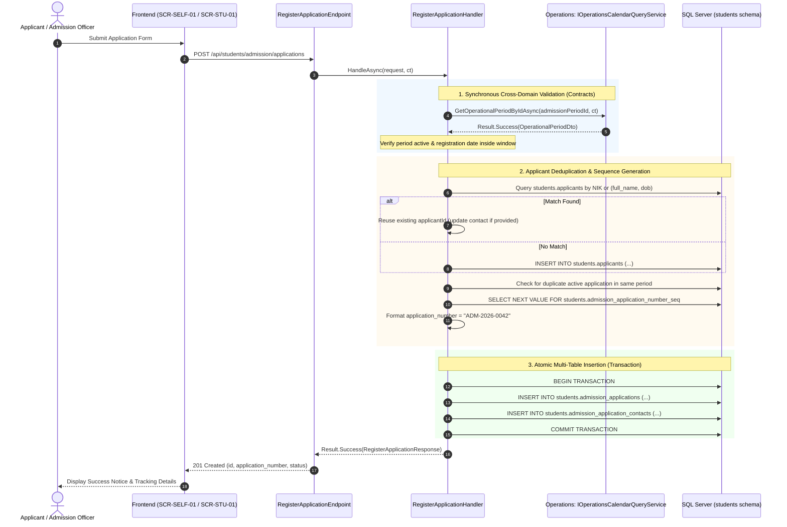
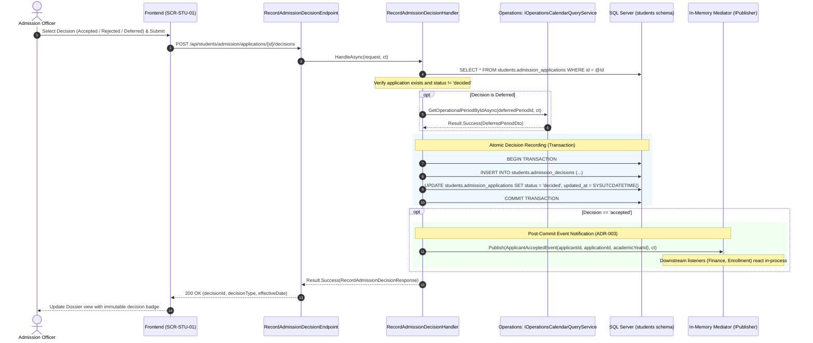
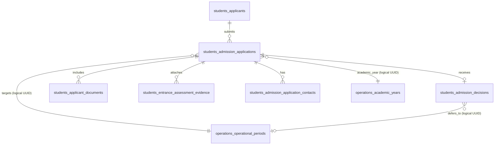

# 1. Overview

This target architecture defines the technical realization for Stage 1 "Admission — full scope (entrance assessment evidence entered as manual/external input; full Academics integration deferred to Stage 2)" under the Student domain, fulfilling change request intake `CR-STU-ADMISSION` ([`IS002 - STU-ADMISSION-ISSUE.md`](file:///d:/Project.Private/elsasa-sis-v3/docs/issues/IS002%20-%20STU-ADMISSION-ISSUE.md)).

The architecture establishes the authoritative student intake and admission lifecycle foundation for the Elsasa School Information System (SIS) V3:
1. **Applicant Identity & Deduplication:** Managing prospective learner profiles (`students.applicants`) with automated deduplication matching by national ID (`government_id_number`) or normalized name and birth date.
2. **Admission Application Lifecycle:** Managing structured applications (`students.admission_applications`) through explicit state transitions (`registered` &rarr; `under_review` &rarr; `decided` / `withdrawn`), enforcing a partial unique constraint of one active application per applicant per admission period.
3. **Sequential Application Numbering:** Generating human-readable traceable application numbers formatted as `ADM-{AcademicYearCode}-{Sequence:D4}` via native SQL Server sequences (`students.admission_application_number_seq`).
4. **Guardian Contacts & Household Intake:** Capturing parent and guardian relationships (`students.admission_application_contacts`) linked to each application for immediate triage and future student records.
5. **Document Verification & File Storage Infrastructure:** Establishing an isolated, local-first file storage abstraction (`IFileStorageService`) with multipart upload, MIME validation, and secure streaming for required credentials (`students.applicant_documents`).
6. **Manual Entrance Assessment Evidence Intake:** Capturing external diagnostic testing scores and evaluations (`students.entrance_assessment_evidence`) as manual evidence during review, keeping Stage 1 decoupled from Academics assessment workflows.
7. **Admission Decision Governance & Event Publication:** Recording immutable admission decisions (`students.admission_decisions`), supporting deferral validation against Operations windows, and publishing `ApplicantAcceptedEvent` via in-process mediator upon acceptance.
8. **Cross-Domain Temporal Coordination:** Consuming `IOperationsCalendarQueryService` synchronously to validate target admission periods and link parent academic years without cross-domain code or schema coupling.
9. **Dual-Surface Frontend Intake:** Realizing the staff-facing Student Intake Workbench ([`SCR-STU-01`](file:///d:/Project.Private/elsasa-sis-v3/docs/screen-inventory.md#L274-L300)) in `src/frontend/src/features/students/admission/views/StudentIntakeWorkbenchView.vue` and the public self-service Admission Application Portal ([`SCR-SELF-01`](file:///d:/Project.Private/elsasa-sis-v3/docs/screen-inventory.md#L222-L243)) in `src/frontend/src/features/students/admission/views/AdmissionPortalView.vue`.

---

# 2. Architectural Basis

## Business Context

This architecture realizes the business outcomes and operational workflows specified in:
- **DOMAIN:** [`student-domain.md`](file:///d:/Project.Private/elsasa-sis-v3/docs/domains/student-domain.md)
  - Workflow 1: Register Admission Application (`STD-WF-01`)
  - Workflow 2: Review and Decide Admission Application (`STD-WF-02`)
- **FEATURE & ROADMAP:** [`sub-modul-and-development-phases.md`](file:///d:/Project.Private/elsasa-sis-v3/docs/sub-modul-and-development-phases.md)
  - Stage 1 Foundation: Admission — full scope (entrance assessment evidence entered as manual/external input; full Academics integration deferred to Stage 2)
  - Stage 1 Completion Criterion 2: *"At least one admission application has been registered, reviewed, and accepted, producing an official student record."*
- **USE CASES:** [`use-cases.md`](file:///d:/Project.Private/elsasa-sis-v3/docs/use-cases.md)
  - `UC-STD-01`: Register Admission Application (both self-service family portal and assisted staff intake)
  - `UC-STD-03`: Review Admission Application (credential audit, assessment review, decision recording)
  - `UC-ACD-07`: Conduct Applicant Entrance Assessment (Stage 1 manual external score intake scope)
- **SCREEN INVENTORY:** [`screen-inventory.md`](file:///d:/Project.Private/elsasa-sis-v3/docs/screen-inventory.md)
  - `SCR-STU-01`: Student Intake Workbench (Staff Work Queue pattern)
  - `SCR-SELF-01`: Admission Application Portal (Public Information Lookup & Registration pattern)
- **DATA SPECIFICATIONS:**
  - [`student-entities.md`](file:///d:/Project.Private/elsasa-sis-v3/docs/entities/student-entities.md) (Submodule 1 — Admission)
  - [`student-entities-tables.md`](file:///d:/Project.Private/elsasa-sis-v3/docs/entities/student-entities-tables.md) (Tables 1.1 through 1.6)

## Analysis Input

This architecture directly consumes the approved gap-closure decisions and technical trade-offs recorded in:
- **FEASIBILITY ASSESSMENT:** [`IS002 - STU-ADMISSION-FEASIBILITY-ASSESSMENT.md`](file:///d:/Project.Private/elsasa-sis-v3/docs/issues/IS002%20-%20STU-ADMISSION-FEASIBILITY-ASSESSMENT.md)
  - Gap closures: GAP-001 through GAP-008
  - Resolved open questions: OQ-001 through OQ-008
  - Architectural Choice: Approach 1 (Pragmatic, Minimalist, and Explicit Domain Alignment)

```text
DOMAIN (student-domain.md) + FEATURE (use-cases.md, screen-inventory.md)
                            +
            FEASIBILITY-ASSESSMENT (STU-ADMISSION)
                            ↓
                TARGET ARCHITECTURE (STU-ADMISSION)
```

---

# 3. Scope

## Included

1. **Database Schema & Migrations:**
   - Single sequential DbUp migration script `20261103_0201_Students_Admission_Tables.sql` in `src/backend/Elsasa.Sis.Database/Scripts/`.
   - Non-destructive schema evolution of `students.applicants` to match [`student-entities-tables.md`](file:///d:/Project.Private/elsasa-sis-v3/docs/entities/student-entities-tables.md): adding `full_name`, `preferred_name`, `place_of_birth`, `nationality`, `government_id_type`, `government_id_number` (with filtered unique index), `address`, `previous_school_name`, `previous_school_address`, and `notes`.
   - Evolution of `students.admission_applications`: adding `admission_period_id` (logical UUID reference to Operations), `application_type` (`new`, `transfer_in`), `requested_entry_level`, `requested_campus`, `requested_program`, `registration_date`, and partial unique index on `(applicant_id, admission_period_id) WHERE status NOT IN ('withdrawn', 'decided')`.
   - Creation of sequence `students.admission_application_number_seq`.
   - Creation of 4 new domain tables in `students`: `admission_decisions`, `applicant_documents`, `entrance_assessment_evidence`, and `admission_application_contacts`.
   - Proper indexing on foreign keys, application status, registration dates, and government ID numbers.

2. **Backend Vertical Slices (`Elsasa.Sis.Students`):**
   - **Application Registration:** `RegisterApplication` (handles deduplication, period inquiry, number generation, atomic multi-table insert).
   - **Queue & Dossier Queries:** `GetAdmissionApplicationsList` (queue filterable by period, status, entry level, search query), `GetAdmissionApplicationById` (complete intake dossier projection), and `GetApplicationStatusByNumber` (unauthenticated lookup for public tracking).
   - **Review Lifecycle Commands:** `StartApplicationReview` (`registered` &rarr; `under_review`), `WithdrawAdmissionApplication` (`status = 'withdrawn'`).
   - **Admission Decision:** `RecordAdmissionDecision` (validates decision outcome, deferral period validation, atomic insert into `admission_decisions`, status update to `decided`, and post-commit publication of `ApplicantAcceptedEvent`).
   - **Document Management:** `UploadApplicantDocument` (multipart upload via `IFileStorageService`), `DownloadApplicantDocument` (stream file with MIME header), and `VerifyApplicantDocument` (`submission_status` update).
   - **Manual Assessment Evidence:** `AddAssessmentEvidence`, `UpdateAssessmentEvidence`, and `DeleteAssessmentEvidence`.

3. **Storage Infrastructure Abstraction (`Elsasa.Sis.Shared.Storage`):**
   - Declaration of `IFileStorageService` and implementation `PhysicalFileStorageService` storing files under `storage/documents/admission/{applicationId}/`.

4. **Frontend Staff Intake Workbench (`SCR-STU-01`):**
   - Implementation of `src/frontend/src/features/students/admission/views/StudentIntakeWorkbenchView.vue`.
   - Cohesive work queue filtering (Status, Admission Period, Entry Level, Search).
   - Multi-tab dossier detail panel: Application Info & Contacts, Document Verification checklist, Manual Assessment Evidence card, and Decision & Review History audit.
   - Action modals for decision recording, manual assessment score entry, document verification, and case withdrawal.

5. **Frontend Public Admission Portal (`SCR-SELF-01`):**
   - Implementation of `src/frontend/src/features/students/admission/views/AdmissionPortalView.vue` (5-step registration wizard: Period & Level &rarr; Applicant Info &rarr; Guardian Contacts &rarr; Credential Upload &rarr; Review & Submit).
   - Implementation of `src/frontend/src/features/students/admission/views/ApplicationTrackerView.vue` (Self-service tracking desk by application number and birth date).

## Excluded

1. **Academics Assessment Scheduling & Grading (`ACD-WF-20`, `UC-ACD-07` Stage 2):**
   - Scheduling diagnostic test sessions, assigning teacher proctors, and automatic score sync from Academics domain are deferred to Stage 2.
2. **Official Enrollment Execution & Student Number Generation (`UC-STD-04`):**
   - Official enrollment execution, assigning official Student IDs (NIS/NISN), homeroom placement, and creating records in `students.students` belong to Submodule 2 (Enrollment & Identity) and will consume `ApplicantAcceptedEvent`.
3. **Finance Fee Obligation Assessment & Gate Verification (`UC-FIN-01`, `UC-FIN-09`):**
   - Generating tuition or admission fee billing obligations and verifying fee payment gates belong strictly to the Finance domain (`Elsasa.Sis.Finance`).
4. **Prior-Credit Evaluation for Transfer-In (`UC-STD-18`):**
   - Detailed course equivalence, prior-credit evaluation, and origin-school curriculum mapping are deferred to Stage 3.

---

# 4. Technical Decisions

## TD-01: Persistence Evolution & Deterministic Migration Strategy

- **Decision:** Execute a single, sequential, idempotent DbUp migration script `20261103_0201_Students_Admission_Tables.sql` targeting SQL Server 2022.
- **Realization:**
  - `students.applicants` is evolved safely in-place:
    - Add `full_name NVARCHAR(200) NOT NULL CONSTRAINT df_students_applicants_full_name DEFAULT ('')`.
    - Backfill: `UPDATE students.applicants SET full_name = LTRIM(RTRIM(CONCAT(ISNULL(first_name, ''), ' ', ISNULL(last_name, '')))) WHERE full_name = '';`.
    - Drop default constraint `df_students_applicants_full_name`.
    - Add `preferred_name NVARCHAR(100) NULL`, `place_of_birth NVARCHAR(100) NULL`, `nationality NVARCHAR(100) NULL DEFAULT ('Indonesian')`.
    - Add `government_id_type NVARCHAR(32) NULL`, `government_id_number NVARCHAR(64) NULL`.
    - Add `address NVARCHAR(MAX) NULL`, `previous_school_name NVARCHAR(200) NULL`, `previous_school_address NVARCHAR(MAX) NULL`, `notes NVARCHAR(MAX) NULL`.
    - Add `updated_at DATETIMEOFFSET(7) NULL`, `updated_by NVARCHAR(100) NULL`.
    - Create filtered unique index: `ux_students_applicants_gov_id` ON `students.applicants (government_id_number) WHERE government_id_number IS NOT NULL;`.
  - `students.admission_applications` is evolved:
    - Add `admission_period_id UNIQUEIDENTIFIER NOT NULL`.
    - Add `application_type NVARCHAR(32) NOT NULL DEFAULT ('new')`.
    - Add `requested_entry_level NVARCHAR(64) NOT NULL`.
    - Add `requested_campus NVARCHAR(100) NULL`, `requested_program NVARCHAR(100) NULL`.
    - Add `registration_date DATE NOT NULL DEFAULT (CAST(GETUTCDATE() AS DATE))`.
    - Add `notes NVARCHAR(MAX) NULL`, `updated_at DATETIMEOFFSET(7) NULL`, `updated_by NVARCHAR(100) NULL`.
    - Add partial unique index: `ux_students_admission_applications_active` ON `students.admission_applications (applicant_id, admission_period_id) WHERE status NOT IN ('withdrawn', 'decided');`.
  - Create sequence:
    - `CREATE SEQUENCE students.admission_application_number_seq AS INT START WITH 1 INCREMENT BY 1 NO CYCLE;`.
  - Create 4 supporting tables:
    - `students.admission_decisions`
    - `students.applicant_documents`
    - `students.entrance_assessment_evidence`
    - `students.admission_application_contacts`
  - All foreign keys within `students.*` use physical constraints with `ON DELETE NO ACTION` to guarantee audit trail preservation.

## TD-02: Deterministic Application Number Sequence & Formatter

- **Decision:** Generate human-readable traceable application numbers formatted as `ADM-{AcademicYearCode}-{Sequence:D4}` (e.g. `ADM-2026-0001`) atomically using SQL Server sequence values (OQ-003).
- **Realization:**
  - During the registration command transaction, execute:
    ```sql
    SELECT NEXT VALUE FOR students.admission_application_number_seq;
    ```
  - Extract the 4-digit year component from the linked Academic Year Code (e.g., `AY-2026-2027` &rarr; `2026`, or fallback to current UTC year).
  - Format as `$"ADM-{yearCode}-{seq:D4}"`.
  - Concurrency safety is guaranteed by SQL Server sequence locking and enforced by unique index `ux_students_admission_applications_application_number`.

## TD-03: Applicant Identity Deduplication & Linking Strategy

- **Decision:** Deduplicate applicant identity during application registration without creating fragmented person rows (GAP-003 / OQ-004).
- **Realization:**
  - Inside `RegisterApplicationHandler`:
    1. If `request.ApplicantId` is provided (e.g. returning applicant selected from staff lookup), verify the record exists in `students.applicants`.
    2. If `request.ApplicantId` is null and `GovernmentIdNumber` is provided, search `students.applicants` by `government_id_number`.
    3. If not found by government ID and `DateOfBirth` is provided, query by normalized `(UPPER(LTRIM(RTRIM(full_name))), date_of_birth)`.
    4. If a match is found:
       - Use the existing `applicantId`.
       - Update contact information (`email`, `phone`, `address`) if updated values are submitted.
    5. If no match is found:
       - Insert a new record into `students.applicants` with a newly generated `Guid.NewGuid()`.
    6. Check active application constraint:
       ```sql
       SELECT COUNT(1) FROM students.admission_applications
       WHERE applicant_id = @ApplicantId AND admission_period_id = @AdmissionPeriodId
         AND status NOT IN ('withdrawn', 'decided');
       ```
       If count > 0, return `Result.Failure(DomainError.Conflict("Admission.DuplicateActiveApplication", "An active application already exists for this applicant in the specified admission period."))`.

## TD-04: Cross-Domain Temporal Validation & Event Publishing

- **Decision:** Enforce operational validity via `IOperationsCalendarQueryService` synchronously and publish `ApplicantAcceptedEvent` asynchronously after transaction commit (ADR-001, ADR-003).
- **Realization:**
  - **Inquiry at Registration:**
    - Inject `IOperationsCalendarQueryService` into `RegisterApplicationHandler`.
    - Call `await calendarService.GetOperationalPeriodByIdAsync(request.AdmissionPeriodId, ct);`.
    - If the period does not exist or has `status NOT IN ('active', 'approved')`, return `DomainError.NotFound` or `DomainError.Conflict`.
    - Retrieve `AcademicYearId` from the returned `OperationalPeriodDto` and persist it directly in `students.admission_applications.academic_year_id` (denormalized read acceleration).
    - Validate that `registrationDate` falls between `period.StartDate` and `period.EndDate` (unless `request.BypassWindowCheck == true`, allowed only for staff-assisted intake with `Permissions.Students.Admission.Register`).
  - **Decision Deferral Validation:**
    - If `request.DecisionType == "deferred"`, require `request.DeferredAdmissionPeriodId`.
    - Verify `deferredPeriodId` exists via `calendarService.GetOperationalPeriodByIdAsync`.
  - **Post-Commit Event Notification:**
    - When `request.DecisionType == "accepted"`, commit the transaction inserting `students.admission_decisions` and setting `admission_applications.status = 'decided'`.
    - After `await transaction.CommitAsync(ct);`, call:
      ```csharp
      await publisher.Publish(new ApplicantAcceptedEvent(applicantId, applicationId, academicYearId), ct);
      ```
    - Guarantees downstream consumers (Enrollment, Finance) only process durable, committed acceptances.

## TD-05: Local-First Document Storage & Secure File Handling

- **Decision:** Implement a lightweight, secure local filesystem storage provider behind an explicit interface in `Elsasa.Sis.Shared.Storage` (GAP-005 / OQ-005).
- **Realization:**
  - **Interface:**
    ```csharp
    namespace Elsasa.Sis.Shared.Storage;

    public interface IFileStorageService
    {
        Task<Result<StoredFileResult>> SaveFileAsync(Stream stream, string fileName, string contentType, string category, CancellationToken ct = default);
        Task<Result<FileStreamResult>> OpenReadStreamAsync(string fileReference, CancellationToken ct = default);
        Task<Result> DeleteFileAsync(string fileReference, CancellationToken ct = default);
    }

    public sealed record StoredFileResult(string FileReference, string FileName, long SizeBytes, string ContentType);
    public sealed record FileStreamResult(Stream Stream, string ContentType, string FileName);
    ```
  - **Storage Root:** Configurable via `appsettings.json` (`Storage:LocalRootPath`, defaults to `App_Data/storage`).
  - **Path Structure:** `documents/admission/{applicationId}/{documentType}_{guid}{extension}`.
  - **Security Validation:**
    - Whitelisted extensions: `.pdf`, `.jpg`, `.jpeg`, `.png`.
    - Whitelisted MIME types: `application/pdf`, `image/jpeg`, `image/png`.
    - Maximum file size: 5 MB (`5 * 1024 * 1024` bytes).
    - Path traversal sanitization: strip directory separators from user-supplied file names.
  - **Endpoints:**
    - `POST /api/students/admission/applications/{id}/documents`: Accepts `IFormFile`, calls `IFileStorageService.SaveFileAsync`, updates/inserts `students.applicant_documents` with `submission_status = 'submitted'`.
    - `GET /api/students/admission/applications/{id}/documents/{docId}/file`: Streams stored file with appropriate `Content-Type` and `Content-Disposition`.
    - `PUT /api/students/admission/applications/{id}/documents/{docId}/verify`: Sets `submission_status = 'verified'` or `'rejected'`, with `verified_by`, `verified_date`, and review notes.

## TD-06: Stage 1 Manual Entrance Assessment Evidence Intake Pattern

- **Decision:** Model entrance assessment scores as external documentary evidence captured directly by Admission Officers without digital Academics domain coupling (GAP-006 / OQ-006).
- **Realization:**
  - Persisted in `students.entrance_assessment_evidence` with columns: `assessment_type`, `score`, `source`, `assessment_date`, `notes`.
  - `score` is modeled as `NVARCHAR(50)` to accommodate varied grading representations (e.g. `85/100`, `Grade A`, `Passed`, `Band 4`).
  - `source` defaults to `"External Assessment Center"` or `"Staff Diagnostic Evaluation"`.
  - Vertical slices provide standard CRUD endpoints:
    - `POST /api/students/admission/applications/{id}/assessment-evidence`
    - `PUT /api/students/admission/applications/{id}/assessment-evidence/{evidenceId}`
    - `DELETE /api/students/admission/applications/{id}/assessment-evidence/{evidenceId}`
  - In `SCR-STU-01`, rendered as a dedicated "Assessment Evidence" panel within the application dossier, providing clear visibility of diagnostic readiness prior to recording an admission decision.

## TD-07: Backend Vertical Slice Layout & Minimal API Routing

- **Decision:** Group slices by capability under `src/backend/Elsasa.Sis.Students/Features/Admission/` strictly adhering to [`coding-conventions.md`](file:///d:/Project.Private/elsasa-sis-v3/docs/architecture/coding-conventions.md) and ADR-005.
- **Directory Layout:**
  ```text
  src/backend/Elsasa.Sis.Students/Features/Admission/
  ├── RegisterApplication/
  │   ├── RegisterApplicationEndpoint.cs     # POST /api/students/admission/applications
  │   ├── RegisterApplicationRequest.cs      # Request record (applicant, contacts, placement)
  │   ├── RegisterApplicationResponse.cs     # Response (id, application_number, status)
  │   ├── RegisterApplicationValidator.cs    # FluentValidation rules
  │   └── RegisterApplicationHandler.cs      # Dapper command handler with deduplication
  ├── GetAdmissionApplicationsList/
  │   ├── GetAdmissionApplicationsListEndpoint.cs # GET /api/students/admission/applications
  │   ├── AdmissionApplicationListItemResponse.cs
  │   └── GetAdmissionApplicationsListHandler.cs
  ├── GetAdmissionApplicationById/
  │   ├── GetAdmissionApplicationByIdEndpoint.cs  # GET /api/students/admission/applications/{id}
  │   ├── AdmissionApplicationDetailResponse.cs   # Complete aggregate dossier
  │   └── GetAdmissionApplicationByIdHandler.cs
  ├── GetApplicationStatusByNumber/
  │   ├── GetApplicationStatusByNumberEndpoint.cs # GET /api/students/admission/applications/status
  │   ├── ApplicationStatusResponse.cs            # Public self-service tracking DTO
  │   └── GetApplicationStatusByNumberHandler.cs
  ├── StartApplicationReview/
  │   ├── StartApplicationReviewEndpoint.cs      # POST /api/students/admission/applications/{id}/start-review
  │   └── StartApplicationReviewHandler.cs
  ├── RecordAdmissionDecision/
  │   ├── RecordAdmissionDecisionEndpoint.cs      # POST /api/students/admission/applications/{id}/decisions
  │   ├── RecordAdmissionDecisionRequest.cs
  │   ├── RecordAdmissionDecisionResponse.cs
  │   ├── RecordAdmissionDecisionValidator.cs
  │   └── RecordAdmissionDecisionHandler.cs       # Transactional write + event publication
  ├── WithdrawAdmissionApplication/
  │   ├── WithdrawAdmissionApplicationEndpoint.cs # POST /api/students/admission/applications/{id}/withdraw
  │   ├── WithdrawAdmissionApplicationRequest.cs
  │   └── WithdrawAdmissionApplicationHandler.cs
  ├── Documents/
  │   ├── UploadApplicantDocument/               # POST /api/students/admission/applications/{id}/documents
  │   ├── DownloadApplicantDocument/             # GET /api/students/admission/applications/{id}/documents/{docId}/file
  │   └── VerifyApplicantDocument/               # PUT /api/students/admission/applications/{id}/documents/{docId}/verify
  └── AssessmentEvidence/
      ├── AddAssessmentEvidence/                 # POST /api/students/admission/applications/{id}/assessment-evidence
      ├── UpdateAssessmentEvidence/              # PUT /api/students/admission/applications/{id}/assessment-evidence/{evidenceId}
      └── DeleteAssessmentEvidence/              # DELETE /api/students/admission/applications/{id}/assessment-evidence/{evidenceId}
  ```

## TD-08: Dual-Frontend Workspaces (`SCR-STU-01` & `SCR-SELF-01`)

- **Decision:** Implement two distinct user surfaces in `src/frontend/src/features/students/admission/` to serve staff intake operations and family self-service independently ([`frontend-architecture.md`](file:///d:/Project.Private/elsasa-sis-v3/docs/architecture/frontend-architecture.md)).
- **Realization:**
  - **1. Student Intake Workbench (`SCR-STU-01` &rarr; `/students/intake`):**
    - Staff work queue table with reactive filters: Target Period, Status (`all`, `registered`, `under_review`, `decided`, `withdrawn`), Requested Entry Level, and Search query (Name, Application #, Government ID).
    - Selected Application Dossier panel featuring:
      - **Header:** Full name, Application #, Registration date, Target Period, Grade level, Status badge (`StatusPill`), and primary workflow action buttons (`Start Review`, `Record Decision`, `Withdraw`).
      - **Tab 1: Application Info & Contacts:** Biographical details, address, previous school, and primary/secondary guardian contacts card.
      - **Tab 2: Document Verification:** Document checklist table (`document_type`, `submission_status`, `submitted_date`, `verified_by`). Actions to download/inspect file and verify/reject with justification.
      - **Tab 3: Assessment Evidence:** Diagnostic score cards with "Add Score" action, displaying assessment type, score, source, and date.
      - **Tab 4: Decision History:** Immutable audit card showing decision outcome (`accepted`, `rejected`, `waitlisted`, `deferred`), effective date, decider, reason, and deferred period link.
  - **2. Admission Application Portal (`SCR-SELF-01` &rarr; `/admission/apply` and `/admission/status`):**
    - **Self-Service Application Wizard (`/admission/apply`):**
      - Step 1: Admission Period & Grade Selection (queries active admission windows from Operations).
      - Step 2: Applicant Biographical Information (Name, Date of Birth, Gender, Government ID, Address).
      - Step 3: Guardian & Family Contact Details (Father/Mother/Guardian name, phone, email, address).
      - Step 4: Credential Document Uploads (Birth certificate, Family card, Previous school report).
      - Step 5: Summary Confirmation & Submission. Upon completion, displays assigned Application Number (`ADM-2026-XXXX`) and clear instructions for tracking.
    - **Status Tracking Desk (`/admission/status`):**
      - Public inquiry form: Application Number + Date of Birth.
      - Shows current status, submitted documents status, and official decision notice. Internal review notes are omitted.
  - **State & Server Management:**
    - TanStack Query Vue (`@tanstack/vue-query`) for all server-side entity queries and mutations.
    - Form state and validation via VeeValidate + Zod schemas.
    - PrimeVue accessible components (`DataTable`, `Dialog`, `Select`, `FileUpload`, `Tabs`) styled with Tailwind CSS.

---

# 5. Component Responsibilities

| Component | Layer / Assembly | Responsibility |
|---|---|---|
| `RegisterApplicationHandler` | `Elsasa.Sis.Students` | Performs applicant deduplication, validates admission period via `IOperationsCalendarQueryService`, generates application number from sequence, and inserts application + contacts in an atomic transaction. |
| `GetAdmissionApplicationsListHandler` | `Elsasa.Sis.Students` | Executes parameterized Dapper query projecting filterable admission queue list items with applicant name, grade, period, and status. |
| `GetAdmissionApplicationByIdHandler` | `Elsasa.Sis.Students` | Retrieves complete admission dossier including applicant bio, guardian contacts, documents, assessment evidence, and decision history. |
| `GetApplicationStatusByNumberHandler` | `Elsasa.Sis.Students` | Validates public lookup by application number and birth date; projects sanitized public status DTO. |
| `StartApplicationReviewHandler` | `Elsasa.Sis.Students` | Transitions application status from `registered` to `under_review`. |
| `RecordAdmissionDecisionHandler` | `Elsasa.Sis.Students` | Validates decision rules (deferral period check, decision immutability), inserts `admission_decisions`, updates application status to `decided`, and publishes `ApplicantAcceptedEvent` post-commit. |
| `WithdrawAdmissionApplicationHandler` | `Elsasa.Sis.Students` | Transitions application to `withdrawn` status with cancellation reason. |
| `UploadApplicantDocumentHandler` | `Elsasa.Sis.Students` | Validates file MIME/size, invokes `IFileStorageService.SaveFileAsync`, and records/updates `applicant_documents`. |
| `DownloadApplicantDocumentHandler` | `Elsasa.Sis.Students` | Queries document metadata and streams file content from `IFileStorageService` with appropriate headers. |
| `VerifyApplicantDocumentHandler` | `Elsasa.Sis.Students` | Updates document verification state (`verified` / `rejected`), audit identity, and verification date. |
| `AddAssessmentEvidenceHandler` | `Elsasa.Sis.Students` | Inserts manual diagnostic test score into `entrance_assessment_evidence`. |
| `UpdateAssessmentEvidenceHandler` | `Elsasa.Sis.Students` | Modifies existing manual assessment evidence score or notes. |
| `DeleteAssessmentEvidenceHandler` | `Elsasa.Sis.Students` | Deletes an assessment evidence record from an active application. |
| `IFileStorageService` | `Elsasa.Sis.Shared.Storage` | Declares file storage abstraction for saving, reading, and deleting physical files. |
| `PhysicalFileStorageService` | `Elsasa.Sis.Shared.Storage` | Implements local disk file storage with path sanitization and safe stream handling. |
| `IOperationsCalendarQueryService` | `Elsasa.Sis.Contracts` | Cross-domain contract consumed by Students to validate periods and retrieve academic years. |
| `ApplicantAcceptedEvent` | `Elsasa.Sis.Contracts` | In-memory domain event published to notify downstream domains (Finance, Enrollment) of accepted applicants. |
| `StudentIntakeWorkbenchView.vue` | `src/frontend` | Orchestrates `SCR-STU-01` staff intake workbench, coordinating queue table, filters, tabs, and action modals. |
| `AdmissionPortalView.vue` | `src/frontend` | Orchestrates `SCR-SELF-01` public multi-step admission registration wizard. |
| `ApplicationTrackerView.vue` | `src/frontend` | Orchestrates `SCR-SELF-01` public status inquiry desk by application number and birth date. |
| `admission.api.ts` | `src/frontend` | Axios HTTP client functions calling Students Admission Minimal API endpoints. |
| `useAdmissionQueries.ts` / `useAdmissionMutations.ts` | `src/frontend` | TanStack Query composables for reactive caching, optimistic updates, and cache invalidation. |
| `admission.schema.ts` | `src/frontend` | Zod validation schemas for registration, decision recording, assessment evidence, and verification. |

---

# 6. Integration Design

## Collaboration Between Components

| Source | Target | Purpose | Mechanism |
|---|---|---|---|
| `Elsasa.Sis.Api` | `Elsasa.Sis.Students` | Discover and map Admission Minimal API endpoints at bootstrap. | Assembly scanning (`app.MapEndpoints(Stage1Assemblies)`). |
| `Frontend (SCR-STU-01)` | `Elsasa.Sis.Api` | Execute staff admission actions, query queues, verify credentials, record decisions. | HTTPS REST calls with JSON/Multipart payloads, JWT Bearer token, and `X-Correlation-ID`. |
| `Frontend (SCR-SELF-01)` | `Elsasa.Sis.Api` | Public admission application registration and status inquiry. | Anonymous HTTPS REST calls with JSON payloads and client-side validation. |
| `RegisterApplicationHandler` | `IOperationsCalendarQueryService` | Validate target admission period exists, is active, and retrieve linked Academic Year ID. | Synchronous C# contract call (`GetOperationalPeriodByIdAsync`). |
| `RecordAdmissionDecisionHandler` | `IOperationsCalendarQueryService` | Validate deferred admission period exists when `decision_type = 'deferred'`. | Synchronous C# contract call (`GetOperationalPeriodByIdAsync`). |
| `RecordAdmissionDecisionHandler` | In-Memory Mediator (`IPublisher`) | Notify downstream domains that an applicant has been officially accepted. | Post-commit publication of `ApplicantAcceptedEvent`. |
| `UploadApplicantDocumentHandler` | `IFileStorageService` | Save uploaded credential file to disk storage. | Asynchronous file stream write. |
| `DownloadApplicantDocumentHandler`| `IFileStorageService` | Read stored credential file from disk storage. | Asynchronous file stream read. |

## Sequence Diagram: Register Admission Application (`STD-WF-01`, `UC-STD-01`)



## Sequence Diagram: Review and Record Admission Decision (`STD-WF-02`, `UC-STD-03`)



---

# 7. Data Ownership

| Data Entity | Primary Schema | Owning Domain Assembly | Allowed Cross-Domain Access |
|---|---|---|---|
| `applicants` | `students` | `Elsasa.Sis.Students` | Read-only SQL projection for student profile linking; no external writes. |
| `admission_applications` | `students` | `Elsasa.Sis.Students` | Read-only SQL projection for Finance billing assessment; no external writes. |
| `admission_decisions` | `students` | `Elsasa.Sis.Students` | Internal Students domain audit record; no external access. |
| `applicant_documents` | `students` | `Elsasa.Sis.Students` | Internal Students domain credential record; no external writes. |
| `entrance_assessment_evidence` | `students` | `Elsasa.Sis.Students` | Internal Students domain evidence record; no external writes. |
| `admission_application_contacts` | `students` | `Elsasa.Sis.Students` | Read-only projection during official student guardian profile creation; no external writes. |

### Domain Boundary Invariants:
1. No external domain (`Operations`, `Finance`, `Academics`) can execute `INSERT`, `UPDATE`, or `DELETE` on any table in the `students` schema (ADR-002).
2. References in `students.admission_applications` to external domains:
   - `admission_period_id` is a logical UUID reference to `operations.operational_periods(id)`.
   - `academic_year_id` is a logical UUID reference to `operations.academic_years(id)`.
   - `deferred_admission_period_id` in `admission_decisions` is a logical UUID reference to `operations.operational_periods(id)`.
   - **Zero physical cross-schema foreign keys** are defined in the database (ADR-002).
3. The Student domain does not store academic course schedules or financial fee ledger accounts.

---

# 8. Database Design

## Modified Tables

### 1. `students.applicants`

| Column | Data Type | Nullability | Constraint / Default | Purpose |
|---|---|---|---|---|
| `id` | `UNIQUEIDENTIFIER` | NOT NULL | PRIMARY KEY | Unique applicant identifier. |
| `full_name` | `NVARCHAR(200)` | NOT NULL | | Full legal name. |
| `preferred_name` | `NVARCHAR(100)` | NULL | | Preferred or informal calling name. |
| `date_of_birth` | `DATE` | NULL | | Date of birth. |
| `place_of_birth` | `NVARCHAR(100)` | NULL | | Place of birth (city/region). |
| `gender` | `NVARCHAR(20)` | NULL | | Gender (`Male`, `Female`, `Other`). |
| `nationality` | `NVARCHAR(100)` | NULL | DEFAULT `'Indonesian'` | Legal nationality. |
| `government_id_type` | `NVARCHAR(32)` | NULL | | ID type (e.g. `NIK`, `Passport`, `KIA`). |
| `government_id_number`| `NVARCHAR(64)` | NULL | | Unique government identification number. |
| `email` | `NVARCHAR(254)` | NULL | | Primary contact email. |
| `phone` | `NVARCHAR(32)` | NULL | | Primary contact phone number. |
| `address` | `NVARCHAR(MAX)` | NULL | | Residential mailing address. |
| `previous_school_name`| `NVARCHAR(200)`| NULL | | Origin school name. |
| `previous_school_address`| `NVARCHAR(MAX)`| NULL | | Origin school location/address. |
| `notes` | `NVARCHAR(MAX)` | NULL | | Administrative notes and intake comments. |
| `created_at` | `DATETIMEOFFSET(7)`| NOT NULL | | Audit creation timestamp (UTC). |
| `created_by` | `NVARCHAR(100)` | NULL | | Identity creating the record. |
| `updated_at` | `DATETIMEOFFSET(7)`| NULL | | Audit last update timestamp (UTC). |
| `updated_by` | `NVARCHAR(100)` | NULL | | Identity updating the record. |

**Indexes:**
- `ux_students_applicants_gov_id` ON `(government_id_number) WHERE government_id_number IS NOT NULL`
- `ix_students_applicants_name_dob` ON `(full_name, date_of_birth)`

---

### 2. `students.admission_applications`

| Column | Data Type | Nullability | Constraint / Default | Purpose |
|---|---|---|---|---|
| `id` | `UNIQUEIDENTIFIER` | NOT NULL | PRIMARY KEY | Unique application identifier. |
| `application_number`| `NVARCHAR(32)` | NOT NULL | UNIQUE (`ux_students_admission_applications_application_number`) | Traceable reference (e.g. `ADM-2026-0001`). |
| `applicant_id` | `UNIQUEIDENTIFIER` | NOT NULL | FK &rarr; `students.applicants(id)` | Applicant submitting this application. |
| `admission_period_id`| `UNIQUEIDENTIFIER`| NOT NULL | | Target operational period (logical FK to Operations). |
| `academic_year_id` | `UNIQUEIDENTIFIER` | NOT NULL | | Target academic year (logical FK to Operations, denormalized). |
| `application_type` | `NVARCHAR(32)` | NOT NULL | DEFAULT `'new'` | Intake pipeline type: `new`, `transfer_in`. |
| `requested_entry_level`| `NVARCHAR(64)` | NOT NULL | | Intended grade or level (e.g. `Grade 1`, `TK-A`). |
| `requested_campus` | `NVARCHAR(100)` | NULL | | Intended campus location. |
| `requested_program`| `NVARCHAR(100)` | NULL | | Intended program track (e.g. `Reguler`, `Bilingual`). |
| `registration_date`| `DATE` | NOT NULL | DEFAULT `(CAST(GETUTCDATE() AS DATE))` | Date application was officially registered. |
| `status` | `NVARCHAR(32)` | NOT NULL | DEFAULT `'registered'` | Lifecycle state: `registered`, `under_review`, `decided`, `withdrawn`. |
| `submitted_at` | `DATETIMEOFFSET(7)`| NULL | | Timestamp of application submission. |
| `notes` | `NVARCHAR(MAX)` | NULL | | Administrative notes and special considerations. |
| `created_at` | `DATETIMEOFFSET(7)`| NOT NULL | | Audit creation timestamp (UTC). |
| `created_by` | `NVARCHAR(100)` | NULL | | Identity creating the record. |
| `updated_at` | `DATETIMEOFFSET(7)`| NULL | | Audit last update timestamp (UTC). |
| `updated_by` | `NVARCHAR(100)` | NULL | | Identity updating the record. |

**Indexes:**
- `ux_students_admission_applications_active` ON `(applicant_id, admission_period_id) WHERE status NOT IN ('withdrawn', 'decided')`
- `ix_students_admission_applications_period_status` ON `(admission_period_id, status)`
- `ix_students_admission_applications_reg_date` ON `(registration_date DESC)`

---

## New Tables & Sequences

### 1. `students.admission_application_number_seq` (Sequence)

```sql
CREATE SEQUENCE [students].[admission_application_number_seq]
    AS INT
    START WITH 1
    INCREMENT BY 1
    NO CYCLE;
```

---

### 2. `students.admission_decisions`

Records the official admission outcome for an application. One decision per application.

| Column | Data Type | Nullability | Constraint / Default | Purpose |
|---|---|---|---|---|
| `id` | `UNIQUEIDENTIFIER` | NOT NULL | PRIMARY KEY | Unique decision identifier. |
| `application_id` | `UNIQUEIDENTIFIER` | NOT NULL | UNIQUE, FK &rarr; `students.admission_applications(id)` | Linked application (one-to-one). |
| `decision_type` | `NVARCHAR(32)` | NOT NULL | | Outcome: `accepted`, `rejected`, `waitlisted`, `withdrawn`, `expired`, `deferred`. |
| `decision_date` | `DATE` | NOT NULL | | Date the decision was recorded. |
| `effective_date` | `DATE` | NOT NULL | | Date the decision takes effect. |
| `decided_by` | `NVARCHAR(100)` | NOT NULL | | Authority or committee that made the decision. |
| `reason` | `NVARCHAR(MAX)` | NULL | | Authoritative justification or rejection reason. |
| `supporting_reference`| `NVARCHAR(200)`| NULL | | Reference code to minutes or policy decree. |
| `deferred_admission_period_id`| `UNIQUEIDENTIFIER`| NULL | | Future admission period if enrollment is deferred. |
| `created_at` | `DATETIMEOFFSET(7)`| NOT NULL | | Audit creation timestamp (UTC). |
| `created_by` | `NVARCHAR(100)` | NULL | | Identity creating the record. |

---

### 3. `students.applicant_documents`

Tracks documents required or submitted as part of an admission application.

| Column | Data Type | Nullability | Constraint / Default | Purpose |
|---|---|---|---|---|
| `id` | `UNIQUEIDENTIFIER` | NOT NULL | PRIMARY KEY | Unique document identifier. |
| `application_id` | `UNIQUEIDENTIFIER` | NOT NULL | FK &rarr; `students.admission_applications(id)` | Parent application. |
| `document_type` | `NVARCHAR(100)` | NOT NULL | | Document category (e.g. `birth_certificate`, `family_card`, `previous_school_report`, `photo`). |
| `submission_status`| `NVARCHAR(32)` | NOT NULL | DEFAULT `'not_submitted'` | Status: `not_submitted`, `submitted`, `verified`, `rejected`. |
| `submitted_date` | `DATE` | NULL | | Date document file was uploaded. |
| `verified_date` | `DATE` | NULL | | Date document was verified by staff. |
| `verified_by` | `NVARCHAR(100)` | NULL | | Username of staff officer verifying. |
| `file_reference` | `NVARCHAR(500)` | NULL | | Storage path or key returned by `IFileStorageService`. |
| `file_name` | `NVARCHAR(255)` | NULL | | Original sanitized file name. |
| `file_size_bytes` | `BIGINT` | NULL | | Size of uploaded file in bytes. |
| `content_type` | `NVARCHAR(100)` | NULL | | MIME type (e.g. `application/pdf`, `image/jpeg`). |
| `notes` | `NVARCHAR(MAX)` | NULL | | Verification notes or rejection comments. |
| `created_at` | `DATETIMEOFFSET(7)`| NOT NULL | | Audit creation timestamp (UTC). |
| `created_by` | `NVARCHAR(100)` | NULL | | Identity creating the record. |
| `updated_at` | `DATETIMEOFFSET(7)`| NULL | | Audit last update timestamp (UTC). |
| `updated_by` | `NVARCHAR(100)` | NULL | | Identity updating the record. |

**Indexes:**
- `ix_students_applicant_documents_app_status` ON `(application_id, submission_status)`

---

### 4. `students.entrance_assessment_evidence`

Records manual diagnostic entrance assessment results attached to an application.

| Column | Data Type | Nullability | Constraint / Default | Purpose |
|---|---|---|---|---|
| `id` | `UNIQUEIDENTIFIER` | NOT NULL | PRIMARY KEY | Unique record identifier. |
| `application_id` | `UNIQUEIDENTIFIER` | NOT NULL | FK &rarr; `students.admission_applications(id)` | Parent application. |
| `assessment_type` | `NVARCHAR(100)` | NOT NULL | | Category (e.g. `reading_readiness`, `math_readiness`, `psychological_evaluation`, `interview`). |
| `score` | `NVARCHAR(50)` | NULL | | Score or diagnostic result (e.g. `82/100`, `Passed`, `Band 4`). |
| `source` | `NVARCHAR(100)` | NOT NULL | DEFAULT `'External Assessment Center'` | Source of assessment evidence. |
| `assessment_date` | `DATE` | NULL | | Date assessment was administered. |
| `notes` | `NVARCHAR(MAX)` | NULL | | Diagnostic evaluator comments. |
| `created_at` | `DATETIMEOFFSET(7)`| NOT NULL | | Audit creation timestamp (UTC). |
| `created_by` | `NVARCHAR(100)` | NULL | | Identity creating the record. |
| `updated_at` | `DATETIMEOFFSET(7)`| NULL | | Audit last update timestamp (UTC). |
| `updated_by` | `NVARCHAR(100)` | NULL | | Identity updating the record. |

**Indexes:**
- `ix_students_assessment_evidence_app` ON `(application_id)`

---

### 5. `students.admission_application_contacts`

Records guardian and contact persons associated with an admission application.

| Column | Data Type | Nullability | Constraint / Default | Purpose |
|---|---|---|---|---|
| `id` | `UNIQUEIDENTIFIER` | NOT NULL | PRIMARY KEY | Unique contact identifier. |
| `application_id` | `UNIQUEIDENTIFIER` | NOT NULL | FK &rarr; `students.admission_applications(id)` | Parent application. |
| `full_name` | `NVARCHAR(200)` | NOT NULL | | Guardian full legal name. |
| `relationship` | `NVARCHAR(50)` | NOT NULL | | Relationship to applicant (`Father`, `Mother`, `Guardian`, `Other`). |
| `phone` | `NVARCHAR(32)` | NULL | | Primary contact phone number. |
| `email` | `NVARCHAR(254)` | NULL | | Contact email address. |
| `address` | `NVARCHAR(MAX)` | NULL | | Residential mailing address. |
| `is_primary` | `BIT` | NOT NULL | DEFAULT `1` | Flag indicating primary administrative contact. |
| `created_at` | `DATETIMEOFFSET(7)`| NOT NULL | | Audit creation timestamp (UTC). |
| `created_by` | `NVARCHAR(100)` | NULL | | Identity creating the record. |

**Indexes:**
- `ix_students_application_contacts_app` ON `(application_id)`

---

## Entity Relationship Diagram



## Migration Considerations

1. **Idempotency & Safe Alterations:**
   Migration script `20261103_0201_Students_Admission_Tables.sql` uses `IF OBJECT_ID(...) IS NULL` for new tables/sequences, and `IF NOT EXISTS (SELECT 1 FROM sys.columns ...)` for column additions to guarantee deterministic re-runs without schema corruption.
2. **Backfill Integrity for `full_name`:**
   Any legacy records in `students.applicants` are safely populated from `first_name` and `last_name` before removing temporary defaults.
3. **Sequence Existence Verification:**
   The script checks `sys.sequences` prior to executing `CREATE SEQUENCE`.
4. **Intra-Schema Foreign Keys:**
   All tables (`admission_decisions`, `applicant_documents`, `entrance_assessment_evidence`, `admission_application_contacts`) declare named foreign keys (`fk_students_*`) referencing `students.admission_applications(id)` with `ON DELETE NO ACTION`.

---

# 9. Cross-Cutting Concerns

## Security & Policy-Based Authorization

Following ADR-009, all endpoints enforce declarative permission requirements:

| Action / Slice | Route | Required Permission | Allowed Roles |
|---|---|---|---|
| View Admission Queue / Dossiers | `GET /api/students/admission/applications` | `Permissions.Students.Admission.View` | Admission Officer, Student Admin Officer, School Leadership |
| Get Application Detail Dossier | `GET /api/students/admission/applications/{id}` | `Permissions.Students.Admission.View` | Admission Officer, Student Admin Officer, School Leadership |
| Register Application (Staff-Assisted) | `POST /api/students/admission/applications` | `Permissions.Students.Admission.Register` | Admission Officer, Student Admin Officer |
| Register Application (Self-Service) | `POST /api/students/admission/portal/applications` | Anonymous / Public | Public Applicants, Prospective Families |
| Track Application Status (Public) | `GET /api/students/admission/applications/status` | Anonymous / Public | Public Applicants, Prospective Families |
| Start Application Review | `POST /api/students/admission/applications/{id}/start-review` | `Permissions.Students.Admission.Review` | Admission Officer |
| Upload Document (Staff or Applicant) | `POST /api/students/admission/applications/{id}/documents` | `Permissions.Students.Admission.Register` or Public Token | Admission Officer, Applicant |
| Download Document File | `GET /api/students/admission/applications/{id}/documents/{docId}/file` | `Permissions.Students.Admission.View` | Admission Officer, Student Admin Officer |
| Verify / Reject Document | `PUT /api/students/admission/applications/{id}/documents/{docId}/verify` | `Permissions.Students.Admission.VerifyDocument` | Admission Officer |
| Add / Edit Assessment Evidence | `POST/PUT /api/students/admission/applications/{id}/assessment-evidence` | `Permissions.Students.Admission.Review` | Admission Officer |
| Delete Assessment Evidence | `DELETE /api/students/admission/applications/{id}/assessment-evidence/{evidenceId}` | `Permissions.Students.Admission.Review` | Admission Officer |
| Record Admission Decision | `POST /api/students/admission/applications/{id}/decisions` | `Permissions.Students.Admission.Decide` | Admission Officer, School Leadership |
| Withdraw Application | `POST /api/students/admission/applications/{id}/withdraw` | `Permissions.Students.Admission.Register` | Admission Officer, Student Admin Officer |

## Auditability & Decision Immutability

1. **Immutability of Admission Decisions:** Once a decision record is inserted into `students.admission_decisions` and the application transitions to `status = 'decided'`, further modifications via `RecordAdmissionDecision` are strictly blocked with `Result.Failure(DomainError.Conflict("Admission.AlreadyDecided", "An official decision has already been recorded for this application."))`.
2. **Document Verification History:** Any change to document verification updates `verified_by`, `verified_date`, and `notes` with the authenticated officer's identity.
3. **Application Cancellation:** Withdrawn applications preserve all previously uploaded documents and contacts for audit history; records are never deleted.

## Concurrency & Data Integrity

1. **Single Active Application Constraint:**
   Enforced at the database level by partial unique index `ux_students_admission_applications_active` on `(applicant_id, admission_period_id) WHERE status NOT IN ('withdrawn', 'decided')` and pre-validated in `RegisterApplicationHandler`.
2. **Application Number Uniqueness:**
   Enforced by unique index `ux_students_admission_applications_application_number` and generated atomically via sequence `students.admission_application_number_seq`.
3. **Atomic Multi-Table Writes:**
   All multi-table mutations (e.g. inserting application + contacts; inserting decision + updating application status) use explicit `await using var tx = await connection.BeginTransactionAsync(ct)`. Single-table updates execute with SQL Server auto-commit.

## File Upload Security & Path Sanitization

1. **Extension & MIME Validation:** Uploaded files must match approved extensions (`.pdf`, `.jpg`, `.jpeg`, `.png`) and corresponding verified MIME types. Executable or script files (`.exe`, `.bat`, `.sh`, `.html`, `.js`) are strictly rejected.
2. **File Size Limit:** Enforced at 5 MB per file.
3. **Path Traversal Protection:** User file names are stripped of directory separators (`Path.GetFileName`) and stored on disk under randomly generated GUID file references: `storage/documents/admission/{applicationId}/{documentType}_{Guid.NewGuid()}{ext}`.

## Error Handling & Outcome Modeling

All slice handlers adhere to ADR-007:
- Handlers return `Task<Result<TResponse>>` or `Task<Result>`.
- Failures map to domain error codes:
  - `Admission.DuplicateActiveApplication` &rarr; 409 Conflict
  - `Admission.ApplicationNotFound` &rarr; 404 Not Found
  - `Admission.AlreadyDecided` &rarr; 409 Conflict
  - `Admission.InvalidPeriod` &rarr; 422 Unprocessable Entity
  - `Admission.DocumentNotFound` &rarr; 404 Not Found
  - `Admission.InvalidFileType` &rarr; 422 Unprocessable Entity

---

# 10. Implementation Constraints

Implementers must strictly adhere to the following rules derived from foundational architecture documents:

1. **C# 12 & .NET 8 Idioms ([`coding-conventions.md`](file:///d:/Project.Private/elsasa-sis-v3/docs/architecture/coding-conventions.md)):**
   - File-scoped namespaces throughout (`namespace Elsasa.Sis.Students.Features.Admission...`).
   - Primary constructors for dependency injection.
   - `public sealed record` for all DTOs, requests, and responses.
   - Explicit `CancellationToken` passed down to all Dapper and storage calls.
2. **Explicit Dapper & T-SQL (ADR-004):**
   - No ORM (No EF Core).
   - Multiline C# raw string literals (`""" ... """`) with uppercase T-SQL keywords.
   - Explicit schema qualification (`students.applicants`, `students.admission_applications`).
   - Explicit column enumeration (No `SELECT *`).
   - Parameterized queries using `CommandDefinition`.
3. **Compile-Time Domain Isolation (ADR-001):**
   - `Elsasa.Sis.Students` must never reference `Elsasa.Sis.Operations` or `Elsasa.Sis.Finance`.
   - All cross-domain validation passes through `Elsasa.Sis.Contracts` (`IOperationsCalendarQueryService`).
4. **Post-Commit Event Notification (ADR-003):**
   - In-memory domain event `ApplicantAcceptedEvent` must only be published **after** the decision transaction has committed.
5. **Frontend Conventions ([`frontend-architecture.md`](file:///d:/Project.Private/elsasa-sis-v3/docs/architecture/frontend-architecture.md)):**
   - Single File Components (`.vue`) using `<script setup lang="ts">`.
   - TanStack Query Vue for all server state; Pinia is reserved for client session context.
   - PrimeVue UI primitives styled via Tailwind CSS utility classes.
   - VeeValidate + Zod for form state and validation schemas.

---

# 11. Acceptance Conditions

The implementation is architecturally complete when all of the following conditions are verified:

1. **Database Migration Execution:**
   - Migration script `20261103_0201_Students_Admission_Tables.sql` runs cleanly on fresh and existing databases.
   - Altered tables (`students.applicants`, `students.admission_applications`) and new tables (`admission_decisions`, `applicant_documents`, `entrance_assessment_evidence`, `admission_application_contacts`) reflect all specified columns, constraints, and indexes.
   - Sequence `students.admission_application_number_seq` generates sequential numbers starting at 1.
2. **Application Registration & Deduplication:**
   - Submitting an application with an existing applicant's government ID reuses the existing `applicants` record.
   - Submitting a new applicant creates a new `applicants` record and links the application.
   - Registering an application validates the target admission period against `IOperationsCalendarQueryService.GetOperationalPeriodByIdAsync` and records `academic_year_id`.
   - Registering a concurrent active application for the same applicant and admission period returns 409 Conflict.
   - Generated application numbers strictly follow the format `ADM-{Year}-{Seq:D4}`.
3. **Document Management & Storage:**
   - Files uploaded via multipart upload are saved to local disk storage via `IFileStorageService` and recorded in `students.applicant_documents`.
   - Uploading disallowed file extensions or files exceeding 5 MB returns 422 Unprocessable Entity.
   - Stored document files can be streamed back via the download endpoint with accurate `Content-Type`.
   - Staff officers can verify or reject uploaded documents with audit timestamps and notes.
4. **Manual Entrance Assessment Evidence:**
   - Admission Officers can record, update, and remove manual external diagnostic assessment scores attached to an application.
5. **Admission Decision Lifecycle & Event Publishing:**
   - Applications transition from `registered` &rarr; `under_review` &rarr; `decided`.
   - Recording an acceptance decision creates an immutable row in `students.admission_decisions`, sets application status to `decided`, and publishes `ApplicantAcceptedEvent`.
   - Recording a deferred decision validates the deferred period against `IOperationsCalendarQueryService`.
   - Attempting to overwrite an existing decision returns 409 Conflict.
6. **User Interface Delivery:**
   - `SCR-STU-01` (`StudentIntakeWorkbenchView.vue`) displays the filterable work queue and 4-tab dossier (Info & Contacts, Documents, Assessment Evidence, Decision History) with working action modals.
   - `SCR-SELF-01` (`AdmissionPortalView.vue` and `ApplicationTrackerView.vue`) provides an autonomous 5-step registration wizard and tracking desk without console errors.
7. **Automated Test Coverage:**
   - Unit tests covering all FluentValidation and Zod schemas, application number formatting, and deduplication logic.
   - Integration tests executing real SQL Server Testcontainers verifying multi-table transactions, DbUp migration, cross-domain contract mocking, and file storage service.
