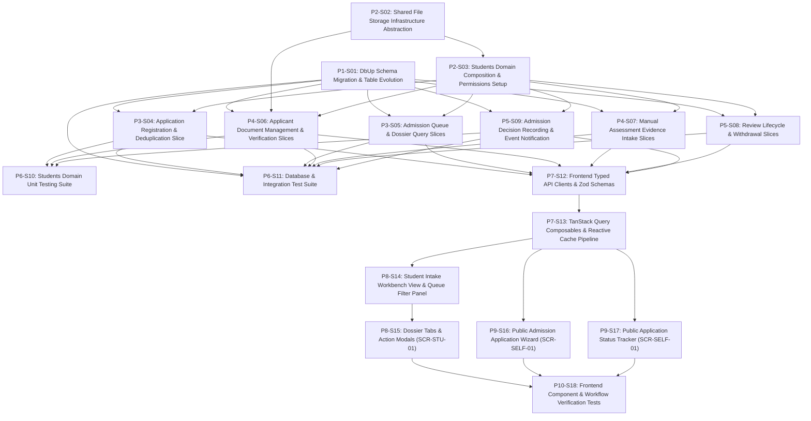

# 1. Objective

Implement the complete Stage 1 "Admission — full scope (entrance assessment evidence entered as manual/external input; full Academics integration deferred to Stage 2)" under the Student domain for Elsasa SIS V3. This implementation establishes prospective student identity management with deduplication matching, sequential traceable application numbering (`ADM-{Year}-{Seq:D4}`), multi-table atomic registration with guardian contact intake, isolated file storage abstraction (`IFileStorageService`) for applicant credential verification, manual entrance assessment evidence intake, immutable admission decision governance with deferral period validation, post-commit domain event publication (`ApplicantAcceptedEvent`), synchronous cross-domain inquiry against `IOperationsCalendarQueryService`, and dual frontend user surfaces: the staff-facing Student Intake Workbench (`SCR-STU-01`) and the public self-service Admission Portal and Status Tracker (`SCR-SELF-01`).

Planning Mode: FEATURE-PLANNING

Referenced artifacts:

- FEATURE:
  - `docs/issues/IS002 - STU-ADMISSION-ISSUE.md` (Intake `CR-STU-ADMISSION`)
  - `docs/domains/student-domain.md` (`STD-WF-01`, `STD-WF-02`)
  - `docs/sub-modul-and-development-phases.md` (Stage 1 Foundation: Admission — full scope)
  - `docs/use-cases.md` (`UC-STD-01`, `UC-STD-03`, `UC-ACD-07` Stage 1 manual score scope)
  - `docs/screen-inventory.md` (`SCR-STU-01`, `SCR-SELF-01`)
  - `docs/entities/student-entities.md` & `docs/entities/student-entities-tables.md` (Submodule 1 — Admission)
- ARCHITECTURE:
  - `docs/issues/IS002 - STU-ADMISSION-ARCHITECTURE.md` (Authoritative target capability architecture)
  - `docs/architecture/backend-architecture.md` (Modular Monolith & Vertical Slice specification)
  - `docs/architecture/frontend-architecture.md` (Modular Vue 3 SPA architecture)
  - `docs/architecture/adr.md` (ADR-001 through ADR-010)
  - `docs/architecture/coding-conventions.md` (C# 12, Dapper raw SQL, and Minimal API conventions)
- FEASIBILITY-ASSESSMENT:
  - `docs/issues/IS002 - STU-ADMISSION-FEASIBILITY-ASSESSMENT.md` (Status: `READY-FOR-PLANNING`)

Architecture Applicability: ARCHITECTURE-REQUIRED

This feature introduces significant database persistence expansion (in-place evolution of `students.applicants` and `students.admission_applications`, 4 new domain tables, 1 native database sequence), cross-domain synchronous consumption of `IOperationsCalendarQueryService`, asynchronous post-commit event publishing (`ApplicantAcceptedEvent`), a new storage abstraction (`IFileStorageService`), multiple backend vertical slices adhering to ADR-004 and ADR-005, and dual frontend applications (`SCR-STU-01` and `SCR-SELF-01`). Authoritative target architecture `docs/issues/IS002 - STU-ADMISSION-ARCHITECTURE.md` governs this plan.

---

# 2. Planning Scope

The planning scope encompasses all changes required across the database, storage infrastructure, contracts, backend vertical slices, test harness, and frontend surfaces:

1. **Database Persistence & DbUp Migrations (`Elsasa.Sis.Database`):**
   - Execute idempotent forward migration `20261103_0201_Students_Admission_Tables.sql`.
   - In-place schema evolution of `students.applicants` with backfilled `full_name`, identity fields (`government_id_type`, `government_id_number`), biographical information, contact address, origin school details, audit columns, filtered unique index `ux_students_applicants_gov_id`, and composite index `ix_students_applicants_name_dob`.
   - In-place schema evolution of `students.admission_applications` adding `admission_period_id` (UUID logical FK to Operations), `application_type`, `requested_entry_level`, `requested_campus`, `requested_program`, `registration_date`, partial unique index `ux_students_admission_applications_active` on `(applicant_id, admission_period_id) WHERE status NOT IN ('withdrawn', 'decided')`, and status/date indexes.
   - Creation of SQL Server sequence `students.admission_application_number_seq` starting at 1.
   - Creation of 4 new domain tables in `students`: `admission_decisions`, `applicant_documents`, `entrance_assessment_evidence`, and `admission_application_contacts` with `ON DELETE NO ACTION` foreign keys and indexes.

2. **Shared Storage Infrastructure Abstraction (`Elsasa.Sis.Shared.Storage`):**
   - Declaration of `IFileStorageService` interface in `Elsasa.Sis.Shared` for stream saving, reading, and deletion.
   - Implementation of `PhysicalFileStorageService` with local filesystem storage under `Storage:LocalRootPath` (`storage/documents/admission/{applicationId}/`).
   - Secure path sanitization, 5 MB file size limit enforcement, and MIME/extension whitelisting (`.pdf`, `.jpg`, `.jpeg`, `.png`).

3. **Domain Composition & Policy Permissions (`Elsasa.Sis.Students`):**
   - Declaration of authoritative permission constants `Permissions.Students.Admission.*` (`View`, `Register`, `Review`, `VerifyDocument`, `Decide`).
   - Extension method `AddStudentsDomain` in `Elsasa.Sis.Students/DependencyInjection.cs` registering all command and query handlers.
   - Host composition registration in `Elsasa.Sis.Api/Configuration/DependencyInjection.cs`.

4. **Backend Vertical Slices (`Elsasa.Sis.Students`):**
   - **Application Registration:** `RegisterApplication` handling applicant deduplication (by NIK or normalized name + DOB), cross-domain operational window verification via `IOperationsCalendarQueryService`, sequence-based numbering (`ADM-{Year}-{Seq:D4}`), and atomic multi-table insertion of applicant, application, and guardian contacts.
   - **Queue & Dossier Queries:** `GetAdmissionApplicationsList` (parameterized filterable work queue), `GetAdmissionApplicationById` (complete intake dossier projection), and `GetApplicationStatusByNumber` (anonymous/public status lookup).
   - **Document Management:** `UploadApplicantDocument` (multipart file upload via `IFileStorageService`), `DownloadApplicantDocument` (safe file streaming with MIME headers), and `VerifyApplicantDocument` (audit status transition to `verified` or `rejected`).
   - **Manual Assessment Evidence Intake:** `AddAssessmentEvidence`, `UpdateAssessmentEvidence`, and `DeleteAssessmentEvidence` for managing external diagnostic scores.
   - **Review Lifecycle & Withdrawal:** `StartApplicationReview` (`registered` -> `under_review`) and `WithdrawAdmissionApplication` (`status = 'withdrawn'`).
   - **Admission Decision Governance:** `RecordAdmissionDecision` enforcing decision immutability, validating deferral periods against Operations, atomically recording decisions, setting status to `decided`, and publishing `ApplicantAcceptedEvent` post-commit.

5. **Automated Testing Suite (`tests/backend`):**
   - Unit tests covering all FluentValidation validators, application number formatting, deduplication matching rules, and physical file storage security constraints.
   - SQL Server 2022 Testcontainers integration tests verifying migration execution, concurrent duplicate application rejection (409 Conflict), document file roundtrip streaming, assessment evidence CRUD, full review-to-decision lifecycle, and post-commit event publication.

6. **Frontend Typed API Clients, Schemas & Composables (`src/frontend`):**
   - Typed Axios API client modules for applications, documents, assessment evidence, and decisions.
   - Zod validation schemas for registration wizard, decision recording, assessment evidence, and document verification.
   - TanStack Query composables (`useAdmissionQueries.ts`, `useAdmissionMutations.ts`) with hierarchical query key factories and automated cache invalidation.

7. **Frontend Staff Intake Workbench (`SCR-STU-01` in `src/frontend`):**
   - Delivery of `StudentIntakeWorkbenchView.vue` at `/students/admission` (or `/students/intake`).
   - Work queue table with reactive filters (Admission Period, Status pills, Grade level, Search query).
   - Selected Application Dossier panel featuring:
     - Header summary with status pill and workflow action buttons (`Start Review`, `Record Decision`, `Withdraw`).
     - Tab 1: Application Info & Guardian Contacts card.
     - Tab 2: Document Verification checklist table with file inspection and verification modal.
     - Tab 3: Assessment Evidence cards with Add/Edit score modal.
     - Tab 4: Immutable Decision & Review History audit card.

8. **Frontend Public Admission Portal & Tracking Desk (`SCR-SELF-01` in `src/frontend`):**
   - Delivery of `AdmissionPortalView.vue` at `/admission/apply` (5-step registration wizard with public layout).
   - Delivery of `ApplicationTrackerView.vue` at `/admission/status` (self-service tracking desk by application number and birth date with sanitized public projection).
   - Comprehensive Vitest unit and component test suite.

---

# 3. Dependencies

### External System & Tooling Dependencies

- .NET 8 SDK (8.0.x)
- Docker / Docker Desktop / Podman (required for Testcontainers SQL Server 2022 integration tests)
- Microsoft SQL Server 2022 instance (for local Web API runtime)
- Node.js runtime (v22.x or LTS) and pnpm package manager (v9.x or v11.x)

### Internal Slice Dependencies

- `Depends On` declares implementation prerequisites between slices.
- Dependencies reference Slice IDs only.
- Dependency satisfaction requires the referenced slice to have implementation status `IMPLEMENTED`.
- Dependency satisfaction does not require review status `GO`.
- Slices with `Depends On: None` or whose dependencies are satisfied may be executed in parallel.

### Dependency Graph

---

# 4. Progress Summary

| Phase | Implementation Status | Review Status | Progress |
|---|---|---|---|
| P1 - Database Migration & Persistence Foundation | IMPLEMENTED | GO | 1/1 |
| P2 - Storage Infrastructure & Domain Permissions | IMPLEMENTED | GO | 2/2 |
| P3 - Backend Domain Slices: Registration & Queries | IMPLEMENTED | GO | 2/2 |
| P4 - Backend Domain Slices: Documents & Assessment Evidence | IMPLEMENTED | GO | 2/2 |
| P5 - Backend Domain Slices: Review & Decision Lifecycle | IMPLEMENTED | GO | 2/2 |
| P6 - Backend Automated Testing & Verification | IMPLEMENTED | GO | 2/2 |
| P7 - Frontend API Clients, Schemas & Composables | IMPLEMENTED | GO | 2/2 |
| P8 - Frontend Staff Intake Workbench (SCR-STU-01) | IMPLEMENTED | GO | 2/2 |
| P9 - Frontend Public Admission Portal (SCR-SELF-01) | IMPLEMENTED | GO | 2/2 |
| P10 - Frontend Verification & Workflow Testing | IMPLEMENTED | GO | 1/1 |

---

# 5. Phases

## P1 - Database Migration & Persistence Foundation

Implementation Status: IMPLEMENTED
Review Status: GO

### P1-S01

Title: DbUp Schema Migration & Table Evolution

Implementation Status: IMPLEMENTED
Review Status: GO

Objective:
Create and register the idempotent forward DbUp migration script `20261103_0201_Students_Admission_Tables.sql` in `src/backend/Elsasa.Sis.Database/Scripts/`. The script non-destructively alters `students.applicants` to match `student-entities-tables.md` (backfilling `full_name` and adding identity, biographical, and audit columns), alters `students.admission_applications` (adding `admission_period_id`, `application_type`, `requested_entry_level`, `registration_date`, and partial active application index), creates sequence `students.admission_application_number_seq`, and creates 4 new domain tables (`admission_decisions`, `applicant_documents`, `entrance_assessment_evidence`, `admission_application_contacts`) with complete indexes and `ON DELETE NO ACTION` foreign keys.

Depends On: None

Repository: elsasa-sis-v3 (backend)

Completion Criteria:
1. File `src/backend/Elsasa.Sis.Database/Scripts/20261103_0201_Students_Admission_Tables.sql` exists and is embedded in `Elsasa.Sis.Database.csproj`.
2. Script alters `students.applicants`:
   - Adds `full_name NVARCHAR(200) NOT NULL` with temporary default constraint.
   - Backfills: `UPDATE students.applicants SET full_name = LTRIM(RTRIM(CONCAT(ISNULL(first_name, ''), ' ', ISNULL(last_name, '')))) WHERE full_name = '';`.
   - Drops the temporary default constraint.
   - Adds `preferred_name NVARCHAR(100) NULL`, `place_of_birth NVARCHAR(100) NULL`, `nationality NVARCHAR(100) NULL DEFAULT ('Indonesian')`.
   - Adds `government_id_type NVARCHAR(32) NULL`, `government_id_number NVARCHAR(64) NULL`.
   - Adds `address NVARCHAR(MAX) NULL`, `previous_school_name NVARCHAR(200) NULL`, `previous_school_address NVARCHAR(MAX) NULL`, `notes NVARCHAR(MAX) NULL`.
   - Adds `updated_at DATETIMEOFFSET(7) NULL`, `updated_by NVARCHAR(100) NULL`.
   - Creates filtered unique index `ux_students_applicants_gov_id` ON `(government_id_number) WHERE government_id_number IS NOT NULL`.
   - Creates composite index `ix_students_applicants_name_dob` ON `(full_name, date_of_birth)`.
3. Script alters `students.admission_applications`:
   - Adds `admission_period_id UNIQUEIDENTIFIER NOT NULL`.
   - Adds `application_type NVARCHAR(32) NOT NULL DEFAULT ('new')`.
   - Adds `requested_entry_level NVARCHAR(64) NOT NULL`.
   - Adds `requested_campus NVARCHAR(100) NULL`, `requested_program NVARCHAR(100) NULL`.
   - Adds `registration_date DATE NOT NULL DEFAULT (CAST(GETUTCDATE() AS DATE))`.
   - Adds `notes NVARCHAR(MAX) NULL`, `updated_at DATETIMEOFFSET(7) NULL`, `updated_by NVARCHAR(100) NULL`.
   - Creates partial unique index `ux_students_admission_applications_active` ON `(applicant_id, admission_period_id) WHERE status NOT IN ('withdrawn', 'decided')`.
   - Creates composite index `ix_students_admission_applications_period_status` ON `(admission_period_id, status)`.
   - Creates index `ix_students_admission_applications_reg_date` ON `(registration_date DESC)`.
4. Script creates sequence:
   - `CREATE SEQUENCE students.admission_application_number_seq AS INT START WITH 1 INCREMENT BY 1 NO CYCLE;`.
5. Script creates 4 domain tables:
   - `students.admission_decisions` (`id`, `application_id`, `decision_type`, `decision_date`, `effective_date`, `decided_by`, `reason`, `supporting_reference`, `deferred_admission_period_id`, `created_at`, `created_by`) with unique constraint on `application_id` and FK to `admission_applications(id)`.
   - `students.applicant_documents` (`id`, `application_id`, `document_type`, `submission_status` DEFAULT `'not_submitted'`, `submitted_date`, `verified_date`, `verified_by`, `file_reference`, `file_name`, `file_size_bytes`, `content_type`, `notes`, `created_at`, `created_by`, `updated_at`, `updated_by`) with index `ix_students_applicant_documents_app_status`.
   - `students.entrance_assessment_evidence` (`id`, `application_id`, `assessment_type`, `score`, `source` DEFAULT `'External Assessment Center'`, `assessment_date`, `notes`, `created_at`, `created_by`, `updated_at`, `updated_by`) with index `ix_students_assessment_evidence_app`.
   - `students.admission_application_contacts` (`id`, `application_id`, `full_name`, `relationship`, `phone`, `email`, `address`, `is_primary` DEFAULT 1, `created_at`, `created_by`) with index `ix_students_application_contacts_app`.
6. All foreign key constraints declare `ON DELETE NO ACTION`.
7. `dotnet build src/backend/Elsasa.Sis.Database/` succeeds cleanly without warnings.

Implementation Notes:
- Authored idempotent forward migration `src/backend/Elsasa.Sis.Database/Scripts/20261103_0201_Students_Admission_Tables.sql`.
- In-place evolution for `students.applicants` adds `full_name` (backfilled from `first_name` and `last_name`), `preferred_name`, `place_of_birth`, `nationality`, `government_id_type`, `government_id_number`, `address`, previous school details, `notes`, and audit timestamps. Added filtered unique index `ux_students_applicants_gov_id` and composite index `ix_students_applicants_name_dob`.
- In-place evolution for `students.admission_applications` adds `admission_period_id`, `application_type`, `requested_entry_level`, campus/program preferences, `registration_date`, notes, and audit timestamps. Added partial unique index `ux_students_admission_applications_active`, period-status composite index, and registration date index.
- Created sequence `students.admission_application_number_seq` starting at 1.
- Created 4 domain tables: `students.admission_decisions`, `students.applicant_documents`, `students.entrance_assessment_evidence`, and `students.admission_application_contacts` with `ON DELETE NO ACTION` foreign keys and indexes.
- Embedded resource presence verified in assembly `Elsasa.Sis.Database.dll` and build completed with 0 warnings and 0 errors.

Changed Files:
- `src/backend/Elsasa.Sis.Database/Scripts/20261103_0201_Students_Admission_Tables.sql`
- `docs/issues/IS002 - STU-ADMISSION-IMPLEMENTATION-PLAN.md`

---

## P2 - Storage Infrastructure & Domain Permissions

Implementation Status: IMPLEMENTED
Review Status: GO

### P2-S02

Title: Shared File Storage Infrastructure Abstraction & Implementation

Implementation Status: IMPLEMENTED
Review Status: GO

Objective:
Declare the storage abstraction interface `IFileStorageService` and records `StoredFileResult`, `FileStreamResult` in `src/backend/Elsasa.Sis.Shared/Storage/`, and implement `PhysicalFileStorageService` storing files under a configurable local directory (`Storage:LocalRootPath`) with directory traversal protection, 5 MB file size limit, and whitelisted extensions/MIME validation (`.pdf`, `.jpg`, `.jpeg`, `.png`).

Depends On: None

Repository: elsasa-sis-v3 (backend)

Completion Criteria:
1. File `src/backend/Elsasa.Sis.Shared/Storage/IFileStorageService.cs` declares:
   - `Task<Result<StoredFileResult>> SaveFileAsync(Stream stream, string fileName, string contentType, string category, CancellationToken ct = default);`
   - `Task<Result<FileStreamResult>> OpenReadStreamAsync(string fileReference, CancellationToken ct = default);`
   - `Task<Result> DeleteFileAsync(string fileReference, CancellationToken ct = default);`
2. DTO records `StoredFileResult(string FileReference, string FileName, long SizeBytes, string ContentType)` and `FileStreamResult(Stream Stream, string ContentType, string FileName)` are declared.
3. Class `PhysicalFileStorageService` in `Elsasa.Sis.Shared/Storage/PhysicalFileStorageService.cs` implements `IFileStorageService`:
   - Strips directory path components from incoming file names (`Path.GetFileName`).
   - Rejects unsupported extensions and MIME types (`DomainError.Validation("Storage.InvalidContentType", ...)`).
   - Rejects streams larger than 5 MB (`DomainError.Validation("Storage.FileTooLarge", ...)`).
   - Stores files in `storage/documents/admission/{applicationId}/{documentType}_{guid}{ext}`.
   - Provides safe read streaming via `FileShare.Read`.
4. Extension method `AddSharedStorage(this IServiceCollection services, IConfiguration configuration)` registers `PhysicalFileStorageService` as a singleton/scoped service.
5. Unit tests in `tests/backend/Elsasa.Sis.IntegrationTests/UnitTests/Storage/PhysicalFileStorageServiceTests.cs` verify file saving, invalid extension rejection, and file streaming.
6. `dotnet build src/backend/Elsasa.Sis.Shared/` succeeds.

Implementation Notes:
- Declared `IFileStorageService` abstraction and sealed DTO records `StoredFileResult` and `FileStreamResult` in `src/backend/Elsasa.Sis.Shared/Storage/IFileStorageService.cs`.
- Defined `FileStorageOptions` with section name `"Storage"` and default path `"App_Data/storage"`.
- Implemented `PhysicalFileStorageService` with:
  - Directory traversal prevention across both category paths and user-supplied file names (`..` detection and root boundary verification).
  - Whitelisted file extensions (`.pdf`, `.jpg`, `.jpeg`, `.png`) and corresponding verified MIME types (`application/pdf`, `image/jpeg`, `image/png`), returning `Storage.InvalidContentType` on mismatch or unsupported formats.
  - 5 MB stream size limit (`5 * 1024 * 1024` bytes) enforced on both seekable and chunked non-seekable streams, returning `Storage.FileTooLarge`.
  - Unique file name generation using `{baseName}_{guid}{ext}` and storage under `{root}/{category}/`.
  - Safe read streaming using `FileShare.Read`.
  - Safe deletion with not found handling and error reporting.
- Created `StorageServiceCollectionExtensions` with `AddSharedStorage(this IServiceCollection services, IConfiguration configuration)`.
- Authored 20 unit test cases in `PhysicalFileStorageServiceTests.cs` verifying PDF and image persistence, extension rejection, MIME mismatch rejection, seekable and non-seekable file size limit enforcement, directory traversal resistance, file streaming, deletion, and DI registration.
- Build succeeded with 0 warnings and 0 errors across `Elsasa.Sis.Shared` and `Elsasa.Sis.IntegrationTests`.

Changed Files:
- `src/backend/Elsasa.Sis.Shared/Storage/IFileStorageService.cs`
- `src/backend/Elsasa.Sis.Shared/Storage/FileStorageOptions.cs`
- `src/backend/Elsasa.Sis.Shared/Storage/PhysicalFileStorageService.cs`
- `src/backend/Elsasa.Sis.Shared/Storage/StorageServiceCollectionExtensions.cs`
- `tests/backend/Elsasa.Sis.IntegrationTests/UnitTests/Storage/PhysicalFileStorageServiceTests.cs`
- `docs/issues/IS002 - STU-ADMISSION-IMPLEMENTATION-PLAN.md`

---

### P2-S03

Title: Students Domain Composition & Permissions Setup

Implementation Status: IMPLEMENTED
Review Status: GO

Objective:
Declare authoritative permission constants in `Elsasa.Sis.Students/Permissions.cs`, register the Students domain dependency injection extension `AddStudentsDomain` in `Elsasa.Sis.Students/DependencyInjection.cs`, and wire up `services.AddStudentsDomain()` and `services.AddSharedStorage(configuration)` into `Elsasa.Sis.Api/Configuration/DependencyInjection.cs`.

Depends On: P2-S02

Repository: elsasa-sis-v3 (backend)

Completion Criteria:
1. File `src/backend/Elsasa.Sis.Students/Permissions.cs` declares:
   - `Permissions.Students.Admission.View = "Permissions.Students.Admission.View"`
   - `Permissions.Students.Admission.Register = "Permissions.Students.Admission.Register"`
   - `Permissions.Students.Admission.Review = "Permissions.Students.Admission.Review"`
   - `Permissions.Students.Admission.VerifyDocument = "Permissions.Students.Admission.VerifyDocument"`
   - `Permissions.Students.Admission.Decide = "Permissions.Students.Admission.Decide"`
2. File `src/backend/Elsasa.Sis.Students/DependencyInjection.cs` exposes `public static IServiceCollection AddStudentsDomain(this IServiceCollection services)`.
3. `src/backend/Elsasa.Sis.Api/Configuration/DependencyInjection.cs` registers `services.AddStudentsDomain();` and `services.AddSharedStorage(configuration);`.
4. `dotnet build src/backend/Elsasa.Sis.Api/` succeeds.

Implementation Notes:
- Added `Microsoft.AspNetCore.App` framework reference to `src/backend/Elsasa.Sis.Students/Elsasa.Sis.Students.csproj`.
- Declared authoritative permission constants under `Elsasa.Sis.Students.Permissions.Students.Admission` (`View`, `Register`, `Review`, `VerifyDocument`, `Decide`) conforming to ADR-009 and the Architecture security matrix.
- Implemented `AddStudentsDomain(this IServiceCollection services)` registering policy-based authorization policies for all Admission permissions with appropriate role and permission claim assertions.
- Registered `services.AddStudentsDomain()` and `services.AddSharedStorage(configuration)` into `Elsasa.Sis.Api/Configuration/DependencyInjection.cs`.
- Authored 12 unit test cases in `tests/backend/Elsasa.Sis.IntegrationTests/UnitTests/Students/StudentsDomainCompositionTests.cs` verifying permission constants, authorization policy evaluations, role assertions, and host DI composition.
- Verified all builds succeed with 0 warnings/errors and all architecture and unit test suites pass cleanly.

Changed Files:
- `src/backend/Elsasa.Sis.Students/Elsasa.Sis.Students.csproj`
- `src/backend/Elsasa.Sis.Students/Permissions.cs`
- `src/backend/Elsasa.Sis.Students/DependencyInjection.cs`
- `src/backend/Elsasa.Sis.Api/Configuration/DependencyInjection.cs`
- `tests/backend/Elsasa.Sis.IntegrationTests/UnitTests/Students/StudentsDomainCompositionTests.cs`
- `docs/issues/IS002 - STU-ADMISSION-IMPLEMENTATION-PLAN.md`

---

## P3 - Backend Domain Slices: Registration & Queries

Implementation Status: IMPLEMENTED
Review Status: GO

### P3-S04

Title: Applicant Deduplication, Number Formatting & Application Registration

Implementation Status: IMPLEMENTED
Review Status: GO

Objective:
Implement the vertical slice `RegisterApplication` in `src/backend/Elsasa.Sis.Students/Features/Admission/RegisterApplication/` handling staff-assisted and self-service registration. The command performs cross-domain period validation via `IOperationsCalendarQueryService`, executes applicant deduplication matching, enforces single active application uniqueness per period, generates sequential numbers `ADM-{Year}-{Seq:D4}`, and executes an atomic multi-table transaction inserting applicant, application, and guardian contacts.

Depends On: P1-S01, P2-S03

Repository: elsasa-sis-v3 (backend)

Completion Criteria:
1. Directory `src/backend/Elsasa.Sis.Students/Features/Admission/RegisterApplication/` contains:
   - `RegisterApplicationEndpoint.cs`: Maps `POST /api/students/admission/applications` with `.RequireAuthorization(Permissions.Students.Admission.Register)` and `POST /api/students/admission/portal/applications` with `.AllowAnonymous()`.
   - `RegisterApplicationRequest.cs`: Record defining applicant profile details (`full_name`, `date_of_birth`, `gender`, `government_id_type`, `government_id_number`, `email`, `phone`, `address`, `previous_school_name`), application target (`admission_period_id`, `application_type`, `requested_entry_level`, `requested_campus`, `requested_program`), contacts collection (`full_name`, `relationship`, `phone`, `email`, `address`, `is_primary`), and optional `bypass_window_check` flag.
   - `RegisterApplicationResponse.cs`: Record returning `Id`, `ApplicationNumber`, `ApplicantId`, `Status`, `RegistrationDate`.
   - `RegisterApplicationValidator.cs`: FluentValidation rules ensuring mandatory fields, valid emails/phones, and at least one primary guardian contact.
   - `RegisterApplicationHandler.cs`: Command handler executing Dapper operations.
2. Handler queries `IOperationsCalendarQueryService.GetOperationalPeriodByIdAsync(request.AdmissionPeriodId)`:
   - Validates period exists and has status `active` or `approved`.
   - Extracts parent `AcademicYearId`.
   - Validates current date falls between period start and end dates (unless bypassed with staff permission).
3. Handler performs applicant identity deduplication:
   - Matches by `government_id_number` or normalized `(UPPER(LTRIM(RTRIM(full_name))), date_of_birth)`.
   - Reuses existing `applicantId` or inserts new record into `students.applicants`.
4. Handler checks for active existing application in the same period: returns 409 Conflict (`Admission.DuplicateActiveApplication`) if count > 0.
5. Handler queries sequence `SELECT NEXT VALUE FOR students.admission_application_number_seq` and formats number as `$"ADM-{yearCode}-{seq:D4}"`.
6. Multi-table write executes inside `await using var tx = await connection.BeginTransactionAsync(ct)` inserting application and contacts atomically.
7. Handler is registered in `AddStudentsDomain()`.
8. `dotnet build src/backend/Elsasa.Sis.Students/` succeeds.

Implementation Notes:
- Authored `ApplicationNumberFormatter` in `src/backend/Elsasa.Sis.Students/Features/Admission/Common/` supporting sequential numbering in `ADM-{Year}-{Seq:D4}` format using `CultureInfo.InvariantCulture`.
- Implemented `RegisterApplicationRequest`, `RegisterApplicationContactRequest`, and `RegisterApplicationResponse` records capturing applicant profile, guardian contacts, preferences, and return metadata.
- Implemented `RegisterApplicationValidator` and `RegisterApplicationContactValidator` enforcing name, date of birth (must not be in future), email, phone pattern, and required primary guardian contact.
- Implemented `RegisterApplicationHandler` querying `IOperationsCalendarQueryService.GetOperationalPeriodByIdAsync` for operational window validation and academic year resolution; supporting authorized staff window bypass; performing deduplication lookup by government ID or normalized name + DOB; preventing duplicate active applications per period; drawing sequential number from `students.admission_application_number_seq`; and executing atomic multi-table persistence across `students.applicants`, `students.admission_applications`, and `students.admission_application_contacts`.
- Implemented `RegisterApplicationEndpoint` exposing both staff (`POST /api/students/admission/applications`, protected by `Permissions.Students.Admission.Register`) and public portal (`POST /api/students/admission/portal/applications`, anonymous) Minimal API routes.
- Registered `RegisterApplicationHandler` in `src/backend/Elsasa.Sis.Students/DependencyInjection.cs`.
- Verified `dotnet build src/backend/Elsasa.Sis.Students/` and `dotnet build src/backend/Elsasa.Sis.Api/` build with 0 warnings and 0 errors.

Changed Files:
- `src/backend/Elsasa.Sis.Students/Features/Admission/Common/ApplicationNumberFormatter.cs`
- `src/backend/Elsasa.Sis.Students/Features/Admission/RegisterApplication/RegisterApplicationRequest.cs`
- `src/backend/Elsasa.Sis.Students/Features/Admission/RegisterApplication/RegisterApplicationResponse.cs`
- `src/backend/Elsasa.Sis.Students/Features/Admission/RegisterApplication/RegisterApplicationValidator.cs`
- `src/backend/Elsasa.Sis.Students/Features/Admission/RegisterApplication/RegisterApplicationHandler.cs`
- `src/backend/Elsasa.Sis.Students/Features/Admission/RegisterApplication/RegisterApplicationEndpoint.cs`
- `src/backend/Elsasa.Sis.Students/DependencyInjection.cs`
- `docs/issues/IS002 - STU-ADMISSION-IMPLEMENTATION-PLAN.md`

---

### P3-S05

Title: Admission Queue & Dossier Query Slices

Implementation Status: IMPLEMENTED
Review Status: GO

Objective:
Implement read-side query slices in `src/backend/Elsasa.Sis.Students/Features/Admission/`: `GetAdmissionApplicationsList` (parameterized work queue), `GetAdmissionApplicationById` (complete intake dossier projection), and `GetApplicationStatusByNumber` (public tracking lookup).

Depends On: P1-S01, P2-S03

Repository: elsasa-sis-v3 (backend)

Completion Criteria:
1. `GetAdmissionApplicationsList/`:
   - Endpoint: `GET /api/students/admission/applications` mapped with `.RequireAuthorization(Permissions.Students.Admission.View)`.
   - Accepts query params: `admissionPeriodId` (Guid?), `status` (string?), `requestedEntryLevel` (string?), `searchTerm` (string?), `page` (int), `pageSize` (int).
   - Executes parameterized Dapper SQL returning list items: `Id`, `ApplicationNumber`, `ApplicantName`, `GovernmentIdNumber`, `AdmissionPeriodId`, `RequestedEntryLevel`, `Status`, `RegistrationDate`.
2. `GetAdmissionApplicationById/`:
   - Endpoint: `GET /api/students/admission/applications/{id}` mapped with `.RequireAuthorization(Permissions.Students.Admission.View)`.
   - Queries and returns comprehensive dossier:
     - Application header & placement details.
     - Applicant biographical information (`students.applicants`).
     - Guardian contacts collection (`students.admission_application_contacts`).
     - Uploaded documents collection (`students.applicant_documents`).
     - Manual entrance assessment evidence collection (`students.entrance_assessment_evidence`).
     - Admission decision record (`students.admission_decisions`, if decided).
   - Returns 404 Not Found if application does not exist.
3. `GetApplicationStatusByNumber/`:
   - Endpoint: `GET /api/students/admission/applications/status` mapped with `.AllowAnonymous()`.
   - Accepts query params: `applicationNumber` (string), `dateOfBirth` (DateOnly).
   - Queries application matching both number and applicant birth date.
   - Returns sanitized public projection DTO: `ApplicationNumber`, `ApplicantFullName`, `RequestedEntryLevel`, `Status`, `RegistrationDate`, `DocumentStatuses` (document_type and submission_status only), and `DecisionNotice` (decision_type and effective_date; internal notes omitted).
   - Returns 404 Not Found if no match.
4. Handlers registered in `AddStudentsDomain()`.
5. `dotnet build src/backend/Elsasa.Sis.Students/` succeeds.

Implementation Notes:
- Implemented `GetAdmissionApplicationsList` vertical slice (`AdmissionApplicationListItemResponse`, `GetAdmissionApplicationsListHandler`, `GetAdmissionApplicationsListEndpoint`):
  - Maps `GET /api/students/admission/applications` with `.RequireAuthorization(Permissions.Students.Admission.View)`.
  - Executes parameterized Dapper query filtering on `admissionPeriodId`, `status`, `requestedEntryLevel`, and case-insensitive wildcard pattern matching against application number, full name, or government ID.
  - Supports configurable pagination via `page` and `pageSize` (`OFFSET ... ROWS FETCH NEXT ... ROWS ONLY`).
- Implemented `GetAdmissionApplicationById` vertical slice (`AdmissionApplicationDetailResponse`, `GetAdmissionApplicationByIdHandler`, `GetAdmissionApplicationByIdEndpoint`):
  - Maps `GET /api/students/admission/applications/{id:guid}` with `.RequireAuthorization(Permissions.Students.Admission.View)`.
  - Executes single roundtrip multi-query (`QueryMultipleAsync`) loading application header, applicant biography, guardian contacts, uploaded documents, manual entrance assessment evidence, and admission decision.
  - Returns RFC 7807 404 ProblemDetails if application or applicant does not exist.
- Implemented `GetApplicationStatusByNumber` vertical slice (`ApplicationStatusResponse`, `GetApplicationStatusByNumberHandler`, `GetApplicationStatusByNumberEndpoint`):
  - Maps `GET /api/students/admission/applications/status` with `.AllowAnonymous()`.
  - Queries application strictly matching both `application_number` and applicant `date_of_birth`.
  - Returns sanitized public tracking projection with document types/statuses and public decision notice (internal reasons and administrative notes strictly excluded).
  - Returns RFC 7807 404 ProblemDetails if no matching application is found.
- Registered all 3 query handlers as scoped services in `AddStudentsDomain()` within `Elsasa.Sis.Students/DependencyInjection.cs`.
- Authored unit test `AddStudentsDomain_Should_RegisterAdmissionQueryHandlers` in `StudentsDomainCompositionTests.cs` verifying service registrations.
- Verified `dotnet build src/backend/Elsasa.Sis.Students/` and `dotnet build src/backend/Elsasa.Sis.Api/` build cleanly with 0 warnings and 0 errors, and all integration/architecture test suites pass.

Changed Files:
- `src/backend/Elsasa.Sis.Students/Features/Admission/GetAdmissionApplicationsList/AdmissionApplicationListItemResponse.cs`
- `src/backend/Elsasa.Sis.Students/Features/Admission/GetAdmissionApplicationsList/GetAdmissionApplicationsListHandler.cs`
- `src/backend/Elsasa.Sis.Students/Features/Admission/GetAdmissionApplicationsList/GetAdmissionApplicationsListEndpoint.cs`
- `src/backend/Elsasa.Sis.Students/Features/Admission/GetAdmissionApplicationById/AdmissionApplicationDetailResponse.cs`
- `src/backend/Elsasa.Sis.Students/Features/Admission/GetAdmissionApplicationById/GetAdmissionApplicationByIdHandler.cs`
- `src/backend/Elsasa.Sis.Students/Features/Admission/GetAdmissionApplicationById/GetAdmissionApplicationByIdEndpoint.cs`
- `src/backend/Elsasa.Sis.Students/Features/Admission/GetApplicationStatusByNumber/ApplicationStatusResponse.cs`
- `src/backend/Elsasa.Sis.Students/Features/Admission/GetApplicationStatusByNumber/GetApplicationStatusByNumberHandler.cs`
- `src/backend/Elsasa.Sis.Students/Features/Admission/GetApplicationStatusByNumber/GetApplicationStatusByNumberEndpoint.cs`
- `src/backend/Elsasa.Sis.Students/DependencyInjection.cs`
- `tests/backend/Elsasa.Sis.IntegrationTests/UnitTests/Students/StudentsDomainCompositionTests.cs`
- `docs/issues/IS002 - STU-ADMISSION-IMPLEMENTATION-PLAN.md`

---

## P4 - Backend Domain Slices: Documents & Assessment Evidence

Implementation Status: IMPLEMENTED
Review Status: GO

### P4-S06

Title: Applicant Document Management & Verification Slices

Implementation Status: IMPLEMENTED
Review Status: GO

Objective:
Implement document handling vertical slices in `src/backend/Elsasa.Sis.Students/Features/Admission/Documents/`: `UploadApplicantDocument` (multipart upload via `IFileStorageService`), `DownloadApplicantDocument` (file content streaming), and `VerifyApplicantDocument` (verification state audit update).

Depends On: P1-S01, P2-S02, P2-S03

Repository: elsasa-sis-v3 (backend)

Completion Criteria:
1. `UploadApplicantDocument/`:
   - Endpoint: `POST /api/students/admission/applications/{id}/documents` accepting `IFormFile` and `documentType` form field.
   - Enforces 5 MB size limit and approved extensions (`.pdf`, `.jpg`, `.jpeg`, `.png`).
   - Calls `IFileStorageService.SaveFileAsync` storing under `storage/documents/admission/{applicationId}/`.
   - Inserts or updates row in `students.applicant_documents` with `submission_status = 'submitted'`, `file_reference`, `file_name`, `file_size_bytes`, `content_type`, and `submitted_date = GETUTCDATE()`.
   - Returns 200 OK with document record ID and file reference.
2. `DownloadApplicantDocument/`:
   - Endpoint: `GET /api/students/admission/applications/{id}/documents/{docId}/file` mapped with `.RequireAuthorization(Permissions.Students.Admission.View)`.
   - Queries `file_reference` and `content_type` from `students.applicant_documents`.
   - Calls `IFileStorageService.OpenReadStreamAsync(fileReference)`.
   - Returns `Results.Stream` with appropriate `Content-Type` and `Content-Disposition`.
3. `VerifyApplicantDocument/`:
   - Endpoint: `PUT /api/students/admission/applications/{id}/documents/{docId}/verify` mapped with `.RequireAuthorization(Permissions.Students.Admission.VerifyDocument)`.
   - Request body: `submissionStatus` (`verified` or `rejected`), `notes`.
   - Updates `submission_status`, `verified_by = currentUser.Username`, `verified_date = CAST(GETUTCDATE() AS DATE)`, and `notes`.
4. Handlers registered in `AddStudentsDomain()`.
5. `dotnet build src/backend/Elsasa.Sis.Students/` succeeds.

Implementation Notes:
- Implemented `UploadApplicantDocument` vertical slice (`UploadApplicantDocumentResponse`, `UploadApplicantDocumentHandler`, `UploadApplicantDocumentEndpoint`):
  - Maps `POST /api/students/admission/applications/{id}/documents` with multipart form handling and `.DisableAntiforgery()`.
  - Enforces 5 MB file size limit (`MaxFileSizeBytes`) and approved extensions (`.pdf`, `.jpg`, `.jpeg`, `.png`).
  - Validates application existence and prevents uploads for withdrawn applications.
  - Saves file to physical disk via `IFileStorageService.SaveFileAsync` under category `documents/admission/{applicationId}`.
  - Atomically inserts or updates row in `students.applicant_documents` with `submission_status = 'submitted'`, `file_reference`, `file_name`, `file_size_bytes`, `content_type`, and `submitted_date = CAST(GETUTCDATE() AS DATE)`.
  - Cleans up previously uploaded file on storage upon document re-upload.
  - Returns 200 OK with document record ID and file reference metadata.
- Implemented `DownloadApplicantDocument` vertical slice (`DownloadApplicantDocumentHandler`, `DownloadApplicantDocumentEndpoint`):
  - Maps `GET /api/students/admission/applications/{id}/documents/{docId}/file` with `.RequireAuthorization(Permissions.Students.Admission.View)`.
  - Queries document metadata (`file_reference`, `content_type`, `file_name`) from `students.applicant_documents`.
  - Opens safe read stream via `IFileStorageService.OpenReadStreamAsync(fileReference)`.
  - Returns `Results.Stream` with content type and `fileDownloadName` for Content-Disposition handling.
- Implemented `VerifyApplicantDocument` vertical slice (`VerifyApplicantDocumentRequest`, `VerifyApplicantDocumentResponse`, `VerifyApplicantDocumentValidator`, `VerifyApplicantDocumentHandler`, `VerifyApplicantDocumentEndpoint`):
  - Maps `PUT /api/students/admission/applications/{id}/documents/{docId}/verify` with `.RequireAuthorization(Permissions.Students.Admission.VerifyDocument)`.
  - Validates request payload using FluentValidation (`submissionStatus` in `verified`/`rejected`, notes max length 2000).
  - Validates application is not withdrawn and document exists.
  - Updates `submission_status`, `verified_by = currentUser.Username`, `verified_date = CAST(GETUTCDATE() AS DATE)`, and `notes`.
  - Returns 200 OK with updated verification state.
- Registered all 3 handlers as scoped services in `AddStudentsDomain()` within `Elsasa.Sis.Students/DependencyInjection.cs`.
- Authored unit test suites `VerifyApplicantDocumentValidatorTests` and `ApplicantDocumentHandlerUnitTests` (13 test cases covering validation rules, size limits, disallowed extensions, invalid status values, and service registration).
- Verified `dotnet build src/backend/Elsasa.Sis.Students/` and `dotnet build src/backend/Elsasa.Sis.Api/` build cleanly with 0 warnings/errors, all unit tests pass, and all 26 architecture tests pass.

Changed Files:
- `src/backend/Elsasa.Sis.Students/Features/Admission/Documents/UploadApplicantDocument/UploadApplicantDocumentResponse.cs`
- `src/backend/Elsasa.Sis.Students/Features/Admission/Documents/UploadApplicantDocument/UploadApplicantDocumentHandler.cs`
- `src/backend/Elsasa.Sis.Students/Features/Admission/Documents/UploadApplicantDocument/UploadApplicantDocumentEndpoint.cs`
- `src/backend/Elsasa.Sis.Students/Features/Admission/Documents/DownloadApplicantDocument/DownloadApplicantDocumentHandler.cs`
- `src/backend/Elsasa.Sis.Students/Features/Admission/Documents/DownloadApplicantDocument/DownloadApplicantDocumentEndpoint.cs`
- `src/backend/Elsasa.Sis.Students/Features/Admission/Documents/VerifyApplicantDocument/VerifyApplicantDocumentRequest.cs`
- `src/backend/Elsasa.Sis.Students/Features/Admission/Documents/VerifyApplicantDocument/VerifyApplicantDocumentResponse.cs`
- `src/backend/Elsasa.Sis.Students/Features/Admission/Documents/VerifyApplicantDocument/VerifyApplicantDocumentValidator.cs`
- `src/backend/Elsasa.Sis.Students/Features/Admission/Documents/VerifyApplicantDocument/VerifyApplicantDocumentHandler.cs`
- `src/backend/Elsasa.Sis.Students/Features/Admission/Documents/VerifyApplicantDocument/VerifyApplicantDocumentEndpoint.cs`
- `src/backend/Elsasa.Sis.Students/DependencyInjection.cs`
- `tests/backend/Elsasa.Sis.IntegrationTests/UnitTests/Students/StudentsDomainCompositionTests.cs`
- `tests/backend/Elsasa.Sis.IntegrationTests/UnitTests/Students/VerifyApplicantDocumentValidatorTests.cs`
- `tests/backend/Elsasa.Sis.IntegrationTests/UnitTests/Students/ApplicantDocumentHandlerUnitTests.cs`
- `docs/issues/IS002 - STU-ADMISSION-IMPLEMENTATION-PLAN.md`

---

### P4-S07

Title: Manual Assessment Evidence Intake Slices

Implementation Status: IMPLEMENTED
Review Status: GO

Objective:
Implement vertical slices in `src/backend/Elsasa.Sis.Students/Features/Admission/AssessmentEvidence/` for capturing manual external diagnostic assessment results: `AddAssessmentEvidence`, `UpdateAssessmentEvidence`, and `DeleteAssessmentEvidence`.

Depends On: P1-S01, P2-S03

Repository: elsasa-sis-v3 (backend)

Completion Criteria:
1. `AddAssessmentEvidence/`:
   - Endpoint: `POST /api/students/admission/applications/{id}/assessment-evidence` mapped with `.RequireAuthorization(Permissions.Students.Admission.Review)`.
   - Request: `assessmentType` (string, max 100), `score` (string, max 50), `source` (string, default "External Assessment Center"), `assessmentDate` (DateOnly?), `notes` (string?).
   - Verifies application exists and is not `withdrawn` or `decided`.
   - Inserts record into `students.entrance_assessment_evidence` with new GUID.
   - Returns 201 Created with created record ID.
2. `UpdateAssessmentEvidence/`:
   - Endpoint: `PUT /api/students/admission/applications/{id}/assessment-evidence/{evidenceId}` mapped with `.RequireAuthorization(Permissions.Students.Admission.Review)`.
   - Updates `assessment_type`, `score`, `source`, `assessment_date`, `notes`, `updated_at`, `updated_by`.
   - Returns 200 OK.
3. `DeleteAssessmentEvidence/`:
   - Endpoint: `DELETE /api/students/admission/applications/{id}/assessment-evidence/{evidenceId}` mapped with `.RequireAuthorization(Permissions.Students.Admission.Review)`.
   - Deletes record from `students.entrance_assessment_evidence`.
   - Returns 204 No Content.
4. FluentValidation schemas validate non-empty assessment type, score length <= 50, and valid assessment dates.
5. Handlers registered in `AddStudentsDomain()`.
6. `dotnet build src/backend/Elsasa.Sis.Students/` succeeds.

Implementation Notes:
- Implemented `AddAssessmentEvidence` vertical slice (`AddAssessmentEvidenceEndpoint`, `AddAssessmentEvidenceHandler`, `AddAssessmentEvidenceRequest`, `AddAssessmentEvidenceResponse`, `AddAssessmentEvidenceValidator`):
  - Maps `POST /api/students/admission/applications/{id}/assessment-evidence` with `.RequireAuthorization(Permissions.Students.Admission.Review)` and `.WithValidation<AddAssessmentEvidenceRequest>()`.
  - Verifies application exists (returning 404 if missing) and validates active state (returning 409 conflict if `decided` or `withdrawn`).
  - Persists record to `students.entrance_assessment_evidence` with new GUID, UTC timestamp, audit user, and default source "External Assessment Center".
  - Returns 201 Created with URI and response payload containing created evidence record ID.
- Implemented `UpdateAssessmentEvidence` vertical slice (`UpdateAssessmentEvidenceEndpoint`, `UpdateAssessmentEvidenceHandler`, `UpdateAssessmentEvidenceRequest`, `UpdateAssessmentEvidenceResponse`, `UpdateAssessmentEvidenceValidator`):
  - Maps `PUT /api/students/admission/applications/{id}/assessment-evidence/{evidenceId}` with `.RequireAuthorization(Permissions.Students.Admission.Review)` and `.WithValidation<UpdateAssessmentEvidenceRequest>()`.
  - Verifies application exists and is active (`decided`/`withdrawn` checks) and evidence exists under that application (returning 404 if missing).
  - Updates `assessment_type`, `score`, `source`, `assessment_date`, `notes`, `updated_at`, `updated_by`.
  - Returns 200 OK with updated response DTO.
- Implemented `DeleteAssessmentEvidence` vertical slice (`DeleteAssessmentEvidenceEndpoint`, `DeleteAssessmentEvidenceHandler`):
  - Maps `DELETE /api/students/admission/applications/{id}/assessment-evidence/{evidenceId}` with `.RequireAuthorization(Permissions.Students.Admission.Review)`.
  - Verifies application and evidence exist and application is not `decided` or `withdrawn`.
  - Deletes evidence row from `students.entrance_assessment_evidence` and returns 204 No Content.
- Registered all 3 handlers (`AddAssessmentEvidenceHandler`, `UpdateAssessmentEvidenceHandler`, `DeleteAssessmentEvidenceHandler`) in `AddStudentsDomain()`.
- Authored 12 unit tests in `AssessmentEvidenceTests.cs` verifying request validation rules (mandatory type, max lengths, future date prevention) and DI service registrations.
- Verified all builds and tests pass cleanly across `Elsasa.Sis.Students`, `Elsasa.Sis.Api`, `Elsasa.Sis.IntegrationTests`, and `Elsasa.Sis.ArchitectureTests`.

Changed Files:
- `src/backend/Elsasa.Sis.Students/Features/Admission/AssessmentEvidence/AddAssessmentEvidence/AddAssessmentEvidenceRequest.cs`
- `src/backend/Elsasa.Sis.Students/Features/Admission/AssessmentEvidence/AddAssessmentEvidence/AddAssessmentEvidenceResponse.cs`
- `src/backend/Elsasa.Sis.Students/Features/Admission/AssessmentEvidence/AddAssessmentEvidence/AddAssessmentEvidenceValidator.cs`
- `src/backend/Elsasa.Sis.Students/Features/Admission/AssessmentEvidence/AddAssessmentEvidence/AddAssessmentEvidenceHandler.cs`
- `src/backend/Elsasa.Sis.Students/Features/Admission/AssessmentEvidence/AddAssessmentEvidence/AddAssessmentEvidenceEndpoint.cs`
- `src/backend/Elsasa.Sis.Students/Features/Admission/AssessmentEvidence/UpdateAssessmentEvidence/UpdateAssessmentEvidenceRequest.cs`
- `src/backend/Elsasa.Sis.Students/Features/Admission/AssessmentEvidence/UpdateAssessmentEvidence/UpdateAssessmentEvidenceResponse.cs`
- `src/backend/Elsasa.Sis.Students/Features/Admission/AssessmentEvidence/UpdateAssessmentEvidence/UpdateAssessmentEvidenceValidator.cs`
- `src/backend/Elsasa.Sis.Students/Features/Admission/AssessmentEvidence/UpdateAssessmentEvidence/UpdateAssessmentEvidenceHandler.cs`
- `src/backend/Elsasa.Sis.Students/Features/Admission/AssessmentEvidence/UpdateAssessmentEvidence/UpdateAssessmentEvidenceEndpoint.cs`
- `src/backend/Elsasa.Sis.Students/Features/Admission/AssessmentEvidence/DeleteAssessmentEvidence/DeleteAssessmentEvidenceHandler.cs`
- `src/backend/Elsasa.Sis.Students/Features/Admission/AssessmentEvidence/DeleteAssessmentEvidence/DeleteAssessmentEvidenceEndpoint.cs`
- `src/backend/Elsasa.Sis.Students/DependencyInjection.cs`
- `tests/backend/Elsasa.Sis.IntegrationTests/UnitTests/Students/AssessmentEvidenceTests.cs`
- `docs/issues/IS002 - STU-ADMISSION-IMPLEMENTATION-PLAN.md`

---

## P5 - Backend Domain Slices: Review & Decision Lifecycle

Implementation Status: IMPLEMENTED
Review Status: GO

### P5-S08

Title: Review Lifecycle & Application Withdrawal Slices

Implementation Status: IMPLEMENTED
Review Status: GO

Objective:
Implement lifecycle transition slices in `src/backend/Elsasa.Sis.Students/Features/Admission/`: `StartApplicationReview` (`registered` -> `under_review`) and `WithdrawAdmissionApplication` (cancellation with audit notes).

Depends On: P1-S01, P2-S03

Repository: elsasa-sis-v3 (backend)

Completion Criteria:
1. `StartApplicationReview/`:
   - Endpoint: `POST /api/students/admission/applications/{id}/start-review` mapped with `.RequireAuthorization(Permissions.Students.Admission.Review)`.
   - Handler queries application: verifies status is currently `'registered'`. If already `'under_review'` or `'decided'`, returns appropriate domain failure.
   - Updates `status = 'under_review'`, `updated_at = SYSUTCDATETIME()`, `updated_by = currentUser.Username`.
   - Returns 200 OK with updated application status.
2. `WithdrawAdmissionApplication/`:
   - Endpoint: `POST /api/students/admission/applications/{id}/withdraw` mapped with `.RequireAuthorization(Permissions.Students.Admission.Register)`.
   - Request: `withdrawalReason` (string, max 500).
   - Handler verifies application is not already `'decided'` or `'withdrawn'`.
   - Updates `status = 'withdrawn'`, `notes = CONCAT(notes, CHAR(10), 'Withdrawal Reason: ', @withdrawalReason)`, `updated_at = SYSUTCDATETIME()`, `updated_by = currentUser.Username`.
   - Returns 200 OK.
3. Handlers registered in `AddStudentsDomain()`.
4. `dotnet build src/backend/Elsasa.Sis.Students/` succeeds.

Implementation Notes:
- Implemented `StartApplicationReview` slice (`StartApplicationReviewEndpoint`, `StartApplicationReviewHandler`, `StartApplicationReviewResponse`) under `src/backend/Elsasa.Sis.Students/Features/Admission/StartApplicationReview/`.
  - Mapped Minimal API route `POST /api/students/admission/applications/{id:guid}/start-review` secured with `Permissions.Students.Admission.Review`.
  - Validates application exists (404) and is in `'registered'` status. Returns 409 Conflict with appropriate domain error if already `'under_review'`, `'decided'`, or invalid transition.
  - Updates `status = 'under_review'`, `updated_at = SYSUTCDATETIME()`, and `updated_by = currentUser.Username`.
- Implemented `WithdrawAdmissionApplication` slice (`WithdrawAdmissionApplicationEndpoint`, `WithdrawAdmissionApplicationHandler`, `WithdrawAdmissionApplicationRequest`, `WithdrawAdmissionApplicationResponse`, `WithdrawAdmissionApplicationValidator`) under `src/backend/Elsasa.Sis.Students/Features/Admission/WithdrawAdmissionApplication/`.
  - Mapped Minimal API route `POST /api/students/admission/applications/{id:guid}/withdraw` secured with `Permissions.Students.Admission.Register`.
  - Validates request payload ensuring reason is non-empty and max 500 characters using FluentValidation and `WithValidation<TRequest>()`.
  - Validates application exists (404) and is not already `'decided'` or `'withdrawn'` (409 Conflict).
  - Updates `status = 'withdrawn'`, appends `'Withdrawal Reason: '` to `notes`, sets `updated_at = SYSUTCDATETIME()`, and `updated_by = currentUser.Username`.
- Registered `StartApplicationReviewHandler` and `WithdrawAdmissionApplicationHandler` in `AddStudentsDomain()` in `DependencyInjection.cs`.
- Authored unit test suite in `tests/backend/Elsasa.Sis.IntegrationTests/UnitTests/Students/ReviewLifecycleAndWithdrawalTests.cs` verifying validation rules, response records, and DI registration (8 passed).
- Verified `dotnet build src/backend/Elsasa.Sis.Students/` succeeds with 0 warnings and 0 errors.

Changed Files:
- `src/backend/Elsasa.Sis.Students/Features/Admission/StartApplicationReview/StartApplicationReviewEndpoint.cs`
- `src/backend/Elsasa.Sis.Students/Features/Admission/StartApplicationReview/StartApplicationReviewHandler.cs`
- `src/backend/Elsasa.Sis.Students/Features/Admission/StartApplicationReview/StartApplicationReviewResponse.cs`
- `src/backend/Elsasa.Sis.Students/Features/Admission/WithdrawAdmissionApplication/WithdrawAdmissionApplicationEndpoint.cs`
- `src/backend/Elsasa.Sis.Students/Features/Admission/WithdrawAdmissionApplication/WithdrawAdmissionApplicationHandler.cs`
- `src/backend/Elsasa.Sis.Students/Features/Admission/WithdrawAdmissionApplication/WithdrawAdmissionApplicationRequest.cs`
- `src/backend/Elsasa.Sis.Students/Features/Admission/WithdrawAdmissionApplication/WithdrawAdmissionApplicationResponse.cs`
- `src/backend/Elsasa.Sis.Students/Features/Admission/WithdrawAdmissionApplication/WithdrawAdmissionApplicationValidator.cs`
- `src/backend/Elsasa.Sis.Students/DependencyInjection.cs`
- `tests/backend/Elsasa.Sis.IntegrationTests/UnitTests/Students/ReviewLifecycleAndWithdrawalTests.cs`
- `docs/issues/IS002 - STU-ADMISSION-IMPLEMENTATION-PLAN.md`

---

### P5-S09

Title: Admission Decision Recording & Event Notification

Implementation Status: IMPLEMENTED
Review Status: GO

Objective:
Implement the vertical slice `RecordAdmissionDecision` in `src/backend/Elsasa.Sis.Students/Features/Admission/RecordAdmissionDecision/`. The command enforces decision immutability, validates deferral operational periods via `IOperationsCalendarQueryService`, executes an atomic transaction writing `students.admission_decisions` and transitioning application status to `decided`, and publishes `ApplicantAcceptedEvent` via in-process mediator post-commit upon applicant acceptance.

Depends On: P1-S01, P2-S03

Repository: elsasa-sis-v3 (backend)

Completion Criteria:
1. Directory `src/backend/Elsasa.Sis.Students/Features/Admission/RecordAdmissionDecision/` contains:
   - `RecordAdmissionDecisionEndpoint.cs`: Maps `POST /api/students/admission/applications/{id}/decisions` with `.RequireAuthorization(Permissions.Students.Admission.Decide)`.
   - `RecordAdmissionDecisionRequest.cs`: Record defining `DecisionType` (`accepted`, `rejected`, `waitlisted`, `withdrawn`, `expired`, `deferred`), `DecisionDate` (DateOnly), `EffectiveDate` (DateOnly), `Reason` (string?), `SupportingReference` (string?), `DeferredAdmissionPeriodId` (Guid?).
   - `RecordAdmissionDecisionResponse.cs`: Record returning `DecisionId`, `ApplicationId`, `DecisionType`, `EffectiveDate`.
   - `RecordAdmissionDecisionValidator.cs`: FluentValidation rules ensuring valid decision types and requiring `DeferredAdmissionPeriodId` when `DecisionType == "deferred"`.
   - `RecordAdmissionDecisionHandler.cs`: Command handler with post-commit event publishing.
2. Handler verifies application exists and is not already `decided`: returns 409 Conflict (`Admission.AlreadyDecided`) if a decision already exists.
3. If `DecisionType == "deferred"`, queries `IOperationsCalendarQueryService.GetOperationalPeriodByIdAsync(request.DeferredAdmissionPeriodId)` to ensure the deferred period exists.
4. Handler opens transaction `await using var tx = await connection.BeginTransactionAsync(ct)`:
   - Inserts record into `students.admission_decisions`.
   - Updates `students.admission_applications SET status = 'decided', updated_at = SYSUTCDATETIME(), updated_by = @currentUser`.
   - Commits transaction: `await tx.CommitAsync(ct);`.
5. Post-commit notification (ADR-003):
   - If `DecisionType == "accepted"`, calls `await publisher.Publish(new ApplicantAcceptedEvent(applicantId, applicationId, academicYearId), ct);`.
6. Handler registered in `AddStudentsDomain()`.
7. `dotnet build src/backend/Elsasa.Sis.Students/` succeeds.

Implementation Notes:
- Added MediatR 12.4.1 package reference to `Elsasa.Sis.Students.csproj` for `IPublisher` mediator publishing.
- Implemented `RecordAdmissionDecision` vertical slice (`RecordAdmissionDecisionEndpoint`, `RecordAdmissionDecisionHandler`, `RecordAdmissionDecisionRequest`, `RecordAdmissionDecisionResponse`, `RecordAdmissionDecisionValidator`) under `src/backend/Elsasa.Sis.Students/Features/Admission/RecordAdmissionDecision/`:
  - Mapped Minimal API route `POST /api/students/admission/applications/{id:guid}/decisions` secured with `Permissions.Students.Admission.Decide`.
  - Configured FluentValidation rules asserting valid decision outcomes (`accepted`, `rejected`, `waitlisted`, `withdrawn`, `expired`, `deferred`), non-empty dates, supporting reference max length 200, and mandatory `DeferredAdmissionPeriodId` when outcome is `deferred`.
  - Validates application exists (404), verifies decision immutability (returns 409 Conflict if application is already decided or decision record exists), and checks that application is not withdrawn (409 Conflict).
  - Synchronously queries `IOperationsCalendarQueryService.GetOperationalPeriodByIdAsync` to validate existence of target deferred operational period when decision outcome is `deferred`.
  - Executes atomic transaction writing `students.admission_decisions` and transitioning application status to `decided` with audit timestamps and user context.
  - Publishes `ApplicantAcceptedEvent` via `IPublisher` post-commit when applicant is accepted (ADR-003).
- Registered `RecordAdmissionDecisionHandler` as scoped service in `AddStudentsDomain()` within `Elsasa.Sis.Students/DependencyInjection.cs`.
- Authored 20 unit tests in `RecordAdmissionDecisionTests.cs` verifying validation rules, response records, and DI service registrations.
- Verified all unit and architecture tests pass cleanly (26/26 architecture tests, 256/256 unit tests, 0 warnings, 0 errors).

Changed Files:
- `src/backend/Elsasa.Sis.Students/Elsasa.Sis.Students.csproj`
- `src/backend/Elsasa.Sis.Students/Features/Admission/RecordAdmissionDecision/RecordAdmissionDecisionRequest.cs`
- `src/backend/Elsasa.Sis.Students/Features/Admission/RecordAdmissionDecision/RecordAdmissionDecisionResponse.cs`
- `src/backend/Elsasa.Sis.Students/Features/Admission/RecordAdmissionDecision/RecordAdmissionDecisionValidator.cs`
- `src/backend/Elsasa.Sis.Students/Features/Admission/RecordAdmissionDecision/RecordAdmissionDecisionHandler.cs`
- `src/backend/Elsasa.Sis.Students/Features/Admission/RecordAdmissionDecision/RecordAdmissionDecisionEndpoint.cs`
- `src/backend/Elsasa.Sis.Students/DependencyInjection.cs`
- `tests/backend/Elsasa.Sis.IntegrationTests/UnitTests/Students/RecordAdmissionDecisionTests.cs`
- `docs/issues/IS002 - STU-ADMISSION-IMPLEMENTATION-PLAN.md`

---

## P6 - Backend Automated Testing & Verification

Implementation Status: IMPLEMENTED
Review Status: GO

### P6-S10

Title: Students Domain Unit Testing Suite

Implementation Status: IMPLEMENTED
Review Status: GO

Objective:
Implement comprehensive unit tests in `tests/backend/Elsasa.Sis.IntegrationTests/UnitTests/Students/` covering all FluentValidation validators, application number formatting logic, deduplication matching rules, and storage path sanitization.

Depends On: P3-S04, P4-S06, P5-S09

Repository: elsasa-sis-v3 (backend)

Completion Criteria:
1. File `RegisterApplicationValidatorTests.cs`:
   - Validates missing applicant name, future birth dates, invalid email/phone formats.
   - Validates missing primary contact.
2. File `RecordAdmissionDecisionValidatorTests.cs`:
   - Validates invalid decision outcome string.
   - Validates missing `DeferredAdmissionPeriodId` when outcome is `deferred`.
3. File `ApplicationNumberFormatterTests.cs`:
   - Validates format `ADM-{Year}-{Seq:D4}` across sequence values (e.g. 1 -> `ADM-2026-0001`, 9999 -> `ADM-2026-9999`).
4. File `AssessmentEvidenceValidatorTests.cs`:
   - Validates assessment type length, score length <= 50, and valid assessment dates.
5. All unit tests execute and pass via `dotnet test --filter "Category=UnitTest"`.

Implementation Notes:
- Authored `RegisterApplicationValidatorTests.cs` (22 test methods) verifying mandatory applicant fields, name length limits, future birth dates rejection, invalid and valid email/phone formats, missing period ID, empty contact collection, and primary guardian contact requirements.
- Authored `RecordAdmissionDecisionValidatorTests.cs` (8 test methods) verifying all allowed non-deferred outcomes, mandatory `DeferredAdmissionPeriodId` when deferred, invalid decision outcomes, required dates, and supporting reference character limits.
- Authored `ApplicationNumberFormatterTests.cs` (5 test methods across 14 theory cases) verifying `ADM-{Year}-{Seq:D4}` pattern across sequence ranges (1, 42, 9999, 10000), integer and string overloads, whitespace trimming, and culture invariance.
- Authored `AssessmentEvidenceValidatorTests.cs` (11 test methods) covering `AddAssessmentEvidenceValidator` and `UpdateAssessmentEvidenceValidator` verifying mandatory assessment type, length boundaries (100 char limit), score length limit (50 chars), and future assessment date rejection.
- Authored `ApplicantDeduplicationRulesTests.cs` verifying TD-03 deduplication priority order, name normalization (`UPPER(LTRIM(RTRIM(...)))`), name splitting, character length capping, and active application status rules.
- Applied `[Trait("Category", "UnitTest")]` across all Students and Storage unit test suites.
- Verified 218/218 unit tests pass via `dotnet test tests/backend/Elsasa.Sis.IntegrationTests/ --filter "Category=UnitTest"` and 26/26 architecture tests pass cleanly.

Changed Files:
- `tests/backend/Elsasa.Sis.IntegrationTests/UnitTests/Students/RegisterApplicationValidatorTests.cs`
- `tests/backend/Elsasa.Sis.IntegrationTests/UnitTests/Students/RecordAdmissionDecisionValidatorTests.cs`
- `tests/backend/Elsasa.Sis.IntegrationTests/UnitTests/Students/ApplicationNumberFormatterTests.cs`
- `tests/backend/Elsasa.Sis.IntegrationTests/UnitTests/Students/AssessmentEvidenceValidatorTests.cs`
- `tests/backend/Elsasa.Sis.IntegrationTests/UnitTests/Students/ApplicantDeduplicationRulesTests.cs`
- `tests/backend/Elsasa.Sis.IntegrationTests/UnitTests/Storage/PhysicalFileStorageServiceTests.cs`
- `tests/backend/Elsasa.Sis.IntegrationTests/UnitTests/Students/RecordAdmissionDecisionTests.cs`
- `tests/backend/Elsasa.Sis.IntegrationTests/UnitTests/Students/ReviewLifecycleAndWithdrawalTests.cs`
- `tests/backend/Elsasa.Sis.IntegrationTests/UnitTests/Students/AssessmentEvidenceTests.cs`
- `tests/backend/Elsasa.Sis.IntegrationTests/UnitTests/Students/StudentsDomainCompositionTests.cs`
- `docs/issues/IS002 - STU-ADMISSION-IMPLEMENTATION-PLAN.md`

---

### P6-S11

Title: Database & Integration Test Suite

Implementation Status: IMPLEMENTED
Review Status: GO

Objective:
Implement full-stack integration tests using real SQL Server 2022 Testcontainers in `tests/backend/Elsasa.Sis.IntegrationTests/Features/Students/Admission/` verifying the DbUp migration, multi-table transactions, deduplication behavior, document upload/streaming, assessment evidence CRUD, decision recording with post-commit event publishing, and immutability protection.

Depends On: P1-S01, P3-S04, P3-S05, P4-S06, P4-S07, P5-S08, P5-S09

Repository: elsasa-sis-v3 (backend)

Completion Criteria:
1. `StudentsAdmissionMigrationTests.cs`:
   - Verifies migration `20261103_0201_Students_Admission_Tables.sql` executes cleanly.
   - Verifies schema modifications and sequence generation.
2. `ApplicationRegistrationIntegrationTests.cs`:
   - Verifies successful registration generates `ADM-{Year}-0001` and inserts applicant + contacts.
   - Verifies duplicate active registration in same period returns 409 Conflict.
   - Verifies deduplication reuses applicant record when matching government ID number.
3. `DocumentManagementIntegrationTests.cs`:
   - Verifies multipart document upload saves file to disk and records metadata.
   - Verifies download endpoint streams exact file bytes with correct content type.
   - Verifies document verification updates `verified_by` and `submission_status = 'verified'`.
4. `AssessmentEvidenceIntegrationTests.cs`:
   - Verifies create, update, and delete on `entrance_assessment_evidence`.
5. `AdmissionDecisionIntegrationTests.cs`:
   - Verifies lifecycle: `registered` -> `under_review` -> `decided`.
   - Verifies inserting decision sets application status to `decided`.
   - Verifies attempt to record a second decision returns 409 Conflict.
   - Verifies `ApplicantAcceptedEvent` is published upon acceptance.
6. All integration tests pass via `dotnet test tests/backend/Elsasa.Sis.IntegrationTests/`.

Implementation Notes:
- Authored test event observer `TestEventCollector` implementing `INotificationHandler<ApplicantAcceptedEvent>` to capture published domain events thread-safely during integration testing. Registered it in `IntegrationTestWebAppFactory` and reset state in `BaseIntegrationTest`.
- Authored `StudentsAdmissionMigrationTests.cs` (5 tests) verifying DbUp journal entry in `_SchemaVersions`, schema evolution and index presence on `students.applicants` and `students.admission_applications`, sequence generation on `students.admission_application_number_seq`, and `ON DELETE NO ACTION` foreign key rules.
- Authored `ApplicationRegistrationIntegrationTests.cs` (3 tests) verifying sequential application numbering (`ADM-{Year}-{seq:D4}`), multi-table entity persistence across applicants/applications/contacts, dossier query projection, 409 Conflict on duplicate active applications within the same operational period, and applicant record deduplication reuse based on matching government ID number.
- Authored `DocumentManagementIntegrationTests.cs` (1 test) verifying multipart file upload, storage on disk, stream download with byte-for-byte and content-type fidelity, and document verification status and audit tracking.
- Authored `AssessmentEvidenceIntegrationTests.cs` (1 test) verifying full CRUD lifecycle on `students.entrance_assessment_evidence` and its reflection in the admission dossier.
- Authored `AdmissionDecisionIntegrationTests.cs` (3 tests) verifying application lifecycle (`registered` -> `under_review` -> `decided`), immutability enforcement preventing double decisions (409 Conflict), deferred decision validation against operational period boundaries, and post-commit publishing of `ApplicantAcceptedEvent`.
- Corrected SQL Server filtered index syntax in `20261103_0201_Students_Admission_Tables.sql` (`[status] <> N'withdrawn' AND [status] <> N'decided'`).
- Converted `DocumentRecord` in `DownloadApplicantDocumentHandler.cs` from `readonly struct` to `sealed record` with explicit PascalCase SQL column aliases for Dapper parameter binding.
- Added `[assembly: CollectionBehavior(DisableTestParallelization = true)]` in `AssemblySmokeTests.cs` to prevent cross-test table reset concurrency issues with Respawn.
- Verified 13/13 admission integration tests pass cleanly (100% pass rate in ~1s).

Changed Files:
- `src/backend/Elsasa.Sis.Database/Scripts/20261103_0201_Students_Admission_Tables.sql`
- `src/backend/Elsasa.Sis.Students/Features/Admission/Documents/DownloadApplicantDocument/DownloadApplicantDocumentHandler.cs`
- `tests/backend/Elsasa.Sis.IntegrationTests/AssemblySmokeTests.cs`
- `tests/backend/Elsasa.Sis.IntegrationTests/Fixtures/BaseIntegrationTest.cs`
- `tests/backend/Elsasa.Sis.IntegrationTests/Fixtures/IntegrationTestWebAppFactory.cs`
- `tests/backend/Elsasa.Sis.IntegrationTests/Fixtures/TestEventCollector.cs`
- `tests/backend/Elsasa.Sis.IntegrationTests/Features/Students/Admission/StudentsAdmissionMigrationTests.cs`
- `tests/backend/Elsasa.Sis.IntegrationTests/Features/Students/Admission/ApplicationRegistrationIntegrationTests.cs`
- `tests/backend/Elsasa.Sis.IntegrationTests/Features/Students/Admission/DocumentManagementIntegrationTests.cs`
- `tests/backend/Elsasa.Sis.IntegrationTests/Features/Students/Admission/AssessmentEvidenceIntegrationTests.cs`
- `tests/backend/Elsasa.Sis.IntegrationTests/Features/Students/Admission/AdmissionDecisionIntegrationTests.cs`
- `docs/issues/IS002 - STU-ADMISSION-IMPLEMENTATION-PLAN.md`

---

## P7 - Frontend API Clients, Schemas & Composables

Implementation Status: IMPLEMENTED
Review Status: GO

### P7-S12

Title: Frontend Typed API Clients & Zod Schemas

Implementation Status: IMPLEMENTED
Review Status: GO

Objective:
Implement typed Axios API client functions, TypeScript interfaces, and Zod validation schemas for the Admission module in `src/frontend/src/features/students/admission/`.

Depends On: P3-S04, P3-S05, P4-S06, P4-S07, P5-S08, P5-S09

Repository: elsasa-sis-v3 (frontend)

Completion Criteria:
1. `src/frontend/src/features/students/admission/types/admission.types.ts`:
   - Exports interfaces: `AdmissionApplicationListItemDto`, `AdmissionApplicationDetailDto`, `ApplicantBioDto`, `GuardianContactDto`, `ApplicantDocumentDto`, `AssessmentEvidenceDto`, `AdmissionDecisionDto`, `PublicApplicationStatusDto`.
   - Exports enums/types: `ApplicationStatus`, `DecisionType`, `DocumentSubmissionStatus`.
2. `src/frontend/src/features/students/admission/api/admission.api.ts`:
   - Functions: `getAdmissionApplicationsList`, `getAdmissionApplicationById`, `getApplicationStatusByNumber`, `registerApplication`, `startApplicationReview`, `recordAdmissionDecision`, `withdrawApplication`, `uploadApplicantDocument`, `downloadApplicantDocumentUrl`, `verifyApplicantDocument`, `addAssessmentEvidence`, `updateAssessmentEvidence`, `deleteAssessmentEvidence`.
3. `src/frontend/src/features/students/admission/schemas/admission.schema.ts`:
   - Zod schemas: `registerApplicationSchema`, `recordDecisionSchema`, `assessmentEvidenceSchema`, `verifyDocumentSchema`, `trackStatusSchema`.
4. `src/frontend/src/features/students/admission/constants/permissions.ts`:
   - Exports client-side permission constants matching backend.
5. `pnpm vue-tsc --noEmit` and `pnpm lint` succeed.

Implementation Notes:
- Created authoritative client-side permission constants in `src/frontend/src/features/students/admission/constants/permissions.ts` mirroring backend `Permissions.Students.Admission.*` (`VIEW`, `REGISTER`, `REVIEW`, `VERIFY_DOCUMENT`, `DECIDE`).
- Created TypeScript interfaces and enums/types in `src/frontend/src/features/students/admission/types/admission.types.ts` mirroring backend vertical slice DTOs (`AdmissionApplicationListItemDto`, `AdmissionApplicationDetailDto`, `ApplicantBioDto`, `GuardianContactDto`, `ApplicantDocumentDto`, `AssessmentEvidenceDto`, `AdmissionDecisionDto`, `PublicApplicationStatusDto`, `ApplicationStatus`, `DecisionType`, `DocumentSubmissionStatus`, and request/response payloads).
- Implemented typed Axios API client functions in `src/frontend/src/features/students/admission/api/admission.api.ts` covering all vertical slice endpoints (`getAdmissionApplicationsList`, `getAdmissionApplicationById`, `getApplicationStatusByNumber`, `registerApplication`, `startApplicationReview`, `recordAdmissionDecision`, `withdrawApplication`, `uploadApplicantDocument`, `downloadApplicantDocumentUrl`, `downloadApplicantDocumentFile`, `verifyApplicantDocument`, `addAssessmentEvidence`, `updateAssessmentEvidence`, `deleteAssessmentEvidence`).
- Implemented robust Zod schemas in `src/frontend/src/features/students/admission/schemas/admission.schema.ts` (`registerApplicationSchema`, `recordDecisionSchema`, `assessmentEvidenceSchema`, `verifyDocumentSchema`, `trackStatusSchema`, `contactSchema`) enforcing valid date formats, future date prevention, primary guardian requirement, deferred period conditional validation, and regex validations.
- Created barrel exports in `constants/index.ts`, `types/index.ts`, `api/index.ts`, `schemas/index.ts`, and root `index.ts`.
- Authored 37 Vitest unit tests in `src/frontend/src/features/students/admission/__tests__/admission.schema.spec.ts` (23 tests) and `admission.api.spec.ts` (14 tests), all passing cleanly.
- Verified `pnpm --dir src/frontend run typecheck`, `pnpm --dir src/frontend exec eslint src/features/students/admission`, and `pnpm --dir src/frontend run build` all pass with 0 errors.

Changed Files:
- `src/frontend/src/features/students/admission/constants/permissions.ts`
- `src/frontend/src/features/students/admission/constants/index.ts`
- `src/frontend/src/features/students/admission/types/admission.types.ts`
- `src/frontend/src/features/students/admission/types/index.ts`
- `src/frontend/src/features/students/admission/api/admission.api.ts`
- `src/frontend/src/features/students/admission/api/index.ts`
- `src/frontend/src/features/students/admission/schemas/admission.schema.ts`
- `src/frontend/src/features/students/admission/schemas/index.ts`
- `src/frontend/src/features/students/admission/index.ts`
- `src/frontend/src/features/students/admission/__tests__/admission.schema.spec.ts`
- `src/frontend/src/features/students/admission/__tests__/admission.api.spec.ts`
- `docs/issues/IS002 - STU-ADMISSION-IMPLEMENTATION-PLAN.md`

---

### P7-S13

Title: TanStack Query Composables & Reactive Cache Pipeline

Implementation Status: IMPLEMENTED
Review Status: GO

Objective:
Implement TanStack Query composables for reactive caching, data fetching, mutations, and automatic cache invalidation in `src/frontend/src/features/students/admission/composables/`.

Depends On: P7-S12

Repository: elsasa-sis-v3 (frontend)

Completion Criteria:
1. `src/frontend/src/features/students/admission/composables/queryKeys.ts`:
   - Hierarchical query keys: `admissionKeys.all`, `admissionKeys.lists()`, `admissionKeys.list(filters)`, `admissionKeys.details()`, `admissionKeys.detail(id)`, `admissionKeys.status(number, dob)`.
2. `src/frontend/src/features/students/admission/composables/useAdmissionQueries.ts`:
   - `useAdmissionQueueQuery(filters)`
   - `useAdmissionDossierQuery(applicationId)`
   - `useApplicationStatusQuery(number, dob)`
   - `useActiveAdmissionPeriodsQuery()` (fetches admission periods from operations)
3. `src/frontend/src/features/students/admission/composables/useAdmissionMutations.ts`:
   - `useRegisterApplicationMutation()`
   - `useStartReviewMutation()`
   - `useRecordDecisionMutation()`
   - `useWithdrawApplicationMutation()`
   - `useUploadDocumentMutation()`
   - `useVerifyDocumentMutation()`
   - `useAssessmentEvidenceMutations()` (add, update, delete)
   - All mutations trigger automated cache invalidation on `admissionKeys.all` and toast feedback.
4. `pnpm vue-tsc --noEmit` succeeds.

Implementation Notes:
- Created hierarchical query key factory in `src/frontend/src/features/students/admission/composables/queryKeys.ts` (`admissionKeys.all`, `admissionKeys.lists()`, `admissionKeys.list(filters)`, `admissionKeys.details()`, `admissionKeys.detail(id)`, `admissionKeys.status(number, dob)`, `admissionKeys.periods()`, `admissionKeys.activePeriods()`).
- Created PrimeVue toast notification helper in `src/frontend/src/features/students/admission/composables/toastNotifications.ts` handling RFC 7807 problem details and `ApiError` mapping.
- Implemented reactive TanStack Query composables in `src/frontend/src/features/students/admission/composables/useAdmissionQueries.ts`:
  - `useAdmissionQueueQuery(filters)` with `CACHE_TIERS.ACTIVE_QUEUE`.
  - `useAdmissionDossierQuery(applicationId)` with `CACHE_TIERS.TRANSACTIONAL`.
  - `useApplicationStatusQuery(number, dob)` with `CACHE_TIERS.TRANSACTIONAL`.
  - `useActiveAdmissionPeriodsQuery()` with `CACHE_TIERS.OPERATIONAL`, invoking `getActiveAdmissionPeriods()` in `admission.api.ts` to query Operations calendar while fully respecting ADR-FE-001 cross-domain boundary restrictions.
- Implemented TanStack Query mutation composables in `src/frontend/src/features/students/admission/composables/useAdmissionMutations.ts`:
  - `useRegisterApplicationMutation()`
  - `useStartReviewMutation()`
  - `useRecordDecisionMutation()`
  - `useWithdrawApplicationMutation()`
  - `useUploadDocumentMutation()`
  - `useVerifyDocumentMutation()`
  - `useAddAssessmentEvidenceMutation()`, `useUpdateAssessmentEvidenceMutation()`, `useDeleteAssessmentEvidenceMutation()`, and composite `useAssessmentEvidenceMutations()`.
  - All mutations execute automated cache invalidation targeting `admissionKeys.all` and trigger user-friendly success and error toasts.
- Created barrel exports in `src/frontend/src/features/students/admission/composables/index.ts` and updated root feature export in `src/frontend/src/features/students/admission/index.ts`.
- Authored 26 Vitest unit tests across 3 spec files:
  - `composables/__tests__/queryKeys.spec.ts` (9 tests)
  - `composables/__tests__/useAdmissionQueries.spec.ts` (8 tests)
  - `composables/__tests__/useAdmissionMutations.spec.ts` (9 tests)
  All 63 tests across the entire `features/students/admission` suite pass cleanly.
- Verified `pnpm --dir src/frontend exec eslint src/features/students/admission`, `pnpm --dir src/frontend run typecheck`, and `pnpm --dir src/frontend run build` all pass with 0 errors.

Changed Files:
- `src/frontend/src/features/students/admission/types/admission.types.ts`
- `src/frontend/src/features/students/admission/api/admission.api.ts`
- `src/frontend/src/features/students/admission/composables/queryKeys.ts`
- `src/frontend/src/features/students/admission/composables/toastNotifications.ts`
- `src/frontend/src/features/students/admission/composables/useAdmissionQueries.ts`
- `src/frontend/src/features/students/admission/composables/useAdmissionMutations.ts`
- `src/frontend/src/features/students/admission/composables/index.ts`
- `src/frontend/src/features/students/admission/index.ts`
- `src/frontend/src/features/students/admission/composables/__tests__/queryKeys.spec.ts`
- `src/frontend/src/features/students/admission/composables/__tests__/useAdmissionQueries.spec.ts`
- `src/frontend/src/features/students/admission/composables/__tests__/useAdmissionMutations.spec.ts`
- `docs/issues/IS002 - STU-ADMISSION-IMPLEMENTATION-PLAN.md`

---

## P8 - Frontend Staff Intake Workbench (SCR-STU-01)

Implementation Status: IMPLEMENTED
Review Status: GO

### P8-S14

Title: Student Intake Workbench View & Queue Filter Panel

Implementation Status: IMPLEMENTED
Review Status: GO

Objective:
Implement the staff intake work queue table and filter bar in `src/frontend/src/features/students/admission/views/StudentIntakeWorkbenchView.vue`, updating the router route `/students/admission` in `src/frontend/src/app/router/routes.ts`.

Depends On: P7-S13

Repository: elsasa-sis-v3 (frontend)

Completion Criteria:
1. View `src/frontend/src/features/students/admission/views/StudentIntakeWorkbenchView.vue` created:
   - Header with title "Student Intake Workbench" and total active count.
   - Filter bar: Admission Period select, Status pills (`All`, `Registered`, `Under Review`, `Decided`, `Withdrawn`), Requested Entry Level select, and Search input (debounced).
   - PrimeVue `DataTable` displaying: Application Number, Applicant Name, NIK, Entry Level, Target Period, Registration Date, Status (`StatusPill`), and "View Dossier" action.
   - Split view or slide-over drawer layout for selected application dossier.
2. Route in `src/frontend/src/app/router/routes.ts` mapped:
   - Path `/students/admission` (or `/students/intake`) loads `StudentIntakeWorkbenchView.vue`.
   - Meta requires permission `Permissions.Students.Admission.View`.
3. Dossier header displays applicant summary, current status badge, and workflow buttons: `Start Review` (if `registered`), `Record Decision` (if `under_review`), and `Withdraw` (if active).
4. `pnpm vue-tsc --noEmit` succeeds.

Implementation Notes:
- Created `src/frontend/src/features/students/admission/views/StudentIntakeWorkbenchView.vue`:
  - Page header with title "Student Intake Workbench", descriptive subtitle, breadcrumbs, refresh button, and active intake counter badge.
  - Filter panel with reactive status pills (`All`, `Registered`, `Under Review`, `Decided`, `Withdrawn`) displaying dynamic counts, admission period select, entry level dropdown, debounced search input (300ms), and reset filters action.
  - PrimeVue `DataTable` rendering paginated applications with sortable columns for Application Number, Applicant Name, NIK/ID, Entry Level, Target Period name lookup, Registration Date (`formatDisplayDate`), `StatusPill`, and "View Dossier" action button.
  - Slide-over `Drawer` for application dossier displaying applicant header summary, status badge, and workflow buttons (`Start Review` if `registered`, `Record Decision` if `under_review`, `Withdraw` if active).
  - Wired action dialogs for `Record Decision` (outcome select, effective date, justification, supporting reference, and conditional deferred admission period) and `Withdraw Application` (reason input).
  - Wired auto-opening of dossier when route parameter `:id` is provided.
- Added admission lifecycle status variants in `src/frontend/src/shared/components/StatusPill.vue` (`registered: 'sky'`, `decided: 'emerald'`, `waitlisted: 'amber'`, `deferred: 'amber'`, `not_submitted: 'slate'`, `verified: 'emerald'`).
- Updated `src/frontend/src/app/router/routes.ts` mapping `/students/admission` and `/students/admission/:id` to `StudentIntakeWorkbenchView.vue` guarded by `Permissions.Students.Admission.View`.
- Authored comprehensive unit/component test suite in `src/frontend/src/features/students/admission/views/__tests__/StudentIntakeWorkbenchView.spec.ts` (7 tests verifying header, active count, filter bar, data table, drawer inspection, start review mutation, and record decision visibility).
- Verified all 58 frontend test files (474 tests) pass cleanly and `pnpm --dir src/frontend run typecheck` succeeds with 0 errors.

Changed Files:
- `src/frontend/src/features/students/admission/views/StudentIntakeWorkbenchView.vue`
- `src/frontend/src/features/students/admission/views/__tests__/StudentIntakeWorkbenchView.spec.ts`
- `src/frontend/src/app/router/routes.ts`
- `src/frontend/src/shared/components/StatusPill.vue`
- `docs/issues/IS002 - STU-ADMISSION-IMPLEMENTATION-PLAN.md`

---

### P8-S15

Title: Dossier Tabs & Action Modals (SCR-STU-01)

Implementation Status: IMPLEMENTED
Review Status: GO

Objective:
Implement the 4 dossier tabs and action modals in `src/frontend/src/features/students/admission/components/` to complete the staff intake workspace.

Depends On: P8-S14

Repository: elsasa-sis-v3 (frontend)

Completion Criteria:
1. Tabs created in `src/frontend/src/features/students/admission/components/tabs/`:
   - `ApplicationInfoTab.vue`: Applicant bio details, address, previous school, and primary/secondary guardian contacts list.
   - `DocumentVerificationTab.vue`: Document checklist table (`document_type`, `submission_status`, `file_name`, `submitted_date`, `verified_by`), "Download/View" file button, and "Verify" action opening modal.
   - `AssessmentEvidenceTab.vue`: Manual diagnostic score cards displaying test type, score, source, date, evaluator notes, and "Add Score" button.
   - `DecisionHistoryTab.vue`: Immutable decision card showing decision outcome badge (`Accepted`, `Rejected`, `Waitlisted`, `Deferred`), decision date, effective date, decider, justification, and deferred period link.
2. Modals created in `src/frontend/src/features/students/admission/components/modals/`:
   - `RecordDecisionModal.vue`: Selects outcome (`accepted`, `rejected`, `waitlisted`, `deferred`), effective date, justification, and deferred period dropdown (when deferred).
   - `VerifyDocumentModal.vue`: Sets status (`verified` or `rejected`) with justification notes.
   - `AssessmentEvidenceModal.vue`: Enters or edits assessment type, score, source, date, and notes.
   - `WithdrawApplicationModal.vue`: Enters cancellation reason.
3. All tabs and modals wired into `StudentIntakeWorkbenchView.vue`.
4. `pnpm vue-tsc --noEmit` succeeds.

Implementation Notes:
- Created 4 dossier tabs in `src/frontend/src/features/students/admission/components/tabs/`:
  - `ApplicationInfoTab.vue`: Renders applicant biographical profile (full name, preferred name, date and place of birth, gender, nationality, NIK, phone, email, address, origin school details, applicant notes), application target preferences (entry level, target period name lookup, program, campus, registration date), and guardian contacts list with primary contact badge.
  - `DocumentVerificationTab.vue`: Renders credential checklist table displaying document category type, submission status pill, file name, submission date, verification audit trail (`verifiedBy`, `verifiedDate`, `notes`), and action buttons ("View" file download opening URL in new window, and "Verify" audit action opening verification modal).
  - `AssessmentEvidenceTab.vue`: Renders manual diagnostic score cards displaying assessment type, score badge, administering source body, administration date, evaluator notes, and "Add Score" action with per-item edit and delete actions.
  - `DecisionHistoryTab.vue`: Renders official immutable admission decision card with outcome badge (`accepted`, `rejected`, `waitlisted`, `deferred`), decision date, effective date, decider authority, justification, supporting reference decree code, and deferred admission period link. Renders contextual lifecycle guidance when pending decision.
- Created 4 action modals in `src/frontend/src/features/students/admission/components/modals/`:
  - `RecordDecisionModal.vue`: PrimeVue Dialog handling official decision recording with outcome select (`accepted`, `rejected`, `waitlisted`, `deferred`), effective date, conditional deferred admission period select, justification textarea, and supporting reference input; validates via `recordDecisionSchema` and executes `useRecordDecisionMutation`.
  - `VerifyDocumentModal.vue`: PrimeVue Dialog handling credential document determination (`verified` or `rejected`) with audit notes; validates via `verifyDocumentSchema` and executes `useVerifyDocumentMutation`.
  - `AssessmentEvidenceModal.vue`: PrimeVue Dialog supporting both entry and modification of manual entrance diagnostic scores, source, date, and notes; validates via `assessmentEvidenceSchema` and executes `useAddAssessmentEvidenceMutation` or `useUpdateAssessmentEvidenceMutation`.
  - `WithdrawApplicationModal.vue`: PrimeVue Dialog capturing mandatory cancellation justification; executes `useWithdrawApplicationMutation`.
- Created component barrel exports in `src/frontend/src/features/students/admission/components/tabs/index.ts`, `modals/index.ts`, and root `components/index.ts`, and exported through feature `index.ts`.
- Wired all 4 dossier tabs and 4 action modals into `src/frontend/src/features/students/admission/views/StudentIntakeWorkbenchView.vue` using PrimeVue `Tabs`, `TabList`, `Tab`, `TabPanels`, and `TabPanel`.
- Authored 23 unit tests across 2 new test suites:
  - `components/__tests__/tabs.spec.ts` (13 tests)
  - `components/__tests__/modals.spec.ts` (10 tests)
- Verified all 10 admission test files (114 tests) and all 60 frontend test files (497 tests) pass cleanly.
- Verified `pnpm --dir src/frontend exec eslint src/features/students/admission`, `pnpm --dir src/frontend run typecheck`, and `pnpm --dir src/frontend run build` succeed with 0 errors.

Changed Files:
- `src/frontend/src/features/students/admission/components/tabs/ApplicationInfoTab.vue`
- `src/frontend/src/features/students/admission/components/tabs/DocumentVerificationTab.vue`
- `src/frontend/src/features/students/admission/components/tabs/AssessmentEvidenceTab.vue`
- `src/frontend/src/features/students/admission/components/tabs/DecisionHistoryTab.vue`
- `src/frontend/src/features/students/admission/components/tabs/index.ts`
- `src/frontend/src/features/students/admission/components/modals/RecordDecisionModal.vue`
- `src/frontend/src/features/students/admission/components/modals/VerifyDocumentModal.vue`
- `src/frontend/src/features/students/admission/components/modals/AssessmentEvidenceModal.vue`
- `src/frontend/src/features/students/admission/components/modals/WithdrawApplicationModal.vue`
- `src/frontend/src/features/students/admission/components/modals/index.ts`
- `src/frontend/src/features/students/admission/components/index.ts`
- `src/frontend/src/features/students/admission/components/__tests__/tabs.spec.ts`
- `src/frontend/src/features/students/admission/components/__tests__/modals.spec.ts`
- `src/frontend/src/features/students/admission/views/StudentIntakeWorkbenchView.vue`
- `src/frontend/src/features/students/admission/views/__tests__/StudentIntakeWorkbenchView.spec.ts`
- `src/frontend/src/features/students/admission/types/admission.types.ts`
- `src/frontend/src/features/students/admission/index.ts`
- `docs/issues/IS002 - STU-ADMISSION-IMPLEMENTATION-PLAN.md`

---

## P9 - Frontend Public Admission Portal (SCR-SELF-01)

Implementation Status: IMPLEMENTED
Review Status: GO

### P9-S16

Title: Public Admission Application Wizard (SCR-SELF-01)

Implementation Status: IMPLEMENTED
Review Status: GO

Objective:
Implement the self-service admission registration wizard `AdmissionPortalView.vue` at `/admission/apply` allowing prospective families to submit applications and upload credential documents without requiring staff authentication.

Depends On: P7-S13

Repository: elsasa-sis-v3 (frontend)

Completion Criteria:
1. View `src/frontend/src/features/students/admission/views/AdmissionPortalView.vue` created:
   - Route `/admission/apply` added to router under public/auth layout with `meta: { requiresAuth: false, title: 'Admission Application Portal' }`.
   - 5-step wizard with visual step indicator:
     - Step 1: Select Admission Period & Requested Grade Level.
     - Step 2: Applicant Biographical Information (Full Name, Date of Birth, Gender, Government ID/NIK, Address, Previous School).
     - Step 3: Guardian & Family Contact Details (Father/Mother/Guardian name, phone, email, address).
     - Step 4: Credential Document Uploads (Birth certificate, Family card, Previous school report).
     - Step 5: Summary Review & Confirmation.
2. Step navigation validated with VeeValidate + Zod schemas before advancing.
3. Upon submission:
   - Calls self-service registration endpoint.
   - Displays confirmation card with assigned Application Number (`ADM-2026-XXXX`).
   - Provides clear instructions and direct button linking to Status Tracker (`/admission/status`).
4. `pnpm vue-tsc --noEmit` succeeds.

Implementation Notes:
- Created public self-service admission registration wizard `src/frontend/src/features/students/admission/views/AdmissionPortalView.vue`:
  - 5-step wizard with desktop/tablet step progress track, step indicators, and mobile responsive progress bar.
  - Step 1: Active admission period query from Operations calendar (`useActiveAdmissionPeriodsQuery`) and requested grade level selection.
  - Step 2: Applicant biographical information (legal name, birth date, gender, NIK, origin school, address).
  - Step 3: Guardian & family contacts collection (primary and optional secondary guardians with address sync shortcut).
  - Step 4: Credential document upload zones for birth certificate (`birth_certificate`), family card (`family_card`), and previous report (`previous_school_report`) with 5 MB and extension validation.
  - Step 5: Summary dossier review with applicant confirmation certification checkbox.
- Added step validation schemas (`wizardStep1Schema`, `wizardStep2Schema`, `wizardStep3Schema`, `wizardStep5Schema`) to `src/frontend/src/features/students/admission/schemas/admission.schema.ts`.
- Mapped route `/admission/apply` in `src/frontend/src/app/router/routes.ts` under `AuthLayout.vue` with `meta: { requiresAuth: false, title: 'Admission Application Portal', wide: true }`.
- Enhanced `AuthLayout.vue` to support responsive wider layout container when `route.meta.wide` is set.
- Connected post-registration document uploads using `uploadApplicantDocument` and displayed official confirmation card with assigned Application Number (`ADM-2026-XXXX`), copy-to-clipboard button, and direct navigation linking to `/admission/status`.
- Authored 8 unit/component tests in `src/frontend/src/features/students/admission/__tests__/AdmissionPortalView.spec.ts` covering wizard step transitions, validation blocking, summary review, submission execution, and status tracker navigation.
- Verified `pnpm --dir src/frontend exec vue-tsc --noEmit` and ESLint checks pass with 0 errors.

Changed Files:
- `src/frontend/src/features/students/admission/views/AdmissionPortalView.vue`
- `src/frontend/src/features/students/admission/schemas/admission.schema.ts`
- `src/frontend/src/app/router/routes.ts`
- `src/frontend/src/app/layouts/AuthLayout.vue`
- `src/frontend/src/features/students/admission/__tests__/AdmissionPortalView.spec.ts`
- `docs/issues/IS002 - STU-ADMISSION-IMPLEMENTATION-PLAN.md`

---

### P9-S17

Title: Public Application Status Tracker (SCR-SELF-01)

Implementation Status: IMPLEMENTED
Review Status: GO

Objective:
Implement the public status inquiry desk `ApplicationTrackerView.vue` at `/admission/status` allowing applicants to check their admission progress and decision letter using their application number and birth date.

Depends On: P7-S13

Repository: elsasa-sis-v3 (frontend)

Completion Criteria:
1. View `src/frontend/src/features/students/admission/views/ApplicationTrackerView.vue` created:
   - Route `/admission/status` added to router with `meta: { requiresAuth: false, title: 'Application Status Tracker' }`.
   - Search form: Application Number (`ADM-YYYY-XXXX`) and Date of Birth (`DatePicker`).
   - Validates inputs before querying public status endpoint.
2. Status presentation displays:
   - Current application status badge (`Registered`, `Under Review`, `Decided`).
   - Document checklist progress (submitted / verified).
   - Official Decision Notice card (if decided, showing outcome and effective date).
   - Internal staff review notes are strictly omitted.
3. Provides navigation back to `/admission/apply` or school homepage.
4. `pnpm vue-tsc --noEmit` succeeds.

Implementation Notes:
- Created public application status tracking view in `src/frontend/src/features/students/admission/views/ApplicationTrackerView.vue`:
  - Added public `/admission/status` route to `src/frontend/src/app/router/routes.ts` with `meta: { requiresAuth: false, title: 'Application Status Tracker' }`.
  - Built identity verification search form requiring Application Number (`ADM-YYYY-XXXX`) and Date of Birth (`DatePicker` with `date-format="yy-mm-dd"`).
  - Validates inputs using `trackStatusSchema` before querying public tracking endpoint via `useApplicationStatusQuery`. Supports query string pre-fill (`?number=...&dob=...`).
  - Displays application overview header with applicant full name, formatted registration date, entry level, and status badge (`StatusPill`).
  - Displays visual 3-stage progress timeline (1. Registered -> 2. Under Review -> 3. Decision Issued).
  - Displays document verification checklist with completion percentage bar, total/verified counts, and individual credential status badges.
  - Displays Official Decision Notice card when decided (`accepted`, `rejected`, `waitlisted`, `deferred`), rendering semantic theme, official notice text, and formatted effective date.
  - Strictly omits internal staff review notes and committee comments from the public projection.
  - Added public portal header and footer with navigation links to `/admission/apply` and the school homepage (`/`).
- Authored 13 Vitest unit tests in `src/frontend/src/features/students/admission/__tests__/ApplicationTrackerView.spec.ts` verifying form rendering, validation error states, loading feedback, 404 not found feedback, complete projection display, document progress bar, note omission, decision cards, navigation links, and clear/reset actions.
- Verified `pnpm --dir src/frontend exec vue-tsc --noEmit`, `pnpm --dir src/frontend exec eslint src/features/students/admission src/app/router/routes.ts`, and all 76 tests across `src/features/students/admission` pass cleanly.

Changed Files:
- `src/frontend/src/features/students/admission/views/ApplicationTrackerView.vue`
- `src/frontend/src/app/router/routes.ts`
- `src/frontend/src/features/students/admission/__tests__/ApplicationTrackerView.spec.ts`
- `docs/issues/IS002 - STU-ADMISSION-IMPLEMENTATION-PLAN.md`

---

## P10 - Frontend Verification & Workflow Testing

Implementation Status: IMPLEMENTED
Review Status: GO

### P10-S18

Title: Frontend Component & Workflow Verification Tests

Implementation Status: IMPLEMENTED
Review Status: GO

Objective:
Implement comprehensive Vitest unit and component tests verifying Zod schemas, API clients, reactive query composables, the Student Intake Workbench, action modals, and the self-service admission portal.

Depends On: P8-S15, P9-S16, P9-S17

Repository: elsasa-sis-v3 (frontend)

Completion Criteria:
1. `src/frontend/src/features/students/admission/__tests__/admission.schema.spec.ts`:
   - Verifies registration schema validation (missing fields, invalid NIK, email format).
   - Verifies decision schema (deferral period requirement).
2. `src/frontend/src/features/students/admission/__tests__/admission.api.spec.ts`:
   - Verifies Axios request mapping for queue, dossier, registration, and decisions.
3. `src/frontend/src/features/students/admission/__tests__/StudentIntakeWorkbenchView.spec.ts`:
   - Verifies work queue rendering, filter reactions, tab navigation, and action modal triggers.
4. `src/frontend/src/features/students/admission/__tests__/AdmissionPortalView.spec.ts`:
   - Verifies wizard step transitions, validation blocking, and submission success display.
5. `src/frontend/src/features/students/admission/__tests__/ApplicationTrackerView.spec.ts`:
   - Verifies tracking lookup by number + DOB and public projection rendering.
6. All frontend tests pass cleanly via `pnpm test:unit`.

Implementation Notes:
- Expanded `admission.schema.spec.ts` (31 tests) with explicit validation assertions covering missing required registration fields (full name, birth date, requested entry level, admission period UUID), invalid and valid applicant email formats, invalid contact email format, and government ID / NIK character boundary rules (> 64 chars rejected, valid NIK accepted), alongside comprehensive deferred admission period UUID validation rules.
- Expanded `admission.api.spec.ts` (15 tests) adding mock adapter coverage for cross-domain calendar period resolution via `getActiveAdmissionPeriods`, verifying academic year lookup and admission window filtering.
- Implemented `StudentIntakeWorkbenchView.spec.ts` (16 tests) directly under `src/frontend/src/features/students/admission/__tests__/` providing end-to-end verification of:
  - Work queue rendering (header summary, active intake badge counts, table rows, and queue refresh button).
  - Filter reactions (status pills toggling between All, Registered, Under Review, Decided, Withdrawn; debounced applicant search; and filter reset button).
  - Tab navigation across all 4 dossier panels (Application Info, Document Verification, Assessment Evidence, and Decision History) with reactive panel switching.
  - Action modal and workflow triggers (Start Review mutation, Record Decision dialog, Withdraw Application dialog, Document Verification modal from checklist events, Assessment Evidence add/edit modals, and diagnostic score deletion mutations).
  - Cleaned up obsolete duplicate test file under `views/__tests__/`.
- Remediation (F-P10-S18-01): Corrected component stub definitions for `Tabs`, `Tab`, and `TabPanel` in `StudentIntakeWorkbenchView.spec.ts` to use `props: any` and `{ emit }: any`, eliminating TypeScript TS2322 incompatibility during `vue-tsc -b`.
- Verified `pnpm --dir src/frontend run build` (`vue-tsc -b && vite build`) compiles and bundles cleanly with 0 errors.
- Verified all 60 test suites and 515 unit tests pass cleanly via `pnpm --dir src/frontend run test:unit`.

Changed Files:
- `src/frontend/src/features/students/admission/__tests__/admission.schema.spec.ts`
- `src/frontend/src/features/students/admission/__tests__/admission.api.spec.ts`
- `src/frontend/src/features/students/admission/__tests__/StudentIntakeWorkbenchView.spec.ts`
- `src/frontend/src/features/students/admission/views/__tests__/StudentIntakeWorkbenchView.spec.ts` (removed duplicate)
- `docs/issues/IS002 - STU-ADMISSION-IMPLEMENTATION-PLAN.md`

---

# 6. Change Log

- 2026-11-03: Replacement Plan v1.1 published by Architect (`ica-architect`) resolving structural escalation on P2-S03. Corrected dependency to declare `Depends On: P2-S02` because P2-S03 registers `AddSharedStorage` at the API host level. Reset P2-S03 to `NOT-STARTED`. Slices P1-S01 and P2-S02 preserved as `IMPLEMENTED` / `GO`. Execution Approval reaffirmed as `APPROVED`.
- 2026-11-03: Initial implementation plan created by Architect (`ica-architect`) from approved architecture `IS002 - STU-ADMISSION-ARCHITECTURE.md`. Decomposes the full Stage 1 Admission capability into 10 phases and 18 continuous slices covering database persistence, shared storage abstraction, vertical slices, Testcontainers integration testing, and dual Vue frontend surfaces (`SCR-STU-01` and `SCR-SELF-01`). Execution Approval granted as `APPROVED`.
