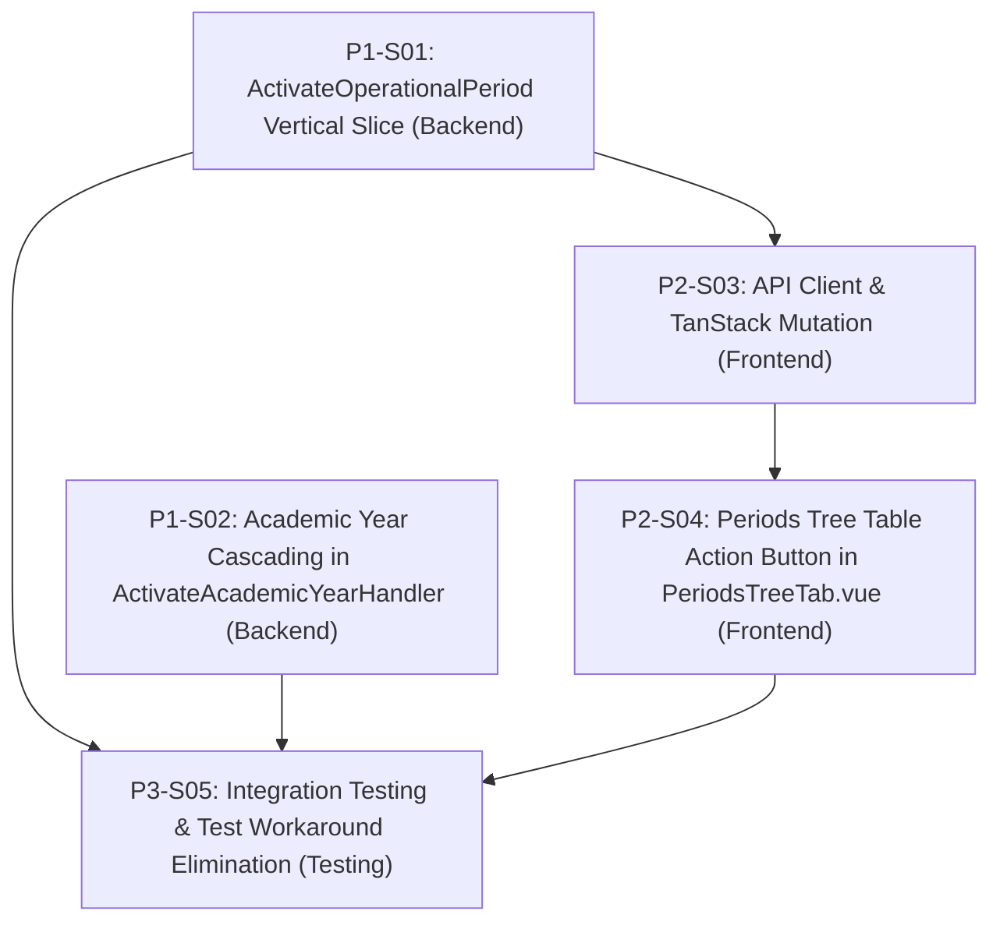

# 1. Objective

Implement the complete operational period activation capability and academic year cascading lifecycle transitions for Elsasa SIS V3 under Change Request `CR-OPS-PERIOD-ACTIVATION` (`docs/issues/IS003 - OPS-PERIOD-ACTIVATION-ISSUE.md`). This enables operational periods (semesters, terms, admission windows, assessment windows) to transition seamlessly to `active` status both automatically when an Academic Year is activated and explicitly via a first-class user action in the Schedule Management Workspace (`SCR-OPS-01` Periods Tree Table). This eliminates the downstream 409 Conflict errors encountered during prospective student admission application submissions and removes manual database test workarounds.

Planning Mode: FEATURE-PLANNING

Referenced artifacts:

- FEATURE / ISSUE:
  - `docs/issues/IS003 - OPS-PERIOD-ACTIVATION-ISSUE.md` (Change Request `CR-OPS-PERIOD-ACTIVATION`)
  - `docs/domains/operational-domain.md` (`OPS-WF-01`)
  - `docs/use-cases.md` (`UC-OPS-04`, `UC-OPS-07`, `UC-OPS-08`, `UC-OPS-13`)
  - `docs/screen-inventory.md` (`SCR-OPS-01`)
- FEASIBILITY-ASSESSMENT:
  - `docs/issues/IS003 - OPS-PERIOD-ACTIVATION-FEASIBILITY-ASSESSMENT.md` (Status: `READY-FOR-PLANNING`)

Architecture Applicability: ARCHITECTURE-NOT-REQUIRED

No architectural target-state artifact was required. Implementation relies on existing technical structure. Approved feasibility decisions are authoritative for the change. The current codebase is the source of current technical truth.

---

# 2. Planning Scope

The planning scope encompasses all changes required across the backend domain slices, frontend workspace components, API composables, and test harnesses:

1. **Backend Operational Period Activation Slice (`Elsasa.Sis.Operations`):**
   - Create new CQRS vertical slice `ActivateOperationalPeriod` under `src/backend/Elsasa.Sis.Operations/Features/CalendarPeriods/OperationalPeriods/ActivateOperationalPeriod/`.
   - Implement `ActivateOperationalPeriodEndpoint` mapping `POST /api/operations/periods/{id:guid}/activate` requiring `Permissions.Operations.Calendar.Manage`.
   - Implement `ActivateOperationalPeriodHandler` enforcing:
     - Record existence check (`DomainError.NotFound`).
     - Rejection if already `active` (`DomainError.Conflict`).
     - Rejection if `closed` (`DomainError.Validation` - closed periods cannot be reopened directly; must use `UC-OPS-13`).
     - Parent Academic Year validation: parent Academic Year must be in `approved` or `active` status (`DomainError.Validation`).
     - Hierarchical parent period validation: if `parent_period_id` is present, the parent period must be in `active` or `approved` status (`DomainError.Validation`).
     - Updates `status = 'active'`, `updated_at = @UpdatedAt`, `updated_by = @UpdatedBy`.
   - Register endpoint in ASP.NET Core endpoint routing pipeline.

2. **Backend Academic Year Lifecycle Cascading (`Elsasa.Sis.Operations`):**
   - Update `ActivateAcademicYearHandler` in `src/backend/Elsasa.Sis.Operations/Features/CalendarPeriods/AcademicYears/ActivateAcademicYear/ActivateAcademicYearHandler.cs`.
   - Within the existing atomic Dapper database transaction:
     - Demote any active child operational periods of the outgoing active academic year to `closed`.
     - Demote the outgoing active academic year to `completed`.
     - Activate the target academic year to `active`.
     - Promote all child operational periods of the activated academic year with `status IN ('draft', 'approved')` to `active`.

3. **Frontend API Client & Composable (`src/frontend`):**
   - Add `activatePeriod(id: string): Promise<OperationalPeriodDto>` in `src/frontend/src/features/operations/calendar/api/operationalPeriod.api.ts`.
   - Add `useActivateOperationalPeriodMutation` in `src/frontend/src/features/operations/calendar/composables/useOperationalPeriodsQuery.ts`.
   - Automatically invalidate query caches: `operationalPeriodKeys.all` and `calendarKeys.matrixAll`.
   - Provide standard toast notifications on success and failure.

4. **Frontend Schedule Management Workspace (`SCR-OPS-01` in `src/frontend`):**
   - In `src/frontend/src/features/operations/calendar/components/tabs/PeriodsTreeTab.vue`:
     - Add an **Activate Period** button in the Actions column of the `<TreeTable>`.
     - Condition: `v-if="canManage && (node.data.status === 'draft' || node.data.status === 'approved')"`.
     - Icon: `CheckCircle2` (emerald-600) with loading spinner on mutation pending.
     - Attribute: `data-testid="row-activate-period-btn"`.
     - Wire to `handleActivatePeriod(node.data)`.

5. **Automated Testing & Workaround Elimination (`tests/backend` and `src/frontend`):**
   - Integration tests in `OperationalPeriodsTests.cs`:
     - Test standalone activation (`draft` -> `active`).
     - Test validation rejections (parent year is draft, parent period is draft, period is closed).
   - Integration tests in `AcademicYearLifecycleTests.cs`:
     - Test automatic promotion of child periods on AY activation and demotion of old year active periods to closed.
   - Clean up `ApplicationRegistrationIntegrationTests.cs`:
     - Remove raw SQL update `UPDATE operations.operational_periods SET status = 'active' WHERE id = @Id;`.
     - Verify prospective student registration succeeds cleanly against active admission periods.
   - Frontend component unit tests in `PeriodsTreeTab.spec.ts` and `operationalPeriod.api.spec.ts`.

---

# 3. Dependencies

### External System & Tooling Dependencies

- .NET 8 SDK (8.0.x)
- Microsoft SQL Server 2022 instance / Testcontainers SQL Server
- Node.js runtime (v22.x or LTS) and pnpm package manager

### Slice Dependencies

- `Depends On` declares implementation prerequisites between slices.
- Dependencies reference Slice IDs only.
- Dependency satisfaction requires the referenced slice to have implementation status `IMPLEMENTED`.
- Dependency satisfaction does not require review status `GO`.
- Slices with `Depends On: None` or whose dependencies are satisfied may be executed in parallel.

### Dependency Graph



---

# 4. Progress Summary

| Phase | Implementation Status | Review Status | Progress |
|---|---|---|---|
| P1 - Backend Lifecycle & Cascading | IMPLEMENTED | GO | 2/2 |
| P2 - Frontend Workspace Integration | IMPLEMENTED | GO | 2/2 |
| P3 - Verification & End-to-End Testing | IMPLEMENTED | GO | 1/1 |

---

# 5. Phases

## P1 - Backend Lifecycle & Cascading

Implementation Status: IMPLEMENTED
Review Status: GO

### P1-S01

Title: Implement `ActivateOperationalPeriod` Vertical Slice

Implementation Status: IMPLEMENTED
Review Status: GO

Objective:
Implement the vertical slice enabling authorized users (`Permissions.Operations.Calendar.Manage`) to explicitly activate a draft or approved operational period via `POST /api/operations/periods/{id}/activate`.

Depends On: None

Repository: Elsasa.Sis.Operations

Completion Criteria:
1. Created `src/backend/Elsasa.Sis.Operations/Features/CalendarPeriods/OperationalPeriods/ActivateOperationalPeriod/`:
   - `ActivateOperationalPeriodResponse.cs`: DTO containing `Guid Id`, `string PeriodCode`, `string Name`, `string Status = "active"`, `DateTimeOffset UpdatedAt`.
   - `ActivateOperationalPeriodHandler.cs`:
     - Queries `operations.operational_periods` by ID joined with parent Academic Year status and parent operational period status.
     - Validates period exists (returns `NotFound` if missing).
     - Validates current status is not `active` (returns 409 `Conflict` "Operations.PeriodAlreadyActive" if already active).
     - Validates current status is not `closed` (returns 422 `Validation` "Operations.ClosedPeriodCannotBeReactivated").
     - Validates parent Academic Year status is `'approved'` or `'active'` (returns 422 `Validation` "Operations.ParentAcademicYearNotEligible" if `'draft'`, `'completed'`, or `'archived'`).
     - If `parent_period_id` is present, validates parent period status is `'active'` or `'approved'` (returns 422 `Validation` "Operations.ParentPeriodNotActiveOrApproved").
     - Parameterized SQL update: `UPDATE operations.operational_periods SET status = 'active', updated_at = @UpdatedAt, updated_by = @UpdatedBy WHERE id = @Id;`.
   - `ActivateOperationalPeriodEndpoint.cs`:
     - Maps `POST /api/operations/periods/{id:guid}/activate`.
     - Configured with `.RequireAuthorization(Permissions.Operations.Calendar.Manage)`.
     - Returns 200 OK with `ActivateOperationalPeriodResponse` or RFC 7807 ProblemDetails on error.
2. Endpoint registered and mapped in `Elsasa.Sis.Operations` dependency injection / endpoint discovery.

Notes:
- Implemented CQRS vertical slice under `src/backend/Elsasa.Sis.Operations/Features/CalendarPeriods/OperationalPeriods/ActivateOperationalPeriod/`.
- Created `ActivateOperationalPeriodResponse`, `ActivateOperationalPeriodHandler`, and `ActivateOperationalPeriodEndpoint`.
- Enforces parent academic year status (`approved` or `active`), hierarchical parent operational period status (`active` or `approved`), conflict rejection if already `active`, and validation rejection if `closed`.
- Registered `ActivateOperationalPeriodHandler` in `src/backend/Elsasa.Sis.Operations/DependencyInjection.cs`.
- Changed files:
  - `src/backend/Elsasa.Sis.Operations/Features/CalendarPeriods/OperationalPeriods/ActivateOperationalPeriod/ActivateOperationalPeriodResponse.cs`
  - `src/backend/Elsasa.Sis.Operations/Features/CalendarPeriods/OperationalPeriods/ActivateOperationalPeriod/ActivateOperationalPeriodHandler.cs`
  - `src/backend/Elsasa.Sis.Operations/Features/CalendarPeriods/OperationalPeriods/ActivateOperationalPeriod/ActivateOperationalPeriodEndpoint.cs`
  - `src/backend/Elsasa.Sis.Operations/DependencyInjection.cs`

---

### P1-S02

Title: Implement Full Lifecycle Cascading in `ActivateAcademicYearHandler`

Implementation Status: IMPLEMENTED
Review Status: GO

Objective:
Enhance `ActivateAcademicYearHandler` so that activating an Academic Year atomically cascades `active` status to all its child operational periods in `draft` or `approved` status, and demotes remaining active child operational periods of the previous active academic year to `closed`.

Depends On: None

Repository: Elsasa.Sis.Operations

Completion Criteria:
1. In `src/backend/Elsasa.Sis.Operations/Features/CalendarPeriods/AcademicYears/ActivateAcademicYear/ActivateAcademicYearHandler.cs`:
   - Added parameterized SQL constant `_closeActivePeriodsOfOutgoingYearSql`:
     ```sql
     UPDATE operations.operational_periods
     SET status = 'closed',
         updated_at = @UpdatedAt,
         updated_by = @UpdatedBy
     WHERE status = 'active'
       AND academic_year_id IN (
           SELECT id FROM operations.academic_years WHERE status = 'active'
       );
     ```
   - Added parameterized SQL constant `_activateChildPeriodsSql`:
     ```sql
     UPDATE operations.operational_periods
     SET status = 'active',
         updated_at = @UpdatedAt,
         updated_by = @UpdatedBy
     WHERE academic_year_id = @Id
       AND status IN ('draft', 'approved');
     ```
   - Updated transaction flow:
     1. Demote active periods of current active academic year to `'closed'`.
     2. Demote current active academic year to `'completed'`.
     3. Activate target academic year to `'active'`.
     4. Promote child operational periods of target academic year with `status IN ('draft', 'approved')` to `'active'`.
     5. Commit transaction.
2. Verified all queries remain schema-qualified to `operations.` and fully parameterized.

Implementation Notes:
- Added `_closeActivePeriodsOfOutgoingYearSql` and `_activateChildPeriodsSql` constants using parameterized Dapper SQL schema-qualified to `operations.`.
- Ordered the atomic transaction execution: (1) close active periods of outgoing active AY, (2) demote outgoing active AY to completed, (3) activate target AY, (4) promote child periods in draft/approved status to active, (5) commit.
- Verified build succeeds with 0 errors and 0 warnings.

Changed Files:
- `src/backend/Elsasa.Sis.Operations/Features/CalendarPeriods/AcademicYears/ActivateAcademicYear/ActivateAcademicYearHandler.cs`

Notes:
Entire cascading operation executes within a single database transaction, guaranteeing ACID consistency.

---

## P2 - Frontend Workspace Integration

Implementation Status: IMPLEMENTED
Review Status: GO

### P2-S03

Title: API Client & TanStack Query Mutation for Period Activation

Implementation Status: IMPLEMENTED
Review Status: GO

Objective:
Implement frontend API function and TanStack Query mutation hook for activating operational periods, with automated cache invalidation.

Depends On: P1-S01

Repository: Elsasa.Sis.Frontend

Completion Criteria:
1. In `src/frontend/src/features/operations/calendar/api/operationalPeriod.api.ts`:
   - Exported function `activatePeriod(id: string): Promise<OperationalPeriodDto>` making `POST /api/operations/periods/${encodeURIComponent(id)}/activate`.
2. In `src/frontend/src/features/operations/calendar/composables/useOperationalPeriodsQuery.ts`:
   - Exported mutation composable `useActivateOperationalPeriodMutation(options?)`:
     - Calls `activatePeriod(id)`.
     - On success: invalidates `operationalPeriodKeys.all` and `calendarKeys.matrixAll`.
     - Displays success toast: `Period Activated: Operational period '${data.periodCode}' has been activated.`.
     - On error: displays error toast.
3. Unit test coverage in `src/frontend/src/features/operations/calendar/__tests__/operationalPeriod.api.spec.ts`.

Implementation Notes:
- Exported `activatePeriod(id: string): Promise<OperationalPeriodDto>` in `src/frontend/src/features/operations/calendar/api/operationalPeriod.api.ts` executing `POST /operations/periods/${encodeURIComponent(id)}/activate`.
- Exported `useActivateOperationalPeriodMutation` in `src/frontend/src/features/operations/calendar/composables/useOperationalPeriodsQuery.ts` invalidating `operationalPeriodKeys.all` and `calendarKeys.matrixAll`, with success toast "Period Activated" (`Operational period '${data.periodCode}' has been activated.`) and error toast "Period Activation Failed".
- Added unit tests in `src/frontend/src/features/operations/calendar/__tests__/operationalPeriod.api.spec.ts` for `activatePeriod` API call and in `src/frontend/src/features/operations/calendar/composables/__tests__/useOperationalPeriodsQuery.spec.ts` for `useActivateOperationalPeriodMutation`.
- All unit tests pass, vue-tsc type checking succeeds with 0 errors, and ESLint / Prettier verification passed cleanly on touched files.

Changed Files:
- `src/frontend/src/features/operations/calendar/api/operationalPeriod.api.ts`
- `src/frontend/src/features/operations/calendar/composables/useOperationalPeriodsQuery.ts`
- `src/frontend/src/features/operations/calendar/__tests__/operationalPeriod.api.spec.ts`
- `src/frontend/src/features/operations/calendar/composables/__tests__/useOperationalPeriodsQuery.spec.ts`

Notes:
Follows existing patterns established by `useCloseOperationalPeriodMutation`.

---

### P2-S04

Title: Periods Tree Table UI Action & Interaction in `PeriodsTreeTab.vue`

Implementation Status: IMPLEMENTED
Review Status: GO

Objective:
Add an "Activate Period" button in the Actions column of `PeriodsTreeTab.vue` for draft/approved periods, enabling single-click activation with loading feedback.

Depends On: P2-S03

Repository: Elsasa.Sis.Frontend

Completion Criteria:
1. In `src/frontend/src/features/operations/calendar/components/tabs/PeriodsTreeTab.vue`:
   - Imported `CheckCircle2` (or `Play`) from `lucide-vue-next`.
   - Imported `useActivateOperationalPeriodMutation`.
   - Instantiated `activatePeriodMutation = useActivateOperationalPeriodMutation()`.
   - Added `handleActivatePeriod(period: OperationalPeriodDto): void` calling `activatePeriodMutation.mutate(period.id)`.
   - In `<TreeTable>` Actions `<Column>`:
     - Rendered Activate Period `<Button>`:
       - `v-if="canManage && (node.data.status === 'draft' || node.data.status === 'approved')"`
       - `type="button" text rounded size="small"`
       - Classes: `p-1 text-slate-500 hover:text-emerald-600 cursor-pointer`
       - Tooltip: `title="Activate operational period"`
       - Test ID: `data-testid="row-activate-period-btn"`
       - `:loading="activatePeriodMutation.isPending.value"`
       - `@click="handleActivatePeriod(node.data)"`
2. Component unit test coverage in `src/frontend/src/features/operations/calendar/__tests__/PeriodsTreeTab.spec.ts` asserting button visibility on draft periods and mutation invocation on click.

Implementation Notes:
- Imported `CheckCircle2` from `lucide-vue-next` and `useActivateOperationalPeriodMutation` from `../../composables/useOperationalPeriodsQuery` in `PeriodsTreeTab.vue`.
- Instantiated `activatePeriodMutation` and added `handleActivatePeriod` invoking `activatePeriodMutation.mutate(period.id)`.
- Added the Activate Period `<Button>` inside the TreeTable Actions column gated by `canManage && (node.data.status === 'draft' || node.data.status === 'approved')` with loading spinner binding and hover styles.
- Added comprehensive unit tests in `src/frontend/src/features/operations/calendar/__tests__/PeriodsTreeTab.spec.ts` covering button presence on draft periods, mutation execution on click, exclusion on active periods, and exclusion when lacking `CALENDAR_PERMISSIONS.MANAGE`.
- All 11 tests in `PeriodsTreeTab.spec.ts` and all 192 tests across the calendar feature pass cleanly; vue-tsc type checking passed with 0 errors; ESLint and Prettier formatting verified.

Changed Files:
- `src/frontend/src/features/operations/calendar/components/tabs/PeriodsTreeTab.vue`
- `src/frontend/src/features/operations/calendar/__tests__/PeriodsTreeTab.spec.ts`

Notes:
Matches the design of the existing "Close Period" button (`Lock` icon) and "Correct Period" button (`ShieldAlert` icon).

---

## P3 - Verification & End-to-End Testing

Implementation Status: IMPLEMENTED
Review Status: GO

### P3-S05

Title: Integration Testing for Period Activation, Cascading & Test Workaround Elimination

Implementation Status: IMPLEMENTED
Review Status: GO

Objective:
Establish end-to-end integration test coverage for operational period activation and academic year cascading, and eliminate the legacy raw SQL workaround in student admission integration tests.

Depends On: P1-S01, P1-S02, P2-S04

Repository: Elsasa.Sis.IntegrationTests

Completion Criteria:
1. In `tests/backend/Elsasa.Sis.IntegrationTests/Features/Operations/OperationalPeriodsTests.cs`:
   - Added test `ActivateOperationalPeriod_Should_TransitionDraftToActive_When_ParentYearIsApprovedOrActive`:
     - Creates AY and approves/activates it.
     - Creates operational period (starts as `draft`).
     - Calls `POST /api/operations/periods/{id}/activate`.
     - Asserts response 200 OK with `status = 'active'`.
     - Asserts database row in `operations.operational_periods` has `status = 'active'`.
   - Added test `ActivateOperationalPeriod_Should_ReturnConflict_When_PeriodIsAlreadyActive`.
   - Added test `ActivateOperationalPeriod_Should_ReturnValidation_When_ParentAcademicYearIsDraft`.
   - Added test `ActivateOperationalPeriod_Should_ReturnValidation_When_ParentPeriodIsDraft`.
2. In `tests/backend/Elsasa.Sis.IntegrationTests/Features/Operations/AcademicYearLifecycleTests.cs`:
   - Added test verifying that activating an Academic Year:
     - Promotes all its child operational periods in `draft` status to `active`.
     - Automatically demotes all active child periods of the outgoing active year to `closed`.
3. In `tests/backend/Elsasa.Sis.IntegrationTests/Features/Students/Admission/ApplicationRegistrationIntegrationTests.cs`:
   - Removed line 51 direct SQL update (`UPDATE operations.operational_periods SET status = 'active' WHERE id = @Id;`).
   - Replaced with domain call to `POST /api/operations/periods/{periodId}/activate` (or relied on AY cascading).
   - Verified that `RegisterApplication` tests pass without database manipulation workarounds.
4. All frontend and backend automated tests pass cleanly.

Implementation Notes:
- Updated `OperationalPeriodsTests.cs`: fixed creation status assertion to draft and added 4 integration tests covering `draft -> active` activation, 409 conflict when already active, 422 validation when parent academic year is draft, and 422 validation when parent hierarchical period is draft.
- Updated `AcademicYearLifecycleTests.cs`: added end-to-end integration test `ActivatingAcademicYear_Should_PromoteChildDraftPeriodsToActive_And_DemoteOutgoingYearActivePeriodsToClosed` asserting that activating an academic year atomically closes active child periods of outgoing active years and activates child periods in draft status of the newly activated year.
- Updated `ApplicationRegistrationIntegrationTests.cs`: removed direct raw SQL workaround (`UPDATE operations.operational_periods SET status = 'active' WHERE id = @Id;`) and replaced with domain call `POST /api/operations/periods/{periodId}/activate`; adjusted setup in deduplication test to establish second period sequentially, reflecting real-world academic year cascading.
- Standardized `ActivateOperationalPeriodResponse` to a single primary constructor for seamless JSON deserialization.
- Verified all 15 backend integration tests across the targeted suites and all 521 frontend tests pass cleanly with 0 errors.

Changed Files:
- `tests/backend/Elsasa.Sis.IntegrationTests/Features/Operations/OperationalPeriodsTests.cs`
- `tests/backend/Elsasa.Sis.IntegrationTests/Features/Operations/AcademicYearLifecycleTests.cs`
- `tests/backend/Elsasa.Sis.IntegrationTests/Features/Students/Admission/ApplicationRegistrationIntegrationTests.cs`
- `src/backend/Elsasa.Sis.Operations/Features/CalendarPeriods/OperationalPeriods/ActivateOperationalPeriod/ActivateOperationalPeriodResponse.cs`
- `docs/issues/IS003 - OPS-PERIOD-ACTIVATION-IMPLEMENTATION-PLAN.md`

Notes:
Guarantees regression protection and ensures the system operates strictly through documented domain interfaces.

---

# 6. Change Log

- 2026-11-03: Initial implementation plan approved based on Feasibility Assessment `IS003 - OPS-PERIOD-ACTIVATION-FEASIBILITY-ASSESSMENT.md`. Full lifecycle cascading in `ActivateAcademicYearHandler`, standalone vertical slice `ActivateOperationalPeriod`, frontend UI button in `PeriodsTreeTab.vue`, and elimination of test workarounds.
