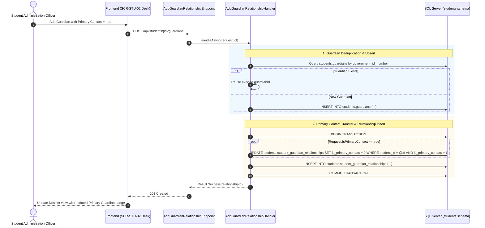
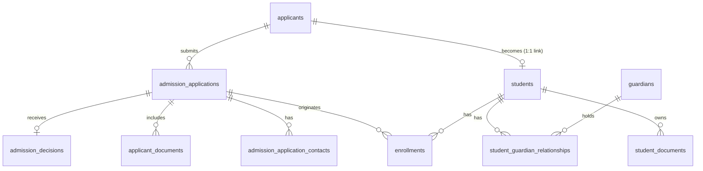

# 1. Overview

This target architecture defines the technical realization for Stage 1 "Enrollment & Identity — full scope" under the Student domain, fulfilling change request intake `CR-STU-ENROLLMENT-IDENTITY` ([`IS004 - STU-ENROLLMENT-IDENTITY-ISSUE.md`](file:///d:/Project.Private/elsasa-sis-v3/docs/issues/IS004%20-%20STU-ENROLLMENT-IDENTITY-ISSUE.md)).

The architecture establishes the permanent student identity, administrative enrollment lifecycle, guardian relationship governance, and official document foundation for the Elsasa School Information System (SIS) V3:
1. **Official Student Identity & Continuity:** Provisioning the authoritative student entity (`students.students`) with a 1:1 referential link to originating applicants (`students.applicants`), guaranteeing zero data re-entry and strict identity continuity across administrative lifecycles.
2. **Authoritative Student Number Generation:** Generating permanent, organization-wide, gap-free student numbers formatted as `STD-{EnrollmentYear}-{Sequence:D4}` via dedicated SQL Server sequence (`students.student_number_seq`) backed by a strict unique database constraint.
3. **Atomic Enrollment Execution & Placement Snapshot:** Executing the administrative act of enrollment (`students.enrollments`) in a single atomic database transaction, capturing initial campus, level, academic year, program, and cohort context.
4. **Policy-Driven Payment Confirmation Gate (`GAP-01`):** Implementing a dual-mode payment gate validating either manual payment receipt references, authorized fee waiver/scholarship overrides, or synchronous verification via `IFinanceModule.IsEnrollmentFeePaidAsync`.
5. **Guardian Responsibility Governance & Primary Contact Rule:** Establishing normalized guardian entities (`students.guardians`) and relationship associations (`students.student_guardian_relationships`) with SQL Server partial unique indexing enforcing at most one active primary contact per student (`(student_id) WHERE (is_primary_contact = 1 AND is_active = 1)`).
6. **Independent Learner Representation:** Modeling independent student status (`is_independent`) directly on `students.students` to support self-managed academic and financial notifications.
7. **Document Promotion & Management:** Promoting verified credential files from admission (`students.applicant_documents`) directly into official student dossiers (`students.student_documents`) reusing existing physical storage references (`IFileStorageService`).
8. **Decoupled Cross-Domain Event Notification:** Publishing `StudentEnrolledEvent` strictly post-commit via MediatR (`IPublisher`) to notify downstream domains (Finance obligation assessment, Operations roster initialization).
9. **Dual-Screen Operational Alignment:** Extending the Student Intake Workbench ([`SCR-STU-01`](file:///d:/Project.Private/elsasa-sis-v3/docs/screen-inventory.md#L274-L300)) in `src/frontend` with an Enrollment modal for accepted applicants, and fully realizing the Student Records Desk ([`SCR-STU-02`](file:///d:/Project.Private/elsasa-sis-v3/docs/screen-inventory.md#L303-L325)) at `/students/records` for indexed search, certified identity maintenance, guardian management, and document tracking.

---

# 2. Architectural Basis

## Business Context

This architecture realizes the business outcomes and operational workflows specified in:
- **DOMAIN:** [`student-domain.md`](file:///d:/Project.Private/elsasa-sis-v3/docs/domains/student-domain.md)
  - Workflow 3: Enroll Accepted Applicant (`STD-WF-03`)
  - Workflow 4: Maintain Student Identity (`STD-WF-04`)
  - Sections: Enrollment, Parent and Guardian Information, Student Number, Student
- **FEATURE & ROADMAP:** [`sub-modul-and-development-phases.md`](file:///d:/Project.Private/elsasa-sis-v3/docs/sub-modul-and-development-phases.md)
  - Stage 1 Foundation: Enrollment & Identity — full scope
  - Stage 1 Completion Criteria 3 & 4:
    - *Criterion 3: "At least one accepted applicant has been officially enrolled, producing an official student record with a unique student number and initial administrative placement."*
    - *Criterion 4: "Certified identity and guardian records have been created and maintained for at least one student."*
- **USE CASES:** [`use-cases.md`](file:///d:/Project.Private/elsasa-sis-v3/docs/use-cases.md)
  - `UC-STD-04`: Enroll Accepted Applicant (payment gate enforcement, student number generation, placement recording)
  - `UC-STD-05`: Maintain Student Identity (biographical updates, guardian updates, independence flag)
  - Section 8.3: Independent Student Self-Service Flag
  - Section 8.4: Multi-Guardian Authority and the Primary Guardian Rule
- **SCREEN INVENTORY:** [`screen-inventory.md`](file:///d:/Project.Private/elsasa-sis-v3/docs/screen-inventory.md)
  - `SCR-STU-01`: Student Intake Workbench (Work Queue pattern — extended with Enrollment trigger)
  - `SCR-STU-02`: Student Records Desk (Information Lookup pattern — comprehensive search and dossier desk)
- **DATA SPECIFICATIONS:**
  - [`student-entities.md`](file:///d:/Project.Private/elsasa-sis-v3/docs/entities/student-entities.md) (Submodule 2 — Enrollment & Identity)
  - [`student-entities-tables.md`](file:///d:/Project.Private/elsasa-sis-v3/docs/entities/student-entities-tables.md) (Tables 2.1 through 2.5)

## Analysis Input

This architecture directly consumes the approved gap-closure decisions and technical trade-offs recorded in:
- **FEASIBILITY ASSESSMENT:** [`IS004 - STU-ENROLLMENT-IDENTITY-FEASIBILITY-ASSESSMENT.md`](file:///d:/Project.Private/elsasa-sis-v3/docs/issues/IS004%20-%20STU-ENROLLMENT-IDENTITY-FEASIBILITY-ASSESSMENT.md)
  - Gap closures: GAP-001 through GAP-008
  - Resolved open questions: OQ-001 through OQ-007
  - Selected Approach: Approach 1 (Pragmatic, Minimalist, and Explicit Domain Alignment)
  - Architecture Applicability: ARCHITECTURE-REQUIRED
  - Planning Readiness: READY-FOR-PLANNING

```text
DOMAIN (student-domain.md) + FEATURE (use-cases.md, screen-inventory.md)
                            +
       FEASIBILITY-ASSESSMENT (STU-ENROLLMENT-IDENTITY)
                            ↓
         TARGET ARCHITECTURE (STU-ENROLLMENT-IDENTITY)
```

---

# 3. Scope

## Included

1. **Database Schema & Migrations (`Elsasa.Sis.Database`):**
   - Single sequential DbUp migration script `20261103_0301_Students_EnrollmentIdentity_Tables.sql`.
   - Creation of sequence `students.student_number_seq` starting at 1.
   - Creation of 5 domain tables in `students`:
     - `students.students`: Authoritative student identity, permanent student number, applicant link, independence flag, denormalized status.
     - `students.enrollments`: Administrative enrollment events, initial placement parameters, payment confirmation/waiver audit.
     - `students.guardians`: Master contact records for parents/guardians with national ID deduplication index.
     - `students.student_guardian_relationships`: Association mapping with relationship type, responsibility flags, and partial unique index on active primary contact.
     - `students.student_documents`: Official student records documents with verification status and file references.
   - Comprehensive intra-schema foreign key constraints with `ON DELETE NO ACTION` to guarantee audit trail preservation.

2. **Backend Vertical Slices (`Elsasa.Sis.Students`):**
   - **Enrollment Execution:** `EnrollAcceptedApplicant` (handles admission prerequisite check, payment/waiver gate, sequence generation, atomic multi-table insert, document promotion, and post-commit event publishing).
   - **Student Lookup & Dossier Queries:**
     - `SearchStudents` (paginated indexed search by query, campus, level, status).
     - `GetStudentById` (comprehensive 360° student dossier projection including identity, enrollment history, guardians, and documents).
     - `GetStudentDocuments` (retrieval of all official student documents).
   - **Identity & Guardian Management Commands:**
     - `UpdateStudentIdentity` (certified biographical details update, audit logging, independence toggle).
     - `AddGuardianRelationship` (guardian linking/creation, responsibility flags, primary contact enforcement).
     - `UpdateGuardianRelationship` (responsibility updates, primary contact transfer, relationship deactivation).
   - **Student Document Management:**
     - `UploadStudentDocument` (file upload via `IFileStorageService`, metadata recording).
     - `DownloadStudentDocument` (file stream retrieval with MIME headers).
     - `VerifyStudentDocument` (verification state transition with audit identity).

3. **Cross-Domain Handshakes & Contracts:**
   - Synchronous payment gate inquiry via `IFinanceModule.IsEnrollmentFeePaidAsync` declared in `Elsasa.Sis.Contracts.Finance`.
   - Asynchronous notification via `StudentEnrolledEvent` declared in `Elsasa.Sis.Contracts.Students.Events`, published post-commit via MediatR `IPublisher`.
   - Expansion of permission constants in `Elsasa.Sis.Students.Permissions`.

4. **Frontend Workspaces (`src/frontend`):**
   - **Extension of `SCR-STU-01` (`StudentIntakeWorkbenchView.vue`):** "Enroll" button on accepted applications opening `EnrollApplicantModal.vue` with placement inputs, payment verification/waiver override, guardian confirmation, and mutation execution.
   - **Full Implementation of `SCR-STU-02` (`StudentRecordsDeskView.vue`):** Dedicated student search, summary metrics, student dossier inspector, biographical editor modal, guardian relationship manager card, and official document upload/verification workspace at `/students/records`.
   - Replacement of stub `EnrollmentDeskView.vue` with redirect to `/students/records`.

## Excluded

1. **Submodule 3 Multi-Record History Tables:**
   - Dedicated placement transition tables (`students.administrative_placements`), status history logs (`students.student_statuses`), and lifecycle transitions (`students.lifecycle_transitions`) are deferred to Submodule 3 (Placement & Status). Initial placement is captured in `students.enrollments` and current status in `students.students.current_status`.
2. **Continuing Lifecycle Workflows (Stage 2):**
   - Leave of Absence (`UC-STD-07`, `UC-STD-08`), Promotion/Retention execution (`UC-STD-09`), Internal Transfers (`UC-STD-10`), and Annual Re-enrollment (`UC-STD-17`) belong to Stage 2 (`SCR-STU-03: Student Lifecycle Workbench`).
3. **Terminating Exits & Guardian Dispute Holds (Stage 3):**
   - External Transfer Out (`UC-STD-11`), Formal Withdrawal (`UC-STD-12`), Expulsion (`UC-STD-14`), and legal guardian dispute injunctions belong to Stage 3.
4. **Automated Finance Invoicing & Fee Assessment:**
   - Generating recurring tuition obligations or processing digital payment receipts belongs to `Elsasa.Sis.Finance` (`SCR-FIN-01`, `SCR-FIN-02`).

---

# 4. Technical Decisions

## TD-01: Persistence Evolution & Deterministic Migration Strategy

- **Decision:** Execute a single, sequential, idempotent DbUp migration script `20261103_0301_Students_EnrollmentIdentity_Tables.sql` targeting Microsoft SQL Server 2022 ([`ADR-002`](file:///d:/Project.Private/elsasa-sis-v3/docs/architecture/adr.md#L50-L75), [`ADR-006`](file:///d:/Project.Private/elsasa-sis-v3/docs/architecture/adr.md#L152-L176)).
- **Realization:**
  - Create sequence:
    ```sql
    CREATE SEQUENCE [students].[student_number_seq]
        AS INT
        START WITH 1
        INCREMENT BY 1
        NO CYCLE;
    ```
  - Create table `students.students`:
    - `id UNIQUEIDENTIFIER NOT NULL PRIMARY KEY`
    - `student_number NVARCHAR(32) NOT NULL CONSTRAINT ux_students_students_student_number UNIQUE`
    - `applicant_id UNIQUEIDENTIFIER NOT NULL CONSTRAINT ux_students_students_applicant_id UNIQUE`
    - `full_name NVARCHAR(200) NOT NULL`
    - `preferred_name NVARCHAR(100) NULL`
    - `date_of_birth DATE NULL`
    - `place_of_birth NVARCHAR(100) NULL`
    - `gender NVARCHAR(20) NULL`
    - `nationality NVARCHAR(100) NULL CONSTRAINT df_students_students_nationality DEFAULT (N'Indonesian')`
    - `government_id_type NVARCHAR(32) NULL`
    - `government_id_number NVARCHAR(64) NULL`
    - `address NVARCHAR(MAX) NULL`
    - `phone NVARCHAR(32) NULL`
    - `email NVARCHAR(254) NULL`
    - `is_independent BIT NOT NULL CONSTRAINT df_students_students_is_independent DEFAULT (0)`
    - `current_status NVARCHAR(32) NOT NULL CONSTRAINT df_students_students_current_status DEFAULT (N'enrolled')`
    - `enrollment_date DATE NOT NULL`
    - `notes NVARCHAR(MAX) NULL`
    - Standard audit columns: `created_at DATETIMEOFFSET(7) NOT NULL`, `created_by NVARCHAR(100) NULL`, `updated_at DATETIMEOFFSET(7) NULL`, `updated_by NVARCHAR(100) NULL`.
    - Physical intra-schema FK: `FOREIGN KEY (applicant_id) REFERENCES students.applicants(id) ON DELETE NO ACTION`.
    - Filtered unique index: `ux_students_students_gov_id ON (government_id_number) WHERE government_id_number IS NOT NULL`.
  - Create table `students.enrollments`:
    - `id UNIQUEIDENTIFIER NOT NULL PRIMARY KEY`
    - `student_id UNIQUEIDENTIFIER NOT NULL` (FK &rarr; `students.students(id)`)
    - `application_id UNIQUEIDENTIFIER NOT NULL` (FK &rarr; `students.admission_applications(id)`)
    - `enrollment_type NVARCHAR(32) NOT NULL CONSTRAINT df_students_enrollments_type DEFAULT (N'initial')`
    - `enrollment_date DATE NOT NULL`
    - `initial_campus NVARCHAR(100) NOT NULL`
    - `initial_level NVARCHAR(64) NOT NULL`
    - `initial_academic_year NVARCHAR(32) NOT NULL`
    - `initial_program NVARCHAR(100) NULL`
    - `initial_cohort NVARCHAR(50) NULL`
    - `approved_by NVARCHAR(100) NOT NULL`
    - `enrollment_payment_confirmed BIT NULL`
    - `payment_reference NVARCHAR(100) NULL`
    - `payment_waived BIT NOT NULL CONSTRAINT df_students_enrollments_payment_waived DEFAULT (0)`
    - `waiver_reference NVARCHAR(100) NULL`
    - `notes NVARCHAR(MAX) NULL`
    - Standard audit columns.
  - Create table `students.guardians`:
    - `id UNIQUEIDENTIFIER NOT NULL PRIMARY KEY`
    - `full_name NVARCHAR(200) NOT NULL`
    - `government_id_type NVARCHAR(32) NULL`
    - `government_id_number NVARCHAR(64) NULL`
    - `phone NVARCHAR(32) NULL`
    - `email NVARCHAR(254) NULL`
    - `address NVARCHAR(MAX) NULL`
    - `occupation NVARCHAR(100) NULL`
    - `notes NVARCHAR(MAX) NULL`
    - Standard audit columns.
    - Filtered unique index: `ux_students_guardians_gov_id ON (government_id_number) WHERE government_id_number IS NOT NULL`.
  - Create table `students.student_guardian_relationships`:
    - `id UNIQUEIDENTIFIER NOT NULL PRIMARY KEY`
    - `student_id UNIQUEIDENTIFIER NOT NULL` (FK &rarr; `students.students(id)`)
    - `guardian_id UNIQUEIDENTIFIER NOT NULL` (FK &rarr; `students.guardians(id)`)
    - `relationship_type NVARCHAR(50) NOT NULL`
    - `is_primary_contact BIT NOT NULL CONSTRAINT df_students_rel_is_primary DEFAULT (0)`
    - `is_emergency_contact BIT NOT NULL CONSTRAINT df_students_rel_is_emergency DEFAULT (0)`
    - `is_financial_contact BIT NOT NULL CONSTRAINT df_students_rel_is_financial DEFAULT (0)`
    - `is_authorized_pickup BIT NOT NULL CONSTRAINT df_students_rel_is_pickup DEFAULT (0)`
    - `is_active BIT NOT NULL CONSTRAINT df_students_rel_is_active DEFAULT (1)`
    - Standard audit columns.
    - Partial unique index: `ux_students_rel_primary_active ON (student_id) WHERE (is_primary_contact = 1 AND is_active = 1)`.
    - Non-clustered composite index: `ix_students_rel_student_guardian ON (student_id, guardian_id)`.
  - Create table `students.student_documents`:
    - `id UNIQUEIDENTIFIER NOT NULL PRIMARY KEY`
    - `student_id UNIQUEIDENTIFIER NOT NULL` (FK &rarr; `students.students(id)`)
    - `document_type NVARCHAR(100) NOT NULL`
    - `submission_status NVARCHAR(32) NOT NULL CONSTRAINT df_students_docs_status DEFAULT (N'submitted')`
    - `submitted_date DATE NULL`
    - `verified_date DATE NULL`
    - `verified_by NVARCHAR(100) NULL`
    - `file_reference NVARCHAR(500) NULL`
    - `file_name NVARCHAR(255) NULL`
    - `file_size_bytes BIGINT NULL`
    - `content_type NVARCHAR(100) NULL`
    - `valid_until DATE NULL`
    - `notes NVARCHAR(MAX) NULL`
    - Standard audit columns.
    - Index: `ix_students_docs_student_type ON (student_id, document_type)`.

## TD-02: Authoritative Student Number Generation & Formatting Strategy

- **Decision:** Generate organization-wide student numbers formatted as `STD-{EnrollmentYear}-{Sequence:D4}` (e.g. `STD-2026-0001`) atomically using SQL Server sequence values (OQ-002).
- **Realization:**
  - Introduce domain service interface:
    ```csharp
    namespace Elsasa.Sis.Students.Features.Enrollment.Services;

    public interface IStudentNumberGenerator
    {
        Task<string> GenerateNextStudentNumberAsync(int enrollmentYear, CancellationToken ct = default);
    }
    ```
  - Implement `SqlStudentNumberGenerator` injecting `ISqlConnectionFactory`:
    ```csharp
    const string sql = "SELECT NEXT VALUE FOR students.student_number_seq;";
    var nextVal = await connection.ExecuteScalarAsync<int>(new CommandDefinition(sql, cancellationToken: ct));
    return $"STD-{enrollmentYear}-{nextVal:D4}";
    ```
  - Non-reusability and concurrency safety are guaranteed by the database sequence engine and enforced by the strict unique index `ux_students_students_student_number`.

## TD-03: Dual-Mode Enrollment Payment Gate Handshake (`GAP-01`)

- **Decision:** Enforce institutional payment clearance before enrollment is finalized, supporting immediate manual/waiver operations and automated Finance verification (GAP-003, OQ-003).
- **Realization:**
  - Inside `EnrollAcceptedApplicantHandler`:
    1. If `request.PaymentWaived == true`:
       - Validate that `request.WaiverReference` is not null or whitespace. If empty, return `DomainError.Validation("Students.Enrollment.WaiverReferenceRequired", "A waiver reference or authorized executive decree is required when payment is waived.")`.
       - Record `payment_waived = true`, `waiver_reference = request.WaiverReference`, `enrollment_payment_confirmed = null`.
    2. If `request.PaymentWaived == false`:
       - If `!string.IsNullOrWhiteSpace(request.PaymentReference)`:
         - Record `payment_waived = false`, `payment_reference = request.PaymentReference`, `enrollment_payment_confirmed = true`.
       - Else if `request.CheckFinanceModule == true`:
         - Call `await financeModule.IsEnrollmentFeePaidAsync(applicantId, academicYearId, ct)`.
         - If result is success and returns `true`:
           - Record `payment_waived = false`, `payment_reference = "FINANCE-AUTO-CLEARED"`, `enrollment_payment_confirmed = true`.
         - Else:
           - Return `DomainError.Conflict("Students.Enrollment.PaymentRequired", "Enrollment payment has not been confirmed. A valid payment reference or authorized fee waiver override is required.")`.
       - Else:
         - Return `DomainError.Conflict("Students.Enrollment.PaymentRequired", "Enrollment payment has not been confirmed. A valid payment reference or authorized fee waiver override is required.")`.

## TD-04: Atomic Transactional Boundary & Post-Commit Event Dispatch

- **Decision:** Execute enrollment as an atomic unit of work within a single Dapper transaction, dispatching `StudentEnrolledEvent` strictly post-commit ([`ADR-003`](file:///d:/Project.Private/elsasa-sis-v3/docs/architecture/adr.md#L76-L98), OQ-007).
- **Realization:**
  - Inside `EnrollAcceptedApplicantHandler`:
    ```csharp
    await using var connection = (SqlConnection)await connectionFactory.CreateConnectionAsync(ct);
    await using var transaction = await connection.BeginTransactionAsync(ct);
    try
    {
        // 1. Validate application status == 'decided' and decision_type == 'accepted'
        // 2. Validate applicant_id not already in students.students
        // 3. Generate student_number = await studentNumberGenerator.GenerateNextStudentNumberAsync(...)
        // 4. INSERT INTO students.students (...)
        // 5. INSERT INTO students.enrollments (...)
        // 6. Promote documents from applicant_documents -> student_documents
        // 7. Insert/link guardians from admission_application_contacts / request
        // 8. Commit
        await transaction.CommitAsync(ct);
    }
    catch
    {
        await transaction.RollbackAsync(ct);
        throw;
    }

    // Strictly Post-Commit:
    await publisher.Publish(new StudentEnrolledEvent(studentId, applicantId, academicYearId), ct);
    ```

## TD-05: Zero Re-Entry Data & Document Promotion Pattern

- **Decision:** Seamlessly transfer verified applicant credentials and contact profiles into official student records without re-uploading files or creating orphan rows (GAP-006, OQ-004).
- **Realization:**
  - **Biographical Promotion:** Query `students.applicants` by `applicant_id` and insert into `students.students` preserving full name, dates of birth, nationality, government ID, address, phone, and email.
  - **Document Promotion:** Query all rows in `students.applicant_documents` for the application where `submission_status = 'verified'`. Insert matching rows into `students.student_documents` with identical `file_reference`, `file_name`, `file_size_bytes`, `content_type`, setting `submission_status = 'verified'`, `submitted_date = sysdate`, `verified_date = sysdate`, and `verified_by = currentUser.Username`.
  - **Guardian Intake:** For each contact in `students.admission_application_contacts` (or provided in request payload):
    - Search `students.guardians` by `government_id_number` (or name + phone).
    - If existing guardian found, reuse `guardianId`. Otherwise insert into `students.guardians`.
    - Insert into `students.student_guardian_relationships` with relationship type and contact flags (`is_primary_contact`, `is_emergency_contact`, `is_financial_contact`).

## TD-06: Guardian Responsibility Matrix & Single Primary Contact Constraint

- **Decision:** Enforce relational and operational integrity for multi-guardian households via SQL Server partial unique index and command-level primary contact transfer (GAP-005, OQ-005).
- **Realization:**
  - Database partial unique index:
    ```sql
    CREATE UNIQUE INDEX [ux_students_rel_primary_active]
        ON [students].[student_guardian_relationships] ([student_id])
        WHERE [is_primary_contact] = 1 AND [is_active] = 1;
    ```
  - When `AddGuardianRelationshipCommand` or `UpdateGuardianRelationshipCommand` sets `IsPrimaryContact = true`:
    - Execute SQL demoting existing active primary contact for that student:
      ```sql
      UPDATE students.student_guardian_relationships
      SET is_primary_contact = 0, updated_at = SYSUTCDATETIME(), updated_by = @UpdatedBy
      WHERE student_id = @StudentId AND is_primary_contact = 1 AND is_active = 1;
      ```
    - Insert or update the target relationship row with `is_primary_contact = 1`.

## TD-07: Backend Vertical Slice Layout & Minimal API Routing

- **Decision:** Group Enrollment and Student Records slices under `src/backend/Elsasa.Sis.Students/Features/` adhering strictly to [`coding-conventions.md`](file:///d:/Project.Private/elsasa-sis-v3/docs/architecture/coding-conventions.md) and [`backend-architecture.md`](file:///d:/Project.Private/elsasa-sis-v3/docs/architecture/backend-architecture.md).
- **Directory Layout:**
  ```text
  src/backend/Elsasa.Sis.Students/Features/
  ├── Enrollment/
  │   ├── Services/
  │   │   ├── IStudentNumberGenerator.cs
  │   │   └── SqlStudentNumberGenerator.cs
  │   └── EnrollAcceptedApplicant/
  │       ├── EnrollAcceptedApplicantEndpoint.cs     # POST /api/students/enrollments
  │       ├── EnrollAcceptedApplicantRequest.cs      # Placement, payment, guardian parameters
  │       ├── EnrollAcceptedApplicantResponse.cs     # student_id, student_number, enrollment_id
  │       ├── EnrollAcceptedApplicantValidator.cs    # FluentValidation gate rules
  │       └── EnrollAcceptedApplicantHandler.cs      # Atomic multi-table Dapper handler
  └── Records/
      ├── SearchStudents/
      │   ├── SearchStudentsEndpoint.cs              # GET /api/students
      │   ├── SearchStudentsRequest.cs               # Query, campus, level, status, pagination
      │   ├── SearchStudentsResponse.cs              # Paginated list of student summary cards
      │   └── SearchStudentsHandler.cs               # Parameterized Dapper projection
      ├── GetStudentById/
      │   ├── GetStudentByIdEndpoint.cs              # GET /api/students/{id}
      │   ├── StudentDetailResponse.cs               # 360° aggregate dossier DTO
      │   └── GetStudentByIdHandler.cs               # Multi-query Dapper dossier retrieval
      ├── UpdateStudentIdentity/
      │   ├── UpdateStudentIdentityEndpoint.cs        # PUT /api/students/{id}/identity
      │   ├── UpdateStudentIdentityRequest.cs
      │   ├── UpdateStudentIdentityValidator.cs
      │   └── UpdateStudentIdentityHandler.cs
      ├── Guardians/
      │   ├── AddGuardianRelationship/               # POST /api/students/{id}/guardians
      │   └── UpdateGuardianRelationship/            # PUT /api/students/{id}/guardians/{relationshipId}
      └── Documents/
          ├── UploadStudentDocument/                 # POST /api/students/{id}/documents
          ├── DownloadStudentDocument/               # GET /api/students/{id}/documents/{docId}/file
          └── VerifyStudentDocument/                 # PUT /api/students/{id}/documents/{docId}/verify
  ```

## TD-08: Frontend Workspaces Architecture (`SCR-STU-01` & `SCR-STU-02`)

- **Decision:** Align frontend components with the 36-screen inventory ([`screen-inventory.md`](file:///d:/Project.Private/elsasa-sis-v3/docs/screen-inventory.md#L274-L325)) and [`frontend-architecture.md`](file:///d:/Project.Private/elsasa-sis-v3/docs/architecture/frontend-architecture.md).
- **Realization:**
  - **1. Student Intake Workbench Extension (`SCR-STU-01` &rarr; `/students/admission`):**
    - In `StudentIntakeWorkbenchView.vue`, when the selected application has `status == 'decided'` and `decision.decision_type == 'accepted'`:
      - Render primary action button: `[ Enroll Applicant ]` (with teal highlight).
      - Clicking opens `EnrollApplicantModal.vue`.
      - Modal features:
        - Placement configuration: Target Campus, School Level, Academic Year, Program, Initial Cohort.
        - Payment gate options: Confirm Payment Reference (text input) OR Authorized Fee Waiver toggle (with Waiver Decree / Justification input).
        - Guardian contact review: pre-populated from admission contacts, with option to designate primary contact.
        - On submit: triggers `useEnrollApplicantMutation()`, shows toast, and invalidates admission queue and applicant dossier.
  - **2. Student Records Desk (`SCR-STU-02` &rarr; `/students/records`):**
    - Route: `/students/records` (replacing stub `EnrollmentDeskView.vue` with redirect from `/students/enrollment`).
    - Implemented in `src/frontend/src/features/students/records/views/StudentRecordsDeskView.vue`.
    - Layout: Two-pane Split Workspace (Master-Detail / Information Lookup pattern):
      - **Left Pane (35%):** Indexed Search Bar (Student #, Name, NIK), filter dropdowns (Campus, Level, Status), and scrollable candidate match list showing Student Number, Name, Grade, and Status Pill.
      - **Right Pane (65%):** 360° Student Dossier Panel:
        - **Header:** Full Name, Student Number badge, Current Status badge, `Independent Student` indicator, and primary action buttons (`Edit Identity`, `Add Guardian`, `Upload Document`).
        - **Tab 1: Certified Identity:** Complete biographical data, government ID, address, contact info, independence status, and audit timestamps.
        - **Tab 2: Guardian & Household Contacts:** Guardian list cards displaying relationship type, primary badge, emergency badge, financial contact badge, phone, email, and actions to edit relationship or transfer primary designation.
        - **Tab 3: Official Documents:** Document checklist table showing document type, verification status (`verified`, `submitted`), upload date, verifier identity, download action, and verify/reject modal trigger.
        - **Tab 4: Enrollment & Placement History:** Initial enrollment details (application number link, enrollment date, approved by, payment/waiver reference, initial placement parameters).

---

# 5. Component Responsibilities

| Component | Layer / Assembly | Responsibility | Single Owner |
|---|---|---|---|
| `IStudentNumberGenerator` | `Elsasa.Sis.Students` | Declares interface for generating sequential, formatted student numbers. | Yes |
| `SqlStudentNumberGenerator` | `Elsasa.Sis.Students` | Generates next number from `students.student_number_seq` and formats `STD-{year}-{seq:D4}`. | Yes |
| `EnrollAcceptedApplicantHandler` | `Elsasa.Sis.Students` | Validates prerequisites, enforces payment gate, generates student number, creates `students`, `enrollments`, promotes documents, links guardians, commits transaction, and publishes `StudentEnrolledEvent`. | Yes |
| `SearchStudentsHandler` | `Elsasa.Sis.Students` | Executes parameterized Dapper query searching students by text, campus, level, and status with pagination. | Yes |
| `GetStudentByIdHandler` | `Elsasa.Sis.Students` | Retrieves complete 360° student dossier (identity, enrollment details, guardians, official documents) via multi-result Dapper query. | Yes |
| `UpdateStudentIdentityHandler` | `Elsasa.Sis.Students` | Updates certified biographical fields and independence flag on `students.students` with audit logging. | Yes |
| `AddGuardianRelationshipHandler` | `Elsasa.Sis.Students` | Deduplicates/inserts guardian record, enforces single active primary contact, and creates relationship link. | Yes |
| `UpdateGuardianRelationshipHandler` | `Elsasa.Sis.Students` | Modifies relationship flags, manages primary contact demotion/promotion, and updates relationship active state. | Yes |
| `UploadStudentDocumentHandler` | `Elsasa.Sis.Students` | Validates file MIME/size, saves physical file via `IFileStorageService`, and inserts record in `students.student_documents`. | Yes |
| `DownloadStudentDocumentHandler` | `Elsasa.Sis.Students` | Fetches document metadata and streams file content from `IFileStorageService` with appropriate HTTP headers. | Yes |
| `VerifyStudentDocumentHandler` | `Elsasa.Sis.Students` | Updates document verification state (`verified` / `rejected`), audit identity, and verification date. | Yes |
| `IFinanceModule` | `Elsasa.Sis.Contracts` | Declares synchronous payment check contract (`IsEnrollmentFeePaidAsync`) consumed by Students. | Yes |
| `StudentEnrolledEvent` | `Elsasa.Sis.Contracts` | In-memory domain event published to notify downstream domains (Finance, Operations) of student enrollment. | Yes |
| `EnrollApplicantModal.vue` | `src/frontend` | Dialog in `SCR-STU-01` capturing enrollment parameters, payment/waiver confirmation, and triggering enrollment. | Yes |
| `StudentRecordsDeskView.vue` | `src/frontend` | Orchestrates `SCR-STU-02` master-detail search, dossier tabs, and record management modals. | Yes |
| `StudentIdentityTab.vue` | `src/frontend` | Presentation tab displaying certified student biographical and government identity attributes. | Yes |
| `StudentGuardiansTab.vue` | `src/frontend` | Presentation tab rendering guardian contact cards, responsibility badges, and primary contact transfer triggers. | Yes |
| `StudentDocumentsTab.vue` | `src/frontend` | Presentation tab rendering official student documents table with upload, download, and verification actions. | Yes |
| `records.api.ts` | `src/frontend` | Axios HTTP client functions calling Students Records Minimal API endpoints. | Yes |
| `useStudentRecordsQueries.ts` | `src/frontend` | TanStack Query composables for reactive student searching and dossier caching. | Yes |
| `useStudentRecordsMutations.ts` | `src/frontend` | TanStack Query composables for identity updates, guardian mutations, and document uploads. | Yes |
| `records.schema.ts` | `src/frontend` | Zod validation schemas for identity updates, guardian relationships, and enrollment execution. | Yes |

---

# 6. Integration Design

## Collaboration Between Components

| Source | Target | Purpose | Mechanism |
|---|---|---|---|
| `Elsasa.Sis.Api` | `Elsasa.Sis.Students` | Discover and map Enrollment and Records Minimal API endpoints at bootstrap. | Assembly scanning (`app.MapEndpoints()`). |
| `Frontend (SCR-STU-01)` | `Elsasa.Sis.Api` | Execute enrollment for accepted applicants (`POST /api/students/enrollments`). | HTTPS REST call with JWT Bearer token and `X-Correlation-ID`. |
| `Frontend (SCR-STU-02)` | `Elsasa.Sis.Api` | Search students, inspect dossiers, update identity, manage guardians, upload/verify documents. | HTTPS REST calls with JSON/Multipart payloads. |
| `EnrollAcceptedApplicantHandler` | `IFinanceModule` | Synchronously verify if mandatory enrollment fee is paid (when waiver not applied). | In-process C# contract call (`IsEnrollmentFeePaidAsync`). |
| `EnrollAcceptedApplicantHandler` | In-Memory Mediator (`IPublisher`) | Notify downstream domains that an applicant has been officially enrolled as a student. | Post-commit publication of `StudentEnrolledEvent`. |
| `UploadStudentDocumentHandler` | `IFileStorageService` | Save official student document to local secure storage. | Asynchronous file stream write. |
| `DownloadStudentDocumentHandler` | `IFileStorageService` | Read official student document from local secure storage. | Asynchronous file stream read. |

## Sequence Diagram: Enroll Accepted Applicant (`STD-WF-03`, `UC-STD-04`)

```mermaid
sequenceDiagram
    autonumber
    actor Officer as Student Administration Officer
    participant Client as Frontend (SCR-STU-01 / EnrollModal)
    participant Endpoint as EnrollAcceptedApplicantEndpoint
    participant Handler as EnrollAcceptedApplicantHandler
    participant FinModule as Finance: IFinanceModule
    participant SeqGen as IStudentNumberGenerator
    participant DB as SQL Server (students schema)
    participant Publisher as In-Memory Mediator (IPublisher)

    Officer->>Client: Open Enroll Modal, enter placement & payment info, submit
    Client->>Endpoint: POST /api/students/enrollments
    Endpoint->>Handler: HandleAsync(request, ct)

    rect rgb(240, 248, 255)
    Note over Handler,FinModule: 1. Prerequisite & Payment Gate Enforcement (GAP-01)
    Handler->>DB: Query admission_applications & admission_decisions
    Note over Handler: Verify application exists, status == 'decided', decision == 'accepted'
    Handler->>DB: Check students.students for existing applicant_id
    alt Payment Waived
        Note over Handler: Verify waiver_reference provided
    else Payment Reference Provided
        Note over Handler: Accept explicit payment reference
    else Automated Finance Check
        Handler->>FinModule: IsEnrollmentFeePaidAsync(applicantId, academicYearId, ct)
        FinModule-->>Handler: Result.Success(true)
    end
    end

    rect rgb(255, 250, 240)
    Note over Handler,SeqGen: 2. Atomic Student Number Generation
    Handler->>SeqGen: GenerateNextStudentNumberAsync(enrollmentYear, ct)
    SeqGen->>DB: SELECT NEXT VALUE FOR students.student_number_seq
    DB-->>SeqGen: Sequence Value (e.g. 1)
    SeqGen-->>Handler: "STD-2026-0001"
    end

    rect rgb(240, 255, 240)
    Note over Handler,DB: 3. Atomic Multi-Table Insertion (Transaction)
    Handler->>DB: BEGIN TRANSACTION
    Handler->>DB: INSERT INTO students.students (...)
    Handler->>DB: INSERT INTO students.enrollments (...)
    Handler->>DB: INSERT INTO students.student_documents SELECT FROM applicant_documents (verified)
    Handler->>DB: INSERT INTO students.guardians & student_guardian_relationships
    Handler->>DB: COMMIT TRANSACTION
    end

    rect rgb(255, 245, 245)
    Note over Handler,Publisher: 4. Post-Commit Domain Event Dispatch (ADR-003)
    Handler->>Publisher: Publish(StudentEnrolledEvent(studentId, applicantId, academicYearId), ct)
    Note over Publisher: Finance assesses tuition obligation; Operations updates rosters
    end

    Handler-->>Endpoint: Result.Success(EnrollAcceptedApplicantResponse)
    Endpoint-->>Client: 201 Created (studentId, studentNumber, enrollmentId)
    Client-->>Officer: Show success toast and route link to Student Records Desk
```

## Sequence Diagram: Maintain Student Identity & Guardians (`STD-WF-04`, `UC-STD-05`)



---

# 7. Data Ownership

| Data Entity | Primary Schema | Owning Domain Assembly | Allowed Cross-Domain Access |
|---|---|---|---|
| `students` | `students` | `Elsasa.Sis.Students` | Read-only SQL projection for Finance billing and Academics rosters; no external writes. |
| `enrollments` | `students` | `Elsasa.Sis.Students` | Internal Students audit record; read-only projection for historical placement reporting. |
| `guardians` | `students` | `Elsasa.Sis.Students` | Read-only SQL projection for Finance invoice dispatch and emergency contact cards. |
| `student_guardian_relationships` | `students` | `Elsasa.Sis.Students` | Read-only SQL projection to locate primary and financial contacts (`is_financial_contact = 1`). |
| `student_documents` | `students` | `Elsasa.Sis.Students` | Internal Students domain certified records; no external access. |

### Domain Boundary Invariants:
1. **Zero External Writes:** No external domain (`Finance`, `Operations`, `Academics`) may execute `INSERT`, `UPDATE`, or `DELETE` on any table in the `students` schema ([`ADR-002`](file:///d:/Project.Private/elsasa-sis-v3/docs/architecture/adr.md#L50-L75)).
2. **Logical Foreign Keys Only:**
   - In `students.enrollments`, `initial_academic_year` is stored as an authoritative textual code (or logical UUID), with **zero physical cross-schema foreign keys**.
   - Intra-schema relationships (`students.students(applicant_id)` &rarr; `students.applicants(id)`, `students.enrollments(student_id)` &rarr; `students.students(id)`, `students.student_guardian_relationships(student_id)` &rarr; `students.students(id)`) are fully enforced with physical SQL Server foreign keys.
3. **Audit Trail Immutability:** Foreign keys within `students` use `ON DELETE NO ACTION` to prevent cascading deletions and preserve historical audit integrity.

---

# 8. Database Design

## Modified Tables

*(None. All Admission tables created in migration `20261103_0201` remain unchanged. Submodule 2 introduces exclusively new tables and sequences.)*

---

## New Tables & Sequences

### 1. `students.student_number_seq` (Sequence)

```sql
CREATE SEQUENCE [students].[student_number_seq]
    AS INT
    START WITH 1
    INCREMENT BY 1
    NO CYCLE;
```

---

### 2. `students.students`

The authoritative student identity record, created upon enrollment.

| Column | Data Type | Nullability | Constraint / Default | Purpose |
|---|---|---|---|---|
| `id` | `UNIQUEIDENTIFIER` | NOT NULL | PRIMARY KEY | Unique student identifier. |
| `student_number` | `NVARCHAR(32)` | NOT NULL | UNIQUE (`ux_students_students_student_number`) | School-issued student number (e.g. `STD-2026-0001`). Never reused. |
| `applicant_id` | `UNIQUEIDENTIFIER` | NOT NULL | UNIQUE (`ux_students_students_applicant_id`), FK &rarr; `students.applicants(id)` | 1:1 link to originating applicant for identity continuity. |
| `full_name` | `NVARCHAR(200)` | NOT NULL | | Full legal name. |
| `preferred_name` | `NVARCHAR(100)` | NULL | | Preferred or informal calling name. |
| `date_of_birth` | `DATE` | NULL | | Certified date of birth. |
| `place_of_birth` | `NVARCHAR(100)` | NULL | | Certified place of birth. |
| `gender` | `NVARCHAR(20)` | NULL | | Legal gender. |
| `nationality` | `NVARCHAR(100)` | NULL | DEFAULT `'Indonesian'` | Legal nationality. |
| `government_id_type` | `NVARCHAR(32)` | NULL | | Government ID type (e.g. `NIK`, `Passport`, `KIA`). |
| `government_id_number`| `NVARCHAR(64)` | NULL | | National government identification number. |
| `address` | `NVARCHAR(MAX)` | NULL | | Certified residential address. |
| `phone` | `NVARCHAR(32)` | NULL | | Student personal phone number. |
| `email` | `NVARCHAR(254)` | NULL | | Student personal email. |
| `is_independent` | `BIT` | NOT NULL | DEFAULT `0` | Flag indicating independent adult learner self-management. |
| `current_status` | `NVARCHAR(32)` | NOT NULL | DEFAULT `'enrolled'` | Operational status: `enrolled`, `active`, `on_leave`, `withdrawn`, `graduated`. |
| `enrollment_date` | `DATE` | NOT NULL | | Date enrollment was completed. |
| `notes` | `NVARCHAR(MAX)` | NULL | | Administrative record notes. |
| `created_at` | `DATETIMEOFFSET(7)`| NOT NULL | | Audit creation timestamp (UTC). |
| `created_by` | `NVARCHAR(100)` | NULL | | Identity creating the record. |
| `updated_at` | `DATETIMEOFFSET(7)`| NULL | | Audit last update timestamp (UTC). |
| `updated_by` | `NVARCHAR(100)` | NULL | | Identity updating the record. |

**Indexes:**
- `ux_students_students_gov_id` ON `(government_id_number) WHERE government_id_number IS NOT NULL`
- `ix_students_students_status_name` ON `(current_status, full_name)`

---

### 3. `students.enrollments`

Records the administrative event transforming an accepted applicant into an official student.

| Column | Data Type | Nullability | Constraint / Default | Purpose |
|---|---|---|---|---|
| `id` | `UNIQUEIDENTIFIER` | NOT NULL | PRIMARY KEY | Unique enrollment identifier. |
| `student_id` | `UNIQUEIDENTIFIER` | NOT NULL | FK &rarr; `students.students(id)` | Enrolled student. |
| `application_id` | `UNIQUEIDENTIFIER` | NOT NULL | FK &rarr; `students.admission_applications(id)` | Originating admission application. |
| `enrollment_type` | `NVARCHAR(32)` | NOT NULL | DEFAULT `'initial'` | Enrollment type: `initial`, `re_admission`. |
| `enrollment_date` | `DATE` | NOT NULL | | Date enrollment was finalized. |
| `initial_campus` | `NVARCHAR(100)` | NOT NULL | | Campus assigned at enrollment. |
| `initial_level` | `NVARCHAR(64)` | NOT NULL | | Grade/level assigned (e.g. `Grade 1`). |
| `initial_academic_year`| `NVARCHAR(32)`| NOT NULL | | Academic year assigned (e.g. `2026/2027`). |
| `initial_program` | `NVARCHAR(100)` | NULL | | Program track (e.g. `Reguler`, `Bilingual`). |
| `initial_cohort` | `NVARCHAR(50)` | NULL | | Initial cohort/homeroom (e.g. `1A`). |
| `approved_by` | `NVARCHAR(100)` | NOT NULL | | Officer who approved enrollment. |
| `enrollment_payment_confirmed`| `BIT` | NULL | | Payment confirmation status flag. |
| `payment_reference` | `NVARCHAR(100)` | NULL | | Bank receipt or finance transaction ID. |
| `payment_waived` | `BIT` | NOT NULL | DEFAULT `0` | Fee waiver / scholarship override flag. |
| `waiver_reference` | `NVARCHAR(100)` | NULL | | Reference code for scholarship decree. |
| `notes` | `NVARCHAR(MAX)` | NULL | | Administrative notes. |
| `created_at` | `DATETIMEOFFSET(7)`| NOT NULL | | Audit creation timestamp (UTC). |
| `created_by` | `NVARCHAR(100)` | NULL | | Identity creating the record. |
| `updated_at` | `DATETIMEOFFSET(7)`| NULL | | Audit last update timestamp (UTC). |
| `updated_by` | `NVARCHAR(100)` | NULL | | Identity updating the record. |

**Indexes:**
- `ix_students_enrollments_student_date` ON `(student_id, enrollment_date DESC)`
- `ix_students_enrollments_application` ON `(application_id)`

---

### 4. `students.guardians`

Master profile for parents, legal guardians, and authorized family contacts.

| Column | Data Type | Nullability | Constraint / Default | Purpose |
|---|---|---|---|---|
| `id` | `UNIQUEIDENTIFIER` | NOT NULL | PRIMARY KEY | Unique guardian identifier. |
| `full_name` | `NVARCHAR(200)` | NOT NULL | | Full legal name. |
| `government_id_type` | `NVARCHAR(32)` | NULL | | ID type (e.g. `NIK`, `Passport`). |
| `government_id_number`| `NVARCHAR(64)` | NULL | | Unique government identification number. |
| `phone` | `NVARCHAR(32)` | NULL | | Primary contact phone. |
| `email` | `NVARCHAR(254)` | NULL | | Primary contact email. |
| `address` | `NVARCHAR(MAX)` | NULL | | Mailing/residential address. |
| `occupation` | `NVARCHAR(100)` | NULL | | Occupation/employment. |
| `notes` | `NVARCHAR(MAX)` | NULL | | Administrative notes. |
| `created_at` | `DATETIMEOFFSET(7)`| NOT NULL | | Audit creation timestamp (UTC). |
| `created_by` | `NVARCHAR(100)` | NULL | | Identity creating the record. |
| `updated_at` | `DATETIMEOFFSET(7)`| NULL | | Audit last update timestamp (UTC). |
| `updated_by` | `NVARCHAR(100)` | NULL | | Identity updating the record. |

**Indexes:**
- `ux_students_guardians_gov_id` ON `(government_id_number) WHERE government_id_number IS NOT NULL`
- `ix_students_guardians_name` ON `(full_name)`

---

### 5. `students.student_guardian_relationships`

Normalized association linking students and guardians with designated operational authorities.

| Column | Data Type | Nullability | Constraint / Default | Purpose |
|---|---|---|---|---|
| `id` | `UNIQUEIDENTIFIER` | NOT NULL | PRIMARY KEY | Unique relationship identifier. |
| `student_id` | `UNIQUEIDENTIFIER` | NOT NULL | FK &rarr; `students.students(id)` | Student identifier. |
| `guardian_id` | `UNIQUEIDENTIFIER` | NOT NULL | FK &rarr; `students.guardians(id)` | Guardian identifier. |
| `relationship_type` | `NVARCHAR(50)` | NOT NULL | | Relationship: `mother`, `father`, `legal_guardian`, `grandparent`, `sibling`, `other`. |
| `is_primary_contact`| `BIT` | NOT NULL | DEFAULT `0` | Primary guardian for official school notices. |
| `is_emergency_contact`| `BIT` | NOT NULL | DEFAULT `0` | Contact for immediate medical/safety emergencies. |
| `is_financial_contact`| `BIT` | NOT NULL | DEFAULT `0` | Contact for billing statements and fee obligations. |
| `is_authorized_pickup`| `BIT` | NOT NULL | DEFAULT `0` | Authorized to pick up student from campus. |
| `is_active` | `BIT` | NOT NULL | DEFAULT `1` | Whether relationship is currently operational. |
| `created_at` | `DATETIMEOFFSET(7)`| NOT NULL | | Audit creation timestamp (UTC). |
| `created_by` | `NVARCHAR(100)` | NULL | | Identity creating the record. |
| `updated_at` | `DATETIMEOFFSET(7)`| NULL | | Audit last update timestamp (UTC). |
| `updated_by` | `NVARCHAR(100)` | NULL | | Identity updating the record. |

**Indexes:**
- `ux_students_rel_primary_active` ON `(student_id) WHERE (is_primary_contact = 1 AND is_active = 1)` (Enforces at most one active primary contact per student)
- `ix_students_rel_student_guardian` ON `(student_id, guardian_id)`
- `ix_students_rel_guardian_active` ON `(guardian_id, is_active)`

---

### 6. `students.student_documents`

Tracks official certified student documents.

| Column | Data Type | Nullability | Constraint / Default | Purpose |
|---|---|---|---|---|
| `id` | `UNIQUEIDENTIFIER` | NOT NULL | PRIMARY KEY | Unique document record identifier. |
| `student_id` | `UNIQUEIDENTIFIER` | NOT NULL | FK &rarr; `students.students(id)` | Student this document belongs to. |
| `document_type` | `NVARCHAR(100)` | NOT NULL | | Document category (e.g. `Birth Certificate`, `Family Card`, `Student Photo 3x4`). |
| `submission_status`| `NVARCHAR(32)` | NOT NULL | DEFAULT `'submitted'` | Status: `submitted`, `verified`, `rejected`. |
| `submitted_date` | `DATE` | NULL | | Date submitted. |
| `verified_date` | `DATE` | NULL | | Date verified. |
| `verified_by` | `NVARCHAR(100)` | NULL | | Identity who verified document. |
| `file_reference` | `NVARCHAR(500)` | NULL | | Storage key path on local disk. |
| `file_name` | `NVARCHAR(255)` | NULL | | Original file name. |
| `file_size_bytes` | `BIGINT` | NULL | | Size in bytes. |
| `content_type` | `NVARCHAR(100)` | NULL | | MIME type. |
| `valid_until` | `DATE` | NULL | | Document expiry date (if applicable). |
| `notes` | `NVARCHAR(MAX)` | NULL | | Administrative verification notes. |
| `created_at` | `DATETIMEOFFSET(7)`| NOT NULL | | Audit creation timestamp (UTC). |
| `created_by` | `NVARCHAR(100)` | NULL | | Identity creating the record. |
| `updated_at` | `DATETIMEOFFSET(7)`| NULL | | Audit last update timestamp (UTC). |
| `updated_by` | `NVARCHAR(100)` | NULL | | Identity updating the record. |

**Indexes:**
- `ix_students_student_documents_student_status` ON `(student_id, submission_status)`

---

## Relationships Diagram (Submodules 1 & 2)



---

## Migration Considerations

1. **Ordering & Execution:** Migration `20261103_0301_Students_EnrollmentIdentity_Tables.sql` executes strictly after `20261103_0201_Students_Admission_Tables.sql`.
2. **Backward Compatibility:** All new tables are purely additive. Existing Admission tables and data are unaffected.
3. **Data Backfill:** Green-field migration; no data backfill is required for the new tables.

---

# 9. Cross-Cutting Concerns

## 1. Security & Permissions

Policy-based authorization is enforced via granular permission strings ([`ADR-009`](file:///d:/Project.Private/elsasa-sis-v3/docs/architecture/adr.md#L231-L255)):

```csharp
namespace Elsasa.Sis.Students;

public static class Permissions
{
    public static class Students
    {
        public static class Admission
        {
            public const string View = "Permissions.Students.Admission.View";
            public const string Register = "Permissions.Students.Admission.Register";
            public const string Review = "Permissions.Students.Admission.Review";
            public const string VerifyDocument = "Permissions.Students.Admission.VerifyDocument";
            public const string Decide = "Permissions.Students.Admission.Decide";
        }

        public static class Enrollment
        {
            public const string Execute = "Permissions.Students.Enrollment.Execute";
        }

        public static class Records
        {
            public const string View = "Permissions.Students.Records.View";
            public const string Edit = "Permissions.Students.Records.Edit";
        }
    }
}
```

- `POST /api/students/enrollments` requires `Permissions.Students.Enrollment.Execute`.
- `GET /api/students` and `GET /api/students/{id}` require `Permissions.Students.Records.View`.
- `PUT /api/students/{id}/identity`, `POST /api/students/{id}/guardians`, and `POST /api/students/{id}/documents` require `Permissions.Students.Records.Edit`.

## 2. Audit Trail Propagation

- Handlers inject `ICurrentUser` to capture the authenticated actor's username (`currentUser.Username`).
- Dapper parameter objects explicitly map `CreatedBy = currentUser.Username` and `UpdatedBy = currentUser.Username`.
- Timestamps are generated in UTC using database `SYSUTCDATETIME()`.

## 3. Concurrency & Idempotency

- `students.students.applicant_id` has a strict `UNIQUE` constraint, preventing duplicate concurrent enrollment executions for the same applicant.
- `students.students.student_number` has a strict `UNIQUE` constraint backed by SQL Server sequence locking.
- `students.student_guardian_relationships` has a partial unique index ensuring only one active primary contact per student.

## 4. Structured Logging & Telemetry

- All requests carry `X-Correlation-ID` header injected into Serilog `LogContext`.
- Handlers log structured business events:
  - `LogInformation("Enrolling accepted applicant {ApplicantId} into academic year {AcademicYear}. Student Number assigned: {StudentNumber}", applicantId, academicYear, studentNumber)`
  - `LogInformation("Updated certified identity for student {StudentId} ({StudentNumber})", studentId, studentNumber)`
  - `LogInformation("Assigned primary guardian {GuardianId} to student {StudentId}", guardianId, studentId)`

---

# 10. Implementation Constraints

1. **Dapper & Raw String Literals:**
   - All SQL statements must reside directly inside slice handlers using C# raw string literals (`""" ... """`).
   - Every table reference must be explicitly qualified with the schema name (`students.students`, `students.enrollments`).
   - `SELECT *` is strictly prohibited. All queries must explicitly project named columns.
2. **Compile-Time Domain Isolation:**
   - `Elsasa.Sis.Students` must **never** reference `Elsasa.Sis.Finance` or `Elsasa.Sis.Operations` ([`ADR-001`](file:///d:/Project.Private/elsasa-sis-v3/docs/architecture/adr.md#L24-L48)).
   - Synchronous inquiries must use `Elsasa.Sis.Contracts.Finance.IFinanceModule`.
3. **Domain Outcome Modeling:**
   - Handlers must never throw business exceptions. Return `Task<Result<T>>` or `Task<Result>` with explicit `DomainError` instances (`DomainError.NotFound`, `DomainError.Conflict`, `DomainError.Validation`) ([`ADR-007`](file:///d:/Project.Private/elsasa-sis-v3/docs/architecture/adr.md#L178-L202)).
4. **Post-Commit Event Discipline:**
   - MediatR events (`StudentEnrolledEvent`) must be dispatched strictly **after** `transaction.CommitAsync()` succeeds ([`ADR-003`](file:///d:/Project.Private/elsasa-sis-v3/docs/architecture/adr.md#L76-L98)).
5. **Physical Document Storage Reuse:**
   - Document promotion from `applicant_documents` to `student_documents` must reuse the existing `file_reference` string without copying or duplicating physical files on disk.
6. **Frontend State Discipline:**
   - Server state must be stored in TanStack Query (`@tanstack/vue-query`), never duplicated into Pinia stores ([`frontend-architecture.md`](file:///d:/Project.Private/elsasa-sis-v3/docs/architecture/frontend-architecture.md#L529-L541)).
   - Screen routing must strictly respect the 36-screen inventory: `/students/admission` for `SCR-STU-01` and `/students/records` for `SCR-STU-02`.

---

# 11. Acceptance Conditions

The implementation of Stage 1 Enrollment & Identity will be architecturally complete when:
1. Migration `20261103_0301_Students_EnrollmentIdentity_Tables.sql` applies cleanly, provisioning sequence `students.student_number_seq` and tables `students.students`, `students.enrollments`, `students.guardians`, `students.student_guardian_relationships`, and `students.student_documents`.
2. Executing `POST /api/students/enrollments` for an accepted applicant:
   - Validates payment confirmation or authorized fee waiver override.
   - Atomically generates the next `STD-{Year}-{Seq:D4}` student number.
   - Inserts records in `students.students` and `students.enrollments`.
   - Promotes verified applicant documents into `students.student_documents`.
   - Links initial guardians into `students.guardians` and `students.student_guardian_relationships`.
   - Publishes `StudentEnrolledEvent` strictly post-commit.
3. Calling `GET /api/students` supports paginated search by name, student number, campus, grade level, and status.
4. Calling `GET /api/students/{id}` returns the complete 360° student dossier (biography, guardians, documents, and enrollment history).
5. Calling `PUT /api/students/{id}/identity` updates certified student attributes (including `is_independent`) and updates audit columns.
6. Designating a new primary contact for a student via `POST /api/students/{id}/guardians` or `PUT /api/students/{id}/guardians/{relId}` automatically demotes the prior primary contact, maintaining the single active primary contact constraint.
7. Uploading, downloading, and verifying student documents functions seamlessly via `IFileStorageService`.
8. The staff user interface in `SCR-STU-01` (`StudentIntakeWorkbenchView.vue`) provides an "Enroll" trigger opening `EnrollApplicantModal.vue` for accepted applicants.
9. `SCR-STU-02` (`StudentRecordsDeskView.vue`) is fully operational at `/students/records` supporting student lookup, identity management, guardian maintenance, and document tracking.
10. All automated integration tests and architecture dependency rules pass with 100% green status.
