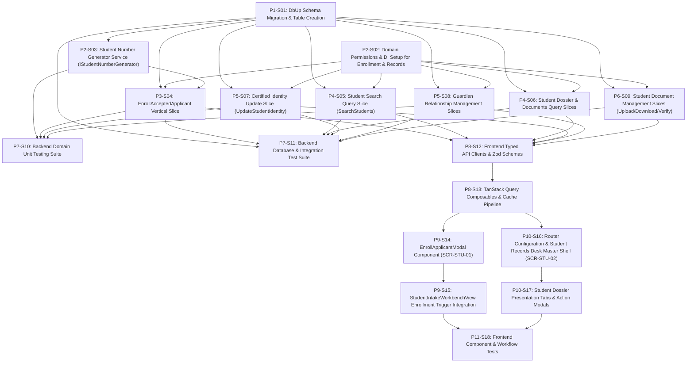

# 1. Objective

Implement the complete Stage 1 "Enrollment & Identity — full scope" under the Student domain for Elsasa SIS V3, fulfilling change request intake `CR-STU-ENROLLMENT-IDENTITY` ([`IS004 - STU-ENROLLMENT-IDENTITY-ISSUE.md`](file:///d:/Project.Private/elsasa-sis-v3/docs/issues/IS004%20-%20STU-ENROLLMENT-IDENTITY-ISSUE.md)). 

This implementation establishes permanent student identity continuity from originating applicants (`students.applicants` 1:1 `students.students`), authoritative gap-free sequential student number generation formatted as `STD-{EnrollmentYear}-{Sequence:D4}` via dedicated database sequence (`students.student_number_seq`), atomic multi-table enrollment execution capturing administrative placement context, policy-driven enrollment payment clearance gate (`GAP-01`) supporting manual payment references, authorized fee waiver overrides, and synchronous Finance verification (`IFinanceModule.IsEnrollmentFeePaidAsync`), guardian responsibility matrix governance with SQL Server partial unique indexing enforcing at most one active primary contact per student (`(student_id) WHERE (is_primary_contact = 1 AND is_active = 1)`), independent learner representation (`is_independent`), credential document promotion from admission files into official student records reusing storage references (`IFileStorageService`), post-commit domain event dispatch (`StudentEnrolledEvent`) via MediatR, and complete staff user interface delivery extending the Student Intake Workbench ([`SCR-STU-01`](file:///d:/Project.Private/elsasa-sis-v3/docs/screen-inventory.md#L274-L300)) with an Enrollment modal and fully realizing the Student Records Desk ([`SCR-STU-02`](file:///d:/Project.Private/elsasa-sis-v3/docs/screen-inventory.md#L303-L325)) at `/students/records`.

Planning Mode: FEATURE-PLANNING

Referenced artifacts:

- FEATURE / ISSUE:
  - `docs/issues/IS004 - STU-ENROLLMENT-IDENTITY-ISSUE.md` (Intake `CR-STU-ENROLLMENT-IDENTITY`)
  - `docs/domains/student-domain.md` (`STD-WF-03: Enroll Accepted Applicant`, `STD-WF-04: Maintain Student Identity`)
  - `docs/sub-modul-and-development-phases.md` (Stage 1 Foundation: Enrollment & Identity — full scope, Completion Criteria 3 & 4)
  - `docs/operational-workflow-discovery.md` (`STD-WF-03`, `STD-WF-04`, `GAP-01`)
  - `docs/use-cases.md` (`UC-STD-04`, `UC-STD-05`, Section 8.3 Independence, Section 8.4 Multi-Guardian Authority)
  - `docs/screen-inventory.md` (`SCR-STU-01`, `SCR-STU-02`)
  - `docs/entities/student-entities.md` & `docs/entities/student-entities-tables.md` (Submodule 2 — Enrollment & Identity)
- ARCHITECTURE:
  - `docs/issues/IS004 - STU-ENROLLMENT-IDENTITY-ARCHITECTURE.md` (Authoritative target capability architecture)
  - `docs/architecture/backend-architecture.md` (Modular Monolith & Vertical Slice specification)
  - `docs/architecture/frontend-architecture.md` (Modular Vue 3 SPA architecture)
  - `docs/architecture/adr.md` (ADR-001 through ADR-010)
  - `docs/architecture/coding-conventions.md` (C# 12, Dapper raw SQL, and Minimal API conventions)
- FEASIBILITY-ASSESSMENT:
  - `docs/issues/IS004 - STU-ENROLLMENT-IDENTITY-FEASIBILITY-ASSESSMENT.md` (Status: `READY-FOR-PLANNING`)

Architecture Applicability: ARCHITECTURE-REQUIRED

This feature introduces significant database schema expansion (1 native SQL sequence, 5 new domain tables in `students`, partial unique indexes), core administrative lifecycle transitions transforming prospective applicants into enrolled students, synchronous cross-domain payment verification against `IFinanceModule`, post-commit MediatR event dispatch (`StudentEnrolledEvent`), multiple backend vertical slices adhering to ADR-004 and ADR-005, and dual frontend operational surfaces (`SCR-STU-01` and `SCR-STU-02`). Authoritative target architecture `docs/issues/IS004 - STU-ENROLLMENT-IDENTITY-ARCHITECTURE.md` governs this plan.

---

# 2. Planning Scope

The planning scope encompasses all changes required across database persistence, backend vertical slices, cross-domain handshakes, test harnesses, and frontend workspaces:

1. **Database Persistence & DbUp Migrations (`Elsasa.Sis.Database`):**
   - Author and register sequential forward DbUp migration script `20261103_0301_Students_EnrollmentIdentity_Tables.sql`.
   - Create native sequence `students.student_number_seq` starting at 1.
   - Create 5 domain tables in `students`:
     - `students.students`: Authoritative permanent student identity, unique `student_number`, 1:1 unique foreign key to originating applicant (`applicant_id`), legal biographical attributes, contact details, `is_independent` flag, `current_status` defaulting to `'enrolled'`, `enrollment_date`, filtered unique index on national ID `ux_students_students_gov_id`, and status/name search index.
     - `students.enrollments`: Administrative enrollment event log, foreign key to student and admission application, `enrollment_type` defaulting to `'initial'`, placement parameters (`initial_campus`, `initial_level`, `initial_academic_year`, `initial_program`, `initial_cohort`), `approved_by`, payment confirmation audit (`enrollment_payment_confirmed`, `payment_reference`, `payment_waived`, `waiver_reference`), and chronological indexes.
     - `students.guardians`: Master directory of parent/guardian profiles with national ID deduplication index `ux_students_guardians_gov_id`.
     - `students.student_guardian_relationships`: Association mapping students and guardians with designated operational authorities (`relationship_type`, `is_primary_contact`, `is_emergency_contact`, `is_financial_contact`, `is_authorized_pickup`, `is_active`) and SQL Server partial unique index `ux_students_rel_primary_active` enforcing at most one active primary contact per student.
     - `students.student_documents`: Certified official student documents, status lifecycle (`submitted`, `verified`, `rejected`), verifier identity, file storage reference, MIME metadata, and search indexes.
   - Enforce intra-schema foreign keys with `ON DELETE NO ACTION` to guarantee audit trail preservation.

2. **Domain Permissions & Number Generation Service (`Elsasa.Sis.Students`):**
   - Declare authoritative permission constants in `Elsasa.Sis.Students.Permissions`:
     - `Permissions.Students.Enrollment.Execute`
     - `Permissions.Students.Records.View`
     - `Permissions.Students.Records.Edit`
   - Declare interface `IStudentNumberGenerator` and implement `SqlStudentNumberGenerator` generating formatted numbers `STD-{EnrollmentYear}-{Sequence:D4}` via `SELECT NEXT VALUE FOR students.student_number_seq`.
   - Register domain services, command/query handlers, and policy requirements in `Elsasa.Sis.Students.DependencyInjection`.

3. **Backend Vertical Slices (`Elsasa.Sis.Students`):**
   - **Enrollment Execution:** `EnrollAcceptedApplicant` endpoint (`POST /api/students/enrollments`), validator, and handler validating applicant acceptance prerequisites, enforcing the dual-mode payment confirmation / fee waiver gate (`GAP-01`), generating sequential student number, executing atomic multi-table insertion, promoting verified admission credentials into student documents, linking guardians, and publishing `StudentEnrolledEvent` strictly post-commit.
   - **Student Lookup & Dossier Queries:**
     - `SearchStudents` (`GET /api/students`): Paginated indexed search by query, campus, level, and status.
     - `GetStudentById` (`GET /api/students/{id}`): Comprehensive 360° student dossier multi-grid projection including certified identity, independence flag, enrollment placement history, guardians with flags, and official documents.
     - `GetStudentDocuments` (`GET /api/students/{id}/documents`): Parameterized document checklist retrieval.
   - **Identity & Guardian Management Commands:**
     - `UpdateStudentIdentity` (`PUT /api/students/{id}/identity`): Certified biographical updates, contact edits, and independence toggle (`is_independent`) with audit tracking.
     - `AddGuardianRelationship` (`POST /api/students/{id}/guardians`): Guardian deduplication/linking, responsibility flag assignments, and automated primary contact demotion.
     - `UpdateGuardianRelationship` (`PUT /api/students/{id}/guardians/{relationshipId}`): Primary contact transfer, responsibility updates, and relationship deactivation.
   - **Student Document Lifecycle:**
     - `UploadStudentDocument` (`POST /api/students/{id}/documents`): File upload via `IFileStorageService` under category `storage/documents/students/{studentId}/`.
     - `DownloadStudentDocument` (`GET /api/students/{id}/documents/{docId}/file`): Safe streaming via `IFileStorageService`.
     - `VerifyStudentDocument` (`PUT /api/students/{id}/documents/{docId}/verify`): Verification status transition (`verified` / `rejected`) with audit identity.

4. **Automated Testing Suite (`tests/backend`):**
   - Unit tests covering student number formatting, validator rules (placement constraints, fee waiver reference validation, guardian contact checks), and domain composition.
   - SQL Server 2022 Testcontainers integration tests verifying migration execution, concurrent duplicate enrollment rejection (409 Conflict), payment gate enforcement (waiver override vs reference vs automated Finance check), atomic multi-table insertion, document promotion, primary guardian partial unique index enforcement, and document streaming.

5. **Frontend Workspaces (`src/frontend`):**
   - Typed Axios API client modules, Zod validation schemas, and TanStack Query composables for enrollment execution and student records desk.
   - **Extension of `SCR-STU-01` (`StudentIntakeWorkbenchView.vue`):** "Enroll" button on accepted applications opening `EnrollApplicantModal.vue` with placement inputs, payment verification/waiver override, guardian confirmation, and mutation execution.
   - **Full Implementation of `SCR-STU-02` (`StudentRecordsDeskView.vue`):** Dedicated student search, summary metrics, student dossier inspector, biographical editor modal, guardian relationship manager card, and official document upload/verification workspace at `/students/records`.
   - Router configuration replacing placeholder stub `EnrollmentDeskView.vue` with redirect to `/students/records`.
   - Frontend Vitest unit and component test suite.

---

# 3. Dependencies

### External System & Tooling Dependencies

- .NET 8 SDK (8.0.x)
- Docker / Docker Desktop / Podman (required for Testcontainers SQL Server 2022 integration tests)
- Microsoft SQL Server 2022 instance (for local Web API runtime)
- Node.js runtime (v22.x or LTS) and pnpm package manager (v9.x or v11.x)

### Internal Slice Dependencies

- `Depends On` declares implementation prerequisites between slices.
- Dependencies reference Slice IDs only.
- Dependency satisfaction requires the referenced slice to have implementation status `IMPLEMENTED`.
- Dependency satisfaction does not require review status `GO`.
- Slices with `Depends On: None` or whose dependencies are satisfied may be executed in parallel.

### Dependency Graph



---

# 4. Progress Summary

| Phase | Implementation Status | Review Status | Progress |
|---|---|---|---|
| P1 - Database Migration & Persistence Foundation | NOT-STARTED | NOT-REVIEWED | 0/1 |
| P2 - Domain Setup, Generator & Permissions | NOT-STARTED | NOT-REVIEWED | 0/2 |
| P3 - Backend Domain Slices: Enrollment Execution | NOT-STARTED | NOT-REVIEWED | 0/1 |
| P4 - Backend Domain Slices: Student Search & Dossier Queries | NOT-STARTED | NOT-REVIEWED | 0/2 |
| P5 - Backend Domain Slices: Certified Identity & Guardian Management | NOT-STARTED | NOT-REVIEWED | 0/2 |
| P6 - Backend Domain Slices: Student Document Lifecycle | NOT-STARTED | NOT-REVIEWED | 0/1 |
| P7 - Backend Automated Testing & Verification | NOT-STARTED | NOT-REVIEWED | 0/2 |
| P8 - Frontend API Clients, Schemas & Composables | NOT-STARTED | NOT-REVIEWED | 0/2 |
| P9 - Frontend Staff Intake Workbench Extension (SCR-STU-01) | NOT-STARTED | NOT-REVIEWED | 0/2 |
| P10 - Frontend Student Records Desk Workspace (SCR-STU-02) | NOT-STARTED | NOT-REVIEWED | 0/2 |
| P11 - Frontend Verification & Workflow Testing | NOT-STARTED | NOT-REVIEWED | 0/1 |

---

# 5. Phases

## P1 - Database Migration & Persistence Foundation

Implementation Status: NOT-STARTED
Review Status: NOT-REVIEWED

### P1-S01

Title: DbUp Schema Migration & Table Creation

Implementation Status: NOT-STARTED
Review Status: NOT-REVIEWED

Objective:
Create and register the idempotent forward DbUp migration script `20261103_0301_Students_EnrollmentIdentity_Tables.sql` in `src/backend/Elsasa.Sis.Database/Scripts/`. The script creates sequence `students.student_number_seq` and provisions the 5 domain tables (`students.students`, `students.enrollments`, `students.guardians`, `students.student_guardian_relationships`, and `students.student_documents`) with complete constraints, filtered indexes, partial unique index on primary guardian, and `ON DELETE NO ACTION` foreign keys.

Depends On: None

Repository: elsasa-sis-v3 (backend)

Completion Criteria:
1. File `src/backend/Elsasa.Sis.Database/Scripts/20261103_0301_Students_EnrollmentIdentity_Tables.sql` exists and is embedded in `Elsasa.Sis.Database.csproj`.
2. Script creates sequence:
   ```sql
   IF NOT EXISTS (SELECT 1 FROM sys.sequences WHERE object_id = OBJECT_ID(N'students.student_number_seq'))
   BEGIN
       CREATE SEQUENCE [students].[student_number_seq]
           AS INT
           START WITH 1
           INCREMENT BY 1
           NO CYCLE;
   END
   ```
3. Script creates table `students.students`:
   - `id UNIQUEIDENTIFIER NOT NULL PRIMARY KEY`
   - `student_number NVARCHAR(32) NOT NULL CONSTRAINT ux_students_students_student_number UNIQUE`
   - `applicant_id UNIQUEIDENTIFIER NOT NULL CONSTRAINT ux_students_students_applicant_id UNIQUE`
   - `full_name NVARCHAR(200) NOT NULL`
   - `preferred_name NVARCHAR(100) NULL`
   - `date_of_birth DATE NULL`
   - `place_of_birth NVARCHAR(100) NULL`
   - `gender NVARCHAR(20) NULL`
   - `nationality NVARCHAR(100) NULL CONSTRAINT df_students_students_nationality DEFAULT (N'Indonesian')`
   - `government_id_type NVARCHAR(32) NULL`
   - `government_id_number NVARCHAR(64) NULL`
   - `address NVARCHAR(MAX) NULL`
   - `phone NVARCHAR(32) NULL`
   - `email NVARCHAR(254) NULL`
   - `is_independent BIT NOT NULL CONSTRAINT df_students_students_is_independent DEFAULT (0)`
   - `current_status NVARCHAR(32) NOT NULL CONSTRAINT df_students_students_current_status DEFAULT (N'enrolled')`
   - `enrollment_date DATE NOT NULL`
   - `notes NVARCHAR(MAX) NULL`
   - Audit columns: `created_at DATETIMEOFFSET(7) NOT NULL`, `created_by NVARCHAR(100) NULL`, `updated_at DATETIMEOFFSET(7) NULL`, `updated_by NVARCHAR(100) NULL`.
   - Physical FK: `FOREIGN KEY (applicant_id) REFERENCES students.applicants(id) ON DELETE NO ACTION`.
   - Filtered unique index: `ux_students_students_gov_id ON (government_id_number) WHERE government_id_number IS NOT NULL`.
   - Search index: `ix_students_students_status_name ON (current_status, full_name)`.
4. Script creates table `students.enrollments`:
   - `id UNIQUEIDENTIFIER NOT NULL PRIMARY KEY`
   - `student_id UNIQUEIDENTIFIER NOT NULL` (FK &rarr; `students.students(id)` `ON DELETE NO ACTION`)
   - `application_id UNIQUEIDENTIFIER NOT NULL` (FK &rarr; `students.admission_applications(id)` `ON DELETE NO ACTION`)
   - `enrollment_type NVARCHAR(32) NOT NULL CONSTRAINT df_students_enrollments_type DEFAULT (N'initial')`
   - `enrollment_date DATE NOT NULL`
   - `initial_campus NVARCHAR(100) NOT NULL`
   - `initial_level NVARCHAR(64) NOT NULL`
   - `initial_academic_year NVARCHAR(32) NOT NULL`
   - `initial_program NVARCHAR(100) NULL`
   - `initial_cohort NVARCHAR(50) NULL`
   - `approved_by NVARCHAR(100) NOT NULL`
   - `enrollment_payment_confirmed BIT NULL`
   - `payment_reference NVARCHAR(100) NULL`
   - `payment_waived BIT NOT NULL CONSTRAINT df_students_enrollments_payment_waived DEFAULT (0)`
   - `waiver_reference NVARCHAR(100) NULL`
   - `notes NVARCHAR(MAX) NULL`
   - Standard audit columns.
   - Indexes: `ix_students_enrollments_student_date ON (student_id, enrollment_date DESC)`, `ix_students_enrollments_application ON (application_id)`.
5. Script creates table `students.guardians`:
   - `id UNIQUEIDENTIFIER NOT NULL PRIMARY KEY`
   - `full_name NVARCHAR(200) NOT NULL`
   - `government_id_type NVARCHAR(32) NULL`
   - `government_id_number NVARCHAR(64) NULL`
   - `phone NVARCHAR(32) NULL`
   - `email NVARCHAR(254) NULL`
   - `address NVARCHAR(MAX) NULL`
   - `occupation NVARCHAR(100) NULL`
   - `notes NVARCHAR(MAX) NULL`
   - Standard audit columns.
   - Filtered unique index: `ux_students_guardians_gov_id ON (government_id_number) WHERE government_id_number IS NOT NULL`.
   - Search index: `ix_students_guardians_name ON (full_name)`.
6. Script creates table `students.student_guardian_relationships`:
   - `id UNIQUEIDENTIFIER NOT NULL PRIMARY KEY`
   - `student_id UNIQUEIDENTIFIER NOT NULL` (FK &rarr; `students.students(id)` `ON DELETE NO ACTION`)
   - `guardian_id UNIQUEIDENTIFIER NOT NULL` (FK &rarr; `students.guardians(id)` `ON DELETE NO ACTION`)
   - `relationship_type NVARCHAR(50) NOT NULL`
   - `is_primary_contact BIT NOT NULL CONSTRAINT df_students_rel_is_primary DEFAULT (0)`
   - `is_emergency_contact BIT NOT NULL CONSTRAINT df_students_rel_is_emergency DEFAULT (0)`
   - `is_financial_contact BIT NOT NULL CONSTRAINT df_students_rel_is_financial DEFAULT (0)`
   - `is_authorized_pickup BIT NOT NULL CONSTRAINT df_students_rel_is_pickup DEFAULT (0)`
   - `is_active BIT NOT NULL CONSTRAINT df_students_rel_is_active DEFAULT (1)`
   - Standard audit columns.
   - Partial unique index: `ux_students_rel_primary_active ON (student_id) WHERE (is_primary_contact = 1 AND is_active = 1)`.
   - Composite index: `ix_students_rel_student_guardian ON (student_id, guardian_id)`.
   - Status index: `ix_students_rel_guardian_active ON (guardian_id, is_active)`.
7. Script creates table `students.student_documents`:
   - `id UNIQUEIDENTIFIER NOT NULL PRIMARY KEY`
   - `student_id UNIQUEIDENTIFIER NOT NULL` (FK &rarr; `students.students(id)` `ON DELETE NO ACTION`)
   - `document_type NVARCHAR(100) NOT NULL`
   - `submission_status NVARCHAR(32) NOT NULL CONSTRAINT df_students_docs_status DEFAULT (N'submitted')`
   - `submitted_date DATE NULL`
   - `verified_date DATE NULL`
   - `verified_by NVARCHAR(100) NULL`
   - `file_reference NVARCHAR(500) NULL`
   - `file_name NVARCHAR(255) NULL`
   - `file_size_bytes BIGINT NULL`
   - `content_type NVARCHAR(100) NULL`
   - `valid_until DATE NULL`
   - `notes NVARCHAR(MAX) NULL`
   - Standard audit columns.
   - Index: `ix_students_student_documents_student_status ON (student_id, submission_status)`.
8. `dotnet build src/backend/Elsasa.Sis.Database/` succeeds cleanly without warnings.

Implementation Notes:

Changed Files:

---

## P2 - Domain Setup, Generator & Permissions

Implementation Status: NOT-STARTED
Review Status: NOT-REVIEWED

### P2-S02

Title: Domain Permissions & DI Setup for Enrollment & Records

Implementation Status: NOT-STARTED
Review Status: NOT-REVIEWED

Objective:
Declare authoritative permission constants for Enrollment and Records in `src/backend/Elsasa.Sis.Students/Permissions.cs`, register policy requirements in `src/backend/Elsasa.Sis.Students/DependencyInjection.cs`, and wire policy authorization for `StudentAdminOfficer`, `AdmissionOfficer`, `SchoolLeadership`, and `Admin` roles.

Depends On: None

Repository: elsasa-sis-v3 (backend)

Completion Criteria:
1. `src/backend/Elsasa.Sis.Students/Permissions.cs` declares:
   ```csharp
   public static class Enrollment
   {
       public const string Execute = "Permissions.Students.Enrollment.Execute";
   }

   public static class Records
   {
       public const string View = "Permissions.Students.Records.View";
       public const string Edit = "Permissions.Students.Records.Edit";
   }
   ```
2. `src/backend/Elsasa.Sis.Students/DependencyInjection.cs` registers policy requirements:
   - `Permissions.Students.Enrollment.Execute` authorized for `StudentAdminOfficer`, `AdmissionOfficer`, `Admin`.
   - `Permissions.Students.Records.View` authorized for `StudentAdminOfficer`, `AdmissionOfficer`, `SchoolLeadership`, `Admin`.
   - `Permissions.Students.Records.Edit` authorized for `StudentAdminOfficer`, `Admin`.
3. `dotnet build src/backend/Elsasa.Sis.Students/` succeeds without errors.

Implementation Notes:

Changed Files:

---

### P2-S03

Title: Student Number Generator Service (IStudentNumberGenerator)

Implementation Status: NOT-STARTED
Review Status: NOT-REVIEWED

Objective:
Declare `IStudentNumberGenerator` interface and implement `SqlStudentNumberGenerator` in `src/backend/Elsasa.Sis.Students/Features/Enrollment/Services/`, retrieving sequence values from `students.student_number_seq` via `ISqlConnectionFactory` and formatting authoritative, gap-free student numbers as `STD-{EnrollmentYear}-{Sequence:D4}` (e.g. `STD-2026-0001`).

Depends On: P1-S01

Repository: elsasa-sis-v3 (backend)

Completion Criteria:
1. Interface `src/backend/Elsasa.Sis.Students/Features/Enrollment/Services/IStudentNumberGenerator.cs` declares:
   ```csharp
   namespace Elsasa.Sis.Students.Features.Enrollment.Services;

   public interface IStudentNumberGenerator
   {
       Task<string> GenerateNextStudentNumberAsync(int enrollmentYear, CancellationToken ct = default);
   }
   ```
2. Class `SqlStudentNumberGenerator.cs` implements `IStudentNumberGenerator`:
   - Injects `ISqlConnectionFactory`.
   - Executes query `SELECT NEXT VALUE FOR students.student_number_seq;` via Dapper.
   - Returns string formatted as `$"STD-{enrollmentYear}-{nextVal:D4}"`.
3. Registered in `Elsasa.Sis.Students/DependencyInjection.cs`:
   `services.AddScoped<IStudentNumberGenerator, SqlStudentNumberGenerator>();`.
4. Unit tests in `StudentNumberGeneratorTests.cs` verify formatting logic across diverse sequence numbers (`1` &rarr; `STD-2026-0001`, `999` &rarr; `STD-2026-0999`, `10000` &rarr; `STD-2026-10000`).
5. `dotnet build src/backend/Elsasa.Sis.Students/` succeeds.

Implementation Notes:

Changed Files:

---

## P3 - Backend Domain Slices: Enrollment Execution

Implementation Status: NOT-STARTED
Review Status: NOT-REVIEWED

### P3-S04

Title: EnrollAcceptedApplicant Vertical Slice

Implementation Status: NOT-STARTED
Review Status: NOT-REVIEWED

Objective:
Implement the complete vertical slice `EnrollAcceptedApplicant` in `src/backend/Elsasa.Sis.Students/Features/Enrollment/EnrollAcceptedApplicant/`. The slice handles admission prerequisite verification (`status == 'decided'` and `decision_type == 'accepted'`), checks applicant non-enrollment, enforces the dual-mode payment confirmation / fee waiver gate (`GAP-01`, `OQ-003`), invokes `IStudentNumberGenerator`, executes atomic multi-table insertion in Dapper transaction (`students.students`, `students.enrollments`, promotes verified `applicant_documents` into `student_documents`, links guardians into `students.guardians` and `students.student_guardian_relationships` with single active primary contact enforcement), commits transaction, and publishes `StudentEnrolledEvent` strictly post-commit.

Depends On: P1-S01, P2-S02, P2-S03

Repository: elsasa-sis-v3 (backend)

Completion Criteria:
1. Minimal API endpoint `EnrollAcceptedApplicantEndpoint.cs` maps `POST /api/students/enrollments`:
   - Requires permission `Permissions.Students.Enrollment.Execute`.
   - Injects `EnrollAcceptedApplicantHandler`.
   - Returns HTTP 201 Created with `EnrollAcceptedApplicantResponse` (`StudentId`, `StudentNumber`, `EnrollmentId`).
2. DTO `EnrollAcceptedApplicantRequest.cs` declares:
   - `ApplicantId` (Guid), `AcademicYearId` (Guid), `InitialCampus` (string), `InitialLevel` (string), `InitialAcademicYear` (string), `InitialProgram` (string?), `InitialCohort` (string?), `PaymentWaived` (bool), `PaymentReference` (string?), `WaiverReference` (string?), `CheckFinanceModule` (bool?), `Guardians` (list of guardian requests), `Notes` (string?).
3. Validator `EnrollAcceptedApplicantValidator.cs` verifies:
   - `ApplicantId` is not empty.
   - `InitialCampus`, `InitialLevel`, and `InitialAcademicYear` are not empty.
   - When `PaymentWaived == true`, `WaiverReference` must not be empty.
   - When `PaymentWaived == false` and `CheckFinanceModule != true`, `PaymentReference` must not be empty.
4. Handler `EnrollAcceptedApplicantHandler.cs` implements:
   - Verifies originating application exists with `status = 'decided'` and `decision_type = 'accepted'`. If not, returns `DomainError.Conflict("Students.Enrollment.ApplicantNotAccepted", ...)`.
   - Verifies applicant is not already enrolled in `students.students`. If already enrolled, returns `DomainError.Conflict("Students.Enrollment.AlreadyEnrolled", ...)`.
   - Payment gate evaluation:
     - If `PaymentWaived == false` and `CheckFinanceModule == true`, calls `IFinanceModule.IsEnrollmentFeePaidAsync(applicantId, academicYearId, ct)`. If false, returns `DomainError.Conflict("Students.Enrollment.PaymentRequired", ...)`.
   - Obtains next student number from `IStudentNumberGenerator`.
   - Executes single atomic Dapper transaction:
     - `INSERT INTO students.students (...)` projecting biographical attributes from originating applicant.
     - `INSERT INTO students.enrollments (...)` capturing placement snapshot and payment/waiver audit.
     - Promotes verified applicant documents: `INSERT INTO students.student_documents (...) SELECT ... FROM students.applicant_documents WHERE application_id = @AppId AND submission_status = 'verified'` reusing existing physical `file_reference`.
     - Inserts/links guardians into `students.guardians` (deduplicating by government ID) and `students.student_guardian_relationships` (enforcing single active primary contact).
     - Commits transaction.
   - Strictly post-commit: calls `await publisher.Publish(new StudentEnrolledEvent(studentId, applicantId, academicYearId), ct);`.
5. Registered in `Elsasa.Sis.Students/DependencyInjection.cs`:
   `services.AddScoped<EnrollAcceptedApplicantHandler>();`.
6. `dotnet build src/backend/Elsasa.Sis.Students/` succeeds.

Implementation Notes:

Changed Files:

---

## P4 - Backend Domain Slices: Student Search & Dossier Queries

Implementation Status: NOT-STARTED
Review Status: NOT-REVIEWED

### P4-S05

Title: Student Search Query Slice (SearchStudents)

Implementation Status: NOT-STARTED
Review Status: NOT-REVIEWED

Objective:
Implement vertical query slice `SearchStudents` in `src/backend/Elsasa.Sis.Students/Features/Records/SearchStudents/`. Provides paginated, indexed search over `students.students` filtering by search query (matching name, student number, or national ID), campus, grade level, and status, returning lightweight student summary cards for the left pane of `SCR-STU-02`.

Depends On: P1-S01, P2-S02

Repository: elsasa-sis-v3 (backend)

Completion Criteria:
1. Endpoint `SearchStudentsEndpoint.cs` maps `GET /api/students`:
   - Requires permission `Permissions.Students.Records.View`.
   - Accepts query parameters: `SearchTerm`, `Campus`, `Level`, `Status`, `PageNumber` (default 1), `PageSize` (default 20).
2. DTO `StudentListItemDto.cs` records:
   - `Id` (Guid), `StudentNumber` (string), `FullName` (string), `PreferredName` (string?), `CurrentStatus` (string), `EnrollmentDate` (DateOnly), `InitialCampus` (string), `InitialLevel` (string), `IsIndependent` (bool), `PrimaryGuardianName` (string?), `PrimaryGuardianPhone` (string?).
3. Response DTO `SearchStudentsResponse.cs` returns `PaginatedList<StudentListItemDto>`.
4. Handler `SearchStudentsHandler.cs` executes parameterized Dapper query using raw string literals:
   - Joins `students.students` with latest `students.enrollments` and active primary contact from `students.student_guardian_relationships` / `students.guardians`.
   - Projects total count and paginated items.
5. Registered in `Elsasa.Sis.Students/DependencyInjection.cs`:
   `services.AddScoped<SearchStudentsHandler>();`.
6. `dotnet build src/backend/Elsasa.Sis.Students/` succeeds.

Implementation Notes:

Changed Files:

---

### P4-S06

Title: Student Dossier & Documents Query Slices

Implementation Status: NOT-STARTED
Review Status: NOT-REVIEWED

Objective:
Implement vertical query slices `GetStudentById` in `Features/Records/GetStudentById/` and `GetStudentDocuments` in `Features/Records/Documents/GetStudentDocuments/`. `GetStudentById` executes a multi-query Dapper projection returning the complete 360° student dossier (identity, independence status, initial enrollment details, all active/inactive guardian relationships, and official documents checklist). `GetStudentDocuments` returns student document records.

Depends On: P1-S01, P2-S02

Repository: elsasa-sis-v3 (backend)

Completion Criteria:
1. Endpoint `GetStudentByIdEndpoint.cs` maps `GET /api/students/{id}`:
   - Requires permission `Permissions.Students.Records.View`.
   - Returns 404 Not Found if student does not exist, or 200 OK with `StudentDetailResponse`.
2. DTO `StudentDetailResponse.cs` encapsulates:
   - Core identity: `Id`, `StudentNumber`, `ApplicantId`, `FullName`, `PreferredName`, `DateOfBirth`, `PlaceOfBirth`, `Gender`, `Nationality`, `GovernmentIdType`, `GovernmentIdNumber`, `Address`, `Phone`, `Email`, `IsIndependent`, `CurrentStatus`, `EnrollmentDate`, `Notes`, `CreatedAt`, `CreatedBy`, `UpdatedAt`, `UpdatedBy`.
   - Enrollment placement history: List of `EnrollmentHistoryDto` (`EnrollmentDate`, `Campus`, `Level`, `AcademicYear`, `Program`, `Cohort`, `ApprovedBy`, `PaymentConfirmed`, `PaymentReference`, `PaymentWaived`, `WaiverReference`).
   - Guardian relationships: List of `StudentGuardianRelationshipDto` (`RelationshipId`, `GuardianId`, `FullName`, `RelationshipType`, `GovernmentIdType`, `GovernmentIdNumber`, `Phone`, `Email`, `Address`, `Occupation`, `IsPrimaryContact`, `IsEmergencyContact`, `IsFinancialContact`, `IsAuthorizedPickup`, `IsActive`).
   - Documents: List of `StudentDocumentDto` (`Id`, `DocumentType`, `SubmissionStatus`, `SubmittedDate`, `VerifiedDate`, `VerifiedBy`, `FileName`, `FileSizeBytes`, `ContentType`, `FileReference`).
3. Endpoint `GetStudentDocumentsEndpoint.cs` maps `GET /api/students/{id}/documents`.
4. Handlers execute parameterized Dapper queries projecting all named columns without `SELECT *`.
5. Registered in `Elsasa.Sis.Students/DependencyInjection.cs`.
6. `dotnet build src/backend/Elsasa.Sis.Students/` succeeds.

Implementation Notes:

Changed Files:

---

## P5 - Backend Domain Slices: Certified Identity & Guardian Management

Implementation Status: NOT-STARTED
Review Status: NOT-REVIEWED

### P5-S07

Title: Certified Identity Update Slice (UpdateStudentIdentity)

Implementation Status: NOT-STARTED
Review Status: NOT-REVIEWED

Objective:
Implement vertical command slice `UpdateStudentIdentity` in `src/backend/Elsasa.Sis.Students/Features/Records/UpdateStudentIdentity/`. Allows authorized officers to update certified biographical information, government ID attributes, residential address, personal contact details, and independent learner toggle (`is_independent`) with audit tracking.

Depends On: P1-S01, P2-S02

Repository: elsasa-sis-v3 (backend)

Completion Criteria:
1. Endpoint `UpdateStudentIdentityEndpoint.cs` maps `PUT /api/students/{id}/identity`:
   - Requires permission `Permissions.Students.Records.Edit`.
   - Validates payload with `UpdateStudentIdentityValidator`.
   - Returns HTTP 200 OK on success, or 404 Not Found if student does not exist.
2. DTO `UpdateStudentIdentityRequest.cs` declares:
   - `FullName` (string), `PreferredName` (string?), `DateOfBirth` (DateOnly?), `PlaceOfBirth` (string?), `Gender` (string?), `Nationality` (string?), `GovernmentIdType` (string?), `GovernmentIdNumber` (string?), `Address` (string?), `Phone` (string?), `Email` (string?), `IsIndependent` (bool), `Notes` (string?).
3. Validator `UpdateStudentIdentityValidator.cs` verifies:
   - `FullName` is not empty and <= 200 characters.
   - `Email` is a valid format when provided.
   - `GovernmentIdNumber` <= 64 characters.
4. Handler `UpdateStudentIdentityHandler.cs`:
   - Injects `ICurrentUser` to capture actor identity.
   - Updates `students.students` record setting `updated_at = SYSUTCDATETIME()` and `updated_by = currentUser.Username`.
5. Registered in `Elsasa.Sis.Students/DependencyInjection.cs`.
6. `dotnet build src/backend/Elsasa.Sis.Students/` succeeds.

Implementation Notes:

Changed Files:

---

### P5-S08

Title: Guardian Relationship Management Slices

Implementation Status: NOT-STARTED
Review Status: NOT-REVIEWED

Objective:
Implement vertical command slices `AddGuardianRelationship` and `UpdateGuardianRelationship` in `src/backend/Elsasa.Sis.Students/Features/Records/Guardians/`. Enforces guardian deduplication against `students.guardians` (by NIK or name + phone), manages authority flags (`is_primary_contact`, `is_emergency_contact`, `is_financial_contact`, `is_authorized_pickup`), and executes atomic primary contact transfer (demoting any prior active primary contact for that student when a new one is designated, satisfying partial unique index `ux_students_rel_primary_active`).

Depends On: P1-S01, P2-S02

Repository: elsasa-sis-v3 (backend)

Completion Criteria:
1. Endpoint `AddGuardianRelationshipEndpoint.cs` maps `POST /api/students/{id}/guardians`:
   - Requires permission `Permissions.Students.Records.Edit`.
   - Payload: Guardian master details, `RelationshipType`, responsibility flags (`IsPrimaryContact`, `IsEmergencyContact`, `IsFinancialContact`, `IsAuthorizedPickup`).
   - Handler deduplicates/inserts guardian in `students.guardians`, demotes prior primary contact if `IsPrimaryContact = true`, inserts relationship into `students.student_guardian_relationships`, and returns HTTP 201 Created with relationship ID.
2. Endpoint `UpdateGuardianRelationshipEndpoint.cs` maps `PUT /api/students/{id}/guardians/{relationshipId}`:
   - Requires permission `Permissions.Students.Records.Edit`.
   - Payload: `RelationshipType`, responsibility flags, and `IsActive` toggle.
   - Handler updates relationship; if `IsPrimaryContact = true` and `IsActive = true`, demotes other active primary contacts for that student first.
3. Validators verify guardian name not empty, valid relationship type, and valid phone/email when supplied.
4. Registered in `Elsasa.Sis.Students/DependencyInjection.cs`.
5. `dotnet build src/backend/Elsasa.Sis.Students/` succeeds.

Implementation Notes:

Changed Files:

---

## P6 - Backend Domain Slices: Student Document Lifecycle

Implementation Status: NOT-STARTED
Review Status: NOT-REVIEWED

### P6-S09

Title: Student Document Management Slices (Upload, Download, Verify)

Implementation Status: NOT-STARTED
Review Status: NOT-REVIEWED

Objective:
Implement vertical slices for official student documents in `src/backend/Elsasa.Sis.Students/Features/Records/Documents/`: `UploadStudentDocument` (saving physical file via `IFileStorageService` under category `storage/documents/students/{studentId}/` and creating record in `students.student_documents`), `DownloadStudentDocument` (safe file stream retrieval), and `VerifyStudentDocument` (updating verification state to `verified` or `rejected` with verifier identity).

Depends On: P1-S01, P2-S02

Repository: elsasa-sis-v3 (backend)

Completion Criteria:
1. Endpoint `UploadStudentDocumentEndpoint.cs` maps `POST /api/students/{id}/documents` (`multipart/form-data`):
   - Requires permission `Permissions.Students.Records.Edit`.
   - Validates file stream (extension `.pdf`, `.jpg`, `.jpeg`, `.png`, size <= 5 MB).
   - Injects `IFileStorageService` to persist file under category `students/{studentId}`.
   - Inserts record into `students.student_documents` with `submission_status = 'submitted'`, returning 201 Created with document ID.
2. Endpoint `DownloadStudentDocumentEndpoint.cs` maps `GET /api/students/{id}/documents/{docId}/file`:
   - Requires permission `Permissions.Students.Records.View`.
   - Retrieves document metadata, opens read stream via `IFileStorageService.OpenReadStreamAsync`, and returns `Results.Stream` with content-type and content-disposition headers.
3. Endpoint `VerifyStudentDocumentEndpoint.cs` maps `PUT /api/students/{id}/documents/{docId}/verify`:
   - Requires permission `Permissions.Students.Records.Edit`.
   - Payload: `SubmissionStatus` (`verified` or `rejected`), `Notes` (optional).
   - Updates `students.student_documents` with `verified_by = currentUser.Username` and `verified_date = SYSUTCDATETIME()`.
4. Registered in `Elsasa.Sis.Students/DependencyInjection.cs`.
5. `dotnet build src/backend/Elsasa.Sis.Students/` succeeds.

Implementation Notes:

Changed Files:

---

## P7 - Backend Automated Testing & Verification

Implementation Status: NOT-STARTED
Review Status: NOT-REVIEWED

### P7-S10

Title: Backend Domain Unit Testing Suite

Implementation Status: NOT-STARTED
Review Status: NOT-REVIEWED

Objective:
Author comprehensive xUnit unit tests in `tests/backend/Elsasa.Sis.IntegrationTests/UnitTests/Students/` covering student number generator formatting rules, FluentValidation validators (enrollment placement rules, fee waiver override rules, certified identity constraints, guardian relationship constraints), and Students domain composition.

Depends On: P2-S03, P3-S04, P5-S07, P5-S08

Repository: elsasa-sis-v3 (backend)

Completion Criteria:
1. `StudentNumberGeneratorTests.cs` verifies:
   - Correct formatting for sequences (`STD-2026-0001`, `STD-2026-0042`, `STD-2026-1000`).
   - Year argument parameterization.
2. `EnrollAcceptedApplicantValidatorTests.cs` verifies:
   - Valid payload passes validation.
   - Missing `ApplicantId`, `InitialCampus`, `InitialLevel`, or `InitialAcademicYear` fails with clear error messages.
   - When `PaymentWaived == true` and `WaiverReference` is empty, validation fails.
   - When `PaymentWaived == false`, `CheckFinanceModule != true`, and `PaymentReference` is empty, validation fails.
3. `UpdateStudentIdentityValidatorTests.cs` verifies:
   - Name required, boundary lengths, email formatting rules.
4. `GuardianRelationshipValidatorTests.cs` verifies:
   - Valid relationship types accepted, invalid types rejected.
   - Guardian full name required.
5. `StudentsEnrollmentDomainCompositionTests.cs` verifies:
   - Permissions `Permissions.Students.Enrollment.*` and `Permissions.Students.Records.*` constants.
   - Policy requirement assertions for various role claims (`StudentAdminOfficer`, `AdmissionOfficer`, `SchoolLeadership`, `Admin`).
   - DI service resolution for all new handlers and `IStudentNumberGenerator`.
6. `dotnet test tests/backend/Elsasa.Sis.IntegrationTests/ --filter Category=Unit` passes with 100% green status.

Implementation Notes:

Changed Files:

---

### P7-S11

Title: Backend Database & Integration Test Suite

Implementation Status: NOT-STARTED
Review Status: NOT-REVIEWED

Objective:
Author end-to-end integration tests using SQL Server 2022 Testcontainers in `tests/backend/Elsasa.Sis.IntegrationTests/Features/Students/` verifying database migration `20261103_0301`, atomic enrollment execution from accepted applicant, payment clearance gate enforcement (waiver vs manual reference vs finance check), duplicate enrollment rejection (409 Conflict), document promotion without file duplication, primary guardian partial unique index enforcement, search query pagination, certified identity updates, and document streaming.

Depends On: P1-S01, P3-S04, P4-S05, P4-S06, P5-S07, P5-S08, P6-S09

Repository: elsasa-sis-v3 (backend)

Completion Criteria:
1. `EnrollAcceptedApplicantIntegrationTests.cs` verifies:
   - Enrolling an accepted applicant creates authoritative `students.students` record and `students.enrollments` record in a single transaction.
   - Generates sequential, non-colliding `STD-{Year}-{Seq:D4}` student number.
   - Automatically promotes verified applicant documents to `students.student_documents` reusing `file_reference`.
   - Links initial guardians into `students.guardians` and `students.student_guardian_relationships`.
   - Publishes `StudentEnrolledEvent` strictly post-commit.
   - Attempting to enroll an unaccepted application returns 409 Conflict.
   - Attempting to re-enroll an already enrolled applicant returns 409 Conflict (`ux_students_students_applicant_id`).
   - Payment gate: unconfirmed payment without waiver returns 409 Conflict; manual payment reference succeeds; fee waiver override with decree succeeds; simulated `IFinanceModule` success succeeds.
2. `StudentRecordsIntegrationTests.cs` verifies:
   - Paginated search by name, student number, campus, grade level, and status returns expected items.
   - 360° dossier projection returns all four tabs of data.
   - Updating certified identity modifies `students.students` and audit columns.
   - Toggling `is_independent` flag updates database state.
   - Adding a guardian with `is_primary_contact = 1` demotes previous active primary guardian, maintaining the partial unique index invariant.
   - Document upload, safe download streaming, and verification status transition.
3. `dotnet test tests/backend/Elsasa.Sis.IntegrationTests/` passes with 100% green status.

Implementation Notes:

Changed Files:

---

## P8 - Frontend API Clients, Schemas & Composables

Implementation Status: NOT-STARTED
Review Status: NOT-REVIEWED

### P8-S12

Title: Frontend Typed API Clients & Zod Schemas

Implementation Status: NOT-STARTED
Review Status: NOT-REVIEWED

Objective:
Create typed Axios API client functions, TypeScript interfaces, and Zod validation schemas for enrollment execution and student records management under `src/frontend/src/features/students/`.

Depends On: P3-S04, P4-S05, P4-S06, P5-S07, P5-S08, P6-S09

Repository: elsasa-sis-v3 (frontend)

Completion Criteria:
1. `src/frontend/src/features/students/enrollment/api/enrollment.api.ts`:
   - `enrollAcceptedApplicant(payload: EnrollAcceptedApplicantPayload): Promise<EnrollAcceptedApplicantResponse>` calling `POST /api/students/enrollments`.
2. `src/frontend/src/features/students/enrollment/schemas/enrollment.schema.ts`:
   - Zod schema validating initial campus, level, academic year, payment reference (or waiver reference when waived).
3. `src/frontend/src/features/students/records/api/records.api.ts`:
   - `searchStudents(params: StudentSearchParams): Promise<PaginatedResponse<StudentListItem>>` calling `GET /api/students`.
   - `getStudentById(id: string): Promise<StudentDetail>` calling `GET /api/students/{id}`.
   - `updateStudentIdentity(id: string, payload: UpdateIdentityPayload): Promise<void>` calling `PUT /api/students/{id}/identity`.
   - `addGuardianRelationship(studentId: string, payload: AddGuardianPayload): Promise<string>` calling `POST /api/students/{id}/guardians`.
   - `updateGuardianRelationship(studentId: string, relationshipId: string, payload: UpdateGuardianPayload): Promise<void>` calling `PUT /api/students/{id}/guardians/{relationshipId}`.
   - `uploadStudentDocument(studentId: string, file: File, documentType: string): Promise<string>` calling `POST /api/students/{id}/documents`.
   - `getStudentDocumentDownloadUrl(studentId: string, docId: string): string`.
   - `verifyStudentDocument(studentId: string, docId: string, status: string, notes?: string): Promise<void>` calling `PUT /api/students/{id}/documents/{docId}/verify`.
4. `src/frontend/src/features/students/records/schemas/records.schema.ts`:
   - Zod schemas for identity editing, guardian relationships, and document verification.
5. `pnpm type-check` in `src/frontend` succeeds without TypeScript errors.

Implementation Notes:

Changed Files:

---

### P8-S13

Title: TanStack Query Composables & Cache Pipeline

Implementation Status: NOT-STARTED
Review Status: NOT-REVIEWED

Objective:
Create TanStack Query composables for reactive searching, dossier fetching, and mutations with automated cache invalidation under `src/frontend/src/features/students/`.

Depends On: P8-S12

Repository: elsasa-sis-v3 (frontend)

Completion Criteria:
1. `src/frontend/src/features/students/enrollment/composables/useEnrollmentMutations.ts`:
   - `useEnrollAcceptedApplicantMutation`: Executes enrollment, invalidates `['students', 'admission', 'queue']` and `['students', 'admission', 'dossier']`, and displays success toast with assigned student number.
2. `src/frontend/src/features/students/records/composables/useStudentRecordsQueries.ts`:
   - `useStudentSearchQuery(params)`: Reactive query with key `['students', 'records', 'list', params]`.
   - `useStudentDossierQuery(studentId)`: Reactive query with key `['students', 'records', 'detail', studentId]`.
3. `src/frontend/src/features/students/records/composables/useStudentRecordsMutations.ts`:
   - `useUpdateStudentIdentityMutation(studentId)`: Invalidates detail query on success.
   - `useAddGuardianMutation(studentId)`: Invalidates detail query on success.
   - `useUpdateGuardianMutation(studentId)`: Invalidates detail query on success.
   - `useUploadStudentDocumentMutation(studentId)`: Invalidates detail query on success.
   - `useVerifyStudentDocumentMutation(studentId)`: Invalidates detail query on success.
4. `pnpm type-check` passes without errors.

Implementation Notes:

Changed Files:

---

## P9 - Frontend Staff Intake Workbench Extension (SCR-STU-01)

Implementation Status: NOT-STARTED
Review Status: NOT-REVIEWED

### P9-S14

Title: EnrollApplicantModal Component (SCR-STU-01)

Implementation Status: NOT-STARTED
Review Status: NOT-REVIEWED

Objective:
Create `EnrollApplicantModal.vue` in `src/frontend/src/features/students/admission/components/`. The dialog provides an administrative form to configure placement parameters (Campus, Grade Level, Academic Year, Program, Initial Cohort), payment confirmation / fee waiver selection (Payment Reference input vs Fee Waiver toggle with Waiver Decree input), and guardian contact confirmation.

Depends On: P8-S13

Repository: elsasa-sis-v3 (frontend)

Completion Criteria:
1. File `src/frontend/src/features/students/admission/components/EnrollApplicantModal.vue` created.
2. Form fields:
   - Placement: Target Campus (select), School Level (pre-filled from application), Academic Year (select), Program (text/select), Initial Cohort (text).
   - Payment Gate: Radio/toggle for "Payment Confirmed" vs "Authorized Fee Waiver".
     - When "Payment Confirmed": Payment Reference input (bank transfer ID, receipt #).
     - When "Authorized Fee Waiver": Waiver Reference input (decree #, scholarship letter #).
   - Guardian Confirmation: Pre-populated list of applicant contacts with primary contact radio designation.
3. Form validation powered by `enrollment.schema.ts`.
4. Submits via `useEnrollAcceptedApplicantMutation`.
5. Emits `success` event with `{ studentId, studentNumber }` on successful mutation.
6. `pnpm type-check` passes.

Implementation Notes:

Changed Files:

---

### P9-S15

Title: StudentIntakeWorkbenchView Enrollment Trigger Integration

Implementation Status: NOT-STARTED
Review Status: NOT-REVIEWED

Objective:
Integrate `EnrollApplicantModal.vue` into `StudentIntakeWorkbenchView.vue` (`SCR-STU-01`). When the selected application has `status == 'decided'` and `decision.decision_type == 'accepted'`, render a prominent `[ Enroll Applicant ]` action button in the dossier actions bar. On click, open `EnrollApplicantModal.vue`. On completion, display success feedback, offer a direct navigation link to the Student Records Desk (`/students/records`), and refetch the queue.

Depends On: P9-S14

Repository: elsasa-sis-v3 (frontend)

Completion Criteria:
1. In `src/frontend/src/features/students/admission/views/StudentIntakeWorkbenchView.vue`:
   - Dossier action bar renders `[ Enroll Applicant ]` button when `dossier.status === 'decided' && dossier.decision?.decisionType === 'accepted'` and user has permission `Permissions.Students.Enrollment.Execute`.
   - Button styled with teal primary brand highlight and appropriate user icon.
   - Clicking opens `EnrollApplicantModal.vue`.
2. On enrollment success:
   - Closes modal.
   - Shows Toast notification: `"Student successfully enrolled with Student Number: STD-YYYY-XXXX"`.
   - Renders success banner in dossier with button: `[ Open in Student Records Desk ]` routing to `/students/records`.
   - Refetches intake work queue and selected application dossier.
3. `pnpm type-check` passes cleanly.

Implementation Notes:

Changed Files:

---

## P10 - Frontend Student Records Desk Workspace (SCR-STU-02)

Implementation Status: NOT-STARTED
Review Status: NOT-REVIEWED

### P10-S16

Title: Router Configuration & Student Records Desk Master Shell (SCR-STU-02)

Implementation Status: NOT-STARTED
Review Status: NOT-REVIEWED

Objective:
Configure router routes for Student Records Desk, redirect legacy stub `/students/enrollment` to `/students/records`, and implement the two-pane Master-Detail shell `StudentRecordsDeskView.vue` (`SCR-STU-02`) at `/students/records`. The left pane (35%) provides search by Student Number, Name, NIK, filter dropdowns (Campus, Level, Status), summary metrics, and candidate list. The right pane (65%) hosts the 360° Student Dossier.

Depends On: P8-S13

Repository: elsasa-sis-v3 (frontend)

Completion Criteria:
1. `src/frontend/src/app/router/routes.ts`:
   - Updates `/students/enrollment` to redirect to `/students/records`.
   - Adds route `/students/records` (`students.records.desk`) rendering `StudentRecordsDeskView.vue` with permission `Permissions.Students.Records.View` and title `"Student Records Desk"`.
   - Adds route `/students/records/:id` (`students.records.detail`).
2. `src/frontend/src/features/students/records/views/StudentRecordsDeskView.vue`:
   - Left Pane (35%):
     - Search input with debounce (searches student number, name, government ID).
     - Filter selects: Campus, School Level, Status (`enrolled`, `active`, `on_leave`, `withdrawn`, `graduated`).
     - Summary counters: Total Students, Enrolled, Active.
     - Scrollable candidate list rendering student number, full name, grade level, and status pill.
     - Empty state when no matches found.
   - Right Pane (65%):
     - Displays 360° Student Dossier for selected student, or empty prompt `"Select a student to inspect records"`.
     - Dossier Header: Full legal name, Student Number badge, Status badge, `Independent Student` badge, and quick action buttons (`Edit Identity`, `Add Guardian`, `Upload Document`).
     - Tab navigation: `Certified Identity`, `Guardians & Household`, `Official Documents`, `Enrollment History`.
3. `pnpm type-check` passes.

Implementation Notes:

Changed Files:

---

### P10-S17

Title: Student Dossier Presentation Tabs & Action Modals

Implementation Status: NOT-STARTED
Review Status: NOT-REVIEWED

Objective:
Implement presentation tabs and action modals in `src/frontend/src/features/students/records/components/`: `StudentIdentityTab.vue` and `EditIdentityModal.vue` (certified biographical data and independence toggle), `StudentGuardiansTab.vue` and `AddGuardianModal.vue` (guardian cards, responsibility badges, primary contact transfer), `StudentDocumentsTab.vue` and upload/verification modals (document checklist, download streaming, verification state transition), and `StudentEnrollmentHistoryTab.vue` (initial placement snapshot, payment/waiver reference, originating application link).

Depends On: P10-S16

Repository: elsasa-sis-v3 (frontend)

Completion Criteria:
1. `StudentIdentityTab.vue` & `EditIdentityModal.vue`:
   - Displays certified biographical attributes, national ID, address, contact details, `is_independent` badge, and audit timestamps.
   - `EditIdentityModal.vue` provides form validated with `records.schema.ts` triggering `useUpdateStudentIdentityMutation`.
2. `StudentGuardiansTab.vue` & `AddGuardianModal.vue`:
   - Renders guardian cards with designated responsibility badges: `Primary Contact`, `Emergency`, `Financial`, `Authorized Pickup`.
   - Provides action to transfer primary contact to another guardian or edit responsibilities.
   - `AddGuardianModal.vue` links new or existing guardian profiles triggering `useAddGuardianMutation`.
3. `StudentDocumentsTab.vue`:
   - Checklist table showing document type, verification status (`verified`, `submitted`, `rejected`), submission date, verifier identity.
   - Actions to download document via stream endpoint, upload new document, or verify/reject document.
4. `StudentEnrollmentHistoryTab.vue`:
   - Displays read-only placement parameters (`initial_campus`, `initial_level`, `initial_academic_year`, `initial_program`, `initial_cohort`), approved by officer, payment confirmation / fee waiver decree reference, and link to originating admission application.
5. `pnpm type-check` passes cleanly.

Implementation Notes:

Changed Files:

---

## P11 - Frontend Verification & Workflow Testing

Implementation Status: NOT-STARTED
Review Status: NOT-REVIEWED

### P11-S18

Title: Frontend Component & Workflow Tests

Implementation Status: NOT-STARTED
Review Status: NOT-REVIEWED

Objective:
Author comprehensive Vitest unit and component tests in `src/frontend/src/features/students/` covering `EnrollApplicantModal.vue`, `StudentIntakeWorkbenchView.vue` enrollment trigger, `StudentRecordsDeskView.vue` master-detail search, `StudentIdentityTab.vue`, `StudentGuardiansTab.vue`, and TanStack Query composables.

Depends On: P9-S15, P10-S17

Repository: elsasa-sis-v3 (frontend)

Completion Criteria:
1. `EnrollApplicantModal.spec.ts` verifies:
   - Form renders placement fields, payment clearance options, and guardian contacts.
   - Switching between "Payment Confirmed" and "Authorized Fee Waiver" toggles required reference fields.
   - Form submission invokes mutation with correct payload and emits success.
2. `StudentIntakeWorkbenchView.spec.ts` verifies:
   - `[ Enroll Applicant ]` button renders only when application status is `decided` and decision is `accepted`.
   - Clicking opens `EnrollApplicantModal.vue`.
3. `StudentRecordsDeskView.spec.ts` verifies:
   - Master list renders student items and handles selection.
   - Filter dropdowns and search input filter results.
   - Dossier panel displays selected student header and tabs.
4. `StudentGuardiansTab.spec.ts` verifies:
   - Primary contact badge renders on the active primary guardian.
   - Action buttons trigger primary contact transfer and modal opening.
5. `pnpm test` in `src/frontend` passes with 100% green status.
6. `pnpm type-check` passes with zero errors.

Implementation Notes:

Changed Files:

---

# 6. Change Log

- 2026-11-03: Initial release of Implementation Plan for Stage 1 Enrollment & Identity full scope (`CR-STU-ENROLLMENT-IDENTITY`, `IS004`). Plan decomposed into 11 phases and 18 independently verifiable vertical slices spanning database persistence, backend Minimal API slices, test harness, and dual frontend workspaces (`SCR-STU-01` and `SCR-STU-02`). Execution approval granted.
