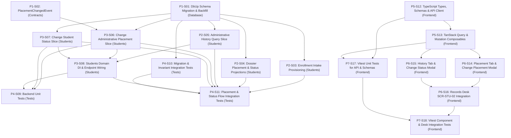

# 1. Objective

Implement the complete Stage 1 "Placement & Status — core submodules only: Administrative Placement, Student Status Management, Administrative History" under the Student domain for Elsasa SIS V3, fulfilling change request intake `CR-STU-PLACEMENT-STATUS` ([`IS005 - STU-PLACEMENT-STATUS-ISSUE.md`](file:///d:/Project.Private/elsasa-sis-v3/docs/issues/IS005%20-%20STU-PLACEMENT-STATUS-ISSUE.md)) and realizing the approved target architecture ([`IS005 - STU-PLACEMENT-STATUS-ARCHITECTURE.md`](file:///d:/Project.Private/elsasa-sis-v3/docs/issues/IS005%20-%20STU-PLACEMENT-STATUS-ARCHITECTURE.md)).

This implementation establishes:
1. **Authoritative Administrative Placement Tracking:** Provisioning `students.administrative_placements` with full support for mandatory organizational placement parameters (`campus`, `school_level`, `grade`, `academic_year`, `effective_date`) and optional extension metadata (`program`, `stream`, `cohort`, `homeroom`, `reason`, `authorized_by`, `decision_reference`).
2. **Database Engine Invariant Enforcement:** Guaranteeing the single active campus placement invariant (`Decision 6`) and single active status invariant via Microsoft SQL Server partial unique indexes (`(student_id) WHERE (is_current = 1)`), eliminating concurrency anomalies at the storage tier.
3. **Authoritative Operational Status Periods & Denormalization Governance:** Capturing every operational status period in `students.student_statuses` with strict transactional synchronization of the convenience status column on `students.students.current_status`.
4. **Immutable Chronological Administrative History:** Establishing `students.administrative_history_entries` as an append-only, tamper-resistant administrative audit trail recording every significant event (`enrollment_completed`, `student_activated`, `placement_changed`, etc.) and supporting non-destructive corrections via explicit self-referential links (`is_correction`, `corrects_entry_id`).
5. **Intake Sequence Orchestration in Enrollment:** Automating the complete initial placement creation, sequential status transition (`enrolled` &rarr; `active`), and initial intake audit trail logging directly inside `EnrollAcceptedApplicantHandler` upon official enrollment completion (`STD-WF-03`, Criteria 3, 5, 10).
6. **Effective-Dated Placement & Status Mutation Slices:** Delivering dedicated vertical slices for `ChangeAdministrativePlacement` (`STD-WF-05`, `UC-STD-06`) and `ChangeStudentStatus` adhering to the Pragmatic Immediate Activation approach with business effective dating.
7. **360-Degree Dossier Projection & Audit Exploration:** Extending `GetStudentById` to project current placement, placement history, and status history, and providing a dedicated query slice `GetStudentAdministrativeHistory` for chronological audit inspection.
8. **Operational Desk Alignment (`SCR-STU-02`):** Extending the Student Records Desk at `/students/records` with dedicated `Placement` and `Administrative History` tabs, authoritative header status management, and modal dialogs for placement and status changes.

Planning Mode: FEATURE-PLANNING

Referenced artifacts:
- FEATURE / ISSUE:
  - `docs/issues/IS005 - STU-PLACEMENT-STATUS-ISSUE.md` (Intake `CR-STU-PLACEMENT-STATUS`)
  - `docs/domains/student-domain.md` (Administrative Placement lines 151–171, Student Status lines 173–196, Administrative History lines 320–330, 1590, Cohort Placement line 180)
  - `docs/sub-modul-and-development-phases.md` (Stage 1 Module: Placement & Status; Criteria 3, 5, 10; Section E Homeroom ownership resolution)
  - `docs/operational-workflow-discovery.md` (`STD-WF-05: Change Administrative Placement`)
  - `docs/use-cases.md` (`UC-STD-06: Change Administrative Placement`)
  - `docs/screen-inventory.md` (`SCR-STU-02: Student Records Desk`)
  - `docs/entities/student-entities.md` & `docs/entities/student-entities-tables.md` (Submodule 3 — Placement & Status; Tables 3.1, 3.2, 3.11)
- ARCHITECTURE:
  - `docs/issues/IS005 - STU-PLACEMENT-STATUS-ARCHITECTURE.md` (Authoritative target capability architecture)
  - `docs/architecture/backend-architecture.md` (Modular Monolith & Vertical Slice specification)
  - `docs/architecture/frontend-architecture.md` (Modular Vue 3 SPA architecture)
  - `docs/architecture/adr.md` (ADR-001 through ADR-010)
  - `docs/architecture/coding-conventions.md` (C# 12, Dapper raw SQL, Minimal API conventions)
- FEASIBILITY-ASSESSMENT:
  - `docs/issues/IS005 - STU-PLACEMENT-STATUS-FEASIBILITY-ASSESSMENT.md` (Status: `READY-FOR-PLANNING`)

Architecture Applicability: ARCHITECTURE-REQUIRED

This feature introduces significant database schema expansion (3 new domain tables in `students`, 2 partial unique indexes, foreign keys, and idempotent historical data backfill), core administrative lifecycle transitions transforming prospective applicants into active placed students, post-commit MediatR domain event dispatch (`PlacementChangedEvent`), multiple backend vertical slices adhering to ADR-004 and ADR-005, and dual workspace tab additions to `SCR-STU-02`. Authoritative target architecture `docs/issues/IS005 - STU-PLACEMENT-STATUS-ARCHITECTURE.md` governs this plan.

---

# 2. Planning Scope

The planning scope encompasses all changes required across database persistence, backend vertical slices, cross-domain events, test harnesses, and frontend workspaces:

1. **Database Persistence & DbUp Migrations (`Elsasa.Sis.Database`):**
   - Author and register sequential forward DbUp migration script `20261104_0101_Students_PlacementStatus_Tables.sql` targeting Microsoft SQL Server 2022.
   - Create 3 domain tables in schema `students`:
     - `students.administrative_placements`: Historical and active placement periods (`campus`, `school_level`, `grade`, `academic_year`, `effective_date`, `program`, `stream`, `cohort`, `homeroom`, `end_date`, `is_current`, `reason`, `authorized_by`, `decision_reference`, audit columns).
     - `students.student_statuses`: Authoritative operational status history (`status`, `effective_date`, `end_date`, `is_current`, `reason`, `authorized_by`, `decision_reference`, audit columns).
     - `students.administrative_history_entries`: Immutable chronological lifecycle audit trail (`event_type`, `event_date`, `detail`, `authorized_by`, `decision_reference`, `is_correction`, `corrects_entry_id`, audit columns).
   - Enforce database-level active invariants via partial unique indexes:
     - `ux_administrative_placements_student_active` on `(student_id) WHERE (is_current = 1)`
     - `ux_student_statuses_student_active` on `(student_id) WHERE (is_current = 1)`
   - Provision chronological nonclustered query indexes on `(student_id, effective_date DESC)` and `(student_id, event_date DESC, created_at DESC)`.
   - Configure intra-schema foreign keys with `ON DELETE NO ACTION` referencing `students.students(id)` and self-referencing correction chain `corrects_entry_id`.
   - Implement an idempotent SQL backfill provisioning active placement, active status, and intake baseline history for existing enrolled students in development and test environments (`GAP-008`, `OQ-004`).

2. **Cross-Domain Contracts & Domain Events (`Elsasa.Sis.Contracts`):**
   - Author `PlacementChangedEvent.cs` in `Elsasa.Sis.Contracts.Students.Events` implementing `IDomainEvent`, published post-commit via MediatR `IPublisher` whenever a student's administrative placement is modified.

3. **Backend Vertical Slices & Enhancements (`Elsasa.Sis.Students`):**
   - **Enrollment Intake Flow Enhancement (`GAP-003`, TD-03):** Update `EnrollAcceptedApplicantHandler.cs` to atomically insert initial active placement (`students.administrative_placements`), record sequential status rows (`enrolled` closed, `active` current in `students.student_statuses`), insert 4 chronological audit entries (`application_submitted`, `application_accepted`, `enrollment_completed`, `student_activated` in `students.administrative_history_entries`), and set `students.students.current_status = 'active'`.
   - **Placement Reassignment Command (`GAP-004`, `STD-WF-05`, `UC-STD-06`, TD-04):** Vertical slice in `Features/Records/Placements/ChangeAdministrativePlacement` (`POST /api/students/{id}/placements`) executing effective-dated placement changes, closing current active placement, inserting new active placement, appending history entry, and publishing `PlacementChangedEvent` post-commit.
   - **Status Adjustment Command (`GAP-005`, TD-05):** Vertical slice in `Features/Records/Status/ChangeStudentStatus` (`POST /api/students/{id}/status`) updating status periods, synchronizing denormalized student status column on `students.students`, and appending history audit entry.
   - **360-Degree Dossier Projection Enhancement (`GAP-006`, TD-06):** Update `StudentDetailResponse.cs` and `GetStudentByIdHandler.cs` multi-query to project `CurrentPlacement`, `PlacementHistory`, and `StatusHistory`.
   - **Chronological Administrative History Query Slice (`GAP-006`, TD-06):** Vertical slice in `Features/Records/History/GetStudentAdministrativeHistory` (`GET /api/students/{id}/history`) projecting the complete chronological audit timeline.
   - **Dependency Injection & Routing:** Register all new feature slice handlers and endpoint mappings in `DependencyInjection.cs`.

4. **Automated Testing Suite (`tests/backend`):**
   - Unit tests covering `ChangeAdministrativePlacementValidator` (effective date constraints, required fields), `ChangeStudentStatusValidator`, domain composition, and event initialization.
   - SQL Server 2022 Testcontainers integration tests verifying migration `20261104_0101` execution, active placement and active status partial unique index enforcement (preventing concurrent duplicates), idempotent backfill behavior, enrollment intake multi-table atomic provisioning, placement reassignment workflow with audit log and event dispatch, status adjustment with denormalized sync, and chronological history query projection.

5. **Frontend Workspaces (`src/frontend`):**
   - **API, Types, and Schemas:** TypeScript interfaces in `records.types.ts`, Zod validation schemas in `records.schema.ts`, typed Axios client functions in `records.api.ts`, and TanStack Query composables in `useStudentRecordsQueries.ts` and `useStudentRecordsMutations.ts`.
   - **UI Components:**
     - `StudentPlacementTab.vue`: Current placement summary card, historical placement timeline, and "Change Placement" action trigger.
     - `StudentAdministrativeHistoryTab.vue`: Chronological lifecycle audit timeline with event badges, authorizers, and correction tracking.
     - `ChangePlacementModal.vue`: PrimeVue dialog form executing `UC-STD-06` placement reassignment with VeeValidate and Zod validation.
     - `ChangeStatusModal.vue`: PrimeVue dialog form executing operational status adjustments with reason and effective date.
   - **Desk View Integration (`SCR-STU-02`):** Extend `StudentRecordsDeskView.vue` with `Placement` and `Administrative History` tabs, surface active status badge in dossier header with quick-action status adjustment trigger, and wire query cache invalidation.
   - **Frontend Vitest Tests:** Unit and component tests verifying schemas, API client functions, tab rendering, modal interactions, and desk view integration.

---

# 3. Dependencies

### External System & Tooling Dependencies

- .NET 8 SDK (8.0.x)
- Docker / Docker Desktop / Podman (required for Testcontainers SQL Server 2022 integration tests)
- Microsoft SQL Server 2022 instance (for local Web API runtime)
- Node.js runtime (v22.x or LTS) and pnpm package manager (v9.x or v11.x)

### Internal Slice Dependencies

- `Depends On` declares implementation prerequisites between slices.
- Dependencies reference Slice IDs only.
- Dependency satisfaction requires the referenced slice to have implementation status `IMPLEMENTED`.
- Dependency satisfaction does not require review status `GO`.
- Slices with `Depends On: None` or whose dependencies are satisfied may be executed in parallel.

### Dependency Graph



---

# 4. Progress Summary

Plan status values:
- NOT-STARTED
- IN-PROGRESS
- BLOCKED
- COMPLETED

Execution Approval values:
- PENDING
- APPROVED

Execution Approval is owned by the Architect. It is set to APPROVED when the plan structure is finalized and released for execution. Execution must not begin while Execution Approval is PENDING.

COMPLETED is a plan-level status only, set when every slice has implementation status IMPLEMENTED and review status GO.

| Phase | Implementation Status | Review Status | Progress |
|---|---|---|---|
| P1 - Persistence & Contracts Foundation | NOT-STARTED | NOT-REVIEWED | 0/2 |
| P2 - Backend Intake Orchestration & Query Projections | NOT-STARTED | NOT-REVIEWED | 0/3 |
| P3 - Backend Placement & Status Mutation Commands | NOT-STARTED | NOT-REVIEWED | 0/3 |
| P4 - Backend Automated Verification & Test Harness | NOT-STARTED | NOT-REVIEWED | 0/3 |
| P5 - Frontend State, API Client & Validation Schemas | NOT-STARTED | NOT-REVIEWED | 0/2 |
| P6 - Frontend Placement & History Workspace Components | NOT-STARTED | NOT-REVIEWED | 0/3 |
| P7 - Frontend Automated Verification & Component Testing | NOT-STARTED | NOT-REVIEWED | 0/2 |

---

# 5. Phases

## P1 - Persistence & Contracts Foundation

Implementation Status: NOT-STARTED  
Review Status: NOT-REVIEWED

### P1-S01

Title: Database Schema Migration & Backfill Script (`20261104_0101_Students_PlacementStatus_Tables.sql`)

Implementation Status: NOT-STARTED  
Review Status: NOT-REVIEWED

Objective:  
Author and register the sequential forward DbUp migration script `20261104_0101_Students_PlacementStatus_Tables.sql` in `Elsasa.Sis.Database/Scripts/` to create domain tables `students.administrative_placements`, `students.student_statuses`, and `students.administrative_history_entries` with partial unique indexes, foreign keys, and an idempotent historical data backfill.

Depends On: None

Repository: `src/backend`

Completion Criteria:
- Migration file `src/backend/Elsasa.Sis.Database/Scripts/20261104_0101_Students_PlacementStatus_Tables.sql` is authored and set to `EmbeddedResource` in `Elsasa.Sis.Database.csproj`.
- Table `students.administrative_placements` is created with columns `id`, `student_id`, `campus`, `school_level`, `grade`, `academic_year`, `effective_date`, `program`, `stream`, `cohort`, `homeroom`, `end_date`, `is_current`, `reason`, `authorized_by`, `decision_reference`, `created_at`, `created_by`, `updated_at`, `updated_by`.
- Table `students.student_statuses` is created with columns `id`, `student_id`, `status`, `effective_date`, `end_date`, `is_current`, `reason`, `authorized_by`, `decision_reference`, `created_at`, `created_by`, `updated_at`, `updated_by`.
- Table `students.administrative_history_entries` is created with columns `id`, `student_id`, `event_type`, `event_date`, `detail`, `authorized_by`, `decision_reference`, `is_correction`, `corrects_entry_id`, `created_at`, `created_by`.
- Partial unique indexes are created:
  - `ux_administrative_placements_student_active` on `students.administrative_placements ([student_id]) WHERE ([is_current] = 1)`
  - `ux_student_statuses_student_active` on `students.student_statuses ([student_id]) WHERE ([is_current] = 1)`
- Query indexes are created:
  - `ix_students_placements_student` on `([student_id], [effective_date] DESC)`
  - `ix_students_statuses_student` on `([student_id], [effective_date] DESC)`
  - `ix_students_history_student` on `([student_id], [event_date] DESC, [created_at] DESC)`
- Foreign keys with `ON DELETE NO ACTION` are established referencing `students.students(id)` and self-referencing `corrects_entry_id`.
- Idempotent backfill script runs using `WHERE NOT EXISTS`:
  - Backfills active placement from latest `students.enrollments` record for existing students lacking placements.
  - Backfills active status from `students.students.current_status` for existing students lacking statuses.
  - Backfills baseline intake history `enrollment_completed` for existing students lacking history entries.

Notes:
- Must follow SQL Server 2022 syntax and schema conventions defined in TD-01, TD-02, TD-07 of ARCHITECTURE.
- Migration runs cleanly through DbUp within an atomic database transaction.

---

### P1-S02

Title: Placement Changed Domain Event & Shared Contracts (`PlacementChangedEvent`)

Implementation Status: NOT-STARTED  
Review Status: NOT-REVIEWED

Objective:  
Introduce `PlacementChangedEvent.cs` in `Elsasa.Sis.Contracts/Students/Events/` implementing `IDomainEvent` to enable decoupled post-commit domain event publishing via MediatR when a student's administrative placement changes.

Depends On: None

Repository: `src/backend`

Completion Criteria:
- File `src/backend/Elsasa.Sis.Contracts/Students/Events/PlacementChangedEvent.cs` is authored in namespace `Elsasa.Sis.Contracts.Students.Events`.
- Implements `Elsasa.Sis.Contracts.Common.IDomainEvent`.
- Declares primary constructor record:
  ```csharp
  public sealed record PlacementChangedEvent(
      Guid StudentId,
      Guid PlacementId,
      string Campus,
      string SchoolLevel,
      string Grade,
      string AcademicYear,
      DateOnly EffectiveDate,
      string? Program,
      string? Stream,
      string? Cohort,
      string? Homeroom,
      DateTimeOffset OccurredOn) : IDomainEvent;
  ```
- Includes convenience constructor defaulting `OccurredOn` to `DateTimeOffset.UtcNow`.
- Compiles cleanly in `Elsasa.Sis.Contracts` without circular references or external project dependencies.

Notes:
- Adheres to ADR-003: Published strictly post-commit via `IPublisher`. Downstream modules (Operations, Finance) may subscribe in Stage 2/3.

---

## P2 - Backend Intake Orchestration & Query Projections

Implementation Status: NOT-STARTED  
Review Status: NOT-REVIEWED

### P2-S03

Title: Enrollment Intake Placement, Status & History Orchestration (`EnrollAcceptedApplicantHandler`)

Implementation Status: NOT-STARTED  
Review Status: NOT-REVIEWED

Objective:  
Enhance `EnrollAcceptedApplicantHandler.cs` in `Elsasa.Sis.Students/Features/Enrollment/EnrollAcceptedApplicant/` to atomically provision initial administrative placement, sequential status periods (`enrolled` &rarr; `active`), and 4 chronological intake audit history entries within its primary database transaction (`GAP-003`, TD-03).

Depends On: P1-S01

Repository: `src/backend`

Completion Criteria:
- `EnrollAcceptedApplicantHandler.cs` is modified to include SQL queries and execution parameters for:
  1. Student creation with `current_status = 'active'` (updated from `'enrolled'`).
  2. Initial administrative placement row inserted into `students.administrative_placements`:
     - `is_current = 1, end_date = NULL, effective_date = enrollment_date`
     - Populated from enrollment payload (`campus`, `school_level`, `grade` as `initial_level`, `academic_year`, `program`, `cohort`).
     - `reason = 'Initial enrollment placement', authorized_by = approved_by, decision_reference = student_number`.
  3. Two sequential status rows inserted into `students.student_statuses`:
     - Row 1 (closed): `status = 'enrolled', is_current = 0, effective_date = enrollment_date, end_date = enrollment_date, reason = 'Initial enrollment completed'`.
     - Row 2 (active): `status = 'active', is_current = 1, effective_date = enrollment_date, end_date = NULL, reason = 'Activated upon enrollment completion'`.
  4. Four chronological intake history rows inserted into `students.administrative_history_entries`:
     - Event 1: `event_type = 'application_submitted'`, `event_date = application_registration_date`.
     - Event 2: `event_type = 'application_accepted'`, `event_date = admission_decision_date`.
     - Event 3: `event_type = 'enrollment_completed'`, `event_date = enrollment_date`, detail: `$"Enrolled at {request.Campus} {request.Level}"`.
     - Event 4: `event_type = 'student_activated'`, `event_date = enrollment_date`, detail: `'Official student status activated'`.
- All operations execute inside the existing `SqlTransaction` unit of work before committing.
- Post-commit `StudentEnrolledEvent` publishing is preserved.
- Code compiles cleanly and passes syntax checks.

Notes:
- Sourced dates for application submission and decision are obtained from prerequisite queries already loaded in `EnrollAcceptedApplicantHandler`.

---

### P2-S04

Title: 360-Degree Dossier Placement & Status Projections (`StudentDetailResponse` & `GetStudentByIdHandler`)

Implementation Status: NOT-STARTED  
Review Status: NOT-REVIEWED

Objective:  
Enrich `StudentDetailResponse.cs` and `GetStudentByIdHandler.cs` in `Elsasa.Sis.Students/Features/Records/GetStudentById/` to project current active placement, historical placements timeline, and status history periods in a single round-trip database query (`GAP-006`, TD-06).

Depends On: P1-S01

Repository: `src/backend`

Completion Criteria:
- `StudentDetailResponse.cs` is updated to define and include:
  - `AdministrativePlacementDto? CurrentPlacement`
  - `IReadOnlyList<AdministrativePlacementDto> PlacementHistory`
  - `IReadOnlyList<StudentStatusDto> StatusHistory`
  - `AdministrativePlacementDto` record with fields: `Id`, `Campus`, `SchoolLevel`, `Grade`, `AcademicYear`, `EffectiveDate`, `EndDate`, `IsCurrent`, `Program`, `Stream`, `Cohort`, `Homeroom`, `Reason`, `AuthorizedBy`, `DecisionReference`.
  - `StudentStatusDto` record with fields: `Id`, `Status`, `EffectiveDate`, `EndDate`, `IsCurrent`, `Reason`, `AuthorizedBy`, `DecisionReference`.
- `GetStudentByIdHandler.cs` multi-query SQL (`_selectDossierMultiSql`) is extended to retrieve:
  - Result set 5: `students.administrative_placements` ordered by `effective_date DESC, created_at DESC`.
  - Result set 6: `students.student_statuses` ordered by `effective_date DESC, created_at DESC`.
- Handler maps DTO collections and derives `CurrentPlacement` from the first record where `is_current = true`.
- Existing dossier sections (Identity, EnrollmentHistory, Guardians, Documents) remain unaffected and functionally intact.

Notes:
- Uses Dapper `QueryMultipleAsync` keeping database round-trips to exactly 1.

---

### P2-S05

Title: Chronological Administrative History Query Slice (`GetStudentAdministrativeHistory`)

Implementation Status: NOT-STARTED  
Review Status: NOT-REVIEWED

Objective:  
Implement the dedicated vertical slice `GetStudentAdministrativeHistory` in `Elsasa.Sis.Students/Features/Records/History/GetStudentAdministrativeHistory/` (`GET /api/students/{id}/history`) projecting the immutable lifecycle audit log (`GAP-006`, TD-06).

Depends On: P1-S01

Repository: `src/backend`

Completion Criteria:
- Feature folder `src/backend/Elsasa.Sis.Students/Features/Records/History/GetStudentAdministrativeHistory/` is created with:
  - `AdministrativeHistoryEntryDto.cs`: Record defining `Id`, `EventType`, `EventDate`, `Detail`, `AuthorizedBy`, `DecisionReference`, `IsCorrection`, `CorrectsEntryId`, `CreatedAt`, `CreatedBy`.
  - `GetStudentAdministrativeHistoryResponse.cs`: Record containing `Guid StudentId` and `IReadOnlyList<AdministrativeHistoryEntryDto> Entries`.
  - `GetStudentAdministrativeHistoryHandler.cs`: Queries `students.students` to verify student exists, then queries `students.administrative_history_entries` ordered by `event_date DESC, created_at DESC` via Dapper and returns `Result<GetStudentAdministrativeHistoryResponse>`.
  - `GetStudentAdministrativeHistoryEndpoint.cs`: Implements `IEndpoint`, maps `GET /api/students/{id:guid}/history`, requires `Permissions.Students.Records.View`, returns 200 OK with response or 404 ProblemDetails.
- Returns empty entries list (not 404) when a valid student exists but has no history records yet.

Notes:
- Read-only parameterized query executed via `connectionFactory.CreateConnectionAsync()`.

---

## P3 - Backend Placement & Status Mutation Commands

Implementation Status: NOT-STARTED  
Review Status: NOT-REVIEWED

### P3-S06

Title: Change Administrative Placement Vertical Slice (`ChangeAdministrativePlacement` — `POST /api/students/{id}/placements`)

Implementation Status: NOT-STARTED  
Review Status: NOT-REVIEWED

Objective:  
Implement the vertical slice `ChangeAdministrativePlacement` in `Elsasa.Sis.Students/Features/Records/Placements/ChangeAdministrativePlacement/` executing effective-dated administrative placement reassignments with atomic record closure, invariant enforcement, history logging, and post-commit event publishing (`GAP-004`, `STD-WF-05`, `UC-STD-06`, TD-04).

Depends On: P1-S01, P1-S02

Repository: `src/backend`

Completion Criteria:
- Feature folder `src/backend/Elsasa.Sis.Students/Features/Records/Placements/ChangeAdministrativePlacement/` is created with:
  - `ChangeAdministrativePlacementRequest.cs`: Record with `Campus`, `SchoolLevel`, `Grade`, `AcademicYear`, `EffectiveDate`, `Program`, `Stream`, `Cohort`, `Homeroom`, `Reason`, `AuthorizedBy`, `DecisionReference`.
  - `ChangeAdministrativePlacementResponse.cs`: Record with `Guid PlacementId`, `Guid StudentId`, `bool IsCurrent`.
  - `ChangeAdministrativePlacementValidator.cs`: FluentValidation validator enforcing:
    - `Campus`, `SchoolLevel`, `Grade`, `AcademicYear` are not empty.
    - `EffectiveDate` is not default.
    - String lengths within database column boundaries.
  - `ChangeAdministrativePlacementHandler.cs`:
    - Checks student existence in `students.students`.
    - Queries current active placement (`is_current = 1`). Returns `DomainError.NotFound("Students.Placements.ActivePlacementNotFound", ...)` if absent.
    - Validates `request.EffectiveDate >= currentPlacement.EffectiveDate`. Returns `DomainError.Validation("Students.Placements.EffectiveDatePriorToCurrent", ...)` if prior.
    - Opens atomic `SqlTransaction`:
      - Closes existing active placement: `UPDATE students.administrative_placements SET is_current = 0, end_date = @EffectiveDate, updated_at = SYSUTCDATETIME(), updated_by = @User WHERE student_id = @StudentId AND is_current = 1`.
      - Inserts new active placement: `is_current = 1, effective_date = @EffectiveDate, end_date = NULL`.
      - Inserts history entry: `event_type = 'placement_changed'`, `event_date = @EffectiveDate`, `detail = $"Reassigned to {request.Campus}, {request.SchoolLevel}, {request.Grade}, Cohort: {request.Cohort ?? "-"}, Homeroom: {request.Homeroom ?? "-"}"`, `authorized_by = @AuthorizedBy`, `decision_reference = @DecisionReference`.
      - Commits transaction.
    - Post-commit: publishes `PlacementChangedEvent` via MediatR `IPublisher`.
    - Returns `Result<ChangeAdministrativePlacementResponse>.Success(...)`.
  - `ChangeAdministrativePlacementEndpoint.cs`: Implements `IEndpoint`, maps `POST /api/students/{id:guid}/placements`, requires `Permissions.Students.Records.Edit`, applies `WithValidation<ChangeAdministrativePlacementRequest>()`, produces 200 OK, 404, 409, 422.

Notes:
- Invariant: SQL Server partial unique index `ux_administrative_placements_student_active` guarantees at most 1 active placement. Close must precede Insert in transaction.

---

### P3-S07

Title: Change Student Status Vertical Slice (`ChangeStudentStatus` — `POST /api/students/{id}/status`)

Implementation Status: NOT-STARTED  
Review Status: NOT-REVIEWED

Objective:  
Implement the vertical slice `ChangeStudentStatus` in `Elsasa.Sis.Students/Features/Records/Status/ChangeStudentStatus/` executing authoritative operational status transitions, closing prior status periods, inserting new status periods, synchronizing `students.students.current_status`, and appending history entries (`GAP-005`, TD-05).

Depends On: P1-S01

Repository: `src/backend`

Completion Criteria:
- Feature folder `src/backend/Elsasa.Sis.Students/Features/Records/Status/ChangeStudentStatus/` is created with:
  - `ChangeStudentStatusRequest.cs`: Record with `string Status`, `DateOnly EffectiveDate`, `string? Reason`, `string? AuthorizedBy`, `string? DecisionReference`.
  - `ChangeStudentStatusResponse.cs`: Record with `Guid StatusId`, `Guid StudentId`, `string Status`, `bool IsCurrent`.
  - `ChangeStudentStatusValidator.cs`: FluentValidation validator enforcing:
    - `Status` must be either `'active'` or `'enrolled'` (Stage 1 supported statuses).
    - `EffectiveDate` is not default.
  - `ChangeStudentStatusHandler.cs`:
    - Checks student existence in `students.students`. Returns `DomainError.NotFound` if missing.
    - Opens atomic `SqlTransaction`:
      - Closes existing active status row: `UPDATE students.student_statuses SET is_current = 0, end_date = @EffectiveDate, updated_at = SYSUTCDATETIME(), updated_by = @User WHERE student_id = @StudentId AND is_current = 1`.
      - Inserts new active status row in `students.student_statuses`: `is_current = 1, status = @Status, effective_date = @EffectiveDate, end_date = NULL`.
      - Synchronizes denormalized column on student identity: `UPDATE students.students SET current_status = @Status, updated_at = SYSUTCDATETIME(), updated_by = @User WHERE id = @StudentId`.
      - Appends history audit entry: `event_type = (status == "active" ? "student_activated" : "status_adjusted")`, `event_date = @EffectiveDate`, `detail = $"Status adjusted to '{request.Status}'. Reason: {request.Reason}"`.
      - Commits transaction.
    - Returns `Result<ChangeStudentStatusResponse>.Success(...)`.
  - `ChangeStudentStatusEndpoint.cs`: Implements `IEndpoint`, maps `POST /api/students/{id:guid}/status`, requires `Permissions.Students.Records.Edit`, applies `WithValidation<ChangeStudentStatusRequest>()`, produces 200 OK, 404, 409, 422.

Notes:
- Single active status invariant is strictly maintained by SQL Server partial unique index `ux_student_statuses_student_active`.

---

### P3-S08

Title: Dependency Injection & Endpoint Registration Wiring

Implementation Status: NOT-STARTED  
Review Status: NOT-REVIEWED

Objective:  
Register new command and query handlers, validators, and endpoint dependencies in `Elsasa.Sis.Students.DependencyInjection` to ensure seamless discovery and runtime execution.

Depends On: P2-S05, P3-S06, P3-S07

Repository: `src/backend`

Completion Criteria:
- `Elsasa.Sis.Students/DependencyInjection.cs` is updated to register:
  - `services.AddScoped<GetStudentAdministrativeHistoryHandler>();`
  - `services.AddScoped<ChangeAdministrativePlacementHandler>();`
  - `services.AddScoped<ChangeStudentStatusHandler>();`
- FluentValidation validators `ChangeAdministrativePlacementValidator` and `ChangeStudentStatusValidator` are discovered and registered.
- Solution builds cleanly with 0 compilation errors and 0 warnings.
- `EndpointDiscoveryTests` in `Elsasa.Sis.IntegrationTests` recognizes the new endpoints.

Notes:
- Minimal API endpoints are discovered automatically by assembly scanning via `app.MapEndpoints(DependencyInjection.Stage1Assemblies)`.

---

## P4 - Backend Automated Verification & Test Harness

Implementation Status: NOT-STARTED  
Review Status: NOT-REVIEWED

### P4-S09

Title: Unit Tests for Placement & Status Validators, Events, and Domain Composition

Implementation Status: NOT-STARTED  
Review Status: NOT-REVIEWED

Objective:  
Author comprehensive unit tests in `tests/backend/Elsasa.Sis.IntegrationTests/UnitTests/Students/` verifying validator rules, domain event contracts, and service registrations for Placement & Status.

Depends On: P3-S06, P3-S07, P3-S08

Repository: `src/backend`

Completion Criteria:
- Create `tests/backend/Elsasa.Sis.IntegrationTests/UnitTests/Students/ChangeAdministrativePlacementValidatorTests.cs`:
  - Validates required fields (`Campus`, `SchoolLevel`, `Grade`, `AcademicYear`).
  - Validates default effective date rejection.
  - Validates string length bounds.
- Create `tests/backend/Elsasa.Sis.IntegrationTests/UnitTests/Students/ChangeStudentStatusValidatorTests.cs`:
  - Validates accepted statuses (`active`, `enrolled`).
  - Validates rejection of unsupported status strings.
  - Validates default effective date rejection.
- Create `tests/backend/Elsasa.Sis.IntegrationTests/UnitTests/Students/PlacementChangedEventTests.cs`:
  - Verifies event properties and convenience constructor timestamps.
- Update `StudentsDomainCompositionTests.cs` (or create `StudentsPlacementDomainCompositionTests.cs`):
  - Asserts that `GetStudentAdministrativeHistoryHandler`, `ChangeAdministrativePlacementHandler`, and `ChangeStudentStatusHandler` resolve cleanly from `IServiceProvider`.
- All unit tests pass with `dotnet test`.

Notes:
- Unit tests run in-memory without database dependencies.

---

### P4-S10

Title: Integration Tests for DbUp Migration, Invariant Enforcement, and Backfill

Implementation Status: NOT-STARTED  
Review Status: NOT-REVIEWED

Objective:  
Author Testcontainers SQL Server integration tests in `tests/backend/Elsasa.Sis.IntegrationTests/Features/Students/Records/` verifying migration execution, active partial unique indexes, foreign keys, and idempotent backfill.

Depends On: P1-S01

Repository: `src/backend`

Completion Criteria:
- Create `tests/backend/Elsasa.Sis.IntegrationTests/Features/Students/Records/StudentsPlacementStatusMigrationTests.cs`:
  - Verifies migration `20261104_0101` runs successfully via `DatabaseMigrator`.
  - Verifies tables `students.administrative_placements`, `students.student_statuses`, and `students.administrative_history_entries` exist with all expected columns.
  - Invariant test: Inserts an active placement (`is_current = 1`) for student A, attempts to insert a second active placement (`is_current = 1`) for student A, and asserts that a SQL unique constraint violation exception (`2601` / `2627`) is thrown.
  - Invariant test: Inserts an active status (`is_current = 1`) for student B, attempts to insert a second active status (`is_current = 1`) for student B, and asserts unique constraint violation.
  - Backfill test: Pre-creates student with an enrollment row but no placement/status/history rows, runs backfill logic, and asserts active placement, active status, and intake history entry are created.
- Tests execute cleanly on SQL Server 2022 Testcontainers fixture.

Notes:
- Reuses existing test infrastructure (`SqlServerFixture` / `CustomWebApplicationFactory`).

---

### P4-S11

Title: Integration Tests for Enrollment Intake Flow, Placement Reassignment, Status Adjustments, and History Projections

Implementation Status: NOT-STARTED  
Review Status: NOT-REVIEWED

Objective:  
Author end-to-end integration tests verifying complete enrollment intake provisioning, placement mutation with event publishing, status adjustment with denormalized sync, and chronological history querying.

Depends On: P2-S03, P2-S04, P2-S05, P3-S06, P3-S07, P3-S08, P4-S10

Repository: `src/backend`

Completion Criteria:
- Create `tests/backend/Elsasa.Sis.IntegrationTests/Features/Students/Records/PlacementStatusLifecycleIntegrationTests.cs`:
  - **Enrollment Intake Test:** Calls `EnrollAcceptedApplicantHandler` for an accepted applicant. Verifies:
    - Student is created with `current_status = 'active'`.
    - Active row in `students.administrative_placements` exists with enrollment placement parameters.
    - Two rows in `students.student_statuses` exist (closed `enrolled`, active `active`).
    - 4 intake history entries exist in `students.administrative_history_entries` (`application_submitted`, `application_accepted`, `enrollment_completed`, `student_activated`).
  - **Placement Reassignment Test:** Calls `POST /api/students/{id}/placements` with new campus and grade:
    - Prior placement has `is_current = 0` and `end_date = effective_date`.
    - New placement has `is_current = 1` and `end_date = NULL`.
    - History entry `placement_changed` is appended.
    - Placement change fails if `EffectiveDate < CurrentPlacement.EffectiveDate` (422/400 validation error).
  - **Status Adjustment Test:** Calls `POST /api/students/{id}/status`:
    - Prior status closed, new status active.
    - `students.students.current_status` updated in lockstep.
    - History entry logged.
  - **Dossier & History Query Test:**
    - `GET /api/students/{id}` returns dossier with populated `CurrentPlacement`, `PlacementHistory`, and `StatusHistory`.
    - `GET /api/students/{id}/history` returns all entries ordered chronologically descending.
- All integration tests pass cleanly with `dotnet test`.

Notes:
- Uses `HttpClient` against `WebApplicationFactory<Program>` with authenticated admin/officer claims.

---

## P5 - Frontend State, API Client & Validation Schemas

Implementation Status: NOT-STARTED  
Review Status: NOT-REVIEWED

### P5-S12

Title: TypeScript Contracts, Zod Schemas & Axios API Client (`src/frontend`)

Implementation Status: NOT-STARTED  
Review Status: NOT-REVIEWED

Objective:  
Define TypeScript data transfer interfaces, Zod validation schemas, and typed Axios API functions in `src/frontend/src/features/students/records/` for Placement, Status, and Administrative History.

Depends On: None

Repository: `src/frontend`

Completion Criteria:
- `src/frontend/src/features/students/records/types/records.types.ts` is updated with:
  - `AdministrativePlacementDto` interface.
  - `StudentStatusDto` interface.
  - `AdministrativeHistoryEntryDto` interface.
  - `ChangeAdministrativePlacementRequest` interface.
  - `ChangeStudentStatusRequest` interface.
  - `GetStudentAdministrativeHistoryResponse` interface.
  - `StudentDetailResponse` updated to include `currentPlacement`, `placementHistory`, `statusHistory`.
- `src/frontend/src/features/students/records/schemas/records.schema.ts` is updated with:
  - `changePlacementSchema` (Zod schema checking non-empty campus, schoolLevel, grade, academicYear, valid effectiveDate, optional homeroom, cohort, reason, authorizedBy, decisionReference).
  - `changeStatusSchema` (Zod schema checking status enum `['active', 'enrolled']`, valid effectiveDate, optional reason, authorizedBy, decisionReference).
  - Exported inferred types `ChangePlacementFormData` and `ChangeStatusFormData`.
- `src/frontend/src/features/students/records/api/records.api.ts` is updated to add:
  - `changeAdministrativePlacement(studentId: string, payload: ChangeAdministrativePlacementRequest): Promise<ChangeAdministrativePlacementResponse>` (`POST /api/students/${studentId}/placements`).
  - `changeStudentStatus(studentId: string, payload: ChangeStudentStatusRequest): Promise<ChangeStudentStatusResponse>` (`POST /api/students/${studentId}/status`).
  - `getStudentAdministrativeHistory(studentId: string): Promise<GetStudentAdministrativeHistoryResponse>` (`GET /api/students/${studentId}/history`).
- TypeScript builds cleanly (`pnpm type-check` or `vue-tsc`).

Notes:
- API functions use shared Axios instance configured in `src/frontend/src/shared/api/`.

---

### P5-S13

Title: TanStack Query Composables & Mutation Hooks (`src/frontend`)

Implementation Status: NOT-STARTED  
Review Status: NOT-REVIEWED

Objective:  
Expand TanStack Query composables in `src/frontend/src/features/students/records/composables/` with query key factories, history query hooks, and placement/status mutation hooks with automatic cache invalidation.

Depends On: P5-S12

Repository: `src/frontend`

Completion Criteria:
- `src/frontend/src/features/students/records/composables/queryKeys.ts` is updated:
  - Adds `queryKeys.students.history = (id: string) => [...queryKeys.students.detail(id), 'history'] as const`.
- `src/frontend/src/features/students/records/composables/useStudentRecordsQueries.ts` is updated:
  - Adds `useStudentAdministrativeHistoryQuery(studentId: Ref<string> | ComputedRef<string>)` calling `getStudentAdministrativeHistory`.
- `src/frontend/src/features/students/records/composables/useStudentRecordsMutations.ts` is updated:
  - Adds `useChangePlacementMutation()`:
    - On success: invalidates `queryKeys.students.detail(studentId)` and `queryKeys.students.history(studentId)`.
    - Triggers success toast notification.
  - Adds `useChangeStatusMutation()`:
    - On success: invalidates `queryKeys.students.detail(studentId)`, `queryKeys.students.history(studentId)`, and `queryKeys.students.list()`.
    - Triggers success toast notification.
- Unit tests for query keys and mutation hooks in `composables/__tests__/` pass.

Notes:
- Invalidation guarantees that both the 360-degree dossier overview and the history tab update immediately without a full page reload.

---

## P6 - Frontend Placement & History Workspace Components

Implementation Status: NOT-STARTED  
Review Status: NOT-REVIEWED

### P6-S14

Title: Student Placement Tab & Change Placement Modal Components (`src/frontend`)

Implementation Status: NOT-STARTED  
Review Status: NOT-REVIEWED

Objective:  
Create `StudentPlacementTab.vue` and `ChangePlacementModal.vue` in `src/frontend/src/features/students/records/components/` delivering administrative placement inspection and reassignment (`UC-STD-06`).

Depends On: P5-S13

Repository: `src/frontend`

Completion Criteria:
- Create `src/frontend/src/features/students/records/components/StudentPlacementTab.vue`:
  - Renders current active placement card: Campus, School Level, Grade, Academic Year, Homeroom, Cohort, Program, Stream, Effective Date.
  - Shows "Change Placement" button (enabled for authorized users with `Permissions.Students.Records.Edit`).
  - Renders historical placement timeline or table displaying prior placements with effective dates, end dates, authorized by, reason, and decision reference.
  - Displays appropriate empty state if no placements exist.
- Create `src/frontend/src/features/students/records/components/ChangePlacementModal.vue`:
  - PrimeVue `Dialog` with form managed by VeeValidate using `changePlacementSchema`.
  - Input fields: Campus, School Level, Grade, Academic Year, Effective Date (defaulting to current date), Program, Stream, Cohort, Homeroom, Reason, Authorized By, Decision Reference.
  - Disables dates prior to current placement effective date.
  - Submits via `useChangePlacementMutation()`, shows loading state, closes modal on success, and resets form.
- Export components in `components/index.ts`.

Notes:
- Uses PrimeVue components (`Dialog`, `InputText`, `Dropdown`, `Calendar`, `Button`, `Tag`) with Tailwind CSS styling consistent with existing tabs.

---

### P6-S15

Title: Student Administrative History Tab & Change Status Modal Components (`src/frontend`)

Implementation Status: NOT-STARTED  
Review Status: NOT-REVIEWED

Objective:  
Create `StudentAdministrativeHistoryTab.vue` and `ChangeStatusModal.vue` in `src/frontend/src/features/students/records/components/` delivering chronological audit inspection and operational status management.

Depends On: P5-S13

Repository: `src/frontend`

Completion Criteria:
- Create `src/frontend/src/features/students/records/components/StudentAdministrativeHistoryTab.vue`:
  - Fetches history via `useStudentAdministrativeHistoryQuery(studentId)`.
  - Renders chronological timeline of audit entries with PrimeVue `Timeline` or vertical feed.
  - Displays event badge based on `eventType` (e.g., `application_submitted`, `application_accepted`, `enrollment_completed`, `student_activated`, `placement_changed`, `status_adjusted`).
  - Displays event date, detail message, authorizer (`authorizedBy`), decision reference, and correction flag/link (`isCorrection`, `correctsEntryId`).
  - Includes event type filter dropdown (All, Placement, Status, Intake).
  - Handles loading, error, and empty states gracefully.
- Create `src/frontend/src/features/students/records/components/ChangeStatusModal.vue`:
  - PrimeVue `Dialog` with form managed by VeeValidate using `changeStatusSchema`.
  - Input fields: Status (Dropdown: `active`, `enrolled`), Effective Date (Calendar), Reason (Textarea), Authorized By (InputText), Decision Reference (InputText).
  - Submits via `useChangeStatusMutation()`, displays loading spinner, closes on success, and resets form.
- Export components in `components/index.ts`.

Notes:
- Complies with ADR-008 (Audit Trail Immutability): History entries are purely read-only on the client; no edit/delete buttons exist.

---

### P6-S16

Title: Student Records Desk (`SCR-STU-02`) Integration & Header Status Management (`src/frontend`)

Implementation Status: NOT-STARTED  
Review Status: NOT-REVIEWED

Objective:  
Integrate `StudentPlacementTab.vue`, `StudentAdministrativeHistoryTab.vue`, and status adjustment actions into `StudentRecordsDeskView.vue` (`SCR-STU-02`), completing the Records Desk workspace.

Depends On: P6-S14, P6-S15

Repository: `src/frontend`

Completion Criteria:
- `src/frontend/src/features/students/records/views/StudentRecordsDeskView.vue` is updated:
  - Header dossier summary displays current operational status badge (`active` = green, `enrolled` = blue) with a "Change Status" quick action button opening `ChangeStatusModal.vue`.
  - Tab view includes two new tabs:
    - Tab: `Placement` &rarr; renders `<StudentPlacementTab :student="student" @change-placement="openChangePlacementModal" />`.
    - Tab: `Administrative History` &rarr; renders `<StudentAdministrativeHistoryTab :student-id="student.id" />`.
  - Retains all existing tabs: `Certified Identity`, `Guardians & Household`, `Official Documents`, `Enrollment History`.
  - Wires modal visibility states for `ChangePlacementModal` and `ChangeStatusModal`.
- Workspace layout renders responsively without CSS glitches or layout breaks.

Notes:
- Aligns directly with screen inventory `SCR-STU-02` specifications and user case `UC-STD-06`.

---

## P7 - Frontend Automated Verification & Component Testing

Implementation Status: NOT-STARTED  
Review Status: NOT-REVIEWED

### P7-S17

Title: Vitest Unit Tests for API, Schemas, and Composables (`src/frontend`)

Implementation Status: NOT-STARTED  
Review Status: NOT-REVIEWED

Objective:  
Author unit tests in `src/frontend/src/features/students/records/__tests__/` verifying Zod schemas, Axios API functions, and TanStack Query composables for Placement & Status.

Depends On: P5-S12, P5-S13

Repository: `src/frontend`

Completion Criteria:
- Update or create `src/frontend/src/features/students/records/__tests__/records.schema.spec.ts`:
  - Tests `changePlacementSchema` with valid, missing required, and boundary inputs.
  - Tests `changeStatusSchema` with valid statuses, invalid statuses, and empty effective date.
- Update `src/frontend/src/features/students/records/__tests__/records.api.spec.ts`:
  - Tests `changeAdministrativePlacement` sends `POST` to `/api/students/:id/placements`.
  - Tests `changeStudentStatus` sends `POST` to `/api/students/:id/status`.
  - Tests `getStudentAdministrativeHistory` sends `GET` to `/api/students/:id/history`.
- Update `src/frontend/src/features/students/records/composables/__tests__/useStudentRecordsMutations.spec.ts`:
  - Tests `useChangePlacementMutation` invalidates detail and history query keys on success.
  - Tests `useChangeStatusMutation` invalidates detail, history, and list query keys on success.
- Update `src/frontend/src/features/students/records/composables/__tests__/useStudentRecordsQueries.spec.ts`:
  - Tests `useStudentAdministrativeHistoryQuery` invokes API and returns formatted entries.
- All Vitest unit tests pass (`pnpm test:unit` or `npx vitest run`).

Notes:
- Mocks network calls via Vitest `vi.mock` / `vi.spyOn`.

---

### P7-S18

Title: Vitest Component & Workspace Integration Tests for Placement & History Tabs, Modals, and Records Desk (`src/frontend`)

Implementation Status: NOT-STARTED  
Review Status: NOT-REVIEWED

Objective:  
Author component and view integration tests verifying rendering, user interactions, form submissions, and desk tab navigation in `src/frontend/src/features/students/records/__tests__/`.

Depends On: P6-S16, P7-S17

Repository: `src/frontend`

Completion Criteria:
- Create `src/frontend/src/features/students/records/__tests__/StudentPlacementTab.spec.ts`:
  - Asserts current placement card displays campus, grade, level, academic year, homeroom.
  - Asserts historical placement list renders correct timeline items.
  - Asserts clicking "Change Placement" emits event or triggers modal.
- Create `src/frontend/src/features/students/records/__tests__/StudentAdministrativeHistoryTab.spec.ts`:
  - Asserts history timeline renders event badges, dates, details, authorizers.
  - Asserts event filter dropdown filters entries by event category.
- Update `src/frontend/src/features/students/records/__tests__/StudentRecordsDeskView.spec.ts`:
  - Asserts `Placement` and `Administrative History` tabs are rendered in the desk tab navigation.
  - Asserts header status badge displays current status and triggers status change modal.
- Update `src/frontend/src/features/students/records/__tests__/StudentRecordsTabsAndModals.spec.ts`:
  - Asserts `ChangePlacementModal` and `ChangeStatusModal` render form inputs and handle submission.
- All Vitest component tests pass cleanly.

Notes:
- Uses `@vue/test-utils` with PrimeVue test plugins and VueQuery test wrappers.

---

# 6. Change Log

- **2026-11-04 (v1.0):** Initial authoritative Implementation Plan created from target architecture `IS005 - STU-PLACEMENT-STATUS-ARCHITECTURE.md`, approved feasibility assessment decisions (`GAP-001` through `GAP-008`, `OQ-001` through `OQ-006`), and existing codebase baseline. Execution Approval granted (`APPROVED`) by Architect. Structure finalized across 7 phases and 18 continuous slices (`P1-S01` to `P7-S18`).
