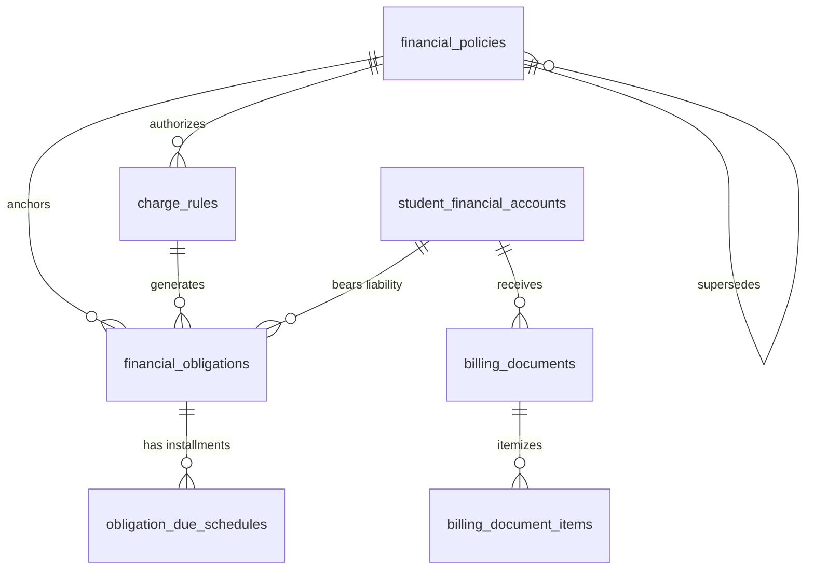

# 1. Overview

This target architecture defines the technical realization for Stage 1 "Obligations & Billing — full scope: Financial Policy & Charge Rules, Student Financial Account, Obligation Assessment & Issuance, Billing & Statement Communication" under the Finance domain. It fulfills change request intake `CR-FIN-OBLIGATIONS-BILLING` ([`IS006 - FIN-OBLIGATIONS-BILLING-ISSUE.md`](file:///d:/Project.Private/elsasa-sis-v3/docs/issues/IS006%20-%20FIN-OBLIGATIONS-BILLING-ISSUE.md)) and realizes the approved analysis decisions documented in [`IS006 - FIN-OBLIGATIONS-BILLING-FEASIBILITY-ASSESSMENT.md`](file:///d:/Project.Private/elsasa-sis-v3/docs/issues/IS006%20-%20FIN-OBLIGATIONS-BILLING-FEASIBILITY-ASSESSMENT.md).

The architecture establishes the institutional financial policy framework, authoritative student ledger accounts, automated charge assessment engine, and billing statement communication pipeline for the Elsasa School Information System (SIS) V3:

1. **Authoritative Seven-Table Relational Persistence Schema:** Provisioning all 7 authoritative domain tables specified in `docs/entities/finance-entities-tables.md` (`financial_policies`, `charge_rules`, `student_financial_accounts`, `financial_obligations`, `obligation_due_schedules`, `billing_documents`, `billing_document_items`) while dropping the rudimentary stub table `finance.policies`.
2. **Student-Centric Financial Ledger Anchor & Lifecycle Synchronization:** Establishing `finance.student_financial_accounts` in a strict 1:1 relationship with `students.students`. Synchronizing account creation via asynchronous event consumption (`StudentEnrolledEvent`) and providing an idempotent backfill script for existing enrolled students. Account balances are dynamically derived from ledger entries rather than maintained in an independently mutable column.
3. **Monetary Precision & Base Currency Standard:** Enforcing exact `BIGINT` integer representation in Indonesian Rupiah (IDR, zero decimal places) across all monetary fields, coupled with explicit `currency_code VARCHAR(3) NOT NULL DEFAULT 'IDR'`.
4. **Dual-Mode Obligation Assessment Engine:** Delivering two vertical slices:
   - Guided batch billing cycle execution (`POST /api/finance/obligations/batch-assess`) with dry-run candidate preview, duplicate conflict validation, and bulk posting.
   - Single-student ad-hoc fee assessment (`POST /api/finance/obligations`).
   Both modes enforce rule-driven due date calculations, attach initial sequence-1 `obligation_due_schedules`, and emit `ObligationAssessedEvent` post-commit.
5. **Unified Point-in-Time Billing Document Pipeline:** Compiling open obligations into authorized bills (invoices) or periodic statements (`billing_documents`) with frozen, immutable line items (`billing_document_items`). Automatically resolving primary financial guarantors or emergency contacts from the Student domain.
6. **Out-of-the-Box Core Charge Rules Seed Data:** Seeding active Financial Policy `FP-2026-001` and three concrete charge rules per GAP-06 (`APPLICATION_FEE`, `ENROLLMENT_FEE`, and `TUITION_FEE`), immediately fulfilling Stage 1 Completion Criteria 6, 7, and 10.
7. **Actor Separation of Duties & Permissions Hierarchy:** Enforcing ADR-009 policy-based authorization with distinct permissions for the `Finance Authority` (policy creation, versioning, approvals) and the `Finance Officer` (operational assessment, billing cycle runs, statement dispatch).
8. **Operational Frontend Workspaces:** Scaffolding three dedicated Vue feature workspaces matching `screen-inventory.md`:
   - `SCR-FIN-04`: Financial Policy Workspace (`/finance/policies`)
   - `SCR-FIN-01`: Billing Cycle Workspace (`/finance/billing-cycles`)
   - `SCR-FIN-03`: Student Accounts Workbench (`/finance/accounts`)
   - Extending `SCR-SELF-02` (Family Tasks & Requests Portal) with a billing statement inspection tab.

---

# 2. Architectural Basis

## Business Context

This architecture realizes the business outcomes, operational workflows, and domain rules specified in:

- **DOMAIN BLUEPRINT:** [`finance-domain.md`](file:///d:/Project.Private/elsasa-sis-v3/docs/domains/finance-domain.md)
  - Financial Policy and Charge Rules (lines 58–91)
  - Student Financial Account (lines 93–115)
  - Financial Obligation and Charge (lines 116–138)
  - Billing and Statements (lines 139–155)
  - Due Schedules (lines 157–183)
  - Indonesian School Context & Operational Principles
- **ROADMAP & CRITERIA:** [`sub-modul-and-development-phases.md`](file:///d:/Project.Private/elsasa-sis-v3/docs/sub-modul-and-development-phases.md)
  - Stage 1 Module: Obligations & Billing (Full Scope)
  - Criterion 6: Financial policy and charge rule defined, obligation assessed against enrolled student.
  - Criterion 7: Bill or statement communicating obligations produced for an authorized recipient.
  - Criterion 10: All domain events recorded and historically traceable.
  - Section E: Resolutions for GAP-01 and GAP-06.
- **WORKFLOWS & USE CASES:**
  - [`operational-workflow-discovery.md`](file:///d:/Project.Private/elsasa-sis-v3/docs/operational-workflow-discovery.md): `FIN-WF-01: Define or Adopt Financial Policy`, `FIN-WF-02: Assess and Issue Financial Obligation`, `FIN-WF-04: Issue Bill or Financial Statement`, `FIN-WF-13: Confirm Enrollment Payment Gate`.
  - [`use-cases.md`](file:///d:/Project.Private/elsasa-sis-v3/docs/use-cases.md): `UC-FIN-10: Establish Financial Policy`, `UC-FIN-02: Assess Financial Obligations`, `UC-FIN-03: Issue Billing Statement`.
  - [`actors.md`](file:///d:/Project.Private/elsasa-sis-v3/docs/actors.md): Finance Authority (`ACT-03`), Finance Officer (`ACT-04`).
- **DATA SPECIFICATIONS:**
  - [`finance-entities.md`](file:///d:/Project.Private/elsasa-sis-v3/docs/entities/finance-entities.md): Submodule 1 (Obligations & Billing) Decisions 1, 2, 5, 6, 7.
  - [`finance-entities-tables.md`](file:///d:/Project.Private/elsasa-sis-v3/docs/entities/finance-entities-tables.md): Submodule 1 tables: `financial_policies`, `charge_rules`, `student_financial_accounts`, `financial_obligations`, `obligation_due_schedules`, `billing_documents`, `billing_document_items` (lines 23–270).
- **SCREEN INVENTORY:** [`screen-inventory.md`](file:///d:/Project.Private/elsasa-sis-v3/docs/screen-inventory.md)
  - `SCR-FIN-04`: Financial Policy Workspace (Planning pattern)
  - `SCR-FIN-01`: Billing Cycle Workspace (Planning / Cycle pattern)
  - `SCR-FIN-03`: Student Accounts Workbench (Work Queue pattern — Stage 1 initial scope)
  - `SCR-SELF-02`: Family Tasks & Requests Portal (Work Queue pattern — billing viewing tab)

## Analysis Input

This architecture directly realizes the approved gap closures, risk mitigations, and technical decisions recorded in:

- **FEASIBILITY ASSESSMENT:** [`IS006 - FIN-OBLIGATIONS-BILLING-FEASIBILITY-ASSESSMENT.md`](file:///d:/Project.Private/elsasa-sis-v3/docs/issues/IS006%20-%20FIN-OBLIGATIONS-BILLING-FEASIBILITY-ASSESSMENT.md)
  - Gap closures: GAP-001 through GAP-008
  - Resolved design decisions: OQ-001 through OQ-007
  - Architecture Applicability: ARCHITECTURE-REQUIRED
  - Planning Readiness: READY-FOR-PLANNING
  - Evaluated Approach: Approach 1 (Pragmatic, Minimalist, and Explicit Domain Alignment)

```text
DOMAIN (finance-domain.md) + FEATURE (use-cases.md, screen-inventory.md)
                            +
       FEASIBILITY-ASSESSMENT (FIN-OBLIGATIONS-BILLING)
                            ↓
        TARGET ARCHITECTURE (FIN-OBLIGATIONS-BILLING)
```

---

# 3. Scope

## Included

1. **Database Schema & Migrations (`Elsasa.Sis.Database`):**
   - Migration script `20261104_0201_Finance_ObligationsBilling_Tables.sql` targeting Microsoft SQL Server 2022 ([`ADR-002`](file:///d:/Project.Private/elsasa-sis-v3/docs/architecture/adr.md#L50-L75), [`ADR-006`](file:///d:/Project.Private/elsasa-sis-v3/docs/architecture/adr.md#L152-L176)).
   - Safe drop of empty stub table `finance.policies`.
   - Creation of 7 authoritative tables in schema `finance`:
     - `finance.financial_policies`: Policy governance, versions, effective dates, approval authority.
     - `finance.charge_rules`: Concrete charging criteria, base amounts (`BIGINT` IDR), recurrence patterns, due rule parameters.
     - `finance.student_financial_accounts`: 1:1 student ledger anchor (`account_number`, `account_status`, `opened_date`).
     - `finance.financial_obligations`: Authoritative liability records (`obligation_number`, `original_amount`, `due_date`, `status`, `authorized_by`).
     - `finance.obligation_due_schedules`: Initial installment/due date schedule attached upon issuance.
     - `finance.billing_documents`: Unified point-in-time bill and periodic statement header (`document_type`, `recipient_name`, `total_billed_amount`, `delivery_status`).
     - `finance.billing_document_items`: Frozen snapshot line items.
   - Partial unique indexes enforcing single active 1:1 account relationships and duplicate prevention.
   - Idempotent SQL backfill script for existing enrolled students in `students.students` (`GAP-002`).
   - Idempotent seed data for active Financial Policy `FP-2026-001` and 3 core charge rules (`APPLICATION_FEE`, `ENROLLMENT_FEE`, `TUITION_FEE`) (`GAP-007`).

2. **Backend Domain Architecture & Vertical Slices (`Elsasa.Sis.Finance`):**
   - **Permissions Constants:** Formal definition of `Permissions.Finance` in `Permissions.cs` (`GAP-008`).
   - **Student Account Lifecycle Event Handler:** Asynchronous MediatR notification handler `StudentEnrolledEventHandler.cs` handling `StudentEnrolledEvent` (ADR-003) to provision `finance.student_financial_accounts` (`GAP-002`).
   - **Financial Policy & Charge Rules Slices (`Features/Policies/`):**
     - `CreateFinancialPolicy` (`POST /api/finance/policies`): Creates policy draft (`FIN-WF-01`, `UC-FIN-10`).
     - `ApproveFinancialPolicy` (`POST /api/finance/policies/{id}/approve`): Transitions policy to `active` status (Finance Authority).
     - `CreateChargeRule` (`POST /api/finance/policies/{id}/rules`): Adds operational charge rule to approved policy.
     - `GetFinancialPolicies` (`GET /api/finance/policies`): Queries policies and associated charge rules.
     - `GetFinancialPolicyById` (`GET /api/finance/policies/{id}`): Detailed policy view.
   - **Obligation Assessment Slices (`Features/Obligations/`):**
     - `BatchAssessObligations` (`POST /api/finance/obligations/batch-assess`): Dual-action billing cycle endpoint supporting `preview` (dry run candidate evaluation) and `commit` (bulk generation with sequence-1 due schedule and event emission) (`FIN-WF-02`, `UC-FIN-02`, `SCR-FIN-01`).
     - `AssessAdHocObligation` (`POST /api/finance/obligations`): Single-student charge issuance.
     - `GetObligations` (`GET /api/finance/obligations`): Queries obligations with filters (`studentId`, `status`, `academicPeriodId`).
   - **Billing Document & Statement Slices (`Features/Billing/`):**
     - `GenerateBillingDocument` (`POST /api/finance/billing-documents/generate`): Compiles open obligations into a `bill`, resolves primary guardian contact, and freezes line items (`FIN-WF-04`, `UC-FIN-03`).
     - `GenerateStatement` (`POST /api/finance/billing-documents/statement`): Compiles periodic financial statement across a date range.
     - `GetBillingDocuments` (`GET /api/finance/billing-documents`): Queries billing documents.
     - `GetBillingDocumentById` (`GET /api/finance/billing-documents/{id}`): Projects complete invoice snapshot with frozen line items.
   - **Student Financial Accounts Slices (`Features/Accounts/`):**
     - `GetStudentFinancialAccount` (`GET /api/finance/accounts/{studentId}`): Queries account header, dynamically derived balance, open obligations, and recent billing documents (`SCR-FIN-03`).
     - `SearchStudentFinancialAccounts` (`GET /api/finance/accounts`): Paginated account search.

3. **Cross-Domain Contracts & Domain Events (`Elsasa.Sis.Contracts`):**
   - Emission of `ObligationAssessedEvent` in `Elsasa.Sis.Contracts.Finance.Events` strictly post-commit via MediatR `IPublisher` ([`ADR-003`](file:///d:/Project.Private/elsasa-sis-v3/docs/architecture/adr.md#L76-L98)).
   - Verification of `StudentEnrolledEvent` consumption from Students domain.

4. **Frontend Workspaces & Client Integration (`src/frontend`):**
   - **`SCR-FIN-04` Financial Policy Workspace (`/finance/policies`):**
     - `FinancialPolicyWorkspaceView.vue`: Policy list, charge rules table, policy creation dialog, rule creation modal, and formal approval action for Finance Authority.
   - **`SCR-FIN-01` Billing Cycle Workspace (`/finance/billing-cycles`):**
     - `BillingCycleWorkspaceView.vue`: Guided step-by-step cycle execution: (1) Select Rule & Academic Period, (2) Candidate Preview & Exception Validation, (3) Post Obligations, (4) Generate & Issue Bills.
   - **`SCR-FIN-03` Student Accounts Workbench (`/finance/accounts`):**
     - `StudentAccountsWorkbenchView.vue`: Student search, account balance summary card, obligations table, invoice history table, ad-hoc charge modal, and billing document viewing dialog.
   - **`SCR-SELF-02` Family Portal Extension:**
     - Addition of `FamilyBillingTab.vue` to inspect issued bills, due dates, and line item breakdowns.
   - **API Services, Composables & Schemas:**
     - Typed Axios API modules (`policies.api.ts`, `obligations.api.ts`, `billing.api.ts`, `accounts.api.ts`).
     - TanStack Query hooks and cache invalidation keys (`useFinancePolicies.ts`, `useFinanceObligations.ts`, `useFinanceBilling.ts`, `useFinanceAccounts.ts`).
     - Zod schemas for form validation and typed TypeScript models.

## Excluded

1. **Payment Collection & Allocation (Companion Stage 1 Issue):**
   - Cash/bank payment receipts, payment verification queue (`SCR-FIN-02`), payment allocations (`finance.payment_allocations`), and the enrollment payment gate (`FIN-WF-13`) belong to `CR-FIN-PAYMENTS-RECEIVABLES`.
2. **Receivables Overdue Management & Payment Arrangements (Stage 2):**
   - Overdue penalty assessments, formal payment arrangement agreements (`payment_arrangements`), and dunning letter generation belong to Stage 2 (`SCR-FIN-05: Financial Decisions Queue`).
3. **Benefits, Discounts & Scholarships (Stage 2):**
   - Institutional scholarship allocations, sibling discounts, and fee reductions (`obligation_benefits`) belong to Stage 2.
4. **Financial Clearance, Refunds & Adjustments (Stage 2 & 3):**
   - Student academic clearance checks (`SCR-ACD-08`), refund processing, credit memo adjustments, and write-offs belong to Stage 2/3.
5. **Live External Communication Gateways:**
   - External SMTP mail servers and WhatsApp business API connections are excluded; document status tracking (`draft`, `issued`, `sent`, `delivered`) and in-app/portal rendering satisfy Stage 1 communication requirements.

---

# 4. Technical Decisions

## TD-01: Seven-Table Relational Schema & Storage Layout

- **Decision:** Replace the obsolete stub table `finance.policies` and provision all 7 authoritative tables in migration `20261104_0201_Finance_ObligationsBilling_Tables.sql` targeting Microsoft SQL Server 2022 ([`ADR-002`](file:///d:/Project.Private/elsasa-sis-v3/docs/architecture/adr.md#L50-L75), [`ADR-006`](file:///d:/Project.Private/elsasa-sis-v3/docs/architecture/adr.md#L152-L176), GAP-001, OQ-001).
- **Realization:**
  - Table drop statement:
    ```sql
    IF OBJECT_ID(N'finance.policies', N'U') IS NOT NULL
        DROP TABLE [finance].[policies];
    ```
  - Provision the 7 authoritative tables with native SQL Server types, `UNIQUEIDENTIFIER` primary keys, `NVARCHAR` strings, `DATETIMEOFFSET(7)` UTC timestamps, and intra-schema foreign key constraints:
    1. `finance.financial_policies`
    2. `finance.charge_rules`
    3. `finance.student_financial_accounts`
    4. `finance.financial_obligations`
    5. `finance.obligation_due_schedules`
    6. `finance.billing_documents`
    7. `finance.billing_document_items`

## TD-02: Zero-Decimal IDR Monetary Representation & Derived Balance Engine

- **Decision:** Standardize all monetary values to `BIGINT` integer representation in Indonesian Rupiah (IDR, zero decimal places) and maintain the student account balance strictly as a dynamically derived calculation (Resolved Decisions 5 & 6, ASM-001, ASM-005, GAP-001).
- **Realization:**
  - Storage columns: `base_amount`, `original_amount`, `scheduled_amount`, `total_billed_amount`, and `amount` are defined as `BIGINT NOT NULL`.
  - Currency column: Every financial table includes `[currency_code] VARCHAR(3) NOT NULL CONSTRAINT [df_..._currency] DEFAULT ('IDR')`.
  - Zero mutable balance columns: `finance.student_financial_accounts` contains **no** balance column.
  - Derived balance calculation in query projections:
    ```sql
    SELECT 
        sfa.id AS account_id,
        sfa.account_number,
        sfa.student_id,
        sfa.account_status,
        ISNULL(SUM(CASE WHEN fo.status NOT IN ('cancelled') THEN fo.original_amount ELSE 0 END), 0) AS total_assessed,
        ISNULL(SUM(CASE WHEN fo.status = 'settled' THEN fo.original_amount ELSE 0 END), 0) AS total_settled,
        (ISNULL(SUM(CASE WHEN fo.status NOT IN ('cancelled') THEN fo.original_amount ELSE 0 END), 0) -
         ISNULL(SUM(CASE WHEN fo.status = 'settled' THEN fo.original_amount ELSE 0 END), 0)) AS current_balance
    FROM finance.student_financial_accounts sfa
    LEFT JOIN finance.financial_obligations fo ON fo.student_account_id = sfa.id
    WHERE sfa.student_id = @StudentId
    GROUP BY sfa.id, sfa.account_number, sfa.student_id, sfa.account_status;
    ```

## TD-03: Asynchronous Account Provisioning & Idempotent Backfill (`GAP-002`)

- **Decision:** Automatically provision `finance.student_financial_accounts` for newly enrolled students via MediatR event handling (`StudentEnrolledEvent`), backed by an idempotent backfill script in migration `20261104_0201` and an auto-provisioning fallback on ad-hoc assessment (GAP-002, OQ-002).
- **Realization:**
  - **MediatR Notification Handler:** `StudentEnrolledEventHandler.cs` in `Elsasa.Sis.Finance/Features/Accounts/Events/` implementing `INotificationHandler<StudentEnrolledEvent>` ([`ADR-003`](file:///d:/Project.Private/elsasa-sis-v3/docs/architecture/adr.md#L76-L98)).
    - Generates deterministic account number: `ACC-{DateTime.UtcNow:yyyy}-{StudentId.ToString()[..8].ToUpperInvariant()}`.
    - Inserts active account record into `finance.student_financial_accounts`.
  - **Database Migration Backfill:** Idempotent SQL block in `20261104_0201_Finance_ObligationsBilling_Tables.sql`:
    ```sql
    INSERT INTO [finance].[student_financial_accounts] (
        [id], [account_number], [student_id], [currency_code], [account_status], [opened_date], [created_at], [created_by]
    )
    SELECT 
        NEWID(),
        CONCAT('ACC-', FORMAT(s.enrollment_date, 'yyyy'), '-', UPPER(LEFT(REPLACE(CONVERT(VARCHAR(36), s.id), '-', ''), 8))),
        s.id,
        'IDR',
        'active',
        s.enrollment_date,
        SYSUTCDATETIME(),
        'MIGRATION_BACKFILL'
    FROM [students].[students] s
    WHERE s.id NOT IN (SELECT student_id FROM [finance].[student_financial_accounts]);
    ```
  - **Defensive Fallback:** If an ad-hoc charge is assessed for an enrolled student whose account row is missing, the handler idempotently provisions the account prior to obligation insertion.

## TD-04: Dual-Mode Obligation Assessment & Duplicate Prevention Engine (`GAP-003`, `GAP-004`)

- **Decision:** Deliver dual-mode assessment vertical slices supporting both bulk billing cycles (`SCR-FIN-01`) and individual ad-hoc fees, enforcing rule-driven due date calculations, initial sequence-1 due schedules, duplicate conflict validation, and post-commit event publishing (`FIN-WF-02`, `UC-FIN-02`, GAP-003, GAP-004, OQ-003, OQ-004).
- **Realization:**
  - **Vertical Slice 1: `BatchAssessObligations` (`POST /api/finance/obligations/batch-assess`)**
    - Accepts: `ChargeRuleId`, `AcademicPeriodId`, `BillingCycleLabel`, `TargetCampus` (optional), `TargetGrade` (optional), `Mode` (`"preview"` | `"commit"`).
    - **Step 1 (Candidate Filtering):** Queries `students.students` and `students.administrative_placements` for active students matching rule criteria (`applicable_program`, `applicable_grade`, `is_current = 1`).
    - **Step 2 (Duplicate Validation):** Evaluates whether any candidate already possesses an obligation for `(student_account_id, charge_rule_id, academic_period_id)`.
    - **Step 3 (Preview Mode):** If `Mode == "preview"`, returns candidate count, gross amount, and student items marked with `is_duplicate` flag without writing to database.
    - **Step 4 (Commit Mode):** If `Mode == "commit"`, filters out duplicate candidates and executes atomic bulk `INSERT` into `finance.financial_obligations` and `finance.obligation_due_schedules` within a single `SqlTransaction`.
    - **Step 5 (Event Publishing):** Publishes `ObligationAssessedEvent` for each newly created obligation strictly post-commit.
  - **Vertical Slice 2: `AssessAdHocObligation` (`POST /api/finance/obligations`)**
    - Accepts: `StudentId`, `ChargeType`, `Description`, `Amount`, `DueDate`, `AcademicPeriodId`, `Notes`.
    - Inserts individual obligation with `charge_rule_id = NULL` and status `issued`.
  - **Due Date Calculation Engine:**
    - `days_after_issuance`: `DueDate = IssueDate.AddDays(int.Parse(due_rule_value))`.
    - `fixed_day_of_month`: Computes day `D` in the target period's month. If the day exceeds the days in that month, clamps to the last day of the month.
    - `fixed_calendar_date`: Parses explicit ISO-8601 date.
  - **Initial Due Schedule:**
    - Automatically creates a sequence-1 schedule in `finance.obligation_due_schedules` matching 100% of the assessed obligation amount (`scheduled_amount = original_amount`, `status = 'pending'`).

## TD-05: Unified Point-in-Time Billing Document Compilation (`GAP-005`)

- **Decision:** Implement a unified billing document compilation pipeline supporting both point-in-time bills (invoices) and periodic financial statements (`FIN-WF-04`, `UC-FIN-03`, Resolved Decision 1, GAP-005, OQ-005).
- **Realization:**
  - **Vertical Slice: `GenerateBillingDocument` (`POST /api/finance/billing-documents/generate`)**
    - Discriminator: `document_type = 'bill'`.
    - Resolves primary recipient from `students.student_guardian_relationships` joined with `students.guardians` (`is_financial_guarantor = 1` first, fallback `is_primary_contact = 1`, fallback student name).
    - Selects all open obligations for the student (`status IN ('assessed', 'issued')`).
    - Generates traceable document number: `BIL-{Year}-{Sequence:D5}`.
    - Inserts header into `finance.billing_documents` with `delivery_status = 'issued'` and `total_billed_amount = SUM(obligations)`.
    - Freezes snapshot line items into `finance.billing_document_items`:
      ```sql
      INSERT INTO finance.billing_document_items (
          id, billing_document_id, line_sequence, item_type,
          reference_entity_type, reference_entity_id, description,
          amount, currency_code
      ) VALUES (
          @ItemId, @DocumentId, @Sequence, 'obligation',
          'financial_obligations', @ObligationId, @Description,
          @Amount, 'IDR'
      );
      ```
    - Updates referenced obligations status to `issued`.
  - **Vertical Slice: `GenerateStatement` (`POST /api/finance/billing-documents/statement`)**
    - Discriminator: `document_type = 'statement'`.
    - Compiles all obligations and transactions within `billing_period_start` and `billing_period_end`.
    - Generates traceable document number: `STM-{Year}-{Sequence:D5}`.
  - **Immutability Invariant:** Once committed, `billing_documents` and `billing_document_items` are append-only. Adjustments or corrections create a new document; historical snapshots are never altered.

## TD-06: Initial Seed Data for GAP-06 Core Charge Types (`GAP-007`)

- **Decision:** Embed idempotent SQL seed data in migration `20261104_0201` establishing an approved Financial Policy and 3 concrete charge rules to satisfy Stage 1 Completion Criterion 6 out of the box (GAP-007, OQ-007).
- **Realization:**
  - **Governing Financial Policy:**
    - `id`: Fixed deterministic UUID `'00000000-0000-0000-0002-000000000001'`
    - `policy_code`: `'FP-2026-001'`
    - `name`: `'Kebijakan Biaya Pendidikan TP 2026/2027'`
    - `category`: `'tuition'`
    - `business_purpose`: `'Menetapkan struktur biaya pendaftaran, uang pangkal, dan SPP bulanan untuk seluruh jenjang TP 2026/2027.'`
    - `status`: `'active'`
    - `approving_authority`: `'Direktur Keuangan'`
    - `approved_date`: `'2026-01-15'`
  - **Charge Rule 1 (Application Fee):**
    - `rule_code`: `'CR-2026-APP'`
    - `name`: `'Biaya Formulir Pendaftaran Siswa Baru'`
    - `charge_type`: `'admission_fee'`, `base_amount`: `500000`, `recurrence_pattern`: `'one_time'`, `due_rule_type`: `'days_after_issuance'`, `due_rule_value`: `'14'`
  - **Charge Rule 2 (Enrollment Fee / Uang Pangkal):**
    - `rule_code`: `'CR-2026-ENR'`
    - `name`: `'Uang Pangkal Masuk Siswa Baru'`
    - `charge_type`: `'enrollment_fee'`, `base_amount`: `15000000`, `recurrence_pattern`: `'one_time'`, `due_rule_type`: `'days_after_issuance'`, `due_rule_value`: `'14'`
  - **Charge Rule 3 (Monthly Tuition SD Reguler):**
    - `rule_code`: `'CR-2026-SPP-SD'`
    - `name`: `'SPP Bulanan SD Reguler'`
    - `charge_type`: `'tuition'`, `base_amount`: `750000`, `recurrence_pattern`: `'monthly'`, `due_rule_type`: `'fixed_day_of_month'`, `due_rule_value`: `'10'`, `applicable_program`: `'SD Reguler'`

## TD-07: Permissions Hierarchy & Actor Separation of Duties (`GAP-008`, ADR-009)

- **Decision:** Formalize domain permission constants in `Elsasa.Sis.Finance/Permissions.cs` enforcing strict separation between policy governance (`Finance Authority`) and billing operations (`Finance Officer`) (GAP-008, Actors Resolution 3.2).
- **Realization:**
  ```csharp
  namespace Elsasa.Sis.Finance;

  public static class Permissions
  {
      public static class Policies
      {
          public const string View = "Permissions.Finance.Policies.View";
          public const string Manage = "Permissions.Finance.Policies.Manage";
          public const string Approve = "Permissions.Finance.Policies.Approve";
      }

      public static class Obligations
      {
          public const string View = "Permissions.Finance.Obligations.View";
          public const string Assess = "Permissions.Finance.Obligations.Assess";
      }

      public static class Billing
      {
          public const string View = "Permissions.Finance.Billing.View";
          public const string Generate = "Permissions.Finance.Billing.Generate";
      }

      public static class Accounts
      {
          public const string View = "Permissions.Finance.Accounts.View";
      }
  }
  ```
  - `Finance Authority` possesses all permissions including `Policies.Approve`.
  - `Finance Officer` possesses `Policies.View`, `Obligations.Assess`, `Billing.Generate`, and `Accounts.View`.

## TD-08: Frontend Workspaces & Navigation Architecture (`GAP-006`)

- **Decision:** Scaffold three cohesive feature modules under `src/frontend/src/features/finance/` directly realizing `screen-inventory.md`, plus an extension to the family portal (GAP-006, OQ-006).
- **Realization:**
  - Directory structure:
    ```
    src/frontend/src/features/finance/
    ├── policies/                     # SCR-FIN-04: Financial Policy Workspace
    │   ├── api/policies.api.ts
    │   ├── components/CreatePolicyModal.vue, CreateChargeRuleModal.vue
    │   ├── composables/useFinancePolicies.ts
    │   ├── views/FinancialPolicyWorkspaceView.vue
    │   └── types/policies.types.ts
    ├── billing/                      # SCR-FIN-01: Billing Cycle Workspace
    │   ├── api/billing.api.ts
    │   ├── components/BillingCycleStepper.vue, CandidatePreviewTable.vue
    │   ├── composables/useFinanceBilling.ts
    │   ├── views/BillingCycleWorkspaceView.vue
    │   └── types/billing.types.ts
    ├── accounts/                     # SCR-FIN-03: Student Accounts Workbench
    │   ├── api/accounts.api.ts
    │   ├── components/AccountBalanceCard.vue, AssessAdHocFeeModal.vue, InvoiceDetailModal.vue
    │   ├── composables/useFinanceAccounts.ts
    │   ├── views/StudentAccountsWorkbenchView.vue
    │   └── types/accounts.types.ts
    └── shared/                       # Shared Finance formatters & helpers (IDR currency, status badges)
    ```
  - Route configuration in `src/frontend/src/app/router/routes.ts`:
    - `/finance/policies` &rarr; `FinancialPolicyWorkspaceView.vue` (meta: `permission: Permissions.Finance.Policies.View`)
    - `/finance/billing-cycles` &rarr; `BillingCycleWorkspaceView.vue` (meta: `permission: Permissions.Finance.Obligations.Assess`)
    - `/finance/accounts` &rarr; `StudentAccountsWorkbenchView.vue` (meta: `permission: Permissions.Finance.Accounts.View`)
  - Extension of `SCR-SELF-02` (`FamilyTasksView.vue`):
    - Embed `FamilyBillingTab.vue` to inspect active bills and line-item breakdowns.

---

# 5. Component Responsibilities

| Component | Assembly / Path | Primary Responsibility |
|---|---|---|
| **Database Migration Runner** | `Elsasa.Sis.Database/Scripts/20261104_0201...` | Drops obsolete stub table `finance.policies`, provisions 7 Submodule 1 tables with constraints/indexes, executes student account backfill, and seeds GAP-06 core policies/rules. |
| **Permissions Definition** | `Elsasa.Sis.Finance/Permissions.cs` | Declares authoritative permission string constants for Finance policies, obligations, billing, and accounts. |
| **Student Enrolled Event Handler** | `Elsasa.Sis.Finance/Features/Accounts/Events/StudentEnrolledEventHandler.cs` | Listens to `StudentEnrolledEvent` from Students domain; idempotently creates active `finance.student_financial_accounts` record. |
| **Policy Management Slices** | `Elsasa.Sis.Finance/Features/Policies/` | Implements Minimal API endpoints and Dapper handlers for `CreateFinancialPolicy`, `ApproveFinancialPolicy`, `CreateChargeRule`, `GetFinancialPolicies`, and `GetFinancialPolicyById`. |
| **Batch Assessment Slice** | `Elsasa.Sis.Finance/Features/Obligations/BatchAssessObligations/` | Implements preview-and-post batch obligation generation (`POST /api/finance/obligations/batch-assess`), evaluates candidates, detects duplicates, inserts obligations and sequence-1 due schedules, and publishes `ObligationAssessedEvent`. |
| **Ad-Hoc Assessment Slice** | `Elsasa.Sis.Finance/Features/Obligations/AssessAdHocObligation/` | Implements individual student charge creation (`POST /api/finance/obligations`), auto-provisions missing account if needed, generates sequence-1 due schedule, and publishes `ObligationAssessedEvent`. |
| **Obligations Query Slice** | `Elsasa.Sis.Finance/Features/Obligations/GetObligations/` | Implements filtered obligation query (`GET /api/finance/obligations`) for workbench tables and billing cycles. |
| **Billing Document Generation Slice** | `Elsasa.Sis.Finance/Features/Billing/GenerateBillingDocument/` | Compiles open obligations into a `bill` (`POST /api/finance/billing-documents/generate`), resolves primary guarantor contact, freezes snapshot items in `billing_document_items`, and updates obligation status. |
| **Statement Generation Slice** | `Elsasa.Sis.Finance/Features/Billing/GenerateStatement/` | Compiles periodic financial statement (`POST /api/finance/billing-documents/statement`) across a date range. |
| **Billing Document Query Slices** | `Elsasa.Sis.Finance/Features/Billing/GetBillingDocuments/` | Projects document list and detailed point-in-time invoice snapshot (`GET /api/finance/billing-documents/{id}`). |
| **Student Account Query Slice** | `Elsasa.Sis.Finance/Features/Accounts/GetStudentFinancialAccount/` | Projects 360-degree student financial position (`GET /api/finance/accounts/{studentId}`), computing dynamic balance from obligations and payments. |
| **Financial Policy Workspace UI** | `src/frontend/.../features/finance/policies/` | Delivers `SCR-FIN-04` for Finance Authority to govern policies, version charge rules, and grant formal approvals. |
| **Billing Cycle Workspace UI** | `src/frontend/.../features/finance/billing/` | Delivers `SCR-FIN-01` guided wizard for Finance Officer to preview assessable charges, review duplicate exceptions, post obligations, and issue billing statements. |
| **Student Accounts Workbench UI** | `src/frontend/.../features/finance/accounts/` | Delivers `SCR-FIN-03` for Finance Officer/Authority to inspect student ledger balance, view obligations, assess ad-hoc fees, and inspect invoices. |
| **Family Portal Billing Tab** | `src/frontend/.../features/portal/FamilyBillingTab.vue` | Delivers payer-facing view in `SCR-SELF-02` to inspect bills, line items, and payment deadlines. |

---

# 6. Integration Design

| Source Component | Target Component | Interaction Type | Purpose & Boundary Constraints |
|---|---|---|---|
| **Students: EnrollAcceptedApplicant** | **Contracts: StudentEnrolledEvent** | Asynchronous Domain Event (MediatR) | Published post-commit when enrollment is finalized (`STD-WF-03`). |
| **Contracts: StudentEnrolledEvent** | **Finance: StudentEnrolledEventHandler** | In-Process Event Consumer | Idempotently provisions active `student_financial_accounts` record without cross-domain write coupling ([`ADR-003`](file:///d:/Project.Private/elsasa-sis-v3/docs/architecture/adr.md#L76-L98)). |
| **Finance: BatchAssessObligations / AssessAdHocObligation** | **Contracts: ObligationAssessedEvent** | Asynchronous Domain Event (MediatR) | Emitted strictly post-commit to notify downstream audit listeners and future notification subscribers ([`ADR-003`](file:///d:/Project.Private/elsasa-sis-v3/docs/architecture/adr.md#L76-L98)). |
| **Finance: BatchAssessObligations** | **students.students & students.administrative_placements** | Read-Only SQL Cross-Schema Projection | Query JOIN to select active student candidates matching rule criteria (`program`, `grade`, `is_current = 1`) ([`ADR-002`](file:///d:/Project.Private/elsasa-sis-v3/docs/architecture/adr.md#L50-L75)). |
| **Finance: GenerateBillingDocument** | **students.student_guardian_relationships & students.guardians** | Read-Only SQL Cross-Schema Projection | Query JOIN to resolve primary financial guarantor name, relationship, and contact for billing documents ([`ADR-002`](file:///d:/Project.Private/elsasa-sis-v3/docs/architecture/adr.md#L50-L75)). |
| **Finance: All Slices** | **operations.academic_years & operations.operational_periods** | Read-Only SQL Cross-Schema Projection | Query JOIN to resolve academic year and term labels for display ([`ADR-002`](file:///d:/Project.Private/elsasa-sis-v3/docs/architecture/adr.md#L50-L75)). |
| **Frontend Workspaces** | **Elsasa.Sis.Api (Finance Endpoints)** | REST HTTPS (JSON) | Minimal API invocations using Axios, authenticated via JWT Bearer tokens, mapped via `Result<T>` ProblemDetails ([`ADR-004`](file:///d:/Project.Private/elsasa-sis-v3/docs/architecture/adr.md#L100-L124), [`ADR-009`](file:///d:/Project.Private/elsasa-sis-v3/docs/architecture/adr.md#L228-L252)). |

---

# 7. Data Ownership

| Data Entity | Authoritative Owner | Bounded Context Access Rules |
|---|---|---|
| `finance.financial_policies` | **Finance Domain** | Owned exclusively by Finance. Created, versioned, and approved by Finance Authority. Read-only to other domains. |
| `finance.charge_rules` | **Finance Domain** | Owned exclusively by Finance. Defines fee criteria and IDR base amounts. |
| `finance.student_financial_accounts` | **Finance Domain** | Owned exclusively by Finance. Anchored 1:1 to external student UUID. Read-only to other domains. |
| `finance.financial_obligations` | **Finance Domain** | Owned exclusively by Finance. Authoritative liabilities owed by student accounts. Mutated only by Finance assessment slices. |
| `finance.obligation_due_schedules` | **Finance Domain** | Owned exclusively by Finance. Initial settlement timetable attached to obligations. |
| `finance.billing_documents` | **Finance Domain** | Owned exclusively by Finance. Unified bills and periodic statements communicating liabilities to payers. Append-only snapshots. |
| `finance.billing_document_items` | **Finance Domain** | Owned exclusively by Finance. Immutable frozen line items capturing transaction snapshots at issuance. |
| `students.students` | **Student Domain** | Authoritative student identity. Finance reads via read-only query projections; **zero writes** from Finance. |
| `students.student_guardian_relationships` | **Student Domain** | Authoritative guardian relationships. Finance reads to resolve financial guarantor contact; **zero writes** from Finance. |
| `operations.academic_years` | **Operations Domain** | Authoritative calendar periods. Finance stores logical UUID reference; **zero writes** from Finance. |

---

# 8. Database Design

## 8.1 New Tables

### Table 1: `finance.financial_policies`
```sql
CREATE TABLE [finance].[financial_policies] (
    [id]                   UNIQUEIDENTIFIER NOT NULL,
    [policy_code]          NVARCHAR(64)     NOT NULL,
    [name]                 NVARCHAR(200)    NOT NULL,
    [category]             NVARCHAR(64)     NOT NULL,
    [business_purpose]     NVARCHAR(MAX)    NOT NULL,
    [applicable_context]   NVARCHAR(200)    NULL,
    [effective_date]       DATE             NOT NULL,
    [end_date]             DATE             NULL,
    [policy_version]       NVARCHAR(32)     NOT NULL CONSTRAINT [df_financial_policies_version] DEFAULT ('1.0'),
    [status]               NVARCHAR(32)     NOT NULL CONSTRAINT [df_financial_policies_status] DEFAULT ('draft'),
    [approving_authority]  NVARCHAR(100)    NULL,
    [approved_date]        DATE             NULL,
    [supersedes_policy_id] UNIQUEIDENTIFIER NULL,
    [notes]                NVARCHAR(MAX)    NULL,
    [created_at]           DATETIMEOFFSET(7) NOT NULL CONSTRAINT [df_financial_policies_created_at] DEFAULT (SYSUTCDATETIME()),
    [created_by]           NVARCHAR(100)    NULL,
    [updated_at]           DATETIMEOFFSET(7) NULL,
    [updated_by]           NVARCHAR(100)    NULL,
    CONSTRAINT [pk_finance_financial_policies] PRIMARY KEY CLUSTERED ([id]),
    CONSTRAINT [uq_finance_financial_policies_code] UNIQUE NONCLUSTERED ([policy_code]),
    CONSTRAINT [fk_finance_financial_policies_supersedes] FOREIGN KEY ([supersedes_policy_id])
        REFERENCES [finance].[financial_policies] ([id]) ON DELETE NO ACTION
);

CREATE NONCLUSTERED INDEX [ix_finance_financial_policies_category_status]
    ON [finance].[financial_policies] ([category], [status], [effective_date] DESC);
```

### Table 2: `finance.charge_rules`
```sql
CREATE TABLE [finance].[charge_rules] (
    [id]                   UNIQUEIDENTIFIER NOT NULL,
    [rule_code]            NVARCHAR(64)     NOT NULL,
    [policy_id]            UNIQUEIDENTIFIER NOT NULL,
    [name]                 NVARCHAR(200)    NOT NULL,
    [charge_type]          NVARCHAR(64)     NOT NULL,
    [is_mandatory]         BIT              NOT NULL CONSTRAINT [df_charge_rules_is_mandatory] DEFAULT (1),
    [determination_method] NVARCHAR(64)     NOT NULL CONSTRAINT [df_charge_rules_method] DEFAULT ('fixed_amount'),
    [base_amount]          BIGINT           NOT NULL,
    [currency_code]        VARCHAR(3)       NOT NULL CONSTRAINT [df_charge_rules_currency] DEFAULT ('IDR'),
    [recurrence_pattern]   NVARCHAR(32)     NOT NULL,
    [due_rule_type]        NVARCHAR(32)     NOT NULL,
    [due_rule_value]       NVARCHAR(64)     NOT NULL,
    [applicable_grade]     NVARCHAR(64)     NULL,
    [applicable_program]   NVARCHAR(100)    NULL,
    [status]               NVARCHAR(32)     NOT NULL CONSTRAINT [df_charge_rules_status] DEFAULT ('active'),
    [notes]                NVARCHAR(MAX)    NULL,
    [created_at]           DATETIMEOFFSET(7) NOT NULL CONSTRAINT [df_charge_rules_created_at] DEFAULT (SYSUTCDATETIME()),
    [created_by]           NVARCHAR(100)    NULL,
    [updated_at]           DATETIMEOFFSET(7) NULL,
    [updated_by]           NVARCHAR(100)    NULL,
    CONSTRAINT [pk_finance_charge_rules] PRIMARY KEY CLUSTERED ([id]),
    CONSTRAINT [uq_finance_charge_rules_code] UNIQUE NONCLUSTERED ([rule_code]),
    CONSTRAINT [fk_finance_charge_rules_policy] FOREIGN KEY ([policy_id])
        REFERENCES [finance].[financial_policies] ([id]) ON DELETE NO ACTION
);

CREATE NONCLUSTERED INDEX [ix_finance_charge_rules_policy]
    ON [finance].[charge_rules] ([policy_id], [status]);
```

### Table 3: `finance.student_financial_accounts`
```sql
CREATE TABLE [finance].[student_financial_accounts] (
    [id]             UNIQUEIDENTIFIER NOT NULL,
    [account_number] NVARCHAR(64)     NOT NULL,
    [student_id]     UNIQUEIDENTIFIER NOT NULL,
    [currency_code]  VARCHAR(3)       NOT NULL CONSTRAINT [df_financial_accounts_currency] DEFAULT ('IDR'),
    [account_status] NVARCHAR(32)     NOT NULL CONSTRAINT [df_financial_accounts_status] DEFAULT ('active'),
    [opened_date]    DATE             NOT NULL,
    [closed_date]    DATE             NULL,
    [notes]          NVARCHAR(MAX)    NULL,
    [created_at]     DATETIMEOFFSET(7) NOT NULL CONSTRAINT [df_financial_accounts_created_at] DEFAULT (SYSUTCDATETIME()),
    [created_by]     NVARCHAR(100)    NULL,
    [updated_at]     DATETIMEOFFSET(7) NULL,
    [updated_by]     NVARCHAR(100)    NULL,
    CONSTRAINT [pk_finance_student_financial_accounts] PRIMARY KEY CLUSTERED ([id]),
    CONSTRAINT [uq_finance_student_financial_accounts_number] UNIQUE NONCLUSTERED ([account_number]),
    CONSTRAINT [uq_finance_student_financial_accounts_student] UNIQUE NONCLUSTERED ([student_id])
);

CREATE NONCLUSTERED INDEX [ix_finance_student_financial_accounts_status]
    ON [finance].[student_financial_accounts] ([account_status], [opened_date] DESC);
```

### Table 4: `finance.financial_obligations`
```sql
CREATE TABLE [finance].[financial_obligations] (
    [id]                    UNIQUEIDENTIFIER NOT NULL,
    [obligation_number]     NVARCHAR(64)     NOT NULL,
    [student_account_id]    UNIQUEIDENTIFIER NOT NULL,
    [student_id]            UNIQUEIDENTIFIER NOT NULL,
    [charge_rule_id]        UNIQUEIDENTIFIER NULL,
    [policy_id]             UNIQUEIDENTIFIER NOT NULL,
    [description]           NVARCHAR(255)    NOT NULL,
    [charge_type]           NVARCHAR(64)     NOT NULL,
    [is_mandatory]          BIT              NOT NULL CONSTRAINT [df_obligations_is_mandatory] DEFAULT (1),
    [original_amount]       BIGINT           NOT NULL,
    [currency_code]         VARCHAR(3)       NOT NULL CONSTRAINT [df_obligations_currency] DEFAULT ('IDR'),
    [issue_date]            DATE             NOT NULL,
    [due_date]              DATE             NOT NULL,
    [academic_period_id]    UNIQUEIDENTIFIER NOT NULL,
    [academic_period_label] NVARCHAR(100)    NOT NULL,
    [status]                NVARCHAR(32)     NOT NULL CONSTRAINT [df_obligations_status] DEFAULT ('assessed'),
    [authorized_by]         NVARCHAR(100)    NOT NULL,
    [notes]                 NVARCHAR(MAX)    NULL,
    [created_at]            DATETIMEOFFSET(7) NOT NULL CONSTRAINT [df_obligations_created_at] DEFAULT (SYSUTCDATETIME()),
    [created_by]            NVARCHAR(100)    NULL,
    [updated_at]            DATETIMEOFFSET(7) NULL,
    [updated_by]            NVARCHAR(100)    NULL,
    CONSTRAINT [pk_finance_financial_obligations] PRIMARY KEY CLUSTERED ([id]),
    CONSTRAINT [uq_finance_financial_obligations_number] UNIQUE NONCLUSTERED ([obligation_number]),
    CONSTRAINT [fk_finance_obligations_account] FOREIGN KEY ([student_account_id])
        REFERENCES [finance].[student_financial_accounts] ([id]) ON DELETE NO ACTION,
    CONSTRAINT [fk_finance_obligations_charge_rule] FOREIGN KEY ([charge_rule_id])
        REFERENCES [finance].[charge_rules] ([id]) ON DELETE NO ACTION,
    CONSTRAINT [fk_finance_obligations_policy] FOREIGN KEY ([policy_id])
        REFERENCES [finance].[financial_policies] ([id]) ON DELETE NO ACTION
);

CREATE NONCLUSTERED INDEX [ix_finance_obligations_student_status]
    ON [finance].[financial_obligations] ([student_id], [status], [due_date] ASC);

CREATE NONCLUSTERED INDEX [ix_finance_obligations_account_period]
    ON [finance].[financial_obligations] ([student_account_id], [academic_period_id], [charge_rule_id]);
```

### Table 5: `finance.obligation_due_schedules`
```sql
CREATE TABLE [finance].[obligation_due_schedules] (
    [id]                   UNIQUEIDENTIFIER NOT NULL,
    [obligation_id]        UNIQUEIDENTIFIER NOT NULL,
    [installment_sequence] INT              NOT NULL,
    [due_date]             DATE             NOT NULL,
    [scheduled_amount]     BIGINT           NOT NULL,
    [currency_code]        VARCHAR(3)       NOT NULL CONSTRAINT [df_due_schedules_currency] DEFAULT ('IDR'),
    [status]               NVARCHAR(32)     NOT NULL CONSTRAINT [df_due_schedules_status] DEFAULT ('pending'),
    [notes]                NVARCHAR(MAX)    NULL,
    [created_at]           DATETIMEOFFSET(7) NOT NULL CONSTRAINT [df_due_schedules_created_at] DEFAULT (SYSUTCDATETIME()),
    [created_by]           NVARCHAR(100)    NULL,
    [updated_at]           DATETIMEOFFSET(7) NULL,
    [updated_by]           NVARCHAR(100)    NULL,
    CONSTRAINT [pk_finance_obligation_due_schedules] PRIMARY KEY CLUSTERED ([id]),
    CONSTRAINT [uq_finance_due_schedules_sequence] UNIQUE NONCLUSTERED ([obligation_id], [installment_sequence]),
    CONSTRAINT [fk_finance_due_schedules_obligation] FOREIGN KEY ([obligation_id])
        REFERENCES [finance].[financial_obligations] ([id]) ON DELETE CASCADE
);

CREATE NONCLUSTERED INDEX [ix_finance_due_schedules_due_date_status]
    ON [finance].[obligation_due_schedules] ([due_date] ASC, [status]);
```

### Table 6: `finance.billing_documents`
```sql
CREATE TABLE [finance].[billing_documents] (
    [id]                     UNIQUEIDENTIFIER NOT NULL,
    [document_number]        NVARCHAR(64)     NOT NULL,
    [student_account_id]     UNIQUEIDENTIFIER NOT NULL,
    [student_id]             UNIQUEIDENTIFIER NOT NULL,
    [document_type]          NVARCHAR(32)     NOT NULL, -- 'bill' | 'statement'
    [recipient_name]         NVARCHAR(200)    NOT NULL,
    [recipient_relationship] NVARCHAR(64)     NOT NULL,
    [recipient_contact]      NVARCHAR(200)    NOT NULL,
    [billing_period_start]   DATE             NULL,
    [billing_period_end]     DATE             NULL,
    [issue_date]             DATE             NOT NULL,
    [payment_due_date]       DATE             NULL,
    [total_billed_amount]    BIGINT           NOT NULL,
    [currency_code]          VARCHAR(3)       NOT NULL CONSTRAINT [df_billing_docs_currency] DEFAULT ('IDR'),
    [delivery_channel]       NVARCHAR(32)     NOT NULL CONSTRAINT [df_billing_docs_channel] DEFAULT ('portal'),
    [delivery_status]        NVARCHAR(32)     NOT NULL CONSTRAINT [df_billing_docs_status] DEFAULT ('issued'),
    [sent_at]                DATETIMEOFFSET(7) NULL,
    [notes]                  NVARCHAR(MAX)    NULL,
    [created_at]             DATETIMEOFFSET(7) NOT NULL CONSTRAINT [df_billing_docs_created_at] DEFAULT (SYSUTCDATETIME()),
    [created_by]             NVARCHAR(100)    NULL,
    [updated_at]             DATETIMEOFFSET(7) NULL,
    [updated_by]             NVARCHAR(100)    NULL,
    CONSTRAINT [pk_finance_billing_documents] PRIMARY KEY CLUSTERED ([id]),
    CONSTRAINT [uq_finance_billing_documents_number] UNIQUE NONCLUSTERED ([document_number]),
    CONSTRAINT [fk_finance_billing_documents_account] FOREIGN KEY ([student_account_id])
        REFERENCES [finance].[student_financial_accounts] ([id]) ON DELETE NO ACTION
);

CREATE NONCLUSTERED INDEX [ix_finance_billing_documents_student]
    ON [finance].[billing_documents] ([student_id], [issue_date] DESC);

CREATE NONCLUSTERED INDEX [ix_finance_billing_documents_status]
    ON [finance].[billing_documents] ([delivery_status], [delivery_channel]);
```

### Table 7: `finance.billing_document_items`
```sql
CREATE TABLE [finance].[billing_document_items] (
    [id]                    UNIQUEIDENTIFIER NOT NULL,
    [billing_document_id]   UNIQUEIDENTIFIER NOT NULL,
    [line_sequence]         INT              NOT NULL,
    [item_type]             NVARCHAR(64)     NOT NULL, -- 'obligation', 'benefit_reduction', 'payment_credit', 'adjustment'
    [reference_entity_type] NVARCHAR(64)     NOT NULL, -- 'financial_obligations', etc.
    [reference_entity_id]   UNIQUEIDENTIFIER NOT NULL,
    [description]           NVARCHAR(255)    NOT NULL,
    [amount]                BIGINT           NOT NULL,
    [currency_code]         VARCHAR(3)       NOT NULL CONSTRAINT [df_billing_items_currency] DEFAULT ('IDR'),
    [created_at]            DATETIMEOFFSET(7) NOT NULL CONSTRAINT [df_billing_items_created_at] DEFAULT (SYSUTCDATETIME()),
    CONSTRAINT [pk_finance_billing_document_items] PRIMARY KEY CLUSTERED ([id]),
    CONSTRAINT [uq_finance_billing_items_sequence] UNIQUE NONCLUSTERED ([billing_document_id], [line_sequence]),
    CONSTRAINT [fk_finance_billing_items_document] FOREIGN KEY ([billing_document_id])
        REFERENCES [finance].[billing_documents] ([id]) ON DELETE CASCADE
);

CREATE NONCLUSTERED INDEX [ix_finance_billing_items_reference]
    ON [finance].[billing_document_items] ([reference_entity_type], [reference_entity_id]);
```

## 8.2 Modified Tables

| Table | Modification | Rationale |
|---|---|---|
| `finance.policies` | **Dropped entirely** via `DROP TABLE [finance].[policies]` | Rudimentary stub table provisioned in `20261101_0301` has no production data and is superseded by `finance.financial_policies` and `finance.charge_rules` per `docs/entities/finance-entities-tables.md`. |

## 8.3 Relationships



## 8.4 Migration Considerations

1. **Ordering & Naming:** Script must be placed in `src/backend/Elsasa.Sis.Database/Scripts/20261104_0201_Finance_ObligationsBilling_Tables.sql` to execute strictly after student placement tables (`20261104_0101`).
2. **Idempotence:** Every DDL statement is guarded with `IF OBJECT_ID(...) IS NULL`.
3. **Legacy Student Backfill:** Idempotently executes `INSERT ... SELECT` into `finance.student_financial_accounts` for all existing students in `students.students`.
4. **Core Charge Rules Seed:** Seeds active policy `FP-2026-001` and the 3 core charge rules (`CR-2026-APP`, `CR-2026-ENR`, `CR-2026-SPP-SD`) guarded by `IF NOT EXISTS` checks.

---

# 9. Cross-Cutting Concerns

## 9.1 Security & Authorization

- **Policy-Based Endpoint Protection:** Endpoints apply `RequireAuthorization` with permission claim policies defined in `Permissions.Finance`:
  - `Permissions.Finance.Policies.Approve`: Reserved for `Finance Authority` (`ACT-03`).
  - `Permissions.Finance.Obligations.Assess`: Granted to `Finance Officer` (`ACT-04`).
  - `Permissions.Finance.Billing.Generate`: Granted to `Finance Officer` (`ACT-04`).
  - `Permissions.Finance.Accounts.View`: Granted to both `Finance Officer` and `Finance Authority`.
- **Tenant & Student Isolation:** Portal queries (`SCR-SELF-02`) automatically enforce that the authenticated parent/student can only access documents where `student_id` matches their verified claims.

## 9.2 Audit & Traceability

- **Explicit Actor Footprint:** All mutation tables capture `[created_at] DATETIMEOFFSET`, `[created_by] NVARCHAR(100)`, `[updated_at]`, and `[updated_by]`.
- **Formal Invariant Fields:** `financial_obligations` explicitly captures `[authorized_by]` and `[charge_rule_id]`.
- **Domain Event Audit:** MediatR in-memory event `ObligationAssessedEvent` records `OccurredOn` UTC timestamp and liability identifiers for downstream notification and activity auditing ([`ADR-003`](file:///d:/Project.Private/elsasa-sis-v3/docs/architecture/adr.md#L76-L98)).

## 9.3 Concurrency & Idempotency

- **Billing Cycle Duplicate Prevention:** `BatchAssessObligations` query filters out any student who already has an assessed/issued obligation for the same `charge_rule_id` and `academic_period_id`.
- **Single 1:1 Account Invariant:** Enforced via `UNIQUE NONCLUSTERED INDEX [uq_finance_student_financial_accounts_student]` on `student_id`. Any concurrent attempt to provision an account for the same student will cleanly violate the unique index rather than creating duplicate accounts.
- **Append-Only Snapshot Immutability:** Historical `billing_documents` and `billing_document_items` are never updated in place. Reissuing generates a new document with an incremented sequence.

## 9.4 Performance & Query Indexing

- **Targeted Composite Indexes:**
  - `(student_id, status, due_date ASC)` on `financial_obligations` for instant account ledger lookups.
  - `(student_account_id, academic_period_id, charge_rule_id)` on `financial_obligations` for sub-millisecond duplicate checks during batch cycles.
  - `(due_date ASC, status)` on `obligation_due_schedules` for future overdue query projections.

---

# 10. Implementation Constraints

1. **Modular Monolith Boundaries ([`ADR-001`](file:///d:/Project.Private/elsasa-sis-v3/docs/architecture/adr.md#L20-L48)):** `Elsasa.Sis.Finance` must never reference `Elsasa.Sis.Students` or `Elsasa.Sis.Operations`. Cross-domain collaboration must occur strictly via `Elsasa.Sis.Contracts` query contracts or MediatR domain events.
2. **Schema Isolation ([`ADR-002`](file:///d:/Project.Private/elsasa-sis-v3/docs/architecture/adr.md#L50-L75)):** Commands write strictly to `finance.*`. Physical cross-schema foreign keys are prohibited. Read-only JOINs to `students.*` and `operations.*` are restricted to query projection slices.
3. **Data Access & Dapper ([`ADR-004`](file:///d:/Project.Private/elsasa-sis-v3/docs/architecture/adr.md#L100-L124)):** All data access must use Dapper with C# raw string literals (`"""..."""`). No Entity Framework Core or generic repository layers.
4. **Domain Outcomes & Exceptions ([`ADR-005`](file:///d:/Project.Private/elsasa-sis-v3/docs/architecture/adr.md#L126-L150)):** Feature handlers return `Task<Result<T>>` or `Task<Result>`. Domain errors use `DomainError.Conflict`, `NotFound`, or `Validation`. Never throw business exceptions.
5. **C# 12 & .NET 8 Idioms ([`coding-conventions.md`](file:///d:/Project.Private/elsasa-sis-v3/docs/architecture/coding-conventions.md)):** File-scoped namespaces, primary constructors for DI, `public sealed record` for all DTOs and requests, and explicit cancellation token propagation.
6. **Frontend State Separation ([`frontend-architecture.md`](file:///d:/Project.Private/elsasa-sis-v3/docs/architecture/frontend-architecture.md)):** TanStack Query owns server state; Pinia is restricted to client session state. Form validation uses VeeValidate integrated with Zod schemas (`toTypedSchema`).
7. **Zero-Decimal IDR Standard:** Monetary amounts must always be handled as integers (`BIGINT` / `long` in C#) in IDR without decimal conversions.

---

# 11. Acceptance Conditions

The implementation will be considered architecturally complete when all of the following conditions are satisfied:

1. **Schema & Migration:**
   - Migration `20261104_0201_Finance_ObligationsBilling_Tables.sql` executes cleanly via DbUp, successfully dropping `finance.policies` and provisioning all 7 tables with documented indexes and foreign keys.
   - The migration idempotently provisions `student_financial_accounts` for all existing enrolled students.
   - Active Financial Policy `FP-2026-001` and 3 core charge rules (`CR-2026-APP`, `CR-2026-ENR`, `CR-2026-SPP-SD`) are seeded and active.
2. **Account Lifecycle:**
   - Publishing `StudentEnrolledEvent` automatically results in the creation of an active `finance.student_financial_accounts` record.
   - Account balance query dynamically reflects assessed liabilities and settled payments without reading a denormalized balance column.
3. **Obligation Assessment:**
   - `BatchAssessObligations` supports `preview` mode returning eligible student counts without writing to the database, and `commit` mode posting obligations and sequence-1 due schedules.
   - Duplicate obligations for the same student, charge rule, and academic period are detected and prevented.
   - `AssessAdHocObligation` creates an individual student charge and attaches a sequence-1 due schedule.
   - Every assessed obligation emits `ObligationAssessedEvent` post-commit.
4. **Billing & Statements:**
   - `GenerateBillingDocument` compiles open obligations into a `bill`, resolves primary guardian contact from the Student domain, and freezes line items in `billing_document_items`.
   - `GetBillingDocumentById` returns a complete, printable/viewable invoice representation.
5. **Frontend Workspaces:**
   - `SCR-FIN-04` at `/finance/policies` enables viewing, creating, and approving policies and charge rules.
   - `SCR-FIN-01` at `/finance/billing-cycles` provides a guided cycle wizard to preview candidates, validate exceptions, and post batch obligations.
   - `SCR-FIN-03` at `/finance/accounts` provides student financial account inquiry, derived balance display, ad-hoc charge modal, and invoice preview.
   - `SCR-SELF-02` (Family Portal) displays issued bills and due dates to authorized parents/students.
6. **Criterion Verification:**
   - Stage 1 Completion Criteria 6, 7, and 10 are fully satisfied and verifiable via automated integration tests and frontend component tests.
