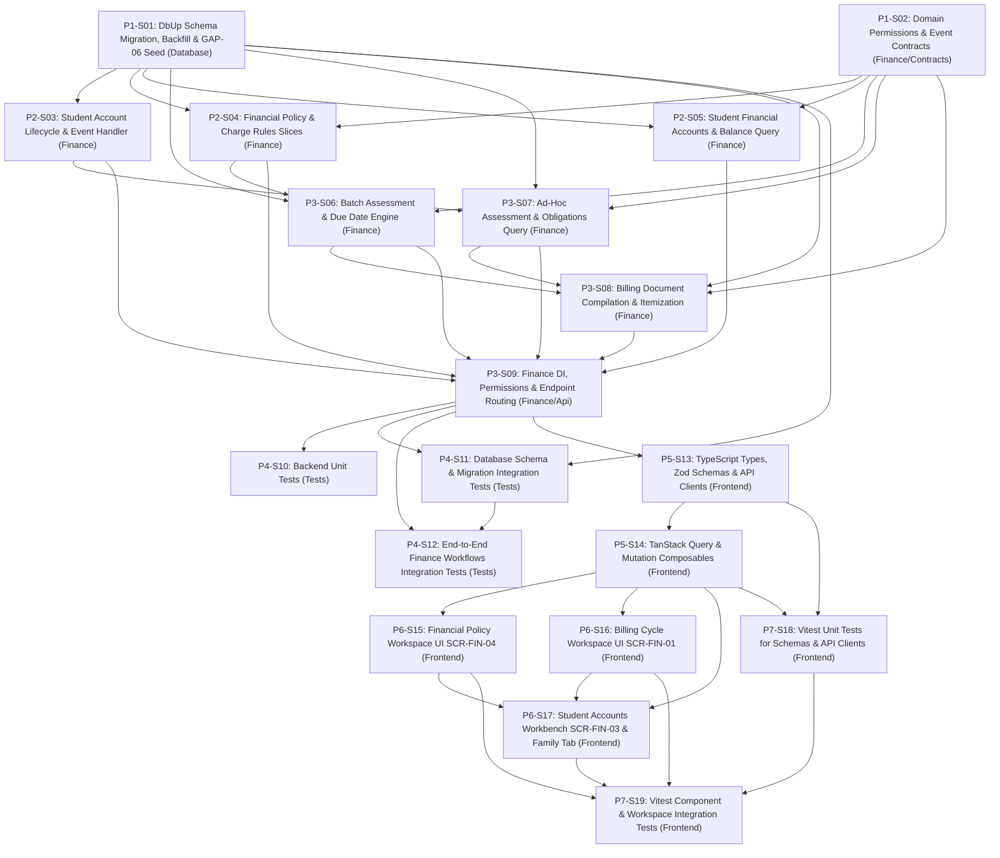

# 1. Objective

Implement the complete Stage 1 "Obligations & Billing — full scope: Financial Policy & Charge Rules, Student Financial Account, Obligation Assessment & Issuance, Billing & Statement Communication" under the Finance domain for Elsasa SIS V3, fulfilling change request intake `CR-FIN-OBLIGATIONS-BILLING` ([`IS006 - FIN-OBLIGATIONS-BILLING-ISSUE.md`](file:///d:/Project.Private/elsasa-sis-v3/docs/issues/IS006%20-%20FIN-OBLIGATIONS-BILLING-ISSUE.md)) and realizing the approved target architecture ([`IS006 - FIN-OBLIGATIONS-BILLING-ARCHITECTURE.md`](file:///d:/Project.Private/elsasa-sis-v3/docs/issues/IS006%20-%20FIN-OBLIGATIONS-BILLING-ARCHITECTURE.md)).

This implementation establishes:
1. **Authoritative Seven-Table Relational Persistence Schema:** Provisioning all 7 authoritative domain tables specified in `docs/entities/finance-entities-tables.md` (`financial_policies`, `charge_rules`, `student_financial_accounts`, `financial_obligations`, `obligation_due_schedules`, `billing_documents`, `billing_document_items`) while dropping the rudimentary stub table `finance.policies`.
2. **Student-Centric Financial Ledger Anchor & Lifecycle Synchronization:** Establishing `finance.student_financial_accounts` in a strict 1:1 relationship with `students.students`. Synchronizing account creation via asynchronous event consumption (`StudentEnrolledEvent`) and providing an idempotent backfill script for existing enrolled students. Account balances are dynamically derived from ledger entries rather than maintained in an independently mutable column.
3. **Monetary Precision & Base Currency Standard:** Enforcing exact `BIGINT` integer representation in Indonesian Rupiah (IDR, zero decimal places) across all monetary fields, coupled with explicit `currency_code VARCHAR(3) NOT NULL DEFAULT 'IDR'`.
4. **Dual-Mode Obligation Assessment Engine:** Delivering two vertical slices:
   - Guided batch billing cycle execution (`POST /api/finance/obligations/batch-assess`) with dry-run candidate preview, duplicate conflict validation, and bulk posting.
   - Single-student ad-hoc fee assessment (`POST /api/finance/obligations`).
   Both modes enforce rule-driven due date calculations, attach initial sequence-1 `obligation_due_schedules`, and emit `ObligationAssessedEvent` post-commit.
5. **Unified Point-in-Time Billing Document Pipeline:** Compiling open obligations into authorized bills (invoices) or periodic statements (`billing_documents`) with frozen, immutable line items (`billing_document_items`). Automatically resolving primary financial guarantors or emergency contacts from the Student domain.
6. **Out-of-the-Box Core Charge Rules Seed Data:** Seeding active Financial Policy `FP-2026-001` and three concrete charge rules per GAP-06 (`APPLICATION_FEE`, `ENROLLMENT_FEE`, and `TUITION_FEE`), immediately fulfilling Stage 1 Completion Criteria 6, 7, and 10.
7. **Actor Separation of Duties & Permissions Hierarchy:** Enforcing ADR-009 policy-based authorization with distinct permissions for the `Finance Authority` (policy creation, versioning, approvals) and the `Finance Officer` (operational assessment, billing cycle runs, statement dispatch).
8. **Operational Frontend Workspaces:** Scaffolding three dedicated Vue feature workspaces matching `screen-inventory.md`:
   - `SCR-FIN-04`: Financial Policy Workspace (`/finance/policies`)
   - `SCR-FIN-01`: Billing Cycle Workspace (`/finance/billing-cycles`)
   - `SCR-FIN-03`: Student Accounts Workbench (`/finance/accounts`)
   - Extending `SCR-SELF-02` (Family Tasks & Requests Portal) with a billing statement inspection tab.

Planning Mode: FEATURE-PLANNING

Referenced artifacts:
- FEATURE / ISSUE:
  - `docs/issues/IS006 - FIN-OBLIGATIONS-BILLING-ISSUE.md` (Intake `CR-FIN-OBLIGATIONS-BILLING`)
  - `docs/domains/finance-domain.md` (Financial Policy & Charge Rules lines 58–91, Student Financial Account lines 93–115, Financial Obligation & Charge lines 116–138, Billing & Statements lines 139–155, Due Schedules lines 157–183, Indonesian School Context & Operational Principles)
  - `docs/sub-modul-and-development-phases.md` (Stage 1 Module: Obligations & Billing; Criteria 6, 7, 10; Section E GAP-01 & GAP-06 resolutions)
  - `docs/operational-workflow-discovery.md` (`FIN-WF-01: Define or Adopt Financial Policy`, `FIN-WF-02: Assess and Issue Financial Obligation`, `FIN-WF-04: Issue Bill or Financial Statement`, `FIN-WF-13: Confirm Enrollment Payment Gate`)
  - `docs/use-cases.md` (`UC-FIN-10: Establish Financial Policy`, `UC-FIN-02: Assess Financial Obligations`, `UC-FIN-03: Issue Billing Statement`)
  - `docs/actors.md` (Finance Authority `ACT-03`, Finance Officer `ACT-04`)
  - `docs/screen-inventory.md` (`SCR-FIN-04: Financial Policy Workspace`, `SCR-FIN-01: Billing Cycle Workspace`, `SCR-FIN-03: Student Accounts Workbench`, `SCR-SELF-02: Family Tasks & Requests Portal`)
  - `docs/entities/finance-entities.md` & `docs/entities/finance-entities-tables.md` (Submodule 1 — Obligations & Billing; Tables 1.1 through 1.7)
- ARCHITECTURE:
  - `docs/issues/IS006 - FIN-OBLIGATIONS-BILLING-ARCHITECTURE.md` (Authoritative target capability architecture)
  - `docs/architecture/backend-architecture.md` (Modular Monolith & Vertical Slice specification)
  - `docs/architecture/frontend-architecture.md` (Modular Vue 3 SPA architecture)
  - `docs/architecture/adr.md` (ADR-001 through ADR-010)
  - `docs/architecture/coding-conventions.md` (C# 12, Dapper raw SQL, Minimal API conventions)
- FEASIBILITY-ASSESSMENT:
  - `docs/issues/IS006 - FIN-OBLIGATIONS-BILLING-FEASIBILITY-ASSESSMENT.md` (Status: `READY-FOR-PLANNING`)

Architecture Applicability: ARCHITECTURE-REQUIRED

This feature introduces the authoritative seven-table relational persistence schema for Finance, establishes event-driven ledger account provisioning, delivers a dual-mode obligation assessment engine, builds a point-in-time billing document compilation pipeline, configures domain authorization hierarchies, and scaffolds three major operational frontend workspaces. Authoritative target architecture `docs/issues/IS006 - FIN-OBLIGATIONS-BILLING-ARCHITECTURE.md` governs this plan.

---

# 2. Planning Scope

The planning scope encompasses all changes required across database persistence, backend vertical slices, cross-domain contracts, test harnesses, and frontend workspaces:

1. **Database Persistence & DbUp Migrations (`Elsasa.Sis.Database`):**
   - Author and register sequential forward DbUp migration script `20261104_0201_Finance_ObligationsBilling_Tables.sql` targeting Microsoft SQL Server 2022 ([`ADR-002`](file:///d:/Project.Private/elsasa-sis-v3/docs/architecture/adr.md#L50-L75), [`ADR-006`](file:///d:/Project.Private/elsasa-sis-v3/docs/architecture/adr.md#L152-L176)).
   - Drop the obsolete stub table `finance.policies`.
   - Create 7 authoritative domain tables in schema `finance`:
     - `finance.financial_policies`: Governance, versioning, status, approving authority, effective dates.
     - `finance.charge_rules`: Fee criteria, base amounts (`BIGINT` IDR), recurrence patterns, due rule parameters.
     - `finance.student_financial_accounts`: 1:1 student ledger anchor (`account_number`, `account_status`, `opened_date`).
     - `finance.financial_obligations`: Authoritative liability records (`obligation_number`, `original_amount`, `due_date`, `status`, `authorized_by`).
     - `finance.obligation_due_schedules`: Initial installment/due date schedule attached upon issuance.
     - `finance.billing_documents`: Unified point-in-time bill and periodic statement header (`document_type`, `recipient_name`, `total_billed_amount`, `delivery_status`).
     - `finance.billing_document_items`: Frozen snapshot line items.
   - Enforce database-level invariants via partial unique index `uq_finance_student_financial_accounts_student` on `student_id`.
   - Provision nonclustered query and composite indexes for sub-millisecond lookup and duplicate checks.
   - Implement an idempotent SQL backfill script for existing enrolled students in `students.students` (`GAP-002`).
   - Implement idempotent SQL seed data for active Financial Policy `FP-2026-001` and 3 core charge rules (`APPLICATION_FEE`, `ENROLLMENT_FEE`, `TUITION_FEE`) (`GAP-007`).

2. **Cross-Domain Contracts & Domain Events (`Elsasa.Sis.Contracts`):**
   - Ensure `ObligationAssessedEvent.cs` in `Elsasa.Sis.Contracts.Finance.Events` supports exact `long Amount` integer representation in IDR post-commit ([`ADR-003`](file:///d:/Project.Private/elsasa-sis-v3/docs/architecture/adr.md#L76-L98)).
   - Consume `StudentEnrolledEvent` from the Student domain.

3. **Backend Vertical Slices & Enhancements (`Elsasa.Sis.Finance`):**
   - **Permissions Hierarchy (`GAP-008`, TD-07):** Formal definition of `Permissions.Finance` in `Permissions.cs` distinguishing `Finance Authority` from `Finance Officer`.
   - **Student Account Lifecycle Event Handler (`GAP-002`, TD-03):** Asynchronous MediatR notification handler `StudentEnrolledEventHandler.cs` handling `StudentEnrolledEvent` to provision `finance.student_financial_accounts`.
   - **Financial Policy & Charge Rules Slices (`Features/Policies/`):**
     - `CreateFinancialPolicy` (`POST /api/finance/policies`): Creates policy draft (`FIN-WF-01`, `UC-FIN-10`).
     - `ApproveFinancialPolicy` (`POST /api/finance/policies/{id}/approve`): Transitions policy to `active` status (Finance Authority).
     - `CreateChargeRule` (`POST /api/finance/policies/{id}/rules`): Adds operational charge rule to approved policy.
     - `GetFinancialPolicies` (`GET /api/finance/policies`): Queries policies and associated charge rules.
     - `GetFinancialPolicyById` (`GET /api/finance/policies/{id}`): Detailed policy view.
   - **Obligation Assessment Slices (`Features/Obligations/`):**
     - `BatchAssessObligations` (`POST /api/finance/obligations/batch-assess`): Dual-mode billing cycle endpoint supporting `preview` (dry run candidate evaluation) and `commit` (bulk generation with sequence-1 due schedule and post-commit event emission) (`FIN-WF-02`, `UC-FIN-02`, `SCR-FIN-01`).
     - `AssessAdHocObligation` (`POST /api/finance/obligations`): Single-student charge issuance, auto-provisions missing account if needed, attaches sequence-1 due schedule, and emits event.
     - `GetObligations` (`GET /api/finance/obligations`): Queries obligations with filters (`studentId`, `status`, `academicPeriodId`).
   - **Billing Document & Statement Slices (`Features/Billing/`):**
     - `GenerateBillingDocument` (`POST /api/finance/billing-documents/generate`): Compiles open obligations into a `bill`, resolves primary guarantor contact, and freezes line items (`FIN-WF-04`, `UC-FIN-03`).
     - `GenerateStatement` (`POST /api/finance/billing-documents/statement`): Compiles periodic financial statement across a date range.
     - `GetBillingDocuments` (`GET /api/finance/billing-documents`): Queries billing documents.
     - `GetBillingDocumentById` (`GET /api/finance/billing-documents/{id}`): Projects complete invoice snapshot with frozen line items.
   - **Student Financial Accounts Slices (`Features/Accounts/`):**
     - `GetStudentFinancialAccount` (`GET /api/finance/accounts/{studentId}`): Queries account header, dynamically derived balance, open obligations, and recent billing documents (`SCR-FIN-03`).
     - `SearchStudentFinancialAccounts` (`GET /api/finance/accounts`): Paginated account search.
   - **Dependency Injection & Routing:** Register all feature handlers and Minimal API endpoints in `DependencyInjection.cs` and `FinanceEndpoints.cs`.

4. **Automated Testing Suite (`tests/backend`):**
   - Unit tests covering FluentValidation validators, due date calculation helper, and event records.
   - SQL Server 2022 Testcontainers integration tests verifying migration `20261104_0201` execution, table structures, constraints, partial unique index, account backfill, core charge rules seed, `StudentEnrolledEvent` account creation, policy approval flow, batch assessment dry-run and commit, duplicate prevention, ad-hoc assessment, derived balance calculation, and billing document compilation with immutable frozen items.

5. **Frontend State, API Clients & Validation Schemas (`src/frontend`):**
   - TypeScript interfaces, Zod validation schemas, and Axios client modules for policies, obligations, billing documents, and accounts.
   - TanStack Query hooks and cache invalidation composables (`useFinancePolicies`, `useFinanceObligations`, `useFinanceBilling`, `useFinanceAccounts`).
   - Shared IDR currency formatters and status badge helpers.

6. **Frontend Workspaces & UI Components (`src/frontend`):**
   - `SCR-FIN-04` Financial Policy Workspace (`/finance/policies`): Policy list, charge rules table, policy creation dialog, rule creation modal, and formal approval button for Finance Authority.
   - `SCR-FIN-01` Billing Cycle Workspace (`/finance/billing-cycles`): Guided wizard for Finance Officer to preview candidates, validate exceptions, post batch obligations, and issue billing statements.
   - `SCR-FIN-03` Student Accounts Workbench (`/finance/accounts`): Student search, account balance summary card, obligations table, invoice history table, ad-hoc charge modal, and invoice viewing dialog.
   - `SCR-SELF-02` Family Portal Extension: Payer-facing `FamilyBillingTab.vue` inspecting bills, due dates, and line item breakdowns.
   - Route registration in `src/frontend/src/app/router/routes.ts` with permission metadata.

7. **Frontend Automated Verification & Testing (`src/frontend`):**
   - Unit tests for Zod schemas, API clients, and currency formatters.
   - Component & integration tests using Vitest and Vue Test Utils for `FinancialPolicyWorkspaceView`, `BillingCycleWorkspaceView`, `StudentAccountsWorkbenchView`, and `FamilyBillingTab`.

---

# 3. Dependencies

### External System & Tooling Dependencies

- .NET 8 SDK (8.0.x)
- Docker / Docker Desktop / Podman (required for Testcontainers SQL Server 2022 integration tests)
- Microsoft SQL Server 2022 instance (for local Web API runtime)
- Node.js runtime (v22.x or LTS) and pnpm package manager (v9.x or v11.x)

### Internal Slice Dependencies

- `Depends On` declares implementation prerequisites between slices.
- Dependencies reference Slice IDs only.
- Dependency satisfaction requires the referenced slice to have implementation status `IMPLEMENTED`.
- Dependency satisfaction does not require review status `GO`.
- Slices with `Depends On: None` or whose dependencies are satisfied may be executed in parallel.

### Dependency Graph

---

# 4. Progress Summary

Plan status values:
- NOT-STARTED
- IN-PROGRESS
- BLOCKED
- COMPLETED

Execution Approval values:
- PENDING
- APPROVED

Execution Approval is owned by the Architect. It is set to APPROVED when the plan structure is finalized and released for execution. Execution must not begin while Execution Approval is PENDING.

COMPLETED is a plan-level status only, set when every slice has implementation status IMPLEMENTED and review status GO.

| Phase | Implementation Status | Review Status | Progress |
|---|---|---|---|
| P1 - Persistence, Contracts & Permissions Foundation | NOT-STARTED | NOT-REVIEWED | 0/2 |
| P2 - Student Account Lifecycle & Policy Governance Backend Slices | NOT-STARTED | NOT-REVIEWED | 0/3 |
| P3 - Obligation Assessment & Billing Document Backend Slices | NOT-STARTED | NOT-REVIEWED | 0/4 |
| P4 - Backend Automated Verification & Test Harness | NOT-STARTED | NOT-REVIEWED | 0/3 |
| P5 - Frontend State, API Clients & Validation Schemas | NOT-STARTED | NOT-REVIEWED | 0/2 |
| P6 - Frontend Workspaces & Portal UI Components | NOT-STARTED | NOT-REVIEWED | 0/3 |
| P7 - Frontend Automated Verification & Component Testing | NOT-STARTED | NOT-REVIEWED | 0/2 |

---

# 5. Phases

## P1 - Persistence, Contracts & Permissions Foundation

Implementation Status: NOT-STARTED  
Review Status: NOT-REVIEWED

### P1-S01

Title: Database Schema Migration, Idempotent Backfill & GAP-06 Seed Data (`20261104_0201_Finance_ObligationsBilling_Tables.sql`)

Implementation Status: NOT-STARTED  
Review Status: NOT-REVIEWED

Objective:  
Author and register the sequential forward DbUp migration script `20261104_0201_Finance_ObligationsBilling_Tables.sql` in `Elsasa.Sis.Database/Scripts/` to drop stub table `finance.policies`, provision all 7 authoritative tables (`financial_policies`, `charge_rules`, `student_financial_accounts`, `financial_obligations`, `obligation_due_schedules`, `billing_documents`, `billing_document_items`), enforce indexes and constraints, execute idempotent student account backfill, and seed GAP-06 core policies and charge rules (`GAP-001`, `GAP-002`, `GAP-007`, TD-01, TD-02, TD-06).

Depends On: None

Repository: `src/backend`

Completion Criteria:
- Migration file `src/backend/Elsasa.Sis.Database/Scripts/20261104_0201_Finance_ObligationsBilling_Tables.sql` is authored and set to `EmbeddedResource` in `Elsasa.Sis.Database.csproj`.
- Drops obsolete stub table `finance.policies` via safe `IF OBJECT_ID(N'finance.policies', N'U') IS NOT NULL DROP TABLE [finance].[policies];`.
- Creates 7 authoritative tables in schema `finance` with exact column names, constraints, and data types specified in Section 8 of ARCHITECTURE:
  1. `finance.financial_policies`: `id`, `policy_code`, `name`, `category`, `business_purpose`, `applicable_context`, `effective_date`, `end_date`, `policy_version`, `status`, `approving_authority`, `approved_date`, `supersedes_policy_id`, `notes`, audit columns.
  2. `finance.charge_rules`: `id`, `rule_code`, `policy_id`, `name`, `charge_type`, `is_mandatory`, `determination_method`, `base_amount` (`BIGINT`), `currency_code` (`VARCHAR(3) DEFAULT 'IDR'`), `recurrence_pattern`, `due_rule_type`, `due_rule_value`, `applicable_grade`, `applicable_program`, `status`, `notes`, audit columns. Foreign key to `financial_policies(id)`.
  3. `finance.student_financial_accounts`: `id`, `account_number`, `student_id`, `currency_code`, `account_status`, `opened_date`, `closed_date`, `notes`, audit columns. Partial/unique indexes enforcing single 1:1 account per student (`uq_finance_student_financial_accounts_student`).
  4. `finance.financial_obligations`: `id`, `obligation_number`, `student_account_id`, `student_id`, `charge_rule_id` (NULL-able), `policy_id`, `description`, `charge_type`, `is_mandatory`, `original_amount` (`BIGINT`), `currency_code`, `issue_date`, `due_date`, `academic_period_id`, `academic_period_label`, `status`, `authorized_by`, `notes`, audit columns. Foreign keys to `student_financial_accounts`, `charge_rules`, `financial_policies`.
  5. `finance.obligation_due_schedules`: `id`, `obligation_id`, `installment_sequence`, `due_date`, `scheduled_amount` (`BIGINT`), `currency_code`, `status`, `notes`, audit columns. Foreign key to `financial_obligations(id)` with `ON DELETE CASCADE`. Unique index on `(obligation_id, installment_sequence)`.
  6. `finance.billing_documents`: `id`, `document_number`, `student_account_id`, `student_id`, `document_type`, `recipient_name`, `recipient_relationship`, `recipient_contact`, `billing_period_start`, `billing_period_end`, `issue_date`, `payment_due_date`, `total_billed_amount` (`BIGINT`), `currency_code`, `delivery_channel`, `delivery_status`, `sent_at`, `notes`, audit columns. Foreign key to `student_financial_accounts`.
  7. `finance.billing_document_items`: `id`, `billing_document_id`, `line_sequence`, `item_type`, `reference_entity_type`, `reference_entity_id`, `description`, `amount` (`BIGINT`), `currency_code`, `created_at`. Foreign key to `billing_documents(id)` with `ON DELETE CASCADE`. Unique index on `(billing_document_id, line_sequence)`.
- All monetary columns (`base_amount`, `original_amount`, `scheduled_amount`, `total_billed_amount`, `amount`) are `BIGINT NOT NULL`.
- Zero mutable balance columns exist on `finance.student_financial_accounts`.
- Nonclustered indexes created:
  - `ix_finance_financial_policies_category_status` on `([category], [status], [effective_date] DESC)`
  - `ix_finance_charge_rules_policy` on `([policy_id], [status])`
  - `ix_finance_student_financial_accounts_status` on `([account_status], [opened_date] DESC)`
  - `ix_finance_obligations_student_status` on `([student_id], [status], [due_date] ASC)`
  - `ix_finance_obligations_account_period` on `([student_account_id], [academic_period_id], [charge_rule_id])`
  - `ix_finance_due_schedules_due_date_status` on `([due_date] ASC, [status])`
  - `ix_finance_billing_documents_student` on `([student_id], [issue_date] DESC)`
  - `ix_finance_billing_documents_status` on `([delivery_status], [delivery_channel])`
  - `ix_finance_billing_items_reference` on `([reference_entity_type], [reference_entity_id])`
- Idempotent backfill script provisions accounts in `finance.student_financial_accounts` for all existing enrolled students in `students.students` who do not already have an account (`GAP-002`, TD-03).
- Idempotent seed data provisions active Financial Policy `FP-2026-001` and 3 core charge rules (`CR-2026-APP`, `CR-2026-ENR`, `CR-2026-SPP-SD`) (`GAP-007`, TD-06).
- Migration executes cleanly through DbUp within an atomic database transaction.

Notes:
- Must adhere to SQL Server 2022 syntax, `DATETIMEOFFSET(7)` UTC defaults, and `NVARCHAR` for text.
- Must execute strictly after student placement tables (`20261104_0101`).

---

### P1-S02

Title: Domain Permissions Definition & Event Contracts Foundation

Implementation Status: NOT-STARTED  
Review Status: NOT-REVIEWED

Objective:  
Define the authoritative domain permissions hierarchy in `Elsasa.Sis.Finance/Permissions.cs` and ensure domain event contracts in `Elsasa.Sis.Contracts/Finance/Events/` conform to the integer IDR monetary standard and post-commit MediatR publishing requirements (`GAP-008`, TD-02, TD-07, ADR-003, ADR-009).

Depends On: None

Repository: `src/backend`

Completion Criteria:
- File `src/backend/Elsasa.Sis.Finance/Permissions.cs` is authored defining nested static classes under namespace `Elsasa.Sis.Finance`:
  - `Policies`: `View = "Permissions.Finance.Policies.View"`, `Manage = "Permissions.Finance.Policies.Manage"`, `Approve = "Permissions.Finance.Policies.Approve"`.
  - `Obligations`: `View = "Permissions.Finance.Obligations.View"`, `Assess = "Permissions.Finance.Obligations.Assess"`.
  - `Billing`: `View = "Permissions.Finance.Billing.View"`, `Generate = "Permissions.Finance.Billing.Generate"`.
  - `Accounts`: `View = "Permissions.Finance.Accounts.View"`.
- `ObligationAssessedEvent.cs` in `Elsasa.Sis.Contracts/Finance/Events/` is verified and updated:
  - Ensures primary constructor or overload supports `(Guid ObligationId, Guid StudentId, long Amount, DateTimeOffset OccurredOn) : IDomainEvent`.
  - Ensures convenience constructor defaults `OccurredOn` to `DateTimeOffset.UtcNow`.
- Code compiles cleanly in `Elsasa.Sis.Contracts` and `Elsasa.Sis.Finance` with zero warnings and zero errors.

Notes:
- `Finance Authority` possesses all permissions including `Policies.Approve`.
- `Finance Officer` possesses operational permissions (`Policies.View`, `Obligations.Assess`, `Billing.Generate`, `Accounts.View`).

---

## P2 - Student Account Lifecycle & Policy Governance Backend Slices

Implementation Status: NOT-STARTED  
Review Status: NOT-REVIEWED

### P2-S03

Title: Student Financial Account Lifecycle & Event Handler (`StudentEnrolledEventHandler`)

Implementation Status: NOT-STARTED  
Review Status: NOT-REVIEWED

Objective:  
Implement MediatR notification handler `StudentEnrolledEventHandler.cs` in `Elsasa.Sis.Finance/Features/Accounts/Events/` to automatically and idempotently provision active `finance.student_financial_accounts` records upon student enrollment, and provide an internal account provisioning service for ad-hoc fallbacks (`GAP-002`, TD-03, ADR-003).

Depends On: P1-S01

Repository: `src/backend`

Completion Criteria:
- `StudentEnrolledEventHandler.cs` is authored in `Elsasa.Sis.Finance/Features/Accounts/Events/` implementing `INotificationHandler<StudentEnrolledEvent>`.
- Handler generates deterministic account number format: `ACC-{DateTime.UtcNow:yyyy}-{StudentId.ToString()[..8].ToUpperInvariant()}`.
- Handler performs an idempotent check: if `finance.student_financial_accounts` already contains a row for `StudentId`, no-op and complete successfully.
- Handler inserts an active account record with `id = Guid.NewGuid()`, `student_id = notification.StudentId`, `currency_code = 'IDR'`, `account_status = 'active'`, `opened_date = DateOnly.FromDateTime(DateTime.UtcNow)`, `created_by = 'SYSTEM_ENROLLMENT'`.
- Provide an internal service or helper method `GetOrCreateAccountAsync(Guid studentId, IDbConnection connection, IDbTransaction? transaction)` to guarantee account presence during ad-hoc obligation assessment.
- Registered in DI and verified with clean compilation.

Notes:
- Relies on Dapper raw SQL parameterized queries.
- Catches potential unique constraint races gracefully via idempotent queries.

---

### P2-S04

Title: Financial Policy & Charge Rules Governance Slices (`Features/Policies/`)

Implementation Status: NOT-STARTED  
Review Status: NOT-REVIEWED

Objective:  
Implement the vertical slices for creating, approving, querying, and managing financial policies and concrete charge rules in `Elsasa.Sis.Finance/Features/Policies/` (`FIN-WF-01`, `UC-FIN-10`, `SCR-FIN-04`, TD-04, TD-06, ADR-004, ADR-005, ADR-009).

Depends On: P1-S01, P1-S02

Repository: `src/backend`

Completion Criteria:
- Feature directory `src/backend/Elsasa.Sis.Finance/Features/Policies/` is created with dedicated vertical slices:
  1. `CreateFinancialPolicy`: Command + FluentValidation Validator + Handler (`POST /api/finance/policies`). Creates policy in `draft` status.
  2. `ApproveFinancialPolicy`: Command + Handler (`POST /api/finance/policies/{id}/approve`). Requires `Permissions.Finance.Policies.Approve` (`Finance Authority`). Validates policy exists and is in `draft` status; transitions status to `active`, sets `approved_date = DateOnly.FromDateTime(DateTime.UtcNow)`, and records `approving_authority`.
  3. `CreateChargeRule`: Command + FluentValidation Validator + Handler (`POST /api/finance/policies/{id}/rules`). Inserts charge rule attached to the active policy with `base_amount` (`BIGINT`), `recurrence_pattern`, `due_rule_type`, `due_rule_value`, and optional grade/program filters.
  4. `GetFinancialPolicies`: Query + Handler (`GET /api/finance/policies`). Supports query parameters for `status`, `category`, and includes associated charge rules.
  5. `GetFinancialPolicyById`: Query + Handler (`GET /api/finance/policies/{id}`). Returns detailed policy DTO with associated charge rules list.
- All handlers return `Task<Result<T>>` or `Task<Result>` per ADR-005.
- Validation checks enforce non-empty codes, base amounts >= 0, and valid due rule types (`days_after_issuance`, `fixed_day_of_month`, `fixed_calendar_date`).

Notes:
- Data access uses Dapper raw string literals (`"""..."""`).
- Enforces ADR-009 authorization policies on mutation endpoints.

---

### P2-S05

Title: Student Financial Accounts & Derived Balance Query Slice (`Features/Accounts/`)

Implementation Status: NOT-STARTED  
Review Status: NOT-REVIEWED

Objective:  
Implement the vertical slice `GetStudentFinancialAccount` and `SearchStudentFinancialAccounts` in `Elsasa.Sis.Finance/Features/Accounts/` projecting the 360-degree student financial position with dynamically derived balance calculation (`SCR-FIN-03`, TD-02, Resolved Decision 5).

Depends On: P1-S01, P1-S02

Repository: `src/backend`

Completion Criteria:
- Feature directory `src/backend/Elsasa.Sis.Finance/Features/Accounts/` is created with:
  1. `GetStudentFinancialAccount`: Query + Handler (`GET /api/finance/accounts/{studentId}`).
     - Projects student account header (`account_number`, `account_status`, `opened_date`).
     - Dynamically computes balance via SQL aggregation per TD-02:
       - `total_assessed = SUM(fo.original_amount WHERE fo.status != 'cancelled')`
       - `total_settled = SUM(fo.original_amount WHERE fo.status = 'settled')`
       - `current_balance = total_assessed - total_settled`
     - Returns open obligations list (`status IN ('assessed', 'issued')`) and recent billing documents.
  2. `SearchStudentFinancialAccounts`: Query + Handler (`GET /api/finance/accounts`).
     - Performs paginated search across student accounts, joining `students.students` via read-only SQL projection for student name, student number, and active grade/campus.
- Protected by `Permissions.Finance.Accounts.View`.
- Returns `DomainError.NotFound` when student account does not exist.

Notes:
- Zero mutable balance columns are read or written; balance is strictly derived.
- Cross-schema join to `students.students` is read-only and conforms to ADR-002.

---

## P3 - Obligation Assessment & Billing Document Backend Slices

Implementation Status: NOT-STARTED  
Review Status: NOT-REVIEWED

### P3-S06

Title: Batch Obligation Assessment & Due Date Engine (`BatchAssessObligations`)

Implementation Status: NOT-STARTED  
Review Status: NOT-REVIEWED

Objective:  
Implement the dual-action batch billing cycle vertical slice `BatchAssessObligations` in `Elsasa.Sis.Finance/Features/Obligations/BatchAssessObligations/` (`POST /api/finance/obligations/batch-assess`) supporting dry-run candidate preview, duplicate conflict validation, rule-driven due date derivation, sequence-1 due schedule attachment, and post-commit event publishing (`FIN-WF-02`, `UC-FIN-02`, `SCR-FIN-01`, `GAP-003`, `GAP-004`, TD-04, ADR-003, ADR-004).

Depends On: P1-S01, P1-S02, P2-S04

Repository: `src/backend`

Completion Criteria:
- Vertical slice folder `Elsasa.Sis.Finance/Features/Obligations/BatchAssessObligations/` is created with Command, Validator, Handler, Response DTOs.
- Supports payload: `ChargeRuleId`, `AcademicPeriodId`, `BillingCycleLabel`, `TargetCampus` (optional), `TargetGrade` (optional), `Mode` (`"preview"` | `"commit"`).
- **Rule Verification:** Validates `ChargeRuleId` exists and is `active`; resolves governing policy and due rule parameters.
- **Candidate Evaluation:** Queries active enrolled students from `students.students` and `students.administrative_placements` matching rule criteria (`applicable_program`, `applicable_grade`, `is_current = 1`).
- **Duplicate Detection:** Queries `finance.financial_obligations` to detect if candidates already have an obligation for `(student_account_id, charge_rule_id, academic_period_id)`.
- **Preview Mode (`Mode == "preview"`):**
  - Returns DTO with `TotalCandidatesCount`, `EligibleCandidatesCount`, `DuplicateCount`, `GrossAssessedAmount`, and candidate student items with `IsDuplicate` boolean flag.
  - Performs zero database writes.
- **Commit Mode (`Mode == "commit"`):**
  - Filters out duplicate candidates.
  - Computes rule-driven due date for each student:
    - `days_after_issuance`: `issue_date.AddDays(int.Parse(due_rule_value))`
    - `fixed_day_of_month`: Computes specified day in the period's month, clamped to the last day of the month.
    - `fixed_calendar_date`: Parses ISO-8601 date.
  - Inserts obligations into `finance.financial_obligations` (`obligation_number = OBL-{Year}-{Sequence:D6}`, `original_amount = rule.base_amount`, `status = 'assessed'`).
  - Inserts initial sequence-1 due schedule in `finance.obligation_due_schedules` (`installment_sequence = 1`, `scheduled_amount = original_amount`, `status = 'pending'`).
  - Executes all inserts inside a single atomic `SqlTransaction`.
  - Publishes `ObligationAssessedEvent` via MediatR `IPublisher` for each created obligation strictly **post-commit**.
- Returns `Result<BatchAssessObligationsResponse>` with summary counts and created obligation IDs.

Notes:
- Protected by `Permissions.Finance.Obligations.Assess`.
- Follows ADR-003 for post-commit event dispatch.

---

### P3-S07

Title: Ad-Hoc Obligation Assessment & Obligations Query Slices

Implementation Status: NOT-STARTED  
Review Status: NOT-REVIEWED

Objective:  
Implement the single-student ad-hoc obligation assessment slice (`AssessAdHocObligation`) and filtered obligations query slice (`GetObligations`) in `Elsasa.Sis.Finance/Features/Obligations/` (`FIN-WF-02`, `UC-FIN-02`, `SCR-FIN-03`, `GAP-003`, `GAP-004`, TD-04).

Depends On: P1-S01, P1-S02, P2-S03

Repository: `src/backend`

Completion Criteria:
- Feature directory `Elsasa.Sis.Finance/Features/Obligations/` contains:
  1. `AssessAdHocObligation` (`POST /api/finance/obligations`):
     - Payload: `StudentId`, `ChargeType`, `Description`, `Amount` (`BIGINT`), `DueDate`, `AcademicPeriodId`, `Notes`.
     - Validates positive amount and valid due date.
     - Resolves or auto-provisions student financial account via `IStudentAccountService` fallback.
     - Resolves academic period label from `operations.operational_periods`.
     - Inserts obligation with `charge_rule_id = NULL`, `status = 'assessed'`, `authorized_by = CurrentUser`.
     - Inserts sequence-1 `finance.obligation_due_schedules` (`scheduled_amount = Amount`, `due_date = DueDate`, `status = 'pending'`).
     - Publishes `ObligationAssessedEvent` post-commit.
     - Returns created obligation summary DTO.
  2. `GetObligations` (`GET /api/finance/obligations`):
     - Supports query parameters: `studentId`, `status`, `academicPeriodId`, `chargeType`, pagination (`page`, `pageSize`).
     - Returns paginated list of obligation DTOs including student details, charge rule, amounts, due dates, and schedule status.
- Protected by `Permissions.Finance.Obligations.Assess` and `Permissions.Finance.Obligations.View`.

Notes:
- Handles individual fees (e.g. lost ID card, late library fee, field trip) without requiring a pre-existing charge rule.

---

### P3-S08

Title: Billing Document Compilation & Itemization Slices (`Features/Billing/`)

Implementation Status: NOT-STARTED  
Review Status: NOT-REVIEWED

Objective:  
Implement the unified billing document compilation and statement pipeline in `Elsasa.Sis.Finance/Features/Billing/` supporting point-in-time bills (invoices) and periodic statements with frozen line items and primary guarantor contact resolution (`FIN-WF-04`, `UC-FIN-03`, `GAP-005`, TD-05, Resolved Decision 1).

Depends On: P1-S01, P1-S02, P3-S06, P3-S07

Repository: `src/backend`

Completion Criteria:
- Feature directory `src/backend/Elsasa.Sis.Finance/Features/Billing/` is created with:
  1. `GenerateBillingDocument` (`POST /api/finance/billing-documents/generate`):
     - Payload: `StudentId`, `ObligationIds` (optional list; if omitted, compiles all open obligations), `PaymentDueDate`, `Notes`.
     - Resolves primary recipient from `students.student_guardian_relationships` joined with `students.guardians` (`is_financial_guarantor = 1` first, fallback `is_primary_contact = 1`, fallback student name).
     - Generates document number: `BIL-{Year}-{Sequence:D5}`.
     - Computes `total_billed_amount` as the exact sum of included obligations.
     - Inserts header row into `finance.billing_documents` with `document_type = 'bill'`, `delivery_channel = 'portal'`, `delivery_status = 'issued'`.
     - Freezes line items into `finance.billing_document_items`:
       - `line_sequence = 1..N`
       - `item_type = 'obligation'`
       - `reference_entity_type = 'financial_obligations'`
       - `reference_entity_id = obligation.id`
       - `description = obligation.description`
       - `amount = obligation.original_amount`
     - Updates referenced obligations status to `issued`.
     - Executes inside atomic `SqlTransaction`.
  2. `GenerateStatement` (`POST /api/finance/billing-documents/statement`):
     - Compiles periodic financial statement across `billing_period_start` and `billing_period_end`.
     - Document number: `STM-{Year}-{Sequence:D5}`, `document_type = 'statement'`.
  3. `GetBillingDocuments` (`GET /api/finance/billing-documents`):
     - Queries billing documents with filters (`studentId`, `documentType`, `deliveryStatus`).
  4. `GetBillingDocumentById` (`GET /api/finance/billing-documents/{id}`):
     - Projects detailed invoice DTO including recipient contact details, payment due date, total amount, and frozen itemized line items list.
- Immutability invariant enforced: `billing_documents` and `billing_document_items` are append-only.

Notes:
- Protected by `Permissions.Finance.Billing.Generate` and `Permissions.Finance.Billing.View`.

---

### P3-S09

Title: Finance Domain Dependency Injection, Permissions & Endpoint Routing

Implementation Status: NOT-STARTED  
Review Status: NOT-REVIEWED

Objective:  
Wire all Finance domain services, MediatR handlers, FluentValidation endpoint filters, and Minimal API route groups into `Elsasa.Sis.Finance` and `Elsasa.Sis.Api`, configuring policy-based authorization claim requirements (`GAP-008`, TD-07, ADR-001, ADR-004, ADR-009).

Depends On: P2-S03, P2-S04, P2-S05, P3-S06, P3-S07, P3-S08

Repository: `src/backend`

Completion Criteria:
- `DependencyInjection.cs` in `Elsasa.Sis.Finance` is updated to register:
  - All MediatR request handlers and notification handlers (`StudentEnrolledEventHandler`).
  - FluentValidation validators across all Finance feature slices.
  - Internal account provisioning service (`IStudentAccountService`).
- Endpoint mapping class `FinanceEndpoints.cs` in `Elsasa.Sis.Finance/Endpoints/` is authored implementing `IEndpoint`:
  - Maps route group `/api/finance`.
  - Maps policy endpoints: `POST /policies`, `POST /policies/{id}/approve`, `POST /policies/{id}/rules`, `GET /policies`, `GET /policies/{id}`.
  - Maps obligation endpoints: `POST /obligations/batch-assess`, `POST /obligations`, `GET /obligations`.
  - Maps billing endpoints: `POST /billing-documents/generate`, `POST /billing-documents/statement`, `GET /billing-documents`, `GET /billing-documents/{id}`.
  - Maps account endpoints: `GET /accounts`, `GET /accounts/{studentId}`.
  - Applies authorization claim requirements matching `Permissions.Finance.*`.
- `Program.cs` in `Elsasa.Sis.Api` registers `AddFinanceDomain()` and maps Finance endpoints.
- Solution builds cleanly with 0 errors and 0 warnings.

Notes:
- Adheres to ADR-004 Minimal API and ADR-009 authorization architecture.

---

## P4 - Backend Automated Verification & Test Harness

Implementation Status: NOT-STARTED  
Review Status: NOT-REVIEWED

### P4-S10

Title: Backend Unit Tests (Validators, Due Date Engine, Events)

Implementation Status: NOT-STARTED  
Review Status: NOT-REVIEWED

Objective:  
Author comprehensive unit test suites in `tests/backend/Elsasa.Sis.IntegrationTests/UnitTests/Finance/` verifying feature validators, rule-driven due date calculations, and domain event records.

Depends On: P3-S09

Repository: `src/backend`

Completion Criteria:
- Unit test classes authored in `tests/backend/Elsasa.Sis.IntegrationTests/UnitTests/Finance/`:
  1. `CreateFinancialPolicyValidatorTests.cs`: Verifies required policy code, name, valid category, and date ordering.
  2. `CreateChargeRuleValidatorTests.cs`: Verifies base amount >= 0, valid recurrence pattern, valid due rule types.
  3. `BatchAssessObligationsValidatorTests.cs`: Verifies mode is 'preview' or 'commit', charge rule ID, and academic period ID.
  4. `AssessAdHocObligationValidatorTests.cs`: Verifies student ID, description, amount > 0, and future/present due date.
  5. `GenerateBillingDocumentValidatorTests.cs`: Verifies student ID and payment due date.
  6. `DueDateCalculationTests.cs`: Verifies:
     - `days_after_issuance`: correct day additions.
     - `fixed_day_of_month`: correct day placement and clamping on 28/30/31-day months and leap years.
     - `fixed_calendar_date`: exact date parsing.
  7. `FinanceEventContractsTests.cs`: Verifies `ObligationAssessedEvent` and `StudentEnrolledEvent` properties and UTC initialization.
- All unit tests pass cleanly with `dotnet test`.

Notes:
- Fast in-memory unit tests executing without database dependencies.

---

### P4-S11

Title: Database Schema & Migration Integration Tests (Testcontainers SQL Server 2022)

Implementation Status: NOT-STARTED  
Review Status: NOT-REVIEWED

Objective:  
Author integration test suite in `tests/backend/Elsasa.Sis.IntegrationTests/Features/Finance/Migration/` using Testcontainers SQL Server 2022 to verify migration `20261104_0201` execution, table dropping, partial unique indexes, account backfill, and seed data.

Depends On: P1-S01, P3-S09

Repository: `src/backend`

Completion Criteria:
- Integration test class `FinanceMigrationIntegrationTests.cs` is authored:
  - Executes DbUp migration scripts against a fresh SQL Server 2022 container.
  - Verifies stub table `finance.policies` is dropped.
  - Verifies all 7 tables exist in schema `finance` with expected columns and foreign key constraints.
  - Verifies partial unique index on `finance.student_financial_accounts(student_id)` rejects duplicate account inserts for the same student.
  - Verifies backfill query created account records for existing enrolled students in `students.students`.
  - Verifies active Financial Policy `FP-2026-001` exists and is `active`.
  - Verifies the 3 core charge rules (`CR-2026-APP`, `CR-2026-ENR`, `CR-2026-SPP-SD`) exist with correct `BIGINT` amounts (500000, 15000000, 750000).
- All integration tests pass cleanly with `dotnet test`.

Notes:
- Targets real Microsoft SQL Server 2022 container matching production storage engine.

---

### P4-S12

Title: End-to-End Finance Workflows Integration Tests (Testcontainers SQL Server 2022)

Implementation Status: NOT-STARTED  
Review Status: NOT-REVIEWED

Objective:  
Author integration test suites in `tests/backend/Elsasa.Sis.IntegrationTests/Features/Finance/` verifying complete end-to-end workflows across the account lifecycle, policy governance, batch assessment, ad-hoc assessment, derived balance, and billing document compilation.

Depends On: P3-S09, P4-S11

Repository: `src/backend`

Completion Criteria:
- Integration test suites authored:
  1. `StudentAccountLifecycleIntegrationTests.cs`: Publishing `StudentEnrolledEvent` triggers `StudentEnrolledEventHandler` to provision active account.
  2. `FinancialPolicyWorkflowIntegrationTests.cs`:
     - Creates policy in `draft` status.
     - Approves policy as Finance Authority &rarr; transitions to `active`.
     - Creates charge rule attached to policy.
  3. `BatchAssessmentWorkflowIntegrationTests.cs`:
     - Executes `preview` mode: returns candidate counts, duplicate flags, without modifying database.
     - Executes `commit` mode: inserts obligations and sequence-1 due schedules, verifies `ObligationAssessedEvent` was dispatched.
     - Re-running batch detects existing obligations and skips duplicates.
  4. `AdHocAssessmentWorkflowIntegrationTests.cs`:
     - Assesses ad-hoc fee for student, verifies sequence-1 due schedule, auto-provisions missing account if needed.
  5. `DerivedAccountBalanceIntegrationTests.cs`:
     - Assesses obligations and simulates payment settlement; verifies account balance query returns exact derived calculation without denormalized balance column.
  6. `BillingDocumentWorkflowIntegrationTests.cs`:
     - Compiles open obligations into `bill`, resolves primary financial guarantor from Student domain, verifies frozen line items in `billing_document_items`, verifies obligations status updated to `issued`.
- Tests satisfy Stage 1 Completion Criteria 6, 7, and 10.
- All integration tests pass cleanly.

Notes:
- Exercises HTTP endpoints via `WebApplicationFactory<Program>` or direct MediatR command dispatch.

---

## P5 - Frontend State, API Clients & Validation Schemas

Implementation Status: NOT-STARTED  
Review Status: NOT-REVIEWED

### P5-S13

Title: TypeScript Types, Zod Schemas & API Client Modules

Implementation Status: NOT-STARTED  
Review Status: NOT-REVIEWED

Objective:  
Author TypeScript interfaces, Zod validation schemas, and typed Axios API client modules under `src/frontend/src/features/finance/` for policies, obligations, billing documents, accounts, and shared IDR formatting helpers (`GAP-006`, TD-02, TD-08, ADR-004).

Depends On: P3-S09

Repository: `src/frontend`

Completion Criteria:
- Modules created under `src/frontend/src/features/finance/`:
  1. `policies/`:
     - `types/policies.types.ts`: `FinancialPolicyDto`, `ChargeRuleDto`, `CreateFinancialPolicyRequest`, `CreateChargeRuleRequest`.
     - `schemas/policies.schema.ts`: Zod schemas for policy and charge rule creation.
     - `api/policies.api.ts`: Typed Axios functions (`getPolicies`, `getPolicyById`, `createPolicy`, `approvePolicy`, `createChargeRule`).
  2. `obligations/`:
     - `types/obligations.types.ts`: `FinancialObligationDto`, `DueScheduleDto`, `BatchAssessRequest`, `BatchAssessPreviewResponse`, `BatchAssessCommitResponse`, `AssessAdHocObligationRequest`.
     - `schemas/obligations.schema.ts`: Zod schemas for batch assessment and ad-hoc charge assessment.
     - `api/obligations.api.ts`: Typed Axios functions (`getObligations`, `batchAssessObligations`, `assessAdHocObligation`).
  3. `billing/`:
     - `types/billing.types.ts`: `BillingDocumentDto`, `BillingDocumentItemDto`, `GenerateBillRequest`, `GenerateStatementRequest`.
     - `schemas/billing.schema.ts`: Zod schemas for generating bills and statements.
     - `api/billing.api.ts`: Typed Axios functions (`getBillingDocuments`, `getBillingDocumentById`, `generateBill`, `generateStatement`).
  4. `accounts/`:
     - `types/accounts.types.ts`: `StudentFinancialAccountDto`, `AccountSummaryDto`, `AccountBalanceDto`.
     - `schemas/accounts.schema.ts`: Zod schemas for account search and ad-hoc actions.
     - `api/accounts.api.ts`: Typed Axios functions (`getStudentAccount`, `searchStudentAccounts`).
  5. `shared/`:
     - `currency.utils.ts`: Formats `BIGINT` integer IDR values (`formatIdr(amount)` &rarr; `"Rp 750.000"`).
     - `financeStatus.utils.ts`: Status tags and severity helpers for policies, obligations, and billing documents.
- TypeScript compiles cleanly with `pnpm vue-tsc --noEmit`.

Notes:
- Adheres to frontend architecture standards and integer monetary representation.

---

### P5-S14

Title: TanStack Query & Mutation Composables

Implementation Status: NOT-STARTED  
Review Status: NOT-REVIEWED

Objective:  
Implement TanStack Query composables and cache invalidation strategies under `src/frontend/src/features/finance/` for reactive data fetching and mutation handling (`GAP-006`, TD-08).

Depends On: P5-S13

Repository: `src/frontend`

Completion Criteria:
- Composables authored:
  1. `policies/composables/useFinancePolicies.ts`:
     - `useFinancePoliciesQuery(filters)`
     - `useFinancePolicyDetailQuery(policyId)`
     - `useCreatePolicyMutation()` (invalidates policies query)
     - `useApprovePolicyMutation()` (invalidates policies query)
     - `useCreateChargeRuleMutation()` (invalidates policy detail query)
  2. `obligations/composables/useFinanceObligations.ts`:
     - `useFinanceObligationsQuery(filters)`
     - `useBatchAssessPreviewMutation()`
     - `useBatchAssessCommitMutation()` (invalidates obligations query and account balance query)
     - `useAdHocAssessMutation()` (invalidates obligations query and account balance query)
  3. `billing/composables/useFinanceBilling.ts`:
     - `useBillingDocumentsQuery(filters)`
     - `useBillingDocumentDetailQuery(documentId)`
     - `useGenerateBillMutation()` (invalidates billing documents query and obligations query)
     - `useGenerateStatementMutation()`
  4. `accounts/composables/useFinanceAccounts.ts`:
     - `useStudentAccountQuery(studentId)`
     - `useSearchStudentAccountsQuery(params)`
- Query keys structured cohesively: `financeKeys.policies.*`, `financeKeys.obligations.*`, `financeKeys.billing.*`, `financeKeys.accounts.*`.
- TypeScript compiles cleanly.

Notes:
- Separation of server state (TanStack Query) from client UI state per frontend architecture guidelines.

---

## P6 - Frontend Workspaces & Portal UI Components

Implementation Status: NOT-STARTED  
Review Status: NOT-REVIEWED

### P6-S15

Title: Financial Policy Workspace UI (`SCR-FIN-04`, `/finance/policies`)

Implementation Status: NOT-STARTED  
Review Status: NOT-REVIEWED

Objective:  
Implement `SCR-FIN-04` Financial Policy Workspace at `/finance/policies` for the Finance Authority to govern policies, version charge rules, and grant formal approvals (`FIN-WF-01`, `UC-FIN-10`, `SCR-FIN-04`, `GAP-006`, TD-08).

Depends On: P5-S14

Repository: `src/frontend`

Completion Criteria:
- Components created in `src/frontend/src/features/finance/policies/`:
  - `views/FinancialPolicyWorkspaceView.vue`: Master-detail layout displaying policies table, status pills (`draft`, `active`, `superseded`), selected policy details, and attached charge rules table.
  - `components/CreatePolicyModal.vue`: PrimeVue Dialog with VeeValidate and Zod validation for creating a policy draft (`code`, `name`, `category`, `purpose`, `effectiveDate`).
  - `components/CreateChargeRuleModal.vue`: PrimeVue Dialog for adding a charge rule (`ruleCode`, `name`, `chargeType`, `baseAmount`, `recurrencePattern`, `dueRuleType`, `dueRuleValue`, `applicableProgram`).
  - Approval action button: Visible and enabled for users with `Permissions.Finance.Policies.Approve` (`Finance Authority`) to approve draft policies.
- Route mapped in `src/frontend/src/app/router/routes.ts`: `/finance/policies` &rarr; `FinancialPolicyWorkspaceView.vue`, meta: `permission: 'Permissions.Finance.Policies.View'`.
- Successfully renders and interacts cleanly without console errors.

Notes:
- Adheres to Planning screen pattern specified in `screen-inventory.md`.

---

### P6-S16

Title: Billing Cycle Workspace UI (`SCR-FIN-01`, `/finance/billing-cycles`)

Implementation Status: NOT-STARTED  
Review Status: NOT-REVIEWED

Objective:  
Implement `SCR-FIN-01` Billing Cycle Workspace at `/finance/billing-cycles` for the Finance Officer to execute guided batch fee assessments with candidate preview, exception review, and bulk obligation posting (`FIN-WF-02`, `UC-FIN-02`, `SCR-FIN-01`, `GAP-006`, TD-08).

Depends On: P5-S14

Repository: `src/frontend`

Completion Criteria:
- Components created in `src/frontend/src/features/finance/billing/`:
  - `views/BillingCycleWorkspaceView.vue`: Guided multi-step billing cycle wizard layout.
  - `components/BillingCycleStepper.vue`: Step navigation tracking:
    - Step 1: Select Charge Rule & Academic Period (dropdown of active charge rules and operational periods).
    - Step 2: Candidate Preview & Exception Validation (displays preview statistics, candidate count, duplicate indicators, gross amount).
    - Step 3: Confirmation & Commit (prompts user to post obligations).
    - Step 4: Completion Summary & Optional Bill Generation trigger.
  - `components/CandidatePreviewTable.vue`: PrimeVue DataTable displaying previewed candidates, student number, student name, grade, amount, and duplicate badge.
- Route mapped in `src/frontend/src/app/router/routes.ts`: `/finance/billing-cycles` &rarr; `BillingCycleWorkspaceView.vue`, meta: `permission: 'Permissions.Finance.Obligations.Assess'`.
- Interacts seamlessly with `useBatchAssessPreviewMutation` and `useBatchAssessCommitMutation`.

Notes:
- Adheres to Cycle / Planning pattern specified in `screen-inventory.md`.

---

### P6-S17

Title: Student Accounts Workbench UI (`SCR-FIN-03`, `/finance/accounts`) & Family Portal Tab (`SCR-SELF-02`)

Implementation Status: NOT-STARTED  
Review Status: NOT-REVIEWED

Objective:  
Implement `SCR-FIN-03` Student Accounts Workbench at `/finance/accounts` for student financial ledger inquiries, ad-hoc charge assessments, and billing document viewing, and extend `SCR-SELF-02` Family Portal with a billing tab (`FIN-WF-04`, `UC-FIN-03`, `SCR-FIN-03`, `SCR-SELF-02`, `GAP-006`, TD-08).

Depends On: P5-S14, P6-S15, P6-S16

Repository: `src/frontend`

Completion Criteria:
- Components created in `src/frontend/src/features/finance/accounts/`:
  - `views/StudentAccountsWorkbenchView.vue`: Student search auto-complete, student financial account dossier layout.
  - `components/AccountBalanceCard.vue`: Card displaying account number, status badge, total assessed, total settled, and prominent derived balance in IDR.
  - `components/ObligationsTable.vue`: Table of obligations showing obligation number, charge type, original amount, due date, and status. Includes button to trigger bill generation for open obligations.
  - `components/BillingDocumentsTable.vue`: Table of issued bills and statements with action to view invoice details.
  - `components/AssessAdHocFeeModal.vue`: PrimeVue Dialog to assess an individual student charge (`chargeType`, `description`, `amount`, `dueDate`).
  - `components/InvoiceDetailModal.vue`: Modal displaying formatted invoice snapshot with recipient contact, billing period, and frozen itemized table.
- Family Portal extension:
  - `src/frontend/src/features/portal/FamilyBillingTab.vue`: Payer-facing tab displaying open bills, due dates, amount, and detailed line items.
  - Integrated into `FamilyTasksView.vue` or family portal routes.
- Route mapped in `src/frontend/src/app/router/routes.ts`: `/finance/accounts` &rarr; `StudentAccountsWorkbenchView.vue`, meta: `permission: 'Permissions.Finance.Accounts.View'`.
- Full navigation and modal interactions work cleanly.

Notes:
- Adheres to Work Queue pattern specified in `screen-inventory.md`.

---

## P7 - Frontend Automated Verification & Component Testing

Implementation Status: NOT-STARTED  
Review Status: NOT-REVIEWED

### P7-S18

Title: Vitest Unit Tests for Schemas, API Clients & Composables

Implementation Status: NOT-STARTED  
Review Status: NOT-REVIEWED

Objective:  
Author unit test suites under `src/frontend/src/features/finance/**/__tests__/` verifying Zod validation schemas, API client wrappers, and TanStack Query composables with mocked HTTP responses.

Depends On: P5-S13, P5-S14

Repository: `src/frontend`

Completion Criteria:
- Test suites created:
  1. `policies.schema.spec.ts`: Tests policy and charge rule creation validation rules.
  2. `obligations.schema.spec.ts`: Tests batch assess and ad-hoc charge validation rules.
  3. `billing.schema.spec.ts`: Tests bill generation validation rules.
  4. `policies.api.spec.ts`: Tests Axios client functions for policy endpoints.
  5. `obligations.api.spec.ts`: Tests Axios client functions for obligation endpoints.
  6. `billing.api.spec.ts`: Tests Axios client functions for billing document endpoints.
  7. `accounts.api.spec.ts`: Tests Axios client functions for account endpoints.
  8. `currencyUtils.spec.ts`: Tests IDR currency integer formatting with various numbers.
- All unit tests pass cleanly with `pnpm test:unit`.

Notes:
- Fast in-memory unit tests using Vitest.

---

### P7-S19

Title: Vitest Component & Workspace Integration Tests

Implementation Status: NOT-STARTED  
Review Status: NOT-REVIEWED

Objective:  
Author component and view integration tests under `src/frontend/src/features/finance/**/__tests__/` verifying rendering, user interactions, dialogs, and permission gating for all Finance workspaces.

Depends On: P6-S15, P6-S16, P6-S17, P7-S18

Repository: `src/frontend`

Completion Criteria:
- Test suites created:
  1. `FinancialPolicyWorkspaceView.spec.ts`:
     - Verifies rendering of policy list and charge rules table.
     - Verifies policy creation dialog opens and submits data.
     - Verifies approval button is displayed only when authorized.
  2. `BillingCycleWorkspaceView.spec.ts`:
     - Verifies stepper navigation across steps 1, 2, 3, 4.
     - Verifies candidate preview table renders eligible students and duplicate badges.
     - Verifies commit execution triggers mutation.
  3. `StudentAccountsWorkbenchView.spec.ts`:
     - Verifies account balance card displays formatted IDR derived balance.
     - Verifies ad-hoc charge modal opens, validates, and submits.
     - Verifies invoice detail modal renders frozen line items.
  4. `FamilyBillingTab.spec.ts`:
     - Verifies portal billing tab lists issued bills and due dates for parents.
- All component tests pass cleanly with `pnpm test:unit`.

Notes:
- Uses `@vue/test-utils` and mocked TanStack Query providers.

---

# 6. Change Log

- **2026-11-04 (Initial Plan Formulation):** Formulated comprehensive 7-phase, 19-slice executable implementation plan for Stage 1 Obligations & Billing under the Knowledge-Centric SDLC. Enforced strict continuous numbering (`P1-S01` through `P7-S19`), single-repository ownership per slice, integer IDR monetary standard, derived balance engine, and dual-mode obligation assessment architecture. Granted `Execution Approval: APPROVED`.
