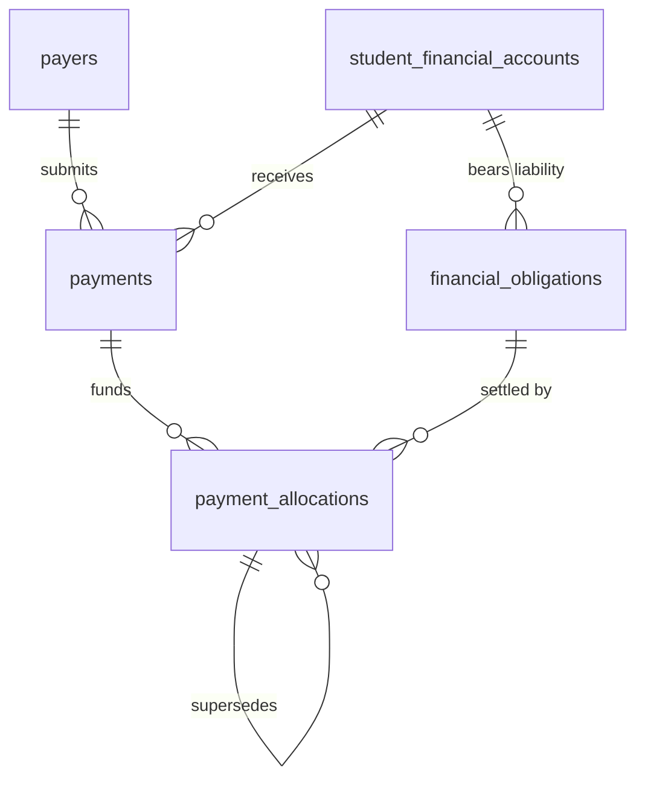

# 1. Overview

This target architecture defines the technical realization for the core submodules of Stage 1 "Payments & Receivables" under the Finance domain:
1. **Payer Management & Payment Receipt / Confirmation (`FIN-WF-05`, `UC-FIN-01`, `UC-FIN-04`)**
2. **Payment Allocation & Reallocation (`FIN-WF-06`, `UC-FIN-05`)**
3. **Enrollment Payment Inquiry Gate (`FIN-WF-13`, `UC-FIN-09`, `GAP-01`)**

It fulfills change request intake `CR-FIN-PAYMENTS-RECEIVABLES` ([`IS007 - FIN-PAYMENTS-RECEIVABLES-ISSUE.md`](file:///d:/Project.Private/elsasa-sis-v3/docs/issues/IS007%20-%20FIN-PAYMENTS-RECEIVABLES-ISSUE.md)) and realizes the approved analysis decisions documented in [`IS007 - FIN-PAYMENTS-RECEIVABLES-FEASIBILITY-ASSESSMENT.md`](file:///d:/Project.Private/elsasa-sis-v3/docs/issues/IS007%20-%20FIN-PAYMENTS-RECEIVABLES-FEASIBILITY-ASSESSMENT.md).

The architecture establishes the cashiering, verification, settlement, and enrollment clearance pipeline for Elsasa School Information System (SIS) V3:

1. **Authoritative Submodule 3 Relational Schema:** Provisioning 3 authoritative relational tables specified in [`finance-entities-tables.md`](file:///d:/Project.Private/elsasa-sis-v3/docs/entities/finance-entities-tables.md) (`finance.payers`, `finance.payments`, `finance.payment_allocations`) and the derived database projection `finance.v_student_receivables`.
2. **Dual Reference Pattern for Pre-Enrollment Candidates (`GAP-001`, `OQ-001`):** Extending `finance.student_financial_accounts`, `finance.financial_obligations`, and `finance.payments` to support both `applicant_id` and `student_id`. This allows accepted admission candidates to hold financial accounts and settle mandatory enrollment obligations prior to official matriculation, automatically graduating upon consumption of `StudentEnrolledEvent`.
3. **Payer Resolution & Deduplication Engine (`GAP-005`, `OQ-002`):** Delivering an explicit `IPayerResolver` service that matches payers by identification number (NIK/NPWP), contact email, or phone number, auto-creating parent/guardian payers on self-service submissions and enabling explicit cashier management of corporate sponsors and foundations.
4. **Dual-Path Payment Intake & Concurrency-Safe Receipting (`OQ-004`):**
   - Self-service portal submissions enter as `submitted` with documentary proof and external bank references.
   - Cashier counter payments (cash, POS EDC, cleared transfer) execute an atomic "Record & Confirm" transition.
   - Confirmed transactions permanently generate sequential, immutable receipt numbers (`REC-{Year}-{Sequence:D6}`) protected by row locks and unique constraints.
5. **Explicit Allocation Engine with Smart Auto-Suggest (`OQ-003`):** Cashier-controlled allocation with 1-click auto-suggest prioritizing mandatory enrollment fees, then outstanding tuition FIFO. Excess funds remain dynamically calculated unallocated credits. Reallocations preserve full historical lineage using replacement records (`status = 'superseded'`, `superseded_by_id`, `reversal_reason`).
6. **Ledger-Backed Enrollment Payment Gate (`GAP-006`, `OQ-005`):** Replacing the stubbed `FinanceModule.IsEnrollmentFeePaidAsync` with a parameterized SQL query that evaluates mandatory enrollment obligation settlement in real time to unblock `STD-WF-03` intake.
7. **Frontend Workspaces & Portal Extensions:** Delivering `SCR-FIN-02: Payment Verification Queue` (`/finance/payments`), extending `SCR-FIN-03: Student Accounts Workbench` with a Payments & Allocations tab, enabling payment submissions and receipt viewing in `SCR-SELF-02: Family Tasks & Requests Portal`, and wiring real-time confirmation into `SCR-STU-01: Student Intake Workbench`.

---

# 2. Architectural Basis

## Business Context

This architecture realizes the business outcomes, operational workflows, and domain rules specified in:

- **DOMAIN BLUEPRINT:** [`finance-domain.md`](file:///d:/Project.Private/elsasa-sis-v3/docs/domains/finance-domain.md)
  - Payment Receipt and Confirmation (lines 185–216)
  - Payment Allocation and Reallocation (lines 218–254)
  - Credit and Overpayment (lines 256–283)
  - Student Financial Account (lines 93–115)
  - Indonesian School Context & Operational Principles (Single currency IDR, zero discretionary spending)
- **ROADMAP & COMPLETION CRITERIA:** [`sub-modul-and-development-phases.md`](file:///d:/Project.Private/elsasa-sis-v3/docs/sub-modul-and-development-phases.md)
  - Stage 1 Module: Payments & Receivables (Core Submodules)
  - Criterion 8: "A payment is received, confirmed, and allocated against an outstanding obligation."
  - Criterion 9: "Enrollment payment confirmation is available to Students when policy requires it."
  - Criterion 10: "All domain events for the above are recorded and historically traceable."
  - Section E: Resolution of `GAP-01` (Enrollment Payment Confirmation Gate).
- **WORKFLOWS & USE CASES:**
  - [`operational-workflow-discovery.md`](file:///d:/Project.Private/elsasa-sis-v3/docs/operational-workflow-discovery.md): `FIN-WF-05: Receive and Confirm Payment`, `FIN-WF-06: Allocate or Reallocate Payment`, `FIN-WF-13: Confirm Enrollment Payment Gate`, `GAP-07: Dual Candidate Reference Precedent`.
  - [`use-cases.md`](file:///d:/Project.Private/elsasa-sis-v3/docs/use-cases.md): `UC-FIN-01: Submit Fee Payment`, `UC-FIN-04: Confirm Payment Receipt`, `UC-FIN-05: Allocate Payment to Obligations`, `UC-FIN-09: Confirm Enrollment Payment Gate`.
  - [`actors.md`](file:///d:/Project.Private/elsasa-sis-v3/docs/actors.md): Finance Officer (`ACT-04`), Finance Authority (`ACT-03`), Parent / Payer.
- **DATA SPECIFICATIONS:**
  - [`finance-entities.md`](file:///d:/Project.Private/elsasa-sis-v3/docs/entities/finance-entities.md): Submodule 3 (Payments & Receivables), Resolved Decisions 4, 5, 6.
  - [`finance-entities-tables.md`](file:///d:/Project.Private/elsasa-sis-v3/docs/entities/finance-entities-tables.md): Submodule 3 tables (`finance.payers`, `finance.payments`, `finance.payment_allocations`, `v_student_receivables`, lines 500–648).
- **SCREEN INVENTORY:** [`screen-inventory.md`](file:///d:/Project.Private/elsasa-sis-v3/docs/screen-inventory.md)
  - `SCR-FIN-02`: Payment Verification Queue (Work Queue pattern)
  - `SCR-FIN-03`: Student Accounts Workbench (Work Queue pattern — Stage 1 extension)
  - `SCR-SELF-02`: Family Tasks & Requests Portal (Work Queue pattern — payment submission & receipt download)
  - `SCR-STU-01`: Student Intake Workbench (Work Queue pattern — payment gate check)

## Analysis Input

This architecture consumes the approved gap closures, risk mitigations, and design decisions recorded in:

- **FEASIBILITY ASSESSMENT:** [`IS007 - FIN-PAYMENTS-RECEIVABLES-FEASIBILITY-ASSESSMENT.md`](file:///d:/Project.Private/elsasa-sis-v3/docs/issues/IS007%20-%20FIN-PAYMENTS-RECEIVABLES-FEASIBILITY-ASSESSMENT.md)
  - `GAP-001 / OQ-001`: Dual Reference Pattern for pre-enrollment candidate accounts.
  - `GAP-005 / OQ-002`: Auto-match and on-demand payer resolution.
  - `OQ-004`: Dual-path payment submission and atomic counter confirmation with sequential receipting.
  - `OQ-003`: Explicit allocation with smart auto-suggest and append-only reallocation lineage.
  - `GAP-006 / OQ-005`: Mandatory obligation settlement check for enrollment gate.
  - Planning Readiness: Granted `READY-FOR-PLANNING`.

```text
DOMAIN (finance-domain.md) + FEATURE (use-cases.md, screen-inventory.md)
                            +
        FEASIBILITY-ASSESSMENT (CR-FIN-PAYMENTS-RECEIVABLES)
                            ↓
         TARGET ARCHITECTURE (FIN-PAYMENTS-RECEIVABLES)
```

---

# 3. Scope

## Included

1. **Database Schema & Migrations (`Elsasa.Sis.Database`):**
   - Migration script `20261104_0301_Finance_PaymentsReceivables_Tables.sql` targeting Microsoft SQL Server 2022 ([`ADR-002`](file:///d:/Project.Private/elsasa-sis-v3/docs/architecture/adr.md#L50-L75), [`ADR-006`](file:///d:/Project.Private/elsasa-sis-v3/docs/architecture/adr.md#L152-L176)).
   - **Schema Adjustments for Pre-Enrollment Candidates (`GAP-001`, `OQ-001`):**
     - Modify `finance.student_financial_accounts` to make `student_id` nullable, add `applicant_id UNIQUEIDENTIFIER NULL`, drop existing single-column unique index `uq_finance_student_financial_accounts_student`, add filtered unique indexes on `student_id` and `applicant_id`, and add table constraint:
       `CHECK (student_id IS NOT NULL OR applicant_id IS NOT NULL)`.
     - Modify `finance.financial_obligations` to make `student_id` nullable, add `applicant_id UNIQUEIDENTIFIER NULL`, and add table constraint:
       `CHECK (student_id IS NOT NULL OR applicant_id IS NOT NULL)`.
   - **New Submodule 3 Tables:**
     - `finance.payers`: Shared entity representing legal payers (parents, sponsors, embassies, foundations) with contact and refund bank details.
     - `finance.payments`: Transactional payment records tracking gross amounts (`BIGINT` IDR), payment methods, external references, proof attachment references, confirmation status (`submitted`, `confirmed`, `rejected`, `reversed`), cashier verifier, and official receipt numbers (`REC-{Year}-{Sequence:D6}`).
     - `finance.payment_allocations`: Authoritative allocation records applying payment funds to specific obligations, tracking `status` (`active`, `superseded`, `reversed`), replacement pointer `superseded_by_id`, and audit `reversal_reason`.
   - **Derived Database Projection:**
     - `finance.v_student_receivables`: Dynamic SQL Server view computing net obligation liability, confirmed paid allocations, remaining outstanding amounts, overdue flags, elapsed overdue days, and aging brackets directly from `financial_obligations` and `payment_allocations`.

2. **Backend Domain Architecture & Vertical Slices (`Elsasa.Sis.Finance`):**
   - **Domain Permission Constants:** Extension of `Permissions.cs` with `Permissions.Finance.Payments` and `Permissions.Finance.Allocations`.
   - **Lifecycle Account Graduation Handler:** Update `StudentEnrolledEventHandler.cs` to check if a financial account already exists for `notification.ApplicantId`; if found, update `student_id = @StudentId` and preserve `applicant_id`. If not found, provision a new account.
   - **Enrollment Payment Gate Contract Implementation:** Replace the stubbed `FinanceModule.IsEnrollmentFeePaidAsync` with a real-time parameterized ledger query in `Elsasa.Sis.Finance/Services/FinanceModule.cs`.
   - **Payer Resolution Service:** Internal service `IPayerResolver` (`Services/PayerResolver.cs`) executing atomic lookup/deduplication on NIK, email, or phone, auto-creating a `parent_guardian` payer if not found.
   - **Vertical Slices — Payers (`Features/Payers/`):**
     - `GetPayers` (`GET /api/finance/payers`): Search and paginate payers for autocomplete or cashier selection.
     - `CreatePayer` (`POST /api/finance/payers`): Register an explicit corporate sponsor, embassy, or guardian.
     - `GetPayerById` (`GET /api/finance/payers/{id}`): Inspect payer details and associated payment history.
   - **Vertical Slices — Payments (`Features/Payments/`):**
     - `SubmitPayment` (`POST /api/finance/payments/submit`): Self-service payment submission (`SCR-SELF-02`, `UC-FIN-01`) creating a payment in `submitted` status without a receipt number.
     - `RecordAndConfirmPayment` (`POST /api/finance/payments`): Cashier counter payment recording (`SCR-FIN-02`, `UC-FIN-04`) atomically creating a payment in `confirmed` status, generating an official `receipt_number`, and publishing `PaymentConfirmedEvent`.
     - `ConfirmPayment` (`POST /api/finance/payments/{id}/confirm`): Cashier review verification transitioning a `submitted` payment to `confirmed`, assigning an official receipt number, and publishing `PaymentConfirmedEvent`.
     - `RejectPayment` (`POST /api/finance/payments/{id}/reject`): Cashier rejection of invalid portal submission with mandatory `rejection_reason`.
     - `GetPayments` (`GET /api/finance/payments`): Paginated verification queue and transaction history (`status`, `dateRange`, `studentId`, `payerId`).
     - `GetPaymentById` (`GET /api/finance/payments/{id}`): Detailed payment inspection including allocation breakdown and receipt details.
     - `GetPaymentReceipt` (`GET /api/finance/payments/{id}/receipt`): Structured receipt voucher projection for printing or PDF rendering.
   - **Vertical Slices — Allocations (`Features/Allocations/`):**
     - `SuggestAllocations` (`GET /api/finance/allocations/suggest`): Computes rule-based distribution recommendation for a given payment amount against a student's open obligations.
     - `AllocatePayment` (`POST /api/finance/allocations`): Atomically allocates confirmed payment value across one or more obligations, enforcing concurrency locks (`UPDLOCK, HOLDLOCK`) and mathematical check assertions.
     - `ReallocatePayment` (`POST /api/finance/allocations/reallocate`): Corrects an erroneous allocation by marking existing rows as `superseded` (`superseded_by_id = @NewAllocationId`) with mandatory `reversal_reason` and creating replacement allocation rows.
     - `GetStudentReceivables` (`GET /api/finance/accounts/{studentId}/receivables`): Queries `finance.v_student_receivables` for a given student or applicant.

3. **Cross-Domain Contracts & Domain Events (`Elsasa.Sis.Contracts`):**
   - Update `PaymentConfirmedEvent` in `Elsasa.Sis.Contracts.Finance.Events` to carry `PaymentId`, `StudentId?`, `ApplicantId?`, `Amount` (`long`), `ReceiptNumber`, and `OccurredOn`.
   - Publish `PaymentConfirmedEvent` strictly post-commit via MediatR `IPublisher` ([`ADR-003`](file:///d:/Project.Private/elsasa-sis-v3/docs/architecture/adr.md#L76-L98)).
   - Verify unblocking integration with `EnrollAcceptedApplicantHandler.cs` in Students domain.

4. **Frontend Workspaces & Client Integration (`src/frontend`):**
   - **`SCR-FIN-02` Payment Verification Queue (`/finance/payments`):**
     - `PaymentVerificationQueueView.vue`: Master worklist filtering submitted portal payments, confirmed counter transactions, and rejected items; quick-action verification drawer; record-payment modal for walk-in cashiering; allocation modal; and rejection dialog.
   - **`SCR-FIN-03` Student Accounts Workbench Extension:**
     - Add `PaymentsHistoryTable.vue` and `AllocationsTable.vue` to `StudentAccountsWorkbenchView.vue` tabs, enabling Finance Officers to inspect payment receipts, allocation breakdowns, and trigger reallocations.
   - **`SCR-SELF-02` Family Tasks & Requests Portal Extension:**
     - Enhance `FamilyBillingTab.vue` to support "Pay Now / Submit Payment" modal (`SubmitPaymentModal.vue`) and "Download Receipt" action for confirmed payments.
   - **`SCR-STU-01` Student Intake Workbench Integration:**
     - Enhance `EnrollApplicantModal.vue` to check real-time `IsEnrollmentFeePaidAsync` status when opening the enrollment dialog, showing a green verified badge when settled or prompting for waiver override.

## Excluded

1. **Receivables Aging Reminders & Escalations (Stage 2):** Automated dunning letters, scheduled SMS/WhatsApp reminders (`overdue_reminders`), and penalty assessments belong to Stage 2 (`SCR-FIN-05`).
2. **Formal Payment Arrangements (Stage 2):** Installment debt restructuring agreements (`payment_arrangements`, `arrangement_installments`) belong to Stage 2 (`FIN-WF-07`).
3. **Benefits, Scholarships, and Fee Reductions (Stage 2):** Merit/need scholarships and sibling discounts (`scholarship_awards`, `obligation_benefits`) belong to Stage 2 (`FIN-WF-03`).
4. **Credit Transfers & Sibling Overpayment Balances (Stage 2):** Inter-account credit transfers (`credit_transfers`) and dedicated `credit_balances` ledgers belong to Stage 2 (`FIN-WF-09`).
5. **Refund Processing & Financial Adjustments (Stage 2 & 3):** Physical bank payout processing, dispute handling, and credit memos belong to Stage 2/3 (`FIN-WF-08`, `FIN-WF-10`).
6. **Live Payment Gateway Webhooks:** Direct integrations with external payment gateways (Midtrans, Xendit, BCA Snap API) are excluded; standard manual/semi-automated verification against bank references satisfies Stage 1 cashiering requirements.

---

# 4. Technical Decisions

## TD-01: Submodule 3 Relational Persistence Schema & Storage Layout

- **Decision:** Provision the three authoritative Submodule 3 tables (`finance.payers`, `finance.payments`, `finance.payment_allocations`) and the derived projection `finance.v_student_receivables` in migration script `20261104_0301_Finance_PaymentsReceivables_Tables.sql` targeting Microsoft SQL Server 2022 ([`ADR-002`](file:///d:/Project.Private/elsasa-sis-v3/docs/architecture/adr.md#L50-L75), [`ADR-006`](file:///d:/Project.Private/elsasa-sis-v3/docs/architecture/adr.md#L152-L176), GAP-002).
- **Realization:**
  - Table 1: `finance.payers` (shared legal entity for receipts and refund routing).
  - Table 2: `finance.payments` (monetary intake records with dual submission/confirmation lifecycle).
  - Table 3: `finance.payment_allocations` (immutable application of payments to obligations with lineage).
  - View 1: `finance.v_student_receivables` (dynamic real-time calculation of net obligations, total paid, outstanding liabilities, and aging classifications).
  - All monetary columns standardize on `BIGINT NOT NULL` (integer IDR) and `currency_code VARCHAR(3) NOT NULL DEFAULT 'IDR'`.
  - Primary keys standardize on `UNIQUEIDENTIFIER NOT NULL`. Audit timestamps use `DATETIMEOFFSET(7) NOT NULL DEFAULT (SYSUTCDATETIME())`.

## TD-02: Dual Reference Pattern for Pre-Enrollment Accounts (`GAP-001`, `OQ-001`)

- **Decision:** Adopt the proven `GAP-07` Dual Reference Pattern to allow financial accounts, obligations, and payments to be anchored to accepted admission applicants before matriculation, graduating seamlessly upon enrollment (`GAP-001`, `OQ-001`).
- **Realization:**
  - **Schema Evolution for Existing Tables:**
    - In `finance.student_financial_accounts`:
      - Alter `student_id` to `UNIQUEIDENTIFIER NULL`.
      - Add column `[applicant_id] UNIQUEIDENTIFIER NULL`.
      - Drop legacy unique constraint `uq_finance_student_financial_accounts_student`.
      - Create filtered unique index on `student_id`:
        ```sql
        CREATE UNIQUE NONCLUSTERED INDEX [ux_finance_student_accounts_student_id]
            ON [finance].[student_financial_accounts] ([student_id])
            WHERE [student_id] IS NOT NULL;
        ```
      - Create filtered unique index on `applicant_id`:
        ```sql
        CREATE UNIQUE NONCLUSTERED INDEX [ux_finance_student_accounts_applicant_id]
            ON [finance].[student_financial_accounts] ([applicant_id])
            WHERE [applicant_id] IS NOT NULL;
        ```
      - Add table check constraint:
        ```sql
        ALTER TABLE [finance].[student_financial_accounts]
            ADD CONSTRAINT [ck_finance_student_accounts_candidate]
            CHECK ([student_id] IS NOT NULL OR [applicant_id] IS NOT NULL);
        ```
    - In `finance.financial_obligations`:
      - Alter `student_id` to `UNIQUEIDENTIFIER NULL`.
      - Add column `[applicant_id] UNIQUEIDENTIFIER NULL`.
      - Add table check constraint:
        ```sql
        ALTER TABLE [finance].[financial_obligations]
            ADD CONSTRAINT [ck_finance_obligations_candidate]
            CHECK ([student_id] IS NOT NULL OR [applicant_id] IS NOT NULL);
        ```
  - **Account Graduation Lifecycle:**
    - When `StudentEnrolledEvent` fires upon enrollment (`STD-WF-03`), `StudentEnrolledEventHandler.cs` checks if an account exists where `applicant_id = @ApplicantId`.
    - If found, it executes:
      ```sql
      UPDATE [finance].[student_financial_accounts]
      SET [student_id] = @StudentId,
          [updated_at] = SYSUTCDATETIME(),
          [updated_by] = 'SYSTEM_ENROLLMENT'
      WHERE [applicant_id] = @ApplicantId AND [student_id] IS NULL;
      ```
      and updates associated obligations and payments setting `student_id = @StudentId`.
    - If no existing account is found, it inserts a new account for `@StudentId` as before.

## TD-03: Auto-Match & On-Demand Payer Resolution (`GAP-005`, `OQ-002`)

- **Decision:** Eliminate cashier friction and prevent payer duplication by implementing an internal `IPayerResolver` service that matches existing payers on NIK/NPWP, email, or phone, auto-creating a `parent_guardian` payer if no match exists (`GAP-005`, `OQ-002`).
- **Realization:**
  - **Contract:**
    ```csharp
    namespace Elsasa.Sis.Finance.Services;

    public interface IPayerResolver
    {
        Task<Guid> ResolveOrCreatePayerAsync(
            string payerName,
            string? identificationNumber,
            string? email,
            string? phone,
            string? payerType,
            CancellationToken ct);
    }
    ```
  - **Resolution Algorithm:**
    1. If `identificationNumber` is non-empty, query `finance.payers` for an exact match.
    2. Else if `email` is non-empty, query `finance.payers` for an exact match.
    3. Else if `phone` is non-empty, query `finance.payers` for an exact match.
    4. If a matching payer is found, return `matchingPayerId`.
    5. If no match is found, insert a new payer:
       - Generate `payer_number`: `PYR-{DateTime.UtcNow:yyyy}-{Sequence:D4}`.
       - Set `payer_type`: specified type or fallback `'parent_guardian'`.
       - Return newly generated `payer_id`.
  - Finance Officers in `SCR-FIN-02` can also directly create and edit explicit payers (corporate sponsors, foundations, embassies) using `CreatePayerEndpoint`.

## TD-04: Dual-Path Payment Intake & Sequential Receipt Voucher Generation (`OQ-004`)

- **Decision:** Implement dual intake paths (self-service submission vs walk-in counter recording) with atomic confirmation for cashiering and concurrency-safe sequential receipt vouchers (`OQ-004`).
- **Realization:**
  - **Path 1: Self-Service Submission (`SubmitPayment` / `SCR-SELF-02`):**
    - Payer submits payment details with payment method, external reference (bank transfer code), and optional document upload.
    - Initial state: `confirmation_status = 'submitted'`, `receipt_number = NULL`.
    - Enters the `SCR-FIN-02` verification queue.
  - **Path 2: Cashier Counter Recording (`RecordAndConfirmPayment` / `SCR-FIN-02`):**
    - Finance Officer accepts physical cash, runs a POS card, or verifies a bank statement clearance.
    - Status immediately transitions to `confirmed` in a single atomic transaction.
    - Generates sequential receipt code `REC-{Year}-{Sequence:D6}` and publishes `PaymentConfirmedEvent`.
  - **Path 3: Verification Queue Confirmation (`ConfirmPayment` / `SCR-FIN-02`):**
    - Cashier verifies an unconfirmed submission against bank records and clicks "Confirm".
    - Status transitions from `submitted` to `confirmed`, assigns `receipt_number`, and publishes `PaymentConfirmedEvent`.
  - **Path 4: Queue Rejection (`RejectPayment` / `SCR-FIN-02`):**
    - Cashier rejects unverified submission, setting `confirmation_status = 'rejected'` with mandatory `rejection_reason`.
  - **Sequential Receipt Numbering Engine:**
    - To guarantee zero gaps and zero duplicate receipt numbers during concurrent cashier operations, receipt sequences are generated inside the transaction using transactional locking:
      ```sql
      DECLARE @NextSeq INT;
      SELECT @NextSeq = ISNULL(MAX(TRY_CAST(RIGHT(receipt_number, 6) AS INT)), 0) + 1
      FROM finance.payments WITH (UPDLOCK, HOLDLOCK)
      WHERE receipt_number LIKE CONCAT('REC-', @CurrentYear, '-%');

      SET @ReceiptNumber = CONCAT('REC-', @CurrentYear, '-', RIGHT('000000' + CAST(@NextSeq AS VARCHAR(6)), 6));
      ```
    - Backed by an explicit database unique index:
      `UNIQUE NONCLUSTERED ([receipt_number]) WHERE [receipt_number] IS NOT NULL`.

## TD-05: Explicit Allocation Engine with Auto-Suggest & Append-Only Reallocation (`OQ-003`)

- **Decision:** Enforce human-in-the-loop explicit allocation with smart auto-suggest prioritizing mandatory fees and oldest debt, dynamic excess fund calculation, and append-only auditable reallocations (`OQ-003`).
- **Realization:**
  - **Auto-Suggest Query (`SuggestAllocations`):**
    - Evaluates student's open obligations from `finance.v_student_receivables` where `outstanding_amount > 0`.
    - Sorts obligations by policy priority:
      1. Mandatory admission/enrollment obligations (`charge_type IN ('enrollment_fee', 'admission_fee') AND is_mandatory = 1`).
      2. Outstanding mandatory obligations ordered by `due_date ASC` (FIFO).
      3. Non-mandatory or future obligations ordered by `due_date ASC`.
    - Simulates distribution of available payment funds across the sorted list and returns suggested line allocations with remaining unallocated balance.
  - **Atomic Commit (`AllocatePayment`):**
    - Acquires row-level locks on `finance.payments` and targeted `finance.financial_obligations` (`UPDLOCK, HOLDLOCK`).
    - Validates invariants:
      1. Target payment must have `confirmation_status = 'confirmed'`.
      2. Sum of existing active allocations + requested allocations must not exceed `payment_amount`.
      3. Allocated amount per obligation must not exceed the obligation's remaining `outstanding_amount`.
    - Inserts records into `finance.payment_allocations` with `status = 'active'`.
    - If an obligation's `outstanding_amount` becomes 0, updates `financial_obligations.status = 'settled'`.
  - **Dynamic Excess / Unallocated Funds:**
    - Unallocated amount on a payment is dynamically computed as:
      `payment_amount - ISNULL((SELECT SUM(allocated_amount) FROM finance.payment_allocations WHERE payment_id = p.id AND status = 'active'), 0)`.
    - Excess funds remain attached to the payment and account for future allocations without requiring Stage 2 credit ledger tables.
  - **Append-Only Reallocation Lineage (`ReallocatePayment`):**
    - Correcting an allocation never mutates or deletes historical rows.
    - The existing active allocation is marked `status = 'superseded'`, `superseded_by_id = @NewAllocationId`, and `reversal_reason = @Reason`.
    - A new replacement allocation row is inserted with `status = 'active'`.
    - If an allocation is cancelled without replacement, status becomes `reversed`.

## TD-06: Ledger-Backed Mandatory Obligation Settlement Check (`GAP-006`, `OQ-005`)

- **Decision:** Replace the stubbed `IFinanceModule.IsEnrollmentFeePaidAsync` in `Elsasa.Sis.Finance/Services/FinanceModule.cs` with an authoritative SQL query verifying mandatory enrollment obligation settlement (`GAP-006`, `OQ-005`).
- **Realization:**
  ```csharp
  public async Task<Result<bool>> IsEnrollmentFeePaidAsync(
      Guid applicantId,
      Guid academicYearId,
      CancellationToken ct = default)
  {
      await using var connection = (SqlConnection)await connectionFactory.CreateConnectionAsync(ct);

      const string checkSql = """
          -- 1. Find all active mandatory enrollment obligations for this applicant/student
          SELECT 
              fo.id,
              fo.original_amount,
              ISNULL(SUM(CASE WHEN pa.status = 'active' THEN pa.allocated_amount ELSE 0 END), 0) AS total_allocated
          FROM finance.financial_obligations fo
          LEFT JOIN finance.payment_allocations pa ON pa.obligation_id = fo.id
          LEFT JOIN operations.operational_periods op ON op.id = fo.academic_period_id
          WHERE (fo.applicant_id = @ApplicantId OR fo.student_id = (SELECT id FROM students.students WHERE applicant_id = @ApplicantId))
            AND fo.charge_type IN ('enrollment_fee', 'admission_fee')
            AND fo.is_mandatory = 1
            AND fo.status NOT IN ('cancelled')
            AND (fo.academic_period_id = @AcademicYearId OR op.academic_year_id = @AcademicYearId)
          GROUP BY fo.id, fo.original_amount;
          """;

      var obligations = (await connection.QueryAsync<(Guid Id, long OriginalAmount, long TotalAllocated)>(
          new CommandDefinition(checkSql, new { ApplicantId = applicantId, AcademicYearId = academicYearId }, cancellationToken: ct))).ToList();

      // Case 1: No mandatory enrollment obligations assessed -> no gate block required
      if (obligations.Count == 0)
      {
          return Result.Success(true);
      }

      // Case 2: Return true if and only if EVERY mandatory enrollment obligation is 100% settled
      var allSettled = obligations.All(o => o.TotalAllocated >= o.OriginalAmount);

      return Result.Success(allSettled);
  }
  ```
  - This query evaluates both pre-enrollment accounts (`applicant_id`) and post-enrollment accounts (`student_id`), unblocking `STD-WF-03` intake immediately upon payment allocation in `SCR-FIN-02`.

## TD-07: Permissions Hierarchy & Separation of Duties (ADR-009)

- **Decision:** Formalize domain permission constants in `Elsasa.Sis.Finance/Permissions.cs` enforcing strict separation between cashier operations (`Finance Officer`) and policy/waiver governance (`Finance Authority` / Leadership) (GAP-008, Actors Resolution 3.1 & 3.2).
- **Realization:**
  ```csharp
  namespace Elsasa.Sis.Finance;

  public static class Permissions
  {
      // Existing Policies, Obligations, Billing, Accounts...

      public static class Payments
      {
          public const string View = "Permissions.Finance.Payments.View";
          public const string Record = "Permissions.Finance.Payments.Record";
          public const string Confirm = "Permissions.Finance.Payments.Confirm";
          public const string Reject = "Permissions.Finance.Payments.Reject";
      }

      public static class Allocations
      {
          public const string View = "Permissions.Finance.Allocations.View";
          public const string Execute = "Permissions.Finance.Allocations.Execute";
          public const string Reallocate = "Permissions.Finance.Allocations.Reallocate";
      }

      public static class Payers
      {
          public const string View = "Permissions.Finance.Payers.View";
          public const string Manage = "Permissions.Finance.Payers.Manage";
      }
  }
  ```
  - `Finance Officer` possesses all `Payments.*`, `Allocations.*`, and `Payers.*` permissions to manage routine counter cashiering, queue triage, and allocation adjustments.
  - `Finance Authority` possesses full administrative oversight and executes formal financial adjustments and waivers.

## TD-08: Frontend Workspaces & Client Integration Architecture (`SCR-FIN-02`, `SCR-FIN-03`)

- **Decision:** Deliver a dedicated `payments` feature module under `src/frontend/src/features/finance/payments/` realizing `SCR-FIN-02`, and seamlessly extend `SCR-FIN-03`, `SCR-SELF-02`, and `SCR-STU-01` without architectural coupling.
- **Realization:**
  - **Directory Structure:**
    ```
    src/frontend/src/features/finance/
    ├── payments/                     # SCR-FIN-02: Payment Verification Queue
    │   ├── api/payments.api.ts
    │   ├── components/
    │   │   ├── RecordPaymentModal.vue       # Cashier counter intake dialog
    │   │   ├── ConfirmPaymentModal.vue      # Queue verification dialog
    │   │   ├── RejectPaymentModal.vue       # Queue rejection dialog
    │   │   ├── AllocatePaymentModal.vue     # Allocation & auto-suggest modal
    │   │   ├── ReallocatePaymentModal.vue   # Correction & reallocation dialog
    │   │   └── ReceiptVoucherViewer.vue     # Receipt print / view dialog
    │   ├── composables/useFinancePayments.ts
    │   ├── schemas/payments.schema.ts
    │   ├── types/payments.types.ts
    │   └── views/PaymentVerificationQueueView.vue
    ├── payers/                       # Shared Payer lookup & creation
    │   ├── api/payers.api.ts
    │   ├── components/CreatePayerModal.vue
    │   ├── composables/useFinancePayers.ts
    │   └── types/payers.types.ts
    ├── accounts/                     # SCR-FIN-03: Extension
    │   └── components/
    │       ├── PaymentsHistoryTable.vue     # Student account payment receipts
    │       └── AllocationsTable.vue         # Student account active allocations
    ```
  - **Route Configuration (`src/frontend/src/app/router/routes.ts`):**
    - `/finance/payments` &rarr; `PaymentVerificationQueueView.vue` (meta: `permission: Permissions.Finance.Payments.View`)
  - **Portal Extension (`FamilyBillingTab.vue`):**
    - Implement the existing `payNow` event by opening `SubmitPaymentModal.vue`, capturing transfer evidence and banking reference.
    - Add "Download / View Receipt" button next to settled billing items.
  - **Enrollment Modal Integration (`EnrollApplicantModal.vue`):**
    - In `SCR-STU-01`, trigger real-time check of `IsEnrollmentFeePaidAsync` when selecting an accepted applicant, displaying clearance status to the admission officer.

---

# 5. Component Responsibilities

| Component | Assembly / Path | Primary Responsibility |
|---|---|---|
| **Database Migration Runner** | `Elsasa.Sis.Database/Scripts/20261104_0301...` | Alters `student_financial_accounts` and `financial_obligations` to support `applicant_id` dual reference, provisions `payers`, `payments`, `payment_allocations`, and view `v_student_receivables`. |
| **Permissions Definition** | `Elsasa.Sis.Finance/Permissions.cs` | Declares authoritative permission string constants for Finance payments, allocations, and payers. |
| **Payer Resolution Service** | `Elsasa.Sis.Finance/Services/PayerResolver.cs` | Internal service implementing `IPayerResolver` to auto-match and provision payer records across identification, email, and phone. |
| **Student Enrolled Event Handler** | `Elsasa.Sis.Finance/Features/Accounts/Events/StudentEnrolledEventHandler.cs` | Listens to `StudentEnrolledEvent`; updates existing account with `student_id = @StudentId` if pre-provisioned via `applicant_id`, or inserts a new account. |
| **Enrollment Fee Inquiry Service** | `Elsasa.Sis.Finance/Services/FinanceModule.cs` | Implements `IFinanceModule.IsEnrollmentFeePaidAsync` executing parameterized T-SQL check against mandatory enrollment obligations and allocations. |
| **Payer Management Slices** | `Elsasa.Sis.Finance/Features/Payers/` | Minimal API endpoints and handlers for `GetPayers`, `CreatePayer`, and `GetPayerById`. |
| **Payment Intake & Queue Slices** | `Elsasa.Sis.Finance/Features/Payments/` | Minimal API endpoints and handlers for `SubmitPayment`, `RecordAndConfirmPayment`, `ConfirmPayment`, `RejectPayment`, `GetPayments`, `GetPaymentById`, and `GetPaymentReceipt`. |
| **Allocation & Reallocation Slices** | `Elsasa.Sis.Finance/Features/Allocations/` | Minimal API endpoints and handlers for `SuggestAllocations`, `AllocatePayment`, `ReallocatePayment`, and `GetStudentReceivables`. |
| **Payment Queue UI (`SCR-FIN-02`)** | `src/frontend/.../features/finance/payments/` | Delivers `SCR-FIN-02` for Finance Officers to triage submitted payments, record walk-in counter cash/card, confirm receipts, and allocate funds. |
| **Student Accounts Workbench UI (`SCR-FIN-03`)**| `src/frontend/.../features/finance/accounts/` | Extends `SCR-FIN-03` with dedicated Payments and Allocations tabs, displaying receipt history and reallocation actions. |
| **Family Portal Payment Intake (`SCR-SELF-02`)**| `src/frontend/.../features/portal/FamilyBillingTab.vue` | Enables parents/payers to submit bank transfer details and download confirmed official receipt vouchers. |
| **Enrollment Intake Modal (`SCR-STU-01`)** | `src/frontend/.../admission/components/EnrollApplicantModal.vue`| Reflects real-time payment clearance gate from Finance to unblock applicant enrollment. |

---

# 6. Integration Design

| Source Component | Target Component | Interaction Type | Purpose & Boundary Constraints |
|---|---|---|---|
| **Students: EnrollAcceptedApplicantHandler** | **Finance: IFinanceModule.IsEnrollmentFeePaidAsync** | Synchronous In-Process Contract Call ([`ADR-003`](file:///d:/Project.Private/elsasa-sis-v3/docs/architecture/adr.md#L76-L98)) | Query gate evaluating whether mandatory enrollment fees are settled before proceeding with enrollment intake (`FIN-WF-13`, `GAP-01`). |
| **Students: EnrollAcceptedApplicant** | **Contracts: StudentEnrolledEvent** | Asynchronous Domain Event (MediatR) | Emitted post-commit upon successful student matriculation (`STD-WF-03`). |
| **Contracts: StudentEnrolledEvent** | **Finance: StudentEnrolledEventHandler** | In-Process Event Consumer | Idempotently graduates pre-enrollment account (`applicant_id`) by updating `student_id = @StudentId` ([`ADR-003`](file:///d:/Project.Private/elsasa-sis-v3/docs/architecture/adr.md#L76-L98)). |
| **Finance: RecordAndConfirmPayment / ConfirmPayment** | **Contracts: PaymentConfirmedEvent** | Asynchronous Domain Event (MediatR) | Emitted strictly post-commit to notify downstream listeners and audit systems of confirmed monetary intake. |
| **Finance: AllocatePayment / SuggestAllocations** | **finance.financial_obligations & finance.v_student_receivables** | Intra-Schema SQL Transaction | Queries outstanding amounts and attaches line-item allocations with pessimistic concurrency locks (`UPDLOCK, HOLDLOCK`). |
| **Finance: PayerResolver** | **finance.payers** | Intra-Schema SQL Query/Insert | Deduplicates payer identities across contact parameters without crossing domain boundaries. |
| **Frontend Workspaces (`SCR-FIN-02`, `SCR-FIN-03`, `SCR-SELF-02`)** | **Elsasa.Sis.Api (Finance Endpoints)** | REST HTTPS (JSON) | Minimal API calls authenticated via JWT Bearer tokens, validated via Zod/VeeValidate, mapped via `Result<T>` ProblemDetails ([`ADR-004`](file:///d:/Project.Private/elsasa-sis-v3/docs/architecture/adr.md#L100-L124), [`ADR-009`](file:///d:/Project.Private/elsasa-sis-v3/docs/architecture/adr.md#L228-L252)). |

---

# 7. Data Ownership

| Data Entity | Authoritative Owner | Bounded Context Access Rules |
|---|---|---|
| `finance.payers` | **Finance Domain** | Owned exclusively by Finance. Created automatically or maintained by Finance Officer. Read-only to other domains. |
| `finance.payments` | **Finance Domain** | Owned exclusively by Finance. Represents monetary receipts in IDR. Mutable only through explicit confirmation/reversal slices. |
| `finance.payment_allocations` | **Finance Domain** | Owned exclusively by Finance. Authoritative settlement of obligations. Append-only lineage (`superseded_by_id`). |
| `finance.v_student_receivables` | **Finance Domain** | Derived database view owned by Finance. Computes real-time aging and balances from obligations and allocations. |
| `finance.student_financial_accounts` | **Finance Domain** | Owned exclusively by Finance. Anchored to `applicant_id` and/or `student_id`. Read-only to other domains. |
| `finance.financial_obligations` | **Finance Domain** | Owned exclusively by Finance. Status updated to `'settled'` when allocations equal or exceed net liability. |
| `students.applicants` | **Student Domain** | Authoritative applicant identity. Finance holds logical UUID reference (`applicant_id`); **zero writes** from Finance. |
| `students.students` | **Student Domain** | Authoritative enrolled student identity. Finance holds logical UUID reference (`student_id`); **zero writes** from Finance. |

---

# 8. Database Design

## 8.1 New Tables

### Table 1: `finance.payers`
```sql
CREATE TABLE [finance].[payers] (
    [id]                    UNIQUEIDENTIFIER  NOT NULL,
    [payer_number]          NVARCHAR(64)      NOT NULL,
    [payer_name]            NVARCHAR(200)     NOT NULL,
    [payer_type]            NVARCHAR(64)      NOT NULL CONSTRAINT [df_payers_type] DEFAULT ('parent_guardian'),
    [identification_number] NVARCHAR(64)      NULL, -- NIK, NPWP, or corporate registration number
    [email]                 NVARCHAR(200)     NULL,
    [phone_number]          NVARCHAR(50)      NULL,
    [billing_address]       NVARCHAR(MAX)     NULL,
    [bank_account_name]     NVARCHAR(200)     NULL,
    [bank_account_number]   NVARCHAR(100)     NULL,
    [bank_name]             NVARCHAR(100)     NULL,
    [notes]                 NVARCHAR(MAX)     NULL,
    [created_at]            DATETIMEOFFSET(7) NOT NULL CONSTRAINT [df_payers_created_at] DEFAULT (SYSUTCDATETIME()),
    [created_by]            NVARCHAR(100)     NULL,
    [updated_at]            DATETIMEOFFSET(7) NULL,
    [updated_by]            NVARCHAR(100)     NULL,
    CONSTRAINT [pk_finance_payers] PRIMARY KEY CLUSTERED ([id]),
    CONSTRAINT [uq_finance_payers_number] UNIQUE NONCLUSTERED ([payer_number])
);

CREATE NONCLUSTERED INDEX [ix_finance_payers_identification]
    ON [finance].[payers] ([identification_number])
    WHERE [identification_number] IS NOT NULL;

CREATE NONCLUSTERED INDEX [ix_finance_payers_contact]
    ON [finance].[payers] ([email], [phone_number]);
```

### Table 2: `finance.payments`
```sql
CREATE TABLE [finance].[payments] (
    [id]                  UNIQUEIDENTIFIER  NOT NULL,
    [payment_number]      NVARCHAR(64)      NOT NULL,
    [student_account_id]  UNIQUEIDENTIFIER  NOT NULL,
    [student_id]          UNIQUEIDENTIFIER  NULL,
    [applicant_id]        UNIQUEIDENTIFIER  NULL,
    [payer_id]            UNIQUEIDENTIFIER  NOT NULL,
    [payment_amount]      BIGINT            NOT NULL, -- Gross received amount in IDR
    [currency_code]       VARCHAR(3)        NOT NULL CONSTRAINT [df_payments_currency] DEFAULT ('IDR'),
    [payment_method]      NVARCHAR(64)      NOT NULL, -- 'bank_transfer', 'cash', 'pos_card', 'qris', 'virtual_account', 'cheque', 'other'
    [external_reference]  NVARCHAR(100)     NULL,     -- Bank transaction reference or slip number
    [payment_date]        DATE              NOT NULL,
    [submission_date]     DATETIMEOFFSET(7) NOT NULL CONSTRAINT [df_payments_submission_date] DEFAULT (SYSUTCDATETIME()),
    [confirmation_status] NVARCHAR(32)      NOT NULL CONSTRAINT [df_payments_status] DEFAULT ('submitted'), -- 'submitted', 'confirmed', 'rejected', 'reversed'
    [confirmation_date]   DATETIMEOFFSET(7) NULL,
    [confirmed_by]        NVARCHAR(100)     NULL,
    [receipt_number]      NVARCHAR(64)      NULL,     -- Official sequential receipt voucher (e.g. REC-2026-000108)
    [receipt_issued_at]   DATETIMEOFFSET(7) NULL,
    [rejection_reason]    NVARCHAR(MAX)     NULL,
    [notes]               NVARCHAR(MAX)     NULL,
    [created_at]          DATETIMEOFFSET(7) NOT NULL CONSTRAINT [df_payments_created_at] DEFAULT (SYSUTCDATETIME()),
    [created_by]          NVARCHAR(100)     NULL,
    [updated_at]          DATETIMEOFFSET(7) NULL,
    [updated_by]          NVARCHAR(100)     NULL,
    CONSTRAINT [pk_finance_payments] PRIMARY KEY CLUSTERED ([id]),
    CONSTRAINT [uq_finance_payments_number] UNIQUE NONCLUSTERED ([payment_number]),
    CONSTRAINT [uq_finance_payments_receipt_number] UNIQUE NONCLUSTERED ([receipt_number]) WHERE [receipt_number] IS NOT NULL,
    CONSTRAINT [fk_finance_payments_account] FOREIGN KEY ([student_account_id])
        REFERENCES [finance].[student_financial_accounts] ([id]) ON DELETE NO ACTION,
    CONSTRAINT [fk_finance_payments_payer] FOREIGN KEY ([payer_id])
        REFERENCES [finance].[payers] ([id]) ON DELETE NO ACTION,
    CONSTRAINT [ck_finance_payments_candidate] CHECK ([student_id] IS NOT NULL OR [applicant_id] IS NOT NULL)
);

CREATE NONCLUSTERED INDEX [ix_finance_payments_queue]
    ON [finance].[payments] ([confirmation_status], [submission_date] DESC);

CREATE NONCLUSTERED INDEX [ix_finance_payments_account]
    ON [finance].[payments] ([student_account_id], [confirmation_status]);

CREATE NONCLUSTERED INDEX [ix_finance_payments_student_applicant]
    ON [finance].[payments] ([student_id], [applicant_id]);
```

### Table 3: `finance.payment_allocations`
```sql
CREATE TABLE [finance].[payment_allocations] (
    [id]                 UNIQUEIDENTIFIER  NOT NULL,
    [allocation_number]  NVARCHAR(64)      NOT NULL,
    [student_account_id] UNIQUEIDENTIFIER  NOT NULL,
    [obligation_id]      UNIQUEIDENTIFIER  NOT NULL,
    [source_type]        NVARCHAR(32)      NOT NULL CONSTRAINT [df_allocations_source] DEFAULT ('payment'), -- 'payment', 'credit_balance'
    [payment_id]         UNIQUEIDENTIFIER  NULL,
    [credit_balance_id]  UNIQUEIDENTIFIER  NULL,
    [allocated_amount]   BIGINT            NOT NULL, -- Amount applied in IDR
    [currency_code]      VARCHAR(3)        NOT NULL CONSTRAINT [df_allocations_currency] DEFAULT ('IDR'),
    [allocation_date]    DATETIMEOFFSET(7) NOT NULL CONSTRAINT [df_allocations_date] DEFAULT (SYSUTCDATETIME()),
    [allocated_by]       NVARCHAR(100)     NOT NULL,
    [status]             NVARCHAR(32)      NOT NULL CONSTRAINT [df_allocations_status] DEFAULT ('active'), -- 'active', 'reversed', 'superseded'
    [superseded_by_id]   UNIQUEIDENTIFIER  NULL,
    [reversal_reason]    NVARCHAR(MAX)     NULL,
    [notes]              NVARCHAR(MAX)     NULL,
    [created_at]         DATETIMEOFFSET(7) NOT NULL CONSTRAINT [df_allocations_created_at] DEFAULT (SYSUTCDATETIME()),
    [created_by]         NVARCHAR(100)     NULL,
    [updated_at]         DATETIMEOFFSET(7) NULL,
    [updated_by]         NVARCHAR(100)     NULL,
    CONSTRAINT [pk_finance_payment_allocations] PRIMARY KEY CLUSTERED ([id]),
    CONSTRAINT [uq_finance_allocations_number] UNIQUE NONCLUSTERED ([allocation_number]),
    CONSTRAINT [fk_finance_allocations_account] FOREIGN KEY ([student_account_id])
        REFERENCES [finance].[student_financial_accounts] ([id]) ON DELETE NO ACTION,
    CONSTRAINT [fk_finance_allocations_obligation] FOREIGN KEY ([obligation_id])
        REFERENCES [finance].[financial_obligations] ([id]) ON DELETE NO ACTION,
    CONSTRAINT [fk_finance_allocations_payment] FOREIGN KEY ([payment_id])
        REFERENCES [finance].[payments] ([id]) ON DELETE NO ACTION,
    CONSTRAINT [fk_finance_allocations_superseded] FOREIGN KEY ([superseded_by_id])
        REFERENCES [finance].[payment_allocations] ([id]) ON DELETE NO ACTION
);

CREATE NONCLUSTERED INDEX [ix_finance_allocations_obligation_status]
    ON [finance].[payment_allocations] ([obligation_id], [status])
    INCLUDE ([allocated_amount]);

CREATE NONCLUSTERED INDEX [ix_finance_allocations_payment_status]
    ON [finance].[payment_allocations] ([payment_id], [status])
    INCLUDE ([allocated_amount]);
```

### View 1: `finance.v_student_receivables`
```sql
CREATE OR ALTER VIEW [finance].[v_student_receivables]
AS
SELECT 
    fo.[id]                    AS [obligation_id],
    fo.[obligation_number]     AS [obligation_number],
    fo.[student_account_id]    AS [student_account_id],
    fo.[student_id]            AS [student_id],
    fo.[applicant_id]          AS [applicant_id],
    fo.[charge_type]           AS [charge_type],
    fo.[description]           AS [description],
    fo.[is_mandatory]          AS [is_mandatory],
    fo.[due_date]              AS [due_date],
    fo.[original_amount]       AS [original_amount],
    fo.[currency_code]         AS [currency_code],
    fo.[academic_period_id]    AS [academic_period_id],
    fo.[academic_period_label] AS [academic_period_label],
    fo.[status]                AS [obligation_status],
    -- Effective net obligation (Stage 1 without benefits/adjustments)
    fo.[original_amount]       AS [net_obligation],
    -- Confirmed active payments allocated
    ISNULL(alloc.[total_allocated], 0) AS [total_paid],
    -- Dynamic outstanding amount clamped at >= 0
    CASE 
        WHEN fo.[original_amount] - ISNULL(alloc.[total_allocated], 0) > 0 
        THEN fo.[original_amount] - ISNULL(alloc.[total_allocated], 0)
        ELSE 0 
    END AS [outstanding_amount],
    -- Overdue detection
    CASE 
        WHEN CAST(SYSUTCDATETIME() AS DATE) > fo.[due_date] 
             AND (fo.[original_amount] - ISNULL(alloc.[total_allocated], 0)) > 0
        THEN 1 
        ELSE 0 
    END AS [is_overdue],
    -- Days overdue calculation
    CASE 
        WHEN CAST(SYSUTCDATETIME() AS DATE) > fo.[due_date] 
             AND (fo.[original_amount] - ISNULL(alloc.[total_allocated], 0)) > 0
        THEN DATEDIFF(DAY, fo.[due_date], CAST(SYSUTCDATETIME() AS DATE))
        ELSE 0 
    END AS [days_overdue],
    -- Standard SIS aging bracket
    CASE 
        WHEN CAST(SYSUTCDATETIME() AS DATE) <= fo.[due_date] 
             OR (fo.[original_amount] - ISNULL(alloc.[total_allocated], 0)) <= 0 THEN 'Current'
        WHEN DATEDIFF(DAY, fo.[due_date], CAST(SYSUTCDATETIME() AS DATE)) <= 30 THEN '1-30 Days'
        WHEN DATEDIFF(DAY, fo.[due_date], CAST(SYSUTCDATETIME() AS DATE)) <= 60 THEN '31-60 Days'
        WHEN DATEDIFF(DAY, fo.[due_date], CAST(SYSUTCDATETIME() AS DATE)) <= 90 THEN '61-90 Days'
        ELSE '90+ Days'
    END AS [aging_bracket],
    -- Operational classification status
    CASE 
        WHEN (fo.[original_amount] - ISNULL(alloc.[total_allocated], 0)) <= 0 THEN 'settled'
        WHEN CAST(SYSUTCDATETIME() AS DATE) > fo.[due_date] THEN 'overdue'
        ELSE 'current'
    END AS [receivable_status]
FROM [finance].[financial_obligations] fo
LEFT JOIN (
    SELECT 
        pa.[obligation_id],
        SUM(pa.[allocated_amount]) AS [total_allocated]
    FROM [finance].[payment_allocations] pa
    WHERE pa.[status] = 'active'
    GROUP BY pa.[obligation_id]
) alloc ON alloc.[obligation_id] fo.[id]
WHERE fo.[status] NOT IN ('cancelled');
```

## 8.2 Modified Tables

| Table | Modification | Rationale |
|---|---|---|
| `finance.student_financial_accounts` | 1. Alter `student_id` to `UNIQUEIDENTIFIER NULL`.<br>2. Add `[applicant_id] UNIQUEIDENTIFIER NULL`.<br>3. Drop `uq_finance_student_financial_accounts_student`.<br>4. Add filtered unique indexes on `student_id` and `applicant_id`.<br>5. Add `CHECK ([student_id] IS NOT NULL OR [applicant_id] IS NOT NULL)`. | Realizes `GAP-001` and `OQ-001`: allows pre-enrollment admission applicants to hold financial accounts and receive fee assessments prior to matriculation. |
| `finance.financial_obligations` | 1. Alter `student_id` to `UNIQUEIDENTIFIER NULL`.<br>2. Add `[applicant_id] UNIQUEIDENTIFIER NULL`.<br>3. Add `CHECK ([student_id] IS NOT NULL OR [applicant_id] IS NOT NULL)`. | Enables mandatory enrollment fee obligations to be assessed directly against admission candidates. |

## 8.3 Relationships



## 8.4 Migration Considerations

1. **Ordering & Naming:** Migration script `20261104_0301_Finance_PaymentsReceivables_Tables.sql` executes strictly after `20261104_0201_Finance_ObligationsBilling_Tables.sql`.
2. **Idempotence:** Every `ALTER TABLE`, `CREATE TABLE`, `CREATE INDEX`, and `CREATE OR ALTER VIEW` is guarded with `IF OBJECT_ID(...)` or `IF NOT EXISTS (SELECT 1 FROM sys.indexes ...)` checks.
3. **Constraint Safety:** Alterations to `finance.student_financial_accounts` drop the existing unique constraint by checking `sys.key_constraints` or `sys.indexes` before altering column nullability, preserving all existing enrolled student accounts without data loss.

---

# 9. Cross-Cutting Concerns

## 9.1 Security & Authorization

- **Endpoint Protection:** Endpoints apply `RequireAuthorization` with permission claim policies defined in `Permissions.Finance`:
  - `Permissions.Finance.Payments.Record`: Cashier counter recording.
  - `Permissions.Finance.Payments.Confirm`: Verification queue approval.
  - `Permissions.Finance.Payments.Reject`: Verification queue rejection.
  - `Permissions.Finance.Allocations.Execute`: Committing payment allocations.
  - `Permissions.Finance.Allocations.Reallocate`: Executing corrections and reallocations.
- **Tenant & Self-Service Isolation:** Portal submissions (`SCR-SELF-02`) enforce that the authenticated parent/guardian can only submit payments or view receipts for students linked to their verified `guardian_id` or `applicant_id`.

## 9.2 Audit & Immutability

- **Sequential Receipt Immutability:** Once a payment reaches `confirmed`, its monetary amount, payer reference, and receipt number become permanently immutable. Corrections occur via reallocation or payment reversal, never in-place row mutation.
- **Allocation Audit Trail:** Reallocations preserve full audit lineages: previous allocations are updated to `status = 'superseded'` and link directly to the replacement allocation ID (`superseded_by_id`) with mandatory `reversal_reason`.
- **Domain Event Audit:** MediatR in-memory event `PaymentConfirmedEvent` records UTC timestamps, actor identifiers, and payment vouchers for activity logs and notification dispatch.

## 9.3 Concurrency & Idempotency

- **Zero-Gap Receipt Sequence Numbering:** Receipt sequence generation uses `WITH (UPDLOCK, HOLDLOCK)` inside an explicit SQL transaction to serialize simultaneous cashier checkouts and eliminate numbering collisions or duplicate receipt exceptions.
- **Pessimistic Allocation Locking:** `AllocatePayment` acquires `UPDLOCK, HOLDLOCK` on the payment and targeted obligations, preventing concurrent split-allocation requests from exceeding gross received funds.
- **Idempotent Account Graduation:** `StudentEnrolledEventHandler` safely updates `student_id` where `applicant_id = @ApplicantId AND student_id IS NULL`. If called multiple times, the statement is a harmless no-op.

## 9.4 Performance & Query Indexing

- **Targeted Composite Indexes:**
  - `(confirmation_status, submission_date DESC)` on `finance.payments` for sub-millisecond retrieval of the pending verification queue.
  - `(obligation_id, status) INCLUDE (allocated_amount)` on `finance.payment_allocations` for near-instant aggregation in `v_student_receivables`.
  - `(identification_number)` and `(email, phone_number)` on `finance.payers` for rapid deduplication in `IPayerResolver`.

---

# 10. Implementation Constraints

1. **Modular Monolith Boundaries ([`ADR-001`](file:///d:/Project.Private/elsasa-sis-v3/docs/architecture/adr.md#L20-L48)):** `Elsasa.Sis.Finance` must never reference `Elsasa.Sis.Students` or `Elsasa.Sis.Operations`. Cross-domain collaboration must occur strictly via `Elsasa.Sis.Contracts` query contracts or MediatR domain events.
2. **Schema Isolation ([`ADR-002`](file:///d:/Project.Private/elsasa-sis-v3/docs/architecture/adr.md#L50-L75)):** Commands write strictly to schema `finance.*`. Physical cross-schema foreign keys are prohibited. Read-only cross-schema joins to `students.*` and `operations.*` are restricted to query projection slices.
3. **Data Access & Dapper ([`ADR-004`](file:///d:/Project.Private/elsasa-sis-v3/docs/architecture/adr.md#L100-L124)):** All data access must use Dapper with C# raw string literals (`"""..."""`). No Entity Framework Core or generic repository layers.
4. **Domain Outcomes & Exceptions ([`ADR-005`](file:///d:/Project.Private/elsasa-sis-v3/docs/architecture/adr.md#L126-L150)):** Feature handlers return `Task<Result<T>>` or `Task<Result>`. Domain errors use `DomainError.Conflict`, `NotFound`, or `Validation`. Never throw business exceptions.
5. **C# 12 & .NET 8 Idioms ([`coding-conventions.md`](file:///d:/Project.Private/elsasa-sis-v3/docs/architecture/coding-conventions.md)):** File-scoped namespaces, primary constructors for DI, `public sealed record` for all DTOs and requests, and explicit cancellation token propagation.
6. **Frontend State Separation ([`frontend-architecture.md`](file:///d:/Project.Private/elsasa-sis-v3/docs/architecture/frontend-architecture.md)):** TanStack Query owns server state; Pinia is restricted to client session state. Form validation uses VeeValidate integrated with Zod schemas (`toTypedSchema`).
7. **Zero-Decimal IDR Standard:** Monetary amounts must always be handled as integers (`BIGINT` / `long` in C#) in IDR without decimal conversions.

---

# 11. Acceptance Conditions

The implementation will be considered architecturally complete when all of the following conditions are satisfied:

1. **Schema & Migration:**
   - Migration `20261104_0301_Finance_PaymentsReceivables_Tables.sql` executes cleanly via DbUp, altering `student_financial_accounts` and `financial_obligations` to support `applicant_id` and provisioning `payers`, `payments`, `payment_allocations`, and view `v_student_receivables`.
2. **Pre-Enrollment Dual Reference & Account Graduation:**
   - Financial accounts and obligations can be provisioned for accepted applicants (`applicant_id`) prior to enrollment.
   - Upon receiving `StudentEnrolledEvent`, `StudentEnrolledEventHandler` seamlessly updates the existing account with `student_id = @StudentId`.
3. **Payment Receipt & Confirmation:**
   - Self-service portal submissions in `SCR-SELF-02` enter `finance.payments` in `submitted` status without a receipt number.
   - Cashier in `SCR-FIN-02` can verify and confirm submitted payments, generating sequential receipt numbers `REC-{Year}-{Sequence:D6}`.
   - Cashier can record walk-in counter payments (cash, POS) directly in `confirmed` status with an immediate receipt.
   - Confirmed payments emit `PaymentConfirmedEvent` post-commit.
4. **Payment Allocation & Reallocation:**
   - `SuggestAllocations` correctly prioritizes mandatory enrollment fees first, then oldest tuition FIFO.
   - `AllocatePayment` commits allocations atomically, rejecting requests that exceed payment amount or obligation liability.
   - `ReallocatePayment` supersedes prior allocations with preserved audit references (`superseded_by_id`, `reversal_reason`).
5. **Enrollment Payment Gate:**
   - `FinanceModule.IsEnrollmentFeePaidAsync` evaluates real-time settlement of mandatory enrollment obligations, unblocking student enrollment intake in `SCR-STU-01` when confirmed paid.
6. **Frontend Workspaces:**
   - `SCR-FIN-02` (`/finance/payments`) enables triaging submitted payments, recording counter payments, confirming receipts, and launching allocations.
   - `SCR-FIN-03` (`/finance/accounts`) displays payment history and active allocation breakdown tabs.
   - `SCR-SELF-02` enables fee payment submission and official receipt download.
   - `SCR-STU-01` displays real-time payment clearance status during applicant enrollment.
7. **Stage 1 Completion Criteria:**
   - Criteria 8, 9, and 10 are completely fulfilled and verifiable via automated tests.
