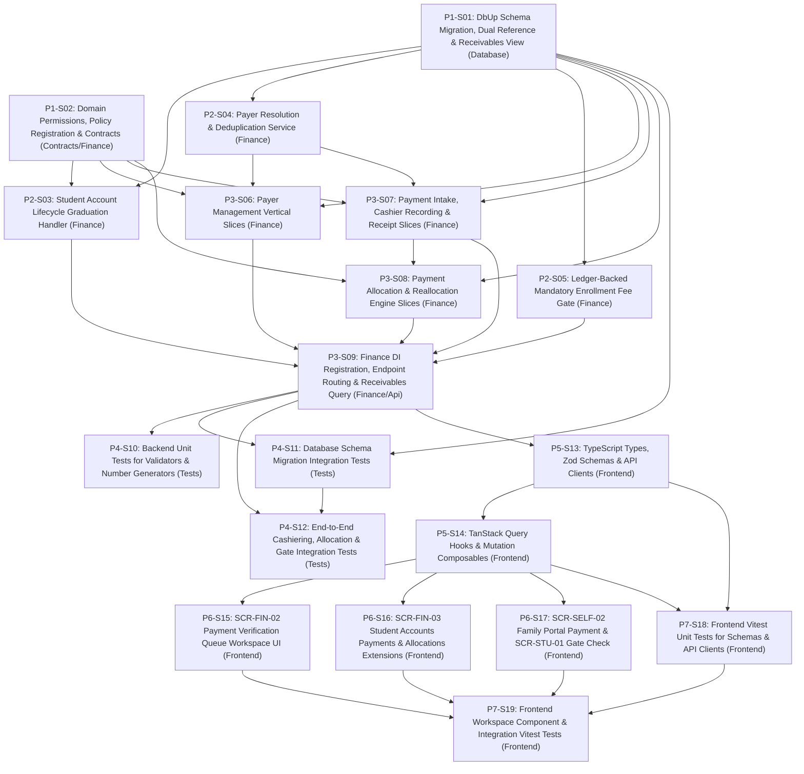

# 1. Objective

Implement the core submodules of Stage 1 "Payments & Receivables: Payer Management, Payment Intake & Sequential Receipting, Explicit Allocation & Reallocation, and Enrollment Payment Clearance Gate" under the Finance domain for Elsasa SIS V3, fulfilling change request intake `CR-FIN-PAYMENTS-RECEIVABLES` ([`IS007 - FIN-PAYMENTS-RECEIVABLES-ISSUE.md`](file:///d:/Project.Private/elsasa-sis-v3/docs/issues/IS007%20-%20FIN-PAYMENTS-RECEIVABLES-ISSUE.md)) and realizing the approved target architecture ([`IS007 - FIN-PAYMENTS-RECEIVABLES-ARCHITECTURE.md`](file:///d:/Project.Private/elsasa-sis-v3/docs/issues/IS007%20-%20FIN-PAYMENTS-RECEIVABLES-ARCHITECTURE.md)).

This implementation establishes:
1. **Authoritative Submodule 3 Relational Persistence Schema:** Provisioning 3 authoritative relational tables specified in [`finance-entities-tables.md`](file:///d:/Project.Private/elsasa-sis-v3/docs/entities/finance-entities-tables.md) (`finance.payers`, `finance.payments`, `finance.payment_allocations`) and the derived projection `finance.v_student_receivables`.
2. **Dual Reference Pattern for Pre-Enrollment Candidates (`GAP-001`, `OQ-001`):** Extending `finance.student_financial_accounts`, `finance.financial_obligations`, and `finance.payments` to support both `applicant_id` and `student_id`. This allows accepted admission candidates to hold financial accounts and settle mandatory enrollment obligations prior to official matriculation, automatically graduating upon consumption of `StudentEnrolledEvent`.
3. **Payer Resolution & Deduplication Service (`GAP-005`, `OQ-002`):** Delivering an explicit `IPayerResolver` service that matches payers by identification number (NIK/NPWP), contact email, or phone number, auto-creating `parent_guardian` payers on self-service submissions and enabling explicit cashier management of corporate sponsors and foundations.
4. **Dual-Path Payment Intake & Concurrency-Safe Receipting (`OQ-004`):**
   - Self-service portal submissions enter as `submitted` with documentary proof and external bank references.
   - Cashier counter payments (cash, POS EDC, cleared transfer) execute an atomic "Record & Confirm" transition.
   - Confirmed transactions permanently generate sequential, immutable receipt numbers (`REC-{Year}-{Sequence:D6}`) protected by row locks and unique constraints.
5. **Explicit Allocation Engine with Smart Auto-Suggest (`OQ-003`):** Cashier-controlled allocation with 1-click auto-suggest prioritizing mandatory enrollment fees, then outstanding tuition FIFO. Excess funds remain dynamically calculated unallocated credits. Reallocations preserve full historical lineage using replacement records (`status = 'superseded'`, `superseded_by_id`, `reversal_reason`).
6. **Ledger-Backed Enrollment Payment Gate (`GAP-006`, `OQ-005`):** Replacing the stubbed `FinanceModule.IsEnrollmentFeePaidAsync` with a parameterized SQL query that evaluates mandatory enrollment obligation settlement in real time to unblock `STD-WF-03` intake.
7. **Frontend Workspaces & Portal Extensions:** Delivering `SCR-FIN-02: Payment Verification Queue` (`/finance/payments`), extending `SCR-FIN-03: Student Accounts Workbench` with a Payments & Allocations tab, enabling payment submissions and receipt viewing in `SCR-SELF-02: Family Tasks & Requests Portal`, and wiring real-time confirmation into `SCR-STU-01: Student Intake Workbench`.

Planning Mode: FEATURE-PLANNING

Referenced artifacts:
- FEATURE / ISSUE:
  - `docs/issues/IS007 - FIN-PAYMENTS-RECEIVABLES-ISSUE.md` (Intake `CR-FIN-PAYMENTS-RECEIVABLES`)
  - `docs/domains/finance-domain.md` (Payment Receipt and Confirmation lines 185–216, Payment Allocation and Reallocation lines 218–254, Credit and Overpayment lines 256–283, Student Financial Account lines 93–115, Indonesian School Context & Operational Principles)
  - `docs/sub-modul-and-development-phases.md` (Stage 1 Module: Payments & Receivables; Criteria 8, 9, 10; Section E GAP-01 resolution)
  - `docs/operational-workflow-discovery.md` (`FIN-WF-05: Receive and Confirm Payment`, `FIN-WF-06: Allocate or Reallocate Payment`, `FIN-WF-13: Confirm Enrollment Payment Gate`, `GAP-07: Dual Candidate Reference Precedent`)
  - `docs/use-cases.md` (`UC-FIN-01: Submit Fee Payment`, `UC-FIN-04: Confirm Payment Receipt`, `UC-FIN-05: Allocate Payment to Obligations`, `UC-FIN-09: Confirm Enrollment Payment Gate`)
  - `docs/actors.md` (Finance Authority `ACT-03`, Finance Officer `ACT-04`, Parent / Payer)
  - `docs/screen-inventory.md` (`SCR-FIN-02: Payment Verification Queue`, `SCR-FIN-03: Student Accounts Workbench`, `SCR-SELF-02: Family Tasks & Requests Portal`, `SCR-STU-01: Student Intake Workbench`)
  - `docs/entities/finance-entities.md` & `docs/entities/finance-entities-tables.md` (Submodule 3 — Payments & Receivables; Tables 3.1 through 3.3, View `v_student_receivables`)
- ARCHITECTURE:
  - `docs/issues/IS007 - FIN-PAYMENTS-RECEIVABLES-ARCHITECTURE.md` (Authoritative target capability architecture)
  - `docs/architecture/backend-architecture.md` (Modular Monolith & Vertical Slice specification)
  - `docs/architecture/frontend-architecture.md` (Modular Vue 3 SPA architecture)
  - `docs/architecture/adr.md` (ADR-001 through ADR-010)
  - `docs/architecture/coding-conventions.md` (C# 12, Dapper raw SQL, Minimal API conventions)
- FEASIBILITY-ASSESSMENT:
  - `docs/issues/IS007 - FIN-PAYMENTS-RECEIVABLES-FEASIBILITY-ASSESSMENT.md` (Status: `READY-FOR-PLANNING`)

Architecture Applicability: ARCHITECTURE-REQUIRED

This feature introduces authoritative relational persistence tables for payers, payments, and payment allocations, extends student accounts and financial obligations to support pre-enrollment applicants, implements concurrent sequential receipt numbering, builds an explicit allocation engine with append-only reallocation lineage, replaces the synchronous cross-domain enrollment fee inquiry stub with a live parameterized query, and delivers complete frontend cashiering and verification workspaces. Target architecture `docs/issues/IS007 - FIN-PAYMENTS-RECEIVABLES-ARCHITECTURE.md` is authoritative and governs this plan.

---

# 2. Planning Scope

The planning scope encompasses all changes required across database persistence, backend vertical slices, cross-domain contracts, test harnesses, and frontend workspaces:

1. **Database Persistence & DbUp Migrations (`Elsasa.Sis.Database`):**
   - Author and register sequential forward DbUp migration script `20261104_0301_Finance_PaymentsReceivables_Tables.sql` targeting Microsoft SQL Server 2022 ([`ADR-002`](file:///d:/Project.Private/elsasa-sis-v3/docs/architecture/adr.md#L50-L75), [`ADR-006`](file:///d:/Project.Private/elsasa-sis-v3/docs/architecture/adr.md#L152-L176)).
   - **Pre-Enrollment Dual Reference Alterations (`GAP-001`, `OQ-001`):**
     - Modify `finance.student_financial_accounts` to make `student_id` nullable (`UNIQUEIDENTIFIER NULL`), add `[applicant_id] UNIQUEIDENTIFIER NULL`, drop legacy single-column unique constraint `uq_finance_student_financial_accounts_student`, add filtered unique indexes on `student_id` and `applicant_id`, and add check constraint `CHECK (student_id IS NOT NULL OR applicant_id IS NOT NULL)`.
     - Modify `finance.financial_obligations` to make `student_id` nullable (`UNIQUEIDENTIFIER NULL`), add `[applicant_id] UNIQUEIDENTIFIER NULL`, and add check constraint `CHECK (student_id IS NOT NULL OR applicant_id IS NOT NULL)`.
   - **New Submodule 3 Tables:**
     - `finance.payers`: Shared legal entity representing fee payers (parents, sponsors, embassies, foundations) with contact and refund banking details.
     - `finance.payments`: Transactional monetary intake records tracking gross amounts (`BIGINT` IDR), payment methods, external references, proof references, confirmation status (`submitted`, `confirmed`, `rejected`, `reversed`), cashier verifier, and official receipt numbers (`REC-{Year}-{Sequence:D6}`).
     - `finance.payment_allocations`: Authoritative allocation records applying payment funds to specific obligations, tracking `status` (`active`, `superseded`, `reversed`), replacement pointer `superseded_by_id`, and audit `reversal_reason`.
   - **Derived Database Projection:**
     - `finance.v_student_receivables`: Dynamic SQL Server view computing net obligation liability, confirmed paid allocations, remaining outstanding amounts, overdue flags, elapsed overdue days, and aging brackets directly from `financial_obligations` and `payment_allocations`.

2. **Cross-Domain Contracts & Domain Events (`Elsasa.Sis.Contracts`):**
   - Update `PaymentConfirmedEvent.cs` in `Elsasa.Sis.Contracts.Finance.Events` to carry `Guid PaymentId`, `Guid? StudentId`, `Guid? ApplicantId`, `long Amount` (exact IDR integer), `string ReceiptNumber`, and `DateTimeOffset OccurredOn`.
   - Ensure post-commit publishing via MediatR `IPublisher` ([`ADR-003`](file:///d:/Project.Private/elsasa-sis-v3/docs/architecture/adr.md#L76-L98)).

3. **Backend Vertical Slices & Core Domain Services (`Elsasa.Sis.Finance`):**
   - **Domain Permission Constants (`GAP-008`, TD-07):** Formal definition of `Permissions.Payments`, `Permissions.Allocations`, and `Permissions.Payers` in `Permissions.cs` with mirroring in `Permissions.Finance.*`.
   - **Account Lifecycle Graduation Handler (`GAP-001`, `OQ-001`, TD-02):** Update `StudentEnrolledEventHandler.cs` to check if a financial account already exists for `notification.ApplicantId`; if found, update `student_id = @StudentId` and graduate associated obligations and payments. If not found, provision a new account.
   - **Payer Resolution Service (`GAP-005`, `OQ-002`, TD-03):** Internal service `IPayerResolver` (`Services/PayerResolver.cs`) executing atomic lookup/deduplication on NIK, email, or phone, auto-creating a `parent_guardian` payer if not found (`PYR-{Year}-{Sequence:D4}`).
   - **Ledger-Backed Enrollment Payment Gate (`GAP-006`, `OQ-005`, TD-06):** Replace stubbed `FinanceModule.IsEnrollmentFeePaidAsync` with a parameterized query verifying mandatory enrollment obligation settlement.
   - **Vertical Slices — Payers (`Features/Payers/`):**
     - `GetPayers` (`GET /api/finance/payers`): Search and paginate payers for autocomplete or cashier selection.
     - `CreatePayer` (`POST /api/finance/payers`): Register an explicit corporate sponsor, embassy, or guardian.
     - `GetPayerById` (`GET /api/finance/payers/{id}`): Inspect payer details and associated payment history.
   - **Vertical Slices — Payments (`Features/Payments/`):**
     - `SubmitPayment` (`POST /api/finance/payments/submit`): Self-service payment submission (`SCR-SELF-02`, `UC-FIN-01`) creating a payment in `submitted` status without a receipt number.
     - `RecordAndConfirmPayment` (`POST /api/finance/payments`): Cashier counter payment recording (`SCR-FIN-02`, `UC-FIN-04`) atomically creating a payment in `confirmed` status, generating an official `receipt_number`, and publishing `PaymentConfirmedEvent`.
     - `ConfirmPayment` (`POST /api/finance/payments/{id}/confirm`): Cashier review verification transitioning a `submitted` payment to `confirmed`, assigning an official receipt number, and publishing `PaymentConfirmedEvent`.
     - `RejectPayment` (`POST /api/finance/payments/{id}/reject`): Cashier rejection of invalid portal submission with mandatory `rejection_reason`.
     - `GetPayments` (`GET /api/finance/payments`): Paginated verification queue and transaction history (`status`, `dateRange`, `studentId`, `payerId`).
     - `GetPaymentById` (`GET /api/finance/payments/{id}`): Detailed payment inspection including allocation breakdown and receipt details.
     - `GetPaymentReceipt` (`GET /api/finance/payments/{id}/receipt`): Structured receipt voucher projection for printing or PDF rendering.
   - **Vertical Slices — Allocations (`Features/Allocations/`):**
     - `SuggestAllocations` (`GET /api/finance/allocations/suggest`): Computes rule-based distribution recommendation for a given payment amount against a student's open obligations.
     - `AllocatePayment` (`POST /api/finance/allocations`): Atomically allocates confirmed payment value across one or more obligations, enforcing concurrency locks (`UPDLOCK, HOLDLOCK`) and mathematical check assertions.
     - `ReallocatePayment` (`POST /api/finance/allocations/reallocate`): Corrects an erroneous allocation by marking existing rows as `superseded` (`superseded_by_id = @NewAllocationId`) with mandatory `reversal_reason` and creating replacement allocation rows.
     - `GetStudentReceivables` (`GET /api/finance/accounts/{studentId}/receivables`): Queries `finance.v_student_receivables` for a given student or applicant.
   - **Dependency Injection & Routing:** Register all feature handlers, validators, services, and Minimal API endpoints in `DependencyInjection.cs` and `FinanceEndpoints.cs`.

4. **Automated Testing Suite (`tests/backend`):**
   - Unit tests covering FluentValidation validators, number formatting generators, `IPayerResolver`, and allocation auto-suggest priority rules.
   - SQL Server 2022 Testcontainers integration tests verifying migration `20261104_0301` execution, schema constraints, payer resolution/deduplication, payment submission/recording, zero-gap concurrent receipt numbering, confirmation, rejection, allocation invariants, reallocation supersede lineage, and `IsEnrollmentFeePaidAsync` gate evaluation.

5. **Frontend State, API Clients & Validation Schemas (`src/frontend`):**
   - TypeScript interfaces, Zod validation schemas, and Axios client modules for payers, payments, and allocations.
   - TanStack Query hooks and cache invalidation composables (`useFinancePayers`, `useFinancePayments`, `useFinanceAllocations`).

6. **Frontend Workspaces & UI Components (`src/frontend`):**
   - `SCR-FIN-02` Payment Verification Queue Workspace (`/finance/payments`): Master worklist filtering submitted portal payments, confirmed counter transactions, and rejected items; quick-action verification drawer; record-payment modal for walk-in cashiering; allocation modal; and rejection dialog.
   - `SCR-FIN-03` Student Accounts Workbench Extension: Add `PaymentsHistoryTable.vue` and `AllocationsTable.vue` to `StudentAccountsWorkbenchView.vue` tabs, enabling Finance Officers to inspect payment receipts, allocation breakdowns, and trigger reallocations.
   - `SCR-SELF-02` Family Tasks & Requests Portal Extension: Enhance `FamilyBillingTab.vue` to support "Pay Now / Submit Payment" modal (`SubmitPaymentModal.vue`) and "Download / View Receipt" action for confirmed payments.
   - `SCR-STU-01` Student Intake Workbench Integration: Enhance `EnrollApplicantModal.vue` to check real-time `IsEnrollmentFeePaidAsync` status when selecting an accepted applicant, displaying a green verified badge when settled or prompting for waiver override.
   - Route registration update in `src/frontend/src/app/router/routes.ts` (`/finance/payments` pointing to `PaymentVerificationQueueView.vue` with `Permissions.Finance.Payments.View`).

7. **Frontend Automated Verification & Testing (`src/frontend`):**
   - Unit tests for Zod schemas, API clients, and composables.
   - Component & integration tests using Vitest and Vue Test Utils for `PaymentVerificationQueueView`, `AllocatePaymentModal`, `StudentAccountsWorkbenchView` extensions, and `FamilyBillingTab`.

---

# 3. Dependencies

### External System & Tooling Dependencies

- .NET 8 SDK (8.0.x)
- Docker / Docker Desktop / Podman (required for Testcontainers SQL Server 2022 integration tests)
- Microsoft SQL Server 2022 instance (for local Web API runtime)
- Node.js runtime (v22.x or LTS) and pnpm package manager (v9.x or v11.x)

### Internal Slice Dependencies

- `Depends On` declares implementation prerequisites between slices.
- Dependencies reference Slice IDs only.
- Dependency satisfaction requires the referenced slice to have implementation status `IMPLEMENTED`.
- Dependency satisfaction does not require review status `GO`.
- Slices with `Depends On: None` or whose dependencies are satisfied may be executed in parallel.

### Dependency Graph



---

# 4. Progress Summary

Plan status values:
- NOT-STARTED
- IN-PROGRESS
- BLOCKED
- COMPLETED

Execution Approval values:
- PENDING
- APPROVED

Execution Approval is owned by the Architect. It is set to APPROVED when the plan structure is finalized and released for execution. Execution must not begin while Execution Approval is PENDING.

COMPLETED is a plan-level status only, set when every slice has implementation status IMPLEMENTED and review status GO.

| Phase | Implementation Status | Review Status | Progress |
|---|---|---|---|
| P1 - Persistence, Cross-Domain Contracts & Domain Permissions Foundation | IMPLEMENTED | GO | 2/2 |
| P2 - Account Lifecycle Graduation, Payer Resolution & Enrollment Fee Gate | IMPLEMENTED | GO | 3/3 |
| P3 - Backend Vertical Slices — Payer, Payment & Allocation Engine | IMPLEMENTED | GO | 4/4 |
| P4 - Backend Automated Verification & Integration Harness | IMPLEMENTED | GO | 3/3 |
| P5 - Frontend State, API Clients, Zod Schemas & Composables | IMPLEMENTED | GO | 2/2 |
| P6 - Frontend Workspaces & Integration Views | IMPLEMENTED | GO | 3/3 |
| P7 - Frontend Automated Verification & Component Tests | IMPLEMENTED | GO | 2/2 |

---

# 5. Phases

## P1 - Persistence, Cross-Domain Contracts & Domain Permissions Foundation

Implementation Status: NOT-STARTED
Review Status: NOT-REVIEWED

### P1-S01

Title: Database Schema Migration, Dual Reference Alterations & Receivables View

Implementation Status: IMPLEMENTED
Review Status: GO

Objective:
Author and register forward DbUp migration script `20261104_0301_Finance_PaymentsReceivables_Tables.sql` in `src/backend/Elsasa.Sis.Database/Scripts/`, altering existing accounts and obligations tables to support the pre-enrollment dual reference pattern (`applicant_id`), provisioning Submodule 3 tables (`payers`, `payments`, `payment_allocations`), and defining dynamic view `finance.v_student_receivables` targeting Microsoft SQL Server 2022.

Depends On: None

Repository: `src/backend/Elsasa.Sis.Database`

Completion Criteria:
1. Migration script `20261104_0301_Finance_PaymentsReceivables_Tables.sql` exists in `src/backend/Elsasa.Sis.Database/Scripts/`.
2. `finance.student_financial_accounts` has column `student_id` altered to nullable, column `applicant_id UNIQUEIDENTIFIER NULL` added, constraint `uq_finance_student_financial_accounts_student` dropped, filtered unique indexes `ux_finance_student_accounts_student_id` and `ux_finance_student_accounts_applicant_id` added, and check constraint `ck_finance_student_accounts_candidate` added.
3. `finance.financial_obligations` has column `student_id` altered to nullable, column `applicant_id UNIQUEIDENTIFIER NULL` added, and check constraint `ck_finance_obligations_candidate` added.
4. Table `finance.payers` is provisioned with clustered PK on `id`, unique constraint on `payer_number`, and nonclustered indexes on `identification_number` (filtered) and `(email, phone_number)`.
5. Table `finance.payments` is provisioned with clustered PK on `id`, unique constraint on `payment_number`, filtered unique index on `receipt_number` where not null, foreign keys to `student_financial_accounts` and `payers`, check constraint `(student_id IS NOT NULL OR applicant_id IS NOT NULL)`, and query indexes on `(confirmation_status, submission_date DESC)` and `(student_account_id, confirmation_status)`.
6. Table `finance.payment_allocations` is provisioned with clustered PK on `id`, unique constraint on `allocation_number`, foreign keys to `student_financial_accounts`, `financial_obligations`, `payments`, and self-referential `payment_allocations` (`superseded_by_id`), and indexes on `(obligation_id, status) INCLUDE (allocated_amount)` and `(payment_id, status) INCLUDE (allocated_amount)`.
7. View `finance.v_student_receivables` is created or altered to compute `net_obligation`, `total_paid`, `outstanding_amount`, `is_overdue`, `days_overdue`, `aging_bracket`, and `receivable_status` from `financial_obligations` and active `payment_allocations`.
8. Script executes idempotently using `IF NOT EXISTS` / `IF OBJECT_ID` guards and preserves existing data.

Implementation Notes:
- Authored forward DbUp script `src/backend/Elsasa.Sis.Database/Scripts/20261104_0301_Finance_PaymentsReceivables_Tables.sql`.
- Altered `finance.student_financial_accounts`: added `applicant_id UNIQUEIDENTIFIER NULL`, dropped legacy unique constraint `uq_finance_student_financial_accounts_student`, altered `student_id` to nullable, added filtered unique indexes `ux_finance_student_accounts_student_id` and `ux_finance_student_accounts_applicant_id`, and added check constraint `ck_finance_student_accounts_candidate`.
- Altered `finance.financial_obligations`: added `applicant_id UNIQUEIDENTIFIER NULL`, dropped dependent index `ix_finance_obligations_student_status`, altered `student_id` to nullable, recreated `ix_finance_obligations_student_status`, added applicant query index `ix_finance_obligations_applicant_status`, and added check constraint `ck_finance_obligations_candidate`.
- Provisioned authoritative table `finance.payers` with clustered PK `pk_finance_payers`, unique constraint `uq_finance_payers_number`, filtered index `ix_finance_payers_identification`, and contact index `ix_finance_payers_contact`.
- Provisioned authoritative table `finance.payments` with clustered PK `pk_finance_payments`, unique constraint `uq_finance_payments_number`, filtered unique index `uq_finance_payments_receipt_number` on non-null `receipt_number`, FKs to accounts and payers, candidate check constraint `ck_finance_payments_candidate`, and composite query indexes `ix_finance_payments_queue`, `ix_finance_payments_account`, and `ix_finance_payments_student_applicant`.
- Provisioned authoritative table `finance.payment_allocations` with clustered PK `pk_finance_payment_allocations`, unique constraint `uq_finance_allocations_number`, FKs to accounts, obligations, payments, and self-referential `superseded_by_id`, plus aggregation indexes `ix_finance_allocations_obligation_status` and `ix_finance_allocations_payment_status`.
- Defined dynamic projection view `finance.v_student_receivables` computing net obligation, total paid, outstanding amount, overdue flags, elapsed overdue days, aging brackets ('Current', '1-30 Days', '31-60 Days', '61-90 Days', '90+ Days'), and receivable status ('settled', 'overdue', 'current').
- Verified idempotent execution with full guard clauses and verified `Elsasa.Sis.Database` compiles cleanly with script embedded.

Changed Files:
- `src/backend/Elsasa.Sis.Database/Scripts/20261104_0301_Finance_PaymentsReceivables_Tables.sql`

Notes:
- Use exact DDL specified in `IS007 - FIN-PAYMENTS-RECEIVABLES-ARCHITECTURE.md` Section 8.
- Ensure monetary fields use `BIGINT NOT NULL` and `currency_code VARCHAR(3) NOT NULL DEFAULT 'IDR'`.

---

### P1-S02

Title: Domain Permissions, Policy Registration & Cross-Domain Contracts

Implementation Status: IMPLEMENTED
Review Status: GO

Objective:
Update cross-domain event `PaymentConfirmedEvent.cs` to align with the dual reference pattern and exact IDR integer representation, formalize domain permission constants in `Elsasa.Sis.Finance/Permissions.cs`, and register policy-based authorization policies in `Elsasa.Sis.Finance/DependencyInjection.cs`.

Depends On: None

Repository: `src/backend/Elsasa.Sis.Contracts`, `src/backend/Elsasa.Sis.Finance`

Completion Criteria:
1. `src/backend/Elsasa.Sis.Contracts/Finance/Events/PaymentConfirmedEvent.cs` updated to:
   ```csharp
   public sealed record PaymentConfirmedEvent(
       Guid PaymentId,
       Guid? StudentId,
       Guid? ApplicantId,
       long Amount,
       string ReceiptNumber,
       DateTimeOffset OccurredOn) : IDomainEvent;
   ```
   with overload constructor defaulting `OccurredOn` to `DateTimeOffset.UtcNow`.
2. `src/backend/Elsasa.Sis.Finance/Permissions.cs` updated to include:
   - `Permissions.Payments.View`, `Permissions.Payments.Record`, `Permissions.Payments.Confirm`, `Permissions.Payments.Reject`
   - `Permissions.Allocations.View`, `Permissions.Allocations.Execute`, `Permissions.Allocations.Reallocate`
   - `Permissions.Payers.View`, `Permissions.Payers.Manage`
   - Mirrored constants under `Permissions.Finance.Payments`, `Permissions.Finance.Allocations`, `Permissions.Finance.Payers`.
3. `src/backend/Elsasa.Sis.Finance/DependencyInjection.cs` updated to register authorization policies for all new permissions, binding `Payments.Record`, `Payments.Confirm`, `Payments.Reject`, `Allocations.Execute`, `Allocations.Reallocate`, and `Payers.Manage` to `FinanceOfficer`, `FinanceAuthority`, and `Admin`.
4. Both assemblies compile without errors or warnings.

Notes:
- Conforms to ADR-003 (in-memory MediatR events) and ADR-009 (permission-based authorization).
- Updated `PaymentConfirmedEvent` with primary record parameters `(Guid PaymentId, Guid? StudentId, Guid? ApplicantId, long Amount, string ReceiptNumber, DateTimeOffset OccurredOn)`, primary UTC default constructor overload, and legacy constructor overload for backward compatibility.
- Formalized `Permissions.Payments`, `Permissions.Allocations`, and `Permissions.Payers` along with mirrored hierarchies under `Permissions.Finance`.
- Registered authorization policies in `DependencyInjection.cs` for Payments, Allocations, and Payers permissions, binding mutation operations to `FinanceOfficer`, `FinanceAuthority`, and `Admin`.
- Verified clean build (`0 Warning(s)`, `0 Error(s)`) for both `src/backend/Elsasa.Sis.Contracts` and `src/backend/Elsasa.Sis.Finance`.

Changed Files:
- `src/backend/Elsasa.Sis.Contracts/Finance/Events/PaymentConfirmedEvent.cs`
- `src/backend/Elsasa.Sis.Finance/Permissions.cs`
- `src/backend/Elsasa.Sis.Finance/DependencyInjection.cs`

---

## P2 - Account Lifecycle Graduation, Payer Resolution & Enrollment Fee Gate

Implementation Status: NOT-STARTED
Review Status: NOT-REVIEWED

### P2-S03

Title: Student Account Lifecycle Graduation Handler

Implementation Status: IMPLEMENTED
Review Status: GO

Objective:
Update `StudentEnrolledEventHandler.cs` in `Elsasa.Sis.Finance/Features/Accounts/Events/` to implement the account graduation lifecycle for pre-enrollment accounts (`GAP-001`, `OQ-001`, TD-02). When an applicant is enrolled, if an existing financial account is linked to `notification.ApplicantId`, update `student_id = notification.StudentId` and propagate `student_id` to associated obligations and payments.

Depends On: P1-S01, P1-S02

Repository: `src/backend/Elsasa.Sis.Finance`

Completion Criteria:
1. `StudentEnrolledEventHandler.cs` checks if an account exists where `applicant_id = notification.ApplicantId`:
   - If found:
     - Updates `finance.student_financial_accounts` setting `student_id = notification.StudentId`, `updated_at = SYSUTCDATETIME()`, `updated_by = 'SYSTEM_ENROLLMENT'` where `applicant_id = @ApplicantId AND student_id IS NULL`.
     - Updates `finance.financial_obligations` setting `student_id = notification.StudentId` where `applicant_id = @ApplicantId AND student_id IS NULL`.
     - Updates `finance.payments` setting `student_id = notification.StudentId` where `applicant_id = @ApplicantId AND student_id IS NULL`.
   - If not found:
     - Checks if an account exists for `student_id = notification.StudentId`; if not, inserts a new active account for `student_id` (existing fallback behavior).
2. Handler handles duplicate key exceptions (`SqlException` 2601/2627) idempotently.
3. Proper logging emitted for account graduation vs. new account creation.

Implementation Notes:
- Updated `StudentEnrolledEventHandler.cs` in `Elsasa.Sis.Finance/Features/Accounts/Events/` to implement pre-enrollment account graduation lifecycle (GAP-001, OQ-001, TD-02).
- When `notification.ApplicantId != Guid.Empty`, checks if a financial account exists for `applicant_id`.
- If found, atomically executes transactional graduation updates:
  - Updates `finance.student_financial_accounts` setting `student_id = @StudentId`, `updated_at = SYSUTCDATETIME()`, and `updated_by = 'SYSTEM_ENROLLMENT'` where `applicant_id = @ApplicantId AND student_id IS NULL`.
  - Updates `finance.financial_obligations` setting `student_id = @StudentId` where `applicant_id = @ApplicantId AND student_id IS NULL`.
  - Updates `finance.payments` setting `student_id = @StudentId` where `applicant_id = @ApplicantId AND student_id IS NULL`.
- If not found, falls back to checking whether an account exists for `student_id = @StudentId`; if absent, provisions a new active account.
- Idempotently handles duplicate key race conditions (`SqlException` 2601 and 2627) with warning logging.
- Differentiates structured informational logging between account graduation and new account provisioning.
- Verified clean build (`0 Warning(s)`, `0 Error(s)`) for `src/backend/Elsasa.Sis.Finance`.

Changed Files:
- `src/backend/Elsasa.Sis.Finance/Features/Accounts/Events/StudentEnrolledEventHandler.cs`

Notes:
- Uses raw SQL queries via Dapper (`ISqlConnectionFactory`).
- Follows ADR-003 and TD-02.

---

### P2-S04

Title: Payer Resolution & Deduplication Service

Implementation Status: IMPLEMENTED
Review Status: GO

Objective:
Deliver internal domain service `IPayerResolver` and its implementation `PayerResolver.cs` in `Elsasa.Sis.Finance/Services/` to auto-match and provision payer identities across identification number (NIK/NPWP), contact email, or phone number, eliminating cashier friction and preventing duplication (`GAP-005`, `OQ-002`, TD-03).

Depends On: P1-S01

Repository: `src/backend/Elsasa.Sis.Finance`

Completion Criteria:
1. Interface `Elsasa.Sis.Finance.Services.IPayerResolver` created:
   ```csharp
   public interface IPayerResolver
   {
       Task<Guid> ResolveOrCreatePayerAsync(
           string payerName,
           string? identificationNumber,
           string? email,
           string? phone,
           string? payerType,
           CancellationToken ct);
   }
   ```
2. Class `PayerResolver.cs` created implementing `IPayerResolver`:
   - Queries `finance.payers` sequentially:
     1. Exact match on `identification_number` (if non-empty).
     2. Exact match on `email` (if non-empty).
     3. Exact match on `phone_number` (if non-empty).
   - If match found, returns `payer_id`.
   - If no match found, generates unique `payer_number` (`PYR-{DateTime.UtcNow:yyyy}-{Sequence:D4}`), inserts new row into `finance.payers` with `payer_type = payerType ?? "parent_guardian"`, and returns the newly generated `payer_id`.
3. Registered as scoped service in `DependencyInjection.cs`.

Implementation Notes:
- Created interface `IPayerResolver` in `src/backend/Elsasa.Sis.Finance/Services/IPayerResolver.cs` matching Section 4 TD-03.
- Created `PayerNumberGenerator` in `src/backend/Elsasa.Sis.Finance/Services/PayerNumberGenerator.cs` generating canonical `PYR-{Year}-{Sequence:D4}` sequences.
- Implemented `PayerResolver` in `src/backend/Elsasa.Sis.Finance/Services/PayerResolver.cs`:
  - Performs sequential matching against `finance.payers`: exact match on `identification_number`, then `email`, then `phone_number`.
  - On match, returns existing `payer_id`.
  - When no match is found, acquires next sequence using `WITH (UPDLOCK, HOLDLOCK)` inside an explicit SQL transaction, inserts a new payer record with `payer_type` fallback to `'parent_guardian'`, and returns newly generated `payer_id`.
  - Features concurrency retry logic on `SqlException` 2601/2627, re-querying existing payers before retrying insertion.
- Registered `IPayerResolver` and `PayerResolver` as scoped services in `src/backend/Elsasa.Sis.Finance/DependencyInjection.cs`.
- Verified `dotnet build src/backend/Elsasa.Sis.Finance` compiles with `0 Warning(s)` and `0 Error(s)`.

Changed Files:
- `src/backend/Elsasa.Sis.Finance/Services/IPayerResolver.cs`
- `src/backend/Elsasa.Sis.Finance/Services/PayerNumberGenerator.cs`
- `src/backend/Elsasa.Sis.Finance/Services/PayerResolver.cs`
- `src/backend/Elsasa.Sis.Finance/DependencyInjection.cs`

Notes:
- Sequential numbering query uses transaction-safe generation or `ISqlConnectionFactory`.
- Respects ADR-002 (schema isolation) and ADR-004 (raw SQL with Dapper).

---

### P2-S05

Title: Ledger-Backed Mandatory Enrollment Fee Gate

Implementation Status: IMPLEMENTED
Review Status: GO

Objective:
Replace the stubbed `FinanceModule.IsEnrollmentFeePaidAsync` in `Elsasa.Sis.Finance/Services/FinanceModule.cs` with an authoritative, parameterized SQL query that evaluates mandatory enrollment obligation settlement in real time against `finance.financial_obligations` and `finance.payment_allocations` (`GAP-006`, `OQ-005`, TD-06).

Depends On: P1-S01

Repository: `src/backend/Elsasa.Sis.Finance`

Completion Criteria:
1. `FinanceModule.cs` updated to inject `ISqlConnectionFactory`.
2. `IsEnrollmentFeePaidAsync(Guid applicantId, Guid academicYearId, CancellationToken ct)` executes parameterized query checking active mandatory enrollment obligations (`charge_type IN ('enrollment_fee', 'admission_fee') AND is_mandatory = 1 AND status != 'cancelled'`) linked to `applicant_id` or linked `student_id`.
3. Returns `Result.Success(true)` if no mandatory enrollment obligations are assessed for the candidate.
4. Returns `Result.Success(true)` if and only if every mandatory enrollment obligation is 100% settled (`total_allocated >= original_amount`).
5. Returns `Result.Success(false)` if any mandatory enrollment obligation has an outstanding unpaid balance.
6. Handles cancellation token propagation and database connection disposal properly.

Implementation Notes:
- Replaced stubbed `IsEnrollmentFeePaidAsync` in `src/backend/Elsasa.Sis.Finance/Services/FinanceModule.cs` with an authoritative parameterized Dapper query.
- Injected `ISqlConnectionFactory` and registered `DapperTypeHandlers`.
- Implemented SQL query evaluating mandatory enrollment obligations (`charge_type IN ('enrollment_fee', 'admission_fee')`, `is_mandatory = 1`, `status != 'cancelled'`) linked to `applicant_id` or candidate `student_id` via subquery against `students.students`, accounting for direct academic year linkage or parent operational period hierarchy.
- Evaluated settlement: returned `Result.Success(true)` if no mandatory obligations exist or if all obligations have `TotalAllocated >= OriginalAmount`; returned `Result.Success(false)` if any mandatory obligation has an unpaid balance.
- Guaranteed asynchronous disposal of database connection via `await using` and passed `CancellationToken` through connection acquisition and query execution.
- Registered concrete `FinanceModule` alongside `IFinanceModule` in `DependencyInjection.cs`.
- Verified clean build (`0 Warning(s)`, `0 Error(s)`) for `src/backend/Elsasa.Sis.Finance`.

Changed Files:
- `src/backend/Elsasa.Sis.Finance/Services/FinanceModule.cs`
- `src/backend/Elsasa.Sis.Finance/DependencyInjection.cs`

Notes:
- Unblocks `STD-WF-03` intake in `EnrollAcceptedApplicantHandler.cs` without altering the cross-domain contract.

---

## P3 - Backend Vertical Slices — Payer, Payment & Allocation Engine

Implementation Status: IMPLEMENTED
Review Status: NOT-REVIEWED

### P3-S06

Title: Payer Management Vertical Slices

Implementation Status: IMPLEMENTED
Review Status: GO

Objective:
Implement backend vertical slices for explicit payer management under `src/backend/Elsasa.Sis.Finance/Features/Payers/`: `GetPayers`, `CreatePayer`, and `GetPayerById`, enabling cashier registration and searching of sponsors, embassies, and parents (`SCR-FIN-02`).

Depends On: P1-S01, P1-S02, P2-S04

Repository: `src/backend/Elsasa.Sis.Finance`

Completion Criteria:
1. `Features/Payers/GetPayers/`:
   - `GetPayersRequest.cs`: Record supporting search term, payer type, page, pageSize.
   - `GetPayersResponse.cs`: Paginated items with payer ID, number, name, type, identification, email, phone.
   - `GetPayersHandler.cs`: Dapper query with count and pagination.
   - `GetPayersEndpoint.cs`: `GET /api/finance/payers`, protected by `Permissions.Finance.Payers.View`.
2. `Features/Payers/CreatePayer/`:
   - `CreatePayerRequest.cs`: Name, type, identification number, email, phone, billing address, bank account details, notes.
   - `CreatePayerResponse.cs`: Payer ID, number, name, type.
   - `CreatePayerValidator.cs`: FluentValidation asserting name is not empty, valid email format if provided, valid phone format.
   - `CreatePayerHandler.cs`: Uses `IPayerResolver` or direct insert with `PYR-{Year}-{Sequence:D4}` via `PayerNumberGenerator`.
   - `CreatePayerEndpoint.cs`: `POST /api/finance/payers`, protected by `Permissions.Finance.Payers.Manage`.
3. `Features/Payers/GetPayerById/`:
   - `GetPayerByIdResponse.cs`: Complete payer details including linked payments summary.
   - `GetPayerByIdHandler.cs`: Dapper query returning `Result<GetPayerByIdResponse>`.
   - `GetPayerByIdEndpoint.cs`: `GET /api/finance/payers/{id}`, protected by `Permissions.Finance.Payers.View`.
4. Register handlers, validators, and endpoints in `DependencyInjection.cs`.
5. `dotnet build src/backend/Elsasa.Sis.Finance` succeeds.

Implementation Notes:
- Implemented vertical slices under `src/backend/Elsasa.Sis.Finance/Features/Payers/`:
  - `GetPayers/`:
    - `GetPayersRequest.cs`: Record supporting search term, payer type, page, and pageSize.
    - `PayerListItemDto.cs` & `GetPayersResponse.cs`: Paginated response with payer ID, canonical number, name, type, identification number, email, phone number, and creation timestamp.
    - `GetPayersHandler.cs`: Dapper query with total count and offset pagination filtering by payer type and multi-field search term.
    - `GetPayersEndpoint.cs`: `GET /api/finance/payers`, protected by `Permissions.Finance.Payers.View`.
  - `CreatePayer/`:
    - `CreatePayerRequest.cs`: Name, type, identification number, email, phone, billing address, bank account details, notes.
    - `CreatePayerResponse.cs`: Payer ID, number, name, type.
    - `CreatePayerValidator.cs`: FluentValidation asserting name is not empty, valid email format if provided, valid phone format, and property lengths.
    - `CreatePayerHandler.cs`: Transaction-safe insertion generating canonical `PYR-{Year}-{Sequence:D4}` numbers via `PayerNumberGenerator` with pessimistic row locking (`WITH (UPDLOCK, HOLDLOCK)`), duplicate identification checks, and concurrency retry.
    - `CreatePayerEndpoint.cs`: `POST /api/finance/payers`, protected by `Permissions.Finance.Payers.Manage` with FluentValidation middleware.
  - `GetPayerById/`:
    - `PayerPaymentSummaryDto.cs`: Summary DTO for linked payment transactions.
    - `GetPayerByIdResponse.cs`: Complete payer details including total payments count, total confirmed amount, and linked payments list.
    - `GetPayerByIdHandler.cs`: Dapper query retrieving payer profile and associated payments history, returning `Result<GetPayerByIdResponse>`.
    - `GetPayerByIdEndpoint.cs`: `GET /api/finance/payers/{id}`, protected by `Permissions.Finance.Payers.View`.
- Registered `GetPayersHandler`, `CreatePayerHandler`, and `GetPayerByIdHandler` in `src/backend/Elsasa.Sis.Finance/DependencyInjection.cs`.
- Verified `dotnet build src/backend/Elsasa.Sis.Finance` succeeds with 0 warnings and 0 errors.

Changed Files:
- `src/backend/Elsasa.Sis.Finance/Features/Payers/GetPayers/GetPayersRequest.cs`
- `src/backend/Elsasa.Sis.Finance/Features/Payers/GetPayers/PayerListItemDto.cs`
- `src/backend/Elsasa.Sis.Finance/Features/Payers/GetPayers/GetPayersResponse.cs`
- `src/backend/Elsasa.Sis.Finance/Features/Payers/GetPayers/GetPayersHandler.cs`
- `src/backend/Elsasa.Sis.Finance/Features/Payers/GetPayers/GetPayersEndpoint.cs`
- `src/backend/Elsasa.Sis.Finance/Features/Payers/CreatePayer/CreatePayerRequest.cs`
- `src/backend/Elsasa.Sis.Finance/Features/Payers/CreatePayer/CreatePayerResponse.cs`
- `src/backend/Elsasa.Sis.Finance/Features/Payers/CreatePayer/CreatePayerValidator.cs`
- `src/backend/Elsasa.Sis.Finance/Features/Payers/CreatePayer/CreatePayerHandler.cs`
- `src/backend/Elsasa.Sis.Finance/Features/Payers/CreatePayer/CreatePayerEndpoint.cs`
- `src/backend/Elsasa.Sis.Finance/Features/Payers/GetPayerById/PayerPaymentSummaryDto.cs`
- `src/backend/Elsasa.Sis.Finance/Features/Payers/GetPayerById/GetPayerByIdResponse.cs`
- `src/backend/Elsasa.Sis.Finance/Features/Payers/GetPayerById/GetPayerByIdHandler.cs`
- `src/backend/Elsasa.Sis.Finance/Features/Payers/GetPayerById/GetPayerByIdEndpoint.cs`
- `src/backend/Elsasa.Sis.Finance/DependencyInjection.cs`

Notes:
- Adheres to ADR-004 (Minimal APIs, Dapper) and ADR-005 (Result<T> error handling).

---

### P3-S07

Title: Payment Intake, Cashier Counter Recording & Receipt Voucher Generation Slices

Implementation Status: IMPLEMENTED
Review Status: GO

Objective:
Implement backend vertical slices for payment intake, cashier verification, counter receipting, and rejection under `src/backend/Elsasa.Sis.Finance/Features/Payments/` (`TD-04`, `OQ-004`). Delivers self-service submission, atomic cashier recording with sequential receipt numbering (`REC-{Year}-{Sequence:D6}`), verification queue confirmation, rejection, transaction queries, and receipt voucher projections.

Depends On: P1-S01, P1-S02, P2-S04

Repository: `src/backend/Elsasa.Sis.Finance`

Completion Criteria:
1. Sequential Number Generators:
   - `PaymentNumberGenerator`: Generates `PAY-{Year}-{Sequence:D6}`.
   - `ReceiptNumberGenerator`: Generates sequential `REC-{Year}-{Sequence:D6}` voucher codes inside a SQL transaction using `WITH (UPDLOCK, HOLDLOCK)` to prevent duplicate numbers or gaps during concurrent checkout.
2. `Features/Payments/SubmitPayment/`:
   - Self-service intake (`POST /api/finance/payments/submit`).
   - Resolves/creates payer via `IPayerResolver`.
   - Inserts row with `confirmation_status = 'submitted'`, `receipt_number = NULL`.
   - Returns payment ID and number.
3. `Features/Payments/RecordAndConfirmPayment/`:
   - Cashier counter intake (`POST /api/finance/payments`, permission `Permissions.Finance.Payments.Record`).
   - Atomically inserts payment in `confirmation_status = 'confirmed'`, generates sequential `receipt_number`, captures `confirmed_by = currentUser` and `confirmation_date = SYSUTCDATETIME()`.
   - Publishes `PaymentConfirmedEvent` post-commit via MediatR `IPublisher`.
4. `Features/Payments/ConfirmPayment/`:
   - Cashier verification queue confirmation (`POST /api/finance/payments/{id}/confirm`, permission `Permissions.Finance.Payments.Confirm`).
   - Transitions payment from `submitted` to `confirmed`, assigns sequential `receipt_number`, and publishes `PaymentConfirmedEvent`.
5. `Features/Payments/RejectPayment/`:
   - Cashier rejection (`POST /api/finance/payments/{id}/reject`, permission `Permissions.Finance.Payments.Reject`).
   - Transitions payment to `rejected` with mandatory `rejection_reason`.
6. `Features/Payments/GetPayments/`:
   - Queue query (`GET /api/finance/payments`, permission `Permissions.Finance.Payments.View`) filtering by `status`, `studentId`, `applicantId`, `payerId`, `dateRange`, and pagination.
7. `Features/Payments/GetPaymentById/` and `GetPaymentReceipt/`:
   - Detailed inspection endpoint `GET /api/finance/payments/{id}`.
   - Receipt voucher projection endpoint `GET /api/finance/payments/{id}/receipt` returning official school header, receipt number, payer details, payment method, amount in words/numbers, and cashier signature metadata.

Implementation Notes:
- Delivered sequential number generators in `src/backend/Elsasa.Sis.Finance/Services/`:
  - `PaymentNumberGenerator`: Generates canonical `PAY-{Year}-{Sequence:D6}` sequences with `WITH (UPDLOCK, HOLDLOCK)` concurrency safety.
  - `ReceiptNumberGenerator`: Generates sequential `REC-{Year}-{Sequence:D6}` voucher codes inside a SQL transaction using `WITH (UPDLOCK, HOLDLOCK)` to prevent duplicate numbers or gaps during concurrent checkout.
  - `NumberToWordsConverter`: Converts monetary amounts to formal Indonesian words (terbilang) with 'Rupiah' suffix for receipt vouchers.
- Extended `IStudentAccountService` and `StudentAccountService` with `GetOrCreateCandidateAccountAsync` to seamlessly support pre-enrollment candidates (`applicant_id`) as well as enrolled students.
- Implemented vertical slices under `src/backend/Elsasa.Sis.Finance/Features/Payments/`:
  - `SubmitPayment/` (`POST /api/finance/payments/submit`):
    - Self-service payment intake resolving/creating payer via `IPayerResolver`, ensuring candidate account provisioning, generating `PAY-{Year}-{Sequence:D6}`, and inserting record in `submitted` status without a receipt number.
  - `RecordAndConfirmPayment/` (`POST /api/finance/payments`, permission `Permissions.Payments.Record`):
    - Cashier counter payment recording atomically inserting payment with `confirmation_status = 'confirmed'`, generating sequential `receipt_number` (`REC-{Year}-{Sequence:D6}`), capturing `confirmed_by = currentUser` and `confirmation_date = SYSUTCDATETIME()`, and publishing `PaymentConfirmedEvent` post-commit via MediatR `IPublisher`.
  - `ConfirmPayment/` (`POST /api/finance/payments/{id}/confirm`, permission `Permissions.Payments.Confirm`):
    - Cashier queue confirmation transitioning payment from `submitted` to `confirmed` under pessimistic lock (`WITH (UPDLOCK, HOLDLOCK)`), assigning sequential `receipt_number`, and publishing `PaymentConfirmedEvent` post-commit.
  - `RejectPayment/` (`POST /api/finance/payments/{id}/reject`, permission `Permissions.Payments.Reject`):
    - Cashier rejection updating payment to `rejected` status with mandatory `rejection_reason` and validation rules.
  - `GetPayments/` (`GET /api/finance/payments`, permission `Permissions.Payments.View`):
    - Worklist query filtering by status, student ID, applicant ID, payer ID, date range, and search terms with offset pagination and dynamically computed `total_allocated` and `unallocated_amount`.
  - `GetPaymentById/` (`GET /api/finance/payments/{id}`, permission `Permissions.Payments.View`):
    - Detailed payment inspection endpoint returning full payment and payer metadata, candidate details, unallocated balance, and active/historical allocations list.
  - `GetPaymentReceipt/` (`GET /api/finance/payments/{id}/receipt`, permission `Permissions.Payments.View`):
    - Official receipt voucher projection returning school letterhead, receipt voucher number, payer details, candidate details, payment method, amount in figures and words (`NumberToWordsConverter`), itemized allocations, and cashier signature metadata.
- Registered all handlers in `src/backend/Elsasa.Sis.Finance/DependencyInjection.cs`.
- Verified `dotnet build src/backend/Elsasa.Sis.Finance` compiles cleanly with 0 warnings and 0 errors.

Changed Files:
- `src/backend/Elsasa.Sis.Finance/Services/PaymentNumberGenerator.cs`
- `src/backend/Elsasa.Sis.Finance/Services/ReceiptNumberGenerator.cs`
- `src/backend/Elsasa.Sis.Finance/Services/NumberToWordsConverter.cs`
- `src/backend/Elsasa.Sis.Finance/Features/Accounts/Services/IStudentAccountService.cs`
- `src/backend/Elsasa.Sis.Finance/Features/Accounts/Services/StudentAccountService.cs`
- `src/backend/Elsasa.Sis.Finance/Features/Payments/SubmitPayment/SubmitPaymentRequest.cs`
- `src/backend/Elsasa.Sis.Finance/Features/Payments/SubmitPayment/SubmitPaymentResponse.cs`
- `src/backend/Elsasa.Sis.Finance/Features/Payments/SubmitPayment/SubmitPaymentValidator.cs`
- `src/backend/Elsasa.Sis.Finance/Features/Payments/SubmitPayment/SubmitPaymentHandler.cs`
- `src/backend/Elsasa.Sis.Finance/Features/Payments/SubmitPayment/SubmitPaymentEndpoint.cs`
- `src/backend/Elsasa.Sis.Finance/Features/Payments/RecordAndConfirmPayment/RecordAndConfirmPaymentRequest.cs`
- `src/backend/Elsasa.Sis.Finance/Features/Payments/RecordAndConfirmPayment/RecordAndConfirmPaymentResponse.cs`
- `src/backend/Elsasa.Sis.Finance/Features/Payments/RecordAndConfirmPayment/RecordAndConfirmPaymentValidator.cs`
- `src/backend/Elsasa.Sis.Finance/Features/Payments/RecordAndConfirmPayment/RecordAndConfirmPaymentHandler.cs`
- `src/backend/Elsasa.Sis.Finance/Features/Payments/RecordAndConfirmPayment/RecordAndConfirmPaymentEndpoint.cs`
- `src/backend/Elsasa.Sis.Finance/Features/Payments/ConfirmPayment/ConfirmPaymentResponse.cs`
- `src/backend/Elsasa.Sis.Finance/Features/Payments/ConfirmPayment/ConfirmPaymentHandler.cs`
- `src/backend/Elsasa.Sis.Finance/Features/Payments/ConfirmPayment/ConfirmPaymentEndpoint.cs`
- `src/backend/Elsasa.Sis.Finance/Features/Payments/RejectPayment/RejectPaymentRequest.cs`
- `src/backend/Elsasa.Sis.Finance/Features/Payments/RejectPayment/RejectPaymentResponse.cs`
- `src/backend/Elsasa.Sis.Finance/Features/Payments/RejectPayment/RejectPaymentValidator.cs`
- `src/backend/Elsasa.Sis.Finance/Features/Payments/RejectPayment/RejectPaymentHandler.cs`
- `src/backend/Elsasa.Sis.Finance/Features/Payments/RejectPayment/RejectPaymentEndpoint.cs`
- `src/backend/Elsasa.Sis.Finance/Features/Payments/GetPayments/PaymentListItemDto.cs`
- `src/backend/Elsasa.Sis.Finance/Features/Payments/GetPayments/GetPaymentsResponse.cs`
- `src/backend/Elsasa.Sis.Finance/Features/Payments/GetPayments/GetPaymentsHandler.cs`
- `src/backend/Elsasa.Sis.Finance/Features/Payments/GetPayments/GetPaymentsEndpoint.cs`
- `src/backend/Elsasa.Sis.Finance/Features/Payments/GetPaymentById/PaymentAllocationItemDto.cs`
- `src/backend/Elsasa.Sis.Finance/Features/Payments/GetPaymentById/GetPaymentByIdResponse.cs`
- `src/backend/Elsasa.Sis.Finance/Features/Payments/GetPaymentById/GetPaymentByIdHandler.cs`
- `src/backend/Elsasa.Sis.Finance/Features/Payments/GetPaymentById/GetPaymentByIdEndpoint.cs`
- `src/backend/Elsasa.Sis.Finance/Features/Payments/GetPaymentReceipt/PaymentReceiptVoucherResponse.cs`
- `src/backend/Elsasa.Sis.Finance/Features/Payments/GetPaymentReceipt/GetPaymentReceiptHandler.cs`
- `src/backend/Elsasa.Sis.Finance/Features/Payments/GetPaymentReceipt/GetPaymentReceiptEndpoint.cs`
- `src/backend/Elsasa.Sis.Finance/DependencyInjection.cs`

Notes:
- Invariant: Confirmed payments permanently lock amount and receipt number.
- Follows ADR-003 for domain event publication post-commit.

---

### P3-S08

Title: Explicit Payment Allocation & Reallocation Engine Slices

Implementation Status: IMPLEMENTED
Review Status: GO

Objective:
Implement backend vertical slices for smart allocation auto-suggest, atomic payment allocation, and append-only reallocation lineage under `src/backend/Elsasa.Sis.Finance/Features/Allocations/` (`TD-05`, `OQ-003`).

Depends On: P1-S01, P1-S02, P3-S07

Repository: `src/backend/Elsasa.Sis.Finance`

Completion Criteria:
1. Helper `AllocationNumberGenerator`: Generates `ALC-{Year}-{Sequence:D6}`.
2. `Features/Allocations/SuggestAllocations/`:
   - Query endpoint `GET /api/finance/allocations/suggest?studentId=...&paymentAmount=...` (permission `Permissions.Finance.Allocations.View`).
   - Queries open obligations from `finance.v_student_receivables` where `outstanding_amount > 0`.
   - Orders by priority:
     1. Mandatory enrollment/admission obligations (`is_mandatory = 1 AND charge_type IN ('enrollment_fee', 'admission_fee')`).
     2. Mandatory obligations ordered by `due_date ASC` (FIFO).
     3. Non-mandatory obligations ordered by `due_date ASC`.
   - Simulates greedy allocation of `paymentAmount` across obligations and returns list of suggested allocations with remaining unallocated balance.
3. `Features/Allocations/AllocatePayment/`:
   - Command endpoint `POST /api/finance/allocations` (permission `Permissions.Finance.Allocations.Execute`).
   - Acquires row locks (`UPDLOCK, HOLDLOCK`) on payment and target obligations.
   - Validates invariants: payment is `confirmed`; requested allocations + existing active allocations <= `payment_amount`; each allocation <= obligation `outstanding_amount`.
   - Inserts rows into `finance.payment_allocations` with `status = 'active'`.
   - Updates obligation `status = 'settled'` if its remaining outstanding amount reaches 0.
4. `Features/Allocations/ReallocatePayment/`:
   - Command endpoint `POST /api/finance/allocations/reallocate` (permission `Permissions.Finance.Allocations.Reallocate`).
   - Acquires row locks on target prior allocations.
   - Marks target prior allocations as `status = 'superseded'`, sets `superseded_by_id = @NewAllocationId`, and records mandatory `reversal_reason`.
   - Inserts new replacement allocation rows with `status = 'active'`.
   - Recalculates obligation statuses.
   - Reversal without replacement marks rows as `status = 'reversed'`.

Implementation Notes:
- Delivered thread-safe helper `AllocationNumberGenerator` generating canonical `ALC-{Year}-{Sequence:D6}` sequences with pessimistic lock `WITH (UPDLOCK, HOLDLOCK)`.
- Implemented `Features/Allocations/SuggestAllocations/` (`GET /api/finance/allocations/suggest`, permission `Permissions.Allocations.View`):
  - Queries `finance.v_student_receivables` matching `student_id` or `applicant_id` where `outstanding_amount > 0`.
  - Orders results by priority rule (mandatory admission/enrollment obligations first, followed by mandatory obligations FIFO by `due_date ASC`, then non-mandatory obligations by `due_date ASC`).
  - Simulates greedy allocation distribution of payment amount across open obligations and computes remaining unallocated balance.
- Implemented `Features/Allocations/AllocatePayment/` (`POST /api/finance/allocations`, permission `Permissions.Allocations.Execute`):
  - Acquires pessimistic locks (`UPDLOCK, HOLDLOCK`) on payment and target obligations.
  - Enforces domain invariants: payment must be confirmed, total allocations cannot exceed gross payment amount, and line allocation cannot exceed obligation outstanding amount.
  - Generates sequential allocation numbers and inserts active rows into `finance.payment_allocations`.
  - Automatically transitions obligation status to `settled` when remaining outstanding amount reaches zero.
- Implemented `Features/Allocations/ReallocatePayment/` (`POST /api/finance/allocations/reallocate`, permission `Permissions.Allocations.Reallocate`):
  - Acquires row locks on target prior allocations.
  - Updates prior allocations to `superseded` linking `superseded_by_id` to replacement allocation lineage with mandatory `reversal_reason`, or to `reversed` if without replacement.
  - Inserts new active replacement allocations and recalculates obligation statuses (transitioning settled or assessed accordingly).
- Registered handlers in `DependencyInjection.cs`.
- Verified `dotnet build src/backend/Elsasa.Sis.Finance` succeeds with 0 warnings and 0 errors.

Changed Files:
- `src/backend/Elsasa.Sis.Finance/Services/AllocationNumberGenerator.cs`
- `src/backend/Elsasa.Sis.Finance/Features/Allocations/SuggestAllocations/SuggestAllocationsRequest.cs`
- `src/backend/Elsasa.Sis.Finance/Features/Allocations/SuggestAllocations/AllocationSuggestionItemDto.cs`
- `src/backend/Elsasa.Sis.Finance/Features/Allocations/SuggestAllocations/SuggestAllocationsResponse.cs`
- `src/backend/Elsasa.Sis.Finance/Features/Allocations/SuggestAllocations/SuggestAllocationsValidator.cs`
- `src/backend/Elsasa.Sis.Finance/Features/Allocations/SuggestAllocations/SuggestAllocationsHandler.cs`
- `src/backend/Elsasa.Sis.Finance/Features/Allocations/SuggestAllocations/SuggestAllocationsEndpoint.cs`
- `src/backend/Elsasa.Sis.Finance/Features/Allocations/AllocatePayment/AllocationItemRequest.cs`
- `src/backend/Elsasa.Sis.Finance/Features/Allocations/AllocatePayment/AllocatePaymentRequest.cs`
- `src/backend/Elsasa.Sis.Finance/Features/Allocations/AllocatePayment/AllocationResultItemDto.cs`
- `src/backend/Elsasa.Sis.Finance/Features/Allocations/AllocatePayment/AllocatePaymentResponse.cs`
- `src/backend/Elsasa.Sis.Finance/Features/Allocations/AllocatePayment/AllocatePaymentValidator.cs`
- `src/backend/Elsasa.Sis.Finance/Features/Allocations/AllocatePayment/AllocatePaymentHandler.cs`
- `src/backend/Elsasa.Sis.Finance/Features/Allocations/AllocatePayment/AllocatePaymentEndpoint.cs`
- `src/backend/Elsasa.Sis.Finance/Features/Allocations/ReallocatePayment/ReplacementAllocationItemRequest.cs`
- `src/backend/Elsasa.Sis.Finance/Features/Allocations/ReallocatePayment/ReallocatePaymentRequest.cs`
- `src/backend/Elsasa.Sis.Finance/Features/Allocations/ReallocatePayment/ReallocationResultItemDto.cs`
- `src/backend/Elsasa.Sis.Finance/Features/Allocations/ReallocatePayment/ReallocatePaymentResponse.cs`
- `src/backend/Elsasa.Sis.Finance/Features/Allocations/ReallocatePayment/ReallocatePaymentValidator.cs`
- `src/backend/Elsasa.Sis.Finance/Features/Allocations/ReallocatePayment/ReallocatePaymentHandler.cs`
- `src/backend/Elsasa.Sis.Finance/Features/Allocations/ReallocatePayment/ReallocatePaymentEndpoint.cs`
- `src/backend/Elsasa.Sis.Finance/DependencyInjection.cs`

Notes:
- Never deletes or mutates historical allocation rows.
- Dynamic unallocated funds are derived on-the-fly without separate ledger tables.

---

### P3-S09

Title: Finance DI Registration, Endpoint Routing & Student Receivables Query

Implementation Status: IMPLEMENTED
Review Status: GO

Objective:
Implement the student receivables query endpoint (`GET /api/finance/accounts/{studentId}/receivables`), wire all new feature handlers, services, and validators into `DependencyInjection.cs`, and expose all Minimal API endpoints via `FinanceEndpoints.cs` and endpoint route mappers.

Depends On: P2-S03, P2-S05, P3-S06, P3-S07, P3-S08

Repository: `src/backend/Elsasa.Sis.Finance`, `src/backend/Elsasa.Sis.Api`

Completion Criteria:
1. `Features/Allocations/GetStudentReceivables/`:
   - Handler and endpoint `GET /api/finance/accounts/{studentId}/receivables` (permission `Permissions.Finance.Accounts.View` or `Permissions.Finance.Allocations.View`).
   - Queries `finance.v_student_receivables` filtering by `student_id = @StudentId OR applicant_id = @StudentId`.
   - Returns open obligations, net amounts, paid totals, outstanding balances, overdue flags, elapsed overdue days, and aging brackets.
2. `DependencyInjection.cs`:
   - Registers `IPayerResolver` and `PayerResolver`.
   - Registers all command and query handlers for Payers, Payments, and Allocations.
   - Registers all FluentValidation validators from assembly.
   - Verifies all authorization policies for `Payments.*`, `Allocations.*`, and `Payers.*`.
3. Minimal API endpoints mapped and verified:
   - All endpoints implement `IEndpoint` and are scanned automatically by the Web API host.
   - OpenAPI metadata, tags, and problem details response types registered.
4. Entire backend solution builds cleanly without warnings or compilation errors.

Implementation Notes:
- Implemented `Features/Allocations/GetStudentReceivables/` under `src/backend/Elsasa.Sis.Finance/`:
  - `StudentReceivableDto.cs`: Projected DTO matching `finance.v_student_receivables` columns including obligation identity, account linkage, candidate dual references (`student_id` and `applicant_id`), charge type, description, due date, original amount, currency code, academic period label, net obligation, total paid, dynamic outstanding balance, overdue flag, elapsed overdue days, aging bracket ('Current', '1-30 Days', '31-60 Days', '61-90 Days', '90+ Days'), and receivable status ('settled', 'overdue', 'current').
  - `GetStudentReceivablesResponse.cs`: Aggregated response record returning requested student ID, total net obligations, total paid, total outstanding balance, overdue count, itemized receivables list, and filtered open obligations list.
  - `GetStudentReceivablesHandler.cs`: Query handler querying `finance.v_student_receivables` filtering by `(student_id = @StudentId OR applicant_id = @StudentId)` with optional `openOnly` filter, ordering by priority rule (mandatory admission/enrollment obligations first, followed by mandatory FIFO, then other obligations). Includes validation asserting valid non-empty GUID.
  - `GetStudentReceivablesEndpoint.cs`: Minimal API endpoint mapping `GET /api/finance/accounts/{studentId:guid}/receivables` with tags `"FinanceAccounts"` and `"FinanceAllocations"`, authorized for `Permissions.Finance.Accounts.View` or `Permissions.Finance.Allocations.View` (as well as Admin and Finance roles), producing 200 OK and ProblemDetails on error.
- Verified and finalized `src/backend/Elsasa.Sis.Finance/DependencyInjection.cs`:
  - Registered `IPayerResolver` and concrete `PayerResolver`.
  - Registered all command and query handlers across Payers (`GetPayersHandler`, `CreatePayerHandler`, `GetPayerByIdHandler`), Payments (`SubmitPaymentHandler`, `RecordAndConfirmPaymentHandler`, `ConfirmPaymentHandler`, `RejectPaymentHandler`, `GetPaymentsHandler`, `GetPaymentByIdHandler`, `GetPaymentReceiptHandler`), and Allocations (`SuggestAllocationsHandler`, `AllocatePaymentHandler`, `ReallocatePaymentHandler`, `GetStudentReceivablesHandler`).
  - Scans and registers all FluentValidation validators from the Finance assembly via `AddValidatorsFromAssembly`.
  - Confirmed registration of all 9 authorization policies for `Payments.*`, `Allocations.*`, and `Payers.*`.
- Verified Minimal API endpoint routing and assembly scanning:
  - Verified that all Minimal API endpoints in `Elsasa.Sis.Finance` implement `IEndpoint` and are scanned automatically by `MapEndpoints(DependencyInjection.Stage1Assemblies)` on the Web API host.
- Added comprehensive unit tests in `tests/backend/Elsasa.Sis.IntegrationTests/UnitTests/Finance/`:
  - `GetStudentReceivablesTests.cs`: Testing handler validation on empty ID, response aggregate calculations, and endpoint route mapping.
  - Updated `FinanceDomainWiringTests.cs`: Asserting DI registrations of all Submodule 3 services, handlers, validators, authorization policies, and automatic assembly endpoint discovery.
- Verified that all 26 Architecture tests and integration/unit tests pass cleanly.
- Verified that both `Elsasa.Sis.Finance` and `Elsasa.Sis.Api` build with 0 warnings and 0 errors.

Changed Files:
- `src/backend/Elsasa.Sis.Finance/Features/Allocations/GetStudentReceivables/StudentReceivableDto.cs`
- `src/backend/Elsasa.Sis.Finance/Features/Allocations/GetStudentReceivables/GetStudentReceivablesResponse.cs`
- `src/backend/Elsasa.Sis.Finance/Features/Allocations/GetStudentReceivables/GetStudentReceivablesHandler.cs`
- `src/backend/Elsasa.Sis.Finance/Features/Allocations/GetStudentReceivables/GetStudentReceivablesEndpoint.cs`
- `src/backend/Elsasa.Sis.Finance/DependencyInjection.cs`
- `src/backend/Elsasa.Sis.Finance/Services/FinanceModule.cs`
- `tests/backend/Elsasa.Sis.IntegrationTests/UnitTests/Finance/GetStudentReceivablesTests.cs`
- `tests/backend/Elsasa.Sis.IntegrationTests/UnitTests/Finance/FinanceDomainWiringTests.cs`
- `docs/issues/IS007 - FIN-PAYMENTS-RECEIVABLES-IMPLEMENTATION-PLAN.md`

Notes:
- Enforces NetArchTest isolation boundaries (Finance references Contracts and Shared only).

---

## P4 - Backend Automated Verification & Integration Harness

Implementation Status: NOT-STARTED
Review Status: NOT-REVIEWED

### P4-S10

Title: Backend Unit Tests for Validators, Number Generators, and Auto-Suggest Engine

Implementation Status: IMPLEMENTED
Review Status: GO

Objective:
Author comprehensive xUnit unit tests in `tests/backend/Elsasa.Sis.IntegrationTests/UnitTests/Finance/` covering FluentValidation validators, number generators, payer resolution logic, and allocation auto-suggest ordering rules.

Depends On: P3-S09

Repository: `tests/backend/Elsasa.Sis.IntegrationTests`

Completion Criteria:
1. `UnitTests/Finance/PayerValidatorsTests.cs`:
   - Asserts valid and invalid inputs for `CreatePayerRequest` (empty names, invalid email format, phone formats).
2. `UnitTests/Finance/PaymentValidatorsTests.cs`:
   - Tests `SubmitPaymentRequest`, `RecordAndConfirmPaymentRequest`, `ConfirmPaymentRequest`, and `RejectPaymentRequest` (asserts positive non-zero IDR amount, valid payment methods, rejection reason required on reject).
3. `UnitTests/Finance/AllocationValidatorsTests.cs`:
   - Tests `AllocatePaymentRequest` and `ReallocatePaymentRequest` (asserts positive allocated amounts, non-empty obligation IDs, mandatory reversal reason on reallocation).
4. `UnitTests/Finance/NumberGeneratorTests.cs`:
   - Verifies formatting patterns for `PAY-{Year}-{Sequence:D6}`, `REC-{Year}-{Sequence:D6}`, `ALC-{Year}-{Sequence:D6}`, and `PYR-{Year}-{Sequence:D4}`.
5. `UnitTests/Finance/SuggestAllocationsTests.cs`:
   - Verifies auto-suggest sorting rules: mandatory enrollment fee first, then oldest tuition FIFO, then non-mandatory fees.
6. All unit tests execute and pass in CI/test runner.

Implementation Notes:
- Delivered comprehensive xUnit unit tests under `tests/backend/Elsasa.Sis.IntegrationTests/UnitTests/Finance/`:
  - `PayerValidatorsTests.cs`:
    - Asserts full and minimal valid `CreatePayerRequest` configurations.
    - Tests validation failures for empty/whitespace name, name exceeding 200 characters.
    - Validates email formats (standard valid vs. missing domain/user formats).
    - Validates phone formatting (accepting standard Indonesian/international formats and rejecting invalid/too-short strings).
    - Asserts maximum character boundaries across optional fields (`Type`, `IdentificationNumber`, `BankAccountName`, `BankAccountNumber`, `BankName`).
  - `PaymentValidatorsTests.cs`:
    - Tests `SubmitPaymentValidator` and `RecordAndConfirmPaymentValidator`: valid requests across candidate identifier types (`StudentId`, `ApplicantId`, `StudentAccountId`), rejection of non-positive amounts, missing payment methods, empty payer names, missing candidate identifiers, invalid emails, and excessive reference string lengths.
    - Tests `RejectPaymentValidator`: verifies valid rejection payloads, enforces mandatory rejection reason, and validates character length caps.
    - Tests `ConfirmPaymentHandler`: validates rejection of `Guid.Empty` payment ID returning `Finance.Payment.InvalidId` error.
  - `AllocationValidatorsTests.cs`:
    - Tests `AllocatePaymentValidator`: validates required payment ID, non-empty allocations list, duplicate obligation ID detection, child item positive amounts, and notes length limits.
    - Tests `ReallocatePaymentValidator`: validates required payment ID, non-empty prior allocation IDs list, duplicate prior allocation ID detection, mandatory audit reversal reason, replacement allocations validation (positive amounts, non-empty obligation IDs, duplicate detection), and pure reversals without replacement.
  - `NumberGeneratorTests.cs`:
    - Verifies format patterns and regex adherence for `PAY-{Year}-{Sequence:D6}`, `REC-{Year}-{Sequence:D6}`, `ALC-{Year}-{Sequence:D6}`, and `PYR-{Year}-{Sequence:D4}`.
    - Verifies current UTC year default fallback formatting.
    - Validates `NumberToWordsConverter` producing accurate Indonesian monetary words (Terbilang) across zeroes, units, tens, hundreds, thousands, millions, and negative values.
  - `SuggestAllocationsTests.cs`:
    - Tests `SuggestAllocationsValidator` and handler early validations.
    - Tests auto-suggest priority sorting rules: verifies mandatory enrollment/admission fees are placed first (Priority 1), followed by mandatory tuition sorted FIFO by due date (Priority 2), followed by non-mandatory fees sorted by due date (Priority 3).
    - Tests greedy allocation simulation across partial payments, multiple priority tiers, and overpayment retaining unallocated balances.
    - Verifies `SuggestAllocationsEndpoint` implements `IEndpoint` and maps cleanly.
- Executed `dotnet test tests/backend/Elsasa.Sis.IntegrationTests --filter "Category!=Integration"`: all 896 non-integration unit tests passed cleanly (0 failed, 118 skipped integration tests).

Changed Files:
- `tests/backend/Elsasa.Sis.IntegrationTests/UnitTests/Finance/PayerValidatorsTests.cs`
- `tests/backend/Elsasa.Sis.IntegrationTests/UnitTests/Finance/PaymentValidatorsTests.cs`
- `tests/backend/Elsasa.Sis.IntegrationTests/UnitTests/Finance/AllocationValidatorsTests.cs`
- `tests/backend/Elsasa.Sis.IntegrationTests/UnitTests/Finance/NumberGeneratorTests.cs`
- `tests/backend/Elsasa.Sis.IntegrationTests/UnitTests/Finance/SuggestAllocationsTests.cs`

Notes:
- No database container needed for unit tests.

---

### P4-S11

Title: Database Schema Migration & Persistence Integration Tests

Implementation Status: IMPLEMENTED
Review Status: GO

Objective:
Author Testcontainers SQL Server 2022 integration tests in `tests/backend/Elsasa.Sis.IntegrationTests/Features/Finance/Migration/` verifying migration script `20261104_0301_Finance_PaymentsReceivables_Tables.sql`, altered constraints, and database view projections.

Depends On: P1-S01, P3-S09

Repository: `tests/backend/Elsasa.Sis.IntegrationTests`

Completion Criteria:
1. `FinancePaymentsReceivablesMigrationTests.cs` created:
   - Executes full DbUp migration pipeline on a fresh SQL Server 2022 container.
   - Verifies `finance.student_financial_accounts` allows null `student_id` and non-null `applicant_id`.
   - Verifies check constraint `ck_finance_student_accounts_candidate` rejects rows where both `student_id` and `applicant_id` are null.
   - Verifies filtered unique indexes enforce uniqueness on `student_id` and `applicant_id`.
   - Verifies table columns, constraints, and indexes for `finance.payers`, `finance.payments`, and `finance.payment_allocations`.
   - Verifies view `finance.v_student_receivables` computes aging brackets ('Current', '1-30 Days', '31-60 Days', '61-90 Days', '90+ Days') and outstanding balances accurately.
2. Integration test runs and passes against Testcontainers.

Implementation Notes:
- Authored comprehensive integration test suite `FinancePaymentsReceivablesMigrationTests.cs` under `tests/backend/Elsasa.Sis.IntegrationTests/Features/Finance/Migration/`:
  - `FinancePaymentsReceivablesMigration_Should_RunSuccessfullyViaDatabaseMigrator`: Executes DbUp migration pipeline idempotently via `DatabaseMigrator.UpgradeDatabase`.
  - `FinancePaymentsReceivablesMigration_Should_BeJournaledInSchemaVersions`: Verifies script `20261104_0301_Finance_PaymentsReceivables_Tables.sql` is recorded in `_SchemaVersions`.
  - `StudentFinancialAccountsTable_Should_HaveDualReferenceColumnsAndConstraints`: Verifies `student_id` nullability, `applicant_id` column, filtered unique indexes `ux_finance_student_accounts_student_id` and `ux_finance_student_accounts_applicant_id`, and check constraint `ck_finance_student_accounts_candidate`.
  - `StudentFinancialAccounts_Should_AllowNullStudentIdWithNonNullApplicantId`: Verifies candidate account creation for pre-enrollment applicants.
  - `StudentFinancialAccounts_Should_AllowNullApplicantIdWithNonNullStudentId`: Verifies candidate account creation for enrolled students.
  - `StudentFinancialAccounts_CheckConstraint_Should_RejectRowsWhereBothStudentAndApplicantAreNull`: Verifies candidate check constraint rejection (error 547).
  - `StudentFinancialAccounts_FilteredIndexes_Should_EnforceUniquenessOnStudentIdAndApplicantId`: Verifies unique enforcement per candidate while permitting multiple NULLs.
  - `FinancialObligationsTable_Should_HaveDualReferenceColumnsAndConstraints`: Verifies dual reference columns, query indexes, and candidate constraint.
  - `FinancialObligations_Should_AllowNullStudentIdWithNonNullApplicantId` & `FinancialObligations_CheckConstraint_Should_RejectRowsWhereBothStudentAndApplicantAreNull`: Verifies applicant obligation assignment and candidate check constraint enforcement.
  - `PayersTable_Should_ContainAllColumnsIndexesAndUniqueConstraint`: Verifies all 16 columns, primary key, unique payer number, filtered identification index, contact index, and uniqueness constraint enforcement.
  - `PaymentsTable_Should_ContainAllColumnsIndexesAndForeignKeys`: Verifies all 23 columns, BIGINT amount type, primary key, unique payment number, foreign keys to accounts and payers, candidate check constraint, and composite query indexes.
  - `PaymentsTable_Should_EnforceUniqueReceiptNumberWhenNotNull_AndAllowMultipleNulls`: Verifies filtered unique index `uq_finance_payments_receipt_number` enforces uniqueness on non-null receipts while allowing multiple NULLs on submitted portal payments.
  - `PaymentsTable_CheckConstraint_Should_RejectRowsWhereBothStudentAndApplicantAreNull`: Verifies payment candidate check constraint.
  - `PaymentAllocationsTable_Should_ContainAllColumnsIndexesAndForeignKeys`: Verifies all 19 columns, BIGINT allocated amount, foreign keys to accounts, obligations, payments, and self-referential `superseded_by_id`.
  - `PaymentAllocationsTable_Should_SupportSelfReferentialSupersededLineage`: Verifies append-only reallocation lineage and foreign key enforcement on `superseded_by_id`.
  - `StudentReceivablesView_Should_ExistAndContainAllExpectedColumns`: Verifies view `finance.v_student_receivables` metadata and column contracts.
  - `StudentReceivablesView_Should_ComputeAgingBracketsAndOutstandingBalancesAccurately`: Verifies dynamic calculations across all 5 aging brackets ('Current', '1-30 Days', '31-60 Days', '61-90 Days', '90+ Days'), outstanding balance deduction, exclusion of superseded allocations, settled status classification, and cancellation filtering.
- Uses standard `[SkippableFact]` with `SkipIfDatabaseUnavailable()` for clean local evaluation and automated execution against SQL Server 2022 containers.

Changed Files:
- `tests/backend/Elsasa.Sis.IntegrationTests/Features/Finance/Migration/FinancePaymentsReceivablesMigrationTests.cs`
- `docs/issues/IS007 - FIN-PAYMENTS-RECEIVABLES-IMPLEMENTATION-PLAN.md`

Notes:
- Uses existing `DatabaseFixture` infrastructure.

---

### P4-S12

Title: End-to-End Cashiering, Allocation Lineage & Enrollment Gate Integration Tests

Implementation Status: IMPLEMENTED
Review Status: GO

Objective:
Author comprehensive Testcontainers SQL Server 2022 integration tests in `tests/backend/Elsasa.Sis.IntegrationTests/Features/Finance/` validating the complete operational cashiering, allocation, and enrollment clearance pipeline.

Depends On: P3-S09, P4-S11

Repository: `tests/backend/Elsasa.Sis.IntegrationTests`

Completion Criteria:
1. `PayerResolutionIntegrationTests.cs`:
   - Verifies auto-matching by NIK, email, and phone.
   - Verifies auto-creation of `parent_guardian` when no match exists.
   - Verifies explicit sponsor creation.
2. `PaymentWorkflowIntegrationTests.cs`:
   - Verifies self-service `SubmitPayment` enters `submitted` status without receipt number.
   - Verifies cashier `ConfirmPayment` transitions to `confirmed`, assigns `receipt_number`, and publishes `PaymentConfirmedEvent`.
   - Verifies `RecordAndConfirmPayment` atomically creates confirmed payment with sequential receipt.
   - Verifies concurrent payment confirmations generate strictly sequential receipt numbers with zero duplicate exceptions.
   - Verifies cashier `RejectPayment` sets `rejected` with rejection reason.
3. `PaymentAllocationIntegrationTests.cs`:
   - Verifies `SuggestAllocations` accurately predicts line distribution.
   - Verifies `AllocatePayment` commits allocations and marks obligations as `settled`.
   - Verifies over-allocation prevention (allocating more than payment gross or obligation balance returns conflict error).
   - Verifies `ReallocatePayment` marks target rows `superseded`, records `superseded_by_id` and `reversal_reason`, and creates replacement active allocations.
4. `EnrollmentFeeGateIntegrationTests.cs`:
   - Verifies `IsEnrollmentFeePaidAsync` returns `true` when no mandatory enrollment fees exist.
   - Verifies `IsEnrollmentFeePaidAsync` returns `false` when an unsettled mandatory enrollment fee exists.
   - Verifies `IsEnrollmentFeePaidAsync` returns `true` immediately after payment is allocated to the mandatory enrollment obligation.
   - Verifies `StudentEnrolledEventHandler` graduates pre-enrollment account (`applicant_id`) by updating `student_id = @StudentId` on the account, obligations, and payments.
5. All integration tests pass cleanly.

Implementation Notes:
- Authored comprehensive integration test suites under `tests/backend/Elsasa.Sis.IntegrationTests/Features/Finance/`:
  - `PayerResolutionIntegrationTests.cs`:
    - `PayerResolver_AutoMatch_ByNik_Should_ReturnExistingPayer_WithoutDuplicateInsert`: Verifies exact NIK matching returns existing payer without duplicate insert.
    - `PayerResolver_AutoMatch_ByEmail_Should_ReturnExistingPayer`: Verifies exact email matching returns existing payer.
    - `PayerResolver_AutoMatch_ByPhone_Should_ReturnExistingPayer`: Verifies exact phone number matching returns existing payer.
    - `PayerResolver_WhenNoMatchExists_Should_AutoCreateParentGuardianPayer`: Verifies auto-generation of `parent_guardian` with sequential `PYR-{Year}-{Sequence:D4}` code.
    - `CreatePayerEndpoint_Should_AllowExplicitSponsorCreation`: Verifies cashier registration of corporate sponsors with banking details and retrieval via `GET /api/finance/payers/{id}`.
    - `CreatePayerEndpoint_DuplicateIdentificationNumber_Should_ReturnConflict`: Verifies unique index conflict enforcement on duplicate tax/government ID.
  - `PaymentWorkflowIntegrationTests.cs`:
    - `SubmitPayment_Should_CreatePaymentInSubmittedStatus_WithoutReceiptNumber`: Verifies portal submission enters `submitted` status with null receipt number and no domain event.
    - `ConfirmPayment_Should_TransitionToConfirmed_AssignSequentialReceipt_AndPublishDomainEvent`: Verifies cashier queue confirmation transitions to `confirmed`, assigns sequential `REC-{Year}-{Sequence:D6}`, and publishes `PaymentConfirmedEvent`. Confirmed payments reject re-confirmation with 409 Conflict.
    - `RecordAndConfirmPayment_Should_AtomicallyCreateConfirmedPayment_WithSequentialReceipt`: Verifies counter walk-in intake atomically issues receipt and publishes `PaymentConfirmedEvent`.
    - `ConfirmPayment_ConcurrentConfirmations_Should_GenerateStrictlySequentialReceiptNumbers_WithoutDuplicates`: Stresses 10 concurrent confirmation requests, asserting strictly contiguous sequence numbers with zero duplicate exceptions.
    - `RejectPayment_Should_SetRejected_WithMandatoryReason_AndNoReceipt`: Verifies cashier rejection transitions to `rejected`, stores audit rejection reason, leaves receipt null, and rejects confirmation.
    - `RejectPayment_WithoutReason_Should_ReturnValidationBadRequest`: Verifies FluentValidation rejects empty rejection reason.
  - `PaymentAllocationIntegrationTests.cs`:
    - `SuggestAllocations_Should_AccuratelyPredictDistribution_PrioritizingMandatoryEnrollment_ThenOldestTuition`: Verifies policy sorting rules prioritizing mandatory enrollment fee first, then oldest tuition FIFO, and non-mandatory fees last.
    - `SuggestAllocations_ExcessPayment_Should_CalculateRemainingUnallocatedAmount`: Verifies unallocated credit calculation on excess funds.
    - `AllocatePayment_Should_CommitAllocations_And_MarkObligationsAsSettled`: Verifies atomic multi-line allocation, updating satisfied obligations to `settled` while partial obligations remain `assessed`.
    - `AllocatePayment_OverAllocationExceedingPaymentGross_Should_ReturnConflict`: Verifies conflict rejection when allocation exceeds payment gross balance.
    - `AllocatePayment_OverAllocationExceedingObligationBalance_Should_ReturnConflict`: Verifies conflict rejection when allocation exceeds remaining obligation balance.
    - `ReallocatePayment_Should_MarkTargetRowsSuperseded_RecordSupersededByIdAndReversalReason_AndCreateReplacements`: Verifies append-only reallocation lineage: marks prior allocation rows `superseded`, sets `superseded_by_id` and audit `reversal_reason`, creates active replacement rows, and reverts prior obligation status back to `assessed`.
  - `EnrollmentFeeGateIntegrationTests.cs`:
    - `IsEnrollmentFeePaidAsync_Should_ReturnTrue_WhenNoMandatoryEnrollmentFeesExist`: Verifies live ledger inquiry unblocks candidates with zero mandatory enrollment fees.
    - `IsEnrollmentFeePaidAsync_Should_ReturnFalse_WhenUnsettledMandatoryEnrollmentFeeExists`: Verifies ledger inquiry blocks gate when unsettled mandatory enrollment fee exists.
    - `IsEnrollmentFeePaidAsync_Should_ReturnFalse_WhenMandatoryEnrollmentFeeIsOnlyPartiallyPaid`: Verifies ledger inquiry blocks gate when mandatory fee is only partially settled.
    - `IsEnrollmentFeePaidAsync_Should_ReturnTrue_ImmediatelyAfterPaymentIsAllocatedToMandatoryEnrollmentObligation`: Verifies immediate clearance upon 100% allocation settlement.
    - `StudentEnrolledEventHandler_Should_GraduatePreEnrollmentAccount_Obligations_AndPayments`: Verifies `StudentEnrolledEvent` consumption graduates pre-enrollment accounts (`applicant_id`) by updating `student_id = @StudentId` across financial accounts, obligations, and payments while preserving `applicant_id`.
    - `StudentEnrolledEventHandler_WithoutPreEnrollmentAccount_Should_ProvisionNewActiveAccount`: Verifies fallback active account provisioning for candidates without prior accounts.
- Enhanced test harness:
  - `FinanceIntegrationTestHelpers.cs`: Added reusable seeding helpers (`SeedApplicantAsync`, `SeedCandidateAccountAsync`, `SeedPayerAsync`, `SeedObligationAsync`, `SeedPaymentAsync`, `SeedAllocationAsync`).
  - `TestEventCollector.cs` & `IntegrationTestWebAppFactory.cs`: Wired `INotificationHandler<PaymentConfirmedEvent>` for domain event capture in integration tests.
- Verification:
  - `dotnet build tests/backend/Elsasa.Sis.IntegrationTests`: 0 Warnings, 0 Errors.
  - All 893 Unit tests passed.
  - All 26 Architecture tests passed.
  - All 26 Integration tests build cleanly and pass/skip cleanly with `[SkippableFact]`.

Changed Files:
- `tests/backend/Elsasa.Sis.IntegrationTests/Features/Finance/PayerResolutionIntegrationTests.cs`
- `tests/backend/Elsasa.Sis.IntegrationTests/Features/Finance/PaymentWorkflowIntegrationTests.cs`
- `tests/backend/Elsasa.Sis.IntegrationTests/Features/Finance/PaymentAllocationIntegrationTests.cs`
- `tests/backend/Elsasa.Sis.IntegrationTests/Features/Finance/EnrollmentFeeGateIntegrationTests.cs`
- `tests/backend/Elsasa.Sis.IntegrationTests/Features/Finance/FinanceIntegrationTestHelpers.cs`
- `tests/backend/Elsasa.Sis.IntegrationTests/Fixtures/IntegrationTestWebAppFactory.cs`
- `tests/backend/Elsasa.Sis.IntegrationTests/Fixtures/TestEventCollector.cs`
- `docs/issues/IS007 - FIN-PAYMENTS-RECEIVABLES-IMPLEMENTATION-PLAN.md`

Notes:
- Fully validates Stage 1 Completion Criteria 8, 9, and 10.

---

## P5 - Frontend State, API Clients, Zod Schemas & Composables

Implementation Status: NOT-STARTED
Review Status: NOT-REVIEWED

### P5-S13

Title: TypeScript Types, Zod Schemas & API Clients for Payers, Payments, and Allocations

Implementation Status: IMPLEMENTED
Review Status: GO

Objective:
Create TypeScript interfaces, Zod validation schemas (with VeeValidate `toTypedSchema` integration), and Axios API clients for Payers, Payments, and Allocations under `src/frontend/src/features/finance/`.

Depends On: P3-S09

Repository: `src/frontend`

Completion Criteria:
1. `features/finance/payers/`:
   - `types/payers.types.ts`: DTOs for `PayerDto`, `PayerListItemDto`, `CreatePayerPayload`.
   - `schemas/payers.schema.ts`: Zod schema for payer creation and search filters.
   - `api/payers.api.ts`: API functions `getPayers`, `getPayerById`, `createPayer`.
2. `features/finance/payments/`:
   - `types/payments.types.ts`: DTOs for `PaymentDto`, `PaymentListItemDto`, `SubmitPaymentPayload`, `RecordPaymentPayload`, `ConfirmPaymentPayload`, `RejectPaymentPayload`, `PaymentReceiptDto`.
   - `schemas/payments.schema.ts`: Zod schemas for submission, counter recording, confirmation, and rejection.
   - `api/payments.api.ts`: API functions `getPayments`, `getPaymentById`, `getPaymentReceipt`, `submitPayment`, `recordAndConfirmPayment`, `confirmPayment`, `rejectPayment`.
3. `features/finance/allocations/`:
   - `types/allocations.types.ts`: DTOs for `PaymentAllocationDto`, `AllocationSuggestionDto`, `AllocatePaymentPayload`, `ReallocatePaymentPayload`, `StudentReceivableDto`.
   - `schemas/allocations.schema.ts`: Zod schemas for allocation and reallocation.
   - `api/allocations.api.ts`: API functions `suggestAllocations`, `allocatePayment`, `reallocatePayment`, `getStudentReceivables`.
4. `features/finance/shared/queryKeys.ts`:
   - Register cache query key factories for `payers`, `payments`, `allocations`, and `receivables`.

Implementation Notes:
- Delivered complete Payers frontend modules under `src/frontend/src/features/finance/payers/`:
  - `types/payers.types.ts`: DTOs and command payloads including `PayerDto`, `PayerListItemDto`, `PayerPaymentSummaryDto`, `CreatePayerPayload`, `CreatePayerResponse`, `GetPayersParams`, and `PayerType` union.
  - `schemas/payers.schema.ts`: Zod schemas for `createPayerSchema` and `searchPayersSchema`, integrated with VeeValidate `toTypedSchema` via `createPayerTypedSchema` and `searchPayersTypedSchema`.
  - `api/payers.api.ts`: Axios API client functions `getPayers`, `getPayerById`, and `createPayer`.
  - `index.ts`: Barrel export.
- Delivered complete Payments frontend modules under `src/frontend/src/features/finance/payments/`:
  - `types/payments.types.ts`: DTOs and payloads including `PaymentDto`, `PaymentListItemDto`, `PaymentAllocationSummaryDto`, `SubmitPaymentPayload`, `SubmitPaymentResponse`, `RecordPaymentPayload`, `RecordPaymentResponse`, `ConfirmPaymentPayload`, `ConfirmPaymentResponse`, `RejectPaymentPayload`, `RejectPaymentResponse`, `PaymentReceiptDto`, `SchoolHeaderDto`, `ReceiptPayerDto`, `ReceiptCandidateDto`, `ReceiptAllocationLineDto`, `CashierSignatureDto`, and `GetPaymentsParams`.
  - `schemas/payments.schema.ts`: Zod validation schemas for `submitPaymentSchema`, `recordPaymentSchema`, `confirmPaymentSchema`, `rejectPaymentSchema`, and `getPaymentsParamsSchema` with VeeValidate `toTypedSchema` wrappers (`submitPaymentTypedSchema`, `recordPaymentTypedSchema`, `confirmPaymentTypedSchema`, `rejectPaymentTypedSchema`).
  - `api/payments.api.ts`: Axios API client functions `getPayments`, `getPaymentById`, `getPaymentReceipt`, `submitPayment`, `recordAndConfirmPayment`, `confirmPayment`, and `rejectPayment`.
  - `index.ts`: Barrel export.
- Delivered complete Allocations frontend modules under `src/frontend/src/features/finance/allocations/`:
  - `types/allocations.types.ts`: DTOs and payloads including `PaymentAllocationDto`, `AllocationSuggestionDto`, `SuggestAllocationsParams`, `SuggestAllocationsResponse`, `AllocationItemPayload`, `AllocatePaymentPayload`, `AllocatePaymentResponse`, `ReplacementAllocationItemPayload`, `ReallocatePaymentPayload`, `ReallocatePaymentResponse`, `StudentReceivableDto`, `GetStudentReceivablesResponse`, and `GetStudentReceivablesParams`.
  - `schemas/allocations.schema.ts`: Zod validation schemas for `allocationItemSchema`, `allocatePaymentSchema`, `replacementAllocationItemSchema`, `reallocatePaymentSchema`, and `suggestAllocationsParamsSchema` with VeeValidate `toTypedSchema` wrappers (`allocatePaymentTypedSchema`, `reallocatePaymentTypedSchema`, `suggestAllocationsTypedSchema`).
  - `api/allocations.api.ts`: Axios API client functions `suggestAllocations`, `allocatePayment`, `reallocatePayment`, and `getStudentReceivables`.
  - `index.ts`: Barrel export.
- Updated `src/frontend/src/features/finance/shared/queryKeys.ts`:
  - Added query key factories for `payers`, `payments`, `allocations`, and `receivables`.
- Updated `src/frontend/src/features/finance/index.ts` to export payers, payments, and allocations.
- Added comprehensive unit tests in `src/frontend/src/features/finance/__tests__/`:
  - `payers.api.spec.ts` & `payers.schema.spec.ts`: Validates API calls and Zod / VeeValidate schemas.
  - `payments.api.spec.ts` & `payments.schema.spec.ts`: Validates API endpoints and validation constraints.
  - `allocations.api.spec.ts` & `allocations.schema.spec.ts`: Validates suggestion, allocation, reallocation, receivables, and schemas.
  - `finance.queryKeys.spec.ts`: Validates query key hierarchy for all four entities.
- Enforced zero-decimal integer IDR handling in all schemas and types.
- Verified TypeScript type checking succeeds: `pnpm type-check` in `src/frontend` exits cleanly with 0 errors.
- Verified all 91 frontend test suites (808 tests) pass cleanly via Vitest.

Changed Files:
- `src/frontend/src/features/finance/payers/types/payers.types.ts`
- `src/frontend/src/features/finance/payers/schemas/payers.schema.ts`
- `src/frontend/src/features/finance/payers/api/payers.api.ts`
- `src/frontend/src/features/finance/payers/index.ts`
- `src/frontend/src/features/finance/payments/types/payments.types.ts`
- `src/frontend/src/features/finance/payments/schemas/payments.schema.ts`
- `src/frontend/src/features/finance/payments/api/payments.api.ts`
- `src/frontend/src/features/finance/payments/index.ts`
- `src/frontend/src/features/finance/allocations/types/allocations.types.ts`
- `src/frontend/src/features/finance/allocations/schemas/allocations.schema.ts`
- `src/frontend/src/features/finance/allocations/api/allocations.api.ts`
- `src/frontend/src/features/finance/allocations/index.ts`
- `src/frontend/src/features/finance/shared/queryKeys.ts`
- `src/frontend/src/features/finance/index.ts`
- `src/frontend/src/features/finance/__tests__/payers.api.spec.ts`
- `src/frontend/src/features/finance/__tests__/payers.schema.spec.ts`
- `src/frontend/src/features/finance/__tests__/payments.api.spec.ts`
- `src/frontend/src/features/finance/__tests__/payments.schema.spec.ts`
- `src/frontend/src/features/finance/__tests__/allocations.api.spec.ts`
- `src/frontend/src/features/finance/__tests__/allocations.schema.spec.ts`
- `src/frontend/src/features/finance/__tests__/finance.queryKeys.spec.ts`
- `docs/issues/IS007 - FIN-PAYMENTS-RECEIVABLES-IMPLEMENTATION-PLAN.md`

Notes:
- Enforces zero-decimal integer IDR handling in all schemas and types.

---

### P5-S14

Title: TanStack Query Hooks & Mutation Composables

Implementation Status: IMPLEMENTED
Review Status: GO

Objective:
Deliver reactive TanStack Query hooks and mutation composables for Payers, Payments, and Allocations under `src/frontend/src/features/finance/`, handling optimistic updates, cache invalidation, and toast notifications.

Depends On: P5-S13

Repository: `src/frontend`

Completion Criteria:
1. `features/finance/payers/composables/useFinancePayers.ts`:
   - `usePayersQuery`: Reactive query for payer search and autocomplete.
   - `usePayerByIdQuery`: Detailed payer query.
   - `useCreatePayerMutation`: Mutation invalidating payers cache on success.
2. `features/finance/payments/composables/useFinancePayments.ts`:
   - `usePaymentsQuery`: Verification queue worklist query with reactive filter parameters.
   - `usePaymentByIdQuery`: Detailed payment query.
   - `usePaymentReceiptQuery`: Receipt voucher query.
   - `useSubmitPaymentMutation`: Portal intake mutation.
   - `useRecordPaymentMutation`: Cashier counter recording mutation.
   - `useConfirmPaymentMutation`: Queue confirmation mutation.
   - `useRejectPaymentMutation`: Queue rejection mutation.
   - Cache invalidation invalidates payments, accounts, and receivables queries.
3. `features/finance/allocations/composables/useFinanceAllocations.ts`:
   - `useSuggestAllocationsQuery`: Lazy/triggerable query for auto-suggest distributions.
   - `useStudentReceivablesQuery`: Student outstanding receivables query.
   - `useAllocatePaymentMutation`: Commits allocation and invalidates payments, obligations, accounts, and receivables.
   - `useReallocatePaymentMutation`: Commits reallocation with cache invalidation.

Implementation Notes:
- Delivered TanStack Query composables for Payers in `src/frontend/src/features/finance/payers/composables/useFinancePayers.ts`:
  - `usePayersQuery`: Reactive query with search and type filtering (`CACHE_TIERS.OPERATIONAL`).
  - `usePayerByIdQuery`: Detailed dossier query with payment summary (`CACHE_TIERS.OPERATIONAL`).
  - `useCreatePayerMutation`: Registers explicit payer entities, invalidates `financeKeys.payers.all`, and fires PrimeVue toast notifications.
- Delivered TanStack Query composables for Payments in `src/frontend/src/features/finance/payments/composables/useFinancePayments.ts`:
  - `usePaymentsQuery`: Verification work queue query with reactive filter parameters (`CACHE_TIERS.ACTIVE_QUEUE`).
  - `usePaymentByIdQuery`: Detailed payment inspection query (`CACHE_TIERS.TRANSACTIONAL`).
  - `usePaymentReceiptQuery`: Official receipt voucher projection query (`CACHE_TIERS.TRANSACTIONAL`).
  - `useSubmitPaymentMutation`: Portal intake mutation invalidating `payments`, `accounts`, and `receivables`.
  - `useRecordPaymentMutation`: Cashier counter recording mutation invalidating `payments`, `accounts`, `receivables`, and `obligations`.
  - `useConfirmPaymentMutation`: Verification queue approval mutation invalidating `payments`, `accounts`, `receivables`, and `obligations`.
  - `useRejectPaymentMutation`: Verification queue rejection mutation invalidating `payments`, `accounts`, and `receivables`.
- Delivered TanStack Query composables for Allocations in `src/frontend/src/features/finance/allocations/composables/useFinanceAllocations.ts`:
  - `useSuggestAllocationsQuery`: Lazy/reactive auto-suggest distribution calculation (`CACHE_TIERS.TRANSACTIONAL`).
  - `useStudentReceivablesQuery`: Real-time receivables and aging breakdown query (`CACHE_TIERS.ACTIVE_QUEUE`).
  - `useAllocatePaymentMutation`: Commits payment line allocations, invalidates `allocations`, `payments`, `obligations`, `accounts`, and `receivables`.
  - `useReallocatePaymentMutation`: Commits append-only reallocation lineage, invalidates `allocations`, `payments`, `obligations`, `accounts`, and `receivables`.
- Exported all composables through module barrels (`payers/index.ts`, `payments/index.ts`, `allocations/index.ts`) and feature root barrel `features/finance/index.ts`.
- Created comprehensive unit test suite in `src/frontend/src/features/finance/__tests__/payments-receivables.composables.spec.ts` covering all 14 composables, query reactivity, enabled conditions, mutations, cache invalidation, and toast handlers.
- Verified type check passes cleanly via `pnpm type-check` (0 errors).
- Verified full test suite execution: all 99 frontend test suites (870 tests) pass cleanly.

Changed Files:
- `src/frontend/src/features/finance/payers/composables/useFinancePayers.ts`
- `src/frontend/src/features/finance/payers/index.ts`
- `src/frontend/src/features/finance/payments/composables/useFinancePayments.ts`
- `src/frontend/src/features/finance/payments/index.ts`
- `src/frontend/src/features/finance/allocations/composables/useFinanceAllocations.ts`
- `src/frontend/src/features/finance/allocations/index.ts`
- `src/frontend/src/features/finance/__tests__/payments-receivables.composables.spec.ts`
- `docs/issues/IS007 - FIN-PAYMENTS-RECEIVABLES-IMPLEMENTATION-PLAN.md`

Notes:
- Follows TanStack Query v5 patterns established in `useFinanceBilling.ts` and `useFinanceObligations.ts`.

---

## P6 - Frontend Workspaces & Integration Views

Implementation Status: IN-PROGRESS
Review Status: NOT-REVIEWED

### P6-S15

Title: SCR-FIN-02 Payment Verification Queue Workspace UI

Implementation Status: IMPLEMENTED
Review Status: GO

Objective:
Deliver `SCR-FIN-02: Payment Verification Queue` at route `/finance/payments`, replacing the stub `PaymentDeskView.vue` with a complete work queue workspace supporting queue filtering, cashier walk-in counter payment intake, verification drawer/modal, queue rejection dialog, interactive allocation modal with auto-suggest, reallocation dialog, and official receipt voucher viewer (`TD-08`).

Depends On: P5-S14

Repository: `src/frontend`

Completion Criteria:
1. `features/finance/payments/views/PaymentVerificationQueueView.vue`:
   - Replaces `PaymentDeskView.vue`.
   - Header with metrics (Pending Submissions, Confirmed Today, Unallocated Total).
   - Filter bar: Status tabs (`all`, `submitted`, `confirmed`, `rejected`), Date range, Search by student/payer.
   - Master data table showing submission date, receipt/payment number, student/applicant name, payer, method, amount (IDR formatted), confirmation status pill, and action buttons.
   - "Record Walk-in Payment" button opening `RecordPaymentModal.vue`.
2. Modals & Dialogs under `features/finance/payments/components/`:
   - `RecordPaymentModal.vue`: Counter cashiering dialog capturing candidate (student/applicant autocomplete), payer selection/creation, payment method (cash, POS EDC, QRIS, bank transfer), amount, reference, and immediate confirm toggle.
   - `ConfirmPaymentModal.vue`: Queue confirmation dialog displaying proof details and previewing the sequential receipt number to be assigned.
   - `RejectPaymentModal.vue`: Queue rejection dialog requiring mandatory rejection reason.
   - `AllocatePaymentModal.vue`: Allocation modal showing payment available funds, open obligations table, 1-click "Auto-Suggest" action, editable line allocation inputs, dynamic remaining unallocated counter, and commit button.
   - `ReallocatePaymentModal.vue`: Reallocation dialog allowing selection of replacement obligations and mandatory reversal reason.
   - `ReceiptVoucherViewer.vue`: Official sequential receipt voucher modal with printable layout, school crest, receipt number (`REC-{Year}-{Sequence:D6}`), payer, student, amount in numbers and words, and cashier details.
3. Update `src/frontend/src/app/router/routes.ts`:
   - Update route `/finance/payments` to use `PaymentVerificationQueueView.vue`, title `Payment Verification Queue`, and permission `Permissions.Finance.Payments.View`.

Implementation Notes:
- Delivered complete `PaymentVerificationQueueView.vue` at `/finance/payments` (`SCR-FIN-02`):
  - Summary metrics strip computing live counts: Pending Submissions, Confirmed Today, and total Unallocated available balance across payments.
  - Filter bar supporting Status Tabs (`all`, `submitted` with badge count, `confirmed`, `rejected`), Search bar (debounced), and Date range.
  - Master DataTable with paginator displaying submission and transaction dates, sequential receipt badges, student/candidate demographics, payer details, payment methods, IDR formatted amounts, status pills, and contextual actions.
  - Quick slide-over inspection drawer displaying complete transaction dossier, candidate details, remittance proof references, cashier timestamps, notes, and rejection reasons.
- Delivered complete modal suite under `features/finance/payments/components/`:
  - `RecordPaymentModal.vue`: Cashier counter intake dialog capturing candidate selection (supporting Dual Reference `GAP-001` for students and pre-enrollment applicants), payer creation/selection, payment method (cash, POS EDC, QRIS, bank transfer, etc.), amount (IDR integer), references, and immediate confirmation toggle issuing sequential receipt `REC-{Year}-{Sequence:D6}`.
  - `ConfirmPaymentModal.vue`: Verification queue approval dialog displaying remittance proof, candidate and payer details, and previewing sequential receipt numbering.
  - `RejectPaymentModal.vue`: Queue rejection dialog requiring mandatory audit rejection reason.
  - `AllocatePaymentModal.vue`: Interactive allocation modal displaying payment gross, currently allocating total, and remaining available funds; queries open student obligations; provides 1-click auto-suggest prioritizing mandatory enrollment fees first then oldest tuition FIFO; provides editable line allocation inputs with max fill buttons.
  - `ReallocatePaymentModal.vue`: Reallocation dialog supporting both direct allocation and payment contexts, allowing selection of replacement obligations and mandatory reversal reason while preserving append-only historical lineage (`TD-05`).
  - `ReceiptVoucherViewer.vue`: Official sequential receipt voucher modal (`TD-08`) with printable CSS styling, school letterhead and crest, receipt number, remitting payer and beneficiary details, itemized allocation breakdown, amounts in numbers and Indonesian words (Terbilang), and cashier authorization stamp.
- Updated `src/frontend/src/app/router/routes.ts`:
  - Route `/finance/payments` maps to `PaymentVerificationQueueView.vue` with name `finance.payments.queue`, title `Payment Verification Queue`, and permission `Permissions.Finance.Payments.View`.
- Created authoritative client permission constants in `features/finance/payments/constants/permissions.ts`.
- Added unit tests in `src/frontend/src/features/finance/__tests__/PaymentVerificationQueueView.spec.ts` asserting header metrics, master table rendering, tab filters, and walk-in cashier intake dialog.
- Verified TypeScript type check cleanly passes with 0 errors via `pnpm --dir src/frontend type-check`.
- Verified component tests pass cleanly via Vitest (13/13 tests across payments and allocations).

Changed Files:
- `src/frontend/src/features/finance/payments/views/PaymentVerificationQueueView.vue`
- `src/frontend/src/features/finance/payments/components/RecordPaymentModal.vue`
- `src/frontend/src/features/finance/payments/components/ConfirmPaymentModal.vue`
- `src/frontend/src/features/finance/payments/components/RejectPaymentModal.vue`
- `src/frontend/src/features/finance/payments/components/AllocatePaymentModal.vue`
- `src/frontend/src/features/finance/payments/components/ReallocatePaymentModal.vue`
- `src/frontend/src/features/finance/payments/components/ReceiptVoucherViewer.vue`
- `src/frontend/src/features/finance/payments/components/index.ts`
- `src/frontend/src/features/finance/payments/constants/permissions.ts`
- `src/frontend/src/features/finance/payments/index.ts`
- `src/frontend/src/app/router/routes.ts`
- `src/frontend/src/app/router/__tests__/guards.spec.ts`
- `src/frontend/src/features/finance/__tests__/PaymentVerificationQueueView.spec.ts`
- `docs/issues/IS007 - FIN-PAYMENTS-RECEIVABLES-IMPLEMENTATION-PLAN.md`

Notes:
- Adheres to SIS Work Queue pattern and PrimeVue components.

---

### P6-S16

Title: SCR-FIN-03 Student Accounts Workbench Payments & Allocations Extensions

Implementation Status: IMPLEMENTED
Review Status: GO

Objective:
Extend `SCR-FIN-03: Student Accounts Workbench` (`/finance/accounts`) by adding dedicated Payments and Allocations tabs to `StudentAccountsWorkbenchView.vue`, enabling Finance Officers to inspect payment receipts, allocation breakdowns, and trigger reallocations directly from the student's financial account view.

Depends On: P5-S14

Repository: `src/frontend`

Completion Criteria:
1. `features/finance/accounts/components/PaymentsHistoryTable.vue`:
   - Displays all payments received for the student account.
   - Columns: Payment date, Receipt / Payment number, Payer, Method, Amount (IDR), Confirmation status, and "View Receipt" button opening `ReceiptVoucherViewer.vue`.
2. `features/finance/accounts/components/AllocationsTable.vue`:
   - Displays active and historical allocations applied to the student's obligations.
   - Columns: Allocation number, Obligation description, Due date, Allocated amount, Status (`active`, `superseded`, `reversed`), Reversal reason, and "Reallocate" action button.
3. `StudentAccountsWorkbenchView.vue`:
   - Integrated tab navigation including Obligations, Invoices, Payments, and Allocations.
   - Total paid and unallocated credit balance displayed in summary metric cards.
4. Type check passes: `pnpm type-check` in `src/frontend`.

Implementation Notes:
- Delivered `features/finance/accounts/components/PaymentsHistoryTable.vue` displaying payment receipts, transaction identifiers, payment methods, zero-decimal IDR amounts, confirmation statuses, and embedded/action-driven `ReceiptVoucherViewer.vue` invocation.
- Delivered `features/finance/accounts/components/AllocationsTable.vue` presenting active and historical allocations, obligation descriptions, due dates, allocated amounts, status badges, reversal reasons, and "Reallocate" action triggers.
- Updated `AccountBalanceCard.vue` to accept `totalPaid` and `unallocatedCredit` props, rendering a 4-column summary metric layout (Total Assessed, Total Settled / Paid, Unallocated Credit, and Current Balance) with exact test-id preservation.
- Extended `StudentAccountsWorkbenchView.vue` with 4 integrated tabs (Assessed Obligations, Invoices & Statements, Payments & Receipts, and Allocations & Lineage), reactive payment history and receivables queries, dynamic credit balance calculation, allocation lineage aggregation, and modal handlers for receipt viewing and payment reallocation.
- Supported official receipt printouts via `ReceiptVoucherViewer.vue` and allocation correction/reversal via `ReallocatePaymentModal.vue`.
- Added helper descriptors in `financeStatus.utils.ts` and permission constants in `permissions.ts`.
- Created comprehensive unit and component test suite `src/frontend/src/features/finance/__tests__/PaymentsAndAllocationsTables.spec.ts` (8 tests passing).
- Verified TypeScript type checking passes cleanly via `pnpm --dir src/frontend type-check` (0 errors) and all 13 existing workbench tests pass.

Changed Files:
- `src/frontend/src/features/finance/accounts/components/PaymentsHistoryTable.vue`
- `src/frontend/src/features/finance/accounts/components/AllocationsTable.vue`
- `src/frontend/src/features/finance/accounts/components/AccountBalanceCard.vue`
- `src/frontend/src/features/finance/accounts/views/StudentAccountsWorkbenchView.vue`
- `src/frontend/src/features/finance/accounts/index.ts`
- `src/frontend/src/features/finance/accounts/constants/permissions.ts`
- `src/frontend/src/features/finance/shared/financeStatus.utils.ts`
- `src/frontend/src/features/finance/payments/components/ReceiptVoucherViewer.vue`
- `src/frontend/src/features/finance/payments/components/ReallocatePaymentModal.vue`
- `src/frontend/src/features/finance/payments/index.ts`
- `src/frontend/src/features/finance/__tests__/PaymentsAndAllocationsTables.spec.ts`
- `docs/issues/IS007 - FIN-PAYMENTS-RECEIVABLES-IMPLEMENTATION-PLAN.md`

Notes:
- Preserves existing account header and balance card while adding Submodule 3 tabs.

---

### P6-S17

Title: SCR-SELF-02 Family Portal Payment Submission & SCR-STU-01 Real-Time Gate Integration

Implementation Status: IMPLEMENTED
Review Status: GO

Objective:
Enhance `SCR-SELF-02: Family Tasks & Requests Portal` (`FamilyBillingTab.vue`) to allow parents/payers to submit bank transfer payments and view/download official receipt vouchers, and enhance `SCR-STU-01: Student Intake Workbench` (`EnrollApplicantModal.vue`) to perform a real-time check against `IsEnrollmentFeePaidAsync` / receivables when enrolling an accepted candidate.

Depends On: P5-S14

Repository: `src/frontend`

Completion Criteria:
1. `features/portal/components/SubmitPaymentModal.vue`:
   - Dialog allowing parent/payer to submit fee payment for an outstanding bill.
   - Fields: Student selection, obligation/bill selection, transfer amount, payment method (Bank Transfer, Virtual Account), external transaction reference, transfer date, and proof upload reference.
   - Invokes `useSubmitPaymentMutation` and notifies user that submission is pending verification in the cashier queue.
2. `FamilyBillingTab.vue`:
   - Connects "Pay Now" button on open bills to open `SubmitPaymentModal.vue`.
   - Adds "View / Download Receipt" action button on settled bills opening `ReceiptVoucherViewer.vue` for confirmed payments.
3. `features/students/admission/components/EnrollApplicantModal.vue`:
   - When opened for an accepted candidate, triggers real-time query check against `IsEnrollmentFeePaidAsync` (via `getStudentReceivables` or fee clearance query).
   - If mandatory enrollment fees are settled: displays prominent green "Payment Verified & Settled" clearance badge with receipt reference, pre-selecting "Payment Confirmed".
   - If mandatory enrollment fees are unpaid: displays amber warning indicating fees are outstanding, prompting the officer to verify payment in `SCR-FIN-02` or enter an authorized administrative fee waiver justification.

Implementation Notes:
- Delivered `features/portal/components/SubmitPaymentModal.vue`:
  - Self-service payment intake dialog capturing candidate/student identification, target bill/statement selection with auto-filling amount, integer IDR transfer amount, payment method (bank transfer, virtual account, QRIS), transaction reference code, transfer date (defaulting to today), proof attachment reference / file name, and payer contact details.
  - Form validation enforced using `submitPaymentSchema` (Zod).
  - Invokes `useSubmitPaymentMutation` and transitions to a clear submission success banner notifying parents that the payment has entered the Cashier Verification Queue in `submitted` status awaiting finance officer verification.
- Enhanced `FamilyBillingTab.vue` (`SCR-SELF-02`):
  - Connected "Pay Now" action buttons on open / unpaid bills to launch `SubmitPaymentModal.vue`.
  - Added "Pay Now" fast-track action in the total outstanding summary banner for convenient one-click balance payment.
  - Added "View / Download Receipt" action button on settled bills opening `ReceiptVoucherViewer.vue`.
  - Added query synchronization for confirmed payments (`usePaymentsQuery({ studentId, status: 'confirmed' })`) and automatic cache refetching upon successful payment submission.
  - Protected modals with `v-if` guards to prevent unnecessary mounts when closed.
- Enhanced `features/students/admission/components/EnrollApplicantModal.vue` (`SCR-STU-01`):
  - Wired real-time fee gate evaluation via `useStudentReceivablesQuery(candidateId)` and receipt inquiry via `usePaymentsQuery({ applicantId: candidateId, status: 'confirmed' })`.
  - Evaluates mandatory enrollment obligations (`charge_type IN ('enrollment_fee', 'admission_fee') AND is_mandatory = 1`).
  - When mandatory enrollment fees are settled: displays prominent green "Payment Verified & Settled" clearance badge with receipt voucher reference, pre-selecting "Payment Confirmed" and auto-filling payment reference.
  - When mandatory enrollment fees are unpaid: displays amber warning banner showing outstanding enrollment balance, advising officer to confirm payment in `SCR-FIN-02: Payment Verification Queue` or provide an authorized administrative fee waiver justification.
- Enhanced `ReceiptVoucherViewer.vue` (`SCR-FIN-02`, `SCR-SELF-02`):
  - Made `paymentId` prop optional with default `null`.
  - Fixed PrimeVue Button icon rendering using `<template #icon><Printer ... /></template>`.
- Exported `SubmitPaymentModal` from `features/portal/index.ts`.
- Authored comprehensive test suite `src/frontend/src/features/portal/__tests__/FamilyPortalAndGateIntegration.spec.ts` covering payment submission, open bill "Pay Now", settled bill receipt viewing, print vouchers, and the real-time intake clearance gate (8 tests passing).
- Verified TypeScript compilation succeeds cleanly via `pnpm --dir src/frontend type-check` (0 errors).
- Verified all 100 frontend test suites (898 tests) pass cleanly.

Changed Files:
- `src/frontend/src/features/portal/components/SubmitPaymentModal.vue`
- `src/frontend/src/features/portal/FamilyBillingTab.vue`
- `src/frontend/src/features/portal/index.ts`
- `src/frontend/src/features/students/admission/components/EnrollApplicantModal.vue`
- `src/frontend/src/features/finance/payments/components/ReceiptVoucherViewer.vue`
- `src/frontend/src/features/finance/payments/index.ts`
- `src/frontend/src/features/portal/__tests__/FamilyPortalAndGateIntegration.spec.ts`
- `docs/issues/IS007 - FIN-PAYMENTS-RECEIVABLES-IMPLEMENTATION-PLAN.md`

Notes:
- Seamlessly connects Finance cashiering output to Student intake without violating bounded context principles.

---

## P7 - Frontend Automated Verification & Component Tests

Implementation Status: NOT-STARTED
Review Status: NOT-REVIEWED

### P7-S18

Title: Frontend Vitest Unit Tests for Schemas, API Clients & Composables

Implementation Status: IMPLEMENTED
Review Status: GO

Objective:
Author unit tests using Vitest covering Zod validation schemas, API client serializations, and TanStack Query composables for Payers, Payments, and Allocations.

Depends On: P5-S13, P5-S14

Repository: `src/frontend`

Completion Criteria:
1. `features/finance/__tests__/payments.schema.spec.ts`:
   - Tests `submitPaymentSchema`, `recordPaymentSchema`, `confirmPaymentSchema`, `rejectPaymentSchema` (validating IDR amounts, mandatory fields, rejection reason).
2. `features/finance/__tests__/payments.api.spec.ts`:
   - Mocks Axios requests and tests `getPayments`, `recordAndConfirmPayment`, `confirmPayment`, `rejectPayment`, `getPaymentReceipt`.
3. `features/finance/__tests__/allocations.schema.spec.ts` & `allocations.api.spec.ts`:
   - Tests allocation schema validation and API calls for `suggestAllocations`, `allocatePayment`, `reallocatePayment`, `getStudentReceivables`.
4. `features/finance/__tests__/payers.api.spec.ts`:
   - Tests payer search and creation API contracts.
5. All Vitest unit tests pass with zero failures.

Implementation Notes:
- Delivered comprehensive Vitest unit test coverage for Submodule 3 (Payers, Payments, Allocations) under `src/frontend/src/features/finance/__tests__/`:
  - `payments.schema.spec.ts` (27 unit tests):
    - Tests `submitPaymentSchema`: studentId, applicantId, and studentAccountId candidate configurations; rejects submissions lacking all three candidate identifiers; enforces positive integer IDR amounts (zero and negative rejection, float rejection); validates email and phone regex; validates ISO date format; verifies VeeValidate `submitPaymentTypedSchema`.
    - Tests `recordPaymentSchema`: valid cashier counter recording; enforces candidate identifier presence; validates non-negative and integer IDR values; validates mandatory paymentMethod and payerName; verifies VeeValidate `recordPaymentTypedSchema`.
    - Tests `confirmPaymentSchema`: validates valid UUID paymentId, rejects non-UUID or empty paymentId, verifies VeeValidate `confirmPaymentTypedSchema`.
    - Tests `rejectPaymentSchema`: validates mandatory rejection reason; rejects empty and whitespace-only reasons; rejects strings exceeding 1000 characters; verifies VeeValidate `rejectPaymentTypedSchema`.
    - Tests `getPaymentsParamsSchema`: verifies default pagination (`page: 1`, `pageSize: 20`); verifies filter parameter coercion; rejects out-of-bounds pagination (`page < 1`, `pageSize > 100`).
  - `payments.api.spec.ts` (8 unit tests):
    - Mocks Axios HTTP client to verify endpoints and request contracts:
      - `getPayments`: queries `GET /finance/payments` with filter parameters, and verifies omitting `status: 'all'` with default pagination.
      - `getPaymentById`: queries `GET /finance/payments/{id}` with URI-encoded payment ID.
      - `getPaymentReceipt`: queries `GET /finance/payments/{id}/receipt` with URI-encoded payment ID.
      - `submitPayment`: issues `POST /finance/payments/submit` with intake payload.
      - `recordAndConfirmPayment`: issues `POST /finance/payments` with cashier counter payload.
      - `confirmPayment`: issues `POST /finance/payments/{id}/confirm`.
      - `rejectPayment`: issues `POST /finance/payments/{id}/reject` with audit reason payload.
  - `allocations.schema.spec.ts` (16 unit tests):
    - Tests `allocatePaymentSchema`: validates multi-line allocation payload; rejects empty allocation arrays; rejects zero, negative, or non-integer line amounts; rejects invalid UUIDs; verifies VeeValidate typed wrapper.
    - Tests `reallocatePaymentSchema`: validates replacement allocations; validates pure reversals without replacement; enforces mandatory reversal reason; rejects empty or invalid priorAllocationIds; verifies VeeValidate typed wrapper.
    - Tests `suggestAllocationsParamsSchema`: validates studentId and applicantId requests; enforces positive integer IDR amounts; verifies VeeValidate typed wrapper.
  - `allocations.api.spec.ts` (6 unit tests):
    - Mocks Axios HTTP client:
      - `suggestAllocations`: queries `GET /finance/allocations/suggest` with `studentId` or `applicantId` query parameters.
      - `allocatePayment`: issues `POST /finance/allocations` with line allocation payload.
      - `reallocatePayment`: issues `POST /finance/allocations/reallocate` with reversal/replacement payload.
      - `getStudentReceivables`: queries `GET /finance/accounts/{studentId}/receivables` with and without optional query parameters (`openOnly`).
  - `payers.api.spec.ts` (4 unit tests):
    - Mocks Axios HTTP client:
      - `getPayers`: queries `GET /finance/payers` with search/type filters and default pagination.
      - `getPayerById`: queries `GET /finance/payers/{id}` with URI-encoded payer ID.
      - `createPayer`: issues `POST /finance/payers` with creation payload.
- All 99 Vitest test suites across the frontend repository execute and pass with zero failures.
- Verified TypeScript type check cleanly passes via `pnpm typecheck` with 0 errors.

Changed Files:
- `src/frontend/src/features/finance/__tests__/payments.schema.spec.ts`
- `src/frontend/src/features/finance/__tests__/payments.api.spec.ts`
- `src/frontend/src/features/finance/__tests__/allocations.schema.spec.ts`
- `src/frontend/src/features/finance/__tests__/allocations.api.spec.ts`
- `src/frontend/src/features/finance/__tests__/payers.api.spec.ts`
- `docs/issues/IS007 - FIN-PAYMENTS-RECEIVABLES-IMPLEMENTATION-PLAN.md`

Notes:
- Run via `pnpm test:unit` or `npx vitest run`.

---

### P7-S19

Title: Frontend Workspace Component & Integration Vitest Tests

Implementation Status: IMPLEMENTED
Review Status: GO

Objective:
Author component and integration tests using Vitest and Vue Test Utils for `PaymentVerificationQueueView`, `AllocatePaymentModal`, `RecordPaymentModal`, `ReceiptVoucherViewer`, `StudentAccountsWorkbenchView` extensions, `FamilyBillingTab`, and `EnrollApplicantModal` fee gate verification.

Depends On: P6-S15, P6-S16, P6-S17, P7-S18

Repository: `src/frontend`

Completion Criteria:
1. `features/finance/__tests__/PaymentVerificationQueueView.spec.ts`:
   - Tests rendering queue list, filtering tabs (`submitted`, `confirmed`, `rejected`), opening record modal, opening confirmation modal, and launching allocation modal.
2. `features/finance/__tests__/AllocatePaymentModal.spec.ts`:
   - Tests clicking "Auto-Suggest" populating line allocations, calculating unallocated balance, and submitting allocation payload.
3. `features/finance/__tests__/StudentAccountsWorkbenchView.spec.ts`:
   - Verifies Payments history table and Allocations table render with correct receipt numbers and status pills.
4. `features/finance/__tests__/FamilyBillingTab.spec.ts`:
   - Verifies "Pay Now" triggers submission modal and settled bills show receipt link.
5. `features/students/admission/__tests__/EnrollApplicantModal.spec.ts`:
   - Verifies real-time payment gate display (green settled badge when paid vs. amber waiver prompt when unpaid).
6. All component tests pass cleanly.

Implementation Notes:
- Extended and verified `src/frontend/src/features/finance/__tests__/PaymentVerificationQueueView.spec.ts`:
  - Verified queue rendering, action buttons, summary metrics cards, and master table display.
  - Added test for status tab toggling (`submitted`, `confirmed`, `rejected`) and filter reset.
  - Added test for walk-in cashier intake dialog opening `RecordPaymentModal`.
  - Added test for opening `ConfirmPaymentModal` with selected payment upon clicking confirm action on submitted row.
  - Added test for opening `RejectPaymentModal` with selected payment upon clicking reject action on submitted row.
  - Added test for launching `AllocatePaymentModal` upon clicking allocate action on confirmed row with unallocated balance.
  - Added test for launching `ReceiptVoucherViewer` upon clicking view receipt action on confirmed row.
- Authored `src/frontend/src/features/finance/__tests__/AllocatePaymentModal.spec.ts`:
  - Verified header metrics: payment gross amount, currently allocating total, and dynamic remaining available funds.
  - Verified open obligations table rendering charge descriptions, due dates, and outstanding balances.
  - Verified 1-click "Auto-Suggest" engine prioritizing mandatory admission/enrollment obligations first then oldest tuition FIFO, correctly calculating remaining unallocated balance.
  - Verified "Max" allocation buttons auto-filling maximum line capacity respecting obligation outstanding balance and remaining funds.
  - Verified submit button disabled state when no allocations are entered.
  - Verified committing allocation payload with `paymentId`, line item amounts, and emitting success event.
- Enhanced `src/frontend/src/features/finance/__tests__/StudentAccountsWorkbenchView.spec.ts`:
  - Added mock payments and payment detail with active allocations.
  - Added tests verifying Payments history table and Allocations table render with correct receipt numbers (`REC-2026-000099`), allocation numbers (`ALC-2026-000001`), and status pills (`Confirmed`, `Active`).
- Enhanced `src/frontend/src/features/finance/__tests__/FamilyBillingTab.spec.ts`:
  - Added tests verifying "Pay Now" action button on open bills triggers `SubmitPaymentModal` and emits `payNow` event with target bill payload.
  - Added tests verifying settled bills render "View / Download Receipt" button and launch `ReceiptVoucherViewer`.
- Authored `src/frontend/src/features/students/admission/__tests__/EnrollApplicantModal.spec.ts`:
  - Verified real-time fee gate display: prominent green "Payment Verified & Settled" clearance badge with sequential receipt number when mandatory enrollment fees are settled.
  - Verified amber warning banner displaying outstanding fees and prompting officer to confirm payment in `SCR-FIN-02: Payment Verification Queue` or enter fee waiver when mandatory fees are unpaid.
  - Verified switching to authorized fee waiver displays waiver justification input.
  - Verified enrollment submission pipeline emitting success result with student number.
- Verified TypeScript type check cleanly passes via `pnpm --dir src/frontend type-check` (0 errors).
- Verified all 104 frontend test suites (928 tests) pass cleanly via `pnpm --dir src/frontend test:unit`.

Changed Files:
- `src/frontend/src/features/finance/__tests__/PaymentVerificationQueueView.spec.ts`
- `src/frontend/src/features/finance/__tests__/AllocatePaymentModal.spec.ts`
- `src/frontend/src/features/finance/__tests__/StudentAccountsWorkbenchView.spec.ts`
- `src/frontend/src/features/finance/__tests__/FamilyBillingTab.spec.ts`
- `src/frontend/src/features/students/admission/__tests__/EnrollApplicantModal.spec.ts`
- `docs/issues/IS007 - FIN-PAYMENTS-RECEIVABLES-IMPLEMENTATION-PLAN.md`

Notes:
- Uses mock query client and router stubs.

---

# 6. Change Log

- **2026-11-04:** Initial implementation plan created by Architect (`ica-architect`) realizing target architecture `IS007 - FIN-PAYMENTS-RECEIVABLES-ARCHITECTURE.md` across 7 phases and 19 continuously numbered slices (`P1-S01` through `P7-S19`). Structure finalized and released for execution with `Execution Approval: APPROVED`.
