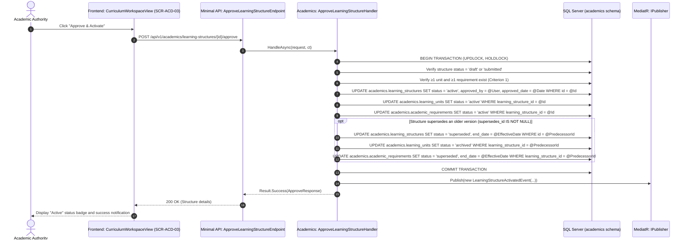
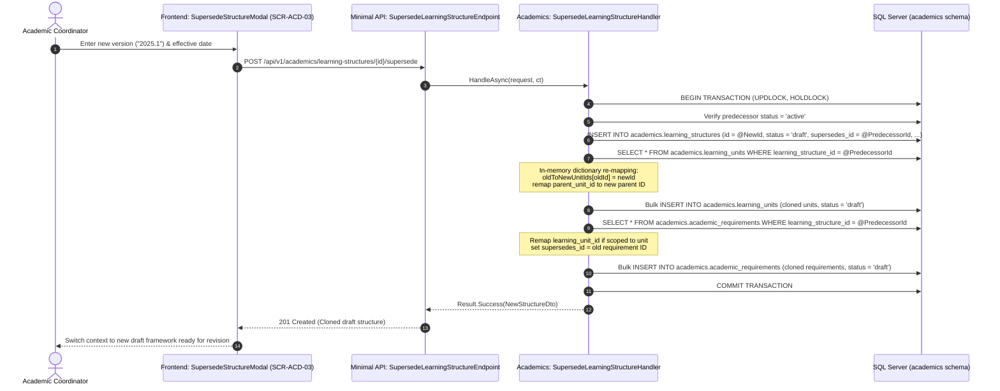
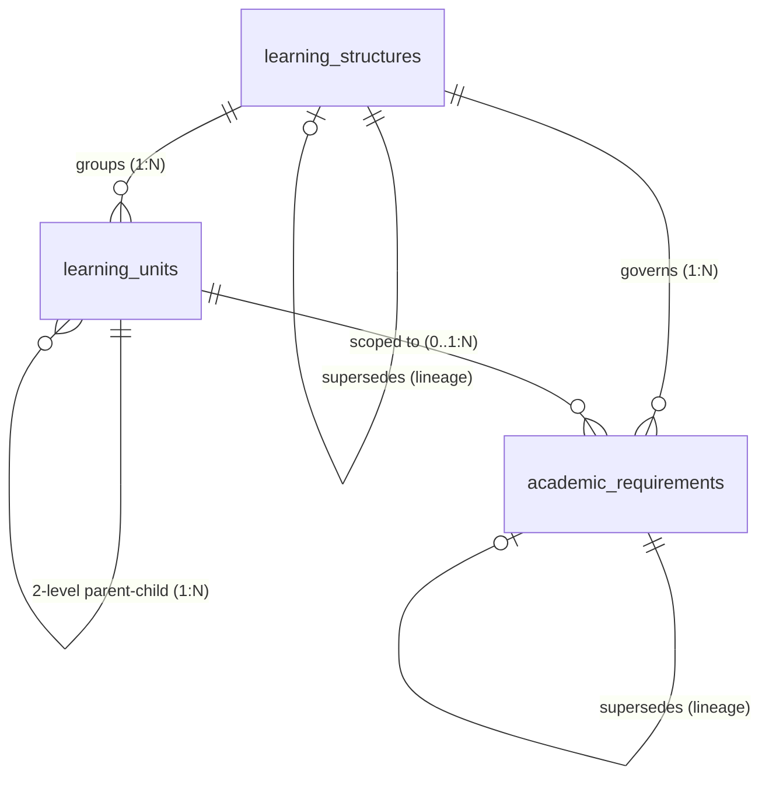

# 1. Overview

This target architecture defines the technical realization for the full scope of Stage 2 "Learning Structure & Requirements" under the Academic domain:
1. **Learning Structure Management (`ACD-WF-01`, `UC-ACD-08`):** Provisioning, lifecycle management, version lineage, and governance of top-level curriculum framework containers (`academics.learning_structures`) effective within operational academic periods.
2. **Curriculum Configuration & Learning Unit Abstraction (`ACD-WF-01`, `UC-ACD-08`):** Implementation of the single curriculum-neutral abstraction `Learning Unit` (`academics.learning_units`) unifying subjects, courses, modules, PACEs, projects, and competencies without variant domain tables, supporting a 2-level hierarchical parent-child composition via `parent_unit_id`.
3. **Academic Requirements & Policy Versioning (`ACD-WF-01`, `UC-ACD-08`):** Modeling, versioning, and governance of requirement rules (`academics.academic_requirements`) defining prerequisites, completion criteria, credit quotas, grading policies, and progression/graduation requirements across program, level, and learning unit scopes.
4. **Curriculum Planning Workspace (`SCR-ACD-03`):** Delivery of the unified Vue 3 planning workbench enabling Academic Coordinators to draft, configure, and revise curriculum frameworks, and Academic Authorities to formally approve and activate them.

It fulfills change request intake `CR-ACD-LEARNING-STRUCTURE-REQUIREMENTS` ([`IS008 - ACD-LEARNING-STRUCTURE-ISSUE.md`](file:///d:/Project.Private/elsasa-sis-v3/docs/issues/IS008%20-%20ACD-LEARNING-STRUCTURE-ISSUE.md)) and realizes the approved analysis decisions documented in [`IS008 - ACD-LEARNING-STRUCTURE-FEASIBILITY-ASSESSMENT.md`](file:///d:/Project.Private/elsasa-sis-v3/docs/issues/IS008%20-%20ACD-LEARNING-STRUCTURE-FEASIBILITY-ASSESSMENT.md).

The architecture establishes the foundational curriculum and requirements backbone for Elsasa School Information System (SIS) V3:
1. **Authoritative Submodule 1 Relational Schema:** Provisioning 3 authoritative relational tables specified in [`academic-entities-tables.md`](file:///d:/Project.Private/elsasa-sis-v3/docs/entities/academic-entities-tables.md) (`academics.learning_structures`, `academics.learning_units`, `academics.academic_requirements`) in a newly isolated SQL Server schema `academics`.
2. **Backend Domain Scaffolding & Compile-Time Isolation (`GAP-002`, `GAP-008`, `ADR-001`, `ADR-010`):** Creating `src/backend/Elsasa.Sis.Academics/` referencing only `Elsasa.Sis.Shared` and `Elsasa.Sis.Contracts`, integrated into `Elsasa.Sis.sln`, and guarded by NetArchTest rules in `Elsasa.Sis.ArchitectureTests`.
3. **Deep Clone-on-Supersede Curriculum Versioning Engine (`GAP-003`, `OQ-001`):** A transactional versioning workflow allowing Academic Coordinators to branch active curriculum into a draft successor version with automatic cloning and ID re-mapping of all units and requirements, preserving immutable historical predecessors.
4. **Two-Level Hierarchy Cap & Cycle-Free Composition (`GAP-004`, `OQ-002`):** Constraining `learning_units` composition strictly to root units (`parent_unit_id IS NULL`) and direct child units (`parent_unit_id IS NOT NULL`), eliminating recursive query overhead and cyclic graph vulnerabilities.
5. **Categorized Metadata for Academic Requirements (`GAP-005`, `OQ-003`):** Modeling requirements with explicit scope (`program`, `level`, `learning_unit`) and type (`completion`, `prerequisite`, `credit`, `progression`, `graduation`, `assessment_policy`) governed by human-supervised reviews in Stage 2 without premature JSON DSL parsers.
6. **Controlled In-Place Edit with Historical Immutability Guard (`GAP-006`, `OQ-005`):** Allowing typo and metadata updates on active frameworks while strictly locking structural fields (`code`, `unit_type`, `parent_unit_id`, `learning_structure_id`, deletions) to safeguard historical academic integrity.
7. **Cross-Domain Contract & Event Notification (`GAP-008`):** Providing `IAcademicsModule` for synchronous inquiries and publishing `LearningStructureActivatedEvent` post-commit to notify downstream Stage 2 modules.
8. **Frontend Unified Planning Workspace (`SCR-ACD-03`, `GAP-007`, `OQ-004`):** Building `src/frontend/src/features/academics/curriculum` featuring a top context bar and 3 cohesive tabs (Overview & Lineage, Learning Units, Academic Requirements).

---

# 2. Architectural Basis

## Business Context

This architecture realizes the business outcomes, operational workflows, and domain rules specified in:

- **DOMAIN BLUEPRINT:** [`academic-domain.md`](file:///d:/Project.Private/elsasa-sis-v3/docs/domains/academic-domain.md)
  - Learning Structure & Learning Unit Abstraction (lines 58–86)
  - Academic Requirements & Versioning (lines 88–106)
  - Student Learning Journey & Participation Boundaries (lines 144–170)
  - Actor Authorities: Academic Coordinator and Academic Authority (lines 132–136)
- **ROADMAP & COMPLETION CRITERIA:** [`sub-modul-and-development-phases.md`](file:///d:/Project.Private/elsasa-sis-v3/docs/sub-modul-and-development-phases.md)
  - Stage 2 Module: Learning Structure & Requirements (Submodule 1)
  - Stage 2 Completion Criterion 1: *"A learning structure with at least one learning unit and academic requirements is approved and effective."*
- **WORKFLOWS & USE CASES:**
  - [`operational-workflow-discovery.md`](file:///d:/Project.Private/elsasa-sis-v3/docs/operational-workflow-discovery.md): `ACD-WF-01: Configure and Approve Learning Structure & Requirements`
  - [`use-cases.md`](file:///d:/Project.Private/elsasa-sis-v3/docs/use-cases.md): `UC-ACD-08: Define Learning Structure`
  - [`actors.md`](file:///d:/Project.Private/elsasa-sis-v3/docs/actors.md): Academic Coordinator (`ACT-07`), Academic Authority (`ACT-08`)
- **DATA SPECIFICATIONS:**
  - [`academic-entities.md`](file:///d:/Project.Private/elsasa-sis-v3/docs/entities/academic-entities.md): Submodule 1 (Learning Structure & Requirements), Core Entities and Lifecycle states.
  - [`academic-entities-tables.md`](file:///d:/Project.Private/elsasa-sis-v3/docs/entities/academic-entities-tables.md): Submodule 1 tables (`academics.learning_structures`, `academics.learning_units`, `academics.academic_requirements`, lines 22–150).
- **SCREEN INVENTORY:** [`screen-inventory.md`](file:///d:/Project.Private/elsasa-sis-v3/docs/screen-inventory.md)
  - `SCR-ACD-03`: Curriculum & Learning Structure Workspace (Planning pattern, Stage 2 introduced)

## Analysis Input

This architecture consumes the approved gap closures, risk mitigations, and design decisions recorded in:

- **FEASIBILITY ASSESSMENT:** [`IS008 - ACD-LEARNING-STRUCTURE-FEASIBILITY-ASSESSMENT.md`](file:///d:/Project.Private/elsasa-sis-v3/docs/issues/IS008%20-%20ACD-LEARNING-STRUCTURE-FEASIBILITY-ASSESSMENT.md)
  - `GAP-001 / OQ-001`: Academics database schema provisioning & Deep Clone-on-Supersede curriculum versioning.
  - `GAP-002 / GAP-008`: Backend domain scaffolding & compile-time modularity in `Elsasa.Sis.Academics`.
  - `GAP-004 / OQ-002`: Two-level hierarchy cap (parent → child only) for learning unit composition.
  - `GAP-005 / OQ-003`: Categorized metadata modeling for academic requirements without dynamic JSON parser.
  - `GAP-006 / OQ-005`: Controlled in-place edit with historical immutability guard for active structures.
  - `GAP-007 / OQ-004`: Frontend unified planning workspace with top context bar and 3 cohesive tabs.
  - Planning Readiness: Granted `READY-FOR-PLANNING`.

```text
DOMAIN (academic-domain.md) + FEATURE (use-cases.md, screen-inventory.md)
                            +
       FEASIBILITY-ASSESSMENT (CR-ACD-LEARNING-STRUCTURE-REQUIREMENTS)
                            ↓
         TARGET ARCHITECTURE (ACD-LEARNING-STRUCTURE)
```

---

# 3. Scope

## Included

1. **Database Schema & Migrations (`Elsasa.Sis.Database`):**
   - Migration script `20261104_0401_Academics_LearningStructure_Tables.sql` targeting Microsoft SQL Server 2022 ([`ADR-002`](file:///d:/Project.Private/elsasa-sis-v3/docs/architecture/adr.md#L50-L75), [`ADR-006`](file:///d:/Project.Private/elsasa-sis-v3/docs/architecture/adr.md#L152-L176)).
   - Idempotent creation of SQL Server schema `academics`.
   - Creation of authoritative relational tables:
     - `academics.learning_structures`: Curriculum framework headers, period linkage, versioning, effective dates, governance approvals, and status lifecycles.
     - `academics.learning_units`: Single curriculum-neutral abstraction for subjects, courses, modules, PACEs, projects, and competencies; self-referencing 2-level parent-child hierarchy; credit weights.
     - `academics.academic_requirements`: Policy rules for completion, prerequisites, credit quotas, and progression across program, level, and learning unit scopes.
   - Provisioning of indexes, foreign key constraints (intra-schema and self-referencing), and unique invariants (`UQ_academics_learning_units_structure_code`).

2. **Backend Domain Architecture & Vertical Slices (`Elsasa.Sis.Academics`):**
   - Creation of new project `src/backend/Elsasa.Sis.Academics/Elsasa.Sis.Academics.csproj` (.NET 8).
   - Domain Assembly Marker `AcademicsAssemblyMarker` and dependency injection extension `AddAcademicsDomain()`.
   - Domain Permission Constants `Permissions.cs` defining `Permissions.Academics.Curriculum`.
   - Solution registration in `Elsasa.Sis.sln` and ASP.NET Core host integration in `Elsasa.Sis.Api/Program.cs`.
   - Compile-time domain isolation verification in `Elsasa.Sis.ArchitectureTests`.
   - **Vertical Slices — Learning Structures (`Features/LearningStructures/`):**
     - `CreateLearningStructure` (`POST /api/v1/academics/learning-structures`): Draft a new curriculum framework for an academic period.
     - `GetLearningStructures` (`GET /api/v1/academics/learning-structures`): Paginated inquiry filtered by `academicPeriodId`, `status`, and `search`.
     - `GetLearningStructureById` (`GET /api/v1/academics/learning-structures/{id}`): Detailed framework inquiry including unit count, requirement count, and lineage.
     - `UpdateLearningStructure` (`PUT /api/v1/academics/learning-structures/{id}`): Edit metadata with immutability guard.
     - `SubmitLearningStructure` (`POST /api/v1/academics/learning-structures/{id}/submit`): Coordinator submission validating Stage 2 Criterion 1 (at least 1 unit and 1 requirement).
     - `ApproveLearningStructure` (`POST /api/v1/academics/learning-structures/{id}/approve`): Authority approval activating structure, superseding predecessor, and emitting domain event.
     - `SupersedeLearningStructure` (`POST /api/v1/academics/learning-structures/{id}/supersede`): Transactional deep clone of active structure, units, and requirements into a new draft version.
     - `ArchiveLearningStructure` (`POST /api/v1/academics/learning-structures/{id}/archive`): Authority transition of superseded or inactive framework to archived.
   - **Vertical Slices — Learning Units (`Features/LearningUnits/`):**
     - `CreateLearningUnit` (`POST /api/v1/academics/learning-structures/{structureId}/units`): Add unit enforcing 2-level cap and unique code within structure.
     - `GetLearningUnits` (`GET /api/v1/academics/learning-structures/{structureId}/units`): Query flat list of units for hierarchical tree projection.
     - `GetLearningUnitById` (`GET /api/v1/academics/learning-units/{id}`): Detailed unit inspection.
     - `UpdateLearningUnit` (`PUT /api/v1/academics/learning-units/{id}`): Edit unit with structural lock if framework is active.
     - `DeleteLearningUnit` (`DELETE /api/v1/academics/learning-units/{id}`): Remove unit (permitted in draft only).
   - **Vertical Slices — Academic Requirements (`Features/AcademicRequirements/`):**
     - `CreateAcademicRequirement` (`POST /api/v1/academics/learning-structures/{structureId}/requirements`): Add requirement rule.
     - `GetAcademicRequirements` (`GET /api/v1/academics/learning-structures/{structureId}/requirements`): Query requirements filtered by `scope` and `type`.
     - `GetAcademicRequirementById` (`GET /api/v1/academics/academic-requirements/{id}`): Detailed requirement inspection.
     - `UpdateAcademicRequirement` (`PUT /api/v1/academics/academic-requirements/{id}`): Edit requirement with immutability guard.
     - `DeleteAcademicRequirement` (`DELETE /api/v1/academics/academic-requirements/{id}`): Remove requirement (permitted in draft only).

3. **Cross-Domain Contracts & Domain Events (`Elsasa.Sis.Contracts`):**
   - Synchronous contract interface `IAcademicsModule` in `Elsasa.Sis.Contracts/Academics/` exposing active structure lookups, learning unit queries, and requirement evaluations for downstream modules.
   - Synchronous contract implementation in `Elsasa.Sis.Academics/Services/AcademicsModule.cs`.
   - Domain event `LearningStructureActivatedEvent` in `Elsasa.Sis.Contracts/Academics/Events/` emitted post-commit via MediatR `IPublisher` ([`ADR-003`](file:///d:/Project.Private/elsasa-sis-v3/docs/architecture/adr.md#L76-L98)).

4. **Frontend Workspaces & Client Integration (`src/frontend`):**
   - **`SCR-ACD-03` Curriculum & Learning Structure Workspace (`/academics/curriculum`):**
     - `CurriculumWorkspaceView.vue`: Master planning view with top context bar (Period selector, Structure dropdown, Version pill, Status badge, Action buttons) and 3 cohesive tabs:
       - Tab 1: `StructureOverviewTab.vue`: Framework metadata, operational period label, effective dates, approval record, and historical predecessor link.
       - Tab 2: `LearningUnitsTab.vue`: Expandable 2-level tree/table of units with unit type badges, credit weights, level tags, status pills, and child unit actions.
       - Tab 3: `AcademicRequirementsTab.vue`: Grouped card/table view by scope (Program-wide, Level-specific, Unit-specific) with requirement types and policy descriptions.
     - Modals & Drawers: `CreateStructureModal.vue`, `CreateLearningUnitModal.vue`, `CreateRequirementModal.vue`, `SupersedeStructureModal.vue`.
   - API client module `curriculumApi.ts`, TanStack Query hooks `useCurriculum.ts`, TypeScript contracts `curriculum.types.ts`, and Zod validation schemas `curriculum.schemas.ts`.
   - Route registration in `src/frontend/src/app/router/routes.ts` protected by `Permissions.Academics.Curriculum.View`.
   - Navigation item in `src/frontend/src/app/layouts/AppLayout.vue` under "Academics".

## Excluded

1. **Student Participation & Roster Management (`ACD-WF-03`, `SCR-ACD-05`):** Individual student enrollment/registration into learning units and class roster finalization belong to companion Stage 2 submodule `Participation & Learning Activities`.
2. **Instructional Delivery & Attendance Tracking (`ACD-WF-04`, `ACD-WF-05`, `SCR-ACD-01`):** Daily session logging and student attendance capture belong to `Participation & Learning Activities`.
3. **Student Learning Plans (SLP) (`ACD-WF-02`, `SCR-ACD-04`):** Exceptional learner accommodations, course substitutions, and individual exemptions belong to `Student Learning Plan`.
4. **Coursework, Assignments & Assessments (`ACD-WF-06` to `ACD-WF-09`, `SCR-ACD-02`, `SCR-ACD-07`):** Rubric evaluation, coursework tasks, formative feedback, and summative result moderation belong to `Assessment & Results`.
5. **Academic Standing & Progression Recommendations (`ACD-WF-13`, `SCR-ACD-09`):** Cohort academic performance review and promotion/retention recommendations belong to `Standing & Progression`.
6. **Teaching Staff Authorization & Workload (`TCH-WF-01` to `TCH-WF-12`, `SCR-TCH-01`, `SCR-TCH-02`):** Faculty profiles, qualifications, and teacher assignment to units belong to the Teaching domain.
7. **Timetable Occurrence & Room Scheduling (`OPS-WF-02` to `OPS-WF-05`, `SCR-OPS-02`):** Physical facility reservation and weekly timetable scheduling belong to the Operations domain.

---

# 4. Technical Decisions

## TD-01: Authoritative Submodule 1 Relational Schema & Storage Layout

- **Decision:** Provision the `academics` database schema and 3 authoritative tables specified in [`academic-entities-tables.md`](file:///d:/Project.Private/elsasa-sis-v3/docs/entities/academic-entities-tables.md) using migration script `20261104_0401_Academics_LearningStructure_Tables.sql` targeting Microsoft SQL Server 2022 ([`ADR-002`](file:///d:/Project.Private/elsasa-sis-v3/docs/architecture/adr.md#L50-L75), [`ADR-006`](file:///d:/Project.Private/elsasa-sis-v3/docs/architecture/adr.md#L152-L176), `GAP-001`, `OQ-001`).
- **Realization:**
  - Idempotent schema creation:
    ```sql
    IF SCHEMA_ID(N'academics') IS NULL
    BEGIN
        EXEC (N'CREATE SCHEMA [academics] AUTHORIZATION [dbo];');
    END;
    GO
    ```
  - Provision 3 tables with native SQL Server types, `UNIQUEIDENTIFIER` primary keys, `NVARCHAR` text, `DATE` effective dates, `DATETIMEOFFSET(7)` UTC audit timestamps, and intra-schema foreign key constraints:
    1. `academics.learning_structures`
    2. `academics.learning_units`
    3. `academics.academic_requirements`
  - External domain references (`academic_period_id` from Operations) are stored as logical `UNIQUEIDENTIFIER` values with **zero physical cross-schema foreign keys**, strictly enforcing compile-time and physical database schema isolation ([`ADR-001`](file:///d:/Project.Private/elsasa-sis-v3/docs/architecture/adr.md#L20-L49), [`ADR-002`](file:///d:/Project.Private/elsasa-sis-v3/docs/architecture/adr.md#L50-L75)).

## TD-02: Backend Domain Assembly Scaffolding & Compile-Time Modularity

- **Decision:** Scaffold `src/backend/Elsasa.Sis.Academics/` as a .NET 8 class library adhering to Modular Monolith and Vertical Slice Architecture conventions ([`ADR-001`](file:///d:/Project.Private/elsasa-sis-v3/docs/architecture/adr.md#L20-L49), [`ADR-010`](file:///d:/Project.Private/elsasa-sis-v3/docs/architecture/adr.md#L252-L280), `GAP-002`, `GAP-008`).
- **Realization:**
  - `Elsasa.Sis.Academics.csproj` references only `Elsasa.Sis.Shared` and `Elsasa.Sis.Contracts`. Direct references to sibling domain projects (`Operations`, `Students`, `Finance`) are strictly prohibited.
  - Sibling domain independence is enforced by NetArchTest rules in `tests/backend/Elsasa.Sis.ArchitectureTests/AssemblyDependencyTests.cs`:
    - `Academics` must not reference `Operations`, `Students`, `Finance`, `Api`, or `Database`.
    - `Operations`, `Students`, and `Finance` must not reference `Academics`.
  - Feature slices are organized under `Features/<Submodule>/<Action>/`:
    - `Features/LearningStructures/`
    - `Features/LearningUnits/`
    - `Features/AcademicRequirements/`
  - Minimal API endpoints implement `IEndpoint` with explicit FluentValidation, Dapper SQL execution, and `Result<T>` outcomes.
  - Module registration: `AcademicsAssemblyMarker` is added to `DependencyInjection.DomainAssemblies` and `Stage2Assemblies` in `Elsasa.Sis.Api`, and `services.AddAcademicsDomain()` registers internal handlers and cross-domain query services.

## TD-03: Deep Clone-on-Supersede Curriculum Versioning Engine

- **Decision:** Implement **Deep Clone-on-Supersede into Draft** to govern curriculum versioning, eliminating tedious manual data re-entry while strictly safeguarding historical academic records (`GAP-003`, `OQ-001`, `RISK-003`).
- **Realization:**
  - Endpoint: `POST /api/v1/academics/learning-structures/{id}/supersede`
  - Handler workflow inside a single `SqlTransaction`:
    1. **Predecessor Validation:** Load predecessor structure with `UPDLOCK, HOLDLOCK`. Verify `status = 'active'`. If not active, return `DomainError.Conflict("Academic.InvalidSupersedeStatus", "Only active learning structures may be superseded.")`.
    2. **Insert Draft Structure:** Insert new `academics.learning_structures` row with `status = 'draft'`, `supersedes_id = @PredecessorId`, new `version` (e.g. `"2025.1"`), user-specified `effective_date`, and optional new `academic_period_id`.
    3. **Clone Learning Units with ID Remapping:**
       - Query all `learning_units` where `learning_structure_id = @PredecessorId`.
       - Instantiate an in-memory dictionary `Dictionary<Guid, Guid> oldToNewUnitIds`.
       - For each predecessor unit, generate `var newUnitId = Guid.NewGuid()` and record `oldToNewUnitIds[oldUnit.Id] = newUnitId`.
       - For each cloned unit, remap `parent_unit_id`:
         ```csharp
         var newParentId = oldUnit.ParentUnitId.HasValue 
             ? oldToNewUnitIds[oldUnit.ParentUnitId.Value] 
             : (Guid?)null;
         ```
       - Bulk insert cloned units with `learning_structure_id = newStructureId`, `status = 'draft'`, `parent_unit_id = newParentId`.
    4. **Clone Academic Requirements with Unit Remapping:**
       - Query all `academic_requirements` where `learning_structure_id = @PredecessorId`.
       - For each predecessor requirement, generate a new GUID, remap `learning_unit_id` using `oldToNewUnitIds` (if scope is `learning_unit`), set `learning_structure_id = newStructureId`, `status = 'draft'`, `supersedes_id = oldReq.Id`, and bulk insert.
  - **Activation & Predecessor Retirement:**
    - Upon approval via `POST /api/v1/academics/learning-structures/{id}/approve`:
      - Structure transitions to `status = 'active'`, `approved_by = @CurrentUser`, `approved_date = @CurrentDate`.
      - If `supersedes_id` is populated, the handler atomically executes:
        ```sql
        UPDATE academics.learning_structures
        SET status = 'superseded',
            end_date = @NewStructureEffectiveDate,
            updated_at = SYSDATETIMEOFFSET(),
            updated_by = @ApprovedBy
        WHERE id = @PredecessorId;
        ```
      - All cloned units and requirements transition their status to `active`.
      - Publishes `LearningStructureActivatedEvent` post-commit.

## TD-04: Two-Level Hierarchy Cap & Cycle-Free Learning Unit Composition

- **Decision:** Constrain `learning_units` composition strictly to a **2-Level Hierarchy Cap (Parent → Child only)**, completely eliminating graph recursion and infinite cycle vulnerabilities (`GAP-004`, `OQ-002`, `RISK-001`).
- **Realization:**
  - **Hierarchy Levels:**
    - **Level 1 (Root Units):** `parent_unit_id IS NULL`. Represents top-level curriculum offerings (e.g. `subject`, `course`, `project`).
    - **Level 2 (Child Units):** `parent_unit_id IS NOT NULL`. Represents granular sub-components (e.g. `module`, `competency`, `pace`, `unit`).
  - **Structural Invariants:**
    1. A child unit **cannot** have children. If unit $A$ has `parent_unit_id IS NOT NULL`, no unit $B$ may set `parent_unit_id = A.id`.
    2. A child unit must belong to the exact same `learning_structure_id` as its parent.
    3. Self-parenting is prohibited (`parent_unit_id != id`).
  - **Validation Logic:** Enforced in `CreateLearningUnitCommandValidator` and `CreateLearningUnitHandler`:
    ```csharp
    if (request.ParentUnitId.HasValue)
    {
        const string checkParentSql = """
            SELECT learning_structure_id, parent_unit_id 
            FROM academics.learning_units 
            WHERE id = @ParentUnitId;
            """;
        var parent = await connection.QuerySingleOrDefaultAsync<ParentUnitCheckDto>(
            checkParentSql, new { request.ParentUnitId }, transaction);

        if (parent is null)
            return Result.Failure(DomainError.NotFound("Academic.ParentUnitNotFound", "Specified parent learning unit does not exist."));

        if (parent.LearningStructureId != structureId)
            return Result.Failure(DomainError.Validation("Academic.CrossStructureParent", "Parent unit must belong to the same learning structure."));

        if (parent.ParentUnitId.HasValue)
            return Result.Failure(DomainError.Validation("Academic.HierarchyDepthExceeded", "Learning units are constrained to a maximum of 2 hierarchy levels. A child unit cannot have sub-children."));
    }
    ```
  - **Query Ergonomics:** Flat Dapper query `SELECT * FROM academics.learning_units WHERE learning_structure_id = @Id ORDER BY code` executes in a single round-trip without recursive CTEs, enabling the frontend to assemble the 2-level tree in memory in $O(N)$ time.

## TD-05: Categorized Metadata for Academic Requirements

- **Decision:** Model academic requirements using **Categorized Metadata with Explicit Description** matching [`academic-entities-tables.md`](file:///d:/Project.Private/elsasa-sis-v3/docs/entities/academic-entities-tables.md), governed by human-supervised evaluation in Stage 2 without introducing a dynamic JSON rule engine (`GAP-005`, `OQ-003`).
- **Realization:**
  - The `academic_requirements` table persists categorized rules using standard discrete attributes:
    - `requirement_scope`: `program`, `level`, `learning_unit`.
    - `requirement_type`: `completion`, `prerequisite`, `credit`, `progression`, `graduation`, `assessment_policy`.
    - `description`: Plain text detailing the explicit requirement criteria (e.g. *"Must achieve at least 75% mastery in all Grade 4 modules with no unexcused absences exceeding 10%"*).
    - Scoped entity linkages: `learning_structure_id` (mandatory context), `learning_unit_id` (populated when scope is `learning_unit`), and `level` (populated when scope is `level`).
  - Pragmatic simplicity: Eliminates runtime JSON parsing, abstract syntax tree evaluators, and fragile rule scripts while fully satisfying Stage 2 Coordinator review workflows.

## TD-06: Controlled In-Place Edit with Historical Immutability Guard

- **Decision:** Adopt **Controlled In-Place Edit with Historical Immutability Guard** to balance routine operational flexibility (fixing typos or updating syllabus text) with strict preservation of historical curriculum integrity (`GAP-006`, `OQ-005`, `RISK-002`).
- **Realization:**
  - **Status-Driven Mutability Rules:**
    | Entity Status | Allowed Mutations | Prohibited Mutations | Remediation for Changes |
    |---|---|---|---|
    | `draft` | Full creation, modification, and hard deletion of structures, units, and requirements. | None. | Direct in-place editing. |
    | `active` | In-place update of non-breaking metadata only: `name`, `description`, `notes`, `level`. Full audit logging (`updated_at`, `updated_by`). | Modifications to `code`, `unit_type`, `parent_unit_id`, `learning_structure_id`, or hard deletion of units/requirements. | Return `DomainError.Conflict("Academic.ImmutableStructuralData", "Structural modifications are locked on active curriculum frameworks. Create a new version via supersede.")`. |
    | `superseded` | Zero mutations permitted. Read-only historical archive. | All modifications and deletions. | Create new version via `supersede` from the active structure. |
    | `archived` | Zero mutations permitted. Read-only historical archive. | All modifications and deletions. | None. |
  - Handlers for `UpdateLearningUnit` and `UpdateAcademicRequirement` verify the owning learning structure's status. If `active` and structural properties differ from persisted state, the operation is rejected with `DomainError.Conflict`.

## TD-07: Permissions Hierarchy & Segregation of Duties

- **Decision:** Enforce strict role-based access control and segregation of duties in accordance with [`ADR-009`](file:///d:/Project.Private/elsasa-sis-v3/docs/architecture/adr.md#L226-L251) and [`actors.md`](file:///d:/Project.Private/elsasa-sis-v3/docs/actors.md).
- **Realization:**
  - Authoritative permission constants in `Elsasa.Sis.Academics/Permissions.cs`:
    - `Permissions.Academics.Curriculum.View`: View learning structures, units, and requirements.
    - `Permissions.Academics.Curriculum.Manage`: Create, edit, and organize structures, units, and requirements in `draft` status (Academic Coordinator).
    - `Permissions.Academics.Curriculum.Submit`: Submit draft structures for formal governance approval (Academic Coordinator).
    - `Permissions.Academics.Curriculum.Approve`: Formally approve, activate, and supersede curriculum frameworks (Academic Authority).
    - `Permissions.Academics.Curriculum.Archive`: Retire superseded or obsolete frameworks (Academic Authority).
  - All endpoints enforce permissions via `.RequireAuthorization(permission)`.

## TD-08: Frontend Unified Planning Workspace Architecture (`SCR-ACD-03`)

- **Decision:** Deliver `SCR-ACD-03: Curriculum & Learning Structure Workspace` as a **Unified Planning Workspace with Top Context Bar & 3 Cohesive Tabs** located at `src/frontend/src/features/academics/curriculum/` (`GAP-007`, `OQ-004`).
- **Realization:**
  - **Route:** `/academics/curriculum` registered in `src/frontend/src/app/router/routes.ts` protected by `Permissions.Academics.Curriculum.View`.
  - **Component Structure:**
    - `CurriculumWorkspaceView.vue`: Master view managing context selection and tab orchestration.
    - **Top Context Bar:**
      - Academic Period dropdown (`IOperationsCalendarQueryService`).
      - Learning Structure selector dropdown for the active period.
      - Version badge (e.g. `v2024.1`) and Status pill (`draft`, `active`, `superseded`, `archived`).
      - Action Bar:
        - Coordinator: "New Structure", "Edit Metadata", "Supersede / New Version", "Submit for Approval".
        - Authority: "Approve & Activate", "Archive".
    - **Tab 1: Overview & Lineage (`StructureOverviewTab.vue`):** Displays structure name, period label, description, version, effective dating, approval audit details (`approved_by`, `approved_date`), and link to predecessor structure.
    - **Tab 2: Learning Units (`LearningUnitsTab.vue`):** 2-level expandable TreeTable displaying unit code, name, unit type badge, level, credit weight, and action menu. Contains "Add Learning Unit" and "Add Child Module" dialogs.
    - **Tab 3: Academic Requirements (`AcademicRequirementsTab.vue`):** Grouped card and table view organized by scope (Program-wide, Level-specific, Learning Unit-specific) displaying requirement type, criteria description, effective dates, and status.
  - **State & Data Access:**
    - TanStack Query hooks in `useCurriculum.ts` managing cache keys `['academics', 'structures']`, `['academics', 'units', structureId]`, and `['academics', 'requirements', structureId]`.
    - Typed Axios client in `curriculumApi.ts`.
    - Form handling with VeeValidate and typed Zod schemas in `curriculum.schemas.ts`.

## TD-09: Synchronous Cross-Domain Contract & Domain Event Publishing

- **Decision:** Expose a read-only cross-domain query contract `IAcademicsModule` and publish `LearningStructureActivatedEvent` upon curriculum activation strictly post-commit ([`ADR-003`](file:///d:/Project.Private/elsasa-sis-v3/docs/architecture/adr.md#L76-L98), `GAP-008`).
- **Realization:**
  - Interface defined in `Elsasa.Sis.Contracts/Academics/IAcademicsModule.cs`:
    ```csharp
    namespace Elsasa.Sis.Contracts.Academics;

    public interface IAcademicsModule
    {
        Task<Result<ActiveLearningStructureDto?>> GetActiveLearningStructureForPeriodAsync(
            Guid academicPeriodId, CancellationToken ct = default);

        Task<Result<IReadOnlyList<LearningUnitDto>>> GetLearningUnitsByStructureAsync(
            Guid learningStructureId, CancellationToken ct = default);

        Task<Result<LearningUnitDto?>> GetLearningUnitByIdAsync(
            Guid learningUnitId, CancellationToken ct = default);

        Task<Result<IReadOnlyList<AcademicRequirementDto>>> GetAcademicRequirementsByStructureAsync(
            Guid learningStructureId, CancellationToken ct = default);
    }
    ```
  - Domain event record defined in `Elsasa.Sis.Contracts/Academics/Events/LearningStructureActivatedEvent.cs`:
    ```csharp
    namespace Elsasa.Sis.Contracts.Academics.Events;

    public sealed record LearningStructureActivatedEvent(
        Guid LearningStructureId,
        Guid AcademicPeriodId,
        string Version,
        DateOnly EffectiveDate,
        DateTimeOffset OccurredOn) : IDomainEvent;
    ```
  - Published via MediatR `IPublisher` inside `ApproveLearningStructureHandler` strictly after `transaction.CommitAsync()` succeeds.

---

# 5. Component Responsibilities

| Component | Assembly / Path | Single Responsibility |
|---|---|---|
| `AcademicsAssemblyMarker` | `Elsasa.Sis.Academics` | Marker type for assembly scanning, MediatR, and FluentValidation registration. |
| `Permissions` | `Elsasa.Sis.Academics` | Authoritative permission constants for the Academics domain. |
| `AcademicsModule` | `Elsasa.Sis.Academics/Services/` | Implements `IAcademicsModule` for synchronous cross-domain queries. |
| `CreateLearningStructureHandler` | `Elsasa.Sis.Academics/Features/LearningStructures/` | Validates academic period existence and persists draft curriculum framework. |
| `GetLearningStructuresHandler` | `Elsasa.Sis.Academics/Features/LearningStructures/` | Executes paginated Dapper queries for learning structures with counts. |
| `GetLearningStructureByIdHandler` | `Elsasa.Sis.Academics/Features/LearningStructures/` | Projects detailed structure record with lineage and predecessor details. |
| `UpdateLearningStructureHandler` | `Elsasa.Sis.Academics/Features/LearningStructures/` | Updates framework metadata with status immutability enforcement. |
| `SubmitLearningStructureHandler` | `Elsasa.Sis.Academics/Features/LearningStructures/` | Enforces Stage 2 Criterion 1 (≥1 unit, ≥1 requirement) before submission. |
| `ApproveLearningStructureHandler` | `Elsasa.Sis.Academics/Features/LearningStructures/` | Activates structure, supersedes predecessor, updates end date, emits event. |
| `SupersedeLearningStructureHandler` | `Elsasa.Sis.Academics/Features/LearningStructures/` | Executes transactional deep clone of structure, units, and requirements into draft. |
| `ArchiveLearningStructureHandler` | `Elsasa.Sis.Academics/Features/LearningStructures/` | Retires superseded or inactive frameworks to archived status. |
| `CreateLearningUnitHandler` | `Elsasa.Sis.Academics/Features/LearningUnits/` | Validates 2-level cap, unique code within structure, and inserts unit. |
| `GetLearningUnitsHandler` | `Elsasa.Sis.Academics/Features/LearningUnits/` | Queries flat list of units for a structure ordered by code. |
| `GetLearningUnitByIdHandler` | `Elsasa.Sis.Academics/Features/LearningUnits/` | Projects single unit details and parent relationship. |
| `UpdateLearningUnitHandler` | `Elsasa.Sis.Academics/Features/LearningUnits/` | Updates unit with structural field locking when structure is active. |
| `DeleteLearningUnitHandler` | `Elsasa.Sis.Academics/Features/LearningUnits/` | Deletes unit from draft structure, preventing orphan child units. |
| `CreateAcademicRequirementHandler` | `Elsasa.Sis.Academics/Features/AcademicRequirements/` | Validates scope, unit reference, and inserts requirement policy. |
| `GetAcademicRequirementsHandler` | `Elsasa.Sis.Academics/Features/AcademicRequirements/` | Queries requirements for a structure filtered by scope and type. |
| `GetAcademicRequirementByIdHandler` | `Elsasa.Sis.Academics/Features/AcademicRequirements/` | Projects single requirement rule details. |
| `UpdateAcademicRequirementHandler` | `Elsasa.Sis.Academics/Features/AcademicRequirements/` | Updates requirement criteria with status immutability enforcement. |
| `DeleteAcademicRequirementHandler` | `Elsasa.Sis.Academics/Features/AcademicRequirements/` | Deletes requirement from draft structure. |
| `CurriculumWorkspaceView.vue` | `src/frontend/.../curriculum/views/` | Master planning view orchestrating context selection, tabs, and action menus. |
| `StructureOverviewTab.vue` | `src/frontend/.../curriculum/components/` | Renders framework overview, effective dates, lineage, and approval audit. |
| `LearningUnitsTab.vue` | `src/frontend/.../curriculum/components/` | Renders 2-level hierarchical TreeTable of units with creation/edit dialogs. |
| `AcademicRequirementsTab.vue` | `src/frontend/.../curriculum/components/` | Renders categorized requirement cards and tables grouped by scope. |
| `curriculumApi.ts` | `src/frontend/.../curriculum/api/` | Axios client executing typed HTTP requests for Academics endpoints. |
| `useCurriculum.ts` | `src/frontend/.../curriculum/composables/` | TanStack Query composables managing server state and cache invalidation. |

---

# 6. Integration Design

| Source Component | Target Component | Purpose & Interaction |
|---|---|---|
| `CreateLearningStructureHandler` | `IOperationsCalendarQueryService` | Synchronously validates that the target `academic_period_id` exists and is open. |
| `ApproveLearningStructureHandler` | `IPublisher` (MediatR) | Publishes `LearningStructureActivatedEvent` post-commit for downstream module discovery. |
| Downstream Stage 2 Modules | `IAcademicsModule` | Synchronously queries active learning structures, learning units, and requirement policies. |
| `CurriculumWorkspaceView.vue` | `Minimal API Endpoints` | Issues REST requests to manage structures, units, requirements, and lifecycle actions. |
| `AssemblyDependencyTests` | `Elsasa.Sis.Academics` | Verifies compile-time isolation and prevents direct sibling domain references. |

## Sequence Diagram: Approval & Activation Workflow



## Sequence Diagram: Deep Clone-on-Supersede Workflow



---

# 7. Data Ownership

| Data Domain / Entity | Authoritative Owner | Non-Authoritative Consumers | Permitted Access Model |
|---|---|---|---|
| `academics.learning_structures` | Academics | Teaching, Students, Operations | Read via `IAcademicsModule` or read query view. Direct write forbidden. |
| `academics.learning_units` | Academics | Teaching, Students, Development | Read via `IAcademicsModule` or direct read projection. Direct write forbidden. |
| `academics.academic_requirements` | Academics | Students, Teaching | Read via `IAcademicsModule`. Direct write forbidden. |
| `operations.operational_periods` | Operations | Academics, Students, Finance | Read via `IOperationsCalendarQueryService`. Academics owns zero period data. |
| `operations.academic_years` | Operations | Academics, Students, Finance | Read via `IOperationsCalendarQueryService`. |

---

# 8. Database Design

## 8.1 New Tables

### Table 1: `academics.learning_structures`

| Column | SQL Type | Nullable | Default | Description |
|---|---|:---:|---|---|
| `id` | `UNIQUEIDENTIFIER` | NO | `NEWID()` | Primary Key. |
| `name` | `NVARCHAR(200)` | NO | — | Human-readable name (e.g. "Kurikulum Merdeka SD 2024"). |
| `description` | `NVARCHAR(MAX)` | YES | NULL | Description of the learning structure. |
| `academic_period_id` | `UNIQUEIDENTIFIER` | NO | — | Logical reference to `operations.operational_periods(id)`. |
| `academic_period_label` | `NVARCHAR(100)` | NO | — | Human-readable period label snapshot (e.g. "TP 2024/2025"). |
| `version` | `NVARCHAR(50)` | NO | — | Version string identifier (e.g. "2024.1"). |
| `effective_date` | `DATE` | NO | — | Date this structure becomes operational. |
| `end_date` | `DATE` | YES | NULL | Date this structure ceases to be effective (null = current). |
| `status` | `NVARCHAR(50)` | NO | `'draft'` | Lifecycle status: `draft`, `submitted`, `active`, `superseded`, `archived`. |
| `approved_by` | `NVARCHAR(256)` | YES | NULL | Username/email of Academic Authority who approved. |
| `approved_date` | `DATE` | YES | NULL | Date approved. |
| `supersedes_id` | `UNIQUEIDENTIFIER` | YES | NULL | Self-reference to previous version in `academics.learning_structures(id)`. |
| `notes` | `NVARCHAR(MAX)` | YES | NULL | Internal coordinator/authority notes. |
| `created_at` | `DATETIMEOFFSET(7)` | NO | `SYSDATETIMEOFFSET()` | Creation timestamp in UTC. |
| `created_by` | `NVARCHAR(256)` | NO | — | User who created the record. |
| `updated_at` | `DATETIMEOFFSET(7)` | YES | NULL | Last modification timestamp in UTC. |
| `updated_by` | `NVARCHAR(256)` | YES | NULL | User who last modified the record. |

**Constraints & Indexes:**
- `PK_academics_learning_structures`: Primary Key on `(id)`.
- `FK_academics_learning_structures_supersedes`: Foreign Key `(supersedes_id)` REFERENCES `academics.learning_structures(id)`.
- `CK_academics_learning_structures_status`: `CHECK (status IN ('draft', 'submitted', 'active', 'superseded', 'archived'))`.
- `IX_academics_learning_structures_period_status`: Non-clustered index on `(academic_period_id, status)`.
- `IX_academics_learning_structures_supersedes`: Non-clustered index on `(supersedes_id)` WHERE `supersedes_id IS NOT NULL`.

---

### Table 2: `academics.learning_units`

| Column | SQL Type | Nullable | Default | Description |
|---|---|:---:|---|---|
| `id` | `UNIQUEIDENTIFIER` | NO | `NEWID()` | Primary Key. |
| `learning_structure_id` | `UNIQUEIDENTIFIER` | NO | — | Foreign Key to `academics.learning_structures(id)`. |
| `parent_unit_id` | `UNIQUEIDENTIFIER` | YES | NULL | Self-referencing FK for 2-level hierarchy composition. |
| `code` | `NVARCHAR(50)` | NO | — | Unit code (e.g. "MAT-4-S1"). Unique within structure. |
| `name` | `NVARCHAR(200)` | NO | — | Human-readable name (e.g. "Matematika Kelas 4 Semester 1"). |
| `unit_type` | `NVARCHAR(50)` | NO | — | Expression: `subject`, `course`, `module`, `pace`, `project`, `competency`, `unit`, `other`. |
| `level` | `NVARCHAR(50)` | YES | NULL | Grade or level context (e.g. "Grade 4"). |
| `description` | `NVARCHAR(MAX)` | YES | NULL | Description of curriculum scope. |
| `credit_weight` | `DECIMAL(5,2)` | YES | NULL | Credit or weight allocation. |
| `status` | `NVARCHAR(50)` | NO | `'draft'` | Status: `draft`, `active`, `archived`. |
| `notes` | `NVARCHAR(MAX)` | YES | NULL | Internal notes. |
| `created_at` | `DATETIMEOFFSET(7)` | NO | `SYSDATETIMEOFFSET()` | Creation timestamp in UTC. |
| `created_by` | `NVARCHAR(256)` | NO | — | User who created the record. |
| `updated_at` | `DATETIMEOFFSET(7)` | YES | NULL | Last modification timestamp in UTC. |
| `updated_by` | `NVARCHAR(256)` | YES | NULL | User who last modified the record. |

**Constraints & Indexes:**
- `PK_academics_learning_units`: Primary Key on `(id)`.
- `FK_academics_learning_units_structure`: Foreign Key `(learning_structure_id)` REFERENCES `academics.learning_structures(id)` ON DELETE NO ACTION.
- `FK_academics_learning_units_parent`: Foreign Key `(parent_unit_id)` REFERENCES `academics.learning_units(id)` ON DELETE NO ACTION.
- `UQ_academics_learning_units_structure_code`: Unique Constraint on `(learning_structure_id, code)`.
- `CK_academics_learning_units_unit_type`: `CHECK (unit_type IN ('subject', 'course', 'module', 'pace', 'project', 'competency', 'unit', 'other'))`.
- `CK_academics_learning_units_status`: `CHECK (status IN ('draft', 'active', 'archived'))`.
- `CK_academics_learning_units_self_parent`: `CHECK (parent_unit_id <> id)`.
- `IX_academics_learning_units_structure_parent`: Non-clustered index on `(learning_structure_id, parent_unit_id)`.

---

### Table 3: `academics.academic_requirements`

| Column | SQL Type | Nullable | Default | Description |
|---|---|:---:|---|---|
| `id` | `UNIQUEIDENTIFIER` | NO | `NEWID()` | Primary Key. |
| `name` | `NVARCHAR(200)` | NO | — | Human-readable name (e.g. "Grade 4 Promotion Requirements"). |
| `requirement_scope` | `NVARCHAR(50)` | NO | — | Scope: `program`, `level`, `learning_unit`. |
| `learning_structure_id` | `UNIQUEIDENTIFIER` | NO | — | Foreign Key to `academics.learning_structures(id)`. |
| `learning_unit_id` | `UNIQUEIDENTIFIER` | YES | NULL | Foreign Key to `academics.learning_units(id)` (when scope = `learning_unit`). |
| `level` | `NVARCHAR(50)` | YES | NULL | Grade/level context (when scope = `level`). |
| `requirement_type` | `NVARCHAR(50)` | NO | — | Type: `completion`, `prerequisite`, `credit`, `progression`, `graduation`, `assessment_policy`. |
| `description` | `NVARCHAR(MAX)` | NO | — | Explicit text description of requirement criteria. |
| `version` | `NVARCHAR(50)` | NO | — | Version string identifier (e.g. "2024.1"). |
| `effective_date` | `DATE` | NO | — | Date requirement becomes effective. |
| `end_date` | `DATE` | YES | NULL | Date requirement ceases to be effective. |
| `status` | `NVARCHAR(50)` | NO | `'draft'` | Status: `draft`, `active`, `superseded`, `archived`. |
| `approved_by` | `NVARCHAR(256)` | YES | NULL | Approving authority username. |
| `approved_date` | `DATE` | YES | NULL | Date approved. |
| `supersedes_id` | `UNIQUEIDENTIFIER` | YES | NULL | Self-reference to previous requirement in `academics.academic_requirements(id)`. |
| `notes` | `NVARCHAR(MAX)` | YES | NULL | Internal notes. |
| `created_at` | `DATETIMEOFFSET(7)` | NO | `SYSDATETIMEOFFSET()` | Creation timestamp in UTC. |
| `created_by` | `NVARCHAR(256)` | NO | — | User who created the record. |
| `updated_at` | `DATETIMEOFFSET(7)` | YES | NULL | Last modification timestamp in UTC. |
| `updated_by` | `NVARCHAR(256)` | YES | NULL | User who last modified the record. |

**Constraints & Indexes:**
- `PK_academics_academic_requirements`: Primary Key on `(id)`.
- `FK_academics_academic_requirements_structure`: Foreign Key `(learning_structure_id)` REFERENCES `academics.learning_structures(id)`.
- `FK_academics_academic_requirements_unit`: Foreign Key `(learning_unit_id)` REFERENCES `academics.learning_units(id)`.
- `FK_academics_academic_requirements_supersedes`: Foreign Key `(supersedes_id)` REFERENCES `academics.academic_requirements(id)`.
- `CK_academics_academic_requirements_scope`: `CHECK (requirement_scope IN ('program', 'level', 'learning_unit'))`.
- `CK_academics_academic_requirements_type`: `CHECK (requirement_type IN ('completion', 'prerequisite', 'credit', 'progression', 'graduation', 'assessment_policy'))`.
- `CK_academics_academic_requirements_status`: `CHECK (status IN ('draft', 'active', 'superseded', 'archived'))`.
- `IX_academics_academic_requirements_structure_scope`: Non-clustered index on `(learning_structure_id, requirement_scope, status)`.

---

## 8.2 Modified Tables

None. The `academics` schema is newly provisioned, requiring zero modifications to existing `operations.*`, `students.*`, or `finance.*` tables.

---

## 8.3 Relationships



- **Learning Structure to Units:** 1:N relationship. A learning structure contains one or more learning units.
- **2-Level Unit Hierarchy:** Self-referencing 1:N relationship on `parent_unit_id`. Root units (`parent_unit_id IS NULL`) group child modules (`parent_unit_id IS NOT NULL`). Children cannot be parents.
- **Learning Structure to Requirements:** 1:N relationship. Requirements are anchored to a learning structure and carry their own version and status lifecycle.
- **Unit Scoped Requirements:** Optional 1:N relationship linking requirements directly to a target learning unit when `requirement_scope = 'learning_unit'`.

---

## 8.4 Migration Considerations

1. **Sequential Migration Execution:** The migration script `20261104_0401_Academics_LearningStructure_Tables.sql` runs sequentially via DbUp in `Elsasa.Sis.Database`.
2. **Schema Creation Guard:** The script begins by idempotently checking `IF SCHEMA_ID(N'academics') IS NULL` and creating the schema.
3. **Idempotent Table Provisioning:** All tables, indexes, and constraints use `IF OBJECT_ID(...) IS NULL` and `IF NOT EXISTS` guards.
4. **Referential Integrity Ordering:** Tables are provisioned in dependency order: `academics.learning_structures` first, followed by `academics.learning_units`, and finally `academics.academic_requirements`.

---

# 9. Cross-Cutting Concerns

## 9.1 Security & Authorization

- **Authentication:** All requests require a valid Bearer JWT authenticated via ASP.NET Core JWT bearer authentication middleware.
- **Authorization Policies:** Endpoints enforce fine-grained permissions via `.RequireAuthorization(permission)`.
- **Segregation of Duties:**
  - `Academic Coordinator` holds `Permissions.Academics.Curriculum.Manage` and `Permissions.Academics.Curriculum.Submit`.
  - `Academic Authority` holds `Permissions.Academics.Curriculum.Approve` and `Permissions.Academics.Curriculum.Archive`.
  - A coordinator cannot approve their own submitted structure without possessing the `Approve` permission.

## 9.2 Audit & Immutability

- **Audit Columns:** Every row in `learning_structures`, `learning_units`, and `academic_requirements` captures `created_at`, `created_by`, `updated_at`, and `updated_by`. User identifiers are extracted from `ICurrentUser` (JWT claims).
- **Historical Immutability:** Once a learning structure is in `active` status, structural fields are permanently locked. Structural evolution requires creating a successor version via the deep clone-on-supersede workflow.
- **Predecessor Retention:** Superseded records are never deleted; their `end_date` is stamped and status transitioned to `superseded`, maintaining an immutable audit trail for historical transcripts and student records.

## 9.3 Concurrency & Idempotency

- **Row Locks during Governance Transitions:** Transitions for `approve` and `supersede` execute inside a transaction with `UPDLOCK, HOLDLOCK` table hints to prevent race conditions when two operators simultaneously act on the same structure.
- **Unique Code Invariant:** Database constraint `UQ_academics_learning_units_structure_code` prevents duplicate unit codes within the same learning structure.
- **Transactional Cloning:** The deep clone-on-supersede operation executes inside a single `SqlTransaction`. If cloning any unit or requirement fails, the entire transaction rolls back cleanly.

## 9.4 Performance & Query Indexing

- **Clustered Primary Keys:** Native `UNIQUEIDENTIFIER` primary keys indexed with non-fragmenting `NEWID()` defaults.
- **Composite Non-Clustered Indexes:** Filtered indexes on `(academic_period_id, status)` and `(learning_structure_id, parent_unit_id)` ensure index-seek performance for high-frequency planning and tree rendering queries.
- **Flat Tree Queries:** Unit tree hierarchies are loaded in a single flat SQL query without recursive CTE joins, assembling into tree nodes in memory with sub-millisecond overhead.

---

# 10. Implementation Constraints

1. **No ORM (No EF Core):** All backend data access must use **Dapper** with parameterized raw T-SQL queries executed through `ISqlConnectionFactory`. Generic repositories or entity trackers are strictly prohibited ([`ADR-002`](file:///d:/Project.Private/elsasa-sis-v3/docs/architecture/adr.md#L50-L75)).
2. **Minimal APIs & Direct Handlers:** Every vertical slice must implement `IEndpoint` and invoke its dedicated feature handler directly. MediatR must **not** be used for commands or queries ([`ADR-004`](file:///d:/Project.Private/elsasa-sis-v3/docs/architecture/adr.md#L100-L125)).
3. **MediatR for Events Only:** MediatR `IPublisher` is strictly reserved for post-commit in-memory domain events (`LearningStructureActivatedEvent`) ([`ADR-003`](file:///d:/Project.Private/elsasa-sis-v3/docs/architecture/adr.md#L76-L98)).
4. **Compile-Time Assembly Isolation:** `Elsasa.Sis.Academics` must reference only `Elsasa.Sis.Shared` and `Elsasa.Sis.Contracts`. Direct references to sibling domains are prohibited and verified by NetArchTest ([`ADR-001`](file:///d:/Project.Private/elsasa-sis-v3/docs/architecture/adr.md#L20-L49), [`ADR-010`](file:///d:/Project.Private/elsasa-sis-v3/docs/architecture/adr.md#L252-L280)).
5. **No Cross-Schema Foreign Keys:** Physical database foreign keys must not cross schema boundaries. Logical foreign key references (such as `academic_period_id`) must be stored as plain `UNIQUEIDENTIFIER` columns ([`ADR-002`](file:///d:/Project.Private/elsasa-sis-v3/docs/architecture/adr.md#L50-L75)).
6. **Result Pattern over Exceptions:** Slices must return `Result<T>` or `Result` with explicit `DomainError` instances. Business validation or conflict flows must never throw exceptions ([`backend-architecture.md`](file:///d:/Project.Private/elsasa-sis-v3/docs/architecture/backend-architecture.md)).
7. **Curriculum-Neutral Abstraction:** Subjects, courses, modules, PACEs, projects, and competencies must be stored in `academics.learning_units` distinguished by `unit_type`. Creating variant tables is strictly prohibited ([`academic-domain.md`](file:///d:/Project.Private/elsasa-sis-v3/docs/domains/academic-domain.md)).
8. **Frontend Ergonomics:** Single File Components using `<script setup lang="ts">`, PrimeVue primitives styled with Tailwind CSS, VeeValidate with Zod schemas for forms, and TanStack Query for server state management ([`frontend-architecture.md`](file:///d:/Project.Private/elsasa-sis-v3/docs/architecture/frontend-architecture.md)).

---

# 11. Acceptance Conditions

The implementation of Stage 2 Learning Structure & Requirements is considered architecturally complete when:

1. **Database Migration:** Script `20261104_0401_Academics_LearningStructure_Tables.sql` runs cleanly via DbUp, successfully creating the `academics` schema, the 3 core tables, unique constraints, and foreign key relationships.
2. **Compile-Time Modularity:** `Elsasa.Sis.Academics` builds without warnings under `<Nullable>enable</Nullable>`, references only `Shared` and `Contracts`, and passes all NetArchTest rules in `Elsasa.Sis.ArchitectureTests`.
3. **Stage 2 Criterion 1 Satisfied:** An Academic Coordinator can create a draft structure, add at least one learning unit and one academic requirement, submit it for approval, and an Academic Authority can formally approve and activate it (`status = 'active'`).
4. **Two-Level Hierarchy Enforced:** Adding a child unit with `parent_unit_id` successfully associates with a root unit; attempting to add a child unit under a unit that already has a parent is rejected with `DomainError.Validation`.
5. **Unique Unit Code Constraint:** Attempting to create or clone two units with the same code in the same learning structure is blocked with `DomainError.Conflict`.
6. **Deep Clone-on-Supersede Verified:** Superseding an active structure transactionally creates a new draft structure with incremented version and clones all predecessor units and requirements with correct parent-child remappings. Upon activating the new structure, the predecessor is updated to `status = 'superseded'` and `end_date` is stamped.
7. **Active Mutability Guard Verified:** Modifying non-breaking metadata on an active structure/unit succeeds; attempting to alter structural fields (`code`, `unit_type`, `parent_unit_id`) or delete units from an active structure is rejected with `DomainError.Conflict`.
8. **Cross-Domain Contract & Events:** `IAcademicsModule` returns active structures and units for valid operational periods, and `LearningStructureActivatedEvent` is published upon framework approval.
9. **Frontend Workspace Functional (`SCR-ACD-03`):** The Vue 3 workbench at `/academics/curriculum` renders the top context bar and 3 cohesive tabs (Overview & Lineage, Learning Units tree-table, Academic Requirements grouped cards), allowing complete management of curriculum lifecycles.
