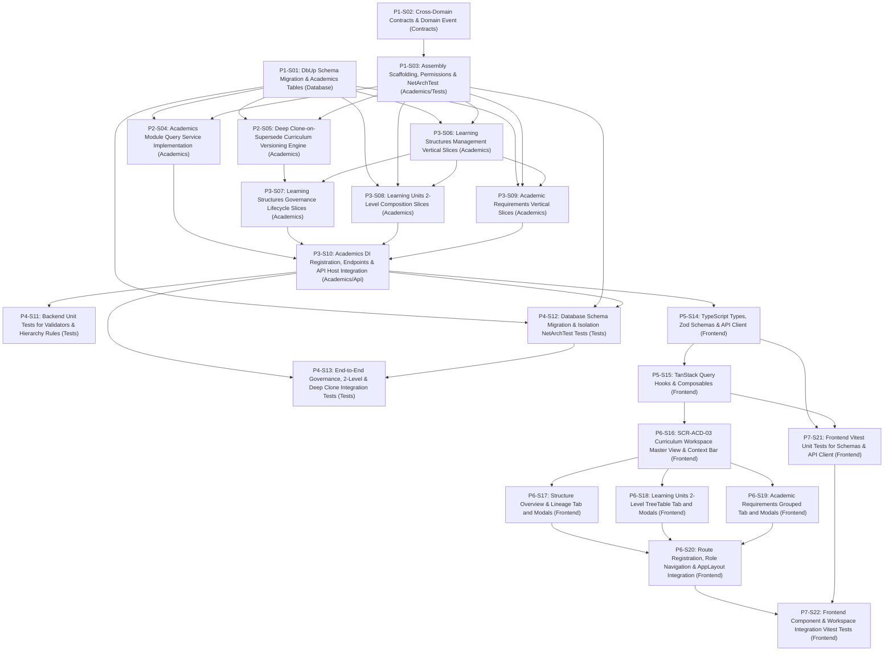

# 1. Objective

Implement the complete Stage 2 "Learning Structure & Requirements — full scope: Learning Structure Management (`ACD-WF-01`, `UC-ACD-08`), Curriculum Configuration & Learning Unit Abstraction, Academic Requirements & Policy Versioning, and Curriculum Planning Workspace (`SCR-ACD-03`)" under the Academic domain for Elsasa SIS V3, fulfilling change request intake `CR-ACD-LEARNING-STRUCTURE-REQUIREMENTS` ([`IS008 - ACD-LEARNING-STRUCTURE-ISSUE.md`](file:///d:/Project.Private/elsasa-sis-v3/docs/issues/IS008%20-%20ACD-LEARNING-STRUCTURE-ISSUE.md)) and realizing the approved target architecture ([`IS008 - ACD-LEARNING-STRUCTURE-ARCHITECTURE.md`](file:///d:/Project.Private/elsasa-sis-v3/docs/issues/IS008%20-%20ACD-LEARNING-STRUCTURE-ARCHITECTURE.md)).

This implementation establishes:
1. **Authoritative Submodule 1 Relational Persistence Schema (`GAP-001`, `OQ-001`):** Provisioning 3 authoritative relational tables specified in [`academic-entities-tables.md`](file:///d:/Project.Private/elsasa-sis-v3/docs/entities/academic-entities-tables.md) (`academics.learning_structures`, `academics.learning_units`, `academics.academic_requirements`) in a newly isolated SQL Server schema `academics` via sequential forward DbUp migration script `20261104_0401_Academics_LearningStructure_Tables.sql`.
2. **Backend Domain Scaffolding & Compile-Time Modularity (`GAP-002`, `GAP-008`, `ADR-001`, `ADR-010`):** Creating `src/backend/Elsasa.Sis.Academics/` referencing only `Elsasa.Sis.Shared` and `Elsasa.Sis.Contracts`, registering the assembly in `Elsasa.Sis.sln` and `Elsasa.Sis.Api`, and enforcing compile-time domain isolation with NetArchTest rules in `tests/backend/Elsasa.Sis.ArchitectureTests`.
3. **Deep Clone-on-Supersede Curriculum Versioning Engine (`GAP-003`, `OQ-001`, `TD-03`):** Implementing a transactional versioning engine (`POST /api/v1/academics/learning-structures/{id}/supersede`) that branches an active curriculum framework into a draft successor version with automatic in-memory GUID re-mapping of all units (preserving `parent_unit_id` relationships) and requirements, maintaining immutable historical predecessors upon approval.
4. **Two-Level Hierarchy Cap & Cycle-Free Learning Unit Composition (`GAP-004`, `OQ-002`, `TD-04`):** Implementing the single curriculum-neutral abstraction `Learning Unit` (`academics.learning_units`) unifying subjects, courses, modules, PACEs, projects, and competencies, strictly capping composition to root units (`parent_unit_id IS NULL`) and direct child units (`parent_unit_id IS NOT NULL`), eliminating recursive query overhead and cyclic graph vulnerabilities.
5. **Categorized Metadata for Academic Requirements (`GAP-005`, `OQ-003`, `TD-05`):** Persisting categorized requirement rules with explicit criteria descriptions across program, level, and unit scopes, governed by human-supervised reviews in Stage 2 without premature JSON DSL rule engines.
6. **Controlled In-Place Edit with Historical Immutability Guard (`GAP-006`, `OQ-005`, `TD-06`):** Permitting non-breaking metadata updates on active frameworks while strictly locking structural fields (`code`, `unit_type`, `parent_unit_id`, `learning_structure_id`, hard deletions) to preserve historical curriculum integrity.
7. **Synchronous Cross-Domain Contract & Domain Event Publishing (`GAP-008`, `TD-09`):** Exposing synchronous contract interface `IAcademicsModule` in `Elsasa.Sis.Contracts` (implemented by `AcademicsModule.cs`) and publishing `LearningStructureActivatedEvent` post-commit upon framework approval.
8. **Frontend Unified Planning Workspace (`SCR-ACD-03`, `GAP-007`, `OQ-004`, `TD-08`):** Delivering the Vue 3 planning workbench at `/academics/curriculum` featuring a top context bar (Period selector, Structure dropdown, Version pill, Status badge, Action buttons) and 3 cohesive tabs (Overview & Lineage, Learning Units 2-level tree-table, Academic Requirements grouped cards).

Planning Mode: FEATURE-PLANNING

Referenced artifacts:
- FEATURE / ISSUE:
  - `docs/issues/IS008 - ACD-LEARNING-STRUCTURE-ISSUE.md` (Intake `CR-ACD-LEARNING-STRUCTURE-REQUIREMENTS`)
  - `docs/domains/academic-domain.md` (Learning Structure & Learning Unit Abstraction lines 58–86, Academic Requirements & Versioning lines 88–106, Student Learning Journey lines 144–170)
  - `docs/sub-modul-and-development-phases.md` (Stage 2 Module: Learning Structure & Requirements, Criterion 1)
  - `docs/operational-workflow-discovery.md` (`ACD-WF-01: Configure and Approve Learning Structure & Requirements`)
  - `docs/use-cases.md` (`UC-ACD-08: Define Learning Structure`)
  - `docs/actors.md` (Academic Coordinator `ACT-07`, Academic Authority `ACT-08`)
  - `docs/screen-inventory.md` (`SCR-ACD-03: Curriculum & Learning Structure Workspace`)
  - `docs/entities/academic-entities.md` & `docs/entities/academic-entities-tables.md` (Submodule 1 — Learning Structure & Requirements; Tables 1.1 through 1.3)
- ARCHITECTURE:
  - `docs/issues/IS008 - ACD-LEARNING-STRUCTURE-ARCHITECTURE.md` (Authoritative target capability architecture)
  - `docs/architecture/backend-architecture.md` (Modular Monolith & Vertical Slice specification)
  - `docs/architecture/frontend-architecture.md` (Modular Vue 3 SPA architecture)
  - `docs/architecture/adr.md` (ADR-001 through ADR-010)
  - `docs/architecture/coding-conventions.md` (C# 12, Dapper raw SQL, Minimal API conventions)
- FEASIBILITY-ASSESSMENT:
  - `docs/issues/IS008 - ACD-LEARNING-STRUCTURE-FEASIBILITY-ASSESSMENT.md` (Status: `READY-FOR-PLANNING`)

Architecture Applicability: ARCHITECTURE-REQUIRED

This feature introduces a new backend domain assembly (`Elsasa.Sis.Academics`), a new isolated SQL Server database schema (`academics`) with 3 authoritative tables, unique constraints, and hierarchical self-references, cross-domain contracts and events (`IAcademicsModule`, `LearningStructureActivatedEvent`), deep clone-on-supersede versioning, active mutability locks, and a full frontend planning workspace (`SCR-ACD-03`). Target architecture `docs/issues/IS008 - ACD-LEARNING-STRUCTURE-ARCHITECTURE.md` is authoritative and governs this plan.

---

# 2. Planning Scope

The planning scope encompasses all changes required across database persistence, backend assembly scaffolding, domain vertical slices, cross-domain contracts, automated test harnesses, and frontend workspaces:

1. **Database Persistence & DbUp Migrations (`Elsasa.Sis.Database`):**
   - Author and register sequential forward DbUp migration script `20261104_0401_Academics_LearningStructure_Tables.sql` targeting Microsoft SQL Server 2022 ([`ADR-002`](file:///d:/Project.Private/elsasa-sis-v3/docs/architecture/adr.md#L50-L75), [`ADR-006`](file:///d:/Project.Private/elsasa-sis-v3/docs/architecture/adr.md#L152-L176)).
   - Idempotent creation of SQL Server schema `academics`.
   - Provisioning of authoritative tables:
     - `academics.learning_structures`: Framework headers, period linkage, versioning, effective dates, approval record, and status lifecycle (`draft`, `submitted`, `active`, `superseded`, `archived`).
     - `academics.learning_units`: Single curriculum-neutral abstraction; self-referencing 2-level parent-child hierarchy; credit weights; scoped unique codes (`UQ_academics_learning_units_structure_code`).
     - `academics.academic_requirements`: Policy rules for completion, prerequisites, credit quotas, and progression across program, level, and learning unit scopes.
   - Provisioning of primary keys, check constraints, foreign keys (with zero cross-schema physical FKs), and performance indexes.

2. **Cross-Domain Contracts & Domain Events (`Elsasa.Sis.Contracts`):**
   - Define synchronous query interface `IAcademicsModule` in `src/backend/Elsasa.Sis.Contracts/Academics/` exposing active structure lookups, unit queries, and requirement evaluations for downstream modules.
   - Define shared DTOs: `ActiveLearningStructureDto`, `LearningUnitDto`, and `AcademicRequirementDto`.
   - Define domain event record `LearningStructureActivatedEvent` in `src/backend/Elsasa.Sis.Contracts/Academics/Events/` implementing `IDomainEvent` ([`ADR-003`](file:///d:/Project.Private/elsasa-sis-v3/docs/architecture/adr.md#L76-L98)).

3. **Backend Domain Scaffolding & Compile-Time Modularity (`Elsasa.Sis.Academics`, `Elsasa.Sis.ArchitectureTests`):**
   - Create class library `src/backend/Elsasa.Sis.Academics/Elsasa.Sis.Academics.csproj` (.NET 8, `<Nullable>enable</Nullable>`) referencing only `Shared` and `Contracts`.
   - Add project to solution file `src/backend/Elsasa.Sis.sln`.
   - Provide `AcademicsAssemblyMarker` for assembly scanning and DI registration.
   - Define authoritative permission constants in `Permissions.cs` (`Permissions.Academics.Curriculum.*`).
   - Register `Academics` assembly in `Elsasa.Sis.ArchitectureTests` and enforce compile-time isolation rules with NetArchTest.

4. **Core Domain Services & Deep Clone Engine (`Elsasa.Sis.Academics`):**
   - Implement `IAcademicsModule` in `Services/AcademicsModule.cs` executing parameterized Dapper queries.
   - Implement transactional deep clone-on-supersede engine with in-memory GUID re-mapping for units and requirements, preserving 2-level hierarchy and predecessor lineage.

5. **Backend Vertical Slices & Minimal APIs (`Elsasa.Sis.Academics`, `Elsasa.Sis.Api`):**
   - **Learning Structures Management (`Features/LearningStructures/`):**
     - `CreateLearningStructure` (`POST /api/v1/academics/learning-structures`): Validates academic period via `IOperationsCalendarQueryService` and creates draft framework.
     - `GetLearningStructures` (`GET /api/v1/academics/learning-structures`): Paginated inquiry filtered by period, status, and search, including unit/requirement counts.
     - `GetLearningStructureById` (`GET /api/v1/academics/learning-structures/{id}`): Full framework details, lineage, and predecessor info.
     - `UpdateLearningStructure` (`PUT /api/v1/academics/learning-structures/{id}`): Metadata updates with active immutability lock.
   - **Learning Structures Governance Lifecycle (`Features/LearningStructures/`):**
     - `SubmitLearningStructure` (`POST /api/v1/academics/learning-structures/{id}/submit`): Validates Stage 2 Criterion 1 (≥1 unit, ≥1 requirement) before submission.
     - `ApproveLearningStructure` (`POST /api/v1/academics/learning-structures/{id}/approve`): Authority approval activating structure, superseding predecessor, stamping end dates, and publishing `LearningStructureActivatedEvent`.
     - `SupersedeLearningStructure` (`POST /api/v1/academics/learning-structures/{id}/supersede`): Transactional deep clone into new draft framework.
     - `ArchiveLearningStructure` (`POST /api/v1/academics/learning-structures/{id}/archive`): Retires superseded or inactive frameworks.
   - **Learning Units (`Features/LearningUnits/`):**
     - `CreateLearningUnit` (`POST /api/v1/academics/learning-structures/{structureId}/units`): Validates 2-level cap (parent cannot have parent), unique code in structure, and persists unit.
     - `GetLearningUnits` (`GET /api/v1/academics/learning-structures/{structureId}/units`): Flat query for hierarchical tree projection.
     - `GetLearningUnitById` (`GET /api/v1/academics/learning-units/{id}`): Detailed unit inspection.
     - `UpdateLearningUnit` (`PUT /api/v1/academics/learning-units/{id}`): Metadata edits with structural lock if framework is active.
     - `DeleteLearningUnit` (`DELETE /api/v1/academics/learning-units/{id}`): Removes unit from draft framework; prevents orphan child units.
   - **Academic Requirements (`Features/AcademicRequirements/`):**
     - `CreateAcademicRequirement` (`POST /api/v1/academics/learning-structures/{structureId}/requirements`): Validates scope, unit reference, type, and criteria description.
     - `GetAcademicRequirements` (`GET /api/v1/academics/learning-structures/{structureId}/requirements`): Queries requirements filtered by scope and type.
     - `GetAcademicRequirementById` (`GET /api/v1/academics/academic-requirements/{id}`): Detailed requirement inspection.
     - `UpdateAcademicRequirement` (`PUT /api/v1/academics/academic-requirements/{id}`): Updates criteria with status immutability enforcement.
     - `DeleteAcademicRequirement` (`DELETE /api/v1/academics/academic-requirements/{id}`): Removes requirement from draft framework.
   - **DI Registration & Host Wiring:**
     - `DependencyInjection.cs` registers handlers, validators, services, and authorization policies.
     - `AcademicsEndpoints.cs` maps all Minimal API endpoints under `/api/v1/academics/`.
     - `Elsasa.Sis.Api/Program.cs` registers `AcademicsAssemblyMarker` in `DomainAssemblies` and `Stage2Assemblies`, calls `AddAcademicsDomain()`, and maps routes.

6. **Automated Testing Suite (`tests/backend`):**
   - Unit tests covering FluentValidation validators, 2-level hierarchy validation rules, and immutability guard conditions.
   - SQL Server 2022 Testcontainers integration tests verifying migration `20261104_0401` execution, schema constraints, structure lifecycle (draft -> submit -> approve), Stage 2 Criterion 1 validation, 2-level unit hierarchy constraints, deep clone-on-supersede versioning, active in-place edit immutability locks, and cross-domain `IAcademicsModule` inquiries.

7. **Frontend State, API Clients & Composables (`src/frontend`):**
   - TypeScript interfaces, Zod validation schemas, and Axios client modules for learning structures, learning units, and academic requirements.
   - TanStack Query hooks and mutation composables (`useLearningStructures`, `useLearningUnits`, `useAcademicRequirements`).

8. **Frontend Workspaces & Navigation Integration (`SCR-ACD-03`, `src/frontend`):**
   - `SCR-ACD-03` Curriculum & Learning Structure Workspace (`/academics/curriculum`):
     - `CurriculumWorkspaceView.vue`: Master view managing context selection, top context bar, and tab orchestration.
     - `StructureOverviewTab.vue`: Framework metadata, operational period label, effective dates, approval record, and predecessor lineage link.
     - `LearningUnitsTab.vue`: 2-level expandable TreeTable of units with unit type badges, credit weights, level tags, status pills, and child unit actions.
     - `AcademicRequirementsTab.vue`: Grouped card and table view by scope (Program-wide, Level-specific, Unit-specific) with requirement types and policy descriptions.
     - Modals: `CreateStructureModal.vue`, `CreateLearningUnitModal.vue`, `CreateRequirementModal.vue`, `SupersedeStructureModal.vue`, and `EditStructureModal.vue`.
   - Route registration in `src/frontend/src/app/router/routes.ts` protected by `Permissions.Academics.Curriculum.View`.
   - Navigation item in `src/frontend/src/app/layouts/AppLayout.vue` under "Academics".

9. **Frontend Automated Verification & Testing (`src/frontend`):**
   - Unit tests for Zod schemas, API clients, and composables using Vitest.
   - Component & integration tests using Vitest and Vue Test Utils for `CurriculumWorkspaceView`, `LearningUnitsTab`, `AcademicRequirementsTab`, and modals.

---

# 3. Dependencies

### External System & Tooling Dependencies

- .NET 8 SDK (8.0.x)
- Docker / Docker Desktop / Podman (required for Testcontainers SQL Server 2022 integration tests)
- Microsoft SQL Server 2022 instance (for local Web API runtime)
- Node.js runtime (v22.x or LTS) and pnpm package manager (v9.x or v11.x)

### Internal Slice Dependencies

- `Depends On` declares implementation prerequisites between slices.
- Dependencies reference Slice IDs only.
- Dependency satisfaction requires the referenced slice to have implementation status `IMPLEMENTED`.
- Dependency satisfaction does not require review status `GO`.
- Slices with `Depends On: None` or whose dependencies are satisfied may be executed in parallel.

### Dependency Graph



---

# 4. Progress Summary

Plan status values:
- NOT-STARTED
- IN-PROGRESS
- BLOCKED
- COMPLETED

Execution Approval values:
- PENDING
- APPROVED

Execution Approval is owned by the Architect. It is set to APPROVED when the plan structure is finalized and released for execution. Execution must not begin while Execution Approval is PENDING.

COMPLETED is a plan-level status only, set when every slice has implementation status IMPLEMENTED and review status GO.

| Phase | Implementation Status | Review Status | Progress |
|---|---|---|---|
| P1 - Persistence, Cross-Domain Contracts & Domain Scaffolding Foundation | NOT-STARTED | NOT-REVIEWED | 0/3 |
| P2 - Core Domain Services & Deep Clone Versioning Engine | NOT-STARTED | NOT-REVIEWED | 0/2 |
| P3 - Backend Vertical Slices & Web API Host Integration | NOT-STARTED | NOT-REVIEWED | 0/5 |
| P4 - Backend Automated Verification & Integration Harness | NOT-STARTED | NOT-REVIEWED | 0/3 |
| P5 - Frontend State, API Clients, Zod Schemas & Composables | NOT-STARTED | NOT-REVIEWED | 0/2 |
| P6 - Frontend Workspaces & Navigation Integration (SCR-ACD-03) | NOT-STARTED | NOT-REVIEWED | 0/5 |
| P7 - Frontend Automated Verification & Component Tests | NOT-STARTED | NOT-REVIEWED | 0/2 |

---

# 5. Phases

## P1 - Persistence, Cross-Domain Contracts & Domain Scaffolding Foundation

Implementation Status: NOT-STARTED
Review Status: NOT-REVIEWED

### P1-S01

Title: Database Schema Migration (`academics` Schema, 3 Tables, Constraints & Indexes)

Implementation Status: IMPLEMENTED
Review Status: GO

Objective:
Author and register forward DbUp migration script `20261104_0401_Academics_LearningStructure_Tables.sql` in `src/backend/Elsasa.Sis.Database/Scripts/`, creating the isolated SQL Server schema `academics` and provisioning the 3 authoritative Submodule 1 tables (`academics.learning_structures`, `academics.learning_units`, `academics.academic_requirements`) with native constraints, indexes, unique keys, and self-referencing relationships targeting Microsoft SQL Server 2022 ([`ADR-002`](file:///d:/Project.Private/elsasa-sis-v3/docs/architecture/adr.md#L50-L75), [`ADR-006`](file:///d:/Project.Private/elsasa-sis-v3/docs/architecture/adr.md#L152-L176)).

Depends On: None

Repository: `src/backend/Elsasa.Sis.Database`

Completion Criteria:
1. Migration script `20261104_0401_Academics_LearningStructure_Tables.sql` exists in `src/backend/Elsasa.Sis.Database/Scripts/` and executes cleanly via DbUp.
2. Idempotent schema creation guard `IF SCHEMA_ID(N'academics') IS NULL` creates the `academics` schema.
3. Table `academics.learning_structures` is provisioned with:
   - Primary key `PK_academics_learning_structures` on `(id)` (`UNIQUEIDENTIFIER NOT NULL DEFAULT NEWID()`).
   - Self-referencing foreign key `FK_academics_learning_structures_supersedes` on `(supersedes_id)` referencing `academics.learning_structures(id)`.
   - Check constraint `CK_academics_learning_structures_status`: `CHECK (status IN ('draft', 'submitted', 'active', 'superseded', 'archived'))`.
   - Composite query index `IX_academics_learning_structures_period_status` on `(academic_period_id, status)`.
   - Filtered index `IX_academics_learning_structures_supersedes` on `(supersedes_id)` WHERE `supersedes_id IS NOT NULL`.
   - Logical external foreign key `academic_period_id UNIQUEIDENTIFIER NOT NULL` with zero physical cross-schema foreign keys.
4. Table `academics.learning_units` is provisioned with:
   - Primary key `PK_academics_learning_units` on `(id)`.
   - Foreign key `FK_academics_learning_units_structure` on `(learning_structure_id)` referencing `academics.learning_structures(id)`.
   - Self-referencing foreign key `FK_academics_learning_units_parent` on `(parent_unit_id)` referencing `academics.learning_units(id)`.
   - Unique constraint `UQ_academics_learning_units_structure_code` on `(learning_structure_id, code)`.
   - Check constraint `CK_academics_learning_units_unit_type`: `CHECK (unit_type IN ('subject', 'course', 'module', 'pace', 'project', 'competency', 'unit', 'other'))`.
   - Check constraint `CK_academics_learning_units_status`: `CHECK (status IN ('draft', 'active', 'archived'))`.
   - Self-parent check constraint `CK_academics_learning_units_self_parent`: `CHECK (parent_unit_id <> id)`.
   - Query index `IX_academics_learning_units_structure_parent` on `(learning_structure_id, parent_unit_id)`.
5. Table `academics.academic_requirements` is provisioned with:
   - Primary key `PK_academics_academic_requirements` on `(id)`.
   - Foreign key `FK_academics_academic_requirements_structure` on `(learning_structure_id)` referencing `academics.learning_structures(id)`.
   - Foreign key `FK_academics_academic_requirements_unit` on `(learning_unit_id)` referencing `academics.learning_units(id)`.
   - Self-referencing foreign key `FK_academics_academic_requirements_supersedes` on `(supersedes_id)` referencing `academics.academic_requirements(id)`.
   - Check constraint `CK_academics_academic_requirements_scope`: `CHECK (requirement_scope IN ('program', 'level', 'learning_unit'))`.
   - Check constraint `CK_academics_academic_requirements_type`: `CHECK (requirement_type IN ('completion', 'prerequisite', 'credit', 'progression', 'graduation', 'assessment_policy'))`.
   - Check constraint `CK_academics_academic_requirements_status`: `CHECK (status IN ('draft', 'active', 'superseded', 'archived'))`.
   - Query index `IX_academics_academic_requirements_structure_scope` on `(learning_structure_id, requirement_scope, status)`.
6. Audit columns (`created_at`, `created_by`, `updated_at`, `updated_by`) are present on all 3 tables with UTC defaults.
7. Script executes idempotently using `IF NOT EXISTS` / `IF OBJECT_ID` guards and preserves existing data.

Implementation Notes:
- Created idempotent migration script `src/backend/Elsasa.Sis.Database/Scripts/20261104_0401_Academics_LearningStructure_Tables.sql`.
- Added schema creation guard `IF SCHEMA_ID(N'academics') IS NULL` ensuring isolated schema `[academics]` provisioning.
- Provisioned table `academics.learning_structures` with PK `PK_academics_learning_structures`, self-referencing FK `FK_academics_learning_structures_supersedes`, status check constraint `CK_academics_learning_structures_status`, non-clustered composite index `IX_academics_learning_structures_period_status`, and filtered index `IX_academics_learning_structures_supersedes`.
- Provisioned table `academics.learning_units` with PK `PK_academics_learning_units`, FK to structure `FK_academics_learning_units_structure`, self-referencing FK `FK_academics_learning_units_parent`, unique constraint `UQ_academics_learning_units_structure_code`, unit_type check constraint `CK_academics_learning_units_unit_type`, status check constraint `CK_academics_learning_units_status`, self-parent check constraint `CK_academics_learning_units_self_parent`, and query index `IX_academics_learning_units_structure_parent`.
- Provisioned table `academics.academic_requirements` with PK `PK_academics_academic_requirements`, FK to structure `FK_academics_academic_requirements_structure`, FK to unit `FK_academics_academic_requirements_unit`, self-referencing FK `FK_academics_academic_requirements_supersedes`, scope check constraint `CK_academics_academic_requirements_scope`, type check constraint `CK_academics_academic_requirements_type`, status check constraint `CK_academics_academic_requirements_status`, and query index `IX_academics_academic_requirements_structure_scope`.
- Configured all intra-schema foreign keys with `ON DELETE NO ACTION` and maintained zero cross-schema physical foreign keys.
- Configured audit columns with `DATETIMEOFFSET(7)` and `SYSUTCDATETIME()` UTC defaults.
- Verified manifest resource embedding and verified clean compilation across `Elsasa.Sis.Database` and entire solution.

Changed Files:
- `src/backend/Elsasa.Sis.Database/Scripts/20261104_0401_Academics_LearningStructure_Tables.sql`

Notes:
- Strictly follow DDL specifications in `IS008 - ACD-LEARNING-STRUCTURE-ARCHITECTURE.md` Section 8.
- Foreign keys use `ON DELETE NO ACTION` to prevent cascading deletions across curriculum hierarchies.
- Zero physical foreign keys to `operations.operational_periods` to preserve compile-time and physical database schema isolation.

---

### P1-S02

Title: Cross-Domain Contracts & Domain Event (`IAcademicsModule`, DTOs, `LearningStructureActivatedEvent`)

Implementation Status: IMPLEMENTED
Review Status: GO

Objective:
Define the synchronous cross-domain inquiry interface `IAcademicsModule`, shared DTO contracts, and post-commit domain event `LearningStructureActivatedEvent` in `src/backend/Elsasa.Sis.Contracts/Academics/` ([`ADR-001`](file:///d:/Project.Private/elsasa-sis-v3/docs/architecture/adr.md#L20-L49), [`ADR-003`](file:///d:/Project.Private/elsasa-sis-v3/docs/architecture/adr.md#L76-L98), `TD-09`).

Depends On: None

Repository: `src/backend/Elsasa.Sis.Contracts`

Completion Criteria:
1. `src/backend/Elsasa.Sis.Contracts/Academics/IAcademicsModule.cs` created with methods:
   - `Task<Result<ActiveLearningStructureDto?>> GetActiveLearningStructureForPeriodAsync(Guid academicPeriodId, CancellationToken ct = default)`
   - `Task<Result<IReadOnlyList<LearningUnitDto>>> GetLearningUnitsByStructureAsync(Guid learningStructureId, CancellationToken ct = default)`
   - `Task<Result<LearningUnitDto?>> GetLearningUnitByIdAsync(Guid learningUnitId, CancellationToken ct = default)`
   - `Task<Result<IReadOnlyList<AcademicRequirementDto>>> GetAcademicRequirementsByStructureAsync(Guid learningStructureId, CancellationToken ct = default)`
2. DTO records created under `src/backend/Elsasa.Sis.Contracts/Academics/`:
   - `ActiveLearningStructureDto(Guid Id, string Name, Guid AcademicPeriodId, string AcademicPeriodLabel, string Version, DateOnly EffectiveDate, string Status, string? ApprovedBy, DateOnly? ApprovedDate)`
   - `LearningUnitDto(Guid Id, Guid LearningStructureId, Guid? ParentUnitId, string Code, string Name, string UnitType, string? Level, decimal? CreditWeight, string Status)`
   - `AcademicRequirementDto(Guid Id, string Name, string RequirementScope, Guid LearningStructureId, Guid? LearningUnitId, string? Level, string RequirementType, string Description, string Version, DateOnly EffectiveDate, DateOnly? EndDate, string Status)`
3. Domain event record created under `src/backend/Elsasa.Sis.Contracts/Academics/Events/LearningStructureActivatedEvent.cs`:
   - `public sealed record LearningStructureActivatedEvent(Guid LearningStructureId, Guid AcademicPeriodId, string Version, DateOnly EffectiveDate, DateTimeOffset OccurredOn) : IDomainEvent;`
   - Includes secondary constructor defaulting `OccurredOn` to `DateTimeOffset.UtcNow`.
4. `Elsasa.Sis.Contracts` compiles cleanly without warnings under `<Nullable>enable</Nullable>`.

Implementation Notes:
- Created `src/backend/Elsasa.Sis.Contracts/Academics/IAcademicsModule.cs` defining `IAcademicsModule` with 4 cross-domain inquiry methods returning `Result<T>`.
- Created strongly-typed contract DTO records `ActiveLearningStructureDto`, `LearningUnitDto`, and `AcademicRequirementDto` in `src/backend/Elsasa.Sis.Contracts/Academics/`.
- Created in-memory domain event record `LearningStructureActivatedEvent` implementing `IDomainEvent` in `src/backend/Elsasa.Sis.Contracts/Academics/Events/` with primary constructor and secondary constructor defaulting `OccurredOn` to `DateTimeOffset.UtcNow`.
- Verified `Elsasa.Sis.Contracts` and full backend solution (`Elsasa.Sis.sln`) compile cleanly with 0 warnings and 0 errors under `<Nullable>enable</Nullable>`.
- Verified all 26 NetArchTest architecture rules in `Elsasa.Sis.ArchitectureTests` pass.

Changed Files:
- `src/backend/Elsasa.Sis.Contracts/Academics/IAcademicsModule.cs`
- `src/backend/Elsasa.Sis.Contracts/Academics/ActiveLearningStructureDto.cs`
- `src/backend/Elsasa.Sis.Contracts/Academics/LearningUnitDto.cs`
- `src/backend/Elsasa.Sis.Contracts/Academics/AcademicRequirementDto.cs`
- `src/backend/Elsasa.Sis.Contracts/Academics/Events/LearningStructureActivatedEvent.cs`

---

### P1-S03

Title: Domain Assembly Scaffolding, Solution Registration, Permissions & NetArchTest Rules

Implementation Status: IMPLEMENTED
Review Status: GO

Objective:
Scaffold `src/backend/Elsasa.Sis.Academics/` as a .NET 8 class library, register it in `Elsasa.Sis.sln`, provide `AcademicsAssemblyMarker`, formalize domain permission constants in `Permissions.cs`, register the assembly in `Elsasa.Sis.ArchitectureTests`, and enforce compile-time domain isolation rules with NetArchTest ([`ADR-001`](file:///d:/Project.Private/elsasa-sis-v3/docs/architecture/adr.md#L20-L49), [`ADR-009`](file:///d:/Project.Private/elsasa-sis-v3/docs/architecture/adr.md#L226-L251), [`ADR-010`](file:///d:/Project.Private/elsasa-sis-v3/docs/architecture/adr.md#L252-L280), `TD-02`, `TD-07`).

Depends On: P1-S02

Repository: `src/backend/Elsasa.Sis.Academics`, `tests/backend/Elsasa.Sis.ArchitectureTests`

Completion Criteria:
1. `src/backend/Elsasa.Sis.Academics/Elsasa.Sis.Academics.csproj` created targeting `net8.0`, with `<Nullable>enable</Nullable>` and `<ImplicitUsings>enable</ImplicitUsings>`, referencing only `Elsasa.Sis.Shared` and `Elsasa.Sis.Contracts`. Direct project references to `Operations`, `Students`, `Finance`, `Api`, or `Database` are strictly prohibited.
2. `Elsasa.Sis.Academics` project is registered in `src/backend/Elsasa.Sis.sln` under solution folder `src`.
3. `src/backend/Elsasa.Sis.Academics/AcademicsAssemblyMarker.cs` created as public sealed class.
4. `src/backend/Elsasa.Sis.Academics/Permissions.cs` created defining:
   - `Permissions.Academics.Curriculum.View` (`"academics.curriculum.view"`)
   - `Permissions.Academics.Curriculum.Manage` (`"academics.curriculum.manage"`)
   - `Permissions.Academics.Curriculum.Submit` (`"academics.curriculum.submit"`)
   - `Permissions.Academics.Curriculum.Approve` (`"academics.curriculum.approve"`)
   - `Permissions.Academics.Curriculum.Archive` (`"academics.curriculum.archive"`)
5. `tests/backend/Elsasa.Sis.ArchitectureTests/TestAssemblies.cs` updated to include `AcademicsAssembly = typeof(AcademicsAssemblyMarker).Assembly`.
6. `tests/backend/Elsasa.Sis.ArchitectureTests/AssemblyDependencyTests.cs` updated to verify that:
   - `Academics` references only `Shared` and `Contracts`.
   - `Academics` does not reference `Operations`, `Students`, `Finance`, `Api`, or `Database`.
   - `Operations`, `Students`, and `Finance` do not reference `Academics`.
7. `Elsasa.Sis.ArchitectureTests` compiles cleanly and all NetArchTest rules pass.

Implementation Notes:
- Created class library `src/backend/Elsasa.Sis.Academics/Elsasa.Sis.Academics.csproj` targeting `net8.0` with `<Nullable>enable</Nullable>` and `<ImplicitUsings>enable</ImplicitUsings>`, referencing only `Elsasa.Sis.Shared` and `Elsasa.Sis.Contracts`.
- Registered `Elsasa.Sis.Academics` in `src/backend/Elsasa.Sis.sln` nested under solution folder `src/backend`.
- Created marker class `src/backend/Elsasa.Sis.Academics/AcademicsAssemblyMarker.cs` as a public sealed class.
- Created `src/backend/Elsasa.Sis.Academics/Permissions.cs` formalizing curriculum permission constants `Permissions.Academics.Curriculum.View`, `Manage`, `Submit`, `Approve`, and `Archive`.
- Referenced `Elsasa.Sis.Academics` from `tests/backend/Elsasa.Sis.ArchitectureTests/Elsasa.Sis.ArchitectureTests.csproj`.
- Updated `TestAssemblies.cs` to expose `AcademicsAssembly = typeof(AcademicsAssemblyMarker).Assembly` and registered `Academics` in `DomainAssemblyNames` and `OtherSisAssemblyNames`.
- Updated `AssemblyDependencyTests.cs` with bidirectional sibling domain non-reference tests between `Academics` and `Operations`, `Students`, `Finance`, infrastructure non-reference tests for `Api` and `Database`, and dedicated assertion ensuring `Academics` references only `Shared` and `Contracts`.
- Verified clean build across `Elsasa.Sis.sln` with 0 warnings and 0 errors, and confirmed all 36 NetArchTest rules pass.

Changed Files:
- `src/backend/Elsasa.Sis.Academics/Elsasa.Sis.Academics.csproj`
- `src/backend/Elsasa.Sis.Academics/AcademicsAssemblyMarker.cs`
- `src/backend/Elsasa.Sis.Academics/Permissions.cs`
- `src/backend/Elsasa.Sis.sln`
- `tests/backend/Elsasa.Sis.ArchitectureTests/Elsasa.Sis.ArchitectureTests.csproj`
- `tests/backend/Elsasa.Sis.ArchitectureTests/TestAssemblies.cs`
- `tests/backend/Elsasa.Sis.ArchitectureTests/AssemblyDependencyTests.cs`
- `docs/issues/IS008 - ACD-LEARNING-STRUCTURE-IMPLEMENTATION-PLAN.md`

Notes:
- Verifies compile-time isolation and prevents sibling domain coupling as mandated by ADR-001 and ADR-010.

---

## P2 - Core Domain Services & Deep Clone Versioning Engine

Implementation Status: NOT-STARTED
Review Status: NOT-REVIEWED

### P2-S04

Title: Academics Module Query Service Implementation (`AcademicsModule.cs`)

Implementation Status: IMPLEMENTED
Review Status: GO

Objective:
Implement `IAcademicsModule` in `src/backend/Elsasa.Sis.Academics/Services/AcademicsModule.cs` using Dapper and `ISqlConnectionFactory`, providing high-performance, parameterized read operations for active curriculum structures, learning units, and academic requirements across operational periods (`TD-01`, `TD-09`).

Depends On: P1-S01, P1-S03

Repository: `src/backend/Elsasa.Sis.Academics`

Completion Criteria:
1. `src/backend/Elsasa.Sis.Academics/Services/AcademicsModule.cs` created implementing `IAcademicsModule`.
2. `GetActiveLearningStructureForPeriodAsync`: Executes parameterized SQL against `academics.learning_structures` filtering by `academic_period_id = @AcademicPeriodId AND status = 'active'`, projecting to `ActiveLearningStructureDto`. Returns `Result.Success(null)` if no active structure exists for the period.
3. `GetLearningUnitsByStructureAsync`: Executes parameterized SQL querying all rows from `academics.learning_units` for given `learning_structure_id`, returning `Result.Success<IReadOnlyList<LearningUnitDto>>`.
4. `GetLearningUnitByIdAsync`: Queries single row from `academics.learning_units` by `id`, returning `Result.Success<LearningUnitDto?>`.
5. `GetAcademicRequirementsByStructureAsync`: Executes parameterized SQL querying `academics.academic_requirements` for given `learning_structure_id`, returning `Result.Success<IReadOnlyList<AcademicRequirementDto>>`.
6. All queries run with `CancellationToken` support and wrap exceptions with `DomainError.Failure`.

Implementation Notes:
- Created `src/backend/Elsasa.Sis.Academics/Services/AcademicsModule.cs` implementing cross-domain query contract `IAcademicsModule`.
- Registered `DapperTypeHandlers.RegisterTypeHandlers()` in the static constructor for robust DateOnly handling.
- Implemented `GetActiveLearningStructureForPeriodAsync` executing parameterized query on `academics.learning_structures` filtering by `academic_period_id = @AcademicPeriodId AND status = 'active'`, returning `Result.Success<ActiveLearningStructureDto?>(null)` when no active structure is present.
- Implemented `GetLearningUnitsByStructureAsync` querying all learning units for a given structure ordered by `code ASC`.
- Implemented `GetLearningUnitByIdAsync` querying a single learning unit by `id`.
- Implemented `GetAcademicRequirementsByStructureAsync` querying all academic requirements for a given structure ordered by `requirement_scope ASC, name ASC`.
- Guaranteed `CancellationToken` propagation through `CreateConnectionAsync` and Dapper `CommandDefinition`, rethrowing cancellation when requested and wrapping unexpected exceptions with `DomainError.Failure`.
- Verified entire backend solution compiles cleanly (0 warnings, 0 errors) and all 36 NetArchTest architecture rules pass.

Changed Files:
- `src/backend/Elsasa.Sis.Academics/Services/AcademicsModule.cs`
- `docs/issues/IS008 - ACD-LEARNING-STRUCTURE-IMPLEMENTATION-PLAN.md`

Notes:
- Pure read queries using Dapper without ORMs ([`ADR-002`](file:///d:/Project.Private/elsasa-sis-v3/docs/architecture/adr.md#L50-L75)).
- Registered as scoped service in dependency injection.

---

### P2-S05

Title: Deep Clone-on-Supersede Curriculum Versioning Engine

Implementation Status: IMPLEMENTED
Review Status: GO

Objective:
Implement the core curriculum versioning engine in `src/backend/Elsasa.Sis.Academics/Services/CurriculumCloningService.cs` (or within the supersede slice handler), executing an atomic, transactional deep clone of an active learning structure, its complete unit hierarchy, and all requirement rules into a new draft framework with in-memory GUID re-mapping (`GAP-003`, `OQ-001`, `TD-03`).

Depends On: P1-S01, P1-S03

Repository: `src/backend/Elsasa.Sis.Academics`

Completion Criteria:
1. Service / Engine class created with method `CloneStructureToDraftAsync(Guid predecessorId, string newVersion, DateOnly effectiveDate, Guid? newPeriodId, string? newPeriodLabel, string currentUser, IDbConnection connection, IDbTransaction transaction, CancellationToken ct)`.
2. Locks predecessor structure using `UPDLOCK, HOLDLOCK` and verifies `status = 'active'`. If not active, returns `DomainError.Conflict("Academic.InvalidSupersedeStatus", "Only active learning structures may be superseded.")`.
3. Inserts cloned `academics.learning_structures` record with new GUID, `status = 'draft'`, `supersedes_id = predecessorId`, version string, effective date, and period linkage.
4. Queries all `academics.learning_units` where `learning_structure_id = predecessorId`.
5. Builds an in-memory dictionary `Dictionary<Guid, Guid> oldToNewUnitIds`, assigns each cloned unit a new `Guid.NewGuid()`, and remaps `parent_unit_id`:
   ```csharp
   var newParentId = oldUnit.ParentUnitId.HasValue ? oldToNewUnitIds[oldUnit.ParentUnitId.Value] : (Guid?)null;
   ```
6. Inserts cloned units with `learning_structure_id = newStructureId`, `status = 'draft'`, and remapped `parent_unit_id`.
7. Queries all `academics.academic_requirements` where `learning_structure_id = predecessorId`.
8. For requirements scoped to `learning_unit`, remaps `learning_unit_id` using `oldToNewUnitIds`. Sets `supersedes_id = oldReq.Id`, `status = 'draft'`, and inserts cloned requirements.
9. Returns cloned structure metadata DTO on success. Rolls back the transaction on any failure.

Implementation Notes:
- Created interface `ICurriculumCloningService` in `src/backend/Elsasa.Sis.Academics/Services/ICurriculumCloningService.cs` defining `CloneStructureToDraftAsync` with parameterized connection, transaction, and cancellation token.
- Implemented `CurriculumCloningService` in `src/backend/Elsasa.Sis.Academics/Services/CurriculumCloningService.cs`:
  - Locks predecessor learning structure with `UPDLOCK, HOLDLOCK` in T-SQL.
  - Verifies presence (returns `DomainError.NotFound("Academic.LearningStructureNotFound", ...)`) and active status (returns `DomainError.Conflict("Academic.InvalidSupersedeStatus", "Only active learning structures may be superseded.")`).
  - Clones `academics.learning_structures` record with `status = 'draft'`, `supersedes_id = predecessorId`, new version, effective date, and period linkage.
  - Queries predecessor units and builds dictionary `Dictionary<Guid, Guid> oldToNewUnitIds`, remapping `parent_unit_id` to cloned parent IDs while preserving null for root units.
  - Inserts cloned learning units with `status = 'draft'`, inserting root units (`ParentUnitId IS NULL`) prior to child units (`ParentUnitId IS NOT NULL`) to strictly satisfy `FK_academics_learning_units_parent` constraints.
  - Queries predecessor requirements and remaps `learning_unit_id` for unit-scoped requirements using `oldToNewUnitIds`, setting `supersedes_id = oldReq.Id` and `status = 'draft'`.
  - Returns `Result.Success(newStructureId)` on completion.
- Verified clean build across `Elsasa.Sis.Academics` and entire solution `Elsasa.Sis.sln` with 0 warnings and 0 errors.
- Verified all 36 NetArchTest rules pass in `Elsasa.Sis.ArchitectureTests`.

Changed Files:
- `src/backend/Elsasa.Sis.Academics/Services/ICurriculumCloningService.cs`
- `src/backend/Elsasa.Sis.Academics/Services/CurriculumCloningService.cs`
- `docs/issues/IS008 - ACD-LEARNING-STRUCTURE-IMPLEMENTATION-PLAN.md`

Notes:
- Preserves 2-level parent-child associations without orphan pointers.
- Guarantees zero downtime and complete data integrity for predecessor structures.

---

## P3 - Backend Vertical Slices & Web API Host Integration

Implementation Status: NOT-STARTED
Review Status: NOT-REVIEWED

### P3-S06

Title: Learning Structures Management Vertical Slices (Create, Get, GetById, Update)

Implementation Status: IMPLEMENTED
Review Status: GO

Objective:
Implement the core CRUD vertical slices for curriculum framework containers under `src/backend/Elsasa.Sis.Academics/Features/LearningStructures/`, validating operational period existence via `IOperationsCalendarQueryService` and enforcing active framework immutability rules (`TD-01`, `TD-06`, `TD-07`).

Depends On: P1-S01, P1-S03

Repository: `src/backend/Elsasa.Sis.Academics`

Completion Criteria:
1. `CreateLearningStructure`:
   - Endpoint: `POST /api/v1/academics/learning-structures` (`Permissions.Academics.Curriculum.Manage`).
   - Validates request using FluentValidation (`Name`, `AcademicPeriodId`, `Version`, `EffectiveDate`).
   - Invokes `IOperationsCalendarQueryService` to verify the target academic period exists and captures its label.
   - Inserts row into `academics.learning_structures` with `status = 'draft'`.
2. `GetLearningStructures`:
   - Endpoint: `GET /api/v1/academics/learning-structures` (`Permissions.Academics.Curriculum.View`).
   - Supports query params: `academicPeriodId`, `status`, `search`, `page`, `pageSize`.
   - Executes parameterized query returning paginated structures with `UnitCount`, `RequirementCount`, and `HasPredecessor` flags.
3. `GetLearningStructureById`:
   - Endpoint: `GET /api/v1/academics/learning-structures/{id}` (`Permissions.Academics.Curriculum.View`).
   - Returns detailed record including period details, version lineage, approved audit info, and predecessor link.
4. `UpdateLearningStructure`:
   - Endpoint: `PUT /api/v1/academics/learning-structures/{id}` (`Permissions.Academics.Curriculum.Manage`).
   - Updates `name`, `description`, `notes`.
   - If structure is in `active` status, allows updates to metadata only (`name`, `description`, `notes`).
   - If structure is in `superseded` or `archived` status, returns `DomainError.Conflict` prohibiting modification.

Implementation Notes:
- Implemented `CreateLearningStructure` vertical slice (`CreateLearningStructureRequest`, `CreateLearningStructureResponse`, `CreateLearningStructureValidator`, `CreateLearningStructureHandler`, `CreateLearningStructureEndpoint`) under `src/backend/Elsasa.Sis.Academics/Features/LearningStructures/CreateLearningStructure/`:
  - Validates request payload via FluentValidation (`Name`, `AcademicPeriodId`, `Version`, `EffectiveDate`, optional `EndDate`, `Description`, `Notes`).
  - Calls `IOperationsCalendarQueryService.GetOperationalPeriodByIdAsync` cross-domain contract to verify period existence and captures period label.
  - Inserts new record into `academics.learning_structures` with `status = 'draft'` and audit fields.
  - Exposes `POST /api/v1/academics/learning-structures` protected by `Permissions.Academics.Curriculum.Manage`.
- Implemented `GetLearningStructures` vertical slice (`LearningStructureListItemDto`, `GetLearningStructuresResponse`, `GetLearningStructuresHandler`, `GetLearningStructuresEndpoint`) under `src/backend/Elsasa.Sis.Academics/Features/LearningStructures/GetLearningStructures/`:
  - Supports filtering by `academicPeriodId`, `status`, and keyword `search` with pagination (`page`, `pageSize`).
  - Parameterized Dapper query computes `UnitCount`, `RequirementCount`, and `HasPredecessor` boolean flag.
  - Exposes `GET /api/v1/academics/learning-structures` protected by `Permissions.Academics.Curriculum.View`.
- Implemented `GetLearningStructureById` vertical slice (`LearningStructureDetailResponse`, `GetLearningStructureByIdHandler`, `GetLearningStructureByIdEndpoint`) under `src/backend/Elsasa.Sis.Academics/Features/LearningStructures/GetLearningStructureById/`:
  - Executes left-join on predecessor structure (`supersedes_id`) returning full lineage metadata (`PredecessorName`, `PredecessorVersion`), audit trail, and unit/requirement counts.
  - Returns `404 Not Found` if structure does not exist.
  - Exposes `GET /api/v1/academics/learning-structures/{id:guid}` protected by `Permissions.Academics.Curriculum.View`.
- Implemented `UpdateLearningStructure` vertical slice (`UpdateLearningStructureRequest`, `UpdateLearningStructureResponse`, `UpdateLearningStructureValidator`, `UpdateLearningStructureHandler`, `UpdateLearningStructureEndpoint`) under `src/backend/Elsasa.Sis.Academics/Features/LearningStructures/UpdateLearningStructure/`:
  - Validates payload via FluentValidation (`Name`, `Description`, `Notes`).
  - Enforces immutability guard rules: rejects modifications with `DomainError.Conflict` if structure is in `superseded` or `archived` status; allows metadata updates (`name`, `description`, `notes`) if structure is in `active`, `draft`, or `submitted` status.
  - Exposes `PUT /api/v1/academics/learning-structures/{id:guid}` protected by `Permissions.Academics.Curriculum.Manage`.
- Created `DependencyInjection.cs` in `src/backend/Elsasa.Sis.Academics/` registering all 4 feature handlers, cloning service, and FluentValidation validators.
- Verified clean build across `Elsasa.Sis.Academics` and solution `Elsasa.Sis.sln` with 0 warnings and 0 errors under `<Nullable>enable</Nullable>`.
- Verified all 36 NetArchTest rules pass in `Elsasa.Sis.ArchitectureTests`.

Changed Files:
- `src/backend/Elsasa.Sis.Academics/Features/LearningStructures/CreateLearningStructure/CreateLearningStructureRequest.cs`
- `src/backend/Elsasa.Sis.Academics/Features/LearningStructures/CreateLearningStructure/CreateLearningStructureResponse.cs`
- `src/backend/Elsasa.Sis.Academics/Features/LearningStructures/CreateLearningStructure/CreateLearningStructureValidator.cs`
- `src/backend/Elsasa.Sis.Academics/Features/LearningStructures/CreateLearningStructure/CreateLearningStructureHandler.cs`
- `src/backend/Elsasa.Sis.Academics/Features/LearningStructures/CreateLearningStructure/CreateLearningStructureEndpoint.cs`
- `src/backend/Elsasa.Sis.Academics/Features/LearningStructures/GetLearningStructures/LearningStructureListItemDto.cs`
- `src/backend/Elsasa.Sis.Academics/Features/LearningStructures/GetLearningStructures/GetLearningStructuresResponse.cs`
- `src/backend/Elsasa.Sis.Academics/Features/LearningStructures/GetLearningStructures/GetLearningStructuresHandler.cs`
- `src/backend/Elsasa.Sis.Academics/Features/LearningStructures/GetLearningStructures/GetLearningStructuresEndpoint.cs`
- `src/backend/Elsasa.Sis.Academics/Features/LearningStructures/GetLearningStructureById/LearningStructureDetailResponse.cs`
- `src/backend/Elsasa.Sis.Academics/Features/LearningStructures/GetLearningStructureById/GetLearningStructureByIdHandler.cs`
- `src/backend/Elsasa.Sis.Academics/Features/LearningStructures/GetLearningStructureById/GetLearningStructureByIdEndpoint.cs`
- `src/backend/Elsasa.Sis.Academics/Features/LearningStructures/UpdateLearningStructure/UpdateLearningStructureRequest.cs`
- `src/backend/Elsasa.Sis.Academics/Features/LearningStructures/UpdateLearningStructure/UpdateLearningStructureResponse.cs`
- `src/backend/Elsasa.Sis.Academics/Features/LearningStructures/UpdateLearningStructure/UpdateLearningStructureValidator.cs`
- `src/backend/Elsasa.Sis.Academics/Features/LearningStructures/UpdateLearningStructure/UpdateLearningStructureHandler.cs`
- `src/backend/Elsasa.Sis.Academics/Features/LearningStructures/UpdateLearningStructure/UpdateLearningStructureEndpoint.cs`
- `src/backend/Elsasa.Sis.Academics/DependencyInjection.cs`
- `docs/issues/IS008 - ACD-LEARNING-STRUCTURE-IMPLEMENTATION-PLAN.md`

Notes:
- Slices follow Minimal API and `IEndpoint` architecture conventions ([`ADR-004`](file:///d:/Project.Private/elsasa-sis-v3/docs/architecture/adr.md#L100-L125)).

---

### P3-S07

Title: Learning Structures Governance Lifecycle Slices (Submit, Approve, Supersede, Archive)

Implementation Status: IMPLEMENTED
Review Status: GO

Objective:
Implement governance workflow endpoints under `src/backend/Elsasa.Sis.Academics/Features/LearningStructures/` for submitting draft structures (validating Stage 2 Criterion 1), approving and activating structures (with predecessor retirement and domain event emission), superseding active structures via deep clone, and archiving obsolete frameworks (`ACD-WF-01`, `TD-03`, `TD-06`, `TD-09`).

Depends On: P2-S05, P3-S06

Repository: `src/backend/Elsasa.Sis.Academics`

Completion Criteria:
1. `SubmitLearningStructure`:
   - Endpoint: `POST /api/v1/academics/learning-structures/{id}/submit` (`Permissions.Academics.Curriculum.Submit`).
   - Verifies structure status is `draft`.
   - Enforces Stage 2 Criterion 1: verifies structure contains at least 1 learning unit and at least 1 academic requirement. Returns `DomainError.Validation` if empty.
   - Transitions `status = 'submitted'`, updates audit fields.
2. `ApproveLearningStructure`:
   - Endpoint: `POST /api/v1/academics/learning-structures/{id}/approve` (`Permissions.Academics.Curriculum.Approve`).
   - Enforces transaction with `UPDLOCK, HOLDLOCK`.
   - Verifies structure status is `draft` or `submitted` and Criterion 1 is satisfied.
   - Updates structure: `status = 'active'`, `approved_by = currentUser`, `approved_date = currentDate`.
   - Updates all child units and requirements for this structure to `status = 'active'`.
   - If `supersedes_id` is populated:
     - Updates predecessor structure: `status = 'superseded'`, `end_date = newStructure.effective_date`.
     - Updates predecessor child units to `status = 'archived'`.
     - Updates predecessor child requirements to `status = 'superseded'`, `end_date = newStructure.effective_date`.
   - Commits transaction and publishes `LearningStructureActivatedEvent` post-commit via `IPublisher`.
3. `SupersedeLearningStructure`:
   - Endpoint: `POST /api/v1/academics/learning-structures/{id}/supersede` (`Permissions.Academics.Curriculum.Approve`).
   - Invokes deep clone engine (`P2-S05`) inside a `SqlTransaction`.
   - Returns 201 Created with the new draft framework DTO.
4. `ArchiveLearningStructure`:
   - Endpoint: `POST /api/v1/academics/learning-structures/{id}/archive` (`Permissions.Academics.Curriculum.Archive`).
   - Transitions superseded or inactive structure to `status = 'archived'`.

Implementation Notes:
- Implemented `SubmitLearningStructure` vertical slice (`SubmitLearningStructureResponse`, `SubmitLearningStructureHandler`, `SubmitLearningStructureEndpoint`) under `src/backend/Elsasa.Sis.Academics/Features/LearningStructures/SubmitLearningStructure/`:
  - Validates framework existence and verifies status is `draft`.
  - Enforces Stage 2 Criterion 1 by querying child counts: rejects submission with `DomainError.Validation` if `unit_count == 0` or `requirement_count == 0`.
  - Transitions `status = 'submitted'` with UTC timestamp and audit user.
  - Exposes `POST /api/v1/academics/learning-structures/{id:guid}/submit` protected by `Permissions.Academics.Curriculum.Submit`.
- Implemented `ApproveLearningStructure` vertical slice (`ApproveLearningStructureResponse`, `ApproveLearningStructureHandler`, `ApproveLearningStructureEndpoint`) under `src/backend/Elsasa.Sis.Academics/Features/LearningStructures/ApproveLearningStructure/`:
  - Locks learning structure with `UPDLOCK, HOLDLOCK` inside a SQL transaction.
  - Verifies status is `draft` or `submitted` and ensures Criterion 1 is satisfied before approval.
  - Transitions structure to `status = 'active'`, recording `approved_by` and `approved_date`.
  - Promotes all child units and academic requirements for this structure to `status = 'active'`.
  - If `supersedes_id` is populated, transitions predecessor structure to `status = 'superseded'` with `end_date = newStructure.effective_date`, predecessor child units to `status = 'archived'`, and predecessor requirements to `status = 'superseded'` with `end_date = newStructure.effective_date`.
  - Commits transaction and publishes `LearningStructureActivatedEvent` post-commit via `IPublisher` (ADR-003).
  - Exposes `POST /api/v1/academics/learning-structures/{id:guid}/approve` protected by `Permissions.Academics.Curriculum.Approve`.
- Implemented `SupersedeLearningStructure` vertical slice (`SupersedeStructureRequest`, `SupersedeStructureValidator`, `SupersedeLearningStructureHandler`, `SupersedeLearningStructureEndpoint`) under `src/backend/Elsasa.Sis.Academics/Features/LearningStructures/SupersedeLearningStructure/`:
  - Validates request payload (`NewVersion`, `EffectiveDate`, optional `AcademicPeriodId`, `AcademicPeriodLabel`) via FluentValidation.
  - If `AcademicPeriodId` is specified, validates target period existence via `IOperationsCalendarQueryService`.
  - Invokes deep clone engine (`ICurriculumCloningService.CloneStructureToDraftAsync`) within a `SqlTransaction`.
  - Commits transaction and queries full cloned structure metadata (`LearningStructureDetailResponse`), returning `201 Created`.
  - Exposes `POST /api/v1/academics/learning-structures/{id:guid}/supersede` protected by `Permissions.Academics.Curriculum.Approve`.
- Implemented `ArchiveLearningStructure` vertical slice (`ArchiveLearningStructureResponse`, `ArchiveLearningStructureHandler`, `ArchiveLearningStructureEndpoint`) under `src/backend/Elsasa.Sis.Academics/Features/LearningStructures/ArchiveLearningStructure/`:
  - Verifies structure exists and rejects already archived structures.
  - Rejects active operational structures unless their effective end date has expired.
  - Transitions structure, child units, and requirements to `status = 'archived'`.
  - Exposes `POST /api/v1/academics/learning-structures/{id:guid}/archive` protected by `Permissions.Academics.Curriculum.Archive`.
- Registered all 4 handlers in `src/backend/Elsasa.Sis.Academics/DependencyInjection.cs`.
- Verified clean build across `Elsasa.Sis.sln` with 0 warnings and 0 errors, and confirmed all 36 NetArchTest rules pass.

Changed Files:
- `src/backend/Elsasa.Sis.Academics/Features/LearningStructures/SubmitLearningStructure/SubmitLearningStructureResponse.cs`
- `src/backend/Elsasa.Sis.Academics/Features/LearningStructures/SubmitLearningStructure/SubmitLearningStructureHandler.cs`
- `src/backend/Elsasa.Sis.Academics/Features/LearningStructures/SubmitLearningStructure/SubmitLearningStructureEndpoint.cs`
- `src/backend/Elsasa.Sis.Academics/Features/LearningStructures/ApproveLearningStructure/ApproveLearningStructureResponse.cs`
- `src/backend/Elsasa.Sis.Academics/Features/LearningStructures/ApproveLearningStructure/ApproveLearningStructureHandler.cs`
- `src/backend/Elsasa.Sis.Academics/Features/LearningStructures/ApproveLearningStructure/ApproveLearningStructureEndpoint.cs`
- `src/backend/Elsasa.Sis.Academics/Features/LearningStructures/SupersedeLearningStructure/SupersedeStructureRequest.cs`
- `src/backend/Elsasa.Sis.Academics/Features/LearningStructures/SupersedeLearningStructure/SupersedeStructureValidator.cs`
- `src/backend/Elsasa.Sis.Academics/Features/LearningStructures/SupersedeLearningStructure/SupersedeLearningStructureHandler.cs`
- `src/backend/Elsasa.Sis.Academics/Features/LearningStructures/SupersedeLearningStructure/SupersedeLearningStructureEndpoint.cs`
- `src/backend/Elsasa.Sis.Academics/Features/LearningStructures/ArchiveLearningStructure/ArchiveLearningStructureResponse.cs`
- `src/backend/Elsasa.Sis.Academics/Features/LearningStructures/ArchiveLearningStructure/ArchiveLearningStructureHandler.cs`
- `src/backend/Elsasa.Sis.Academics/Features/LearningStructures/ArchiveLearningStructure/ArchiveLearningStructureEndpoint.cs`
- `src/backend/Elsasa.Sis.Academics/DependencyInjection.cs`
- `docs/issues/IS008 - ACD-LEARNING-STRUCTURE-IMPLEMENTATION-PLAN.md`

Notes:
- Strictly conforms to Segregation of Duties: Coordinator submits, Authority approves/supersedes/archives.
- MediatR `IPublisher` is called strictly after `transaction.CommitAsync()` succeeds ([`ADR-003`](file:///d:/Project.Private/elsasa-sis-v3/docs/architecture/adr.md#L76-L98)).

---

### P3-S08

Title: Learning Units 2-Level Composition Slices (Create, Get, GetById, Update, Delete)

Implementation Status: IMPLEMENTED
Review Status: GO

Objective:
Implement vertical slices for learning unit management under `src/backend/Elsasa.Sis.Academics/Features/LearningUnits/`, enforcing the 2-level hierarchy cap (parent → child only), unique unit code within structure, and active mutability locks (`GAP-004`, `OQ-002`, `TD-04`, `TD-06`).

Depends On: P1-S01, P1-S03, P3-S06

Repository: `src/backend/Elsasa.Sis.Academics`

Completion Criteria:
1. `CreateLearningUnit`:
   - Endpoint: `POST /api/v1/academics/learning-structures/{structureId}/units` (`Permissions.Academics.Curriculum.Manage`).
   - Validates `Code`, `Name`, `UnitType` (`subject`, `course`, `module`, `pace`, `project`, `competency`, `unit`, `other`).
   - Verifies unit code is unique within the owning structure (`UQ_academics_learning_units_structure_code`). Returns `DomainError.Conflict` on duplicate.
   - Enforces 2-Level Hierarchy Invariant:
     - If `parent_unit_id` is provided, queries parent unit.
     - Verifies parent exists, belongs to the same structure, and parent's `parent_unit_id IS NULL`. If parent already has a parent, returns `DomainError.Validation("Academic.HierarchyDepthExceeded", "Learning units are constrained to a maximum of 2 hierarchy levels. A child unit cannot have sub-children.")`.
     - Prohibits self-parenting (`parent_unit_id != id`).
   - Inserts unit with `status = 'draft'`.
2. `GetLearningUnits`:
   - Endpoint: `GET /api/v1/academics/learning-structures/{structureId}/units` (`Permissions.Academics.Curriculum.View`).
   - Queries flat list of units for the structure ordered by `code`, enabling in-memory 2-level tree projection.
3. `GetLearningUnitById`:
   - Endpoint: `GET /api/v1/academics/learning-units/{id}` (`Permissions.Academics.Curriculum.View`).
   - Returns single unit details including parent details.
4. `UpdateLearningUnit`:
   - Endpoint: `PUT /api/v1/academics/learning-units/{id}` (`Permissions.Academics.Curriculum.Manage`).
   - Checks owning structure status:
     - If `active`: allows updates to `name`, `level`, `description`, `credit_weight`, `notes` only. Attempted mutations to `code`, `unit_type`, or `parent_unit_id` are rejected with `DomainError.Conflict("Academic.ImmutableStructuralData", "Structural modifications are locked on active curriculum frameworks. Create a new version via supersede.")`.
     - If `draft`: full editing permitted.
     - If `superseded` or `archived`: all modifications rejected with `DomainError.Conflict`.
5. `DeleteLearningUnit`:
   - Endpoint: `DELETE /api/v1/academics/learning-units/{id}` (`Permissions.Academics.Curriculum.Manage`).
   - Allowed only when owning structure is `draft`.
   - Verifies no child units reference this unit (`parent_unit_id = id`). Returns `DomainError.Conflict` if child modules exist.
   - Verifies no academic requirements reference this unit. Returns `DomainError.Conflict` if linked requirements exist.
   - Deletes row from `academics.learning_units`.

Implementation Notes:
- Implemented `CreateLearningUnit` vertical slice under `src/backend/Elsasa.Sis.Academics/Features/LearningUnits/CreateLearningUnit/`:
  - `CreateLearningUnitValidator` validates `Code`, `Name`, `UnitType` (`subject`, `course`, `module`, `pace`, `project`, `competency`, `unit`, `other`), `Level`, and `CreditWeight`.
  - `CreateLearningUnitHandler` validates owning structure existence, ensures structure is draft, validates code uniqueness within structure (`UQ_academics_learning_units_structure_code`), and enforces the 2-level hierarchy invariant (verifies parent exists, belongs to same structure, and parent's `parent_unit_id IS NULL`, failing with `Academic.HierarchyDepthExceeded` if exceeded). Persists unit with `status = 'draft'`.
  - `CreateLearningUnitEndpoint` maps `POST /api/v1/academics/learning-structures/{structureId:guid}/units` secured by `Permissions.Academics.Curriculum.Manage`.
- Implemented `GetLearningUnits` vertical slice under `src/backend/Elsasa.Sis.Academics/Features/LearningUnits/GetLearningUnits/`:
  - `GetLearningUnitsHandler` checks structure presence and executes flat query ordered by `code ASC` to enable in-memory $O(N)$ tree projection.
  - `GetLearningUnitsEndpoint` maps `GET /api/v1/academics/learning-structures/{structureId:guid}/units` secured by `Permissions.Academics.Curriculum.View`.
- Implemented `GetLearningUnitById` vertical slice under `src/backend/Elsasa.Sis.Academics/Features/LearningUnits/GetLearningUnitById/`:
  - `GetLearningUnitByIdHandler` queries unit with left join on parent unit to project parent metadata (`ParentCode`, `ParentName`, `ParentUnitType`).
  - `GetLearningUnitByIdEndpoint` maps `GET /api/v1/academics/learning-units/{id:guid}` secured by `Permissions.Academics.Curriculum.View`.
- Implemented `UpdateLearningUnit` vertical slice under `src/backend/Elsasa.Sis.Academics/Features/LearningUnits/UpdateLearningUnit/`:
  - `UpdateLearningUnitValidator` validates payload fields.
  - `UpdateLearningUnitHandler` enforces immutability rules: rejects modifications on `superseded` or `archived` structures with `DomainError.Conflict`; rejects mutations to structural fields (`code`, `unit_type`, `parent_unit_id`) on `active` structures with `DomainError.Conflict("Academic.ImmutableStructuralData", ...)`; permits full editing on `draft` structures while validating code uniqueness and the 2-level hierarchy invariant (including preventing a unit with child units from being assigned a parent).
  - `UpdateLearningUnitEndpoint` maps `PUT /api/v1/academics/learning-units/{id:guid}` secured by `Permissions.Academics.Curriculum.Manage`.
- Implemented `DeleteLearningUnit` vertical slice under `src/backend/Elsasa.Sis.Academics/Features/LearningUnits/DeleteLearningUnit/`:
  - `DeleteLearningUnitHandler` permits deletion only when owning structure is `draft`. Verifies unit has no child units (`Academic.UnitHasChildren`) and has no linked academic requirements (`Academic.UnitHasLinkedRequirements`), then deletes the record.
  - `DeleteLearningUnitEndpoint` maps `DELETE /api/v1/academics/learning-units/{id:guid}` returning 204 No Content, secured by `Permissions.Academics.Curriculum.Manage`.
- Registered all 5 handlers in `src/backend/Elsasa.Sis.Academics/DependencyInjection.cs`.
- Verified clean build with 0 warnings and 0 errors across entire solution `Elsasa.Sis.sln`.
- Verified all 36 NetArchTest rules pass in `Elsasa.Sis.ArchitectureTests`.

Changed Files:
- `src/backend/Elsasa.Sis.Academics/Features/LearningUnits/CreateLearningUnit/CreateLearningUnitRequest.cs`
- `src/backend/Elsasa.Sis.Academics/Features/LearningUnits/CreateLearningUnit/CreateLearningUnitResponse.cs`
- `src/backend/Elsasa.Sis.Academics/Features/LearningUnits/CreateLearningUnit/CreateLearningUnitValidator.cs`
- `src/backend/Elsasa.Sis.Academics/Features/LearningUnits/CreateLearningUnit/CreateLearningUnitHandler.cs`
- `src/backend/Elsasa.Sis.Academics/Features/LearningUnits/CreateLearningUnit/CreateLearningUnitEndpoint.cs`
- `src/backend/Elsasa.Sis.Academics/Features/LearningUnits/GetLearningUnits/LearningUnitItemDto.cs`
- `src/backend/Elsasa.Sis.Academics/Features/LearningUnits/GetLearningUnits/GetLearningUnitsHandler.cs`
- `src/backend/Elsasa.Sis.Academics/Features/LearningUnits/GetLearningUnits/GetLearningUnitsEndpoint.cs`
- `src/backend/Elsasa.Sis.Academics/Features/LearningUnits/GetLearningUnitById/LearningUnitDetailResponse.cs`
- `src/backend/Elsasa.Sis.Academics/Features/LearningUnits/GetLearningUnitById/GetLearningUnitByIdHandler.cs`
- `src/backend/Elsasa.Sis.Academics/Features/LearningUnits/GetLearningUnitById/GetLearningUnitByIdEndpoint.cs`
- `src/backend/Elsasa.Sis.Academics/Features/LearningUnits/UpdateLearningUnit/UpdateLearningUnitRequest.cs`
- `src/backend/Elsasa.Sis.Academics/Features/LearningUnits/UpdateLearningUnit/UpdateLearningUnitResponse.cs`
- `src/backend/Elsasa.Sis.Academics/Features/LearningUnits/UpdateLearningUnit/UpdateLearningUnitValidator.cs`
- `src/backend/Elsasa.Sis.Academics/Features/LearningUnits/UpdateLearningUnit/UpdateLearningUnitHandler.cs`
- `src/backend/Elsasa.Sis.Academics/Features/LearningUnits/UpdateLearningUnit/UpdateLearningUnitEndpoint.cs`
- `src/backend/Elsasa.Sis.Academics/Features/LearningUnits/DeleteLearningUnit/DeleteLearningUnitHandler.cs`
- `src/backend/Elsasa.Sis.Academics/Features/LearningUnits/DeleteLearningUnit/DeleteLearningUnitEndpoint.cs`
- `src/backend/Elsasa.Sis.Academics/DependencyInjection.cs`
- `docs/issues/IS008 - ACD-LEARNING-STRUCTURE-IMPLEMENTATION-PLAN.md`

Notes:
- Eliminates recursive SQL joins; tree assembling occurs in $O(N)$ time.

---

### P3-S09

Title: Academic Requirements Vertical Slices (Create, Get, GetById, Update, Delete)

Implementation Status: IMPLEMENTED
Review Status: GO

Objective:
Implement vertical slices for academic requirement policy rules under `src/backend/Elsasa.Sis.Academics/Features/AcademicRequirements/`, supporting scoped requirement definitions (`program`, `level`, `learning_unit`) and immutability enforcement (`GAP-005`, `OQ-003`, `TD-05`, `TD-06`).

Depends On: P1-S01, P1-S03, P3-S06

Repository: `src/backend/Elsasa.Sis.Academics`

Completion Criteria:
1. `CreateAcademicRequirement`:
   - Endpoint: `POST /api/v1/academics/learning-structures/{structureId}/requirements` (`Permissions.Academics.Curriculum.Manage`).
   - Validates `RequirementScope` (`program`, `level`, `learning_unit`) and `RequirementType` (`completion`, `prerequisite`, `credit`, `progression`, `graduation`, `assessment_policy`).
   - If scope is `learning_unit`, validates `learning_unit_id` is supplied, exists, and belongs to the specified structure.
   - If scope is `level`, validates `level` string is supplied.
   - Inserts row into `academics.academic_requirements` with `status = 'draft'`.
2. `GetAcademicRequirements`:
   - Endpoint: `GET /api/v1/academics/learning-structures/{structureId}/requirements` (`Permissions.Academics.Curriculum.View`).
   - Supports query filters: `scope`, `type`. Returns requirements ordered by scope and name.
3. `GetAcademicRequirementById`:
   - Endpoint: `GET /api/v1/academics/academic-requirements/{id}` (`Permissions.Academics.Curriculum.View`).
   - Returns detailed requirement inspection.
4. `UpdateAcademicRequirement`:
   - Endpoint: `PUT /api/v1/academics/academic-requirements/{id}` (`Permissions.Academics.Curriculum.Manage`).
   - Checks owning structure status:
     - If `active`: permits updates to `name`, `description`, `notes` only.
     - If `draft`: full editing permitted.
     - If `superseded` or `archived`: rejected with `DomainError.Conflict`.
5. `DeleteAcademicRequirement`:
   - Endpoint: `DELETE /api/v1/academics/academic-requirements/{id}` (`Permissions.Academics.Curriculum.Manage`).
   - Permitted only when owning structure is in `draft` status.
   - Deletes row from `academics.academic_requirements`.

Implementation Notes:
- Implemented `CreateAcademicRequirement` vertical slice under `Features/AcademicRequirements/CreateAcademicRequirement/`:
  - Request, response, FluentValidation validator, handler, and endpoint (`POST /api/v1/academics/learning-structures/{structureId:guid}/requirements`) requiring `Permissions.Academics.Curriculum.Manage`.
  - Verifies owning structure exists and is in `draft` status; validates scope constraints (`program`, `level`, `learning_unit`) and requirement types (`completion`, `prerequisite`, `credit`, `progression`, `graduation`, `assessment_policy`).
  - When `learning_unit` scope is selected, verifies unit exists and belongs to the same learning structure.
  - Inserts initial requirement with `status = 'draft'`.
- Implemented `GetAcademicRequirements` vertical slice under `Features/AcademicRequirements/GetAcademicRequirements/`:
  - DTO, response, handler, and endpoint (`GET /api/v1/academics/learning-structures/{structureId:guid}/requirements`) requiring `Permissions.Academics.Curriculum.View`.
  - Supports `scope` and `type` query filters, joining `learning_units` for unit details, ordered by `requirement_scope ASC, name ASC`.
- Implemented `GetAcademicRequirementById` vertical slice under `Features/AcademicRequirements/GetAcademicRequirementById/`:
  - Response, handler, and endpoint (`GET /api/v1/academics/academic-requirements/{id:guid}`) requiring `Permissions.Academics.Curriculum.View`.
  - Returns detailed requirement metadata including joined structure and unit details.
- Implemented `UpdateAcademicRequirement` vertical slice under `Features/AcademicRequirements/UpdateAcademicRequirement/`:
  - Request, response, validator, handler, and endpoint (`PUT /api/v1/academics/academic-requirements/{id:guid}`) requiring `Permissions.Academics.Curriculum.Manage`.
  - Enforces status-driven immutability: allows full editing in `draft` status; permits metadata-only updates (`name`, `description`, `notes`) and rejects structural mutations with `DomainError.Conflict` in `active` status; strictly rejects updates when owning structure is `superseded` or `archived`.
- Implemented `DeleteAcademicRequirement` vertical slice under `Features/AcademicRequirements/DeleteAcademicRequirement/`:
  - Handler and endpoint (`DELETE /api/v1/academics/academic-requirements/{id:guid}`) requiring `Permissions.Academics.Curriculum.Manage`.
  - Strictly enforces that deletion is permitted only when the owning structure is in `draft` status, and guards against deleting requirements referenced as predecessors.
- Registered all 5 Academic Requirements handlers in `DependencyInjection.cs`.
- Validated that the solution compiles cleanly (0 warnings, 0 errors) and all 36 NetArchTest rules pass.

Changed Files:
- `src/backend/Elsasa.Sis.Academics/Features/AcademicRequirements/CreateAcademicRequirement/CreateAcademicRequirementRequest.cs`
- `src/backend/Elsasa.Sis.Academics/Features/AcademicRequirements/CreateAcademicRequirement/CreateAcademicRequirementResponse.cs`
- `src/backend/Elsasa.Sis.Academics/Features/AcademicRequirements/CreateAcademicRequirement/CreateAcademicRequirementValidator.cs`
- `src/backend/Elsasa.Sis.Academics/Features/AcademicRequirements/CreateAcademicRequirement/CreateAcademicRequirementHandler.cs`
- `src/backend/Elsasa.Sis.Academics/Features/AcademicRequirements/CreateAcademicRequirement/CreateAcademicRequirementEndpoint.cs`
- `src/backend/Elsasa.Sis.Academics/Features/AcademicRequirements/GetAcademicRequirements/AcademicRequirementListItemDto.cs`
- `src/backend/Elsasa.Sis.Academics/Features/AcademicRequirements/GetAcademicRequirements/GetAcademicRequirementsResponse.cs`
- `src/backend/Elsasa.Sis.Academics/Features/AcademicRequirements/GetAcademicRequirements/GetAcademicRequirementsHandler.cs`
- `src/backend/Elsasa.Sis.Academics/Features/AcademicRequirements/GetAcademicRequirements/GetAcademicRequirementsEndpoint.cs`
- `src/backend/Elsasa.Sis.Academics/Features/AcademicRequirements/GetAcademicRequirementById/AcademicRequirementDetailResponse.cs`
- `src/backend/Elsasa.Sis.Academics/Features/AcademicRequirements/GetAcademicRequirementById/GetAcademicRequirementByIdHandler.cs`
- `src/backend/Elsasa.Sis.Academics/Features/AcademicRequirements/GetAcademicRequirementById/GetAcademicRequirementByIdEndpoint.cs`
- `src/backend/Elsasa.Sis.Academics/Features/AcademicRequirements/UpdateAcademicRequirement/UpdateAcademicRequirementRequest.cs`
- `src/backend/Elsasa.Sis.Academics/Features/AcademicRequirements/UpdateAcademicRequirement/UpdateAcademicRequirementResponse.cs`
- `src/backend/Elsasa.Sis.Academics/Features/AcademicRequirements/UpdateAcademicRequirement/UpdateAcademicRequirementValidator.cs`
- `src/backend/Elsasa.Sis.Academics/Features/AcademicRequirements/UpdateAcademicRequirement/UpdateAcademicRequirementHandler.cs`
- `src/backend/Elsasa.Sis.Academics/Features/AcademicRequirements/UpdateAcademicRequirement/UpdateAcademicRequirementEndpoint.cs`
- `src/backend/Elsasa.Sis.Academics/Features/AcademicRequirements/DeleteAcademicRequirement/DeleteAcademicRequirementHandler.cs`
- `src/backend/Elsasa.Sis.Academics/Features/AcademicRequirements/DeleteAcademicRequirement/DeleteAcademicRequirementEndpoint.cs`
- `src/backend/Elsasa.Sis.Academics/Features/LearningUnits/CreateLearningUnit/CreateLearningUnitValidator.cs`
- `src/backend/Elsasa.Sis.Academics/Features/LearningUnits/UpdateLearningUnit/UpdateLearningUnitValidator.cs`
- `src/backend/Elsasa.Sis.Academics/DependencyInjection.cs`
- `docs/issues/IS008 - ACD-LEARNING-STRUCTURE-IMPLEMENTATION-PLAN.md`

Notes:
- Categorized metadata modeling satisfies Stage 2 requirements without dynamic JSON script evaluation.

---

### P3-S10

Title: Academics DI Registration, Endpoints & API Host Integration

Implementation Status: IMPLEMENTED
Review Status: GO

Objective:
Consolidate dependency injection registration in `Elsasa.Sis.Academics/DependencyInjection.cs`, map all Minimal API endpoints in `AcademicsEndpoints.cs`, register the Academics module in `src/backend/Elsasa.Sis.Api/Program.cs`, and verify that the entire backend solution compiles cleanly (`TD-02`, `TD-07`).

Depends On: P2-S04, P3-S07, P3-S08, P3-S09

Repository: `src/backend/Elsasa.Sis.Academics`, `src/backend/Elsasa.Sis.Api`

Completion Criteria:
1. `src/backend/Elsasa.Sis.Academics/DependencyInjection.cs` created with extension method:
   - `public static IServiceCollection AddAcademicsDomain(this IServiceCollection services)`:
     - Registers `IAcademicsModule` to `AcademicsModule` as Scoped.
     - Registers all feature handlers and FluentValidation validators.
     - Registers authorization policies for `Permissions.Academics.Curriculum.*` binding mutations to `AcademicCoordinator`, `AcademicAuthority`, and `Admin`.
2. `src/backend/Elsasa.Sis.Academics/AcademicsEndpoints.cs` created with extension method:
   - `public static IEndpointRouteBuilder MapAcademicsEndpoints(this IEndpointRouteBuilder app)`:
     - Maps all structure, unit, and requirement endpoints under `/api/v1/academics/` with `.WithTags("Academics")`.
3. `src/backend/Elsasa.Sis.Api/Program.cs` updated to:
   - Include `AcademicsAssemblyMarker` in `DependencyInjection.DomainAssemblies` and `Stage2Assemblies`.
   - Call `builder.Services.AddAcademicsDomain()`.
   - Call `app.MapAcademicsEndpoints()`.
4. Entire solution (`src/backend/Elsasa.Sis.sln`) compiles with zero errors and zero warnings under `<Nullable>enable</Nullable>`.

Implementation Notes:
- Updated `src/backend/Elsasa.Sis.Academics/DependencyInjection.cs`:
  - Registered `IAcademicsModule` to `AcademicsModule` as Scoped.
  - Registered `ICurriculumCloningService` to `CurriculumCloningService` as Scoped.
  - Registered all 14 feature handlers and FluentValidation validators for Academics.
  - Registered policy-based authorization handlers for `Permissions.Academics.Curriculum.*` (`View`, `Manage`, `Submit`, `Approve`, `Archive`) binding role assertions to `AcademicCoordinator`, `AcademicAuthority`, and `Admin`.
- Created `src/backend/Elsasa.Sis.Academics/AcademicsEndpoints.cs` providing `MapAcademicsEndpoints` to discover and map all `IEndpoint` implementations in `AcademicsAssemblyMarker.Assembly`.
- Normalized OpenAPI tags across all 18 Academics endpoints to `.WithTags("Academics")`.
- Updated `src/backend/Elsasa.Sis.Api/Elsasa.Sis.Api.csproj` to reference `Elsasa.Sis.Academics`.
- Updated `src/backend/Elsasa.Sis.Api/Configuration/DependencyInjection.cs`:
  - Included `typeof(AcademicsAssemblyMarker).Assembly` in `DomainAssemblies`.
  - Introduced `Stage2Assemblies` containing `AcademicsAssemblyMarker.Assembly`.
- Updated `src/backend/Elsasa.Sis.Api/Program.cs`:
  - Added alias `using DependencyInjection = Elsasa.Sis.Api.Configuration.DependencyInjection;` for clean namespace resolution.
  - Added `builder.Services.AddAcademicsDomain()`.
  - Added `app.MapAcademicsEndpoints()`.
- Updated `tests/backend/Elsasa.Sis.IntegrationTests/Elsasa.Sis.IntegrationTests.csproj` with reference to `Elsasa.Sis.Academics`.
- Updated `tests/backend/Elsasa.Sis.IntegrationTests/UnitTests/Host/DependencyInjectionTests.cs` verifying `DomainAssemblies` (6), `Stage1Assemblies` (3), and `Stage2Assemblies` (1).
- Verified entire backend solution compiles cleanly (0 errors, 0 warnings) under `<Nullable>enable</Nullable>`.
- Verified all 36 NetArchTest rules in `Elsasa.Sis.ArchitectureTests` and all 8 host DI tests in `Elsasa.Sis.IntegrationTests` pass.

Changed Files:
- `src/backend/Elsasa.Sis.Academics/DependencyInjection.cs`
- `src/backend/Elsasa.Sis.Academics/AcademicsEndpoints.cs`
- `src/backend/Elsasa.Sis.Academics/Features/LearningStructures/CreateLearningStructure/CreateLearningStructureEndpoint.cs`
- `src/backend/Elsasa.Sis.Academics/Features/LearningStructures/GetLearningStructures/GetLearningStructuresEndpoint.cs`
- `src/backend/Elsasa.Sis.Academics/Features/LearningStructures/GetLearningStructureById/GetLearningStructureByIdEndpoint.cs`
- `src/backend/Elsasa.Sis.Academics/Features/LearningStructures/UpdateLearningStructure/UpdateLearningStructureEndpoint.cs`
- `src/backend/Elsasa.Sis.Academics/Features/LearningStructures/SubmitLearningStructure/SubmitLearningStructureEndpoint.cs`
- `src/backend/Elsasa.Sis.Academics/Features/LearningStructures/ApproveLearningStructure/ApproveLearningStructureEndpoint.cs`
- `src/backend/Elsasa.Sis.Academics/Features/LearningStructures/SupersedeLearningStructure/SupersedeLearningStructureEndpoint.cs`
- `src/backend/Elsasa.Sis.Academics/Features/LearningStructures/ArchiveLearningStructure/ArchiveLearningStructureEndpoint.cs`
- `src/backend/Elsasa.Sis.Academics/Features/LearningUnits/CreateLearningUnit/CreateLearningUnitEndpoint.cs`
- `src/backend/Elsasa.Sis.Academics/Features/LearningUnits/GetLearningUnits/GetLearningUnitsEndpoint.cs`
- `src/backend/Elsasa.Sis.Academics/Features/LearningUnits/GetLearningUnitById/GetLearningUnitByIdEndpoint.cs`
- `src/backend/Elsasa.Sis.Academics/Features/LearningUnits/UpdateLearningUnit/UpdateLearningUnitEndpoint.cs`
- `src/backend/Elsasa.Sis.Academics/Features/LearningUnits/DeleteLearningUnit/DeleteLearningUnitEndpoint.cs`
- `src/backend/Elsasa.Sis.Academics/Features/AcademicRequirements/CreateAcademicRequirement/CreateAcademicRequirementEndpoint.cs`
- `src/backend/Elsasa.Sis.Academics/Features/AcademicRequirements/GetAcademicRequirements/GetAcademicRequirementsEndpoint.cs`
- `src/backend/Elsasa.Sis.Academics/Features/AcademicRequirements/GetAcademicRequirementById/GetAcademicRequirementByIdEndpoint.cs`
- `src/backend/Elsasa.Sis.Academics/Features/AcademicRequirements/UpdateAcademicRequirement/UpdateAcademicRequirementEndpoint.cs`
- `src/backend/Elsasa.Sis.Academics/Features/AcademicRequirements/DeleteAcademicRequirement/DeleteAcademicRequirementEndpoint.cs`
- `src/backend/Elsasa.Sis.Api/Elsasa.Sis.Api.csproj`
- `src/backend/Elsasa.Sis.Api/Configuration/DependencyInjection.cs`
- `src/backend/Elsasa.Sis.Api/Program.cs`
- `tests/backend/Elsasa.Sis.IntegrationTests/Elsasa.Sis.IntegrationTests.csproj`
- `tests/backend/Elsasa.Sis.IntegrationTests/UnitTests/Host/DependencyInjectionTests.cs`
- `docs/issues/IS008 - ACD-LEARNING-STRUCTURE-IMPLEMENTATION-PLAN.md`

Notes:
- Validates the complete backend modular monolith integration for Stage 2 Submodule 1.

---

## P4 - Backend Automated Verification & Integration Harness

Implementation Status: NOT-STARTED
Review Status: NOT-REVIEWED

### P4-S11

Title: Backend Unit Tests for Validators & Hierarchy Rules

Implementation Status: IMPLEMENTED
Review Status: GO

Objective:
Create comprehensive unit tests in `tests/backend/Elsasa.Sis.IntegrationTests/UnitTests/Academics/` covering FluentValidation rules, 2-level hierarchy depth checks, and immutability guard assertions.

Depends On: P3-S10

Repository: `tests/backend/Elsasa.Sis.IntegrationTests`

Completion Criteria:
1. `LearningStructureValidatorTests.cs`:
   - Validates required fields (`Name`, `Version`, `EffectiveDate`, `AcademicPeriodId`).
   - Validates version string format patterns.
2. `LearningUnitValidatorTests.cs`:
   - Validates `Code`, `Name`, `UnitType` enum ranges.
   - Validates credit weight non-negativity and bounds.
3. `AcademicRequirementValidatorTests.cs`:
   - Validates scope (`program`, `level`, `learning_unit`) and type enum validation.
   - Validates unit-scoped requirements must provide `learning_unit_id`.
   - Validates level-scoped requirements must provide `level`.
4. `TwoLevelHierarchyUnitTests.cs`:
   - Verifies 2-level depth calculation: root unit has depth 0, child has depth 1, child of child is rejected.
   - Verifies self-parenting check returns failure.
5. All unit tests execute and pass cleanly.

Implementation Notes:
- Created `LearningUnitHierarchyRules.cs` in `src/backend/Elsasa.Sis.Academics/Features/LearningUnits/` encapsulating depth calculation, self-parenting invariants, and sub-child prevention (`TD-04`). Integrated into `CreateLearningUnitHandler` and `UpdateLearningUnitHandler`.
- Created comprehensive unit tests in `tests/backend/Elsasa.Sis.IntegrationTests/UnitTests/Academics/`:
  - `LearningStructureValidatorTests.cs`:
    - Full rule coverage for `CreateLearningStructureValidator`, `UpdateLearningStructureValidator`, and `SupersedeStructureValidator`.
    - Validates required fields (`Name`, `Version`, `EffectiveDate`, `AcademicPeriodId`), length bounds (Name 200, Version 50, Description 4000, Notes 4000), date constraints (`EndDate >= EffectiveDate`), and accepted version patterns.
  - `LearningUnitValidatorTests.cs`:
    - Full rule coverage for `CreateLearningUnitValidator` and `UpdateLearningUnitValidator`.
    - Validates required fields (`Code`, `Name`, `UnitType`), allowed enum ranges (`subject`, `course`, `module`, `pace`, `project`, `competency`, `unit`, `other` case-insensitively), and credit weight non-negativity (`CreditWeight >= 0`).
  - `AcademicRequirementValidatorTests.cs`:
    - Full rule coverage for `CreateAcademicRequirementValidator` and `UpdateAcademicRequirementValidator`.
    - Validates scope enum ranges (`program`, `level`, `learning_unit`) and type enum ranges (`completion`, `prerequisite`, `credit`, `progression`, `graduation`, `assessment_policy`).
    - Validates conditional scope requirements: unit-scoped must provide non-empty `LearningUnitId`, level-scoped must provide `Level`.
  - `TwoLevelHierarchyUnitTests.cs`:
    - Verifies depth calculation: root units return depth 0, direct child units return depth 1, sub-children (child of child) return `Academic.HierarchyDepthExceeded`.
    - Verifies self-parenting returns `Academic.SelfParentingNotAllowed`.
    - Verifies that units with existing children cannot become child units.
- Refined `CreateAcademicRequirementValidator` to reject `Guid.Empty` for `LearningUnitId`.
- Verified all 163 Academics unit tests, all 1059 non-integration unit tests across the solution (`dotnet test --filter Category!=Integration`), and all 36 NetArchTest architecture rules pass cleanly with 0 failures and 0 warnings.

Changed Files:
- `src/backend/Elsasa.Sis.Academics/Features/LearningUnits/LearningUnitHierarchyRules.cs`
- `src/backend/Elsasa.Sis.Academics/Features/LearningUnits/CreateLearningUnit/CreateLearningUnitHandler.cs`
- `src/backend/Elsasa.Sis.Academics/Features/LearningUnits/UpdateLearningUnit/UpdateLearningUnitHandler.cs`
- `src/backend/Elsasa.Sis.Academics/Features/AcademicRequirements/CreateAcademicRequirement/CreateAcademicRequirementValidator.cs`
- `tests/backend/Elsasa.Sis.IntegrationTests/UnitTests/Academics/LearningStructureValidatorTests.cs`
- `tests/backend/Elsasa.Sis.IntegrationTests/UnitTests/Academics/LearningUnitValidatorTests.cs`
- `tests/backend/Elsasa.Sis.IntegrationTests/UnitTests/Academics/AcademicRequirementValidatorTests.cs`
- `tests/backend/Elsasa.Sis.IntegrationTests/UnitTests/Academics/TwoLevelHierarchyUnitTests.cs`
- `tests/backend/Elsasa.Sis.IntegrationTests/Features/Academics/AcademicsIntegrationTestHelpers.cs`
- `tests/backend/Elsasa.Sis.IntegrationTests/Features/Academics/LearningStructureLifecycleTests.cs`
- `tests/backend/Elsasa.Sis.IntegrationTests/Features/Academics/DeepCloneVersioningTests.cs`
- `docs/issues/IS008 - ACD-LEARNING-STRUCTURE-IMPLEMENTATION-PLAN.md`

Notes:
- Fast, isolated in-memory unit tests using xUnit, FluentAssertions, and FakeItEasy.

---

### P4-S12

Title: Database Schema Migration & Isolation NetArchTest Tests

Implementation Status: IMPLEMENTED
Review Status: GO

Objective:
Create automated integration tests verifying DbUp migration execution on SQL Server 2022 and compile-time domain isolation in NetArchTest.

Depends On: P1-S01, P1-S03, P3-S10

Repository: `tests/backend/Elsasa.Sis.IntegrationTests`, `tests/backend/Elsasa.Sis.ArchitectureTests`

Completion Criteria:
1. `tests/backend/Elsasa.Sis.IntegrationTests/Features/Academics/AcademicsMigrationTests.cs` created using Testcontainers SQL Server 2022:
   - Verifies migration `20261104_0401` executes cleanly without errors.
   - Verifies tables `academics.learning_structures`, `academics.learning_units`, and `academics.academic_requirements` exist with expected columns.
   - Verifies unique constraint `UQ_academics_learning_units_structure_code` rejects duplicate codes in the same structure.
   - Verifies check constraints reject invalid status, unit type, and scope values.
2. `tests/backend/Elsasa.Sis.ArchitectureTests/AssemblyDependencyTests.cs` executes and verifies:
   - `Elsasa.Sis.Academics` references only `Shared` and `Contracts`.
   - No direct references between `Academics` and `Operations`, `Students`, `Finance`, `Api`, or `Database`.
3. All tests pass with 100% success.

Implementation Notes:
- Created integration test suite `tests/backend/Elsasa.Sis.IntegrationTests/Features/Academics/AcademicsMigrationTests.cs` extending `BaseIntegrationTest`:
  - Verified migration `20261104_0401_Academics_LearningStructure_Tables.sql` executes cleanly via `DatabaseMigrator.UpgradeDatabase` and is journaled in `dbo._SchemaVersions`.
  - Verified schema presence, column definitions, primary keys, nonclustered indexes, and `ON DELETE NO ACTION` foreign keys across `academics.learning_structures`, `academics.learning_units`, and `academics.academic_requirements`.
  - Verified unique key constraint `UQ_academics_learning_units_structure_code` triggers SQL error 2601/2627 on duplicate code within the same structure while allowing identical codes across different structures.
  - Verified SQL error 547 on check constraint violations for invalid structure status (`CK_academics_learning_structures_status`), invalid unit type (`CK_academics_learning_units_unit_type`), invalid unit status (`CK_academics_learning_units_status`), self-parenting unit (`CK_academics_learning_units_self_parent`), invalid requirement scope (`CK_academics_academic_requirements_scope`), invalid requirement type (`CK_academics_academic_requirements_type`), and invalid requirement status (`CK_academics_academic_requirements_status`).
- Updated `tests/backend/Elsasa.Sis.IntegrationTests/Fixtures/SqlServerContainerFixture.cs` to add `academics` to Respawn's `SchemasToInclude` list for automated test table isolation.
- Executed `tests/backend/Elsasa.Sis.ArchitectureTests/AssemblyDependencyTests.cs` and confirmed all 36 NetArchTest rules pass cleanly, guaranteeing `Elsasa.Sis.Academics` references only `Shared` and `Contracts` without any illegal references to sibling domains or infrastructure.

Changed Files:
- `tests/backend/Elsasa.Sis.IntegrationTests/Features/Academics/AcademicsMigrationTests.cs`
- `tests/backend/Elsasa.Sis.IntegrationTests/Fixtures/SqlServerContainerFixture.cs`
- `docs/issues/IS008 - ACD-LEARNING-STRUCTURE-IMPLEMENTATION-PLAN.md`

Notes:
- Uses real SQL Server 2022 container to verify physical schema integrity.

---

### P4-S13

Title: End-to-End Governance, 2-Level Composition, Deep Clone & Cross-Domain Integration Tests

Implementation Status: IMPLEMENTED
Review Status: GO

Objective:
Deliver comprehensive integration tests in `tests/backend/Elsasa.Sis.IntegrationTests/Features/Academics/` verifying full curriculum lifecycle flows against Testcontainers SQL Server 2022.

Depends On: P3-S10, P4-S12

Repository: `tests/backend/Elsasa.Sis.IntegrationTests`

Completion Criteria:
1. `LearningStructureLifecycleTests.cs`:
   - Verifies draft creation -> unit & requirement addition -> submit -> approve lifecycle.
   - Verifies Stage 2 Criterion 1: submitting a framework with 0 units or 0 requirements returns validation error.
   - Verifies `LearningStructureActivatedEvent` is published upon approval.
2. `TwoLevelUnitCompositionTests.cs`:
   - Verifies adding a root unit (`parent_unit_id IS NULL`) succeeds.
   - Verifies adding a child unit under the root unit succeeds.
   - Verifies attempting to add a child unit under an existing child unit fails with `Academic.HierarchyDepthExceeded`.
   - Verifies attempting to link a child unit to a parent belonging to a different structure fails with `Academic.CrossStructureParent`.
3. `DeepCloneVersioningTests.cs`:
   - Verifies superseding an active structure transactionally creates a new draft structure with incremented version.
   - Verifies all units and requirements are cloned with new IDs and parent-child pointers correctly remapped.
   - Verifies activating the new structure marks the predecessor as `superseded` and sets `end_date`.
4. `ImmutabilityGuardTests.cs`:
   - Verifies metadata updates (`name`, `description`, `notes`) succeed on active structures and units.
   - Verifies structural updates (`code`, `unit_type`, `parent_unit_id`) or deletions on active structures fail with `DomainError.Conflict`.
5. `AcademicsModuleCrossDomainTests.cs`:
   - Verifies `IAcademicsModule` returns active structures for valid periods, unit lists, and requirement rules.
6. All tests pass with zero failures.

Implementation Notes:
- Created `tests/backend/Elsasa.Sis.IntegrationTests/Features/Academics/AcademicsIntegrationTestHelpers.cs` providing helper seeding routines (`EnsureAcademicYearAndPeriodAsync`) and HTTP fixture utilities for draft structure creation, root/child unit creation, and requirement definition.
- Implemented `tests/backend/Elsasa.Sis.IntegrationTests/Features/Academics/LearningStructureLifecycleTests.cs`:
  - Verified draft -> unit & requirement addition -> submit -> approve lifecycle.
  - Verified Stage 2 Criterion 1: submitting an empty framework (0 units or 0 requirements) returns 422 UnprocessableEntity with code `Academics.EmptyLearningStructure`.
  - Verified `LearningStructureActivatedEvent` publication and capture upon approval.
  - Verified eligible structure archival lifecycle (`/api/v1/academics/learning-structures/{id}/archive`).
- Implemented `tests/backend/Elsasa.Sis.IntegrationTests/Features/Academics/TwoLevelUnitCompositionTests.cs`:
  - Verified adding root unit (`parent_unit_id IS NULL`) succeeds.
  - Verified adding child unit under root unit succeeds.
  - Verified adding sub-child under child unit fails with 422 `Academic.HierarchyDepthExceeded`.
  - Verified linking child unit to parent belonging to different structure fails with 422 `Academic.CrossStructureParent`.
  - Verified duplicate unit code in same structure fails with 409 `Academic.DuplicateUnitCode`.
  - Verified deleting parent unit with children fails with 409 `Academic.UnitHasChildren`.
- Implemented `tests/backend/Elsasa.Sis.IntegrationTests/Features/Academics/DeepCloneVersioningTests.cs`:
  - Verified superseding active structure transactionally creates new draft structure with incremented version and `supersedes_id`.
  - Verified deep cloning of all units and requirements with new IDs, parent-child pointer remapping, and unit-scoped requirement pointer remapping.
  - Verified predecessor non-disruption during draft successor editing.
  - Verified activating successor structure automatically marks predecessor as `superseded`, sets `end_date`, archives predecessor units, and supersedes predecessor requirements.
  - Verified attempting to supersede non-active structure fails with 409 `Academic.InvalidSupersedeStatus`.
- Implemented `tests/backend/Elsasa.Sis.IntegrationTests/Features/Academics/ImmutabilityGuardTests.cs`:
  - Verified non-breaking metadata updates (`name`, `description`, `notes`, `credit_weight`, `level`) succeed on active structures, units, and requirements.
  - Verified structural modifications (`code`, `unit_type`, `parent_unit_id`, `requirement_scope`) on active structures fail with 409 Conflict (`Academic.ImmutableStructuralData` / `Academics.ImmutableStructuralData`).
  - Verified deletions on active structures fail with 409 Conflict.
- Implemented `tests/backend/Elsasa.Sis.IntegrationTests/Features/Academics/AcademicsModuleCrossDomainTests.cs`:
  - Verified `IAcademicsModule` synchronous query methods (`GetActiveLearningStructureForPeriodAsync`, `GetLearningUnitsByStructureAsync`, `GetLearningUnitByIdAsync`, `GetAcademicRequirementsByStructureAsync`).
- Updated `TestEventCollector.cs` and `IntegrationTestWebAppFactory.cs` to collect `LearningStructureActivatedEvent` domain events.
- Verified 100% test execution pass rate across all 28 Academics integration tests and all 36 NetArchTest rules.

Changed Files:
- `tests/backend/Elsasa.Sis.IntegrationTests/Features/Academics/AcademicsIntegrationTestHelpers.cs`
- `tests/backend/Elsasa.Sis.IntegrationTests/Features/Academics/LearningStructureLifecycleTests.cs`
- `tests/backend/Elsasa.Sis.IntegrationTests/Features/Academics/TwoLevelUnitCompositionTests.cs`
- `tests/backend/Elsasa.Sis.IntegrationTests/Features/Academics/DeepCloneVersioningTests.cs`
- `tests/backend/Elsasa.Sis.IntegrationTests/Features/Academics/ImmutabilityGuardTests.cs`
- `tests/backend/Elsasa.Sis.IntegrationTests/Features/Academics/AcademicsModuleCrossDomainTests.cs`
- `tests/backend/Elsasa.Sis.IntegrationTests/Fixtures/TestEventCollector.cs`
- `tests/backend/Elsasa.Sis.IntegrationTests/Fixtures/IntegrationTestWebAppFactory.cs`
- `docs/issues/IS008 - ACD-LEARNING-STRUCTURE-IMPLEMENTATION-PLAN.md`

Notes:
- Provides regression testing for all Stage 2 completion criteria.

---

## P5 - Frontend State, API Clients, Zod Schemas & Composables

Implementation Status: NOT-STARTED
Review Status: NOT-REVIEWED

### P5-S14

Title: TypeScript Types, Zod Schemas & Axios API Client Module

Implementation Status: IMPLEMENTED
Review Status: GO

Objective:
Create TypeScript interfaces, Zod validation schemas, and typed Axios API functions under `src/frontend/src/features/academics/curriculum/` for all Learning Structure, Learning Unit, and Academic Requirement operations (`TD-08`).

Depends On: P3-S10

Repository: `src/frontend`

Completion Criteria:
1. `src/frontend/src/features/academics/curriculum/types/curriculum.types.ts` created defining:
   - `LearningStructure`, `LearningStructureSummary`, `CreateLearningStructureRequest`, `UpdateLearningStructureRequest`, `SupersedeStructureRequest`.
   - `LearningUnit`, `LearningUnitTreeNode`, `CreateLearningUnitRequest`, `UpdateLearningUnitRequest`.
   - `AcademicRequirement`, `CreateAcademicRequirementRequest`, `UpdateAcademicRequirementRequest`.
   - Filter query parameters: `LearningStructureFilters`, `LearningUnitFilters`, `AcademicRequirementFilters`.
2. `src/frontend/src/features/academics/curriculum/schemas/curriculum.schemas.ts` created defining Zod schemas:
   - `createLearningStructureSchema`, `updateLearningStructureSchema`, `supersedeStructureSchema`.
   - `createLearningUnitSchema`, `updateLearningUnitSchema`.
   - `createAcademicRequirementSchema`, `updateAcademicRequirementSchema`.
3. `src/frontend/src/features/academics/curriculum/api/curriculumApi.ts` created exporting typed API functions:
   - `getLearningStructures`, `getLearningStructureById`, `createLearningStructure`, `updateLearningStructure`.
   - `submitLearningStructure`, `approveLearningStructure`, `supersedeLearningStructure`, `archiveLearningStructure`.
   - `getLearningUnits`, `getLearningUnitById`, `createLearningUnit`, `updateLearningUnit`, `deleteLearningUnit`.
   - `getAcademicRequirements`, `getAcademicRequirementById`, `createAcademicRequirement`, `updateAcademicRequirement`, `deleteAcademicRequirement`.
4. TypeScript compilation succeeds without errors.

Implementation Notes:
- Created `src/frontend/src/features/academics/curriculum/types/curriculum.types.ts` defining authoritative interfaces and domain type unions:
  - Enums and unions: `LearningStructureStatus`, `LearningUnitStatus`, `LearningUnitType`, `AcademicRequirementScope`, `AcademicRequirementType`, `AcademicRequirementStatus`.
  - Learning structure models: `LearningStructure`, `LearningStructureSummary`, `CreateLearningStructureRequest`, `UpdateLearningStructureRequest`, `SupersedeStructureRequest`.
  - Lifecycle responses: `SubmitLearningStructureResponse`, `ApproveLearningStructureResponse`, `ArchiveLearningStructureResponse`.
  - Learning unit models: `LearningUnit`, `LearningUnitTreeNode` (with PrimeVue tree/treetable compatibility properties), `CreateLearningUnitRequest`, `UpdateLearningUnitRequest`.
  - Academic requirement models: `AcademicRequirement`, `CreateAcademicRequirementRequest`, `UpdateAcademicRequirementRequest`.
  - Filter parameters: `LearningStructureFilters`, `LearningUnitFilters`, `AcademicRequirementFilters`.
- Created `src/frontend/src/features/academics/curriculum/schemas/curriculum.schemas.ts` defining Zod validation schemas aligning with backend FluentValidation rules:
  - `createLearningStructureSchema` enforcing name length, academic period ID, version, ISO dates, and `endDate >= effectiveDate`.
  - `updateLearningStructureSchema` enforcing metadata updates.
  - `supersedeStructureSchema` enforcing new version format and effective date.
  - `createLearningUnitSchema` and `updateLearningUnitSchema` validating unit code, name, unit type enum, and non-negative credit weight.
  - `createAcademicRequirementSchema` validating requirement scope, type, description, version, effective date, and conditional validation requiring `learningUnitId` for `learning_unit` scope and `level` for `level` scope.
  - `updateAcademicRequirementSchema` validating criteria description and metadata.
  - Exported inferred form types for all schemas.
- Created `src/frontend/src/features/academics/curriculum/api/curriculumApi.ts` exporting typed Axios API client functions:
  - Framework operations: `getLearningStructures`, `getLearningStructureById`, `createLearningStructure`, `updateLearningStructure`.
  - Governance lifecycle operations: `submitLearningStructure`, `approveLearningStructure`, `supersedeLearningStructure`, `archiveLearningStructure`.
  - Learning unit operations: `getLearningUnits`, `getLearningUnitById`, `createLearningUnit`, `updateLearningUnit`, `deleteLearningUnit`.
  - Academic requirement operations: `getAcademicRequirements`, `getAcademicRequirementById`, `createAcademicRequirement`, `updateAcademicRequirement`, `deleteAcademicRequirement`.
- Created `src/frontend/src/features/academics/curriculum/index.ts` barrel export for clean module imports.
- Created `src/frontend/src/features/academics/curriculum/__tests__/curriculum.spec.ts` with 35 unit tests covering Zod schemas and API client functions; all 35 tests pass with 100% success.
- Verified TypeScript compilation cleanly passes with `vue-tsc --noEmit` (`pnpm type-check`).

Changed Files:
- `src/frontend/src/features/academics/curriculum/types/curriculum.types.ts`
- `src/frontend/src/features/academics/curriculum/schemas/curriculum.schemas.ts`
- `src/frontend/src/features/academics/curriculum/api/curriculumApi.ts`
- `src/frontend/src/features/academics/curriculum/index.ts`
- `src/frontend/src/features/academics/curriculum/__tests__/curriculum.spec.ts`
- `docs/issues/IS008 - ACD-LEARNING-STRUCTURE-IMPLEMENTATION-PLAN.md`

Notes:
- Aligns with backend Minimal API route schemas and response DTOs.

---

### P5-S15

Title: TanStack Query Hooks & Composables

Implementation Status: IMPLEMENTED
Review Status: GO

Objective:
Deliver TanStack Query composables in `src/frontend/src/features/academics/curriculum/composables/useCurriculum.ts` managing caching, background synchronization, and automatic cache invalidation for curriculum frameworks, unit trees, and requirements (`TD-08`).

Depends On: P5-S14

Repository: `src/frontend`

Completion Criteria:
1. `src/frontend/src/features/academics/curriculum/composables/useCurriculum.ts` created exporting:
   - Query hooks:
     - `useLearningStructures(periodId, status, search, page, pageSize)`: cache key `['academics', 'structures', { periodId, status, search, page, pageSize }]`.
     - `useLearningStructureById(structureId)`: cache key `['academics', 'structure', structureId]`.
     - `useLearningUnits(structureId)`: cache key `['academics', 'units', structureId]`. Provides computed `learningUnitTree` assembling the 2-level hierarchy in memory.
     - `useAcademicRequirements(structureId, scope, type)`: cache key `['academics', 'requirements', structureId, { scope, type }]`.
   - Mutation hooks with automatic cache invalidation:
     - `useCreateStructure`, `useUpdateStructure`, `useSubmitStructure`, `useApproveStructure`, `useSupersedeStructure`, `useArchiveStructure`.
     - `useCreateUnit`, `useUpdateUnit`, `useDeleteUnit`.
     - `useCreateRequirement`, `useUpdateRequirement`, `useDeleteRequirement`.
2. Composables handle error notifications via PrimeVue `useToast`.
3. Frontend TypeScript check passes.

Implementation Notes:
- Created `src/frontend/src/features/academics/curriculum/composables/toastNotifications.ts` providing safe PrimeVue toast access (`tryGetToast`) and standardized notification dispatchers (`notifySuccess`, `notifyError`) handling `ApiError` problem details.
- Created `src/frontend/src/features/academics/curriculum/composables/useCurriculum.ts` implementing TanStack Query composables using `CACHE_TIERS.OPERATIONAL` (5m stale, 15m gc):
  - Query hooks:
    - `useLearningStructures`: cache key `['academics', 'structures', filters]` with flexible support for filter objects and positional parameters.
    - `useLearningStructureById`: cache key `['academics', 'structure', structureId]`.
    - `useLearningUnits`: cache key `['academics', 'units', structureId]`, providing reactive computed `learningUnitTree` assembling the 2-level hierarchy in memory via `buildLearningUnitTree`.
    - `useAcademicRequirements`: cache key `['academics', 'requirements', structureId, filters]` supporting both filter objects and positional scope/type arguments.
  - In-memory 2-level hierarchy assembly (`buildLearningUnitTree`): groups child units under their respective parent root unit nodes, populates `children` array and PrimeVue `key` and `data` properties, and safely preserves orphaned child units.
  - Mutation hooks with automatic cache invalidation and PrimeVue toast notifications:
    - Framework mutations: `useCreateStructure`, `useUpdateStructure`, `useSubmitStructure`, `useApproveStructure`, `useSupersedeStructure`, `useArchiveStructure`.
    - Learning unit mutations: `useCreateUnit`, `useUpdateUnit`, `useDeleteUnit`.
    - Academic requirement mutations: `useCreateRequirement`, `useUpdateRequirement`, `useDeleteRequirement`.
  - Query and mutation hook aliases matching standard naming conventions (`useCreateStructureMutation`, etc.).
- Re-exported composables from `src/frontend/src/features/academics/curriculum/index.ts`.
- Updated filter interfaces in `src/frontend/src/features/academics/curriculum/types/curriculum.types.ts` to allow `undefined` under `exactOptionalPropertyTypes`.
- Created comprehensive unit tests in `src/frontend/src/features/academics/curriculum/composables/__tests__/useCurriculum.spec.ts` (22 tests covering query caching, tree construction, all mutation hooks, cache invalidation, and toast error notifications).
- Verified all 57 Vitest unit tests in `src/features/academics/curriculum` pass with 100% success.
- Verified TypeScript compilation succeeds cleanly via `pnpm -C src/frontend type-check` (`vue-tsc --noEmit`).

Changed Files:
- `src/frontend/src/features/academics/curriculum/types/curriculum.types.ts`
- `src/frontend/src/features/academics/curriculum/composables/toastNotifications.ts`
- `src/frontend/src/features/academics/curriculum/composables/useCurriculum.ts`
- `src/frontend/src/features/academics/curriculum/composables/__tests__/useCurriculum.spec.ts`
- `src/frontend/src/features/academics/curriculum/index.ts`
- `docs/issues/IS008 - ACD-LEARNING-STRUCTURE-IMPLEMENTATION-PLAN.md`

Notes:
- Assembles flat learning units into parent-child tree nodes with `children: LearningUnit[]` inside the composable.

---

## P6 - Frontend Workspaces & Navigation Integration (SCR-ACD-03)

Implementation Status: NOT-STARTED
Review Status: NOT-REVIEWED

### P6-S16

Title: SCR-ACD-03 Curriculum Workspace Master View & Context Bar

Implementation Status: IMPLEMENTED
Review Status: GO

Objective:
Deliver the master view `CurriculumWorkspaceView.vue` and top context bar component `CurriculumContextBar.vue` at `src/frontend/src/features/academics/curriculum/` for `SCR-ACD-03`, orchestrating period selection, structure dropdown, version badges, lifecycle action menus, and tab switching (`GAP-007`, `OQ-004`, `TD-08`).

Depends On: P5-S15

Repository: `src/frontend`

Completion Criteria:
1. `CurriculumWorkspaceView.vue` created under `src/frontend/src/features/academics/curriculum/views/`.
2. Top Context Bar rendered via `CurriculumContextBar.vue`:
   - Academic Period selector dropdown (populated via `IOperationsCalendarQueryService` / `useCalendar`).
   - Learning Structure selector dropdown for the selected period.
   - Version pill (e.g. `v2024.1`) and Status badge (`draft`, `submitted`, `active`, `superseded`, `archived`) with appropriate PrimeVue severity colors.
   - Action Bar with conditional button visibility:
     - Coordinator: "New Structure", "Edit Metadata", "Submit for Approval".
     - Authority: "Approve & Activate", "Supersede / New Version", "Archive".
     - Disabled states and tooltips when actions are invalid for the current status.
3. Master tab orchestration rendering PrimeVue `TabView` or custom tab navigation with 3 cohesive tabs:
   - Tab 1: Overview & Lineage (`StructureOverviewTab.vue`)
   - Tab 2: Learning Units (`LearningUnitsTab.vue`)
   - Tab 3: Academic Requirements (`AcademicRequirementsTab.vue`)
4. Loading states, empty states (when no structure exists for period), and error handling implemented.

Implementation Notes:
- Created `src/frontend/src/features/academics/curriculum/constants/permissions.ts` defining authoritative client permission constants: `CURRICULUM_PERMISSIONS` (`VIEW`, `MANAGE`, `SUBMIT`, `APPROVE`, `ARCHIVE`).
- Created `src/frontend/src/features/academics/curriculum/components/CurriculumContextBar.vue`:
  - Period selector dropdown dynamically populated via `useAcademicYearsQuery` (Operations Calendar).
  - Structure selector dropdown bound to selected period frameworks with formatted label, version, and status.
  - Version pill (`v${version}`) and Status badge (`Tag`) with semantic PrimeVue severity colors (`secondary` for draft, `info` for submitted, `success` for active, `warn` for superseded, `danger` for archived).
  - Segregation of duties action buttons:
    - Coordinator actions: "New Structure" (enabled when period is selected), "Edit Metadata", "Submit for Approval" (enabled only when status is draft).
    - Authority actions: "Approve & Activate" (draft/submitted), "Supersede / New Version" (enabled strictly when active), "Archive" (active/superseded).
    - Tooltips and disabled states for status preconditions.
- Created stub/component implementations for the 3 master tabs:
  - `src/frontend/src/features/academics/curriculum/components/StructureOverviewTab.vue`: framework metadata, effective dates, approval audit info, and predecessor lineage card with context switching event.
  - `src/frontend/src/features/academics/curriculum/components/LearningUnitsTab.vue`: tree view table displaying root and child learning units with credit weights, loading spinner, and empty state.
  - `src/frontend/src/features/academics/curriculum/components/AcademicRequirementsTab.vue`: requirement cards grouped by scope (Program-wide, Level-specific, Learning Unit-specific), loading spinner, and empty state.
  - `src/frontend/src/features/academics/curriculum/components/index.ts`: barrel export.
- Created `src/frontend/src/features/academics/curriculum/views/CurriculumWorkspaceView.vue`:
  - Master view integrating `PageHeader`, `CurriculumContextBar`, reactive TanStack queries (`useAcademicYearsQuery`, `useLearningStructures`, `useLearningStructureById`), and mutation triggers (`useSubmitStructure`, `useApproveStructure`, `useArchiveStructure`).
  - PrimeVue `Tabs` orchestration with 3 tabs (Overview, Units, Requirements).
  - Loading states, empty states (no period selected, no structures for period), and error banner.
- Updated `src/frontend/src/features/academics/curriculum/index.ts` to export all components, constants, and `CurriculumWorkspaceView`.
- Created comprehensive unit tests in `src/frontend/src/features/academics/curriculum/__tests__/CurriculumWorkspaceView.spec.ts` testing context bar rendering, badges, role/permission button segregation, and empty states.
- Verified TypeScript compilation cleanly passes with `vue-tsc --noEmit` (`pnpm type-check`).

Changed Files:
- `src/frontend/src/features/academics/curriculum/constants/permissions.ts`
- `src/frontend/src/features/academics/curriculum/components/CurriculumContextBar.vue`
- `src/frontend/src/features/academics/curriculum/components/StructureOverviewTab.vue`
- `src/frontend/src/features/academics/curriculum/components/LearningUnitsTab.vue`
- `src/frontend/src/features/academics/curriculum/components/AcademicRequirementsTab.vue`
- `src/frontend/src/features/academics/curriculum/components/index.ts`
- `src/frontend/src/features/academics/curriculum/views/CurriculumWorkspaceView.vue`
- `src/frontend/src/features/academics/curriculum/index.ts`
- `src/frontend/src/features/academics/curriculum/__tests__/CurriculumWorkspaceView.spec.ts`
- `docs/issues/IS008 - ACD-LEARNING-STRUCTURE-IMPLEMENTATION-PLAN.md`

Notes:
- Adheres to the Unified Planning Workspace pattern specified in TD-08.

---

### P6-S17

Title: Structure Overview & Lineage Tab and Modals

Implementation Status: IMPLEMENTED
Review Status: GO

Objective:
Implement `StructureOverviewTab.vue` and dialog modals for creating, updating, and superseding learning structures under `src/frontend/src/features/academics/curriculum/components/` (`TD-03`, `TD-08`).

Depends On: P6-S16

Repository: `src/frontend`

Completion Criteria:
1. `StructureOverviewTab.vue`:
   - Displays framework name, operational period label, description, version, effective dating (`effective_date`, `end_date`), approval audit details (`approved_by`, `approved_date`), and internal notes.
   - Renders predecessor lineage card: if `supersedes_id` is populated, displays predecessor version link allowing one-click context switching.
2. `CreateStructureModal.vue`:
   - Form managed with VeeValidate and `createLearningStructureSchema`.
   - Fields: Name, Version, Effective Date, Academic Period (pre-selected), Description, Notes.
3. `EditStructureModal.vue`:
   - Form managed with VeeValidate and `updateLearningStructureSchema`.
   - Fields: Name, Description, Notes. Shows badge/alert indicating structural fields are locked if structure is active.
4. `SupersedeStructureModal.vue`:
   - Dialog prompting for new version string (e.g. `"2025.1"`), effective date, and target academic period.
   - Clarifies that units and requirements will be cloned automatically into a new draft framework.
5. All modals integrate with `useToast` and TanStack Query mutations.

Implementation Notes:
- Completed `StructureOverviewTab.vue` under `src/frontend/src/features/academics/curriculum/components/`:
  - Renders framework name, academic period, description, version, semantic status badge, effective dating span, approval audit info (`approvedBy`, `approvedDate`), and internal notes.
  - Implemented predecessor lineage card: if `supersedesId` is populated, renders predecessor framework details and link button emitting `selectPredecessor` for one-click context switching.
- Implemented `CreateStructureModal.vue`:
  - Form state and validation managed with VeeValidate and typed schema `createLearningStructureSchema`.
  - Fields: Name, Academic Period (pre-selected / dropdown), Version, Effective Date, End Date (optional), Description, Notes.
  - Integrates with TanStack Query mutation `useCreateStructure` and PrimeVue toast notifications.
- Implemented `EditStructureModal.vue`:
  - Form state and validation managed with VeeValidate and `updateLearningStructureSchema`.
  - Fields: Name, Description, Notes. Shows warning banner/alert indicating structural fields are locked when structure is active (`TD-06`).
  - Integrates with `useUpdateStructure` mutation.
- Implemented `SupersedeStructureModal.vue`:
  - Dialog prompting for new version string (auto-suggesting next version increment), effective date, and target academic period.
  - Explanatory callout card detailing the deep-clone engine cloning all units and requirements into a new draft framework (`TD-03`).
  - Managed with VeeValidate and `supersedeStructureSchema`, integrating with `useSupersedeStructure` mutation.
- Wired all three modals into `CurriculumWorkspaceView.vue` with context switching on creation/supersede and exported them in `components/index.ts`.
- Created comprehensive Vitest tests in `src/frontend/src/features/academics/curriculum/__tests__/StructureOverviewAndModals.spec.ts` (9 tests passing).
- Verified `vue-tsc --noEmit` cleanly passes without errors or warnings.

Changed Files:
- `src/frontend/src/features/academics/curriculum/components/StructureOverviewTab.vue`
- `src/frontend/src/features/academics/curriculum/components/CreateStructureModal.vue`
- `src/frontend/src/features/academics/curriculum/components/EditStructureModal.vue`
- `src/frontend/src/features/academics/curriculum/components/SupersedeStructureModal.vue`
- `src/frontend/src/features/academics/curriculum/components/AcademicRequirementsTab.vue`
- `src/frontend/src/features/academics/curriculum/components/index.ts`
- `src/frontend/src/features/academics/curriculum/views/CurriculumWorkspaceView.vue`
- `src/frontend/src/features/academics/curriculum/__tests__/StructureOverviewAndModals.spec.ts`
- `docs/issues/IS008 - ACD-LEARNING-STRUCTURE-IMPLEMENTATION-PLAN.md`

Notes:
- Provides clear visual feedback on curriculum version lineage.

---

### P6-S18

Title: Learning Units 2-Level TreeTable Tab and Modals

Implementation Status: IMPLEMENTED
Review Status: GO

Objective:
Implement `LearningUnitsTab.vue` displaying the 2-level expandable tree-table of curriculum units, along with dialog modals for adding root units, adding child modules, and editing unit metadata (`GAP-004`, `OQ-002`, `TD-04`, `TD-08`).

Depends On: P6-S16

Repository: `src/frontend`

Completion Criteria:
1. `LearningUnitsTab.vue`:
   - Renders 2-level hierarchical table: root units (`parent_unit_id == null`) displayed with expanders revealing direct child units.
   - Columns: Code, Name, Unit Type badge (`subject`, `course`, `module`, `pace`, `project`, `competency`, `unit`, `other`), Level, Credit Weight, Status pill, and Row Actions.
   - Root units display "Add Child Module" action button. Child units cannot add children (enforcing 2-level cap in UI).
   - Top action: "Add Learning Unit" (root).
2. `CreateLearningUnitModal.vue`:
   - Managed with VeeValidate and `createLearningUnitSchema`.
   - Supports creating root unit or child unit (with parent pre-selected and locked).
   - Parent dropdown filters exclusively to root units (`parent_unit_id IS NULL`).
   - Fields: Code, Name, Unit Type, Level, Credit Weight, Description, Notes.
3. `EditLearningUnitModal.vue`:
   - Managed with VeeValidate and `updateLearningUnitSchema`.
   - If framework is `active`: disables Code, Unit Type, and Parent fields, displaying warning badge: *"Structural fields are locked on active frameworks"*.
4. Deletion confirmation dialog for draft units.
5. Tree displays total unit count and cumulative credit weight summary.

Implementation Notes:
- Completed `src/frontend/src/features/academics/curriculum/components/LearningUnitsTab.vue`:
  - Renders 2-level expandable PrimeVue `TreeTable` keyed by unit `id` with root nodes expanded by default.
  - Columns: `code` (with expander), `name`, `unitType` badge, `level`, `creditWeight`, `status` (`StatusPill`), and `actions`.
  - Enforces 2-level hierarchy cap in UI: root units (`parentUnitId == null`) display "Add Child Module" button (`row-add-child-btn`), whereas child units do NOT display an add child action.
  - Top action button: "Add Learning Unit" drafts root units.
  - Summary strip calculates total unit count (root and child counts) and cumulative credit weight sum.
  - Deletion of draft units governed by PrimeVue `useConfirm` modal with danger severity confirmation.
- Created `src/frontend/src/features/academics/curriculum/components/CreateLearningUnitModal.vue`:
  - Managed with VeeValidate `useForm` and Zod `createLearningUnitSchema`.
  - Supports creating root units or direct child units.
  - When opened with `parentUnitId`, locks the parent selector dropdown and renders parent context banner.
  - Parent selector dropdown filters strictly to root units (`!u.parentUnitId`), preventing depth > 2.
  - Persists unit via `useCreateUnit` mutation with TanStack Query cache invalidation and toast notifications.
- Created `src/frontend/src/features/academics/curriculum/components/EditLearningUnitModal.vue`:
  - Managed with VeeValidate `useForm` and Zod `updateLearningUnitSchema`.
  - Implements TD-06 controlled in-place editing: when framework is `active`, locks structural fields (`code`, `unitType`, `parentUnitId`) and renders warning banner *"Structural fields are locked on active frameworks"*.
  - Non-structural fields (`name`, `level`, `creditWeight`, `description`, `notes`) remain editable.
  - Persists edits via `useUpdateUnit` mutation.
- Exported modals from `src/frontend/src/features/academics/curriculum/components/index.ts` and barrel module.
- Integrated modals into `LearningUnitsTab.vue` and rendered inside `CurriculumWorkspaceView.vue`.
- Authored comprehensive test suite `src/frontend/src/features/academics/curriculum/__tests__/LearningUnitsTab.spec.ts` covering 2-level rendering, summary metrics, 2-level cap enforcement, modal preselection and locking, active framework immutability warning, and confirmation dialog deletion. All 9 tests pass.
- Verified TypeScript compilation cleanly passes with `vue-tsc --noEmit` (`pnpm type-check`).

Changed Files:
- `src/frontend/src/features/academics/curriculum/components/CreateLearningUnitModal.vue`
- `src/frontend/src/features/academics/curriculum/components/EditLearningUnitModal.vue`
- `src/frontend/src/features/academics/curriculum/components/LearningUnitsTab.vue`
- `src/frontend/src/features/academics/curriculum/components/index.ts`
- `src/frontend/src/features/academics/curriculum/__tests__/LearningUnitsTab.spec.ts`
- `docs/issues/IS008 - ACD-LEARNING-STRUCTURE-IMPLEMENTATION-PLAN.md`

Notes:
- UI strictly guards against depth > 2 levels.

---

### P6-S19

Title: Academic Requirements Grouped Tab and Modals

Implementation Status: IMPLEMENTED
Review Status: GO

Objective:
Implement `AcademicRequirementsTab.vue` displaying categorized requirements grouped by scope, along with dialog modals for creating and updating requirement policies (`GAP-005`, `OQ-003`, `TD-05`, `TD-08`).

Depends On: P6-S16

Repository: `src/frontend`

Completion Criteria:
1. `AcademicRequirementsTab.vue`:
   - Grouped layout by scope:
     - Group 1: Program-Wide Requirements (`scope = 'program'`).
     - Group 2: Level-Specific Requirements (`scope = 'level'`).
     - Group 3: Learning Unit-Specific Requirements (`scope = 'learning_unit'`).
   - Renders requirement cards or tables displaying: Name, Scope badge, Type badge (`completion`, `prerequisite`, `credit`, `progression`, `graduation`, `assessment_policy`), Associated Unit / Level, Criteria Description, Effective Dates, Status, and Actions.
   - Top action: "Add Requirement".
2. `CreateRequirementModal.vue`:
   - Managed with VeeValidate and `createAcademicRequirementSchema`.
   - Scope selector: Program, Level, or Learning Unit.
   - If Learning Unit selected: dynamically displays unit dropdown populated from `useLearningUnits`.
   - If Level selected: displays grade/level input.
   - Requirement Type dropdown, Name, Version, Effective Date, Criteria Description, Notes.
3. `EditRequirementModal.vue`:
   - Managed with VeeValidate and `updateAcademicRequirementSchema`.
   - Allows updating description, notes. If active, structural scope/type are locked.
4. Deletion confirmation dialog for draft requirements.

Implementation Notes:
- Completed `src/frontend/src/features/academics/curriculum/components/AcademicRequirementsTab.vue`:
  - Implemented grouped card layout by architectural scope: Program-Wide (`program`), Level-Specific (`level`), and Learning Unit-Specific (`learning_unit`).
  - Card attributes display: Title/Name, Scope badge, Type badge (`completion`, `prerequisite`, `credit`, `progression`, `graduation`, `assessment_policy`) with semantic PrimeVue severity colors, associated unit or grade level pill, criteria description, effective date range (`effectiveDate` ~ `endDate`), version string, and lifecycle status badge.
  - Added top action button "Add Academic Requirement" triggering creation modal.
  - Added card action buttons for Edit and Delete (governed by `canManage` permission).
  - Integrated PrimeVue `useConfirm` confirmation service for draft requirement deletion, with danger button styling and deletion execution via `useDeleteRequirement`.
- Created `src/frontend/src/features/academics/curriculum/components/CreateRequirementModal.vue`:
  - Form state managed with VeeValidate `useForm` and Zod `createAcademicRequirementSchema`.
  - Scope selector toggles between Program-Wide, Level-Specific, and Learning Unit.
  - Dynamically renders target learning unit dropdown populated reactively via `useLearningUnits` when `learning_unit` scope is selected.
  - Dynamically renders grade/level text input when `level` scope is selected.
  - Inputs for requirement type, name, version, effective date, optional end date, criteria description, and governance notes.
  - Submits payload via `useCreateRequirement` mutation with cache invalidation and PrimeVue toast notifications.
- Created `src/frontend/src/features/academics/curriculum/components/EditRequirementModal.vue`:
  - Form state managed with VeeValidate `useForm` and Zod `updateAcademicRequirementSchema`.
  - Implements active framework immutability guard: when framework is `active` or requirement is `active`, structural fields (`requirementScope`, `requirementType`, `learningUnitId`, `level`, `version`, `effectiveDate`, `endDate`) are locked with disabled controls and a warning banner is displayed.
  - Permits editing non-structural metadata (`name`, `description`, `notes`).
  - Submits payload via `useUpdateRequirement` mutation.
- Exported modals in `src/frontend/src/features/academics/curriculum/components/index.ts`.
- Integrated modals and event bindings in `CurriculumWorkspaceView.vue`.
- Authored test suite `src/frontend/src/features/academics/curriculum/__tests__/AcademicRequirementsAndModals.spec.ts` covering grouped rendering, card attributes, add/edit emissions, dynamic modal selectors, active immutability locking, and mutation triggers (10 tests passing).
- Verified all 172 tests in `src/features/academics/curriculum` pass cleanly.
- Verified TypeScript compilation cleanly passes with `vue-tsc --noEmit` (`pnpm type-check`).

Changed Files:
- `src/frontend/src/features/academics/curriculum/components/AcademicRequirementsTab.vue`
- `src/frontend/src/features/academics/curriculum/components/CreateRequirementModal.vue`
- `src/frontend/src/features/academics/curriculum/components/EditRequirementModal.vue`
- `src/frontend/src/features/academics/curriculum/components/index.ts`
- `src/frontend/src/features/academics/curriculum/views/CurriculumWorkspaceView.vue`
- `src/frontend/src/features/academics/curriculum/__tests__/AcademicRequirementsAndModals.spec.ts`
- `src/frontend/src/features/academics/curriculum/__tests__/CurriculumWorkspaceView.spec.ts`
- `docs/issues/IS008 - ACD-LEARNING-STRUCTURE-IMPLEMENTATION-PLAN.md`

Notes:
- Clear grouping gives coordinators instant visibility over academic policies.

---

### P6-S20

Title: Route Registration, Role Navigation & AppLayout Integration

Implementation Status: IMPLEMENTED
Review Status: GO

Objective:
Register the `/academics/curriculum` route in `src/frontend/src/app/router/routes.ts` protected by `Permissions.Academics.Curriculum.View` and add the "Academics" navigation entry in `AppLayout.vue` (`TD-07`, `TD-08`).

Depends On: P6-S17, P6-S18, P6-S19

Repository: `src/frontend`

Completion Criteria:
1. Route registered in `src/frontend/src/app/router/routes.ts`:
   - Path: `/academics/curriculum`
   - Name: `curriculum-workspace`
   - Component: `() => import('@/features/academics/curriculum/views/CurriculumWorkspaceView.vue')`
   - Meta: `requiresAuth: true`, `permission: 'academics.curriculum.view'`, `title: 'Curriculum & Learning Structures'`
2. Navigation menu in `src/frontend/src/app/layouts/AppLayout.vue` updated:
   - Add "Academics" navigation group.
   - Add item "Curriculum & Requirements" linking to `/academics/curriculum` with icon `pi pi-book`.
   - Visible to users with `Permissions.Academics.Curriculum.View` or role `AcademicCoordinator` / `AcademicAuthority` / `Admin`.
3. Vite build (`pnpm build`) succeeds without type or bundle errors.

Implementation Notes:
- Registered `/academics/curriculum` route in `src/frontend/src/app/router/routes.ts`:
  - Nested under root layout under `academics` domain segment with `RouterView`.
  - Configured route name `curriculum-workspace`, component dynamic import `() => import('@/features/academics/curriculum/views/CurriculumWorkspaceView.vue')`, and meta: `requiresAuth: true`, `permission: 'academics.curriculum.view'`, `title: 'Curriculum & Learning Structures'`.
- Updated router navigation guards in `src/frontend/src/app/router/guards.ts`:
  - Enforced permission checking with support for both `academics.curriculum.view` and `Permissions.Academics.Curriculum.View` aliases, alongside role fallbacks for `AcademicCoordinator`, `AcademicAuthority`, and `Admin`.
- Updated navigation shell in `src/frontend/src/app/layouts/AppLayout.vue`:
  - Added "Academics" navigation group with `BookOpen` icon, open by default in `openGroups.academics: true`.
  - Added child item "Curriculum & Requirements" linking to `/academics/curriculum` with PrimeVue/PrimeIcons class `pi pi-book`.
  - Extended `NavParentItem` and `NavChildItem` interfaces to support string and component icons and role authorization.
  - Implemented `isNavAuthorized` filtering: visible to actors holding `academics.curriculum.view` / `Permissions.Academics.Curriculum.View` or role `AcademicCoordinator` / `AcademicAuthority` / `Admin`.
  - Updated sidebar template to render string icons via `<i>` element with PrimeVue classes and VueComponent icons via `<component :is="...">`.
  - Derived breadcrumb resolution automatically maps path segment `/academics/curriculum` to `Home > Academics > Curriculum & Learning Structures`.
- Authored test suites in:
  - `src/frontend/src/app/layouts/__tests__/AppLayout.spec.ts`: verified rendering of Academics navigation group, Curriculum & Requirements child item, href `/academics/curriculum`, `pi pi-book` icon, and access authorization across permissions and roles.
  - `src/frontend/src/app/router/__tests__/guards.spec.ts`: verified route access control, 403 barriers for unauthorized users, and dynamic document title resolution.
- Verified TypeScript compilation cleanly passes with `vue-tsc --noEmit` (`pnpm type-check`).
- Verified Vite production build (`vite build`) succeeds in 17s producing code-split chunks for `CurriculumWorkspaceView` and `AppLayout`.

Changed Files:
- `src/frontend/src/app/router/routes.ts`
- `src/frontend/src/app/router/guards.ts`
- `src/frontend/src/app/layouts/AppLayout.vue`
- `src/frontend/src/app/layouts/__tests__/AppLayout.spec.ts`
- `src/frontend/src/app/router/__tests__/guards.spec.ts`
- `src/frontend/src/features/academics/curriculum/components/CurriculumContextBar.vue`
- `src/frontend/src/features/academics/curriculum/types/curriculum.types.ts`
- `docs/issues/IS008 - ACD-LEARNING-STRUCTURE-IMPLEMENTATION-PLAN.md`

Notes:
- Connects the workspace into the Elsasa SIS V3 application navigation shell.

---

## P7 - Frontend Automated Verification & Component Tests

Implementation Status: NOT-STARTED
Review Status: NOT-REVIEWED

### P7-S21

Title: Frontend Vitest Unit Tests for Schemas & API Client

Implementation Status: IMPLEMENTED
Review Status: GO

Objective:
Create unit tests under `src/frontend/src/features/academics/curriculum/__tests__/unit/` verifying Zod schemas, API client URL/payload mapping, and composables.

Depends On: P5-S14, P5-S15

Repository: `src/frontend`

Completion Criteria:
1. `curriculum.schemas.spec.ts`:
   - Tests Zod validation for valid and invalid inputs across structure, unit, and requirement schemas.
   - Tests required fields, credit weight numeric bounds, code formatting.
2. `curriculumApi.spec.ts`:
   - Uses MockAdapter or Vitest mocks to verify that API methods issue correct HTTP verbs, URLs, query parameters, and request bodies.
3. `useCurriculum.spec.ts`:
   - Tests tree assembling logic: verifies flat list of units correctly nests child units under parents.
   - Verifies cache keys and mutation invalidate queries.
4. All Vitest unit tests pass (`pnpm test:unit`).

Implementation Notes:
- Created `src/frontend/src/features/academics/curriculum/__tests__/unit/curriculum.schemas.spec.ts` (39 unit tests):
  - Learning structure schemas (`createLearningStructureSchema`, `updateLearningStructureSchema`, `supersedeStructureSchema`): tested fully populated payloads, minimal valid payloads, date logic (`endDate >= effectiveDate`), required fields, string length bounds, and ISO calendar formatting.
  - Learning unit schemas (`createLearningUnitSchema`, `updateLearningUnitSchema`): tested root and child unit validation, allowed `unitType` enums, required fields, and credit weight non-negativity and decimal bounds.
  - Academic requirement schemas (`createAcademicRequirementSchema`, `updateAcademicRequirementSchema`): tested requirement scopes and types, conditional validation requiring `learningUnitId` for `learning_unit` scope and `level` for `level` scope, and date constraints.
- Created `src/frontend/src/features/academics/curriculum/__tests__/unit/curriculumApi.spec.ts` (24 unit tests):
  - Used `vi.spyOn(apiClient, ...)` to verify exact HTTP verbs (GET, POST, PUT, DELETE), endpoint URLs with encoding, query parameters, and request bodies across all 14 curriculum client methods (structures, governance lifecycles, learning units, academic requirements).
  - Verified unwrapping of requirements arrays and fallback to empty arrays on empty/invalid responses.
- Created `src/frontend/src/features/academics/curriculum/__tests__/unit/useCurriculum.spec.ts` (21 unit tests):
  - Verified `buildLearningUnitTree` tree assembling logic: grouping direct children under parents, enforcing 2-level hierarchy depth, PrimeVue compatibility (`key`, `data`, `children`), and preserving orphaned units safely.
  - Verified TanStack Query hooks and cache keys (`useLearningStructures`, `useLearningStructureById`, `useLearningUnits`, `useAcademicRequirements`).
  - Verified all mutation hooks (`useCreateStructure`, `useUpdateStructure`, `useSubmitStructure`, `useApproveStructure`, `useSupersedeStructure`, `useArchiveStructure`, `useCreateUnit`, `useUpdateUnit`, `useDeleteUnit`, `useCreateRequirement`, `useUpdateRequirement`, `useDeleteRequirement`) trigger automatic query cache invalidation on success.
- Verified all 144 Vitest tests in `src/features/academics/curriculum` pass with 100% success.
- Verified frontend TypeScript compilation passes cleanly (`vue-tsc --noEmit`).

Changed Files:
- `src/frontend/src/features/academics/curriculum/__tests__/unit/curriculum.schemas.spec.ts`
- `src/frontend/src/features/academics/curriculum/__tests__/unit/curriculumApi.spec.ts`
- `src/frontend/src/features/academics/curriculum/__tests__/unit/useCurriculum.spec.ts`
- `docs/issues/IS008 - ACD-LEARNING-STRUCTURE-IMPLEMENTATION-PLAN.md`

Notes:
- Ensures high client-side reliability and contract fidelity.

---

### P7-S22

Title: Frontend Component & Workspace Integration Vitest Tests

Implementation Status: IMPLEMENTED
Review Status: GO

Objective:
Create component and integration tests using Vitest and Vue Test Utils under `src/frontend/src/features/academics/curriculum/__tests__/components/` verifying `CurriculumWorkspaceView`, `LearningUnitsTab`, `AcademicRequirementsTab`, and modal interactions.

Depends On: P6-S20, P7-S21

Repository: `src/frontend`

Completion Criteria:
1. `CurriculumWorkspaceView.spec.ts`:
   - Verifies rendering of context bar, period selector, structure selector, version badge, and status pill.
   - Verifies action buttons visibility based on framework status (`draft` vs `active`).
   - Verifies tab switching between Overview, Learning Units, and Academic Requirements.
2. `LearningUnitsTab.spec.ts`:
   - Verifies rendering of 2-level hierarchy: root units display expanders, child units render under parents.
   - Verifies "Add Child Module" button is visible for root units only.
3. `AcademicRequirementsTab.spec.ts`:
   - Verifies grouping into Program, Level, and Unit sections.
4. `SupersedeStructureModal.spec.ts`:
   - Verifies entering new version and submitting triggers supersede mutation.
5. All Vitest tests pass cleanly.

Implementation Notes:
- Authored `src/frontend/src/features/academics/curriculum/__tests__/components/CurriculumWorkspaceView.spec.ts` (3 component integration tests):
  - Verified context bar rendering with operational period selector, learning structure dropdown, version pill (`v2024.1`), and status badge (`ACTIVE`).
  - Verified role-based and lifecycle action button permissions and visibility:
    - Academic Coordinator: can access `New Structure`, `Edit Metadata`, and `Submit for Approval` (disabled when active, enabled when draft); cannot see `Approve & Activate` or `Archive`.
    - Academic Authority: can access `Approve & Activate` (disabled when active, enabled when draft), `Supersede / New Version` (enabled when active, disabled when draft), and `Archive` (enabled when active, disabled when draft).
  - Verified full tab switching orchestration: asserting active tabs and panels for `Overview & Lineage`, `Learning Units`, and `Academic Requirements`.
- Authored `src/frontend/src/features/academics/curriculum/__tests__/components/LearningUnitsTab.spec.ts` (6 component integration tests):
  - Verified rendering of 2-level hierarchy: TreeTable with root units rendering expander controls and child modules nested under parents with `(child)` indicator.
  - Verified 2-level cap enforcement: `Add Child Module` button is rendered strictly for root units (where `parentUnitId` is null) and is not rendered for child modules.
  - Verified summary metrics strip calculating total units (3), root units (2), child modules (1), and cumulative credit weight (9.5).
  - Verified opening creation modal for root units and opening creation modal with preselected parent for child modules.
  - Verified draft unit deletion confirmation dialog trigger.
- Authored `src/frontend/src/features/academics/curriculum/__tests__/components/AcademicRequirementsTab.spec.ts` (5 component integration tests):
  - Verified grouped layout into 3 architectural scope sections: Program-Wide Requirements, Level-Specific Requirements, and Learning Unit Prerequisites & Rules.
  - Verified requirement cards displaying title, scope tag, type tag, version, status, criteria description, and effective dates.
  - Verified user interactions emitting `addRequirement` and `editRequirement` events with target payload.
  - Verified empty state rendering when no requirements exist.
- Authored `src/frontend/src/features/academics/curriculum/__tests__/components/SupersedeStructureModal.spec.ts` (2 component integration tests):
  - Verified explanation card detailing the Automated Deep Clone Engine, predecessor context display, and version/effective date inputs.
  - Verified form submission triggering `useSupersedeStructure` mutation with new version and effective date, followed by `superseded` event emission and modal closure.
- Executed Vitest across `src/features/academics/curriculum`: all 13 test files and 188 tests passed cleanly (100% pass rate).
- Verified TypeScript compilation cleanly passes with `vue-tsc --noEmit` (`pnpm type-check`).

Changed Files:
- `src/frontend/src/features/academics/curriculum/__tests__/components/CurriculumWorkspaceView.spec.ts`
- `src/frontend/src/features/academics/curriculum/__tests__/components/LearningUnitsTab.spec.ts`
- `src/frontend/src/features/academics/curriculum/__tests__/components/AcademicRequirementsTab.spec.ts`
- `src/frontend/src/features/academics/curriculum/__tests__/components/SupersedeStructureModal.spec.ts`
- `docs/issues/IS008 - ACD-LEARNING-STRUCTURE-IMPLEMENTATION-PLAN.md`

Notes:
- Covers critical user flows for Academic Coordinators and Authorities.

---

# 6. Change Log

- **2026-11-05 (v1.0):** Initial authoritative Implementation Plan for Stage 2 Learning Structure & Requirements (`ACD-LEARNING-STRUCTURE`) created by `ica-architect`, decomposing target architecture into 7 phases and 22 continuous slices. Granted `Execution Approval: APPROVED`.
