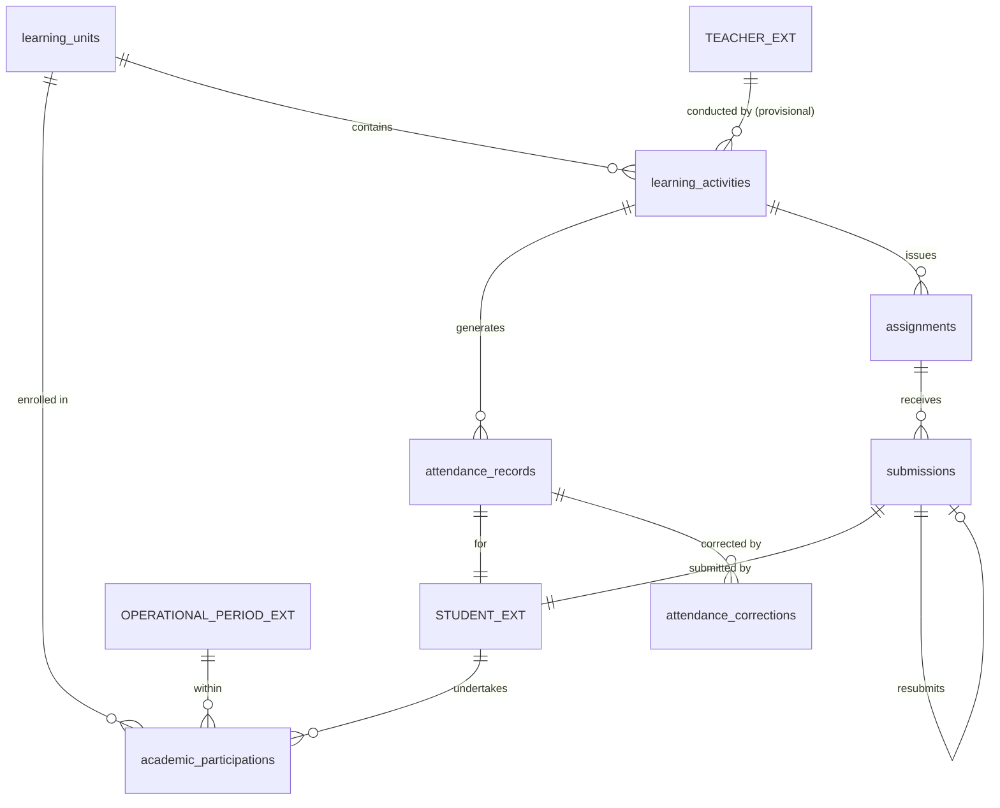

# 1. Overview

This target architecture defines the technical realization for the full scope of Stage 2 "Participation & Learning Activities" under the Academic domain:
1. **Academic Participation (`ACD-WF-03`, `ACD-WF-11`, `UC-ACD-10`, `UC-ACD-12`, `SCR-ACD-05`):** Provisioning, lifecycle management (`in_progress`, `paused`, `withdrawn`, `completed`), participation typing (`standard`, `repeat`, `transferred_in`, `recognized_prior`), retake attempt counters, cohort section partitioning (`section_label`), credit recognition for prior/transferred learning (`source_institution`, `external_grade_or_credit`, `recognition_basis`, `approved_by`), and term conclusion of learning unit participation.
2. **Learning Activity Conduct (`ACD-WF-04`, `UC-ACD-02`, `SCR-ACD-01`):** Instructional session management and learning containers (`academics.learning_activities`) tied to active learning units; tracking scheduled dates and times, section labels, pedagogical delivery notes, provisional teacher references (`teacher_assignment_id`, `teacher_name`), activity statuses (`planned`, `conducted`, `cancelled`), and statutory daily homeroom roll-call sessions (`activity_type = 'homeroom_session'`, per `GAP-03`).
3. **Student Attendance & Audit Corrections (`ACD-WF-05`, `ACD-WF-18`, `UC-ACD-03`, `UC-ACD-15`, `SCR-ACD-01`):** Recording session attendance for required activities (`academics.attendance_records`) across standard statuses (`present`, `absent`, `late`, `excused_absence`, `partial`), enforced by a 24-hour same-day teacher grace window, and backed by an immutable correction audit log (`academics.attendance_corrections`) capturing previous status, new status, mandatory justification reason, authorizer identity, and timestamp.
4. **Assignment & Submission Management (`ACD-WF-06`, `ACD-WF-18`, `UC-ACD-04`, `UC-ACD-01`, `SCR-ACD-02`, `SCR-SELF-03`):** Publishing and managing academic coursework tasks (`academics.assignments`) strictly originating from a learning activity (`Learning Activity → Assignment → Submission`), handling submission responses (`academics.submissions`), tracking delivery timestamps, lightweight hybrid references (URL, text, or local uploaded file path), resubmissions, and dynamic on-the-fly missing work projection without background daemons.

It fulfills change request intake `CR-ACD-PARTICIPATION-LEARNING-ACTIVITIES` ([`IS009 - ACD-PARTICIPATION-LEARNING-ACTIVITIES-ISSUE.md`](file:///d:/Project.Private/elsasa-sis-v3/docs/issues/IS009%20-%20ACD-PARTICIPATION-LEARNING-ACTIVITIES-ISSUE.md)) and realizes the approved analysis decisions documented in [`IS009 - ACD-PARTICIPATION-LEARNING-ACTIVITIES-FEASIBILITY-ASSESSMENT.md`](file:///d:/Project.Private/elsasa-sis-v3/docs/issues/IS009%20-%20ACD-PARTICIPATION-LEARNING-ACTIVITIES-FEASIBILITY-ASSESSMENT.md).

The architecture delivers the execution backbone for Elsasa School Information System (SIS) V3:
1. **Authoritative Submodule 2 Relational Schema (`GAP-001`, `ADR-002`, `ADR-006`):** Provisioning 6 authoritative relational tables specified in [`academic-entities-tables.md`](file:///d:/Project.Private/elsasa-sis-v3/docs/entities/academic-entities-tables.md) lines 150–380 (`academic_participations`, `learning_activities`, `attendance_records`, `attendance_corrections`, `assignments`, `submissions`) in schema `academics` via DbUp migration script `20261105_0401_Academics_ParticipationActivities_Tables.sql`.
2. **Dual Participation Registration Engine (`GAP-003`, `OQ-001`):** A dual-mode registration API supporting both bulk cohort enrollment (`BatchRegisterCohortParticipation`) and individual adjustments (`RegisterParticipation`), enforcing synchronous enrollment validation via `IStudentsModule.IsStudentEnrolledAsync` and respecting the boundary invariant that *administrative enrollment does not automatically create academic participation*.
3. **Provisional Teacher Context & Decoupled Session Conducting (`GAP-004`, `OQ-002`):** Supporting `teacher_assignment_id` as a nullable logical UUID with companion `teacher_name` string context on `learning_activities`, enabling immediate instructional logging and attendance capture without blocking on the unreleased Teaching domain.
4. **Two-Tier Attendance Recording & Audit Trail Architecture (`GAP-005`, `OQ-003`):** Fast same-day roll call edits within a 24-hour teacher grace window via `RecordSessionAttendance`, paired with a legally compliant, immutable correction slice `CorrectAttendance` (`UC-ACD-15`) requiring mandatory justification reasons and writing to `attendance_corrections`.
5. **On-the-Fly Query Projection for Missing Work (`GAP-007`, `OQ-005`):** Calculating `missing` submission status dynamically in Dapper read queries when `CURRENT_TIMESTAMP > assignments.due_date` and no submission exists, eliminating background scheduler daemons, write locking, and synthetic row bloat.
6. **Lightweight Hybrid Submission Reference Model (`GAP-006`, `OQ-004`):** Accommodating cloud links, plain text, and local files via `submission_reference` supported by a dedicated multipart upload endpoint `/api/v1/academics/submissions/upload`, avoiding heavy external cloud LMS storage dependencies.
7. **Strict Separation of Submission Tracking and Grading (`academic-domain.md`):** Tracking receipt and timeliness in `submissions` without determining grades; formal evaluation and scoring are strictly deferred to Assessment & Results (`IS010`).
8. **Cross-Domain Contract & Domain Event Extensions (`GAP-009`, `ADR-001`, `ADR-003`):** Extending `IAcademicsModule` with synchronous participation and attendance queries, and publishing granular post-commit domain events for downstream assessment, progression, and teaching modules.
9. **Role-Aligned Frontend Workbenches (`GAP-008`, `OQ-006`):** Delivering 4 dedicated Vue 3 feature slices matching the screen inventory: `SCR-ACD-05` (Participation & Roster Workbench), `SCR-ACD-01` (Class Session Workbench), `SCR-ACD-02` (Coursework & Assessment Workbench), and `SCR-SELF-03` (Student Learning Workspace).

---

# 2. Architectural Basis

## Business Context

This architecture realizes the business outcomes, operational workflows, and domain rules specified in:

- **DOMAIN BLUEPRINT:** [`academic-domain.md`](file:///d:/Project.Private/elsasa-sis-v3/docs/domains/academic-domain.md)
  - Academic Participation & Boundary Invariant (lines 108–130)
  - Learning Activities & Homeroom Conduction (lines 132–158)
  - Student Attendance & Grace Window Audit Rules (lines 160–186)
  - Coursework Assignments, Submissions & Grading Separation (lines 188–214)
  - Hierarchy Invariant: `Learning Structure → Learning Unit → Learning Activity → Assignment → Submission` (lines 58–64)
- **ROADMAP & COMPLETION CRITERIA:** [`sub-modul-and-development-phases.md`](file:///d:/Project.Private/elsasa-sis-v3/docs/sub-modul-and-development-phases.md)
  - Stage 2 Module: Participation & Learning Activities (Submodule 2)
  - **Criterion 2:** *"An active student has academic participation in at least one learning unit."*
  - **Criterion 3:** *"A learning activity has been conducted with attendance recorded."*
  - **Criterion 4:** *"An assignment has been issued, a submission received, formative evaluation recorded, and result approved."* (Assignment and submission receipt portion)
- **WORKFLOWS & USE CASES:**
  - [`operational-workflow-discovery.md`](file:///d:/Project.Private/elsasa-sis-v3/docs/operational-workflow-discovery.md):
    - `ACD-WF-03`: Register Academic Participation & Form Cohorts
    - `ACD-WF-04`: Conduct Learning Activity & Log Delivery
    - `ACD-WF-05`: Record Session Attendance & Manage Grace Window
    - `ACD-WF-06`: Issue Coursework Assignment & Receive Submissions
    - `ACD-WF-11`: Process Transfer Credit Recognition
    - `ACD-WF-18`: Correct Historical Attendance Record
    - `GAP-03`: School Attendance Architecture Resolution (homeroom roll-call vs physical gate presence)
    - `GAP-08`: External Academic Records & Credit Transfer Resolution
  - [`use-cases.md`](file:///d:/Project.Private/elsasa-sis-v3/docs/use-cases.md):
    - `UC-ACD-10`: Register Academic Participation
    - `UC-ACD-12`: Conclude Learning Unit Participation
    - `UC-ACD-02`: Record Learning Activity Delivery
    - `UC-ACD-03`: Record Student Attendance
    - `UC-ACD-15`: Correct Non-Grade Academic Record (Attendance slice)
    - `UC-ACD-04`: Issue Coursework Assignment
    - `UC-ACD-01`: Submit Coursework Assignment
- **ACTORS:** [`actors.md`](file:///d:/Project.Private/elsasa-sis-v3/docs/actors.md)
  - Academic Coordinator (`ACT-07`): Roster management, cohort registration, credit recognition, participation conclusion.
  - Teacher (`ACT-09`): Activity conduction, curriculum delivery logging, roll-call attendance, attendance corrections, assignment issuance, submission exceptions.
  - Student (`ACT-10`): Coursework inspection, submission upload, resubmission.
  - Academic Authority (`ACT-08`): Prior credit recognition approval, audit oversight.
- **DATA SPECIFICATIONS:**
  - [`academic-entities.md`](file:///d:/Project.Private/elsasa-sis-v3/docs/entities/academic-entities.md): Submodule 2 (Participation & Learning Activities), Core Entities and Lifecycle states.
  - [`academic-entities-tables.md`](file:///d:/Project.Private/elsasa-sis-v3/docs/entities/academic-entities-tables.md): Submodule 2 tables (`academics.academic_participations`, `academics.learning_activities`, `academics.attendance_records`, `academics.attendance_corrections`, `academics.assignments`, `academics.submissions`, lines 150–380).
- **SCREEN INVENTORY:** [`screen-inventory.md`](file:///d:/Project.Private/elsasa-sis-v3/docs/screen-inventory.md)
  - `SCR-ACD-05`: Participation & Roster Workbench (Work Queue pattern, Academic Coordinator)
  - `SCR-ACD-01`: Class Session Workbench (Work Queue pattern, Teacher)
  - `SCR-ACD-02`: Coursework & Assessment Workbench (Work Queue pattern, Teacher)
  - `SCR-SELF-03`: Student Learning Workspace (Work Queue pattern, Student)

## Analysis Input

This architecture consumes the approved gap closures, risk mitigations, and design decisions recorded in:

- **FEASIBILITY ASSESSMENT:** [`IS009 - ACD-PARTICIPATION-LEARNING-ACTIVITIES-FEASIBILITY-ASSESSMENT.md`](file:///d:/Project.Private/elsasa-sis-v3/docs/issues/IS009%20-%20ACD-PARTICIPATION-LEARNING-ACTIVITIES-FEASIBILITY-ASSESSMENT.md)
  - `GAP-001`: Submodule 2 database schema provisioning via DbUp migration script.
  - `GAP-002`: Backend vertical slice implementation under `src/backend/Elsasa.Sis.Academics/Features/`.
  - `GAP-003 / OQ-001`: Dual registration modes (Batch Cohort + Individual) with synchronous enrollment check.
  - `GAP-004 / OQ-002`: Nullable logical UUID teacher assignment with display name context.
  - `GAP-005 / OQ-003`: Two dedicated endpoints with server-side temporal grace window for attendance.
  - `GAP-006 / OQ-004`: Lightweight hybrid submission reference model with multipart file upload.
  - `GAP-007 / OQ-005`: On-the-fly SQL query projection for missing coursework submissions.
  - `GAP-008 / OQ-006`: 4 role-aligned frontend workbenches in `src/frontend/src/features/`.
  - `GAP-009`: Cross-domain synchronous contract and in-memory domain event definitions.
  - Planning Readiness: Granted `READY-FOR-PLANNING`.

```text
DOMAIN (academic-domain.md) + FEATURE (use-cases.md, screen-inventory.md)
                            +
       FEASIBILITY-ASSESSMENT (CR-ACD-PARTICIPATION-LEARNING-ACTIVITIES)
                            ↓
     TARGET ARCHITECTURE (ACD-PARTICIPATION-LEARNING-ACTIVITIES)
```

---

# 3. Scope

## Included

1. **Database Schema & Migrations (`Elsasa.Sis.Database`):**
   - Migration script `20261105_0401_Academics_ParticipationActivities_Tables.sql` targeting Microsoft SQL Server 2022 ([`ADR-002`](file:///d:/Project.Private/elsasa-sis-v3/docs/architecture/adr.md#L50-L75), [`ADR-006`](file:///d:/Project.Private/elsasa-sis-v3/docs/architecture/adr.md#L152-L176)).
   - Creation of 6 authoritative relational tables in schema `academics`:
     - `academics.academic_participations`: Student-learning unit learning relationship, attempt counters, lifecycle status, cohort section label, prior learning recognition.
     - `academics.learning_activities`: Scheduled learning occurrences, activity types, provisional teacher references, homeroom sessions, and delivery notes.
     - `academics.attendance_records`: Student session attendance records, statuses, recorder identity, and supporting evidence.
     - `academics.attendance_corrections`: Immutable audit log for historical attendance modifications with mandatory justification reason and authorizer identity.
     - `academics.assignments`: Coursework tasks strictly originating from learning activities, release dates, due dates, and lifecycle statuses.
     - `academics.submissions`: Student submission responses, delivery timestamps, hybrid references, resubmission lineage, and exception statuses.
   - Provisioning of indexes, intra-schema foreign key constraints, status check constraints, and filtered unique index on active student participation (`UQ_academics_participations_active`).

2. **Backend Domain Architecture & Vertical Slices (`Elsasa.Sis.Academics`):**
   - **Academic Participations Slices (`Features/AcademicParticipations/`):**
     - `BatchRegisterCohortParticipation` (`POST /api/v1/academics/participations/batch-cohort`): Atomic registration of active cohort students into learning units with synchronous enrollment verification.
     - `RegisterParticipation` (`POST /api/v1/academics/participations`): Individual student registration for electives, transfers, or individualized adjustments.
     - `UpdateParticipationStatus` (`PUT /api/v1/academics/participations/{id}/status`): Transition participation status (`in_progress`, `paused`, `withdrawn`).
     - `RecognizePriorCredit` (`POST /api/v1/academics/participations/recognize-prior`): Record transfer or prior learning credit (`transferred_in`, `recognized_prior`) immediately marked `completed`.
     - `ConcludeParticipation` (`POST /api/v1/academics/participations/{id}/conclude`): Formal period conclusion (`completed`) recording completion date (`UC-ACD-12`).
     - `GetParticipationsByUnit` (`GET /api/v1/academics/learning-units/{learningUnitId}/participations`): Query unit roster filtered by `academicPeriodId`, `sectionLabel`, and `status`.
     - `GetStudentParticipations` (`GET /api/v1/academics/students/{studentId}/participations`): Query all learning participations for a student within a period.
   - **Learning Activities Slices (`Features/LearningActivities/`):**
     - `PlanLearningActivity` (`POST /api/v1/academics/learning-activities`): Schedule instructional session or homeroom roll-call container.
     - `ConductLearningActivity` (`POST /api/v1/academics/learning-activities/{id}/conduct`): Record session completion, delivery notes, and curriculum milestones (`UC-ACD-02`).
     - `CancelLearningActivity` (`POST /api/v1/academics/learning-activities/{id}/cancel`): Cancel scheduled activity with reason.
     - `GetActivitiesByUnit` (`GET /api/v1/academics/learning-units/{learningUnitId}/activities`): Query activities filtered by date range, `sectionLabel`, and `status`.
     - `GetActivityById` (`GET /api/v1/academics/learning-activities/{id}`): Detailed activity inspection including assignment and attendance summary.
     - `GetTeacherDailyActivities` (`GET /api/v1/academics/teacher/activities`): Query scheduled and conducted activities for the authenticated teacher by date (`SCR-ACD-01`).
   - **Attendance & Audit Slices (`Features/Attendance/`):**
     - `RecordSessionAttendance` (`POST /api/v1/academics/learning-activities/{id}/attendance`): Roll-call recording for active roster; permitted within same calendar day (24-hour grace window).
     - `CorrectAttendance` (`POST /api/v1/academics/attendance-records/{id}/correct`): Auditable correction requiring mandatory reason and authorization, inserting immutable entry into `attendance_corrections` (`UC-ACD-15`).
     - `GetActivityAttendance` (`GET /api/v1/academics/learning-activities/{id}/attendance`): Query session attendance roster with current status and correction audit trail.
     - `GetStudentAttendanceSummary` (`GET /api/v1/academics/students/{studentId}/attendance-summary`): Aggregate student attendance totals (present, absent, late, excused) across period or unit.
   - **Assignments & Submissions Slices (`Features/Assignments/`):**
     - `CreateAssignment` (`POST /api/v1/academics/learning-activities/{activityId}/assignments`): Create coursework task tied strictly to parent learning activity.
     - `ReleaseAssignment` (`POST /api/v1/academics/assignments/{id}/release`): Publish assignment making it visible to students.
     - `CloseAssignment` (`POST /api/v1/academics/assignments/{id}/close`): Close assignment to further standard submissions.
     - `GetAssignmentsByActivity` (`GET /api/v1/academics/learning-activities/{activityId}/assignments`): Query assignments for a specific activity.
     - `GetAssignmentsByUnit` (`GET /api/v1/academics/learning-units/{unitId}/assignments`): Query assignments across a learning unit.
     - `SubmitCoursework` (`POST /api/v1/academics/assignments/{id}/submissions`): Student coursework submission recording delivery timestamp, reference, and resubmission link (`UC-ACD-01`).
     - `RecordSubmissionException` (`POST /api/v1/academics/assignments/{id}/submissions/exception`): Teacher records policy exception (`excused` or `exempted`).
     - `GetAssignmentSubmissions` (`GET /api/v1/academics/assignments/{id}/submissions`): Query submissions roster for an assignment with on-the-fly missing projection.
     - `GetStudentCourseworkWorkspace` (`GET /api/v1/portal/learning/coursework`): Student workspace query projecting tasks, deadlines, submission statuses, and on-the-fly missing flags (`SCR-SELF-03`).
     - `UploadSubmissionFile` (`POST /api/v1/academics/submissions/upload`): Minimalist multipart upload storing file locally and returning relative storage path.

3. **Cross-Domain Contracts & Domain Events (`Elsasa.Sis.Contracts`):**
   - Extending `IAcademicsModule` with synchronous query methods for downstream consumers.
   - Defining in-memory domain events in `Elsasa.Sis.Contracts/Academics/Events/` emitted post-commit via MediatR `IPublisher` ([`ADR-003`](file:///d:/Project.Private/elsasa-sis-v3/docs/architecture/adr.md#L76-L98)).

4. **Frontend Workspaces & Client Integration (`src/frontend`):**
   - **`SCR-ACD-05` Participation & Roster Workbench (`/academics/participation`):**
     - Batch cohort registration modal, individual student registration modal, prior learning recognition modal, roster management table, and participation conclusion dialog.
   - **`SCR-ACD-01` Class Session Workbench (`/academics/sessions`):**
     - Daily session schedule list, session activity planner, curriculum delivery logging, roll-call attendance grid, homeroom roll-call mode, and auditable correction drawer.
   - **`SCR-ACD-02` Coursework & Assessment Workbench (`/academics/coursework`):**
     - Unit coursework list, assignment creation drawer, submission tracking table with on-the-fly missing status, exception modal, and submission inspection drawer.
   - **`SCR-SELF-03` Student Learning Workspace (`/portal/learning`):**
     - Upcoming/due/completed task cards, deadline countdowns, coursework submission modal (file upload or URL link), and resubmission tracking.

## Excluded

1. **Curriculum Frameworks & Unit Abstraction (`IS008`):** Creating and versioning `learning_structures`, `learning_units`, and `academic_requirements` is owned by `Learning Structure & Requirements`.
2. **Formal Assessment Planning, Scoring & Grading (`IS010`):** Assessment rubrics, score entry, weighted grading components, summative moderation, and gradebook calculations belong to `Assessment & Results`.
3. **Student Learning Plans (SLP) Drafting & Accommodation Rules:** Individualized accommodation drafting and IEP policies belong to `Student Learning Plan`.
4. **Cohort Academic Review & Standing Determinations (`SCR-ACD-09`):** Promotion/retention committee decisions and academic honors belong to `Standing & Progression`.
5. **Official Teaching Authorization & Workload (`Teaching` domain):** Teacher profiles, credential verification, and contractual workload tracking belong to `Teaching`.
6. **Room Reservation & Campus Timetable Occurrence (`Operations` domain):** Physical facility booking and room conflict resolution belong to `Scheduling & Rooms`.

---

# 4. Technical Decisions

## TD-01: Authoritative Submodule 2 Relational Schema & Storage Layout

### Context
Stage 2 Participation & Learning Activities introduces 6 core entities: academic participations, learning activities, attendance records, attendance corrections, assignments, and student submissions. We must persist these entities in SQL Server adhering to ADR-001, ADR-002, and ADR-006.

### Decision
Provision all 6 tables within schema `academics` using DbUp migration script `20261105_0401_Academics_ParticipationActivities_Tables.sql`:
1. Use `UNIQUEIDENTIFIER` with `DEFAULT (NEWID())` for primary keys.
2. Cross-domain references (`student_id`, `academic_period_id`, `teacher_assignment_id`) are stored as logical UUIDs without physical cross-schema foreign keys (ADR-002).
3. Intra-schema foreign keys (`learning_unit_id`, `learning_activity_id`, `attendance_record_id`, `assignment_id`, `previous_submission_id`) are strictly enforced with `ON DELETE NO ACTION`.
4. Filtered unique index `UQ_academics_participations_active` guarantees that a student can have at most one active (`status = 'in_progress'`) participation record per learning unit per academic period.
5. Composite unique index `UQ_academics_attendance_records_activity_student` guarantees that each student has at most one attendance record per learning activity.
6. Check constraints enforce domain enum literals (`participation_type`, `source`, `participation_status`, `activity_type`, `activity_status`, `attendance_status`, `assignment_status`, `submission_status`).

---

## TD-02: Dual Participation Registration Mechanics with Synchronous Enrollment Verification

### Context
Academic Coordinators must set up term rosters for hundreds of students across grade levels (`SCR-ACD-05`, `UC-ACD-10`). Single-student entry causes unacceptable manual overhead, yet bulk entry must not bypass the domain boundary rule: *administrative enrollment in Students does not automatically create academic participation*.

### Decision
Implement **Dual Registration Modes (Batch Cohort + Individual Registration)**:
1. `BatchRegisterCohortParticipation` (`POST /api/v1/academics/participations/batch-cohort`):
   - Accepts `academic_period_id`, `academic_period_label`, array of `learning_unit_ids`, `section_label` (e.g. "4A"), `start_date`, and an optional array of `student_ids`.
   - If `student_ids` is omitted, it queries active students in that section/placement from Students via SQL read projection or calls `IStudentsModule`.
   - Performs a synchronous check via `IStudentsModule.IsStudentEnrolledAsync(studentId)` for every student.
   - Atomically inserts participation rows using `INSERT ... SELECT WHERE NOT EXISTS` to ensure idempotency and prevent duplicate records.
2. `RegisterParticipation` (`POST /api/v1/academics/participations`):
   - Accepts individual student payload for electives, retakes, transfers, or individualized adjustments.
   - Synchronously validates enrollment via `IStudentsModule.IsStudentEnrolledAsync(studentId)`.
   - Validates that if `participation_type == 'repeat'`, any prior participation in the same unit has reached terminal status (`completed` or `withdrawn`), and automatically computes `attempt_number = prior_attempt + 1`.
3. Cohort partitioning is captured flexibly via `section_label` without requiring an artificial standalone class table.

---

## TD-03: Provisional Teacher Context & Decoupled Session Conducting

### Context
Learning activities must record instructional conduct and teacher context for timetable reconciliation. However, the `Teaching` domain is scheduled for concurrent development and is not yet implemented in `src/backend/`.

### Decision
Model `learning_activities.teacher_assignment_id` as a nullable `UNIQUEIDENTIFIER` and introduce `learning_activities.teacher_name` (NVARCHAR(200) NULL):
1. In Stage 2, teachers conducting sessions can supply `teacher_name` directly (or default from `ICurrentUser.FullName` / `ICurrentUser.Username`) while leaving `teacher_assignment_id` null or populated from provisional assignments.
2. When the `Teaching` domain is deployed, `teacher_assignment_id` will reference official teaching assignments without requiring schema migration or breaking API changes.
3. Completely decouples the execution of Stage 2 Academics from the unreleased Teaching domain.

---

## TD-04: Two-Tier Attendance Recording & Audit Trail Architecture

### Context
Teachers require fast, frictionless roll call during classroom instruction (`SCR-ACD-01`, `UC-ACD-03`). However, education regulations and school policy mandate that historical attendance records must never be silently altered or overwritten without justification and authorization (`UC-ACD-15`, `academic-entities.md` Q8).

### Decision
Implement **Two Distinct Endpoints with a Server-Side Temporal Grace Window**:
1. `RecordSessionAttendance` (`POST /api/v1/academics/learning-activities/{id}/attendance`):
   - Live roll-call endpoint for the teacher.
   - Evaluates a 24-hour grace window: permitted if `activity_date == today` or `SYSUTCDATETIME() - activity.created_at <= 24 hours`.
   - Directly executes `MERGE` or `UPDATE`/`INSERT` on `academics.attendance_records`.
   - Records `recorded_by = currentUser.Username` and `recorded_date = today`.
2. `CorrectAttendance` (`POST /api/v1/academics/attendance-records/{id}/correct`):
   - Formal correction slice implementing `UC-ACD-15`.
   - Required once the 24-hour grace window has expired.
   - Requires `new_status`, mandatory `reason` (minimum 5 characters), and optional `evidence`.
   - Executes in a single SQL transaction:
     - Captures `previous_status` from `attendance_records`.
     - Updates `attendance_records.status` to `new_status`, updating `updated_at` and `updated_by`.
     - Inserts an immutable row into `academics.attendance_corrections` logging `attendance_record_id`, `previous_status`, `new_status`, `reason`, `corrected_by = currentUser.Username`, and `corrected_date = today`.
3. Statutory daily attendance (`GAP-03`): Homeroom roll call is conducted as a scheduled `learning_activities` record with `activity_type = 'homeroom_session'` and `is_attendance_required = true`. Statutory daily totals are aggregated directly from these records without conflating with physical gate presence.

---

## TD-05: Strict Curriculum Hierarchy Invariant

### Context
The academic domain enforces the explicit curriculum hierarchy:
`Learning Structure → Learning Unit → Learning Activity → Assignment → Submission`
Orphan assignments or detached submissions violate academic accountability.

### Decision
Enforce the hierarchy strictly at both database and application levels:
1. `assignments.learning_activity_id` is defined as `UNIQUEIDENTIFIER NOT NULL` with foreign key referencing `academics.learning_activities(id)`.
2. `submissions.assignment_id` is defined as `UNIQUEIDENTIFIER NOT NULL` with foreign key referencing `academics.assignments(id)`.
3. Slices reject assignment creation if the parent learning activity does not exist or is in `cancelled` status.
4. Slices reject student submission if the assignment is in `draft` or `closed` status.

---

## TD-06: On-the-Fly Missing Submission Projection & Separation of Submission from Grading

### Context
When an assignment passes its `due_date`, unsubmitted students must be identified as having "missing" work (`SCR-ACD-02`, `SCR-SELF-03`). Generating physical database rows via background cron jobs creates write churn, table locking, and synchronization bugs whenever due dates are extended.

### Decision
Adopt **On-the-Fly Query Projection for Missing Work**:
1. Physical rows in `academics.submissions` are created **only** when:
   - A student explicitly submits work (`submitted` or `late`).
   - A teacher explicitly grants an administrative exception (`excused` or `exempted`).
2. In query slices (`GetAssignmentSubmissions`, `GetStudentCourseworkWorkspace`), the status of each enrolled participant is dynamically evaluated using SQL `CASE`:
   ```sql
   CASE
       WHEN s.id IS NOT NULL THEN s.status
       WHEN a.due_date IS NOT NULL AND CAST(SYSUTCDATETIME() AS DATE) > a.due_date THEN 'missing'
       ELSE 'pending'
   END AS display_status
   ```
3. Zero background scheduler daemons, zero synthetic row churn, and real-time responsiveness to due date revisions.
4. **Grading Separation:** Submissions track only receipt and timeliness. Formal grading and rubric scoring belong strictly to `Assessment & Results` (`IS010`).

---

## TD-07: Lightweight Hybrid Coursework Submission Storage Model

### Context
Students must submit coursework evidence (`UC-ACD-01`, `SCR-SELF-03`). The system must accommodate external links (Google Docs, Drive links, GitHub repositories), plain text responses, and local file uploads (PDF, DOCX, images) without external cloud LMS dependencies (ADR-004, ADR-010).

### Decision
Implement a **Lightweight Hybrid Submission Model**:
1. `submissions.submission_reference` stores a string representing:
   - An external URL (e.g. `https://docs.google.com/...`)
   - Inline student plain text
   - A relative file path for uploaded documents (e.g. `uploads/submissions/2026/std-108/math-hw1.pdf`)
2. Provide a minimalist file upload endpoint:
   - `POST /api/v1/academics/submissions/upload`
   - Accepts `multipart/form-data`, validates allowed MIME types (`application/pdf`, `image/jpeg`, `image/png`, `application/vnd.openxmlformats-officedocument.wordprocessingml.document`), validates max size (25 MB), sanitizes file names, and saves to configured directory `App_Data/Submissions/{Year}/{StudentId}/`.
   - Returns relative path for storage in `submission_reference`.
3. Keeps binary blob data out of SQL Server, avoiding database bloat while requiring zero external cloud storage SDKs.

---

## TD-08: Cross-Domain Contract Extensions & In-Memory Domain Events

### Context
Downstream Stage 2 and Stage 3 modules (`Assessment & Results`, `Standing & Progression`, `Teaching`) require synchronous query capabilities and event notifications from Participation & Learning Activities (ADR-001, ADR-003).

### Decision
1. **Synchronous Contract Extensions:** Extend `IAcademicsModule` in `Elsasa.Sis.Contracts/Academics/`:
   ```csharp
   Task<Result<bool>> IsStudentParticipatingAsync(Guid studentId, Guid learningUnitId, Guid academicPeriodId, CancellationToken ct = default);
   Task<Result<StudentAttendanceSummaryDto>> GetStudentAttendanceSummaryAsync(Guid studentId, Guid academicPeriodId, CancellationToken ct = default);
   Task<Result<IReadOnlyList<CompletedParticipationDto>>> GetStudentCompletedUnitsAsync(Guid studentId, CancellationToken ct = default);
   ```
2. **Post-Commit In-Memory Domain Events:** Define domain event records in `Elsasa.Sis.Contracts/Academics/Events/` implementing `IDomainEvent`:
   - `AcademicParticipationRegisteredEvent(Guid ParticipationId, Guid StudentId, Guid LearningUnitId, Guid AcademicPeriodId, string SectionLabel, string ParticipationType)`
   - `ParticipationConcludedEvent(Guid ParticipationId, Guid StudentId, Guid LearningUnitId, DateOnly CompletionDate)`
   - `LearningActivityConductedEvent(Guid ActivityId, Guid LearningUnitId, DateOnly ActivityDate, string ActivityType, string SectionLabel)`
   - `AttendanceRecordedEvent(Guid LearningActivityId, DateOnly RecordedDate, int TotalPresent, int TotalAbsent, int TotalLate, int TotalExcused, string RecordedBy)`
   - `AttendanceCorrectedEvent(Guid AttendanceRecordId, Guid LearningActivityId, Guid StudentId, string PreviousStatus, string NewStatus, string Reason, string CorrectedBy)`
   - `AssignmentReleasedEvent(Guid AssignmentId, Guid LearningActivityId, string Title, DateOnly? DueDate)`
   - `CourseworkSubmittedEvent(Guid SubmissionId, Guid AssignmentId, Guid StudentId, string Status, DateTimeOffset SubmittedDate, bool IsResubmission)`

---

## TD-09: Policy-Based Security & Fine-Grained Authorization Policies

### Context
Stage 2 involves distinct actors: Academic Coordinator, Teacher, Student, and Academic Authority. Handlers must enforce least privilege access according to ADR-009.

### Decision
Define permission constants in `Elsasa.Sis.Academics/Permissions.cs`:
- `Permissions.Academics.Participations.View` / `Manage` / `RecognizePrior` / `Conclude`
- `Permissions.Academics.Activities.View` / `Manage` / `Conduct`
- `Permissions.Academics.Attendance.View` / `Record` / `Correct`
- `Permissions.Academics.Assignments.View` / `Manage` / `Release` / `Close`
- `Permissions.Academics.Submissions.Submit` / `Exception` / `View`

Map ASP.NET Core authorization policies:
- **Academic Coordinator / Authority:** Full access to Participations, Activities, Attendance, Assignments.
- **Teacher:** Access to Activities (`Conduct`), Attendance (`Record`, `Correct`), Assignments (`Manage`, `Release`, `Close`), and Submissions (`Exception`, `View`).
- **Student:** Access to own Participations (`View`), assigned Coursework (`View`), and Coursework Submissions (`Submit`). Enforce student identity guard (`currentUser.StudentId == studentId`).

---

## TD-10: Frontend Architectural Alignment & Role-Aligned Workbenches

### Context
Four screens must be delivered across three actor personas adhering to `frontend-architecture.md` and `screen-inventory.md`: `SCR-ACD-05`, `SCR-ACD-01`, `SCR-ACD-02`, and `SCR-SELF-03`.

### Decision
Implement 4 dedicated feature slices under `src/frontend/src/features/`:
1. `src/frontend/src/features/academics/participation/` (`SCR-ACD-05`, Academic Coordinator):
   - Route: `/academics/participation`
   - Master worklist grouped by learning unit and period.
   - Batch cohort enrollment modal, individual student registration modal, prior credit recognition modal, roster management table, and participation conclusion dialog.
2. `src/frontend/src/features/academics/sessions/` (`SCR-ACD-01`, Teacher):
   - Route: `/academics/sessions`
   - Daily calendar/schedule selector, activity planner drawer, delivery notes logging modal, roll-call attendance table, homeroom daily session mode, and attendance correction drawer.
3. `src/frontend/src/features/academics/coursework/` (`SCR-ACD-02`, Teacher):
   - Route: `/academics/coursework`
   - Coursework task list grouped by learning unit and status (`draft`, `released`, `closed`), assignment creation drawer, submission review roster with dynamic missing indicator, and exception modal.
4. `src/frontend/src/features/portal/learning/` (`SCR-SELF-03`, Student):
   - Route: `/portal/learning`
   - Filterable worklist (Upcoming, Due Soon, Submitted, Missing), assignment detail view, file upload / URL submission modal, and resubmission status timeline.

---

# 5. Component Responsibilities

| Component | Layer / Project | Responsibility |
|---|---|---|
| `20261105_0401_Academics_ParticipationActivities_Tables.sql` | `Elsasa.Sis.Database` | Provisions 6 tables, intra-schema foreign keys, indexes, check constraints, and filtered unique index in `academics` schema. |
| `AcademicParticipations` Slices | `Elsasa.Sis.Academics` | Handles batch cohort registration, single student registration, status transitions, prior credit recognition, roster queries, and term conclusions. |
| `LearningActivities` Slices | `Elsasa.Sis.Academics` | Handles instructional activity planning, conducting, cancellation, delivery logging, teacher activity querying, and homeroom sessions. |
| `Attendance` Slices | `Elsasa.Sis.Academics` | Handles same-day roll-call recording, auditable historical corrections with justification logging, and attendance summary aggregation. |
| `Assignments` Slices | `Elsasa.Sis.Academics` | Handles coursework creation, release, closure, submissions, file uploads, teacher exceptions, and missing work projection. |
| `AcademicsModule` | `Elsasa.Sis.Academics` | Implements `IAcademicsModule` exposing synchronous cross-domain queries for participation, attendance, and completed units. |
| `AcademicsDomainEvents` | `Elsasa.Sis.Contracts` | Defines immutable event records for post-commit cross-domain reactions via MediatR. |
| `ParticipationWorkbenchView.vue` (`SCR-ACD-05`) | `src/frontend` | Vue 3 UI for Academic Coordinators to register students, manage cohort rosters, recognize transfer credit, and conclude units. |
| `ClassSessionWorkbenchView.vue` (`SCR-ACD-01`) | `src/frontend` | Vue 3 UI for Teachers to log curriculum delivery, conduct daily sessions, record attendance, and submit corrections. |
| `CourseworkWorkbenchView.vue` (`SCR-ACD-02`) | `src/frontend` | Vue 3 UI for Teachers to plan, issue, and manage coursework assignments, review submissions, and grant exceptions. |
| `StudentLearningWorkspaceView.vue` (`SCR-SELF-03`) | `src/frontend` | Vue 3 UI for Students to inspect assigned coursework, track deadlines, upload submissions, and review submission history. |

---

# 6. Integration Design

| Source | Target | Purpose |
|---|---|---|
| `BatchRegisterCohortParticipationHandler` | `IStudentsModule` | Synchronous validation of student enrollment eligibility before creating participation records. |
| `RegisterParticipationHandler` | `IStudentsModule` | Synchronous validation that student is currently enrolled in Students domain. |
| `PlanLearningActivityHandler` | `IOperationsCalendarQueryService` | Validates that `activity_date` falls within an active operational term/session. |
| `ConductLearningActivityHandler` | `MediatR (IPublisher)` | Emits `LearningActivityConductedEvent` post-commit. |
| `RecordSessionAttendanceHandler` | `MediatR (IPublisher)` | Emits `AttendanceRecordedEvent` post-commit for downstream compliance monitoring. |
| `CorrectAttendanceHandler` | `MediatR (IPublisher)` | Emits `AttendanceCorrectedEvent` post-commit logging audit trail. |
| `ReleaseAssignmentHandler` | `MediatR (IPublisher)` | Emits `AssignmentReleasedEvent` post-commit alerting enrolled student portals. |
| `SubmitCourseworkHandler` | `MediatR (IPublisher)` | Emits `CourseworkSubmittedEvent` post-commit alerting teachers. |
| `ParticipationWorkbenchView.vue` | `/api/v1/academics/participations/*` | REST API calls via Axios and TanStack Query for roster management. |
| `ClassSessionWorkbenchView.vue` | `/api/v1/academics/learning-activities/*` | REST API calls for daily instructional session conducting and roll call. |
| `CourseworkWorkbenchView.vue` | `/api/v1/academics/assignments/*` | REST API calls for assignment management and submission inspection. |
| `StudentLearningWorkspaceView.vue` | `/api/v1/portal/learning/*` | REST API calls for student coursework worklist and submission upload. |

---

# 7. Data Ownership

| Data | Owner Schema / Table | Notes |
|---|---|---|
| Academic Participations | `academics.academic_participations` | Owned exclusively by Academics. References logical `student_id` (Students) and `academic_period_id` (Operations). |
| Learning Activities | `academics.learning_activities` | Owned exclusively by Academics. References logical `teacher_assignment_id` (Teaching). |
| Attendance Records | `academics.attendance_records` | Owned exclusively by Academics. References logical `student_id` (Students). |
| Attendance Corrections | `academics.attendance_corrections` | Owned exclusively by Academics. Immutable audit record of attendance modifications. |
| Coursework Assignments | `academics.assignments` | Owned exclusively by Academics. Strictly references `learning_activity_id`. |
| Student Submissions | `academics.submissions` | Owned exclusively by Academics. Strictly references `assignment_id` and logical `student_id`. |
| Student Enrollment & Status | `students.students` | Owned exclusively by Students domain. Academics reads synchronously via `IStudentsModule`. |
| Operational Calendar & Periods | `operations.operational_periods` | Owned exclusively by Operations domain. Academics reads synchronously via `IOperationsCalendarQueryService`. |

---

# 8. Database Design

## New Tables

### 1. `academics.academic_participations`
```sql
CREATE TABLE [academics].[academic_participations] (
    [id]                        UNIQUEIDENTIFIER  NOT NULL CONSTRAINT [DF_academics_academic_participations_id] DEFAULT (NEWID()),
    [student_id]                UNIQUEIDENTIFIER  NOT NULL, -- Logical reference to students.students(id)
    [learning_unit_id]          UNIQUEIDENTIFIER  NOT NULL,
    [academic_period_id]        UNIQUEIDENTIFIER  NOT NULL, -- Logical reference to operations.operational_periods(id)
    [academic_period_label]     NVARCHAR(100)     NOT NULL,
    [participation_type]        NVARCHAR(50)      NOT NULL CONSTRAINT [DF_academics_academic_participations_type] DEFAULT ('standard'),
    [attempt_number]            INT               NOT NULL CONSTRAINT [DF_academics_academic_participations_attempt] DEFAULT (1),
    [source]                    NVARCHAR(50)      NOT NULL CONSTRAINT [DF_academics_academic_participations_source] DEFAULT ('assigned'),
    [section_label]             NVARCHAR(50)      NULL,     -- Cohort partition (e.g. "4A")
    [status]                    NVARCHAR(50)      NOT NULL CONSTRAINT [DF_academics_academic_participations_status] DEFAULT ('in_progress'),
    [start_date]                DATE              NOT NULL,
    [end_date]                  DATE              NULL,
    [completion_date]           DATE              NULL,
    [source_institution]        NVARCHAR(200)     NULL,     -- For transfer/prior credit
    [external_grade_or_credit]  NVARCHAR(100)     NULL,
    [recognition_basis]         NVARCHAR(MAX)     NULL,
    [approved_by]               NVARCHAR(256)     NULL,     -- Academic Authority
    [student_learning_plan_id]  UNIQUEIDENTIFIER  NULL,     -- Optional reference to SLP
    [notes]                     NVARCHAR(MAX)     NULL,
    [created_at]                DATETIMEOFFSET(7) NOT NULL CONSTRAINT [DF_academics_academic_participations_created_at] DEFAULT (SYSUTCDATETIME()),
    [created_by]                NVARCHAR(256)     NOT NULL,
    [updated_at]                DATETIMEOFFSET(7) NULL,
    [updated_by]                NVARCHAR(256)     NULL,
    CONSTRAINT [PK_academics_academic_participations] PRIMARY KEY CLUSTERED ([id]),
    CONSTRAINT [FK_academics_academic_participations_unit] FOREIGN KEY ([learning_unit_id])
        REFERENCES [academics].[learning_units] ([id]) ON DELETE NO ACTION,
    CONSTRAINT [CK_academics_academic_participations_type]
        CHECK ([participation_type] IN ('standard', 'repeat', 'transferred_in', 'recognized_prior')),
    CONSTRAINT [CK_academics_academic_participations_source]
        CHECK ([source] IN ('assigned', 'student_selected', 'learning_plan')),
    CONSTRAINT [CK_academics_academic_participations_status]
        CHECK ([status] IN ('in_progress', 'paused', 'withdrawn', 'completed'))
);

CREATE UNIQUE NONCLUSTERED INDEX [UQ_academics_participations_active]
    ON [academics].[academic_participations] ([student_id], [learning_unit_id], [academic_period_id])
    WHERE ([status] = 'in_progress');

CREATE NONCLUSTERED INDEX [IX_academics_participations_unit_period]
    ON [academics].[academic_participations] ([learning_unit_id], [academic_period_id], [section_label]);

CREATE NONCLUSTERED INDEX [IX_academics_participations_student_period]
    ON [academics].[academic_participations] ([student_id], [academic_period_id]);
```

### 2. `academics.learning_activities`
```sql
CREATE TABLE [academics].[learning_activities] (
    [id]                        UNIQUEIDENTIFIER  NOT NULL CONSTRAINT [DF_academics_learning_activities_id] DEFAULT (NEWID()),
    [learning_unit_id]          UNIQUEIDENTIFIER  NOT NULL,
    [activity_type]             NVARCHAR(50)      NOT NULL,
    [title]                     NVARCHAR(200)     NOT NULL,
    [description]               NVARCHAR(MAX)     NULL,
    [section_label]             NVARCHAR(50)      NULL,     -- Cohort partition (e.g. "4A")
    [activity_date]             DATE              NOT NULL,
    [start_time]                TIME(0)           NULL,
    [end_time]                  TIME(0)           NULL,
    [teacher_assignment_id]     UNIQUEIDENTIFIER  NULL,     -- Provisional logical reference to Teaching
    [teacher_name]              NVARCHAR(200)     NULL,     -- Display context for concurrent rollout
    [status]                    NVARCHAR(50)      NOT NULL CONSTRAINT [DF_academics_learning_activities_status] DEFAULT ('planned'),
    [is_attendance_required]    BIT               NOT NULL CONSTRAINT [DF_academics_learning_activities_att_req] DEFAULT (1),
    [delivery_notes]            NVARCHAR(MAX)     NULL,     -- Curriculum milestones / notes
    [notes]                     NVARCHAR(MAX)     NULL,
    [created_at]                DATETIMEOFFSET(7) NOT NULL CONSTRAINT [DF_academics_learning_activities_created_at] DEFAULT (SYSUTCDATETIME()),
    [created_by]                NVARCHAR(256)     NOT NULL,
    [updated_at]                DATETIMEOFFSET(7) NULL,
    [updated_by]                NVARCHAR(256)     NULL,
    CONSTRAINT [PK_academics_learning_activities] PRIMARY KEY CLUSTERED ([id]),
    CONSTRAINT [FK_academics_learning_activities_unit] FOREIGN KEY ([learning_unit_id])
        REFERENCES [academics].[learning_units] ([id]) ON DELETE NO ACTION,
    CONSTRAINT [CK_academics_learning_activities_type]
        CHECK ([activity_type] IN ('lesson', 'tutorial', 'laboratory', 'independent_work', 'project', 'discussion', 'practice', 'examination', 'remediation', 'homeroom_session', 'other')),
    CONSTRAINT [CK_academics_learning_activities_status]
        CHECK ([status] IN ('planned', 'conducted', 'cancelled'))
);

CREATE NONCLUSTERED INDEX [IX_academics_learning_activities_unit_date]
    ON [academics].[learning_activities] ([learning_unit_id], [activity_date]);

CREATE NONCLUSTERED INDEX [IX_academics_learning_activities_date_status]
    ON [academics].[learning_activities] ([activity_date], [status]);

CREATE NONCLUSTERED INDEX [IX_academics_learning_activities_section_date]
    ON [academics].[learning_activities] ([section_label], [activity_date]);
```

### 3. `academics.attendance_records`
```sql
CREATE TABLE [academics].[attendance_records] (
    [id]                        UNIQUEIDENTIFIER  NOT NULL CONSTRAINT [DF_academics_attendance_records_id] DEFAULT (NEWID()),
    [learning_activity_id]      UNIQUEIDENTIFIER  NOT NULL,
    [student_id]                UNIQUEIDENTIFIER  NOT NULL, -- Logical reference to students.students(id)
    [status]                    NVARCHAR(50)      NOT NULL,
    [recorded_by]               NVARCHAR(256)     NOT NULL,
    [recorded_date]             DATE              NOT NULL,
    [evidence]                  NVARCHAR(MAX)     NULL,
    [notes]                     NVARCHAR(MAX)     NULL,
    [created_at]                DATETIMEOFFSET(7) NOT NULL CONSTRAINT [DF_academics_attendance_records_created_at] DEFAULT (SYSUTCDATETIME()),
    [created_by]                NVARCHAR(256)     NOT NULL,
    [updated_at]                DATETIMEOFFSET(7) NULL,
    [updated_by]                NVARCHAR(256)     NULL,
    CONSTRAINT [PK_academics_attendance_records] PRIMARY KEY CLUSTERED ([id]),
    CONSTRAINT [FK_academics_attendance_records_activity] FOREIGN KEY ([learning_activity_id])
        REFERENCES [academics].[learning_activities] ([id]) ON DELETE NO ACTION,
    CONSTRAINT [UQ_academics_attendance_records_activity_student] UNIQUE ([learning_activity_id], [student_id]),
    CONSTRAINT [CK_academics_attendance_records_status]
        CHECK ([status] IN ('present', 'absent', 'late', 'excused_absence', 'partial'))
);

CREATE NONCLUSTERED INDEX [IX_academics_attendance_records_student_date]
    ON [academics].[attendance_records] ([student_id], [recorded_date]);
```

### 4. `academics.attendance_corrections`
```sql
CREATE TABLE [academics].[attendance_corrections] (
    [id]                        UNIQUEIDENTIFIER  NOT NULL CONSTRAINT [DF_academics_attendance_corrections_id] DEFAULT (NEWID()),
    [attendance_record_id]      UNIQUEIDENTIFIER  NOT NULL,
    [previous_status]           NVARCHAR(50)      NOT NULL,
    [new_status]                NVARCHAR(50)      NOT NULL,
    [reason]                    NVARCHAR(MAX)     NOT NULL,
    [corrected_by]              NVARCHAR(256)     NOT NULL,
    [corrected_date]            DATE              NOT NULL,
    [evidence]                  NVARCHAR(MAX)     NULL,
    [created_at]                DATETIMEOFFSET(7) NOT NULL CONSTRAINT [DF_academics_attendance_corrections_created_at] DEFAULT (SYSUTCDATETIME()),
    CONSTRAINT [PK_academics_attendance_corrections] PRIMARY KEY CLUSTERED ([id]),
    CONSTRAINT [FK_academics_attendance_corrections_record] FOREIGN KEY ([attendance_record_id])
        REFERENCES [academics].[attendance_records] ([id]) ON DELETE NO ACTION
);

CREATE NONCLUSTERED INDEX [IX_academics_attendance_corrections_record]
    ON [academics].[attendance_corrections] ([attendance_record_id]);
```

### 5. `academics.assignments`
```sql
CREATE TABLE [academics].[assignments] (
    [id]                        UNIQUEIDENTIFIER  NOT NULL CONSTRAINT [DF_academics_assignments_id] DEFAULT (NEWID()),
    [learning_activity_id]      UNIQUEIDENTIFIER  NOT NULL,
    [title]                     NVARCHAR(200)     NOT NULL,
    [description]               NVARCHAR(MAX)     NULL,
    [release_date]              DATE              NOT NULL,
    [due_date]                  DATE              NULL,
    [status]                    NVARCHAR(50)      NOT NULL CONSTRAINT [DF_academics_assignments_status] DEFAULT ('draft'),
    [notes]                     NVARCHAR(MAX)     NULL,
    [created_at]                DATETIMEOFFSET(7) NOT NULL CONSTRAINT [DF_academics_assignments_created_at] DEFAULT (SYSUTCDATETIME()),
    [created_by]                NVARCHAR(256)     NOT NULL,
    [updated_at]                DATETIMEOFFSET(7) NULL,
    [updated_by]                NVARCHAR(256)     NULL,
    CONSTRAINT [PK_academics_assignments] PRIMARY KEY CLUSTERED ([id]),
    CONSTRAINT [FK_academics_assignments_activity] FOREIGN KEY ([learning_activity_id])
        REFERENCES [academics].[learning_activities] ([id]) ON DELETE NO ACTION,
    CONSTRAINT [CK_academics_assignments_status]
        CHECK ([status] IN ('draft', 'released', 'closed'))
);

CREATE NONCLUSTERED INDEX [IX_academics_assignments_activity]
    ON [academics].[assignments] ([learning_activity_id]);

CREATE NONCLUSTERED INDEX [IX_academics_assignments_release_status]
    ON [academics].[assignments] ([release_date], [status]);
```

### 6. `academics.submissions`
```sql
CREATE TABLE [academics].[submissions] (
    [id]                        UNIQUEIDENTIFIER  NOT NULL CONSTRAINT [DF_academics_submissions_id] DEFAULT (NEWID()),
    [assignment_id]             UNIQUEIDENTIFIER  NOT NULL,
    [student_id]                UNIQUEIDENTIFIER  NOT NULL, -- Logical reference to students.students(id)
    [status]                    NVARCHAR(50)      NOT NULL,
    [submitted_date]            DATETIMEOFFSET(7) NULL,
    [submission_reference]      NVARCHAR(1000)    NULL,     -- URL, plain text, or local upload path
    [is_resubmission]           BIT               NOT NULL CONSTRAINT [DF_academics_submissions_is_resub] DEFAULT (0),
    [previous_submission_id]    UNIQUEIDENTIFIER  NULL,
    [notes]                     NVARCHAR(MAX)     NULL,
    [created_at]                DATETIMEOFFSET(7) NOT NULL CONSTRAINT [DF_academics_submissions_created_at] DEFAULT (SYSUTCDATETIME()),
    [created_by]                NVARCHAR(256)     NOT NULL,
    [updated_at]                DATETIMEOFFSET(7) NULL,
    [updated_by]                NVARCHAR(256)     NULL,
    CONSTRAINT [PK_academics_submissions] PRIMARY KEY CLUSTERED ([id]),
    CONSTRAINT [FK_academics_submissions_assignment] FOREIGN KEY ([assignment_id])
        REFERENCES [academics].[assignments] ([id]) ON DELETE NO ACTION,
    CONSTRAINT [FK_academics_submissions_previous] FOREIGN KEY ([previous_submission_id])
        REFERENCES [academics].[submissions] ([id]) ON DELETE NO ACTION,
    CONSTRAINT [CK_academics_submissions_status]
        CHECK ([status] IN ('submitted', 'late', 'missing', 'excused', 'exempted'))
);

CREATE NONCLUSTERED INDEX [IX_academics_submissions_assignment_student]
    ON [academics].[submissions] ([assignment_id], [student_id]);

CREATE NONCLUSTERED INDEX [IX_academics_submissions_student_status]
    ON [academics].[submissions] ([student_id], [status]);
```

## Modified Tables
No existing tables are modified. The `academics` schema was provisioned in `IS008`, and existing tables `academics.learning_structures`, `academics.learning_units`, and `academics.academic_requirements` remain structurally unchanged.

## Relationships



1. **`learning_units` → `academic_participations`:** 1:N. A learning unit has many participating students.
2. **`learning_units` → `learning_activities`:** 1:N. A learning unit contains many scheduled learning activities.
3. **`learning_activities` → `attendance_records`:** 1:N. An activity generates attendance records for participating students.
4. **`attendance_records` → `attendance_corrections`:** 1:N. An attendance record has an immutable history of corrections.
5. **`learning_activities` → `assignments`:** 1:N. An assignment strictly originates from a learning activity.
6. **`assignments` → `submissions`:** 1:N. An assignment receives student submissions.
7. **`submissions` → `submissions`:** 0..1:1. A submission may resubmit a prior submission via self-referencing `previous_submission_id`.

## Migration Considerations

1. **DbUp Script Idempotency:** Guard all table creations with `IF OBJECT_ID(N'table', N'U') IS NULL` and indexes with `IF NOT EXISTS (SELECT 1 FROM sys.indexes WHERE ...)`.
2. **Execution Ordering:** Script is named `20261105_0401_Academics_ParticipationActivities_Tables.sql` to execute strictly after `20261104_0401_Academics_LearningStructure_Tables.sql`.
3. **Zero Data Loss:** All new tables; no existing data requires backfilling.
4. **Referential Integrity:** Intra-schema foreign keys use `ON DELETE NO ACTION` to prevent accidental cascading deletion of academic records.

---

# 9. Cross-Cutting Concerns

## 9.1 Security & Authorization
- Enforce JWT Bearer Authentication and scoped `ICurrentUser` context (ADR-009).
- Endpoint policies enforce permissions defined in `Permissions.Academics.*`.
- Student portal endpoints (`/api/v1/portal/learning/...`) enforce student-ownership checks, verifying that `ICurrentUser.StudentId` matches the target `studentId` or submitting user, preventing horizontal privilege escalation.

## 9.2 Audit Trail & Regulatory Immutability
- All tables maintain standard metadata: `created_at`, `created_by`, `updated_at`, `updated_by`.
- Historical attendance records cannot be overwritten past the 24-hour grace window. The `CorrectAttendance` endpoint enforces writing to `academics.attendance_corrections` with mandatory `reason` text.
- Resubmissions preserve lineage via `previous_submission_id`, maintaining historical student submissions.

## 9.3 Concurrency & Race Conditions
- The filtered unique index `UQ_academics_participations_active` physically prevents concurrent double-registration of active student participations.
- The unique constraint `UQ_academics_attendance_records_activity_student` physically prevents duplicate attendance rows for the same student in the same activity.
- Attendance roll-call utilizes atomic `MERGE` or existence checks within SQL transactions to safely handle concurrent teacher clicks.

## 9.4 Observability & Logging
- Log all state-altering operations (batch registration, activity conduction, attendance correction, assignment release) using structured Serilog logging with `CorrelationId`, `UserId`, `LearningUnitId`, and `ActivityId`.
- Capture elapsed execution times for batch registration and missing-work query projections.

## 9.5 Performance & Indexing
- Comprehensive covering indexes on `(learning_unit_id, academic_period_id, section_label)` for roster lookups.
- Composite index on `(learning_unit_id, activity_date)` and `(activity_date, status)` for fast daily teacher workbench queries.
- On-the-fly missing submission queries leverage the composite index `(assignment_id, student_id)` to execute fast LEFT JOIN projections without table scans.

---

# 10. Implementation Constraints

1. **Vertical Slice Architecture:** Every feature resides in its own cohesive folder under `src/backend/Elsasa.Sis.Academics/Features/<Submodule>/<Action>/` containing Endpoint, Request, Response, Validator, and Handler.
2. **Explicit Dapper Execution:** Use Dapper with explicit T-SQL raw string literals and `ISqlConnectionFactory` (ADR-004). Entity Framework or generic repositories are strictly prohibited.
3. **Native Minimal APIs:** Handlers are mapped directly via Minimal APIs implementing `IEndpoint` (ADR-005). MediatR is strictly prohibited for commands and queries.
4. **Domain Assembly Isolation:** `Elsasa.Sis.Academics` references only `Elsasa.Sis.Shared` and `Elsasa.Sis.Contracts`. Direct assembly references to other domain assemblies (`Students`, `Finance`, `Operations`, `Teaching`) are strictly prohibited (ADR-001).
5. **No Cross-Schema Foreign Keys:** External IDs (`student_id`, `academic_period_id`, `teacher_assignment_id`) are stored as logical UUIDs without physical SQL Server foreign keys (ADR-002).
6. **Domain Outcome Modeling:** Handlers return `Task<Result<T>>` or `Task<Result>`. Throwing business exceptions is prohibited; return `Result.Failure(...)` using domain errors (ADR-007).
7. **Post-Commit Event Publication:** In-memory domain events (`IDomainEvent`) must be published via MediatR `IPublisher` strictly **after** database transactions commit (ADR-003).
8. **Frontend Implementation Standards:**
   - Single File Components (`.vue`) using `<script setup lang="ts">`.
   - Server state managed exclusively via TanStack Query; client session state in Pinia; ephemeral state in Composition API (`ref`/`reactive`).
   - Tailwind CSS 4 utility styling with PrimeVue 4 components.
   - Zod schemas for validation and VeeValidate for form orchestration.

---

# 11. Acceptance Conditions

The implementation realized by this architecture is complete and acceptable when:

1. **Database Migration:**
   - Script `20261105_0401_Academics_ParticipationActivities_Tables.sql` runs cleanly via DbUp on SQL Server 2022.
   - All 6 tables, indexes, check constraints, intra-schema foreign keys, and unique invariants are verified in `academics` schema.
2. **Academic Participation:**
   - Academic Coordinators can batch-register an entire cohort/section into learning units via `POST /api/v1/academics/participations/batch-cohort`.
   - Active student enrollment is verified synchronously via `IStudentsModule.IsStudentEnrolledAsync`.
   - Filtered index prevents duplicate active participations for a student in the same unit and period.
   - Transfer and prior learning credit can be recognized via `POST /api/v1/academics/participations/recognize-prior`, immediately completed with approval metadata.
   - Completed units can be formally concluded via `POST /api/v1/academics/participations/{id}/conclude` (`UC-ACD-12`).
3. **Learning Activities & Conducting:**
   - Teachers can schedule activities via `POST /api/v1/academics/learning-activities`.
   - Teachers can conduct activities and log curriculum delivery notes via `POST /api/v1/academics/learning-activities/{id}/conduct` (`UC-ACD-02`).
   - Activities support provisional `teacher_name` string context without blocking on the unreleased Teaching domain.
   - Homeroom roll-call sessions can be conducted (`activity_type = 'homeroom_session'`).
4. **Attendance & Corrections:**
   - Teachers can record session roll call within the same calendar day via `POST /api/v1/academics/learning-activities/{id}/attendance`.
   - Direct roll-call updates past the 24-hour grace window are rejected by the server.
   - Historical corrections via `POST /api/v1/academics/attendance-records/{id}/correct` succeed only with a mandatory justification reason and create an immutable row in `academics.attendance_corrections` (`UC-ACD-15`).
   - Student attendance summaries aggregate counts accurately for report cards and downstream modules.
5. **Assignments & Submissions:**
   - Assignments strictly require a parent learning activity (`learning_activity_id NOT NULL`).
   - Teachers can create, release, and close assignments.
   - Students can upload submission files or submit external URLs via `POST /api/v1/academics/assignments/{id}/submissions` (`UC-ACD-01`).
   - Resubmission preserves previous submission lineage via `previous_submission_id`.
   - Overdue assignments without submissions are dynamically projected as `missing` without background daemon jobs.
6. **Cross-Domain Contracts & Events:**
   - `IAcademicsModule` exposes synchronous methods `IsStudentParticipatingAsync`, `GetStudentAttendanceSummaryAsync`, and `GetStudentCompletedUnitsAsync`.
   - Post-commit domain events (`AcademicParticipationRegisteredEvent`, `LearningActivityConductedEvent`, `AttendanceRecordedEvent`, `AttendanceCorrectedEvent`, `AssignmentReleasedEvent`, `CourseworkSubmittedEvent`) are emitted and verified.
7. **Frontend Workbenches:**
   - `SCR-ACD-05` (`/academics/participation`) allows Academic Coordinators to manage rosters and cohort enrollments.
   - `SCR-ACD-01` (`/academics/sessions`) allows Teachers to conduct daily sessions, log milestones, and take roll call.
   - `SCR-ACD-02` (`/academics/coursework`) allows Teachers to plan coursework, inspect submissions, and grant exceptions.
   - `SCR-SELF-03` (`/portal/learning`) allows Students to view coursework tasks, deadlines, and upload submissions.
8. **Automated Verification:**
   - Integration tests in `Elsasa.Sis.IntegrationTests` pass with 100% success against Testcontainers SQL Server 2022.
   - Architecture tests in `Elsasa.Sis.ArchitectureTests` pass with zero dependency violations.
   - Frontend unit tests with Vitest pass with 100% success.
