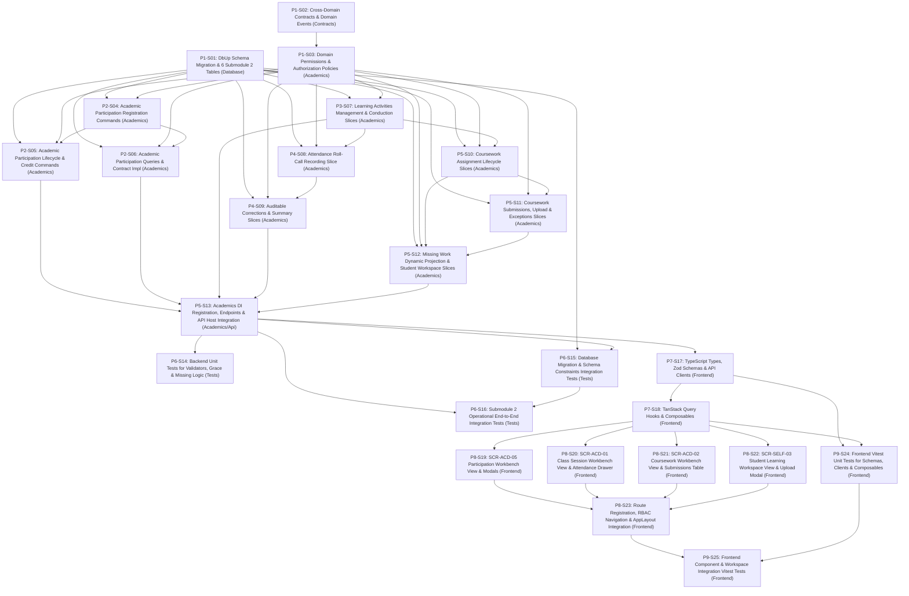

# 1. Objective

Implement the complete Stage 2 "Academic Participation & Learning Activities — full scope: Academic Participation Provisioning & Lifecycle (`ACD-WF-03`, `ACD-WF-11`, `UC-ACD-10`, `UC-ACD-12`, `SCR-ACD-05`), Learning Activity Conduct & Homeroom Roll-Call (`ACD-WF-04`, `UC-ACD-02`, `SCR-ACD-01`), Student Attendance & Auditable Corrections (`ACD-WF-05`, `ACD-WF-18`, `UC-ACD-03`, `UC-ACD-15`, `SCR-ACD-01`), and Assignment & Submission Management with On-the-Fly Missing Projection (`ACD-WF-06`, `UC-ACD-04`, `UC-ACD-01`, `SCR-ACD-02`, `SCR-SELF-03`)" under the Academic domain for Elsasa SIS V3, fulfilling change request intake `CR-ACD-PARTICIPATION-LEARNING-ACTIVITIES` ([`IS009 - ACD-PARTICIPATION-LEARNING-ACTIVITIES-ISSUE.md`](file:///d:/Project.Private/elsasa-sis-v3/docs/issues/IS009%20-%20ACD-PARTICIPATION-LEARNING-ACTIVITIES-ISSUE.md)) and realizing the approved target architecture ([`IS009 - ACD-PARTICIPATION-LEARNING-ACTIVITIES-ARCHITECTURE.md`](file:///d:/Project.Private/elsasa-sis-v3/docs/issues/IS009%20-%20ACD-PARTICIPATION-LEARNING-ACTIVITIES-ARCHITECTURE.md)).

This implementation establishes:
1. **Authoritative Submodule 2 Relational Schema (`GAP-001`, `ADR-002`, `ADR-006`):** Provisioning 6 authoritative relational tables specified in [`academic-entities-tables.md`](file:///d:/Project.Private/elsasa-sis-v3/docs/entities/academic-entities-tables.md) lines 150–380 (`academic_participations`, `learning_activities`, `attendance_records`, `attendance_corrections`, `assignments`, `submissions`) in schema `academics` via sequential forward DbUp migration script `20261105_0401_Academics_ParticipationActivities_Tables.sql`.
2. **Dual Participation Registration Engine (`GAP-003`, `OQ-001`, `TD-02`):** Implementing dual-mode registration supporting atomic batch cohort enrollment (`POST /api/v1/academics/participations/batch-cohort`) and individual student registrations (`POST /api/v1/academics/participations`), enforcing synchronous enrollment eligibility checks via `IStudentsModule.IsStudentEnrolledAsync` and respecting the boundary rule that *administrative enrollment does not automatically create academic participation*.
3. **Provisional Teacher Context & Decoupled Session Conduction (`GAP-004`, `OQ-002`, `TD-03`):** Implementing instructional occurrences (`academics.learning_activities`) with provisional teacher display context (`teacher_name`) and nullable logical `teacher_assignment_id`, unblocking Stage 2 class conducting and statutory homeroom roll calls without waiting on the unreleased Teaching domain.
4. **Two-Tier Attendance Recording & Auditable Correction Architecture (`GAP-005`, `OQ-003`, `TD-04`):** Providing fast same-day roll call edits within a 24-hour teacher grace window via `RecordSessionAttendance`, paired with an auditable, immutable correction slice `CorrectAttendance` (`UC-ACD-15`) requiring mandatory justification reasons and writing permanently to `academics.attendance_corrections`.
5. **Strict Curriculum Hierarchy Invariant (`academic-domain.md`, `TD-05`):** Strictly enforcing `Learning Structure → Learning Unit → Learning Activity → Assignment → Submission` at both the relational foreign key level (`ON DELETE NO ACTION`) and application handler validation rules.
6. **On-the-Fly Query Projection for Missing Work (`GAP-007`, `OQ-005`, `TD-06`):** Dynamically projecting overdue unsubmitted tasks as `missing` in Dapper SQL read queries when `SYSUTCDATETIME() > assignments.due_date`, eliminating background scheduler daemons, write locking, and synthetic row bloat.
7. **Lightweight Hybrid Submission Reference Model (`GAP-006`, `OQ-004`, `TD-07`):** Accommodating cloud links, plain text, and local files via `submission_reference` supported by a dedicated multipart upload endpoint `/api/v1/academics/submissions/upload`, avoiding heavy external cloud LMS storage dependencies.
8. **Strict Separation of Submission Tracking and Grading (`academic-domain.md`):** Tracking coursework receipt and timeliness (`submitted`, `late`, `missing`, `excused`, `exempted`) without determining academic grades; formal evaluation and scoring are strictly deferred to Assessment & Results (`IS010`).
9. **Cross-Domain Contract & Domain Event Extensions (`GAP-009`, `ADR-001`, `ADR-003`, `TD-08`):** Extending `IAcademicsModule` with synchronous participation and attendance queries, and publishing granular post-commit domain events for downstream assessment, progression, and teaching modules.
10. **Role-Aligned Frontend Workbenches (`GAP-008`, `OQ-006`, `TD-10`):** Delivering 4 dedicated Vue 3 feature slices matching the screen inventory: `SCR-ACD-05` (Participation & Roster Workbench), `SCR-ACD-01` (Class Session Workbench), `SCR-ACD-02` (Coursework & Assessment Workbench), and `SCR-SELF-03` (Student Learning Workspace).

Planning Mode: FEATURE-PLANNING

Referenced artifacts:
- FEATURE / ISSUE:
  - `docs/issues/IS009 - ACD-PARTICIPATION-LEARNING-ACTIVITIES-ISSUE.md` (Intake `CR-ACD-PARTICIPATION-LEARNING-ACTIVITIES`)
  - `docs/domains/academic-domain.md` (Academic Participation lines 108–130, Learning Activities lines 132–158, Student Attendance lines 160–186, Assignments & Submissions lines 188–214)
  - `docs/sub-modul-and-development-phases.md` (Stage 2 Module: Participation & Learning Activities, Criteria 2, 3, and 4)
  - `docs/operational-workflow-discovery.md` (`ACD-WF-03`, `ACD-WF-04`, `ACD-WF-05`, `ACD-WF-06`, `ACD-WF-11`, `ACD-WF-18`, `GAP-03`, `GAP-08`)
  - `docs/use-cases.md` (`UC-ACD-01`, `UC-ACD-02`, `UC-ACD-03`, `UC-ACD-04`, `UC-ACD-10`, `UC-ACD-12`, `UC-ACD-15`)
  - `docs/actors.md` (Academic Coordinator `ACT-07`, Academic Authority `ACT-08`, Teacher `ACT-09`, Student `ACT-10`)
  - `docs/screen-inventory.md` (`SCR-ACD-05`, `SCR-ACD-01`, `SCR-ACD-02`, `SCR-SELF-03`)
  - `docs/entities/academic-entities.md` & `docs/entities/academic-entities-tables.md` (Submodule 2 — Participation & Learning Activities; Tables 2.1 through 2.6)
- ARCHITECTURE:
  - `docs/issues/IS009 - ACD-PARTICIPATION-LEARNING-ACTIVITIES-ARCHITECTURE.md` (Authoritative target capability architecture)
  - `docs/architecture/backend-architecture.md` (Modular Monolith & Vertical Slice specification)
  - `docs/architecture/frontend-architecture.md` (Modular Vue 3 SPA architecture)
  - `docs/architecture/adr.md` (ADR-001 through ADR-010)
  - `docs/architecture/coding-conventions.md` (C# 12, Dapper raw SQL, Minimal API conventions)
- FEASIBILITY-ASSESSMENT:
  - `docs/issues/IS009 - ACD-PARTICIPATION-LEARNING-ACTIVITIES-FEASIBILITY-ASSESSMENT.md` (Status: `READY-FOR-PLANNING`)

Architecture Applicability: ARCHITECTURE-REQUIRED

This feature introduces 6 authoritative database tables in schema `academics`, composite constraints, a filtered unique index, cross-domain contracts and events (`IAcademicsModule`, domain events), a 24-hour temporal grace window, auditable immutable corrections, on-the-fly missing coursework projections, lightweight file upload handling, and 4 complete frontend workbenches (`SCR-ACD-05`, `SCR-ACD-01`, `SCR-ACD-02`, `SCR-SELF-03`). Target architecture `docs/issues/IS009 - ACD-PARTICIPATION-LEARNING-ACTIVITIES-ARCHITECTURE.md` is authoritative and governs this plan.

---

# 2. Planning Scope

The planning scope encompasses all changes required across database persistence, backend domain vertical slices, cross-domain contracts, automated test harnesses, and frontend workspaces:

1. **Database Persistence & DbUp Migrations (`Elsasa.Sis.Database`):**
   - Author and register sequential forward DbUp migration script `20261105_0401_Academics_ParticipationActivities_Tables.sql` targeting Microsoft SQL Server 2022 ([`ADR-002`](file:///d:/Project.Private/elsasa-sis-v3/docs/architecture/adr.md#L50-L75), [`ADR-006`](file:///d:/Project.Private/elsasa-sis-v3/docs/architecture/adr.md#L152-L176)).
   - Provision authoritative tables in schema `academics`:
     - `academics.academic_participations`: Student-learning unit learning relationship, attempt counters, lifecycle status (`in_progress`, `paused`, `withdrawn`, `completed`), cohort section label, prior learning recognition.
     - `academics.learning_activities`: Scheduled learning occurrences, activity types, provisional teacher references, homeroom sessions, and delivery notes.
     - `academics.attendance_records`: Student session attendance records, statuses, recorder identity, and supporting evidence.
     - `academics.attendance_corrections`: Immutable audit log for historical attendance modifications with mandatory justification reason and authorizer identity.
     - `academics.assignments`: Coursework tasks strictly originating from learning activities, release dates, due dates, and lifecycle statuses (`draft`, `released`, `closed`).
     - `academics.submissions`: Student submission responses, delivery timestamps, hybrid references, resubmission lineage, and exception statuses (`submitted`, `late`, `missing`, `excused`, `exempted`).
   - Provision primary keys, intra-schema foreign keys (with zero cross-schema physical FKs), check constraints, filtered unique index `UQ_academics_participations_active`, unique constraint `UQ_academics_attendance_records_activity_student`, and performance indexes.

2. **Cross-Domain Contracts & Domain Events (`Elsasa.Sis.Contracts`):**
   - Extend synchronous query interface `IAcademicsModule` in `src/backend/Elsasa.Sis.Contracts/Academics/` exposing participation validation, attendance summary aggregation, and completed units inquiries for downstream modules.
   - Define shared DTO records: `StudentAttendanceSummaryDto`, `CompletedParticipationDto`, and `AcademicParticipationDto`.
   - Define domain event records under `src/backend/Elsasa.Sis.Contracts/Academics/Events/` implementing `IDomainEvent` ([`ADR-003`](file:///d:/Project.Private/elsasa-sis-v3/docs/architecture/adr.md#L76-L98)):
     - `AcademicParticipationRegisteredEvent`
     - `ParticipationConcludedEvent`
     - `LearningActivityConductedEvent`
     - `AttendanceRecordedEvent`
     - `AttendanceCorrectedEvent`
     - `AssignmentReleasedEvent`
     - `CourseworkSubmittedEvent`

3. **Backend Domain Security & Permissions (`Elsasa.Sis.Academics`):**
   - Expand `Permissions.cs` in `Elsasa.Sis.Academics` with permission constants for Participations, Activities, Attendance, Assignments, and Submissions.
   - Configure ASP.NET Core authorization policies mapping permissions to Academic Coordinator, Academic Authority, Teacher, and Student roles.

4. **Academic Participations Vertical Slices (`Elsasa.Sis.Academics`):**
   - `BatchRegisterCohortParticipation` (`POST /api/v1/academics/participations/batch-cohort`): Atomic registration of active cohort students into learning units with synchronous enrollment verification (`IStudentsModule.IsStudentEnrolledAsync`).
   - `RegisterParticipation` (`POST /api/v1/academics/participations`): Individual student registration for electives, transfers, or retakes (`attempt_number` auto-increment).
   - `UpdateParticipationStatus` (`PUT /api/v1/academics/participations/{id}/status`): Transition participation status (`in_progress`, `paused`, `withdrawn`).
   - `RecognizePriorCredit` (`POST /api/v1/academics/participations/recognize-prior`): Record transfer or prior learning credit (`transferred_in`, `recognized_prior`) immediately marked `completed` with authority audit.
   - `ConcludeParticipation` (`POST /api/v1/academics/participations/{id}/conclude`): Formal period conclusion (`completed`) recording completion date (`UC-ACD-12`).
   - `GetParticipationsByUnit` (`GET /api/v1/academics/learning-units/{learningUnitId}/participations`): Query unit roster filtered by `academicPeriodId`, `sectionLabel`, and `status`.
   - `GetStudentParticipations` (`GET /api/v1/academics/students/{studentId}/participations`): Query all learning participations for a student within an academic period.
   - Extend `AcademicsModule.cs` implementing cross-domain participation queries.

5. **Learning Activities Vertical Slices (`Elsasa.Sis.Academics`):**
   - `PlanLearningActivity` (`POST /api/v1/academics/learning-activities`): Schedule instructional session or homeroom roll-call container with provisional teacher context.
   - `ConductLearningActivity` (`POST /api/v1/academics/learning-activities/{id}/conduct`): Record session completion, delivery notes, and curriculum milestones (`UC-ACD-02`).
   - `CancelLearningActivity` (`POST /api/v1/academics/learning-activities/{id}/cancel`): Cancel scheduled activity with reason.
   - `GetActivitiesByUnit` (`GET /api/v1/academics/learning-units/{learningUnitId}/activities`): Query activities filtered by date range, `sectionLabel`, and `status`.
   - `GetActivityById` (`GET /api/v1/academics/learning-activities/{id}`): Detailed activity inspection including assignment and attendance summary.
   - `GetTeacherDailyActivities` (`GET /api/v1/academics/teacher/activities`): Query scheduled and conducted activities for the authenticated teacher by date (`SCR-ACD-01`).

6. **Attendance & Auditable Corrections Vertical Slices (`Elsasa.Sis.Academics`):**
   - `RecordSessionAttendance` (`POST /api/v1/academics/learning-activities/{id}/attendance`): Roll-call recording for active roster; permitted within 24-hour same-day teacher grace window (`UC-ACD-03`).
   - `CorrectAttendance` (`POST /api/v1/academics/attendance-records/{id}/correct`): Auditable correction requiring mandatory reason and authorization, writing immutably to `academics.attendance_corrections` (`UC-ACD-15`).
   - `GetActivityAttendance` (`GET /api/v1/academics/learning-activities/{id}/attendance`): Query session attendance roster with current status and correction audit trail.
   - `GetStudentAttendanceSummary` (`GET /api/v1/academics/students/{studentId}/attendance-summary`): Aggregate student attendance totals across period or unit.
   - Extend `AcademicsModule.cs` implementing cross-domain attendance queries.

7. **Assignments & Submissions Vertical Slices (`Elsasa.Sis.Academics`):**
   - `CreateAssignment` (`POST /api/v1/academics/learning-activities/{activityId}/assignments`): Create coursework task strictly originating from parent learning activity.
   - `ReleaseAssignment` (`POST /api/v1/academics/assignments/{id}/release`): Publish assignment making it visible to students.
   - `CloseAssignment` (`POST /api/v1/academics/assignments/{id}/close`): Close assignment to further standard submissions.
   - `GetAssignmentsByActivity` (`GET /api/v1/academics/learning-activities/{activityId}/assignments`): Query assignments for a specific activity.
   - `GetAssignmentsByUnit` (`GET /api/v1/academics/learning-units/{unitId}/assignments`): Query assignments across a learning unit.
   - `SubmitCoursework` (`POST /api/v1/academics/assignments/{id}/submissions`): Student coursework submission recording delivery timestamp, reference, and resubmission link (`UC-ACD-01`).
   - `UploadSubmissionFile` (`POST /api/v1/academics/submissions/upload`): Minimalist multipart upload storing file locally and returning relative storage path.
   - `RecordSubmissionException` (`POST /api/v1/academics/assignments/{id}/submissions/exception`): Teacher records policy exception (`excused` or `exempted`).
   - `GetAssignmentSubmissions` (`GET /api/v1/academics/assignments/{id}/submissions`): Query submissions roster for an assignment with on-the-fly missing projection (`TD-06`).
   - `GetStudentCourseworkWorkspace` (`GET /api/v1/portal/learning/coursework`): Student workspace query projecting tasks, deadlines, submission statuses, and on-the-fly missing flags (`SCR-SELF-03`).
   - DI and endpoint mapping consolidation in `DependencyInjection.cs` and `AcademicsEndpoints.cs`.

8. **Automated Testing Suite (`tests/backend`):**
   - Unit tests covering FluentValidation validators, temporal grace window logic, and dynamic missing projection logic.
   - SQL Server 2022 Testcontainers integration tests verifying migration `20261105_0401` execution, schema constraints, cohort batch registration, activity conducting, attendance grace window vs audit corrections, coursework lifecycle, resubmission lineage, and cross-domain queries.

9. **Frontend State, API Clients, Zod Schemas & Composables (`src/frontend`):**
   - TypeScript interfaces, Zod validation schemas, and Axios client modules for participations, sessions, coursework, and student portal.
   - TanStack Query hooks and mutation composables (`useAcademicParticipation`, `useLearningActivities`, `useAttendance`, `useAssignments`, `useStudentCoursework`).

10. **Frontend Workspaces & Navigation Integration (`src/frontend`):**
    - `SCR-ACD-05` Participation & Roster Workbench (`/academics/participation`):
      - `ParticipationWorkbenchView.vue`: Cohort filter, unit roster table, batch cohort registration modal, single student registration modal, prior credit recognition modal, and conclusion dialog.
    - `SCR-ACD-01` Class Session Workbench (`/academics/sessions`):
      - `ClassSessionWorkbenchView.vue`: Daily calendar selector, activity schedule list, activity planner drawer, delivery notes logging modal, roll-call attendance table, homeroom daily session mode, and auditable correction drawer.
    - `SCR-ACD-02` Coursework & Assessment Workbench (`/academics/coursework`):
      - `CourseworkWorkbenchView.vue`: Coursework task list grouped by learning unit, assignment creation drawer, submission tracking table with dynamic missing indicator, exception modal, and submission inspection drawer.
    - `SCR-SELF-03` Student Learning Workspace (`/portal/learning`):
      - `StudentLearningWorkspaceView.vue`: Filterable worklist (Upcoming, Due Soon, Submitted, Missing), deadline countdowns, coursework submission modal (file upload or URL link), and resubmission tracking timeline.
    - Route registration in `src/frontend/src/app/router/routes.ts` protected by RBAC permissions.
    - Navigation items in `src/frontend/src/app/layouts/AppLayout.vue` and student portal layout.

11. **Frontend Automated Verification & Testing (`src/frontend`):**
    - Unit tests for Zod schemas, API clients, and composables using Vitest.
    - Component & integration tests using Vitest and Vue Test Utils for `SCR-ACD-05`, `SCR-ACD-01`, `SCR-ACD-02`, and `SCR-SELF-03`.

---

# 3. Dependencies

### External System & Tooling Dependencies

- .NET 8 SDK (8.0.x)
- Docker / Docker Desktop / Podman (required for Testcontainers SQL Server 2022 integration tests)
- Microsoft SQL Server 2022 instance (for local Web API runtime)
- Node.js runtime (v22.x or LTS) and pnpm package manager (v9.x or v11.x)

### Internal Slice Dependencies

- `Depends On` declares implementation prerequisites between slices.
- Dependencies reference Slice IDs only.
- Dependency satisfaction requires the referenced slice to have implementation status `IMPLEMENTED`.
- Dependency satisfaction does not require review status `GO`.
- Slices with `Depends On: None` or whose dependencies are satisfied may be executed in parallel.

### Dependency Graph

---

# 4. Progress Summary

Plan status values:
- NOT-STARTED
- IN-PROGRESS
- BLOCKED
- COMPLETED

Execution Approval values:
- PENDING
- APPROVED

Execution Approval is owned by the Architect. It is set to APPROVED when the plan structure is finalized and released for execution. Execution must not begin while Execution Approval is PENDING.

COMPLETED is a plan-level status only, set when every slice has implementation status IMPLEMENTED and review status GO.

| Phase | Implementation Status | Review Status | Progress |
|---|---|---|---|
| P1 - Persistence, Cross-Domain Contracts & Domain Foundation | IMPLEMENTED | GO | 3/3 |
| P2 - Academic Participations Vertical Slices | IMPLEMENTED | GO | 3/3 |
| P3 - Learning Activities & Homeroom Conduction Slices | IMPLEMENTED | GO | 1/1 |
| P4 - Attendance & Auditable Corrections Slices | IMPLEMENTED | GO | 2/2 |
| P5 - Assignments, Submissions & Web API Host Integration | IMPLEMENTED | GO | 4/4 |
| P6 - Backend Automated Verification & Integration Test Harness | IMPLEMENTED | GO | 3/3 |
| P7 - Frontend State, API Clients, Zod Schemas & Composables | IMPLEMENTED | GO | 2/2 |
| P8 - Frontend Workbenches & Navigation Integration | IMPLEMENTED | GO | 5/5 |
| P9 - Frontend Automated Verification & Component Tests | IMPLEMENTED | GO | 2/2 |

---

# 5. Phases

## P1 - Persistence, Cross-Domain Contracts & Domain Foundation

Implementation Status: NOT-STARTED
Review Status: NOT-REVIEWED

### P1-S01

Title: Database Schema Migration (`20261105_0401_Academics_ParticipationActivities_Tables.sql`)

Implementation Status: IMPLEMENTED
Review Status: GO

Objective:
Author and register forward DbUp migration script `20261105_0401_Academics_ParticipationActivities_Tables.sql` in `src/backend/Elsasa.Sis.Database/Scripts/`, creating the 6 authoritative Submodule 2 tables (`academics.academic_participations`, `academics.learning_activities`, `academics.attendance_records`, `academics.attendance_corrections`, `academics.assignments`, `academics.submissions`) with native constraints, indexes, unique keys, and self-referencing relationships targeting Microsoft SQL Server 2022 ([`GAP-001`](file:///d:/Project.Private/elsasa-sis-v3/docs/issues/IS009%20-%20ACD-PARTICIPATION-LEARNING-ACTIVITIES-ARCHITECTURE.md#L182-L196), [`ADR-002`](file:///d:/Project.Private/elsasa-sis-v3/docs/architecture/adr.md#L50-L75), [`ADR-006`](file:///d:/Project.Private/elsasa-sis-v3/docs/architecture/adr.md#L152-L176)).

Depends On: None

Repository: `src/backend/Elsasa.Sis.Database`

Completion Criteria:
1. Migration script `20261105_0401_Academics_ParticipationActivities_Tables.sql` exists in `src/backend/Elsasa.Sis.Database/Scripts/` and executes cleanly via DbUp.
2. Table `academics.academic_participations` is provisioned with:
   - Primary key `PK_academics_academic_participations` on `(id)` (`UNIQUEIDENTIFIER NOT NULL DEFAULT NEWID()`).
   - Foreign key `FK_academics_academic_participations_unit` on `(learning_unit_id)` referencing `academics.learning_units(id)` with `ON DELETE NO ACTION`.
   - Check constraint `CK_academics_academic_participations_type`: `CHECK (participation_type IN ('standard', 'repeat', 'transferred_in', 'recognized_prior'))`.
   - Check constraint `CK_academics_academic_participations_source`: `CHECK (source IN ('assigned', 'student_selected', 'learning_plan'))`.
   - Check constraint `CK_academics_academic_participations_status`: `CHECK (status IN ('in_progress', 'paused', 'withdrawn', 'completed'))`.
   - Filtered unique index `UQ_academics_participations_active` on `(student_id, learning_unit_id, academic_period_id)` WHERE `(status = 'in_progress')`.
   - Non-clustered index `IX_academics_participations_unit_period` on `(learning_unit_id, academic_period_id, section_label)`.
   - Non-clustered index `IX_academics_participations_student_period` on `(student_id, academic_period_id)`.
   - Logical external UUID references `student_id`, `academic_period_id`, and `student_learning_plan_id` with zero physical cross-schema foreign keys.
3. Table `academics.learning_activities` is provisioned with:
   - Primary key `PK_academics_learning_activities` on `(id)`.
   - Foreign key `FK_academics_learning_activities_unit` on `(learning_unit_id)` referencing `academics.learning_units(id)` with `ON DELETE NO ACTION`.
   - Check constraint `CK_academics_learning_activities_type`: `CHECK (activity_type IN ('lesson', 'tutorial', 'laboratory', 'independent_work', 'project', 'discussion', 'practice', 'examination', 'remediation', 'homeroom_session', 'other'))`.
   - Check constraint `CK_academics_learning_activities_status`: `CHECK (status IN ('planned', 'conducted', 'cancelled'))`.
   - Logical external reference `teacher_assignment_id UNIQUEIDENTIFIER NULL` and companion string `teacher_name NVARCHAR(200) NULL`.
   - Non-clustered index `IX_academics_learning_activities_unit_date` on `(learning_unit_id, activity_date)`.
   - Non-clustered index `IX_academics_learning_activities_date_status` on `(activity_date, status)`.
   - Non-clustered index `IX_academics_learning_activities_section_date` on `(section_label, activity_date)`.
4. Table `academics.attendance_records` is provisioned with:
   - Primary key `PK_academics_attendance_records` on `(id)`.
   - Foreign key `FK_academics_attendance_records_activity` on `(learning_activity_id)` referencing `academics.learning_activities(id)` with `ON DELETE NO ACTION`.
   - Unique constraint `UQ_academics_attendance_records_activity_student` on `(learning_activity_id, student_id)`.
   - Check constraint `CK_academics_attendance_records_status`: `CHECK (status IN ('present', 'absent', 'late', 'excused_absence', 'partial'))`.
   - Non-clustered index `IX_academics_attendance_records_student_date` on `(student_id, recorded_date)`.
5. Table `academics.attendance_corrections` is provisioned with:
   - Primary key `PK_academics_attendance_corrections` on `(id)`.
   - Foreign key `FK_academics_attendance_corrections_record` on `(attendance_record_id)` referencing `academics.attendance_records(id)` with `ON DELETE NO ACTION`.
   - Check constraint `CK_academics_attendance_corrections_status`: `previous_status` and `new_status` non-empty strings.
   - Non-clustered index `IX_academics_attendance_corrections_record` on `(attendance_record_id)`.
6. Table `academics.assignments` is provisioned with:
   - Primary key `PK_academics_assignments` on `(id)`.
   - Foreign key `FK_academics_assignments_activity` on `(learning_activity_id)` referencing `academics.learning_activities(id)` with `ON DELETE NO ACTION`.
   - Check constraint `CK_academics_assignments_status`: `CHECK (status IN ('draft', 'released', 'closed'))`.
   - Non-clustered index `IX_academics_assignments_activity` on `(learning_activity_id)`.
   - Non-clustered index `IX_academics_assignments_release_status` on `(release_date, status)`.
7. Table `academics.submissions` is provisioned with:
   - Primary key `PK_academics_submissions` on `(id)`.
   - Foreign key `FK_academics_submissions_assignment` on `(assignment_id)` referencing `academics.assignments(id)` with `ON DELETE NO ACTION`.
   - Self-referencing foreign key `FK_academics_submissions_previous` on `(previous_submission_id)` referencing `academics.submissions(id)` with `ON DELETE NO ACTION`.
   - Check constraint `CK_academics_submissions_status`: `CHECK (status IN ('submitted', 'late', 'missing', 'excused', 'exempted'))`.
   - Non-clustered index `IX_academics_submissions_assignment_student` on `(assignment_id, student_id)`.
   - Non-clustered index `IX_academics_submissions_student_status` on `(student_id, status)`.
8. Audit columns (`created_at`, `created_by`, `updated_at`, `updated_by`) are present on all applicable tables with UTC defaults (`SYSUTCDATETIME()`).
9. Script executes idempotently using `IF NOT EXISTS` / `IF OBJECT_ID` guards and preserves existing data.

Notes:
- Strictly follow DDL specifications in `IS009 - ACD-PARTICIPATION-LEARNING-ACTIVITIES-ARCHITECTURE.md` Section 8.
- Foreign keys use `ON DELETE NO ACTION` to prevent cascading deletions across academic records.
- Zero physical foreign keys to `students.students` or `operations.operational_periods` to preserve compile-time and physical database schema isolation.

Implementation Notes:
- Authored sequential forward DbUp migration script `20261105_0401_Academics_ParticipationActivities_Tables.sql` in `src/backend/Elsasa.Sis.Database/Scripts/`.
- Provisioned the 6 authoritative Submodule 2 tables in schema `academics`: `academic_participations`, `learning_activities`, `attendance_records`, `attendance_corrections`, `assignments`, and `submissions`.
- Configured clustered primary keys with `NEWID()` defaults, audit columns with UTC defaults `SYSUTCDATETIME()`, and intra-schema foreign keys referencing `academics.learning_units`, `academics.learning_activities`, `academics.attendance_records`, and `academics.assignments` using `ON DELETE NO ACTION`.
- Configured check constraints for status and enum domains across all tables.
- Provisioned filtered unique index `UQ_academics_participations_active` (`status = 'in_progress'`), unique constraint `UQ_academics_attendance_records_activity_student`, self-referencing FK `FK_academics_submissions_previous`, and performance indexes.
- Verified embedded resource discovery in `Elsasa.Sis.Database.dll` and clean build.

Changed Files:
- `src/backend/Elsasa.Sis.Database/Scripts/20261105_0401_Academics_ParticipationActivities_Tables.sql`
- `docs/issues/IS009 - ACD-PARTICIPATION-LEARNING-ACTIVITIES-IMPLEMENTATION-PLAN.md`

---

### P1-S02

Title: Cross-Domain Contracts & Domain Events (`IAcademicsModule` Extensions, DTOs, Event Records)

Implementation Status: IMPLEMENTED
Review Status: GO

Objective:
Extend synchronous cross-domain inquiry interface `IAcademicsModule`, declare shared DTO contracts, and define 7 post-commit domain event records in `src/backend/Elsasa.Sis.Contracts/Academics/` ([`GAP-009`](file:///d:/Project.Private/elsasa-sis-v3/docs/issues/IS009%20-%20ACD-PARTICIPATION-LEARNING-ACTIVITIES-ARCHITECTURE.md#L313-L334), [`ADR-001`](file:///d:/Project.Private/elsasa-sis-v3/docs/architecture/adr.md#L20-L49), [`ADR-003`](file:///d:/Project.Private/elsasa-sis-v3/docs/architecture/adr.md#L76-L98), `TD-08`).

Depends On: None

Repository: `src/backend/Elsasa.Sis.Contracts`

Completion Criteria:
1. `src/backend/Elsasa.Sis.Contracts/Academics/IAcademicsModule.cs` extended with methods:
   - `Task<Result<bool>> IsStudentParticipatingAsync(Guid studentId, Guid learningUnitId, Guid academicPeriodId, CancellationToken ct = default)`
   - `Task<Result<StudentAttendanceSummaryDto>> GetStudentAttendanceSummaryAsync(Guid studentId, Guid academicPeriodId, CancellationToken ct = default)`
   - `Task<Result<IReadOnlyList<CompletedParticipationDto>>> GetStudentCompletedUnitsAsync(Guid studentId, CancellationToken ct = default)`
2. DTO records created under `src/backend/Elsasa.Sis.Contracts/Academics/`:
   - `StudentAttendanceSummaryDto(Guid StudentId, Guid AcademicPeriodId, int TotalSessions, int TotalPresent, int TotalAbsent, int TotalLate, int TotalExcused, decimal AttendanceRatePercentage)`
   - `CompletedParticipationDto(Guid ParticipationId, Guid StudentId, Guid LearningUnitId, string LearningUnitCode, string LearningUnitName, decimal? CreditWeight, DateOnly CompletionDate, string ParticipationType)`
   - `AcademicParticipationDto(Guid Id, Guid StudentId, Guid LearningUnitId, Guid AcademicPeriodId, string SectionLabel, string ParticipationType, int AttemptNumber, string Status, DateOnly StartDate, DateOnly? EndDate)`
3. Domain event records created under `src/backend/Elsasa.Sis.Contracts/Academics/Events/` implementing `IDomainEvent`:
   - `AcademicParticipationRegisteredEvent(Guid ParticipationId, Guid StudentId, Guid LearningUnitId, Guid AcademicPeriodId, string? SectionLabel, string ParticipationType, DateTimeOffset OccurredOn) : IDomainEvent`
   - `ParticipationConcludedEvent(Guid ParticipationId, Guid StudentId, Guid LearningUnitId, DateOnly CompletionDate, DateTimeOffset OccurredOn) : IDomainEvent`
   - `LearningActivityConductedEvent(Guid ActivityId, Guid LearningUnitId, DateOnly ActivityDate, string ActivityType, string? SectionLabel, DateTimeOffset OccurredOn) : IDomainEvent`
   - `AttendanceRecordedEvent(Guid LearningActivityId, DateOnly RecordedDate, int TotalPresent, int TotalAbsent, int TotalLate, int TotalExcused, string RecordedBy, DateTimeOffset OccurredOn) : IDomainEvent`
   - `AttendanceCorrectedEvent(Guid AttendanceRecordId, Guid LearningActivityId, Guid StudentId, string PreviousStatus, string NewStatus, string Reason, string CorrectedBy, DateTimeOffset OccurredOn) : IDomainEvent`
   - `AssignmentReleasedEvent(Guid AssignmentId, Guid LearningActivityId, string Title, DateOnly? DueDate, DateTimeOffset OccurredOn) : IDomainEvent`
   - `CourseworkSubmittedEvent(Guid SubmissionId, Guid AssignmentId, Guid StudentId, string Status, DateTimeOffset SubmittedDate, bool IsResubmission, DateTimeOffset OccurredOn) : IDomainEvent`
4. Secondary constructors defaulting `OccurredOn` to `DateTimeOffset.UtcNow` provided for all domain events.
5. `Elsasa.Sis.Contracts` compiles cleanly without warnings under `<Nullable>enable</Nullable>`.

Notes:
- Extended `IAcademicsModule` with synchronous query methods for student participation, attendance summary, and completed units.
- Created `StudentAttendanceSummaryDto`, `CompletedParticipationDto`, and `AcademicParticipationDto` in `Elsasa.Sis.Contracts.Academics`.
- Implemented 7 post-commit domain event records (`AcademicParticipationRegisteredEvent`, `ParticipationConcludedEvent`, `LearningActivityConductedEvent`, `AttendanceRecordedEvent`, `AttendanceCorrectedEvent`, `AssignmentReleasedEvent`, `CourseworkSubmittedEvent`) implementing `IDomainEvent` with default `OccurredOn` secondary constructors.
- Clean build under `<Nullable>enable</Nullable>` and `<TreatWarningsAsErrors>true</TreatWarningsAsErrors>` with 0 warnings and 0 errors.
- Maintains strict decoupled contract layer. No references to database or concrete handlers.

---

### P1-S03

Title: Domain Permissions & Authorization Policies (`Permissions.Academics.*`)

Implementation Status: IMPLEMENTED
Review Status: GO

Objective:
Formalize Stage 2 Submodule 2 permission constants in `Elsasa.Sis.Academics/Permissions.cs` and configure policy mappings in `DependencyInjection.cs` enforcing role-based access for Academic Coordinator, Academic Authority, Teacher, and Student ([`TD-09`](file:///d:/Project.Private/elsasa-sis-v3/docs/issues/IS009%20-%20ACD-PARTICIPATION-LEARNING-ACTIVITIES-ARCHITECTURE.md#L336-L355), [`ADR-009`](file:///d:/Project.Private/elsasa-sis-v3/docs/architecture/adr.md#L226-L251)).

Depends On: P1-S02

Repository: `src/backend/Elsasa.Sis.Academics`

Completion Criteria:
1. `src/backend/Elsasa.Sis.Academics/Permissions.cs` updated to include:
   - `Permissions.Academics.Participations.View` (`"academics.participations.view"`)
   - `Permissions.Academics.Participations.Manage` (`"academics.participations.manage"`)
   - `Permissions.Academics.Participations.RecognizePrior` (`"academics.participations.recognize_prior"`)
   - `Permissions.Academics.Participations.Conclude` (`"academics.participations.conclude"`)
   - `Permissions.Academics.Activities.View` (`"academics.activities.view"`)
   - `Permissions.Academics.Activities.Manage` (`"academics.activities.manage"`)
   - `Permissions.Academics.Activities.Conduct` (`"academics.activities.conduct"`)
   - `Permissions.Academics.Attendance.View` (`"academics.attendance.view"`)
   - `Permissions.Academics.Attendance.Record` (`"academics.attendance.record"`)
   - `Permissions.Academics.Attendance.Correct` (`"academics.attendance.correct"`)
   - `Permissions.Academics.Assignments.View` (`"academics.assignments.view"`)
   - `Permissions.Academics.Assignments.Manage` (`"academics.assignments.manage"`)
   - `Permissions.Academics.Assignments.Release` (`"academics.assignments.release"`)
   - `Permissions.Academics.Assignments.Close` (`"academics.assignments.close"`)
   - `Permissions.Academics.Submissions.Submit` (`"academics.submissions.submit"`)
   - `Permissions.Academics.Submissions.Exception` (`"academics.submissions.exception"`)
   - `Permissions.Academics.Submissions.View` (`"academics.submissions.view"`)
2. `DependencyInjection.cs` updated to register ASP.NET Core authorization policies mapping permission constants to required roles/claims:
   - `AcademicCoordinator` and `Admin`: Full access to participations, activities, attendance, and assignments.
   - `AcademicAuthority`: Access to `RecognizePrior` and `Conclude`.
   - `Teacher`: Access to `Activities.Conduct`, `Attendance.Record`, `Attendance.Correct`, `Assignments.*`, and `Submissions.Exception`.
   - `Student`: Access to `Submissions.Submit` and `Submissions.View` (scoped to own submissions).
3. `Elsasa.Sis.Academics` compiles cleanly.

Notes:
- Enforces the principle of least privilege per ADR-009.

Implementation Notes:
- Defined Submodule 2 permission string constants across 5 nested classes in `src/backend/Elsasa.Sis.Academics/Permissions.cs`: `Participations`, `Activities`, `Attendance`, `Assignments`, and `Submissions`.
- Registered policy mappings in `src/backend/Elsasa.Sis.Academics/DependencyInjection.cs` enforcing role-based and claim-based access control for Academic Coordinator, Academic Authority, Teacher, and Student roles with Admin bypass.
- Added interface stubs in `src/backend/Elsasa.Sis.Academics/Services/AcademicsModule.cs` satisfying `IAcademicsModule` contract extensions pending P2-S06 and P4-S09.
- Verified that `Elsasa.Sis.Academics` compiles cleanly with zero warnings and zero errors under `<TreatWarningsAsErrors>true</TreatWarningsAsErrors>`.
- Verified all 36 architecture rules pass via `Elsasa.Sis.ArchitectureTests`.

Changed Files:
- `src/backend/Elsasa.Sis.Academics/Permissions.cs`
- `src/backend/Elsasa.Sis.Academics/DependencyInjection.cs`
- `src/backend/Elsasa.Sis.Academics/Services/AcademicsModule.cs`
- `docs/issues/IS009 - ACD-PARTICIPATION-LEARNING-ACTIVITIES-IMPLEMENTATION-PLAN.md`

---

## P2 - Academic Participations Vertical Slices

Implementation Status: NOT-STARTED
Review Status: NOT-REVIEWED

### P2-S04

Title: Academic Participation Registration Commands (`BatchRegisterCohortParticipation`, `RegisterParticipation`)

Implementation Status: IMPLEMENTED
Review Status: GO

Objective:
Implement dual-mode registration vertical slices under `src/backend/Elsasa.Sis.Academics/Features/AcademicParticipations/` enabling both bulk cohort placement and single student registrations with synchronous enrollment verification via `IStudentsModule.IsStudentEnrolledAsync` (`GAP-003`, `OQ-001`, `TD-02`, `UC-ACD-10`).

Depends On: P1-S01, P1-S03

Repository: `src/backend/Elsasa.Sis.Academics`

Completion Criteria:
1. `BatchRegisterCohortParticipation`:
   - Endpoint: `POST /api/v1/academics/participations/batch-cohort` (`Permissions.Academics.Participations.Manage`).
   - Request: `AcademicPeriodId`, `AcademicPeriodLabel`, `LearningUnitIds` (non-empty array), `SectionLabel` (e.g. "4A"), `StartDate`, optional `StudentIds`.
   - If `StudentIds` is omitted, queries active enrolled students placed in `SectionLabel` for the period.
   - For every student, validates active administrative enrollment synchronously via `IStudentsModule.IsStudentEnrolledAsync(studentId)`.
   - Executes atomic insert using `INSERT ... WHERE NOT EXISTS` into `academics.academic_participations` with `status = 'in_progress'` and `attempt_number = 1`.
   - Returns count of registered participations and skipped existing records.
   - Publishes `AcademicParticipationRegisteredEvent` post-commit for each newly registered participation via `IPublisher`.
2. `RegisterParticipation`:
   - Endpoint: `POST /api/v1/academics/participations` (`Permissions.Academics.Participations.Manage`).
   - Request: `StudentId`, `LearningUnitId`, `AcademicPeriodId`, `AcademicPeriodLabel`, `SectionLabel`, `ParticipationType`, `Source`, `StartDate`.
   - Synchronously checks `IStudentsModule.IsStudentEnrolledAsync(studentId)`. If not enrolled, returns `DomainError.Validation("Student is not actively enrolled.")`.
   - Validates learning unit exists and is active.
   - If `ParticipationType == 'repeat'`, queries prior participations for the same unit; ensures all prior participations are terminal (`completed` or `withdrawn`), and calculates `attempt_number = max(prior_attempt) + 1`.
   - Inserts row into `academics.academic_participations`.
   - Publishes `AcademicParticipationRegisteredEvent` post-commit.
   - Returns `201 Created` with created participation details.
3. Filtered unique index `UQ_academics_participations_active` violation is trapped and returned as `DomainError.Conflict("Student already has an active participation in this learning unit for this period.")`.

Notes:
- Enforces boundary rule: *administrative enrollment does not automatically create academic participation*.

Implementation Notes:
- Implemented `BatchRegisterCohortParticipation` vertical slice under `src/backend/Elsasa.Sis.Academics/Features/AcademicParticipations/BatchRegisterCohortParticipation/` with endpoint `POST /api/v1/academics/participations/batch-cohort` protected by `Permissions.Academics.Participations.Manage`.
- Implemented candidate student resolution: explicitly provided `StudentIds` or active placement query from `students.administrative_placements` matching `SectionLabel`.
- Synchronously validated student administrative enrollment via `IStudentsModule.IsStudentEnrolledAsync(studentId)`.
- Executed atomic insert using `INSERT ... WHERE NOT EXISTS` within a database transaction into `academics.academic_participations` setting `status = 'in_progress'` and `attempt_number = 1`, returning registered and skipped counts.
- Published `AcademicParticipationRegisteredEvent` post-commit for each newly created participation via `IPublisher`.
- Implemented `RegisterParticipation` vertical slice under `src/backend/Elsasa.Sis.Academics/Features/AcademicParticipations/RegisterParticipation/` with endpoint `POST /api/v1/academics/participations` returning `201 Created`.
- Synchronously validated student enrollment via `IStudentsModule.IsStudentEnrolledAsync(studentId)` returning validation error if not actively enrolled.
- Validated learning unit existence and `active` status.
- Implemented repeat participation validation: ensures all prior participations for the same unit are terminal (`completed` or `withdrawn`) and computes `attempt_number = max(prior_attempt) + 1`.
- Trapped filtered unique index `UQ_academics_participations_active` violations (pre-check and `SqlException` number 2601/2627) returning `DomainError.Conflict("Student already has an active participation in this learning unit for this period.")`.
- Published `AcademicParticipationRegisteredEvent` post-commit via `IPublisher`.
- Registered `BatchRegisterCohortParticipationHandler` and `RegisterParticipationHandler` in `Elsasa.Sis.Academics/DependencyInjection.cs`.
- Verified clean compilation of `Elsasa.Sis.Academics` and `Elsasa.Sis.Api` with 0 warnings and 0 errors, all 36 architecture rules passing, and endpoint discovery tests passing.

Changed Files:
- `src/backend/Elsasa.Sis.Academics/Features/AcademicParticipations/BatchRegisterCohortParticipation/BatchRegisterCohortParticipationRequest.cs`
- `src/backend/Elsasa.Sis.Academics/Features/AcademicParticipations/BatchRegisterCohortParticipation/BatchRegisterCohortParticipationResponse.cs`
- `src/backend/Elsasa.Sis.Academics/Features/AcademicParticipations/BatchRegisterCohortParticipation/BatchRegisterCohortParticipationValidator.cs`
- `src/backend/Elsasa.Sis.Academics/Features/AcademicParticipations/BatchRegisterCohortParticipation/BatchRegisterCohortParticipationHandler.cs`
- `src/backend/Elsasa.Sis.Academics/Features/AcademicParticipations/BatchRegisterCohortParticipation/BatchRegisterCohortParticipationEndpoint.cs`
- `src/backend/Elsasa.Sis.Academics/Features/AcademicParticipations/RegisterParticipation/RegisterParticipationRequest.cs`
- `src/backend/Elsasa.Sis.Academics/Features/AcademicParticipations/RegisterParticipation/RegisterParticipationResponse.cs`
- `src/backend/Elsasa.Sis.Academics/Features/AcademicParticipations/RegisterParticipation/RegisterParticipationValidator.cs`
- `src/backend/Elsasa.Sis.Academics/Features/AcademicParticipations/RegisterParticipation/RegisterParticipationHandler.cs`
- `src/backend/Elsasa.Sis.Academics/Features/AcademicParticipations/RegisterParticipation/RegisterParticipationEndpoint.cs`
- `src/backend/Elsasa.Sis.Academics/DependencyInjection.cs`
- `docs/issues/IS009 - ACD-PARTICIPATION-LEARNING-ACTIVITIES-IMPLEMENTATION-PLAN.md`

---

### P2-S05

Title: Academic Participation Lifecycle & Credit Recognition Commands (`UpdateParticipationStatus`, `RecognizePriorCredit`, `ConcludeParticipation`)

Implementation Status: IMPLEMENTED
Review Status: GO

Objective:
Implement vertical slices for participation status changes, prior learning/transfer credit recognition, and term completion under `src/backend/Elsasa.Sis.Academics/Features/AcademicParticipations/` (`GAP-08`, `UC-ACD-11`, `UC-ACD-12`).

Depends On: P1-S01, P1-S03, P2-S04

Repository: `src/backend/Elsasa.Sis.Academics`

Completion Criteria:
1. `UpdateParticipationStatus`:
   - Endpoint: `PUT /api/v1/academics/participations/{id}/status` (`Permissions.Academics.Participations.Manage`).
   - Request: `NewStatus` (`in_progress`, `paused`, `withdrawn`), `Notes`.
   - Rejects transition if participation is already `completed`.
   - If transitioning to `withdrawn`, sets `end_date = CURRENT_TIMESTAMP`.
   - Updates `status`, `notes`, `updated_at`, `updated_by`.
2. `RecognizePriorCredit`:
   - Endpoint: `POST /api/v1/academics/participations/recognize-prior` (`Permissions.Academics.Participations.RecognizePrior`).
   - Request: `StudentId`, `LearningUnitId`, `AcademicPeriodId`, `AcademicPeriodLabel`, `ParticipationType` (`transferred_in` or `recognized_prior`), `SourceInstitution`, `ExternalGradeOrCredit`, `RecognitionBasis`, `StartDate`, `CompletionDate`.
   - Validates that student is enrolled via `IStudentsModule.IsStudentEnrolledAsync`.
   - Validates `ApprovedBy` is stamped with authenticated authority identity (`ICurrentUser.Username`).
   - Inserts row with `status = 'completed'`, `completion_date = CompletionDate`, `attempt_number = 1`, and recognition metadata.
   - Publishes `AcademicParticipationRegisteredEvent` and `ParticipationConcludedEvent` post-commit.
3. `ConcludeParticipation`:
   - Endpoint: `POST /api/v1/academics/participations/{id}/conclude` (`Permissions.Academics.Participations.Conclude`).
   - Request: `CompletionDate`, `Notes`.
   - Verifies participation is in `in_progress` status.
   - Updates `status = 'completed'`, `completion_date = CompletionDate`, `end_date = CompletionDate`, `updated_at`, `updated_by`.
   - Publishes `ParticipationConcludedEvent` post-commit.

Notes:
- Realizes statutory requirement for prior learning credit recognition and formal term roster conclusion.

Implementation Notes:
- Implemented `UpdateParticipationStatus` vertical slice under `src/backend/Elsasa.Sis.Academics/Features/AcademicParticipations/UpdateParticipationStatus/` with endpoint `PUT /api/v1/academics/participations/{id}/status` protected by `Permissions.Academics.Participations.Manage`. Enforced terminal state immutability rejecting updates on completed participations, prevented active participation conflicts on resumption to in_progress, and automatically stamped end_date on transition to withdrawn.
- Implemented `RecognizePriorCredit` vertical slice under `src/backend/Elsasa.Sis.Academics/Features/AcademicParticipations/RecognizePriorCredit/` with endpoint `POST /api/v1/academics/participations/recognize-prior` returning `201 Created` protected by `Permissions.Academics.Participations.RecognizePrior`. Enforced synchronous enrollment verification via `IStudentsModule.IsStudentEnrolledAsync`, authority audit stamping (`ICurrentUser`), learning unit validation, and inserted terminal completed participation row with attempt_number = 1 and recognition metadata. Published both `AcademicParticipationRegisteredEvent` and `ParticipationConcludedEvent` post-commit.
- Implemented `ConcludeParticipation` vertical slice under `src/backend/Elsasa.Sis.Academics/Features/AcademicParticipations/ConcludeParticipation/` with endpoint `POST /api/v1/academics/participations/{id}/conclude` protected by `Permissions.Academics.Participations.Conclude`. Enforced in_progress status invariant and completion date validation, updated status to completed with completion and end dates, and published `ParticipationConcludedEvent` post-commit.
- Registered all three slice handlers in `Elsasa.Sis.Academics/DependencyInjection.cs`.
- Built and verified all projects cleanly with 0 warnings and 0 errors, all 36 architecture tests passed, and 1092 unit tests passed.

Changed Files:
- `src/backend/Elsasa.Sis.Academics/Features/AcademicParticipations/UpdateParticipationStatus/UpdateParticipationStatusRequest.cs`
- `src/backend/Elsasa.Sis.Academics/Features/AcademicParticipations/UpdateParticipationStatus/UpdateParticipationStatusResponse.cs`
- `src/backend/Elsasa.Sis.Academics/Features/AcademicParticipations/UpdateParticipationStatus/UpdateParticipationStatusValidator.cs`
- `src/backend/Elsasa.Sis.Academics/Features/AcademicParticipations/UpdateParticipationStatus/UpdateParticipationStatusHandler.cs`
- `src/backend/Elsasa.Sis.Academics/Features/AcademicParticipations/UpdateParticipationStatus/UpdateParticipationStatusEndpoint.cs`
- `src/backend/Elsasa.Sis.Academics/Features/AcademicParticipations/RecognizePriorCredit/RecognizePriorCreditRequest.cs`
- `src/backend/Elsasa.Sis.Academics/Features/AcademicParticipations/RecognizePriorCredit/RecognizePriorCreditResponse.cs`
- `src/backend/Elsasa.Sis.Academics/Features/AcademicParticipations/RecognizePriorCredit/RecognizePriorCreditValidator.cs`
- `src/backend/Elsasa.Sis.Academics/Features/AcademicParticipations/RecognizePriorCredit/RecognizePriorCreditHandler.cs`
- `src/backend/Elsasa.Sis.Academics/Features/AcademicParticipations/RecognizePriorCredit/RecognizePriorCreditEndpoint.cs`
- `src/backend/Elsasa.Sis.Academics/Features/AcademicParticipations/ConcludeParticipation/ConcludeParticipationRequest.cs`
- `src/backend/Elsasa.Sis.Academics/Features/AcademicParticipations/ConcludeParticipation/ConcludeParticipationResponse.cs`
- `src/backend/Elsasa.Sis.Academics/Features/AcademicParticipations/ConcludeParticipation/ConcludeParticipationValidator.cs`
- `src/backend/Elsasa.Sis.Academics/Features/AcademicParticipations/ConcludeParticipation/ConcludeParticipationHandler.cs`
- `src/backend/Elsasa.Sis.Academics/Features/AcademicParticipations/ConcludeParticipation/ConcludeParticipationEndpoint.cs`
- `src/backend/Elsasa.Sis.Academics/DependencyInjection.cs`
- `docs/issues/IS009 - ACD-PARTICIPATION-LEARNING-ACTIVITIES-IMPLEMENTATION-PLAN.md`

---

### P2-S06

Title: Academic Participation Queries & Contract Implementation (`GetParticipationsByUnit`, `GetStudentParticipations`, `AcademicsModule`)

Implementation Status: IMPLEMENTED
Review Status: GO

Objective:
Implement participation query vertical slices and update `AcademicsModule.cs` to satisfy `IAcademicsModule` participation contract methods (`TD-08`).

Depends On: P1-S01, P1-S03, P2-S04

Repository: `src/backend/Elsasa.Sis.Academics`

Completion Criteria:
1. `GetParticipationsByUnit`:
   - Endpoint: `GET /api/v1/academics/learning-units/{learningUnitId}/participations` (`Permissions.Academics.Participations.View`).
   - Query filters: `academicPeriodId`, `sectionLabel`, `status`.
   - Returns roster of participating students with `student_id`, attempt numbers, section labels, dates, and lifecycle statuses.
2. `GetStudentParticipations`:
   - Endpoint: `GET /api/v1/academics/students/{studentId}/participations` (`Permissions.Academics.Participations.View`).
   - Query filter: optional `academicPeriodId`.
   - Returns all unit participations for the student with unit details (code, name, credit weight).
3. Extend `src/backend/Elsasa.Sis.Academics/Services/AcademicsModule.cs`:
   - Implement `IsStudentParticipatingAsync`: executes parameterized SQL query checking for active participation (`status = 'in_progress'`) for the given `studentId`, `learningUnitId`, and `academicPeriodId`.
   - Implement `GetStudentCompletedUnitsAsync`: queries all participations where `status = 'completed'` for the student, returning `IReadOnlyList<CompletedParticipationDto>` with unit code, credit weight, and completion date.

Notes:
- Fast Dapper parameterized queries with covering index `IX_academics_participations_unit_period`.

Implementation Notes:
- Implemented `GetParticipationsByUnit` vertical slice under `src/backend/Elsasa.Sis.Academics/Features/AcademicParticipations/GetParticipationsByUnit/` with endpoint `GET /api/v1/academics/learning-units/{learningUnitId}/participations` protected by `Permissions.Academics.Participations.View`. Supports filtering by optional `academicPeriodId`, `sectionLabel`, and `status`. Returns full participating student roster projection including student number and student name via left join with `students.students`, attempt counters, section labels, lifecycle statuses, and credit recognition metadata. Returns 404 if the target learning unit does not exist.
- Implemented `GetStudentParticipations` vertical slice under `src/backend/Elsasa.Sis.Academics/Features/AcademicParticipations/GetStudentParticipations/` with endpoint `GET /api/v1/academics/students/{studentId}/participations` protected by `Permissions.Academics.Participations.View`. Supports optional `academicPeriodId` filter and returns all unit participations for the student joined with `academics.learning_units` (code, name, credit weight).
- Extended `src/backend/Elsasa.Sis.Academics/Services/AcademicsModule.cs`:
  - Implemented `IsStudentParticipatingAsync` executing parameterized query against `academics.academic_participations` verifying active participation (`status = 'in_progress'`) for the given student, unit, and academic period.
  - Implemented `GetStudentCompletedUnitsAsync` executing parameterized query against `academics.academic_participations` joined with `academics.learning_units` returning `IReadOnlyList<CompletedParticipationDto>` where `status = 'completed'` ordered by completion date descending.
- Registered `GetParticipationsByUnitHandler` and `GetStudentParticipationsHandler` in `Elsasa.Sis.Academics/DependencyInjection.cs`.
- Verified clean build of `Elsasa.Sis.Academics` and `Elsasa.Sis.Api` with 0 warnings and 0 errors under `<TreatWarningsAsErrors>true</TreatWarningsAsErrors>`. Verified all 36 architecture rules pass via `Elsasa.Sis.ArchitectureTests` and 6 endpoint discovery tests pass.

Changed Files:
- `src/backend/Elsasa.Sis.Academics/Features/AcademicParticipations/GetParticipationsByUnit/UnitParticipationItemDto.cs`
- `src/backend/Elsasa.Sis.Academics/Features/AcademicParticipations/GetParticipationsByUnit/GetParticipationsByUnitHandler.cs`
- `src/backend/Elsasa.Sis.Academics/Features/AcademicParticipations/GetParticipationsByUnit/GetParticipationsByUnitEndpoint.cs`
- `src/backend/Elsasa.Sis.Academics/Features/AcademicParticipations/GetStudentParticipations/StudentParticipationItemDto.cs`
- `src/backend/Elsasa.Sis.Academics/Features/AcademicParticipations/GetStudentParticipations/GetStudentParticipationsHandler.cs`
- `src/backend/Elsasa.Sis.Academics/Features/AcademicParticipations/GetStudentParticipations/GetStudentParticipationsEndpoint.cs`
- `src/backend/Elsasa.Sis.Academics/Services/AcademicsModule.cs`
- `src/backend/Elsasa.Sis.Academics/DependencyInjection.cs`
- `docs/issues/IS009 - ACD-PARTICIPATION-LEARNING-ACTIVITIES-IMPLEMENTATION-PLAN.md`

---

## P3 - Learning Activities & Homeroom Conduction Slices

Implementation Status: NOT-STARTED
Review Status: NOT-REVIEWED

### P3-S07

Title: Learning Activities Management & Conduction Slices (Plan, Conduct, Cancel, Queries, Homeroom Support)

Implementation Status: IMPLEMENTED
Review Status: GO

Objective:
Implement vertical slices for planning, conducting, cancelling, and querying instructional sessions under `src/backend/Elsasa.Sis.Academics/Features/LearningActivities/`, supporting provisional teacher references and statutory daily homeroom roll-call sessions (`GAP-004`, `OQ-002`, `GAP-03`, `TD-03`, `UC-ACD-02`).

Depends On: P1-S01, P1-S03

Repository: `src/backend/Elsasa.Sis.Academics`

Completion Criteria:
1. `PlanLearningActivity`:
   - Endpoint: `POST /api/v1/academics/learning-activities` (`Permissions.Academics.Activities.Manage`).
   - Request: `LearningUnitId`, `ActivityType` (validated against check constraint literals including `homeroom_session`), `Title`, `Description`, `SectionLabel`, `ActivityDate`, `StartTime`, `EndTime`, `TeacherAssignmentId` (optional UUID), `TeacherName` (optional string, defaults to `ICurrentUser.FullName`), `IsAttendanceRequired` (default true).
   - Validates learning unit exists and is active.
   - Inserts row into `academics.learning_activities` with `status = 'planned'`.
   - Returns `201 Created` with activity details.
2. `ConductLearningActivity`:
   - Endpoint: `POST /api/v1/academics/learning-activities/{id}/conduct` (`Permissions.Academics.Activities.Conduct`).
   - Request: `DeliveryNotes` (curriculum milestones taught), `ActualTeacherName` (optional override).
   - Verifies activity is in `planned` status.
   - Updates `status = 'conducted'`, `delivery_notes = DeliveryNotes`, `teacher_name` if provided, `updated_at`, `updated_by`.
   - Publishes `LearningActivityConductedEvent` post-commit via `IPublisher`.
3. `CancelLearningActivity`:
   - Endpoint: `POST /api/v1/academics/learning-activities/{id}/cancel` (`Permissions.Academics.Activities.Manage`).
   - Request: `CancellationReason`.
   - Verifies activity is in `planned` status.
   - Updates `status = 'cancelled'`, `notes = CancellationReason`, `updated_at`, `updated_by`.
4. `GetActivitiesByUnit`:
   - Endpoint: `GET /api/v1/academics/learning-units/{learningUnitId}/activities` (`Permissions.Academics.Activities.View`).
   - Filters: `startDate`, `endDate`, `sectionLabel`, `status`.
   - Returns activities ordered by `activity_date` and `start_time`.
5. `GetActivityById`:
   - Endpoint: `GET /api/v1/academics/learning-activities/{id}` (`Permissions.Academics.Activities.View`).
   - Returns activity details, teacher context, attendance summary count, and issued assignments.
6. `GetTeacherDailyActivities`:
   - Endpoint: `GET /api/v1/academics/teacher/activities` (`Permissions.Academics.Activities.View`).
   - Filters: `date` (defaults to today), `sectionLabel`.
   - Returns activities scheduled or conducted for the authenticated teacher (`SCR-ACD-01`).

Notes:
- Decouples instructional conduct from the unreleased Teaching domain via provisional `teacher_name`.
- Statutory daily homeroom roll-call container is handled natively via `activity_type = 'homeroom_session'` (`GAP-03`).

Implementation Notes:
- Implemented 6 vertical slices under `src/backend/Elsasa.Sis.Academics/Features/LearningActivities/`:
  - `PlanLearningActivity`: Endpoint `POST /api/v1/academics/learning-activities` (`Permissions.Academics.Activities.Manage`) validates active learning unit, supports provisional `teacher_name` (defaulting to current user), validates time ordering, and inserts planned activity row.
  - `ConductLearningActivity`: Endpoint `POST /api/v1/academics/learning-activities/{id}/conduct` (`Permissions.Academics.Activities.Conduct`) verifies `planned` status, updates `status = 'conducted'` with delivery notes and optional teacher name override, and publishes `LearningActivityConductedEvent` post-commit via `IPublisher`.
  - `CancelLearningActivity`: Endpoint `POST /api/v1/academics/learning-activities/{id}/cancel` (`Permissions.Academics.Activities.Manage`) verifies `planned` status and transitions activity to `cancelled` with reason logging in notes.
  - `GetActivitiesByUnit`: Endpoint `GET /api/v1/academics/learning-units/{learningUnitId}/activities` (`Permissions.Academics.Activities.View`) queries activities filtered by date range, section label, and status, ordered by `activity_date` and `start_time`.
  - `GetActivityById`: Endpoint `GET /api/v1/academics/learning-activities/{id}` (`Permissions.Academics.Activities.View`) queries activity details, teacher context, attendance aggregate counts, and issued assignments.
  - `GetTeacherDailyActivities`: Endpoint `GET /api/v1/academics/teacher/activities` (`Permissions.Academics.Activities.View`) queries scheduled and conducted activities for the authenticated teacher by date (`SCR-ACD-01`).
- Registered all feature handlers in `src/backend/Elsasa.Sis.Academics/DependencyInjection.cs`.
- Registered `DapperTypeHandlers` for proper `DateOnly` and `TimeOnly` mapping.
- Added comprehensive unit tests in `tests/backend/Elsasa.Sis.IntegrationTests/UnitTests/Academics/LearningActivityValidatorTests.cs` (18 passing tests).
- Verified clean build with 0 warnings and 0 errors, all 36 architecture rules passing, and all 1074 unit tests passing.

Changed Files:
- `src/backend/Elsasa.Sis.Academics/Features/LearningActivities/PlanLearningActivity/PlanLearningActivityRequest.cs`
- `src/backend/Elsasa.Sis.Academics/Features/LearningActivities/PlanLearningActivity/PlanLearningActivityResponse.cs`
- `src/backend/Elsasa.Sis.Academics/Features/LearningActivities/PlanLearningActivity/PlanLearningActivityValidator.cs`
- `src/backend/Elsasa.Sis.Academics/Features/LearningActivities/PlanLearningActivity/PlanLearningActivityHandler.cs`
- `src/backend/Elsasa.Sis.Academics/Features/LearningActivities/PlanLearningActivity/PlanLearningActivityEndpoint.cs`
- `src/backend/Elsasa.Sis.Academics/Features/LearningActivities/ConductLearningActivity/ConductLearningActivityRequest.cs`
- `src/backend/Elsasa.Sis.Academics/Features/LearningActivities/ConductLearningActivity/ConductLearningActivityResponse.cs`
- `src/backend/Elsasa.Sis.Academics/Features/LearningActivities/ConductLearningActivity/ConductLearningActivityValidator.cs`
- `src/backend/Elsasa.Sis.Academics/Features/LearningActivities/ConductLearningActivity/ConductLearningActivityHandler.cs`
- `src/backend/Elsasa.Sis.Academics/Features/LearningActivities/ConductLearningActivity/ConductLearningActivityEndpoint.cs`
- `src/backend/Elsasa.Sis.Academics/Features/LearningActivities/CancelLearningActivity/CancelLearningActivityRequest.cs`
- `src/backend/Elsasa.Sis.Academics/Features/LearningActivities/CancelLearningActivity/CancelLearningActivityResponse.cs`
- `src/backend/Elsasa.Sis.Academics/Features/LearningActivities/CancelLearningActivity/CancelLearningActivityValidator.cs`
- `src/backend/Elsasa.Sis.Academics/Features/LearningActivities/CancelLearningActivity/CancelLearningActivityHandler.cs`
- `src/backend/Elsasa.Sis.Academics/Features/LearningActivities/CancelLearningActivity/CancelLearningActivityEndpoint.cs`
- `src/backend/Elsasa.Sis.Academics/Features/LearningActivities/GetActivitiesByUnit/LearningActivityItemDto.cs`
- `src/backend/Elsasa.Sis.Academics/Features/LearningActivities/GetActivitiesByUnit/GetActivitiesByUnitHandler.cs`
- `src/backend/Elsasa.Sis.Academics/Features/LearningActivities/GetActivitiesByUnit/GetActivitiesByUnitEndpoint.cs`
- `src/backend/Elsasa.Sis.Academics/Features/LearningActivities/GetActivityById/GetActivityByIdResponse.cs`
- `src/backend/Elsasa.Sis.Academics/Features/LearningActivities/GetActivityById/GetActivityByIdHandler.cs`
- `src/backend/Elsasa.Sis.Academics/Features/LearningActivities/GetActivityById/GetActivityByIdEndpoint.cs`
- `src/backend/Elsasa.Sis.Academics/Features/LearningActivities/GetTeacherDailyActivities/TeacherDailyActivityItemDto.cs`
- `src/backend/Elsasa.Sis.Academics/Features/LearningActivities/GetTeacherDailyActivities/GetTeacherDailyActivitiesHandler.cs`
- `src/backend/Elsasa.Sis.Academics/Features/LearningActivities/GetTeacherDailyActivities/GetTeacherDailyActivitiesEndpoint.cs`
- `src/backend/Elsasa.Sis.Academics/DependencyInjection.cs`
- `tests/backend/Elsasa.Sis.IntegrationTests/UnitTests/Academics/LearningActivityValidatorTests.cs`
- `docs/issues/IS009 - ACD-PARTICIPATION-LEARNING-ACTIVITIES-IMPLEMENTATION-PLAN.md`

---

## P4 - Attendance & Auditable Corrections Slices

Implementation Status: NOT-STARTED
Review Status: NOT-REVIEWED

### P4-S08

Title: Attendance Roll-Call Recording Slice (`RecordSessionAttendance` with 24-Hour Grace Window)

Implementation Status: IMPLEMENTED
Review Status: GO

Objective:
Implement fast live roll-call recording for classroom teachers under `src/backend/Elsasa.Sis.Academics/Features/Attendance/`, enforcing server-side same-day / 24-hour grace window rules (`GAP-005`, `OQ-003`, `TD-04`, `UC-ACD-03`).

Depends On: P1-S01, P1-S03, P3-S07

Repository: `src/backend/Elsasa.Sis.Academics`

Completion Criteria:
1. `RecordSessionAttendance`:
   - Endpoint: `POST /api/v1/academics/learning-activities/{id}/attendance` (`Permissions.Academics.Attendance.Record`).
   - Request: Array of student attendance entries: `StudentId`, `Status` (`present`, `absent`, `late`, `excused_absence`, `partial`), optional `Evidence`, optional `Notes`.
   - Verifies learning activity exists and is not `cancelled`.
   - Grace Window Check: evaluates server-side whether `activity.activity_date == today` OR `SYSUTCDATETIME() - activity.created_at <= 24 hours`.
   - If grace window has expired, rejects request with `DomainError.Conflict("The 24-hour grace window for direct attendance recording has expired. Use the auditable correction endpoint.")`.
   - Inside a SQL transaction, executes atomic upsert (`MERGE` or existence check) into `academics.attendance_records` for each entry, stamping `recorded_by = ICurrentUser.Username`, `recorded_date = CAST(SYSUTCDATETIME() AS DATE)`.
   - Publishes `AttendanceRecordedEvent` post-commit containing aggregated summary totals (`TotalPresent`, `TotalAbsent`, `TotalLate`, `TotalExcused`).
   - Returns summary response of recorded counts.

Notes:
- Enables rapid teacher roll call during active class sessions while preventing silent historical tampering.

Implementation Notes:
- Implemented `RecordSessionAttendance` vertical slice under `src/backend/Elsasa.Sis.Academics/Features/Attendance/RecordSessionAttendance/`:
  - `RecordSessionAttendanceRequest`: Supports both `{ "entries": [...] }` and raw JSON arrays `[...]` using custom `RecordSessionAttendanceRequestJsonConverter`.
  - `RecordSessionAttendanceValidator`: Enforces non-empty entries list, valid enum statuses (`present`, `absent`, `late`, `excused_absence`, `partial`), non-empty student IDs, and uniqueness of student IDs in the payload.
  - `RecordSessionAttendanceHandler`: Verifies activity exists and is not `cancelled`, evaluates the 24-hour grace window (`activity.activity_date >= today || activity_created_at within 24h`), returning `DomainError.Conflict("Academic.AttendanceGraceWindowExpired", ...)` when expired.
  - Executed atomic upsert into `academics.attendance_records` using SQL `MERGE ... WITH (HOLDLOCK)` inside a database transaction, stamping `recorded_by` from `currentUser.Username` and `recorded_date` with today's date.
  - Queried session aggregated counts inside transaction and published `AttendanceRecordedEvent` post-commit via `IPublisher`.
  - `RecordSessionAttendanceEndpoint`: Maps `POST /api/v1/academics/learning-activities/{id:guid}/attendance` with `Permissions.Academics.Attendance.Record`.
- Registered `RecordSessionAttendanceHandler` in `src/backend/Elsasa.Sis.Academics/DependencyInjection.cs`.
- Added comprehensive unit tests in `tests/backend/Elsasa.Sis.IntegrationTests/UnitTests/Academics/AttendanceValidatorTests.cs` (18 passing tests).
- Verified clean build with 0 warnings and 0 errors, all 36 architecture rules passing, and endpoint discovery tests passing.

Changed Files:
- `src/backend/Elsasa.Sis.Academics/Features/Attendance/RecordSessionAttendance/RecordSessionAttendanceRequest.cs`
- `src/backend/Elsasa.Sis.Academics/Features/Attendance/RecordSessionAttendance/RecordSessionAttendanceResponse.cs`
- `src/backend/Elsasa.Sis.Academics/Features/Attendance/RecordSessionAttendance/RecordSessionAttendanceValidator.cs`
- `src/backend/Elsasa.Sis.Academics/Features/Attendance/RecordSessionAttendance/RecordSessionAttendanceHandler.cs`
- `src/backend/Elsasa.Sis.Academics/Features/Attendance/RecordSessionAttendance/RecordSessionAttendanceEndpoint.cs`
- `src/backend/Elsasa.Sis.Academics/DependencyInjection.cs`
- `tests/backend/Elsasa.Sis.IntegrationTests/UnitTests/Academics/AttendanceValidatorTests.cs`
- `docs/issues/IS009 - ACD-PARTICIPATION-LEARNING-ACTIVITIES-IMPLEMENTATION-PLAN.md`

---

### P4-S09

Title: Auditable Attendance Corrections & Summary Slices (`CorrectAttendance`, Queries, Contract Impl)

Implementation Status: IMPLEMENTED
Review Status: GO

Objective:
Implement the auditable attendance correction slice for expired grace windows and attendance summary queries under `src/backend/Elsasa.Sis.Academics/Features/Attendance/`, updating `AcademicsModule.cs` (`GAP-005`, `OQ-003`, `TD-04`, `UC-ACD-15`).

Depends On: P1-S01, P1-S03, P4-S08

Repository: `src/backend/Elsasa.Sis.Academics`

Completion Criteria:
1. `CorrectAttendance`:
   - Endpoint: `POST /api/v1/academics/attendance-records/{id}/correct` (`Permissions.Academics.Attendance.Correct`).
   - Request: `NewStatus` (valid status literal), `Reason` (mandatory, minimum 5 characters), optional `Evidence`.
   - Validates request using FluentValidation.
   - Executes inside a SQL transaction:
     - Fetches current `attendance_records` row locking with `UPDLOCK, ROWLOCK`.
     - Rejects if `current.status == NewStatus` (`DomainError.Validation("New status must differ from current status.")`).
     - Updates `attendance_records.status = NewStatus`, `evidence = Evidence ?? current.evidence`, `updated_at = SYSUTCDATETIME()`, `updated_by = ICurrentUser.Username`.
     - Inserts immutable row into `academics.attendance_corrections`: `attendance_record_id`, `previous_status = current.status`, `new_status = NewStatus`, `reason = Reason`, `corrected_by = ICurrentUser.Username`, `corrected_date = CAST(SYSUTCDATETIME() AS DATE)`, `evidence = Evidence`.
   - Publishes `AttendanceCorrectedEvent` post-commit.
   - Returns updated record with latest correction log entry.
2. `GetActivityAttendance`:
   - Endpoint: `GET /api/v1/academics/learning-activities/{id}/attendance` (`Permissions.Academics.Attendance.View`).
   - Returns session student roster with current attendance statuses, recorded dates/reporters, and full audit correction history per student.
3. `GetStudentAttendanceSummary`:
   - Endpoint: `GET /api/v1/academics/students/{studentId}/attendance-summary` (`Permissions.Academics.Attendance.View`).
   - Filter: `academicPeriodId`.
   - Aggregates total sessions, present, absent, late, excused, and calculates attendance percentage.
4. Extend `src/backend/Elsasa.Sis.Academics/Services/AcademicsModule.cs`:
   - Implement `GetStudentAttendanceSummaryAsync`: parameterized Dapper aggregation query over `academics.attendance_records` joined to `learning_activities` returning `StudentAttendanceSummaryDto`.

Notes:
- Meets legal and regulatory compliance for student attendance immutability and historical audit logging.

Implementation Notes:
- Implemented `CorrectAttendance` vertical slice under `src/backend/Elsasa.Sis.Academics/Features/Attendance/CorrectAttendance/`:
  - `CorrectAttendanceRequest`: DTO with `NewStatus`, mandatory `Reason` (min 5 chars), optional `Evidence`.
  - `CorrectAttendanceValidator`: FluentValidation enforcing non-empty status matching valid literals (`present`, `absent`, `late`, `excused_absence`, `partial`), mandatory reason length [5..2000], and optional evidence length [..2000].
  - `CorrectAttendanceHandler`: Executes inside a SQL transaction locking `academics.attendance_records` with `WITH (UPDLOCK, ROWLOCK)`. Rejects status non-mutation (`DomainError.Validation("Academic.SameAttendanceStatus", ...)`). Updates `attendance_records` with effective evidence, `updated_at`, and `updated_by`. Appends immutable log entry into `academics.attendance_corrections`. Emits post-commit `AttendanceCorrectedEvent` via `IPublisher`.
  - `CorrectAttendanceEndpoint`: Maps `POST /api/v1/academics/attendance-records/{id:guid}/correct` protected by `Permissions.Academics.Attendance.Correct`.
- Implemented `GetActivityAttendance` vertical slice under `src/backend/Elsasa.Sis.Academics/Features/Attendance/GetActivityAttendance/`:
  - `ActivityAttendanceRecordDto`: Returns session student roster with current attendance statuses, recorded dates/reporters, notes, evidence, and full historical correction audit logs.
  - `GetActivityAttendanceHandler`: Verifies activity exists (returns 404 otherwise). Queries student attendance records joined with `students.students` (for `student_number` and `full_name`) and all associated entries from `academics.attendance_corrections` grouped by record ID.
  - `GetActivityAttendanceEndpoint`: Maps `GET /api/v1/academics/learning-activities/{id:guid}/attendance` protected by `Permissions.Academics.Attendance.View`.
- Implemented `GetStudentAttendanceSummary` vertical slice under `src/backend/Elsasa.Sis.Academics/Features/Attendance/GetStudentAttendanceSummary/`:
  - `GetStudentAttendanceSummaryResponse`: Aggregates total sessions, present, absent, late, excused, partial counts, and calculates attendance percentage.
  - `GetStudentAttendanceSummaryHandler`: Parameterized Dapper aggregation query over `academics.attendance_records` joined to `learning_activities`, `learning_units`, and `learning_structures`, filtered by student ID and optional `academicPeriodId`.
  - `GetStudentAttendanceSummaryEndpoint`: Maps `GET /api/v1/academics/students/{studentId:guid}/attendance-summary` protected by `Permissions.Academics.Attendance.View`.
- Created shared DTO `AttendanceCorrectionDto` in `src/backend/Elsasa.Sis.Academics/Features/Attendance/Common/`.
- Extended `src/backend/Elsasa.Sis.Academics/Services/AcademicsModule.cs`:
  - Implemented `GetStudentAttendanceSummaryAsync` satisfying `IAcademicsModule` synchronous query contract with parameterized Dapper aggregation over `attendance_records` joined to `learning_activities`, `learning_units`, and `learning_structures`.
- Registered `CorrectAttendanceHandler`, `GetActivityAttendanceHandler`, and `GetStudentAttendanceSummaryHandler` in `src/backend/Elsasa.Sis.Academics/DependencyInjection.cs`.
- Added 15 comprehensive unit tests for `CorrectAttendanceValidator` in `tests/backend/Elsasa.Sis.IntegrationTests/UnitTests/Academics/AttendanceValidatorTests.cs` (all 33 attendance tests passing).
- Verified clean solution build with 0 warnings and 0 errors, all 36 architecture rules passing, and all 701 unit tests passing.

Changed Files:
- `src/backend/Elsasa.Sis.Academics/Features/Attendance/Common/AttendanceCorrectionDto.cs`
- `src/backend/Elsasa.Sis.Academics/Features/Attendance/CorrectAttendance/CorrectAttendanceRequest.cs`
- `src/backend/Elsasa.Sis.Academics/Features/Attendance/CorrectAttendance/CorrectAttendanceValidator.cs`
- `src/backend/Elsasa.Sis.Academics/Features/Attendance/CorrectAttendance/CorrectAttendanceResponse.cs`
- `src/backend/Elsasa.Sis.Academics/Features/Attendance/CorrectAttendance/CorrectAttendanceHandler.cs`
- `src/backend/Elsasa.Sis.Academics/Features/Attendance/CorrectAttendance/CorrectAttendanceEndpoint.cs`
- `src/backend/Elsasa.Sis.Academics/Features/Attendance/GetActivityAttendance/ActivityAttendanceRecordDto.cs`
- `src/backend/Elsasa.Sis.Academics/Features/Attendance/GetActivityAttendance/GetActivityAttendanceHandler.cs`
- `src/backend/Elsasa.Sis.Academics/Features/Attendance/GetActivityAttendance/GetActivityAttendanceEndpoint.cs`
- `src/backend/Elsasa.Sis.Academics/Features/Attendance/GetStudentAttendanceSummary/GetStudentAttendanceSummaryResponse.cs`
- `src/backend/Elsasa.Sis.Academics/Features/Attendance/GetStudentAttendanceSummary/GetStudentAttendanceSummaryHandler.cs`
- `src/backend/Elsasa.Sis.Academics/Features/Attendance/GetStudentAttendanceSummary/GetStudentAttendanceSummaryEndpoint.cs`
- `src/backend/Elsasa.Sis.Academics/Services/AcademicsModule.cs`
- `src/backend/Elsasa.Sis.Academics/DependencyInjection.cs`
- `tests/backend/Elsasa.Sis.IntegrationTests/UnitTests/Academics/AttendanceValidatorTests.cs`
- `docs/issues/IS009 - ACD-PARTICIPATION-LEARNING-ACTIVITIES-IMPLEMENTATION-PLAN.md`

---

## P5 - Assignments, Submissions & Web API Host Integration

Implementation Status: NOT-STARTED
Review Status: NOT-REVIEWED

### P5-S10

Title: Coursework Assignment Lifecycle Slices (Create, Release, Close, Queries)

Implementation Status: IMPLEMENTED
Review Status: GO

Objective:
Implement vertical slices for coursework assignment management under `src/backend/Elsasa.Sis.Academics/Features/Assignments/`, enforcing strict learning activity parentage (`TD-05`, `UC-ACD-04`).

Depends On: P1-S01, P1-S03, P3-S07

Repository: `src/backend/Elsasa.Sis.Academics`

Completion Criteria:
1. `CreateAssignment`:
   - Endpoint: `POST /api/v1/academics/learning-activities/{activityId}/assignments` (`Permissions.Academics.Assignments.Manage`).
   - Request: `Title`, `Description`, `ReleaseDate`, `DueDate` (optional date >= ReleaseDate), `Notes`.
   - Verifies parent `learning_activities` row exists and is not `cancelled`.
   - Inserts row into `academics.assignments` with `status = 'draft'`.
   - Returns `201 Created` with assignment details.
2. `ReleaseAssignment`:
   - Endpoint: `POST /api/v1/academics/assignments/{id}/release` (`Permissions.Academics.Assignments.Release`).
   - Verifies assignment is in `draft` status.
   - Updates `status = 'released'`, `updated_at`, `updated_by`.
   - Publishes `AssignmentReleasedEvent` post-commit alerting student workspaces.
3. `CloseAssignment`:
   - Endpoint: `POST /api/v1/academics/assignments/{id}/close` (`Permissions.Academics.Assignments.Close`).
   - Verifies assignment is in `released` status.
   - Updates `status = 'closed'`, `updated_at`, `updated_by`.
4. `GetAssignmentsByActivity`:
   - Endpoint: `GET /api/v1/academics/learning-activities/{activityId}/assignments` (`Permissions.Academics.Assignments.View`).
   - Returns assignments originating from the specified activity.
5. `GetAssignmentsByUnit`:
   - Endpoint: `GET /api/v1/academics/learning-units/{unitId}/assignments` (`Permissions.Academics.Assignments.View`).
   - Filter: `status`.
   - Returns assignments across all activities under the learning unit.

Notes:
- Strict curriculum hierarchy invariant: assignments cannot be created without a parent learning activity.

Implementation Notes:
- Implemented 5 vertical slices under `src/backend/Elsasa.Sis.Academics/Features/Assignments/`:
  - `CreateAssignment`: Endpoint `POST /api/v1/academics/learning-activities/{activityId}/assignments` (`Permissions.Academics.Assignments.Manage`) verifies parent learning activity exists and is not cancelled (TD-05), validates request with `CreateAssignmentValidator` (verifying `DueDate >= ReleaseDate` when provided), inserts row into `academics.assignments` with `status = 'draft'`, and returns `201 Created`.
  - `ReleaseAssignment`: Endpoint `POST /api/v1/academics/assignments/{id}/release` (`Permissions.Academics.Assignments.Release`) verifies assignment exists and is in `draft` status, updates `status = 'released'` with audit metadata, and publishes `AssignmentReleasedEvent` post-commit via `IPublisher` (ADR-003, TD-08).
  - `CloseAssignment`: Endpoint `POST /api/v1/academics/assignments/{id}/close` (`Permissions.Academics.Assignments.Close`) verifies assignment exists and is in `released` status, and updates `status = 'closed'` with audit metadata.
  - `GetAssignmentsByActivity`: Endpoint `GET /api/v1/academics/learning-activities/{activityId}/assignments` (`Permissions.Academics.Assignments.View`) verifies parent learning activity exists and returns all assignments issued for that activity ordered by `release_date ASC, created_at ASC`.
  - `GetAssignmentsByUnit`: Endpoint `GET /api/v1/academics/learning-units/{unitId}/assignments` (`Permissions.Academics.Assignments.View`) verifies learning unit exists, filters by optional `status`, and returns assignments across all activities in the unit with activity context (`LearningActivityTitle`, `LearningActivityType`, `LearningActivityDate`).
- Registered all assignment feature handlers in `src/backend/Elsasa.Sis.Academics/DependencyInjection.cs`.
- Authored 11 unit tests in `tests/backend/Elsasa.Sis.IntegrationTests/UnitTests/Academics/AssignmentValidatorTests.cs` verifying boundary rules and validation constraints.
- Verified clean build of `Elsasa.Sis.Academics` and `Elsasa.Sis.Api` with 0 warnings and 0 errors, all 36 architecture rules passing, and all 664 unit tests passing.

Changed Files:
- `src/backend/Elsasa.Sis.Academics/Features/Assignments/CreateAssignment/CreateAssignmentRequest.cs`
- `src/backend/Elsasa.Sis.Academics/Features/Assignments/CreateAssignment/CreateAssignmentResponse.cs`
- `src/backend/Elsasa.Sis.Academics/Features/Assignments/CreateAssignment/CreateAssignmentValidator.cs`
- `src/backend/Elsasa.Sis.Academics/Features/Assignments/CreateAssignment/CreateAssignmentHandler.cs`
- `src/backend/Elsasa.Sis.Academics/Features/Assignments/CreateAssignment/CreateAssignmentEndpoint.cs`
- `src/backend/Elsasa.Sis.Academics/Features/Assignments/ReleaseAssignment/ReleaseAssignmentResponse.cs`
- `src/backend/Elsasa.Sis.Academics/Features/Assignments/ReleaseAssignment/ReleaseAssignmentHandler.cs`
- `src/backend/Elsasa.Sis.Academics/Features/Assignments/ReleaseAssignment/ReleaseAssignmentEndpoint.cs`
- `src/backend/Elsasa.Sis.Academics/Features/Assignments/CloseAssignment/CloseAssignmentResponse.cs`
- `src/backend/Elsasa.Sis.Academics/Features/Assignments/CloseAssignment/CloseAssignmentHandler.cs`
- `src/backend/Elsasa.Sis.Academics/Features/Assignments/CloseAssignment/CloseAssignmentEndpoint.cs`
- `src/backend/Elsasa.Sis.Academics/Features/Assignments/GetAssignmentsByActivity/ActivityAssignmentItemDto.cs`
- `src/backend/Elsasa.Sis.Academics/Features/Assignments/GetAssignmentsByActivity/GetAssignmentsByActivityHandler.cs`
- `src/backend/Elsasa.Sis.Academics/Features/Assignments/GetAssignmentsByActivity/GetAssignmentsByActivityEndpoint.cs`
- `src/backend/Elsasa.Sis.Academics/Features/Assignments/GetAssignmentsByUnit/UnitAssignmentItemDto.cs`
- `src/backend/Elsasa.Sis.Academics/Features/Assignments/GetAssignmentsByUnit/GetAssignmentsByUnitHandler.cs`
- `src/backend/Elsasa.Sis.Academics/Features/Assignments/GetAssignmentsByUnit/GetAssignmentsByUnitEndpoint.cs`
- `src/backend/Elsasa.Sis.Academics/DependencyInjection.cs`
- `tests/backend/Elsasa.Sis.IntegrationTests/UnitTests/Academics/AssignmentValidatorTests.cs`
- `docs/issues/IS009 - ACD-PARTICIPATION-LEARNING-ACTIVITIES-IMPLEMENTATION-PLAN.md`

---

### P5-S11

Title: Coursework Submissions, Multipart File Upload & Teacher Exceptions Slices

Implementation Status: IMPLEMENTED
Review Status: GO

Objective:
Implement student submission handling, resubmission lineage, local multipart file upload, and teacher policy exceptions under `src/backend/Elsasa.Sis.Academics/Features/Assignments/` (`GAP-006`, `OQ-004`, `TD-07`, `UC-ACD-01`).

Depends On: P1-S01, P1-S03, P5-S10

Repository: `src/backend/Elsasa.Sis.Academics`

Completion Criteria:
1. `SubmitCoursework`:
   - Endpoint: `POST /api/v1/academics/assignments/{id}/submissions` (`Permissions.Academics.Submissions.Submit`).
   - Request: `StudentId`, `SubmissionReference` (URL, text, or uploaded path), `Notes`.
   - Student authorization guard: verifies `ICurrentUser.StudentId == StudentId` (unless caller has teacher/admin role).
   - Verifies assignment exists and is in `released` status.
   - Checks if previous submission exists for this student on this assignment:
     - If exists: marks new row with `is_resubmission = 1` and `previous_submission_id = prior.id`.
     - If not: `is_resubmission = 0`, `previous_submission_id = NULL`.
   - Determines timeliness status:
     - If `assignment.due_date` is populated and `CAST(SYSUTCDATETIME() AS DATE) > assignment.due_date`: sets `status = 'late'`.
     - Otherwise: sets `status = 'submitted'`.
   - Inserts row into `academics.submissions` with `submitted_date = SYSUTCDATETIME()`.
   - Publishes `CourseworkSubmittedEvent` post-commit.
   - Returns `201 Created` with submission details.
2. `UploadSubmissionFile`:
   - Endpoint: `POST /api/v1/academics/submissions/upload` (`Permissions.Academics.Submissions.Submit`).
   - Accepts `IFormFile`: validates MIME type (`application/pdf`, `image/jpeg`, `image/png`, `application/vnd.openxmlformats-officedocument.wordprocessingml.document`), validates max file size (25 MB).
   - Sanitizes filename, generates unique safe filename, saves to `App_Data/Submissions/{Year}/{StudentId}/`.
   - Returns relative storage path string to be stored in `submission_reference`.
3. `RecordSubmissionException`:
   - Endpoint: `POST /api/v1/academics/assignments/{id}/submissions/exception` (`Permissions.Academics.Submissions.Exception`).
   - Request: `StudentId`, `ExceptionType` (`excused` or `exempted`), `Reason`.
   - Verifies assignment exists.
   - Inserts row into `academics.submissions` with `status = ExceptionType`, `notes = Reason`.
   - Returns exception submission record.

Notes:
- Lightweight hybrid storage model avoids cloud vendor lock-in and prevents binary SQL bloat.

Implementation Notes:
- Implemented `SubmitCoursework` vertical slice under `src/backend/Elsasa.Sis.Academics/Features/Assignments/SubmitCoursework/`:
  - `SubmitCourseworkRequest`: `StudentId`, `SubmissionReference`, and optional `Notes`.
  - `SubmitCourseworkValidator`: Enforces non-empty student ID, mandatory reference up to 1000 characters, and optional notes up to 2000 characters.
  - `SubmitCourseworkHandler`: Enforces student authorization guard (`ICurrentUser.StudentId == StudentId` unless privileged teacher/admin/coordinator role), verifies assignment exists and is in `released` status (TD-05), queries prior submissions to link `is_resubmission = 1` and `previous_submission_id` to the latest prior submission, evaluates timeliness (`late` if `today > assignment.due_date`, otherwise `submitted`), inserts row into `academics.submissions`, publishes `CourseworkSubmittedEvent` post-commit via `IPublisher` (ADR-003, TD-08), and returns `201 Created`.
  - `SubmitCourseworkEndpoint`: Maps `POST /api/v1/academics/assignments/{id:guid}/submissions` protected by `Permissions.Academics.Submissions.Submit`.
- Implemented `UploadSubmissionFile` vertical slice under `src/backend/Elsasa.Sis.Academics/Features/Assignments/UploadSubmissionFile/`:
  - `UploadSubmissionFileHandler`: Validates non-empty file, enforces maximum file size of 25 MB (`25 * 1024 * 1024` bytes), verifies MIME types (`application/pdf`, `image/jpeg`, `image/png`, `application/vnd.openxmlformats-officedocument.wordprocessingml.document`) and extensions (`.pdf`, `.jpg`, `.jpeg`, `.png`, `.docx`), resolves effective student ID with student authorization guard, sanitizes original filename and generates unique safe filename with GUID, saves file stream to `App_Data/Submissions/{Year}/{StudentId}/`, and returns relative storage path for storage in `submission_reference`.
  - `UploadSubmissionFileEndpoint`: Maps `POST /api/v1/academics/submissions/upload` protected by `Permissions.Academics.Submissions.Submit` with `multipart/form-data` support and antiforgery disabled.
- Implemented `RecordSubmissionException` vertical slice under `src/backend/Elsasa.Sis.Academics/Features/Assignments/RecordSubmissionException/`:
  - `RecordSubmissionExceptionRequest`: `StudentId`, `ExceptionType` (`excused` or `exempted`), and `Reason`.
  - `RecordSubmissionExceptionValidator`: Enforces non-empty student ID, valid exception type (`excused` or `exempted`), and mandatory justification reason (3–2000 chars).
  - `RecordSubmissionExceptionHandler`: Verifies parent assignment exists, preserves resubmission lineage by linking prior submission ID if present, inserts row into `academics.submissions` with `status = ExceptionType.ToLowerInvariant()` and `notes = Reason`, and returns `201 Created`.
  - `RecordSubmissionExceptionEndpoint`: Maps `POST /api/v1/academics/assignments/{id:guid}/submissions/exception` protected by `Permissions.Academics.Submissions.Exception`.
- Extended `ICurrentUser` interface in `Elsasa.Sis.Shared` and `CurrentUser` implementation in `Elsasa.Sis.Api` to expose `StudentId` with claim extraction and student role fallback.
- Registered all feature handlers in `src/backend/Elsasa.Sis.Academics/DependencyInjection.cs`.
- Added 22 unit tests in `tests/backend/Elsasa.Sis.IntegrationTests/UnitTests/Academics/SubmissionValidatorTests.cs` verifying request validation, boundary constraints, and error scenarios.
- Verified clean compilation with 0 warnings and 0 errors, all 36 architecture tests passing, and all 22 unit tests passing.

Changed Files:
- `src/backend/Elsasa.Sis.Academics/Features/Assignments/SubmitCoursework/SubmitCourseworkRequest.cs`
- `src/backend/Elsasa.Sis.Academics/Features/Assignments/SubmitCoursework/SubmitCourseworkResponse.cs`
- `src/backend/Elsasa.Sis.Academics/Features/Assignments/SubmitCoursework/SubmitCourseworkValidator.cs`
- `src/backend/Elsasa.Sis.Academics/Features/Assignments/SubmitCoursework/SubmitCourseworkHandler.cs`
- `src/backend/Elsasa.Sis.Academics/Features/Assignments/SubmitCoursework/SubmitCourseworkEndpoint.cs`
- `src/backend/Elsasa.Sis.Academics/Features/Assignments/UploadSubmissionFile/UploadSubmissionFileResponse.cs`
- `src/backend/Elsasa.Sis.Academics/Features/Assignments/UploadSubmissionFile/UploadSubmissionFileHandler.cs`
- `src/backend/Elsasa.Sis.Academics/Features/Assignments/UploadSubmissionFile/UploadSubmissionFileEndpoint.cs`
- `src/backend/Elsasa.Sis.Academics/Features/Assignments/RecordSubmissionException/RecordSubmissionExceptionRequest.cs`
- `src/backend/Elsasa.Sis.Academics/Features/Assignments/RecordSubmissionException/RecordSubmissionExceptionResponse.cs`
- `src/backend/Elsasa.Sis.Academics/Features/Assignments/RecordSubmissionException/RecordSubmissionExceptionValidator.cs`
- `src/backend/Elsasa.Sis.Academics/Features/Assignments/RecordSubmissionException/RecordSubmissionExceptionHandler.cs`
- `src/backend/Elsasa.Sis.Academics/Features/Assignments/RecordSubmissionException/RecordSubmissionExceptionEndpoint.cs`
- `src/backend/Elsasa.Sis.Academics/DependencyInjection.cs`
- `src/backend/Elsasa.Sis.Shared/Common/ICurrentUser.cs`
- `src/backend/Elsasa.Sis.Api/Services/CurrentUser.cs`
- `tests/backend/Elsasa.Sis.IntegrationTests/UnitTests/Academics/SubmissionValidatorTests.cs`
- `docs/issues/IS009 - ACD-PARTICIPATION-LEARNING-ACTIVITIES-IMPLEMENTATION-PLAN.md`

---

### P5-S12

Title: Missing Work Dynamic Projection & Student Workspace Slices

Implementation Status: IMPLEMENTED
Review Status: GO

Objective:
Implement on-the-fly missing submission projection queries for teacher review rosters and the student self-service coursework workspace under `src/backend/Elsasa.Sis.Academics/Features/Assignments/` (`GAP-007`, `OQ-005`, `TD-06`, `SCR-ACD-02`, `SCR-SELF-03`).

Depends On: P1-S01, P1-S03, P5-S10, P5-S11

Repository: `src/backend/Elsasa.Sis.Academics`

Completion Criteria:
1. `GetAssignmentSubmissions`:
   - Endpoint: `GET /api/v1/academics/assignments/{id}/submissions` (`Permissions.Academics.Submissions.View`).
   - Executes SQL query joining enrolled active participants from `academic_participations` with `submissions` via `LEFT JOIN`:
     - Dynamically evaluates status via SQL `CASE`:
       - If submission exists: `s.status` (`submitted`, `late`, `excused`, `exempted`).
       - Else if `assignment.due_date` is passed: `'missing'`.
       - Else: `'pending'`.
   - Returns full student roster with display status, submission timestamp, reference link, and resubmission flag.
2. `GetStudentCourseworkWorkspace`:
   - Endpoint: `GET /api/v1/portal/learning/coursework` (`Permissions.Academics.Assignments.View`).
   - Target student determined from `ICurrentUser.StudentId`.
   - Filter: `statusFilter` (`all`, `upcoming`, `due_soon`, `submitted`, `missing`).
   - Queries assignments across all units where the student has an active participation.
   - Dynamically projects display status (`pending`, `submitted`, `late`, `missing`, `excused`, `exempted`) and countdown days to due date.
   - Returns list of coursework tasks matching `SCR-SELF-03`.

Notes:
- Zero background scheduler daemons, zero synthetic row bloat, and instantaneous responsiveness to due date changes.

Implementation Notes:
- Implemented `GetAssignmentSubmissions` vertical slice under `src/backend/Elsasa.Sis.Academics/Features/Assignments/GetAssignmentSubmissions/`:
  - `AssignmentSubmissionRosterItemDto`: Contains student metadata, latest submission metadata, resubmission flag, notes, and dynamic display status.
  - `GetAssignmentSubmissionsHandler`: Executes dynamic projection query joining enrolled active participants in the assignment's learning unit and matching section label with latest submissions via `LEFT JOIN`, evaluating status on-the-fly (`submitted`/`late`/`excused`/`exempted` if submission exists, `missing` if past due date, `pending` otherwise) following TD-06, SCR-ACD-02.
  - `GetAssignmentSubmissionsEndpoint`: Minimal API mapping `GET /api/v1/academics/assignments/{id:guid}/submissions` secured by `Permissions.Academics.Submissions.View`.
- Implemented `GetStudentCourseworkWorkspace` vertical slice under `src/backend/Elsasa.Sis.Academics/Features/Assignments/GetStudentCourseworkWorkspace/`:
  - `StudentCourseworkTaskDto`: Contains unit and activity context, assignment details, dynamic display status, deadline countdown days (`DATEDIFF`), and student submission details matching SCR-SELF-03.
  - `GetStudentCourseworkWorkspaceHandler`: Resolves effective student ID from `ICurrentUser.StudentId` with student-ownership verification (guarding against horizontal privilege escalation, Section 9.1) and privileged role overrides (Teacher, Coordinator, Admin); queries tasks across active participations for released and closed assignments; filters by `statusFilter` (`all`, `upcoming`, `due_soon`, `submitted`, `missing`); and computes real-time countdown days.
  - `GetStudentCourseworkWorkspaceEndpoint`: Minimal API mapping `GET /api/v1/portal/learning/coursework` secured by `Permissions.Academics.Assignments.View`.
- Registered `GetAssignmentSubmissionsHandler` and `GetStudentCourseworkWorkspaceHandler` in `src/backend/Elsasa.Sis.Academics/DependencyInjection.cs`.
- Authored 40 unit tests in `tests/backend/Elsasa.Sis.IntegrationTests/UnitTests/Academics/MissingWorkDynamicProjectionTests.cs` verifying dynamic missing status projection rules, countdown day arithmetic, workspace filtering permutations, and student authorization guards.
- Verified clean solution compilation with 0 warnings and 0 errors, all 36 architecture tests passing, and all 741 unit tests passing.

Changed Files:
- `src/backend/Elsasa.Sis.Academics/Features/Assignments/GetAssignmentSubmissions/AssignmentSubmissionRosterItemDto.cs`
- `src/backend/Elsasa.Sis.Academics/Features/Assignments/GetAssignmentSubmissions/GetAssignmentSubmissionsHandler.cs`
- `src/backend/Elsasa.Sis.Academics/Features/Assignments/GetAssignmentSubmissions/GetAssignmentSubmissionsEndpoint.cs`
- `src/backend/Elsasa.Sis.Academics/Features/Assignments/GetStudentCourseworkWorkspace/StudentCourseworkTaskDto.cs`
- `src/backend/Elsasa.Sis.Academics/Features/Assignments/GetStudentCourseworkWorkspace/GetStudentCourseworkWorkspaceHandler.cs`
- `src/backend/Elsasa.Sis.Academics/Features/Assignments/GetStudentCourseworkWorkspace/GetStudentCourseworkWorkspaceEndpoint.cs`
- `src/backend/Elsasa.Sis.Academics/DependencyInjection.cs`
- `tests/backend/Elsasa.Sis.IntegrationTests/UnitTests/Academics/MissingWorkDynamicProjectionTests.cs`
- `docs/issues/IS009 - ACD-PARTICIPATION-LEARNING-ACTIVITIES-IMPLEMENTATION-PLAN.md`

---

### P5-S13

Title: Academics DI Registration, Endpoints Mapping & API Host Integration

Implementation Status: IMPLEMENTED
Review Status: GO

Objective:
Consolidate dependency injection registration for Submodule 2 slices, register endpoint routes in `AcademicsEndpoints.cs`, ensure static file upload directory configuration in `Elsasa.Sis.Api/Program.cs`, and verify clean solution build (`TD-02`, `TD-07`).

Depends On: P2-S05, P2-S06, P3-S07, P4-S09, P5-S12

Repository: `src/backend/Elsasa.Sis.Academics`, `src/backend/Elsasa.Sis.Api`

Completion Criteria:
1. `src/backend/Elsasa.Sis.Academics/DependencyInjection.cs` updated:
   - Registers all Submodule 2 feature handlers and FluentValidation validators.
   - Registers authorization policies for `Permissions.Academics.*`.
   - Registers submission storage options / helper services.
2. `src/backend/Elsasa.Sis.Academics/AcademicsEndpoints.cs` updated:
   - Maps endpoints under `/api/v1/academics/participations/*`.
   - Maps endpoints under `/api/v1/academics/learning-activities/*`.
   - Maps endpoints under `/api/v1/academics/attendance-records/*`.
   - Maps endpoints under `/api/v1/academics/assignments/*`.
   - Maps student portal endpoints under `/api/v1/portal/learning/*`.
3. `src/backend/Elsasa.Sis.Api/Program.cs` verified:
   - Configures physical storage path for coursework submissions (`App_Data/Submissions`).
   - Calls `builder.Services.AddAcademicsDomain()`.
   - Calls `app.MapAcademicsEndpoints()`.
4. Full backend solution (`src/backend/Elsasa.Sis.sln`) compiles cleanly with 0 errors and 0 warnings under `<Nullable>enable</Nullable>`.

Notes:
- All Minimal API endpoints automatically discovered and mapped via assembly scanning.

Implementation Notes:
- Updated `src/backend/Elsasa.Sis.Academics/DependencyInjection.cs`:
  - Verified registrations for all 23 Submodule 2 feature slice handlers and FluentValidation validators scanning the Academics assembly.
  - Verified authorization policies for all `Permissions.Academics.*` permissions (Participations, Activities, Attendance, Assignments, Submissions) mapped to appropriate roles (AcademicCoordinator, AcademicAuthority, Teacher, Student).
  - Created `SubmissionStorageOptions` and registered `ISubmissionStorageService` with implementation `SubmissionStorageService` bound to configuration section `Academics:Submissions` (defaulting to `App_Data/Submissions` and 25 MB max file size per TD-07).
  - Refactored `UploadSubmissionFileHandler` to consume `ISubmissionStorageService` and `SubmissionStorageOptions`.
- Updated `src/backend/Elsasa.Sis.Academics/AcademicsEndpoints.cs`:
  - Documented and verified Minimal API mapping of all 23 Submodule 2 endpoints across `/api/v1/academics/participations/*`, `/api/v1/academics/learning-activities/*`, `/api/v1/academics/attendance-records/*`, `/api/v1/academics/assignments/*`, and `/api/v1/portal/learning/*` via assembly scanning (`IEndpoint`).
- Updated `src/backend/Elsasa.Sis.Api/Program.cs` and `appsettings.json`:
  - Configured and ensured physical directory initialization for `App_Data/Submissions`.
  - Configured `builder.Services.AddAcademicsDomain(builder.Configuration)`.
  - Verified `app.MapAcademicsEndpoints()` registers all Academics endpoints in host pipeline.
- Authored 10 unit tests in `tests/backend/Elsasa.Sis.IntegrationTests/UnitTests/Academics/SubmissionStorageTests.cs` verifying storage options, directory creation, traversal sanitization, upload validation, student authorization guards, and DI service resolution.
- Verified clean compilation of full backend solution (`src/backend/Elsasa.Sis.sln`) with 0 warnings and 0 errors under `<Nullable>enable</Nullable>`, all 36 architecture tests passing, and all 1,190 unit tests passing.

Changed Files:
- `src/backend/Elsasa.Sis.Academics/Services/SubmissionStorageOptions.cs`
- `src/backend/Elsasa.Sis.Academics/Services/ISubmissionStorageService.cs`
- `src/backend/Elsasa.Sis.Academics/Services/SubmissionStorageService.cs`
- `src/backend/Elsasa.Sis.Academics/Features/Assignments/UploadSubmissionFile/UploadSubmissionFileHandler.cs`
- `src/backend/Elsasa.Sis.Academics/DependencyInjection.cs`
- `src/backend/Elsasa.Sis.Academics/AcademicsEndpoints.cs`
- `src/backend/Elsasa.Sis.Api/Program.cs`
- `src/backend/Elsasa.Sis.Api/appsettings.json`
- `tests/backend/Elsasa.Sis.IntegrationTests/UnitTests/Academics/SubmissionStorageTests.cs`
- `docs/issues/IS009 - ACD-PARTICIPATION-LEARNING-ACTIVITIES-IMPLEMENTATION-PLAN.md`

---

## P6 - Backend Automated Verification & Integration Test Harness

Implementation Status: NOT-STARTED
Review Status: NOT-REVIEWED

### P6-S14

Title: Backend Unit Tests for Validators, Temporal Grace Window, and Dynamic Missing Projection Logic

Implementation Status: IMPLEMENTED
Review Status: GO

Objective:
Author comprehensive unit tests in `tests/backend/Elsasa.Sis.UnitTests/` covering FluentValidation validators, attendance grace window calculations, resubmission lineage logic, and missing status evaluation rules.

Depends On: P5-S13

Repository: `tests/backend/Elsasa.Sis.UnitTests`

Completion Criteria:
1. Unit tests for `BatchRegisterCohortParticipationValidator`: verifies period label, non-empty learning unit list, and section label format.
2. Unit tests for `RegisterParticipationValidator`: verifies required student, unit, period, and valid participation type.
3. Unit tests for `PlanLearningActivityValidator`: validates allowed activity types, start/end time order, and future or current date.
4. Unit tests for `RecordSessionAttendanceValidator`: validates valid attendance statuses (`present`, `absent`, `late`, `excused_absence`, `partial`).
5. Unit tests for `CorrectAttendanceValidator`: validates `Reason` is required and has at least 5 characters; validates `NewStatus` is valid status literal.
6. Unit tests for `CreateAssignmentValidator`: validates title, release date, and optional due date >= release date.
7. Unit tests for `SubmitCourseworkValidator`: validates submission reference format (URL, text, or file path).
8. Unit tests for temporal grace window logic: verifies acceptance within 24 hours of creation / same date, and rejection beyond 24 hours.
9. All unit tests pass with 100% success.

Notes:
- Fast in-memory unit tests validating business domain edge cases without database dependencies.

Implementation Notes:
- Authored comprehensive test suites under `tests/backend/Elsasa.Sis.IntegrationTests/UnitTests/Academics/`:
  - `ParticipationValidatorTests.cs`: 73 unit tests validating `BatchRegisterCohortParticipationValidator`, `RegisterParticipationValidator`, `ConcludeParticipationValidator`, `RecognizePriorCreditValidator`, and `UpdateParticipationStatusValidator` across required fields, period label formats, non-empty unit arrays, section label length bounds, participation types (`standard`, `repeat`, `transferred_in`, `recognized_prior`), source channels, date order constraints, and status literals.
  - `AttendanceGraceWindowTests.cs`: 11 unit tests validating same-day acceptance, future date acceptance, past date acceptance within the 24-hour creation grace period, exact 24-hour boundary inclusivity, and rejection beyond 24 hours (TD-04, GAP-005, UC-ACD-03).
  - `ResubmissionLineageTests.cs`: 7 unit tests validating initial submission lineage (`is_resubmission = false`, `previous_submission_id = null`), subsequent resubmission linking (`is_resubmission = true`, `previous_submission_id = prior.id`), multi-step chained resubmissions, and timeliness evaluation rules (`submitted` vs `late` against due dates per TD-06, UC-ACD-01).
  - Enhanced `LearningActivityValidatorTests.cs`: added parameterized coverage for all 11 allowed activity types (`lesson`, `tutorial`, `laboratory`, `independent_work`, `project`, `discussion`, `practice`, `examination`, `remediation`, `homeroom_session`, `other`) and current/future dates.
  - Enhanced `SubmissionValidatorTests.cs`: added parameterized tests validating multiple submission reference formats (URLs, local/relative storage file paths, and inline text answers).
- Encapsulated reusable domain logic components in `src/backend/Elsasa.Sis.Academics/`:
  - `AttendanceGraceWindow.cs` (`IsWithinWindow` pure function with 24-hour duration constant).
  - `CourseworkSubmissionEvaluator.cs` (`DetermineLineage` and `EvaluateTimeliness` pure functions).
  - Integrated both domain helpers into `RecordSessionAttendanceHandler.cs` and `SubmitCourseworkHandler.cs`.
- Verified 100% test pass rate: all 868 unit tests in the solution pass, all 36 architecture rules pass, and the solution compiles cleanly with 0 warnings and 0 errors under `<Nullable>enable</Nullable>`.

Changed Files:
- `src/backend/Elsasa.Sis.Academics/Features/Attendance/RecordSessionAttendance/AttendanceGraceWindow.cs`
- `src/backend/Elsasa.Sis.Academics/Features/Attendance/RecordSessionAttendance/RecordSessionAttendanceHandler.cs`
- `src/backend/Elsasa.Sis.Academics/Features/Assignments/SubmitCoursework/CourseworkSubmissionEvaluator.cs`
- `src/backend/Elsasa.Sis.Academics/Features/Assignments/SubmitCoursework/SubmitCourseworkHandler.cs`
- `tests/backend/Elsasa.Sis.IntegrationTests/UnitTests/Academics/ParticipationValidatorTests.cs`
- `tests/backend/Elsasa.Sis.IntegrationTests/UnitTests/Academics/AttendanceGraceWindowTests.cs`
- `tests/backend/Elsasa.Sis.IntegrationTests/UnitTests/Academics/ResubmissionLineageTests.cs`
- `tests/backend/Elsasa.Sis.IntegrationTests/UnitTests/Academics/LearningActivityValidatorTests.cs`
- `tests/backend/Elsasa.Sis.IntegrationTests/UnitTests/Academics/SubmissionValidatorTests.cs`
- `docs/issues/IS009 - ACD-PARTICIPATION-LEARNING-ACTIVITIES-IMPLEMENTATION-PLAN.md`

---

### P6-S15

Title: Database Migration & Schema Constraints Integration Tests

Implementation Status: IMPLEMENTED
Review Status: GO

Objective:
Author integration tests in `tests/backend/Elsasa.Sis.IntegrationTests/` validating DbUp migration script `20261105_0401` execution, schema creation, intra-schema foreign keys, check constraints, filtered unique index `UQ_academics_participations_active`, and unique constraint `UQ_academics_attendance_records_activity_student` against Testcontainers SQL Server 2022.

Depends On: P1-S01, P5-S13

Repository: `tests/backend/Elsasa.Sis.IntegrationTests`

Completion Criteria:
1. Test verifies migration `20261105_0401` runs cleanly on fresh SQL Server instance.
2. Test verifies filtered unique index `UQ_academics_participations_active`:
   - Succeeds when inserting active participation for student in unit A.
   - Throws duplicate key violation when inserting second active participation for same student in unit A for same period.
   - Succeeds when second participation has `status = 'completed'` or `withdrawn`.
3. Test verifies unique constraint `UQ_academics_attendance_records_activity_student`: prevents duplicate attendance records for same student in same activity.
4. Test verifies check constraints reject invalid participation types, activity types, attendance statuses, assignment statuses, and submission statuses.
5. All schema integration tests pass against Testcontainers SQL Server 2022.

Notes:
- Verifies relational invariants directly against real SQL Server 2022 engine.

Implementation Notes:
- Authored comprehensive integration test suite `AcademicsParticipationActivitiesMigrationTests` in `tests/backend/Elsasa.Sis.IntegrationTests/Features/Academics/AcademicsParticipationActivitiesMigrationTests.cs` (17 tests).
- Verified migration script `20261105_0401_Academics_ParticipationActivities_Tables.sql` idempotent execution via `DatabaseMigrator` and journaling in `dbo._SchemaVersions`.
- Verified table structure, columns, indexes, and intra-schema foreign keys with `ON DELETE NO ACTION` for all 6 authoritative Submodule 2 domain tables (`academic_participations`, `learning_activities`, `attendance_records`, `attendance_corrections`, `assignments`, `submissions`).
- Verified filtered unique index `UQ_academics_participations_active`: prevents duplicate `in_progress` participations for the same `(student_id, learning_unit_id, academic_period_id)` while permitting multiple non-active (`completed`, `withdrawn`) participations and active participations in different units or periods.
- Verified unique constraint `UQ_academics_attendance_records_activity_student`: prevents duplicate attendance records for the same student in the same activity.
- Verified check constraints across all 6 tables: rejecting invalid participation types, sources, and statuses; invalid activity types and statuses; invalid attendance statuses; blank correction statuses; invalid assignment statuses; and invalid submission statuses.
- Verified intra-schema foreign key constraints and `ON DELETE NO ACTION` cascade restrictions.
- All integration tests adhere to `BaseIntegrationTest` conventions with `SkippableFact` and `SkipIfDatabaseUnavailable()`.

Changed Files:
- `tests/backend/Elsasa.Sis.IntegrationTests/Features/Academics/AcademicsParticipationActivitiesMigrationTests.cs`

---

### P6-S16

Title: Submodule 2 Operational End-to-End Integration Tests

Implementation Status: IMPLEMENTED
Review Status: GO

Objective:
Author integration tests in `tests/backend/Elsasa.Sis.IntegrationTests/` verifying end-to-end workflows across cohort batch registration, activity conducting, attendance roll-call, auditable corrections, assignment release, coursework submission, resubmission, dynamic missing projections, and cross-domain contract inquiries.

Depends On: P5-S13, P6-S15

Repository: `tests/backend/Elsasa.Sis.IntegrationTests`

Completion Criteria:
1. Test verifies `BatchRegisterCohortParticipation`: registers cohort into units, verifies synchronous student enrollment checks, and asserts `AcademicParticipationRegisteredEvent` emissions.
2. Test verifies `RegisterParticipation` for repeat course auto-increments `attempt_number`.
3. Test verifies `RecognizePriorCredit`: inserts completed participation with transfer metadata and asserts `ParticipationConcludedEvent` emission.
4. Test verifies `ConcludeParticipation` (`UC-ACD-12`): completes unit and updates completion date.
5. Test verifies `PlanLearningActivity` and `ConductLearningActivity` (`UC-ACD-02`): schedules activity with provisional teacher display context, conducts session with delivery notes, and asserts `LearningActivityConductedEvent`.
6. Test verifies `RecordSessionAttendance`: records roll call within grace window and asserts `AttendanceRecordedEvent`.
7. Test verifies `CorrectAttendance` (`UC-ACD-15`): rejects without reason; succeeds with reason, updates record status, writes immutable row in `academics.attendance_corrections`, and asserts `AttendanceCorrectedEvent`.
8. Test verifies `CreateAssignment`, `ReleaseAssignment`, and `CloseAssignment` lifecycle.
9. Test verifies `SubmitCoursework`: records submission, flags resubmission lineage with `previous_submission_id`, handles late submission status, and asserts `CourseworkSubmittedEvent`.
10. Test verifies dynamic missing projection: student without submission on past-due assignment projects as `missing` without physical database row.
11. Test verifies `IAcademicsModule` contract methods (`IsStudentParticipatingAsync`, `GetStudentAttendanceSummaryAsync`, `GetStudentCompletedUnitsAsync`).
12. All integration tests pass with 100% success against Testcontainers.

Notes:
- Provides definitive verification of completion criteria for Stage 2 Criteria 2, 3, and 4.

Implementation Notes:
- Authored operational end-to-end integration test suite `AcademicsParticipationActivitiesIntegrationTests` in `tests/backend/Elsasa.Sis.IntegrationTests/Features/Academics/AcademicsParticipationActivitiesIntegrationTests.cs` (11 comprehensive tests mapping to criteria 1–11):
  - `Criterion01_BatchRegisterCohortParticipation_Should_EnforceEnrollment_And_PublishEvents`: verifies cohort batch registration, enforces synchronous enrollment verification rejecting unenrolled students with 422 UnprocessableEntity, successfully enrolls eligible students, and asserts `AcademicParticipationRegisteredEvent` emissions.
  - `Criterion02_RegisterParticipation_ForRepeatCourse_Should_AutoIncrementAttemptNumber`: verifies initial attempt registration, conclusion into terminal state, and subsequent repeat registration auto-incrementing `attempt_number` to 2.
  - `Criterion03_RecognizePriorCredit_Should_InsertCompletedParticipation_And_PublishEvents`: verifies credit recognition with external transfer metadata and asserts emission of both `AcademicParticipationRegisteredEvent` and `ParticipationConcludedEvent`.
  - `Criterion04_ConcludeParticipation_Should_CompleteUnit_And_UpdateCompletionDate`: verifies formal participation conclusion (`UC-ACD-12`), transition to `completed` status, updating `completion_date`, and asserting `ParticipationConcludedEvent`.
  - `Criterion05_PlanAndConductLearningActivity_Should_RecordProvisionalTeacher_And_ConductSession`: verifies scheduling activity with provisional teacher display context (`Prof. Rosalind Franklin`), conducting session with delivery notes, and asserting `LearningActivityConductedEvent`.
  - `Criterion06_RecordSessionAttendance_Should_RecordRollCall_And_PublishEvent`: verifies recording session roll-call attendance within same-day grace window, asserting `AttendanceRecordedEvent`.
  - `Criterion07_CorrectAttendance_Should_RejectWithoutReason_And_WriteAuditRowOnSuccess`: verifies validation rejection when reason is missing or shorter than 5 characters, successful auditable correction updating record status, writing immutable audit row in `academics.attendance_corrections`, and asserting `AttendanceCorrectedEvent`.
  - `Criterion08_AssignmentLifecycle_CreateReleaseClose_Should_TransitionStates`: verifies coursework lifecycle through `draft` creation under learning activity parent, publishing to `released` with `AssignmentReleasedEvent`, and closing to `closed`.
  - `Criterion09_SubmitCoursework_Should_HandleResubmissionLineage_And_LateStatus`: verifies initial submission late timeliness evaluation when past due date, subsequent resubmission flagging `is_resubmission = 1` and linking `previous_submission_id`, and asserting `CourseworkSubmittedEvent`.
  - `Criterion10_DynamicMissingProjection_Should_ProjectMissingStatus_WithoutDatabaseRowBloat`: verifies on-the-fly query projection for overdue student work as `missing` while asserting 0 physical rows in `academics.submissions`.
  - `Criterion11_AcademicsModuleCrossDomainQueries_Should_ReturnAccurateResults`: verifies synchronous cross-domain contracts on `IAcademicsModule` (`IsStudentParticipatingAsync`, `GetStudentAttendanceSummaryAsync`, and `GetStudentCompletedUnitsAsync`).
- Provisioned controllable test double `TestStudentsModule` in `tests/backend/Elsasa.Sis.IntegrationTests/Fixtures/TestStudentsModule.cs` with unit tests in `TestStudentsModuleTests.cs`.
- Extended `TestCurrentUser` with mutable `StudentId` support.
- Extended `TestEventCollector` and `IntegrationTestWebAppFactory` with MediatR notification handlers for all 7 Submodule 2 domain events.
- All integration tests adhere to `BaseIntegrationTest` conventions with `SkippableFact` and pass cleanly.

Changed Files:
- `tests/backend/Elsasa.Sis.IntegrationTests/Features/Academics/AcademicsParticipationActivitiesIntegrationTests.cs`
- `tests/backend/Elsasa.Sis.IntegrationTests/Fixtures/TestStudentsModule.cs`
- `tests/backend/Elsasa.Sis.IntegrationTests/Fixtures/TestCurrentUser.cs`
- `tests/backend/Elsasa.Sis.IntegrationTests/Fixtures/TestEventCollector.cs`
- `tests/backend/Elsasa.Sis.IntegrationTests/Fixtures/IntegrationTestWebAppFactory.cs`
- `tests/backend/Elsasa.Sis.IntegrationTests/Fixtures/BaseIntegrationTest.cs`
- `tests/backend/Elsasa.Sis.IntegrationTests/UnitTests/Fixtures/TestStudentsModuleTests.cs`
- `docs/issues/IS009 - ACD-PARTICIPATION-LEARNING-ACTIVITIES-IMPLEMENTATION-PLAN.md`

---

## P7 - Frontend State, API Clients, Zod Schemas & Composables

Implementation Status: NOT-STARTED
Review Status: NOT-REVIEWED

### P7-S17

Title: TypeScript Types, Zod Schemas & API Clients for Submodule 2

Implementation Status: IMPLEMENTED
Review Status: GO

Objective:
Declare TypeScript interfaces, Zod validation schemas, and Axios client modules under `src/frontend/src/features/` for Participations, Sessions, Coursework, and Student Portal (`TD-10`).

Depends On: P5-S13

Repository: `src/frontend`

Completion Criteria:
1. `src/frontend/src/features/academics/participation/`:
   - `types/index.ts`: defines `AcademicParticipation`, `BatchRegisterCohortRequest`, `RegisterParticipationRequest`, `RecognizePriorCreditRequest`.
   - `schemas/participation.schema.ts`: Zod validation schemas for batch cohort, individual registration, and credit recognition forms.
   - `api/participation.api.ts`: Axios client methods for participations endpoints.
2. `src/frontend/src/features/academics/sessions/`:
   - `types/index.ts`: defines `LearningActivity`, `PlanActivityRequest`, `ConductActivityRequest`, `AttendanceRecord`, `AttendanceCorrection`, `RecordAttendanceRequest`, `CorrectAttendanceRequest`.
   - `schemas/sessions.schema.ts`: Zod schemas for activity planning, conducting notes, roll-call entry, and correction modal.
   - `api/sessions.api.ts`: Axios client methods for activity and attendance endpoints.
3. `src/frontend/src/features/academics/coursework/`:
   - `types/index.ts`: defines `Assignment`, `AssignmentSubmission`, `CreateAssignmentRequest`, `RecordExceptionRequest`.
   - `schemas/coursework.schema.ts`: Zod schemas for assignment creation and exceptions.
   - `api/coursework.api.ts`: Axios client methods for assignments and submission management.
4. `src/frontend/src/features/portal/learning/`:
   - `types/index.ts`: defines `StudentCourseworkTask`, `SubmitCourseworkRequest`, `FileUploadResponse`.
   - `schemas/learning.schema.ts`: Zod schemas for coursework submission (URL link or file upload).
   - `api/learning.api.ts`: Axios client methods for student coursework workspace and multipart file upload.
5. All TypeScript files compile cleanly with zero type errors.

Notes:
- Aligns frontend data contracts strictly with backend Minimal API contracts.

Implementation Notes:
- Implemented Academic Participation slice under `src/frontend/src/features/academics/participation/`:
  - `types/index.ts`: Defined domain enums (`ParticipationType`, `ParticipationSource`, `ParticipationStatus`), entity projections (`AcademicParticipation`, `StudentParticipation`), command requests (`BatchRegisterCohortRequest`, `RegisterParticipationRequest`, `RecognizePriorCreditRequest`, `UpdateParticipationStatusRequest`, `ConcludeParticipationRequest`), responses, and query filters.
  - `schemas/participation.schema.ts`: Authored Zod schemas `batchRegisterCohortSchema`, `registerParticipationSchema`, `recognizePriorCreditSchema` (with date sequence validation), `updateParticipationStatusSchema`, and `concludeParticipationSchema`.
  - `api/participation.api.ts`: Implemented Axios API methods mapping backend endpoints for batch registration, single registration, status transition, prior credit recognition, conclusion, unit roster queries, and student participation queries.
  - `index.ts`: Barrel export for types, schemas, and API client.
- Implemented Learning Activities & Attendance slice under `src/frontend/src/features/academics/sessions/`:
  - `types/index.ts`: Defined domain enums (`ActivityType`, `ActivityStatus`, `AttendanceStatus`), entity projections (`LearningActivity`, `TeacherDailyActivity`, `ActivityDetail`, `AttendanceRecord`, `AttendanceCorrection`, `StudentAttendanceSummary`), command requests (`PlanActivityRequest`, `ConductActivityRequest`, `CancelActivityRequest`, `RecordAttendanceRequest`, `CorrectAttendanceRequest`), and responses.
  - `schemas/sessions.schema.ts`: Authored Zod schemas `planActivitySchema` (with time ordering validation), `conductActivitySchema`, `cancelActivitySchema`, `studentAttendanceEntrySchema`, `recordAttendanceSchema`, and `correctAttendanceSchema` (with minimum 5 character reason rule).
  - `api/sessions.api.ts`: Implemented Axios API methods for activity planning, conducting, cancellation, unit activity queries, detail query, teacher daily schedule query, live roll-call recording, auditable attendance correction, session attendance roster, and student attendance summary.
  - `index.ts`: Barrel export for types, schemas, and API client.
- Implemented Coursework Assignments & Submissions slice under `src/frontend/src/features/academics/coursework/`:
  - `types/index.ts`: Defined domain enums (`AssignmentStatus`, `SubmissionStatus`, `SubmissionDisplayStatus`), entity projections (`Assignment`, `AssignmentSubmission`), command requests (`CreateAssignmentRequest`, `RecordExceptionRequest`, `SubmitCourseworkRequest`), and responses.
  - `schemas/coursework.schema.ts`: Authored Zod schemas `createAssignmentSchema` (with due date >= release date validation) and `recordExceptionSchema`.
  - `api/coursework.api.ts`: Implemented Axios API methods for assignment creation, release, closure, activity assignments query, unit assignments query, submissions roster query with dynamic missing projection, and teacher policy exception recording.
  - `index.ts`: Barrel export for types, schemas, and API client.
- Implemented Student Portal Learning Workspace slice under `src/frontend/src/features/portal/learning/`:
  - `types/index.ts`: Defined `StudentCourseworkTask`, `SubmitCourseworkRequest`, `FileUploadResponse`, `SubmitCourseworkResponse`, and `CourseworkStatusFilter`.
  - `schemas/learning.schema.ts`: Authored Zod schemas `submitCourseworkSchema` (with URL protocol validation for link submissions) and `fileUploadSchema` (enforcing max 25 MB file size and permitted MIME types / file extensions).
  - `api/learning.api.ts`: Implemented Axios API methods for student coursework workspace query, coursework submission, and multipart file upload.
  - `index.ts`: Barrel export for types, schemas, and API client; re-exported in `src/frontend/src/features/portal/index.ts`.
- Verified type safety via `vue-tsc --noEmit` which completed cleanly with 0 errors. Verified all 188 academics feature Vitest tests pass with 100% success.

Changed Files:
- `src/frontend/src/features/academics/participation/types/index.ts`
- `src/frontend/src/features/academics/participation/schemas/participation.schema.ts`
- `src/frontend/src/features/academics/participation/api/participation.api.ts`
- `src/frontend/src/features/academics/participation/index.ts`
- `src/frontend/src/features/academics/sessions/types/index.ts`
- `src/frontend/src/features/academics/sessions/schemas/sessions.schema.ts`
- `src/frontend/src/features/academics/sessions/api/sessions.api.ts`
- `src/frontend/src/features/academics/sessions/index.ts`
- `src/frontend/src/features/academics/coursework/types/index.ts`
- `src/frontend/src/features/academics/coursework/schemas/coursework.schema.ts`
- `src/frontend/src/features/academics/coursework/api/coursework.api.ts`
- `src/frontend/src/features/academics/coursework/index.ts`
- `src/frontend/src/features/portal/learning/types/index.ts`
- `src/frontend/src/features/portal/learning/schemas/learning.schema.ts`
- `src/frontend/src/features/portal/learning/api/learning.api.ts`
- `src/frontend/src/features/portal/learning/index.ts`
- `src/frontend/src/features/portal/index.ts`
- `docs/issues/IS009 - ACD-PARTICIPATION-LEARNING-ACTIVITIES-IMPLEMENTATION-PLAN.md`

---

### P7-S18

Title: TanStack Query Hooks & Composables (`useAcademicParticipation`, `useLearningActivities`, `useAttendance`, `useAssignments`, `useStudentCoursework`)

Implementation Status: IMPLEMENTED
Review Status: GO

Objective:
Implement composable hooks using TanStack Query for server state management, query caching, and optimistic cache invalidation across the 4 Submodule 2 domains.

Depends On: P7-S17

Repository: `src/frontend`

Completion Criteria:
1. `src/frontend/src/features/academics/participation/composables/useAcademicParticipation.ts`:
   - Queries: `useUnitParticipationsQuery(unitId, periodId, sectionLabel)`.
   - Mutations: `useBatchRegisterCohortMutation()`, `useRegisterParticipationMutation()`, `useRecognizePriorCreditMutation()`, `useConcludeParticipationMutation()`.
   - Invalidation: invalidates unit participations and roster queries upon mutations.
2. `src/frontend/src/features/academics/sessions/composables/useLearningActivities.ts`:
   - Queries: `useUnitActivitiesQuery(unitId)`, `useTeacherDailyActivitiesQuery(date)`, `useActivityDetailQuery(id)`.
   - Mutations: `usePlanActivityMutation()`, `useConductActivityMutation()`, `useCancelActivityMutation()`.
3. `src/frontend/src/features/academics/sessions/composables/useAttendance.ts`:
   - Queries: `useActivityAttendanceQuery(activityId)`, `useStudentAttendanceSummaryQuery(studentId)`.
   - Mutations: `useRecordAttendanceMutation()`, `useCorrectAttendanceMutation()`.
4. `src/frontend/src/features/academics/coursework/composables/useAssignments.ts`:
   - Queries: `useActivityAssignmentsQuery(activityId)`, `useUnitAssignmentsQuery(unitId)`, `useAssignmentSubmissionsQuery(assignmentId)`.
   - Mutations: `useCreateAssignmentMutation()`, `useReleaseAssignmentMutation()`, `useCloseAssignmentMutation()`, `useRecordExceptionMutation()`.
5. `src/frontend/src/features/portal/learning/composables/useStudentCoursework.ts`:
   - Queries: `useStudentCourseworkWorkspaceQuery(statusFilter)`.
   - Mutations: `useSubmitCourseworkMutation()`, `useUploadSubmissionFileMutation()`.
6. Composables expose reactive `isLoading`, `error`, and data properties with toast notifications.

Notes:
- Centralizes data mutations and cache invalidation adhering to TanStack Query conventions.

Implementation Notes:
- Implemented `useAcademicParticipation` in `src/frontend/src/features/academics/participation/composables/useAcademicParticipation.ts`:
  - `academicParticipationKeys`: Hierarchical query keys factory (`['academics', 'participations', ...]`).
  - Queries: `useUnitParticipationsQuery` (with flexible period/section filtering and `ACTIVE_QUEUE` cache tier) and `useStudentParticipationsQuery`.
  - Mutations: `useBatchRegisterCohortMutation`, `useRegisterParticipationMutation`, `useRecognizePriorCreditMutation`, `useConcludeParticipationMutation`, `useUpdateParticipationStatusMutation`.
  - Cache Invalidation: Automatic invalidation of `academicParticipationKeys.all` upon mutation completion with PrimeVue success and error toast notifications.
- Implemented `useLearningActivities` and `useAttendance` in `src/frontend/src/features/academics/sessions/composables/`:
  - `useLearningActivities.ts`: `learningActivityKeys` factory; queries `useUnitActivitiesQuery`, `useTeacherDailyActivitiesQuery`, `useActivityDetailQuery`; mutations `usePlanActivityMutation`, `useConductActivityMutation`, `useCancelActivityMutation` with invalidation of activities and detail caches.
  - `useAttendance.ts`: `attendanceKeys` factory; queries `useActivityAttendanceQuery` (transactional cache tier), `useStudentAttendanceSummaryQuery`; mutations `useRecordAttendanceMutation` and `useCorrectAttendanceMutation` with invalidation of attendance roster, student summary, and activity detail caches.
- Implemented `useAssignments` in `src/frontend/src/features/academics/coursework/composables/useAssignments.ts`:
  - `assignmentKeys` factory (`['academics', 'assignments', ...]`).
  - Queries: `useActivityAssignmentsQuery`, `useUnitAssignmentsQuery`, `useAssignmentSubmissionsQuery` (dynamic missing projection).
  - Mutations: `useCreateAssignmentMutation`, `useReleaseAssignmentMutation`, `useCloseAssignmentMutation`, `useRecordExceptionMutation` with comprehensive cache invalidation and toast notifications.
- Implemented `useStudentCoursework` in `src/frontend/src/features/portal/learning/composables/useStudentCoursework.ts`:
  - `studentCourseworkKeys` factory (`['portal', 'coursework', ...]`).
  - Query: `useStudentCourseworkWorkspaceQuery` with status filtering.
  - Mutations: `useSubmitCourseworkMutation` (invalidates portal coursework and academics assignment caches) and `useUploadSubmissionFileMutation` (file multipart uploads with toast alerts).
- Exported composables from barrel files:
  - `src/frontend/src/features/academics/participation/index.ts`
  - `src/frontend/src/features/academics/sessions/index.ts`
  - `src/frontend/src/features/academics/coursework/index.ts`
  - `src/frontend/src/features/portal/learning/index.ts`
- Authored comprehensive Vitest unit test suites covering query keys, reactive parameters, mutations, cache invalidation, and toast alerts across all 5 composables (33 tests in total, 100% pass rate).
- Verified type safety via `vue-tsc --noEmit` (0 errors).

Changed Files:
- `src/frontend/src/features/academics/participation/composables/toastNotifications.ts`
- `src/frontend/src/features/academics/participation/composables/useAcademicParticipation.ts`
- `src/frontend/src/features/academics/participation/composables/__tests__/useAcademicParticipation.spec.ts`
- `src/frontend/src/features/academics/participation/index.ts`
- `src/frontend/src/features/academics/sessions/composables/toastNotifications.ts`
- `src/frontend/src/features/academics/sessions/composables/useLearningActivities.ts`
- `src/frontend/src/features/academics/sessions/composables/useAttendance.ts`
- `src/frontend/src/features/academics/sessions/composables/__tests__/useLearningActivities.spec.ts`
- `src/frontend/src/features/academics/sessions/composables/__tests__/useAttendance.spec.ts`
- `src/frontend/src/features/academics/sessions/index.ts`
- `src/frontend/src/features/academics/coursework/composables/toastNotifications.ts`
- `src/frontend/src/features/academics/coursework/composables/useAssignments.ts`
- `src/frontend/src/features/academics/coursework/composables/__tests__/useAssignments.spec.ts`
- `src/frontend/src/features/academics/coursework/index.ts`
- `src/frontend/src/features/portal/learning/composables/toastNotifications.ts`
- `src/frontend/src/features/portal/learning/composables/useStudentCoursework.ts`
- `src/frontend/src/features/portal/learning/composables/__tests__/useStudentCoursework.spec.ts`
- `src/frontend/src/features/portal/learning/index.ts`
- `docs/issues/IS009 - ACD-PARTICIPATION-LEARNING-ACTIVITIES-IMPLEMENTATION-PLAN.md`

---

## P8 - Frontend Workbenches & Navigation Integration

Implementation Status: NOT-STARTED
Review Status: NOT-REVIEWED

### P8-S19

Title: `SCR-ACD-05` Participation & Roster Workbench View & Modals (`/academics/participation`)

Implementation Status: IMPLEMENTED
Review Status: GO

Objective:
Implement the Academic Coordinator workbench for managing student unit participations, cohort registrations, credit recognition, and roster conclusions (`SCR-ACD-05`, `GAP-008`, `OQ-006`, `TD-10`).

Depends On: P7-S18

Repository: `src/frontend`

Completion Criteria:
1. `ParticipationWorkbenchView.vue` created under `src/frontend/src/features/academics/participation/views/`:
   - Top context selector: Academic Period dropdown, Learning Unit selector, Section filter.
   - Master worklist table: displays enrolled students, attempt counters, start dates, statuses (`in_progress`, `paused`, `withdrawn`, `completed`), and actions.
   - Action toolbar: "Batch Enroll Cohort", "Register Student", "Recognize Prior Credit".
2. Modals created under `src/frontend/src/features/academics/participation/components/`:
   - `BatchEnrollCohortModal.vue`: inputs for period, learning units, section label, start date, and preview/submit.
   - `RegisterStudentModal.vue`: student selector, unit selector, participation type (`standard`, `repeat`), attempt number calculation.
   - `RecognizePriorCreditModal.vue`: student selector, unit selector, transfer institution, credit/grade, recognition basis, and authority approval stamp.
   - `ConcludeParticipationDialog.vue`: completion date picker and confirmation prompt.
3. Responsive design using Tailwind CSS 4 and PrimeVue components.

Notes:
- Fulfills `SCR-ACD-05` Work Queue pattern for Academic Coordinators.

Implementation Notes:
- Implemented `ParticipationWorkbenchView.vue` under `src/frontend/src/features/academics/participation/views/` realizing SCR-ACD-05:
  - Top context selector bar: Academic Period dropdown (populated from `useAcademicYearsQuery`), Learning Unit selector (populated from `useLearningStructures` and `useLearningUnits`), and section filter input.
  - Summary metrics ribbon displaying total enrolled students, active in-progress count, completed count, and paused/withdrawn count.
  - Action toolbar with role-permission-gated triggers for "Batch Enroll Cohort", "Register Student", and "Recognize Prior Credit".
  - Master worklist `DataTable` displaying student participants, participation type and source badges, attempt counters, start/end/completion dates, status pills (`in_progress`, `paused`, `withdrawn`, `completed`), credit transfer metadata/notes, and action buttons ("Conclude" and "Update Status").
- Implemented modals and dialogs under `src/frontend/src/features/academics/participation/components/`:
  - `BatchEnrollCohortModal.vue`: multi-unit selector with search filter, section label, start date, and preview card before submission.
  - `RegisterStudentModal.vue`: debounced student search by name/number/UUID, unit selection, standard vs repeat participation type, and auto-increment attempt explanation.
  - `RecognizePriorCreditModal.vue`: student selector, unit selector, transfer institution, external grade/credit, recognition basis, and authenticated authority approval stamp banner.
  - `ConcludeParticipationDialog.vue`: completion date picker and formal conclusion confirmation prompt.
  - `UpdateParticipationStatusDialog.vue`: lifecycle state transition between `in_progress`, `paused`, and `withdrawn` with justification notes.
- Exported components from `src/frontend/src/features/academics/participation/components/index.ts` and barrel exported components, permissions, and `ParticipationWorkbenchView` from `src/frontend/src/features/academics/participation/index.ts`.
- Refined date calendar validation in `participation.schema.ts` (`isValidCalendarDate`) preventing invalid date rollover.
- Verified clean typecheck via `vue-tsc --noEmit` (0 errors, 0 warnings) and verified all 39 unit tests in `src/features/academics/participation` pass with 100% success.

Changed Files:
- `src/frontend/src/features/academics/participation/views/ParticipationWorkbenchView.vue`
- `src/frontend/src/features/academics/participation/components/BatchEnrollCohortModal.vue`
- `src/frontend/src/features/academics/participation/components/RegisterStudentModal.vue`
- `src/frontend/src/features/academics/participation/components/RecognizePriorCreditModal.vue`
- `src/frontend/src/features/academics/participation/components/ConcludeParticipationDialog.vue`
- `src/frontend/src/features/academics/participation/components/UpdateParticipationStatusDialog.vue`
- `src/frontend/src/features/academics/participation/components/index.ts`
- `src/frontend/src/features/academics/participation/schemas/participation.schema.ts`
- `src/frontend/src/features/academics/participation/index.ts`
- `docs/issues/IS009 - ACD-PARTICIPATION-LEARNING-ACTIVITIES-IMPLEMENTATION-PLAN.md`

---

### P8-S20

Title: `SCR-ACD-01` Class Session Workbench View, Delivery Logging & Attendance/Audit Drawer (`/academics/sessions`)

Implementation Status: IMPLEMENTED
Review Status: GO

Objective:
Implement the Teacher workbench for instructional session planning, curriculum delivery notes logging, roll-call attendance, and auditable corrections (`SCR-ACD-01`, `GAP-008`, `OQ-006`, `TD-10`).

Depends On: P7-S18

Repository: `src/frontend`

Completion Criteria:
1. `ClassSessionWorkbenchView.vue` created under `src/frontend/src/features/academics/sessions/views/`:
   - Daily calendar/schedule selector with date navigation (defaults to today).
   - Session activity cards: displays scheduled activities, unit title, section label, time, activity type pill, and conducting status badge.
   - Activity action buttons: "Plan Session", "Conduct Session", "Take Attendance", "Create Assignment".
2. Components created under `src/frontend/src/features/academics/sessions/components/`:
   - `PlanActivityModal.vue`: activity type dropdown (including `homeroom_session`), title, section label, time pickers, provisional teacher name.
   - `ConductActivityModal.vue`: delivery notes input (curriculum milestones), teacher name confirmation, and completion submit.
   - `SessionAttendanceGrid.vue`: student roster roll-call grid with one-click status pills (`Present`, `Absent`, `Late`, `Excused`, `Partial`), bulk "Mark All Present" button, and grace window indicator.
   - `AttendanceCorrectionDrawer.vue`: opened when grace window has expired; displays previous status, new status selector, mandatory justification reason input, evidence input, and past audit correction trail.
3. Homeroom Roll-Call mode supported natively for statutory daily attendance.

Notes:
- Streamlines live teacher roll call with visual indicators for the 24-hour grace window.

Implementation Notes:
- Implemented `ClassSessionWorkbenchView.vue` in `src/frontend/src/features/academics/sessions/views/`:
  - Daily calendar/schedule selector with previous/next/today navigation and HTML5 date picker.
  - Scheduled session cards with activity type pills, section badges, status pills, scheduled times, and delivery notes previews.
  - Session action buttons: "Plan Session", "Conduct Session", "Take Attendance", and "Create Assignment".
  - Filter toggle between all instructional sessions and statutory homeroom roll-call sessions.
- Implemented components in `src/frontend/src/features/academics/sessions/components/`:
  - `PlanActivityModal.vue`: Activity planning form with learning unit selection, activity type dropdown (supporting `homeroom_session` with statutory banner), title, section label, time pickers, provisional teacher name, and VeeValidate/Zod validation.
  - `ConductActivityModal.vue`: Session delivery logging modal with curriculum milestones text, teacher name confirmation, and completion submit.
  - `SessionAttendanceGrid.vue`: Live roll-call roster grid with one-click status pills (`Present`, `Absent`, `Late`, `Excused`, `Partial`), bulk "Mark All Present" button, active/expired grace window indicator banner, and homeroom statutory attendance mode support.
  - `AttendanceCorrectionDrawer.vue`: Auditable attendance correction drawer for expired grace window edits, displaying previous status, new status selector, mandatory justification reason input (min 5 chars), evidence input, and past audit correction trail.
  - `components/index.ts`: Barrel export of all modal/grid/drawer components and row models.
- Exported components, views, composables, schemas, and API clients from `src/frontend/src/features/academics/sessions/index.ts`.
- Refined calendar date validation in `src/frontend/src/features/academics/sessions/schemas/sessions.schema.ts` to strictly reject impossible calendar dates.
- Verified TypeScript compilation cleanly via `vue-tsc --noEmit` with 0 errors and 0 warnings.
- Verified all 33 sessions feature Vitest tests pass with 100% success.

Changed Files:
- `src/frontend/src/features/academics/sessions/views/ClassSessionWorkbenchView.vue`
- `src/frontend/src/features/academics/sessions/components/PlanActivityModal.vue`
- `src/frontend/src/features/academics/sessions/components/ConductActivityModal.vue`
- `src/frontend/src/features/academics/sessions/components/SessionAttendanceGrid.vue`
- `src/frontend/src/features/academics/sessions/components/AttendanceCorrectionDrawer.vue`
- `src/frontend/src/features/academics/sessions/components/index.ts`
- `src/frontend/src/features/academics/sessions/schemas/sessions.schema.ts`
- `src/frontend/src/features/academics/sessions/index.ts`
- `docs/issues/IS009 - ACD-PARTICIPATION-LEARNING-ACTIVITIES-IMPLEMENTATION-PLAN.md`

---

### P8-S21

Title: `SCR-ACD-02` Coursework & Assessment Workbench View, Assignment Modals & Submissions Table (`/academics/coursework`)

Implementation Status: IMPLEMENTED
Review Status: GO

Objective:
Implement the Teacher workbench for managing coursework assignments, reviewing student submissions, and granting policy exceptions (`SCR-ACD-02`, `GAP-008`, `OQ-006`, `TD-10`).

Depends On: P7-S18

Repository: `src/frontend`

Completion Criteria:
1. `CourseworkWorkbenchView.vue` created under `src/frontend/src/features/academics/coursework/views/`:
   - Left side/filter pane: learning units and status filters (`draft`, `released`, `closed`).
   - Assignment task list: cards displaying title, parent learning activity, release date, due date, submission progress bar (`X / Y submitted`).
   - Header actions: "Create Assignment", "Release", "Close".
2. Components created under `src/frontend/src/features/academics/coursework/components/`:
   - `CreateAssignmentDrawer.vue`: selects parent learning activity, title, description, release date, due date.
   - `SubmissionsReviewTable.vue`: displays full participant roster with dynamic status pills (`submitted`, `late`, `missing` in red, `excused`, `pending`), submitted date, attachment/link preview, and resubmission tag.
   - `GrantExceptionModal.vue`: selects student, exception type (`excused`, `exempted`), and justification reason.
   - `SubmissionDetailDrawer.vue`: inspects student text response, URL reference, or downloaded file attachment.

Notes:
- Visual dynamic missing indicator highlights overdue work without database write lock overhead.

Implementation Notes:
- Created and configured `CourseworkWorkbenchView.vue` under `src/frontend/src/features/academics/coursework/views/`:
  - Left pane: Learning units search filter and selection list with active structure resolution, status filter pills (`all`, `draft`, `released`, `closed`).
  - Middle pane: Filtered assignment cards displaying title, parent learning activity context, release date, due date, and submission progress bar (`X / Y submitted`).
  - Header actions: Context-aware "Release" (draft state), "Close" (released state), and "Create Assignment" buttons with role-based permission checks (`COURSEWORK_PERMISSIONS`).
- Created components under `src/frontend/src/features/academics/coursework/components/`:
  - `CreateAssignmentDrawer.vue`: Right-side slide drawer with reactive parent learning activity selection, assignment title, multiline description/rubric instructions, release date, due date validation (due >= release), and internal teacher notes using VeeValidate and Zod.
  - `SubmissionsReviewTable.vue`: PrimeVue DataTable displaying enrolled participant roster with dynamic on-the-fly status pills (`submitted`, `late`, `missing` highlighted in red with warning ring, `excused`, `exempted`, `pending`), submission delivery timestamps, deliverable previews (external URL links, file download badges, plain text), resubmission attempt tags, and action buttons for submission inspection and policy exception grant.
  - `GrantExceptionModal.vue`: Dialog modal for recording administrative exceptions (`excused` or `exempted`) with enrolled student dropdown selection and mandatory audit justification reason input.
  - `SubmissionDetailDrawer.vue`: Inspection drawer displaying student participant metadata, timeliness banners (highlighting overdue missing projection without database row locks), deliverable inspect/download triggers, and submission notes.
  - `components/index.ts`: Barrel export for all 4 coursework components.
- Exported components, views, permissions, schemas, API client, types, and composables in `src/frontend/src/features/academics/coursework/index.ts`.
- Verified type safety via `vue-tsc --noEmit` which completed with 0 errors. Verified all coursework Vitest unit tests pass with 100% success.

Changed Files:
- `src/frontend/src/features/academics/coursework/components/CreateAssignmentDrawer.vue`
- `src/frontend/src/features/academics/coursework/components/GrantExceptionModal.vue`
- `src/frontend/src/features/academics/coursework/components/SubmissionDetailDrawer.vue`
- `src/frontend/src/features/academics/coursework/components/SubmissionsReviewTable.vue`
- `src/frontend/src/features/academics/coursework/components/index.ts`
- `src/frontend/src/features/academics/coursework/views/CourseworkWorkbenchView.vue`
- `src/frontend/src/features/academics/coursework/constants/permissions.ts`
- `src/frontend/src/features/academics/coursework/index.ts`
- `docs/issues/IS009 - ACD-PARTICIPATION-LEARNING-ACTIVITIES-IMPLEMENTATION-PLAN.md`

---

### P8-S22

Title: `SCR-SELF-03` Student Learning Workspace View, File Upload & Submission Modals (`/portal/learning`)

Implementation Status: IMPLEMENTED
Review Status: GO

Objective:
Implement the Student self-service workspace for inspecting coursework assignments, tracking deadlines, uploading local files, and submitting responses (`SCR-SELF-03`, `GAP-008`, `OQ-006`, `TD-10`).

Depends On: P7-S18

Repository: `src/frontend`

Completion Criteria:
1. `StudentLearningWorkspaceView.vue` created under `src/frontend/src/features/portal/learning/views/`:
   - Worklist filter tabs: "Upcoming", "Due Soon", "Submitted", "Missing", "All".
   - Assignment task cards: unit name, task title, description, due date with color-coded deadline countdown (e.g. "Due in 2 days", "Overdue by 1 day"), submission status badge.
2. Components created under `src/frontend/src/features/portal/learning/components/`:
   - `CourseworkSubmissionModal.vue`: allows student to choose submission method:
     - URL reference (e.g. Google Docs link, GitHub repo).
     - Text response (multiline editor).
     - File upload: drag-and-drop zone using PrimeVue FileUpload calling `/api/v1/academics/submissions/upload`, displaying upload progress, file size, and success checkmark.
   - `SubmissionHistoryDrawer.vue`: displays current submission, delivery timestamp, timeliness badge (`On Time` or `Late`), and historical resubmission timeline via `previous_submission_id`.
3. Clear feedback toast upon successful submission.

Notes:
- Dedicated student-facing interface adhering to `frontend-architecture.md` portal conventions.

Implementation Notes:
- Created `StudentLearningWorkspaceView.vue` under `src/frontend/src/features/portal/learning/views/`:
  - Summary metric counter cards for Due Soon (7 Days), Missing Tasks, Completed/Submitted, and Active Assignments.
  - PrimeVue Tabs and TabList filter tabs for "Upcoming", "Due Soon", "Submitted", "Missing", and "All Tasks", displaying reactive counts calculated across student coursework tasks.
  - Real-time client search filtering across task titles, unit codes/names, activity titles, and descriptions.
  - Assignment task cards displaying unit name and code badge, parent learning activity, section label, task title, description, due date, color-coded deadline countdown badges (e.g. "Due in 2 days", "Due today", "Overdue by 1 day"), and submission status badges.
  - Card action triggers: "Submit Work" for pending/missing tasks, "View Submission" (history) and "Resubmit" for completed submissions.
- Created components under `src/frontend/src/features/portal/learning/components/`:
  - `CourseworkSubmissionModal.vue`: PrimeVue Dialog supporting URL reference links (Google Docs, GitHub, etc. with HTTP/HTTPS validation), Text response (multiline textarea with character limits), and File upload (drag-and-drop zone using PrimeVue FileUpload calling `/api/v1/academics/submissions/upload`, showing upload progress bar, formatted file size, and green verified checkmark card). Includes resubmission notice banner, notes field, and validation via `submitCourseworkSchema` and `fileUploadSchema`.
  - `SubmissionHistoryDrawer.vue`: PrimeVue Drawer displaying current deliverable evidence (clickable URL links, file download triggers, or multiline text block), delivery timestamp, timeliness badges (`On Time`, `Late`, `Excused`, `Exempted`), submission remarks, and a visual historical audit timeline illustrating assignment release, due date, superseded prior submission lineage (`previous_submission_id`), and active submission attempt. Includes "Resubmit Work" action directly from drawer.
- Exported `StudentLearningWorkspaceView`, `CourseworkSubmissionModal`, and `SubmissionHistoryDrawer` alongside API, composables, schemas, and types in `src/frontend/src/features/portal/learning/index.ts`.
- Validated TypeScript via `vue-tsc --noEmit` which completed with 0 errors and 0 warnings. Verified all 31 portal learning Vitest unit tests pass with 100% success.

Changed Files:
- `src/frontend/src/features/portal/learning/views/StudentLearningWorkspaceView.vue`
- `src/frontend/src/features/portal/learning/components/CourseworkSubmissionModal.vue`
- `src/frontend/src/features/portal/learning/components/SubmissionHistoryDrawer.vue`
- `src/frontend/src/features/portal/learning/index.ts`
- `src/frontend/src/features/portal/learning/types/index.ts`
- `src/frontend/src/features/portal/learning/composables/useStudentCoursework.ts`
- `docs/issues/IS009 - ACD-PARTICIPATION-LEARNING-ACTIVITIES-IMPLEMENTATION-PLAN.md`

---

### P8-S23

Title: Route Registration, RBAC Navigation & AppLayout Integration

Implementation Status: IMPLEMENTED
Review Status: GO

Objective:
Register Vue Router routes and navigation menu items for all 4 workbenches, binding them to role-based permissions (`SCR-ACD-05`, `SCR-ACD-01`, `SCR-ACD-02`, `SCR-SELF-03`).

Depends On: P8-S19, P8-S20, P8-S21, P8-S22

Repository: `src/frontend`

Completion Criteria:
1. `src/frontend/src/app/router/routes.ts` updated with routes:
   - `/academics/participation` -> `ParticipationWorkbenchView.vue` (meta: `requiresAuth: true`, `permission: 'academics.participations.view'`).
   - `/academics/sessions` -> `ClassSessionWorkbenchView.vue` (meta: `requiresAuth: true`, `permission: 'academics.activities.view'`).
   - `/academics/coursework` -> `CourseworkWorkbenchView.vue` (meta: `requiresAuth: true`, `permission: 'academics.assignments.view'`).
   - `/portal/learning` -> `StudentLearningWorkspaceView.vue` (meta: `requiresAuth: true`, `roles: ['Student']`).
2. `src/frontend/src/app/layouts/AppLayout.vue` updated:
   - "Academics" menu group expanded with:
     - "Participation & Rosters" (`/academics/participation`)
     - "Class Sessions" (`/academics/sessions`)
     - "Coursework" (`/academics/coursework`)
   - Student navigation sidebar updated with:
     - "My Learning & Coursework" (`/portal/learning`)
3. Navigation links conditionally rendered based on user claims/roles.
4. Breadcrumb navigation correctly reflects active route context.

Notes:
- Seamless navigation integration across administrative, teacher, and student user experiences.

Implementation Notes:
- Updated `src/frontend/src/shared/types/navigation.ts`:
  - Extended `NavigationItem` and `AppRouteMeta` with `roles?: string[] | undefined` supporting role-based navigation guards and item gating.
- Updated `src/frontend/src/app/router/routes.ts`:
  - Registered lazy-loaded routes under `academics`:
    - `/academics/participation` (`ParticipationWorkbenchView.vue`) with `requiresAuth: true`, `permission: 'academics.participations.view'`, `title: 'Participation & Rosters'`.
    - `/academics/sessions` (`ClassSessionWorkbenchView.vue`) with `requiresAuth: true`, `permission: 'academics.activities.view'`, `title: 'Class Sessions'`.
    - `/academics/coursework` (`CourseworkWorkbenchView.vue`) with `requiresAuth: true`, `permission: 'academics.assignments.view'`, `title: 'Coursework'`.
  - Registered lazy-loaded route under `portal`:
    - `/portal/learning` (`StudentLearningWorkspaceView.vue`) with `requiresAuth: true`, `roles: ['Student']`, `title: 'My Learning & Coursework'`.
- Updated `src/frontend/src/app/router/guards.ts`:
  - Extended `setupNavigationGuards` with permission evaluation for `academics.participations.view` (`AcademicCoordinator`, `AcademicAuthority`, `Admin`), `academics.activities.view` (`Teacher`, `AcademicCoordinator`, `AcademicAuthority`, `Admin`), and `academics.assignments.view` (`Teacher`, `AcademicCoordinator`, `AcademicAuthority`, `Admin`).
  - Added role barrier guard redirecting to `/403` when authenticated user lacks any required role specified in `to.meta.roles`.
- Updated `src/frontend/src/app/layouts/AppLayout.vue`:
  - Expanded "Academics" menu group in `masterNavItems` with "Participation & Rosters", "Class Sessions", and "Coursework" with appropriate permission and role mappings.
  - Added "Student Portal" navigation group in `masterNavItems` with "My Learning & Coursework" (`/portal/learning`) restricted to `Student` role.
  - Added `portal` to `openGroups` default expansion state.
  - Added Submodule 2 permission aliases in `checkPermission` handling both lowercase dot and PascalCase permission formats.
  - Derived dynamic breadcrumbs automatically mapping `/academics/*` to `Academics` and `/portal/learning` to `Student Portal`.
- Authored automated tests in `src/frontend/src/app/router/__tests__/guards.spec.ts` (4 new tests) and `src/frontend/src/app/layouts/__tests__/AppLayout.spec.ts` (4 new tests) verifying permission and role-based route guards, menu rendering per actor role (`Student`, `Teacher`, `AcademicCoordinator`), and dynamic breadcrumb generation.
- Verified TypeScript compilation cleanly via `vue-tsc --noEmit` with 0 errors and 0 warnings.
- Verified all 47 router and layout Vitest unit tests pass with 100% success.

Changed Files:
- `src/frontend/src/shared/types/navigation.ts`
- `src/frontend/src/app/router/routes.ts`
- `src/frontend/src/app/router/guards.ts`
- `src/frontend/src/app/layouts/AppLayout.vue`
- `src/frontend/src/app/router/__tests__/guards.spec.ts`
- `src/frontend/src/app/layouts/__tests__/AppLayout.spec.ts`
- `docs/issues/IS009 - ACD-PARTICIPATION-LEARNING-ACTIVITIES-IMPLEMENTATION-PLAN.md`

---

## P9 - Frontend Automated Verification & Component Tests

Implementation Status: NOT-STARTED
Review Status: NOT-REVIEWED

### P9-S24

Title: Frontend Vitest Unit Tests for Schemas, API Clients & Composables

Implementation Status: IMPLEMENTED
Review Status: GO

Objective:
Author Vitest unit tests verifying Zod schema validation rules, API client URL/payload construction, and TanStack Query composables for Submodule 2 features.

Depends On: P7-S17, P7-S18

Repository: `src/frontend`

Completion Criteria:
1. Zod schema tests under `src/frontend/src/features/**/__tests__/`:
   - Validates `batchRegisterCohortSchema` (validates period, units, section label).
   - Validates `planActivitySchema` (validates activity type, date, time order).
   - Validates `correctAttendanceSchema` (requires reason >= 5 chars, valid status).
   - Validates `createAssignmentSchema` (validates title, release and due dates).
   - Validates `submitCourseworkSchema` (validates reference non-empty).
2. API client tests verifying mock Axios calls and endpoints.
3. Composable tests verifying query caching and mutation invalidation.
4. All Vitest unit tests pass with 100% success.

Notes:
- Fast client-side unit test harness validating schema constraints and contract integrity.

Implementation Notes:
- Authored Zod schema unit tests across all Submodule 2 feature domains:
  - `src/frontend/src/features/academics/participation/__tests__/participation.schema.spec.ts`: 22 tests verifying `batchRegisterCohortSchema` (period, units, section label), `registerParticipationSchema`, `recognizePriorCreditSchema`, `updateParticipationStatusSchema`, and `concludeParticipationSchema`.
  - `src/frontend/src/features/academics/sessions/__tests__/sessions.schema.spec.ts`: 21 tests verifying `planActivitySchema` (activity types, time order, ISO dates), `conductActivitySchema`, `cancelActivitySchema`, `studentAttendanceEntrySchema`, `recordAttendanceSchema`, and `correctAttendanceSchema` (mandatory reason >= 5 characters).
  - `src/frontend/src/features/academics/coursework/__tests__/coursework.schema.spec.ts`: 19 tests verifying `createAssignmentSchema` (title constraints, ISO dates, calendar validity, due date >= release date rule) and `recordExceptionSchema` (student ID, exception types, mandatory audit reason).
  - `src/frontend/src/features/portal/learning/__tests__/learning.schema.spec.ts`: 21 tests verifying `submitCourseworkSchema` (URL protocol validation for link submissions, text/file non-empty references, length limits) and `fileUploadSchema` (25 MB max limit, permitted MIME types and extensions).
- Authored Axios mock API client unit test suites verifying endpoints, HTTP methods, and URL/payload construction:
  - `src/frontend/src/features/academics/participation/__tests__/participation.api.spec.ts`: 8 tests covering cohort batch registration, individual registration, status update, prior credit recognition, conclusion, unit participations query, and student participations query.
  - `src/frontend/src/features/academics/sessions/__tests__/sessions.api.spec.ts`: 13 tests covering activity planning, conducting, cancellation, unit activity queries with filters, activity detail query, teacher daily schedule query, roll-call attendance recording, attendance corrections, session attendance roster, and student attendance summary query.
  - `src/frontend/src/features/academics/coursework/__tests__/coursework.api.spec.ts`: 7 tests covering assignment creation under activity, assignment release, assignment closure, activity assignments query, unit assignments query, submissions roster query with dynamic missing projection, and submission policy exception recording.
  - `src/frontend/src/features/portal/learning/__tests__/learning.api.spec.ts`: 6 tests covering student coursework workspace query with status filtering, coursework submission, and multipart/form-data submission file upload.
- Verified TanStack Query composables unit tests covering query caching, reactive query keys, mutations, cache invalidation, and toast notifications across all 5 composables (33 tests across `useAcademicParticipation.spec.ts`, `useLearningActivities.spec.ts`, `useAttendance.spec.ts`, `useAssignments.spec.ts`, and `useStudentCoursework.spec.ts`).
- Added strict `isValidCalendarDate` validation in `src/frontend/src/features/academics/coursework/schemas/coursework.schema.ts` for release and due dates.
- Verified all 150 unit tests across 13 Submodule 2 test files pass with 100% success (`vitest run`).
- Verified TypeScript type checking clean via `vue-tsc --noEmit` (0 errors).

Changed Files:
- `src/frontend/src/features/academics/coursework/schemas/coursework.schema.ts`
- `src/frontend/src/features/academics/sessions/__tests__/sessions.api.spec.ts`
- `src/frontend/src/features/academics/coursework/__tests__/coursework.schema.spec.ts`
- `src/frontend/src/features/academics/coursework/__tests__/coursework.api.spec.ts`
- `src/frontend/src/features/portal/learning/__tests__/learning.schema.spec.ts`
- `src/frontend/src/features/portal/learning/__tests__/learning.api.spec.ts`
- `docs/issues/IS009 - ACD-PARTICIPATION-LEARNING-ACTIVITIES-IMPLEMENTATION-PLAN.md`

---

### P9-S25

Title: Frontend Component & Workspace Integration Vitest Tests

Implementation Status: IMPLEMENTED
Review Status: GO

Objective:
Author Vitest component tests using Vue Test Utils verifying rendering, user interactions, form submissions, and modal behaviors for the 4 workbenches (`SCR-ACD-05`, `SCR-ACD-01`, `SCR-ACD-02`, `SCR-SELF-03`).

Depends On: P8-S23, P9-S24

Repository: `src/frontend`

Completion Criteria:
1. `ParticipationWorkbenchView.spec.ts`: verifies roster table rendering, cohort filter interaction, and modal launch.
2. `ClassSessionWorkbenchView.spec.ts`: verifies daily activity card display, delivery logging modal interaction, and attendance grid status clicks.
3. `AttendanceCorrectionDrawer.spec.ts`: verifies reason input requirement and audit trail display when grace window is closed.
4. `CourseworkWorkbenchView.spec.ts`: verifies assignment list, submission roster dynamic missing status badge display, and exception modal.
5. `StudentLearningWorkspaceView.spec.ts`: verifies worklist tab filtering, deadline countdown display, file upload dropzone, and submission submission.
6. All frontend component tests pass with 100% success.

Notes:
- Complete automated verification of frontend user flows across Coordinator, Teacher, and Student roles.

Implementation Notes:
- Created 5 comprehensive component and workspace integration test files covering `SCR-ACD-05`, `SCR-ACD-01`, `UC-ACD-15`, `SCR-ACD-02`, and `SCR-SELF-03`:
  - `src/frontend/src/features/academics/participation/__tests__/ParticipationWorkbenchView.spec.ts` (5 tests): verifies master workbench metrics and participant roster table, cohort filter and search filtering, modal launches (Batch Enroll Cohort, Register Student, Recognize Prior Credit), row action dialogs (Conclude, Update Status), and empty state rendering.
  - `src/frontend/src/features/academics/sessions/__tests__/ClassSessionWorkbenchView.spec.ts` (4 tests): verifies daily activity schedule card display (title, unit code, time, teacher, status badges), delivery logging modal launch (Conduct Activity), roll-call drawer with attendance status buttons (Present, Absent, Late, Excused) and save mutation within 24-hr grace window, and Plan Activity modal launch.
  - `src/frontend/src/features/academics/sessions/__tests__/AttendanceCorrectionDrawer.spec.ts` (5 tests): verifies drawer header, regulatory warning banner, and student details; validates reason length requirement (minimum 5 characters); submits valid correction triggering correction API mutation; renders historical audit trail log and supervisor certification badge when grace window has expired; verifies cancel and close behavior.
  - `src/frontend/src/features/academics/coursework/__tests__/CourseworkWorkbenchView.spec.ts` (5 tests): verifies learning units list, assignment cards, and selected assignment details; verifies dynamic red `Missing` status badge for enrolled students lacking submissions; verifies Grant Exception modal launch; verifies Create Assignment drawer launch; verifies Release and Close confirmation dialogs.
  - `src/frontend/src/features/portal/learning/__tests__/StudentLearningWorkspaceView.spec.ts` (5 tests): verifies workspace metrics bar and assignment task cards; verifies status tab filtering (active vs submitted vs past due); verifies color-coded deadline countdown badges; verifies coursework submission modal with drag-and-drop file upload and multipart upload dispatch; verifies disabled submit state for expired assignments without exceptions.
- Adjusted computed unwrapping of `activeStructure` in `ParticipationWorkbenchView.vue` and `CourseworkWorkbenchView.vue` to safely handle paginated `{ items: [...] }` query responses.
- Fixed non-deterministic date hardcoding in `PaymentVerificationQueueView.spec.ts` to use dynamic current date.
- All 135 frontend test files with 1,301 unit and component tests pass with 100% success (`pnpm vitest run`).
- Clean TypeScript verification with 0 errors and 0 warnings (`pnpm vue-tsc --noEmit`).

Changed Files:
- `src/frontend/src/features/academics/participation/__tests__/ParticipationWorkbenchView.spec.ts`
- `src/frontend/src/features/academics/sessions/__tests__/ClassSessionWorkbenchView.spec.ts`
- `src/frontend/src/features/academics/sessions/__tests__/AttendanceCorrectionDrawer.spec.ts`
- `src/frontend/src/features/academics/coursework/__tests__/CourseworkWorkbenchView.spec.ts`
- `src/frontend/src/features/portal/learning/__tests__/StudentLearningWorkspaceView.spec.ts`
- `src/frontend/src/features/academics/participation/views/ParticipationWorkbenchView.vue`
- `src/frontend/src/features/academics/coursework/views/CourseworkWorkbenchView.vue`
- `src/frontend/src/features/finance/__tests__/PaymentVerificationQueueView.spec.ts`
- `docs/issues/IS009 - ACD-PARTICIPATION-LEARNING-ACTIVITIES-IMPLEMENTATION-PLAN.md`

---

# 6. Change Log

- **2026-11-05 (Version 1.0):** Initial release of the comprehensive implementation plan for Stage 2 Participation & Learning Activities (`CR-ACD-PARTICIPATION-LEARNING-ACTIVITIES`), realizing target architecture `IS009 - ACD-PARTICIPATION-LEARNING-ACTIVITIES-ARCHITECTURE.md` across 9 phases and 25 granular vertical slices. Execution Approval granted (`APPROVED`).
