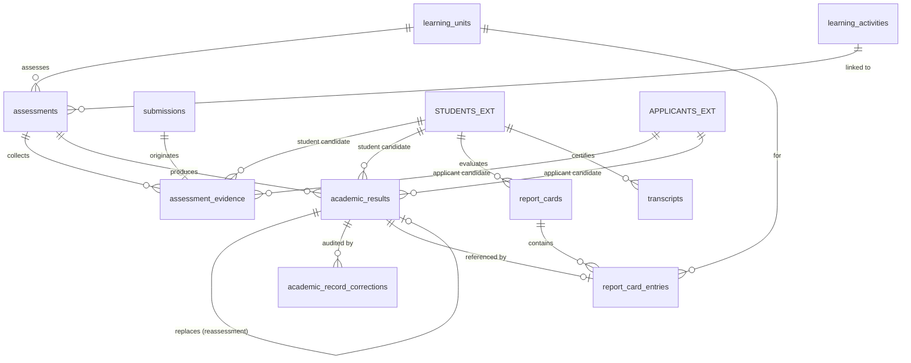

# 1. Overview

This target architecture defines the technical realization for the full scope of Stage 2 "Assessment & Results" under the Academic domain:
1. **Assessment Planning & Conduct (`ACD-WF-07`, `ACD-WF-20`, `UC-ACD-05`, `UC-ACD-07`, `SCR-ACD-02`, `SCR-STU-01`):** Managing planned and conducted evaluation events (`academics.assessments`) linked to approved learning units (`learning_unit_id`) and optionally to specific instructional learning activities (`learning_activity_id`). Supporting assessment types (`formative`, `summative`, `diagnostic`, `portfolio`, `project`, `other`), methods (`written_test`, `oral`, `practical`, `project`, `portfolio`, `observation`, `other`), scoring specifications (`max_score`, `passing_score` / KKM, `criteria`), reassessment policies (`capped_at_passing`, `highest_score`, `latest_attempt`, `average`, `none`), and applicant entrance assessment administration (`ACD-WF-20`, `GAP-07`).
2. **Evidence Collection & Evaluation / Scoring (`ACD-WF-08`, `UC-ACD-06`, `SCR-ACD-02`):** Collecting raw learning evidence (`academics.assessment_evidence`) originating from coursework submissions (`submissions`), test papers, observations, oral responses, or practical demonstrations. Supporting diverse evaluation models (`numeric`, `letter_grade`, `pass_fail`, `competency`, `rubric`, `narrative`, `completion`), recording immutable multi-attempt remediation histories (`attempt_number`, `replaces_result_id`), adjudicating operative outcomes (`is_final = true`), and authorizing classroom teachers to publish routine formative evaluations directly (`UC-ACD-06`).
3. **Result Moderation, Approval & Publication (`ACD-WF-09`, `UC-ACD-16`, `SCR-ACD-07`):** Enabling Academic Authorities and delegated Coordinators to moderate provisional summative grades across classes and cohorts. Enforcing the strict institutional lifecycle: Teacher records provisional evaluations (`provisional`) → Academic Authority formally approves summative results (`approved`) → authorized release to stakeholders (`published`), guaranteeing that only approved results feed downstream progression, standing, report cards, or transcripts.
4. **Report Card & Transcript Production (`ACD-WF-12`, `UC-ACD-13`, `SCR-ACD-07`, `SCR-SELF-03`, `SCR-SELF-02`):** Compiling periodic academic reports (`academics.report_cards` and `academics.report_card_entries`) for active reporting periods (supporting Mid-Term Progress Reports `mid_term` and End-of-Semester Report Cards `end_of_term` — *Buku Rapor Merdeka*), and issuing interim academic transcripts (`academics.transcripts`). Enforcing the boundary invariant that *report cards do not own grades or attendance*, and freezing immutable document snapshots (`content_snapshot` JSON) upon approval to guarantee 100% exact historical reproducibility.
5. **Academic Record Correction Protocol (`ACD-WF-15`, `UC-ACD-19`, `SCR-ACD-07`):** Enforcing a formal, auditable correction protocol for approved academic results (`academics.academic_record_corrections`). Strictly prohibiting silent or in-place overwriting of approved academic records, recording complete correction audit metadata (`original_value`, `corrected_value`, `reason`, `evidence`, `corrected_by`, `corrected_date`, `is_material`), restricting material alterations to Academic Authority authorization, and publishing `AcademicResultCorrectedEvent` for downstream progression and standing re-evaluations.

It fulfills change request intake `CR-ACD-ASSESSMENT-RESULTS` ([`IS010 - ACD-ASSESSMENT-RESULTS-ISSUE.md`](file:///d:/Project.Private/elsasa-sis-v3/docs/issues/IS010%20-%20ACD-ASSESSMENT-RESULTS-ISSUE.md)) and realizes the approved analysis decisions documented in [`IS010 - ACD-ASSESSMENT-RESULTS-FEASIBILITY-ASSESSMENT.md`](file:///d:/Project.Private/elsasa-sis-v3/docs/issues/IS010%20-%20ACD-ASSESSMENT-RESULTS-FEASIBILITY-ASSESSMENT.md).

The architecture delivers the assessment backbone for Elsasa School Information System (SIS) V3:
1. **Authoritative Submodule 3 Relational Schema (`GAP-001`, `ADR-002`, `ADR-006`):** Provisioning 7 authoritative relational tables specified in [`academic-entities-tables.md`](file:///d:/Project.Private/elsasa-sis-v3/docs/entities/academic-entities-tables.md) lines 390–660 (`assessments`, `assessment_evidence`, `academic_results`, `academic_record_corrections`, `report_cards`, `report_card_entries`, `transcripts`) in schema `academics` via DbUp migration script `20261105_0402_Academics_AssessmentResults_Tables.sql`.
2. **Explicit Dual Nullable Candidate References with CHECK Constraint (`GAP-003`, `OQ-001`, `GAP-07`):** Enabling applicant entrance assessments (`ACD-WF-20`) to reuse 100% of the rubric scoring, assessor assignment, and approval pipeline via explicit `student_id UUID NULL` and `applicant_id UUID NULL` columns constrained by `CHECK ((student_id IS NOT NULL AND applicant_id IS NULL) OR (student_id IS NULL AND applicant_id IS NOT NULL))`.
3. **Application-Level Reassessment Policy Evaluator (`GAP-004`, `OQ-002`):** Implementing a pure C# domain service `IReassessmentPolicyEvaluator` within command transactions to adjudicate operative results across multiple retakes (`capped_at_passing`, `highest_score`, `latest_attempt`, `average`, `none`), maintaining complete remediation history while setting `is_final = true` on the winning record for high-speed downstream queries.
4. **Three-Tier Result Governance Lifecycle (`GAP-005`, `OQ-003`):** Implementing explicit command slices for `EvaluateStudentLearning`, `ApproveSummativeResults`, and `PublishAcademicResults`, ensuring teachers possess autonomous authority to publish formative developmental feedback (`UC-ACD-06`) while strictly locking summative evaluations to `provisional` until formally certified by Academic Authority (`UC-ACD-16`).
5. **Structured JSON Document Snapshot Architecture (`GAP-006`, `OQ-004`):** Freezing complete certified datasets into explicit JSON contracts stored in `content_snapshot NVARCHAR(MAX)` at approval time, rendered via client-side CSS `@media print` layout templates (*Buku Rapor Merdeka*), eliminating server-side binary PDF dependencies and database blob bloat while guaranteeing 100% historical reproducibility.
6. **Auditable Academic Record Correction Protocol (`GAP-007`, `OQ-005`):** Atomically logging serialized pre/post-mutation states into `academic_record_corrections` with mandatory justification reasons (min 10 chars) before updating operative result records, preserving foreign key integrity in report card entries and notifying downstream modules via `AcademicResultCorrectedEvent`.
7. **Cross-Domain Contracts & Domain Events (`GAP-009`, `ADR-001`, `ADR-003`):** Extending `IAcademicsModule` with synchronous query methods for student approved results, applicant entrance scores, and report card snapshots, and publishing granular post-commit domain events for downstream standing, admission, and financial benefits modules.
8. **Role-Aligned Frontend Workbenches (`GAP-008`, `OQ-006`):** Delivering 2 dedicated Vue 3 feature slices matching the master screen inventory (`SCR-ACD-02` Coursework & Assessment Workbench, `SCR-ACD-07` Academic Records Workbench), extending student/family self-service portals (`SCR-SELF-03`, `SCR-SELF-02`), and displaying entrance scores in `SCR-STU-01`.

---

# 2. Architectural Basis

## Business Context

This architecture realizes the business outcomes, operational workflows, and domain rules specified in:

- **DOMAIN BLUEPRINT:** [`academic-domain.md`](file:///d:/Project.Private/elsasa-sis-v3/docs/domains/academic-domain.md)
  - Assessment Organization, Types & Methods (lines 216–242)
  - Academic Results, Governance Lifecycle & Multiple Evaluation Models (lines 244–278)
  - Reassessment Policies & Multi-Attempt History Preservation (lines 280–304)
  - Report Cards & Cumulative Transcripts (lines 306–336)
  - Academic Record Correction Protocol & Materiality Rules (lines 338–366)
  - Boundary Rule: Report cards do not own grades or attendance (lines 314–318)
- **ROADMAP & COMPLETION CRITERIA:** [`sub-modul-and-development-phases.md`](file:///d:/Project.Private/elsasa-sis-v3/docs/sub-modul-and-development-phases.md)
  - Stage 2 Module: Assessment & Results (Submodule 3)
  - **Criterion 4:** *"An assignment has been issued, a submission received, formative evaluation recorded, and result approved."* (Evaluation and approval portion)
  - **Criterion 5:** *"An academic result has been approved and published. A report card or progress report is produced."*
  - **Criterion 15:** *"An entrance assessment is conducted through an Academics workflow and its result is consumed by the Admission module as an authorized admission input."*
- **WORKFLOWS & USE CASES:**
  - [`operational-workflow-discovery.md`](file:///d:/Project.Private/elsasa-sis-v3/docs/operational-workflow-discovery.md):
    - `ACD-WF-07`: Plan Assessment & Define Scoring Rubric
    - `ACD-WF-08`: Collect Evidence & Record Student Evaluations
    - `ACD-WF-09`: Moderate, Approve & Publish Summative Results
    - `ACD-WF-12`: Compile & Issue Periodic Report Cards and Interim Transcripts
    - `ACD-WF-15`: Correct Approved Academic Record (Grade Alteration)
    - `ACD-WF-20`: Administer Applicant Entrance Assessment
    - `GAP-07`: Dual candidate reference resolution for entrance assessments
    - `GAP-08`: External academic records & transfer credit resolution
  - [`use-cases.md`](file:///d:/Project.Private/elsasa-sis-v3/docs/use-cases.md):
    - `UC-ACD-05`: Plan & Schedule Assessment
    - `UC-ACD-06`: Evaluate Student Learning (Formative & Summative)
    - `UC-ACD-07`: Administer Entrance Assessment
    - `UC-ACD-13`: Compile Periodic Report Card & Issue Transcript
    - `UC-ACD-16`: Moderate & Approve Summative Results
    - `UC-ACD-19`: Correct Approved Academic Record
- **ACTORS:** [`actors.md`](file:///d:/Project.Private/elsasa-sis-v3/docs/actors.md)
  - Teacher (`ACT-09`): Assessment planning, criteria configuration, evidence capture, provisional scoring, formative feedback publication.
  - Academic Coordinator (`ACT-07`): Assessment moderation, cohort report card batch compilation, interim transcript generation.
  - Academic Authority (`ACT-08`): Summative grade approval, official publication, material grade corrections authorization.
  - Student (`ACT-10`): Inspection of published formative/summative marks, rubric breakdown, certified report cards.
  - Parent / Guardian (`ACT-11`): Portal inspection of published evaluations, teacher remarks, and certified *Buku Rapor*.
  - Admission Officer (`ACT-02`): Consumption of authorized entrance assessment scores during admission application review.
- **DATA SPECIFICATIONS:**
  - [`academic-entities.md`](file:///d:/Project.Private/elsasa-sis-v3/docs/entities/academic-entities.md): Submodule 3 (Assessment & Results), Core Entities, Reassessment Strategies, Governance Lifecycles.
  - [`academic-entities-tables.md`](file:///d:/Project.Private/elsasa-sis-v3/docs/entities/academic-entities-tables.md): Submodule 3 tables (`academics.assessments`, `academics.assessment_evidence`, `academics.academic_results`, `academics.academic_record_corrections`, `academics.report_cards`, `academics.report_card_entries`, `academics.transcripts`, lines 390–660).
- **SCREEN INVENTORY:** [`screen-inventory.md`](file:///d:/Project.Private/elsasa-sis-v3/docs/screen-inventory.md)
  - `SCR-ACD-02`: Coursework & Assessment Workbench (Work Queue pattern, Teacher)
  - `SCR-ACD-07`: Academic Records Workbench (Work Queue pattern, Academic Coordinator & Academic Authority)
  - `SCR-SELF-03`: Student Learning Workspace (Work Queue pattern, Student)
  - `SCR-SELF-02`: Family Tasks & Requests Portal (Work Queue pattern, Parent)
  - `SCR-STU-01`: Student Intake Workbench (Work Queue pattern, Admission Officer)

## Analysis Input

This architecture consumes the approved gap closures, risk mitigations, and technical decisions recorded in:

- **FEASIBILITY ASSESSMENT:** [`IS010 - ACD-ASSESSMENT-RESULTS-FEASIBILITY-ASSESSMENT.md`](file:///d:/Project.Private/elsasa-sis-v3/docs/issues/IS010%20-%20ACD-ASSESSMENT-RESULTS-FEASIBILITY-ASSESSMENT.md)
  - `GAP-001`: Submodule 3 database schema provisioning via DbUp migration script `20261105_0402_Academics_AssessmentResults_Tables.sql`.
  - `GAP-002`: Backend vertical slice implementation under `src/backend/Elsasa.Sis.Academics/Features/`.
  - `GAP-003 / OQ-001`: Candidate reference in assessment & evidence (`student_id` NULL, `applicant_id` NULL with CHECK constraint).
  - `GAP-004 / OQ-002`: Reassessment policy execution via C# domain service `IReassessmentPolicyEvaluator` updating `is_final` atomically in command transactions.
  - `GAP-005 / OQ-003`: Three-tier result governance lifecycle with separate endpoints and role guards enforcing teacher formative release vs authority summative approval.
  - `GAP-006 / OQ-004`: Report card and transcript historical snapshot architecture freezing structured JSON into `content_snapshot` rendered via CSS `@media print`.
  - `GAP-007 / OQ-005`: Transactional in-place mutation with mandatory audit logging in `academic_record_corrections` and `AcademicResultCorrectedEvent` emission.
  - `GAP-008 / OQ-006`: Role-aligned frontend feature slicing (`features/academics/assessment/`, `features/academics/records/`, self-service and admission portal tabs).
  - `GAP-009`: Cross-domain synchronous contract and in-memory domain event definitions.
  - Planning Readiness: Granted `READY-FOR-PLANNING`.

```text
DOMAIN (academic-domain.md) + FEATURE (use-cases.md, screen-inventory.md)
                            +
        FEASIBILITY-ASSESSMENT (CR-ACD-ASSESSMENT-RESULTS)
                            ↓
      TARGET ARCHITECTURE (ACD-ASSESSMENT-RESULTS)
```

---

# 3. Scope

## Included

1. **Database Schema & Migrations (`Elsasa.Sis.Database`):**
   - Migration script `20261105_0402_Academics_AssessmentResults_Tables.sql` targeting Microsoft SQL Server 2022 ([`ADR-002`](file:///d:/Project.Private/elsasa-sis-v3/docs/architecture/adr.md#L50-L75), [`ADR-006`](file:///d:/Project.Private/elsasa-sis-v3/docs/architecture/adr.md#L152-L176)).
   - Creation of 7 authoritative relational tables in schema `academics`:
     - `academics.assessments`: Planned and conducted evaluation events, assessment types, methods, scoring specs (`max_score`, `passing_score`), reassessment policies, and status.
     - `academics.assessment_evidence`: Raw learning evidence, student/applicant dual reference, evidence types, submission references, and timestamps.
     - `academics.academic_results`: Primary academic evaluation records, multi-attempt counters (`attempt_number`), previous attempt links (`replaces_result_id`), operative flags (`is_final`), diverse scoring models (`score_numeric`, `grade_letter`, `grade_label`, `narrative_feedback`), and lifecycle statuses (`provisional`, `approved`, `published`).
     - `academics.academic_record_corrections`: Unified immutable correction audit log capturing pre/post-mutation states (`original_value`, `corrected_value`), mandatory reason text, authorizer identity, and materiality flag.
     - `academics.report_cards`: Periodic academic reports for active periods (`mid_term`, `end_of_term`), template styles (*Buku Rapor Merdeka*), statuses (`draft`, `approved`, `published`), teacher narrative comments, and immutable JSON `content_snapshot`.
     - `academics.report_card_entries`: Linking report cards to constituent approved academic results and subject-specific teacher remarks.
     - `academics.transcripts`: Cumulative academic history documents (`official`, `unofficial`), covered date ranges, issuance purpose, approval metadata, and frozen JSON `content_snapshot`.
   - Provisioning of indexes, intra-schema foreign key constraints, status check constraints, candidate CHECK constraints, and filtered unique index on active report cards.

2. **Backend Domain Architecture & Vertical Slices (`Elsasa.Sis.Academics`):**
   - **Assessment Planning Slices (`Features/Assessments/`):**
     - `CreateAssessment` (`POST /api/v1/academics/assessments`): Plan evaluation event tied to learning unit and optional activity (`UC-ACD-05`).
     - `UpdateAssessment` (`PUT /api/v1/academics/assessments/{id}`): Update title, criteria, date, scoring thresholds, or reassessment policy.
     - `ConductAssessment` (`POST /api/v1/academics/assessments/{id}/conduct`): Transition status to `conducted`.
     - `CancelAssessment` (`POST /api/v1/academics/assessments/{id}/cancel`): Cancel planned assessment with reason.
     - `GetAssessmentsByUnit` (`GET /api/v1/academics/learning-units/{unitId}/assessments`): Query assessments by unit, period, and status.
     - `GetAssessmentById` (`GET /api/v1/academics/assessments/{id}`): Detailed assessment inspection with scoring rubric and participant counts.
   - **Evidence Collection Slices (`Features/AssessmentEvidence/`):**
     - `RecordEvidence` (`POST /api/v1/academics/assessments/{id}/evidence`): Record raw student or applicant evidence linked to submissions, test papers, or observations (`ACD-WF-08`, `UC-ACD-07`).
     - `GetEvidenceByAssessment` (`GET /api/v1/academics/assessments/{id}/evidence`): Query collected evidence roster for an assessment.
   - **Academic Results & Governance Slices (`Features/AcademicResults/`):**
     - `EvaluateStudentLearning` (`POST /api/v1/academics/assessments/{id}/results`): Teacher records provisional evaluation or autonomous formative release, executing `IReassessmentPolicyEvaluator` to update `is_final` (`UC-ACD-06`).
     - `ApproveSummativeResults` (`POST /api/v1/academics/assessments/{id}/results/approve`): Academic Authority / Coordinator certifies provisional results to `approved` (`UC-ACD-16`).
     - `PublishAcademicResults` (`POST /api/v1/academics/assessments/{id}/results/publish`): Academic Authority releases approved results to `published` status for portal visibility.
     - `GetResultsByAssessment` (`GET /api/v1/academics/assessments/{id}/results`): Query results roster with attempt numbers, final status, and score breakdowns.
     - `GetStudentResultsWorkspace` (`GET /api/v1/portal/learning/results`): Query published results and rubric breakdowns for student self-service (`SCR-SELF-03`).
   - **Report Cards Slices (`Features/ReportCards/`):**
     - `CompileReportCard` (`POST /api/v1/academics/report-cards/compile`): Compile periodic draft report card from approved operational results and attendance tallies (`UC-ACD-13`).
     - `BatchCompileCohortReportCards` (`POST /api/v1/academics/report-cards/batch-compile`): Batch-compile draft report cards for all enrolled section participants.
     - `ApproveReportCard` (`POST /api/v1/academics/report-cards/{id}/approve`): Academic Authority formally approves report card and freezes immutable JSON snapshot into `content_snapshot`.
     - `PublishReportCard` (`POST /api/v1/academics/report-cards/{id}/publish`): Release approved report card to student/family self-service portals.
     - `GetReportCardById` (`GET /api/v1/academics/report-cards/{id}`): Fetch report card details (rendering live draft or frozen snapshot if approved).
     - `GetStudentReportCards` (`GET /api/v1/portal/learning/report-cards`): Query certified report cards for authenticated student/parent.
   - **Transcripts Slices (`Features/Transcripts/`):**
     - `GenerateInterimTranscript` (`POST /api/v1/academics/transcripts/generate`): Compile cumulative academic history across completed periods into draft transcript (`UC-ACD-13`).
     - `IssueTranscript` (`POST /api/v1/academics/transcripts/{id}/issue`): Certify and issue transcript, freezing immutable JSON `content_snapshot`.
     - `GetStudentTranscript` (`GET /api/v1/academics/students/{studentId}/transcript`): Query student transcript and historical entries.
   - **Academic Record Corrections Slices (`Features/RecordCorrections/`):**
     - `CorrectApprovedResult` (`POST /api/v1/academics/academic-results/{id}/correct`): Auditable in-place grade alteration requiring mandatory reason (min 10 chars) and Academic Authority authorization, recording audit entry into `academic_record_corrections` (`UC-ACD-19`).
     - `GetResultCorrectionHistory` (`GET /api/v1/academics/academic-results/{id}/corrections`): Query full audit log of alterations for a specific result.

3. **Cross-Domain Contracts & Domain Events (`Elsasa.Sis.Contracts`):**
   - Extending `IAcademicsModule` with synchronous query methods for downstream consumers (`GetStudentApprovedResultsAsync`, `GetApplicantAssessmentScoreAsync`, `GetStudentReportCardSnapshotAsync`).
   - Defining in-memory domain events in `Elsasa.Sis.Contracts/Academics/Events/` emitted post-commit via MediatR `IPublisher` ([`ADR-003`](file:///d:/Project.Private/elsasa-sis-v3/docs/architecture/adr.md#L76-L98)):
     - `AcademicResultApprovedEvent`
     - `AcademicResultPublishedEvent`
     - `AcademicResultCorrectedEvent`
     - `ReportCardPublishedEvent`
     - `TranscriptIssuedEvent`

4. **Frontend Workspaces & Client Integration (`src/frontend`):**
   - **`SCR-ACD-02` Coursework & Assessment Workbench (`/academics/assessment` or integrated `/academics/coursework`):**
     - Teacher Assessment Planner: create/edit assessments, configure scoring criteria, define KKM thresholds and reassessment policies.
     - Teacher Evaluation Queue: rubric scoring grid, score entry, multi-attempt view, autonomous formative release button (`UC-ACD-06`).
   - **`SCR-ACD-07` Academic Records Workbench (`/academics/records`):**
     - Coordinator / Authority Moderation Queue: review provisional summative scores across cohorts, bulk approve, publish to portals (`UC-ACD-16`).
     - Report Card Suite: periodic report card compiler, batch cohort generator, template selector (*Buku Rapor Merdeka*), printable preview with CSS `@media print` rules, official approval and release actions (`UC-ACD-13`).
     - Interim Transcript Generator: cumulative transcript compiler, tag-flagged transfer credits (`[T]`), snapshot viewer, issuance action.
     - Record Correction Modal: auditable correction dialog with original value preview, mandatory justification reason field, and authority role guard (`UC-ACD-19`).
   - **Self-Service & Admission Integrations:**
     - `SCR-SELF-03` Student Learning Workspace (`/portal/learning`): "Grades & Report Cards" tab showing published scores, teacher feedback, and downloadable/printable *Buku Rapor*.
     - `SCR-SELF-02` Family Tasks & Requests Portal (`/portal`): "Academic Progress & Report Cards" tab for parents/guardians.
     - `SCR-STU-01` Student Intake Workbench (`/students/admission`): Integrated tab displaying authorized Academics entrance exam results (`UC-ACD-07`, `GAP-07`).

## Excluded

1. **Curriculum Frameworks & Learning Units (`IS008`):** Creating and versioning `learning_structures`, `learning_units`, and `academic_requirements` is owned by `Learning Structure & Requirements`.
2. **Participation Registration & Session Conduct (`IS009`):** Student participation rosters, daily instructional logging, roll-call attendance, coursework assignments, and submission tracking are owned by `Participation & Learning Activities`.
3. **Student Learning Plans (SLP) Exceptional Accommodations:** Drafting individualized accommodation plans and IEP policies belongs to `Student Learning Plan`.
4. **Cohort Standing & Progression Determinations (`SCR-ACD-09`):** Promotion/retention committee decisions, academic probation tracking, and academic honors conferral belong to `Standing & Progression`.
5. **Stage 3 Official Graduation Transcript Certification & Transfer-In Credit Integration (`UC-STD-18`):** Final legal graduation transcript seals, diplomas, and external accredited credit transfers belong to Stage 3 (`SCR-ACD-07` Stage 3 extension).
6. **Purpose-Specific Academic Clearance (`SCR-ACD-08`, `ACD-WF-16`):** Transfer-out academic clearance workflows are deferred to Stage 3.
7. **Official Teaching Authorization & Workload (`Teaching` domain):** Faculty profile verification and contractual workload tracking belong to `Teaching`.
8. **Examination Scheduling & Facility Timetabling (`Operations` domain):** Room reservation, exam hall invigilation timetables, and conflict resolution belong to `Scheduling & Rooms`.

---

# 4. Technical Decisions

## TD-01: Authoritative Submodule 3 Relational Schema & Storage Layout

### Context
Stage 2 Assessment & Results introduces 7 core entities: assessments, assessment evidence, academic results, academic record corrections, report cards, report card entries, and transcripts. We must persist these entities in SQL Server adhering to ADR-001, ADR-002, and ADR-006.

### Decision
Provision all 7 tables within schema `academics` using DbUp migration script `20261105_0402_Academics_AssessmentResults_Tables.sql`:
1. Use `UNIQUEIDENTIFIER` with `DEFAULT (NEWID())` for all primary keys.
2. Cross-domain references (`student_id`, `applicant_id`, `academic_period_id`) are stored as logical UUIDs without physical cross-schema foreign keys (ADR-002).
3. Intra-schema foreign keys (`learning_unit_id`, `learning_activity_id`, `assessment_id`, `submission_id`, `replaces_result_id`, `report_card_id`, `academic_result_id`) are strictly enforced with `ON DELETE NO ACTION`.
4. Check constraints enforce domain enum literals (`assessment_type`, `assessment_method`, `reassessment_policy`, `assessment_status`, `evidence_type`, `evaluation_model`, `result_status`, `correction_record_type`, `report_type`, `report_status`, `transcript_type`, `transcript_status`).
5. Composite unique index `UQ_academics_report_cards_student_period_type` guarantees that a student receives at most one report card of a specific type (`mid_term` or `end_of_term`) per academic period.

---

## TD-02: Explicit Dual Nullable Candidate References with CHECK Constraint (GAP-07 / ACD-WF-20)

### Context
Assessments evaluate enrolled students in routine academic coursework, but also evaluate prospective applicants in admissions entrance diagnostic examinations (`ACD-WF-20`, `UC-ACD-07`, `GAP-07`). Storing polymorphic string IDs degrades query safety, while creating separate tables for applicant exams creates unnecessary schema bloat.

### Decision
Adopt **Explicit Dual Nullable References with CHECK Constraint** on `academics.assessment_evidence` and `academics.academic_results`:
1. Columns:
   - `student_id UNIQUEIDENTIFIER NULL` (references enrolled student in `students.students`)
   - `applicant_id UNIQUEIDENTIFIER NULL` (references admission applicant in `students.applicants`)
2. Relational invariant enforced by SQL Server check constraint:
   ```sql
   CONSTRAINT [CK_academics_academic_results_candidate]
       CHECK (([student_id] IS NOT NULL AND [applicant_id] IS NULL) OR
              ([student_id] IS NULL AND [applicant_id] IS NOT NULL))
   ```
3. Dedicated filtered indexes:
   - `IX_academics_academic_results_student` on `([student_id]) WHERE [student_id] IS NOT NULL`
   - `IX_academics_academic_results_applicant` on `([applicant_id]) WHERE [applicant_id] IS NOT NULL`
4. Reuses 100% of the rubric scoring, assessor assignment, and approval pipeline for entrance exams while maintaining complete compile-time and relational type safety.

---

## TD-03: Pure C# Domain Service Reassessment Policy Evaluator

### Context
When students take reassessments or retakes (`attempt_number > 1`), school policy dictates how the operative score is determined (`capped_at_passing`, `highest_score`, `latest_attempt`, `average`, `none`). The system must preserve 100% of historical attempts while allowing downstream report card and progression queries to filter the winning score quickly without running slow window functions across thousands of rows.

### Decision
Implement **Application-Level Explicit Policy Evaluator in Command Transaction**:
1. Define a pure C# domain service `IReassessmentPolicyEvaluator`:
   - Inputs: Parent assessment's `reassessment_policy`, passing threshold `passing_score`, collection of existing attempts for this student/assessment, and candidate attempt score.
   - Output: Identification of the operative attempt record and calculated operative values.
2. Supported Policies:
   - `highest_score`: Attempt with highest score is operative (`is_final = true`).
   - `capped_at_passing`: Highest score is operative, but if it exceeds `passing_score` (KKM), the operative score is capped at `passing_score`.
   - `latest_attempt`: Most recent attempt (`MAX(attempt_number)`) is operative (`is_final = true`).
   - `average`: Arithmetic mean of all attempts is computed; latest attempt record carries the calculated average score and is flagged `is_final = true`.
   - `none`: Initial attempt is always operative (`attempt_number = 1`, `is_final = true`).
3. Execution in `EvaluateStudentLearningCommand`:
   - Within a single SQL transaction:
     - Atomically inserts the new attempt record (`attempt_number = prior_max + 1`, `replaces_result_id = prior_operative_id`).
     - Evaluates the policy and issues `UPDATE academics.academic_results SET is_final = CASE WHEN id = @WinnerId THEN 1 ELSE 0 END WHERE assessment_id = @AssessmentId AND student_id = @StudentId`.
4. Guarantees high-speed index read queries (`WHERE is_final = 1 AND result_status IN ('approved', 'published')`) without database stored procedures or cron worker jobs.

---

## TD-04: Explicit Three-Tier Result Governance Lifecycle & Formative Autonomous Release

### Context
A fundamental invariant of Elsasa SIS is that *provisional marks recorded by teachers must never be consumed by downstream progression, standing, or report cards until formally reviewed and approved by Academic Authority* (`UC-ACD-16`). Simultaneously, teachers must have full autonomous authority to publish daily formative scores, rubric breakdowns, and developmental remarks directly to students and parents without administrative bottlenecks (`UC-ACD-06`).

### Decision
Implement **Explicit Lifecycle Endpoints with Role & Type Guards**:
1. `POST /api/v1/academics/assessments/{id}/results` (`EvaluateStudentLearning`):
   - Authenticated Teacher records evaluation.
   - If assessment is `formative` and teacher flags `publish_immediately = true`: sets `result_status = 'published'`, `published_date = CURRENT_TIMESTAMP`, and `approved_by = teacher.Username` (teacher exercises autonomous authority for formative feedback).
   - If assessment is `summative`: server **strictly forces** `result_status = 'provisional'`, `approved_by = NULL`, `approved_date = NULL`, regardless of request payload flags.
2. `POST /api/v1/academics/assessments/{id}/results/approve` (`ApproveSummativeResults`):
   - Restricted to `AcademicAuthority` or authorized `AcademicCoordinator` (`UC-ACD-16`).
   - Validates that assessment is conducted and transitions provisional results to `result_status = 'approved'`, logging `approved_by` and `approved_date`.
   - Emits `AcademicResultApprovedEvent` post-commit.
3. `POST /api/v1/academics/assessments/{id}/results/publish` (`PublishAcademicResults`):
   - Restricted to `AcademicAuthority` / `AcademicCoordinator`.
   - Transitions approved results to `result_status = 'published'`, setting `published_date = CURRENT_TIMESTAMP`.
   - Emits `AcademicResultPublishedEvent` post-commit alerting student and parent portals.

---

## TD-05: Immutable Structured JSON Document Snapshot Architecture

### Context
Periodic report cards (*Buku Rapor Merdeka*) and academic transcripts must be 100% historically reproducible (`academic-entities.md` Q18). Retrospective edits to student names, attendance records, or learning unit titles in subsequent school years must never alter certified historical documents. Generating binary PDF blobs in SQL Server creates unacceptable database bloat and requires heavy server-side PDF compilation libraries.

### Decision
Adopt **Structured JSON Snapshot with Native Print Layout Rendering**:
1. Snapshot Generation (upon Report Card / Transcript Approval & Publication):
   - The command handler queries the complete certified state: student full name, student number (NISN), school details, period metadata, enrolled subjects, teacher names, approved numeric scores, letter grades, competency descriptors, attendance aggregates (present, absent, late, excused), and teacher/principal comments.
   - Serializes this complete payload into an explicit C# record contract (`ReportCardSnapshotDto` or `TranscriptSnapshotDto`) and saves the JSON string into `content_snapshot NVARCHAR(MAX)`.
2. Frontend Rendering & Print Engine:
   - When viewing or printing an approved/published report card, the frontend loads `content_snapshot` directly without querying mutable operational tables.
   - Renders the snapshot via dedicated Vue print components styled with standard CSS `@media print` rules (*Buku Rapor Merdeka* statutory layout).
   - Eliminates all server-side headless browser / PDF compilation dependencies (Puppeteer, QuestPDF) while guaranteeing tamper-proof historical fidelity.

---

## TD-06: Auditable Academic Record Correction Protocol (UC-ACD-19 / ACD-WF-15)

### Context
Education regulations strictly prohibit silent or in-place overwriting of approved academic grades. Corrections must be fully accountable, attributing who made the change, when, why, and what the original value was. Furthermore, modifying an approved result's `id` would break foreign key relationships in existing `report_card_entries`.

### Decision
Adopt **Transactional In-Place Mutation with Mandatory Audit Log**:
1. When `CorrectApprovedResultCommand` executes:
   - Guard checks: requires `AcademicAuthority` role (or Coordinator for non-material corrections) and mandatory `reason` text (minimum 10 characters).
   - Verifies target `academic_results` record is currently in `approved` or `published` status.
   - Serializes existing evaluation state (`score_numeric`, `grade_letter`, `grade_label`, `narrative_feedback`) as JSON into `original_value`.
   - Serializes proposed state as JSON into `corrected_value`.
2. In a single SQL transaction:
   - Inserts audit row into `academics.academic_record_corrections` logging `record_type = 'academic_result'`, `record_id`, `original_value`, `corrected_value`, `reason`, `evidence`, `corrected_by = currentUser.Username`, `corrected_date = today`, and `is_material`.
   - Executes `UPDATE academics.academic_results` with corrected values, updating `updated_at` and `updated_by`.
   - Invokes `IReassessmentPolicyEvaluator` to re-verify `is_final` flag across retake attempts.
   - Emits `AcademicResultCorrectedEvent` post-commit via MediatR to trigger downstream review of standing and progression.
3. Preserves `academic_results.id` integrity while maintaining an unforgeable, legally defensible audit trail.

---

## TD-07: Batch Cohort Report Card Compilation Engine

### Context
At the end of an academic term, coordinators must compile hundreds of report cards for entire cohorts. Compiling them one by one induces extreme user fatigue and risk of omissions.

### Decision
Implement **Batch Cohort Report Card Compilation Slice (`BatchCompileCohortReportCards`)**:
1. Endpoint: `POST /api/v1/academics/report-cards/batch-compile`
2. Accepts `academic_period_id`, `report_type` (`mid_term` or `end_of_term`), `template_name`, and optional `section_label` filter (e.g. "4A").
3. Performs a single optimized set-based query:
   - Identifies all active students in that cohort/section.
   - Matches active participations in `academics.academic_participations`.
   - LEFT JOINs operative approved results (`academic_results WHERE is_final = 1 AND result_status IN ('approved', 'published')`).
   - Inserts draft rows into `academics.report_cards` and `academics.report_card_entries` using `INSERT ... SELECT WHERE NOT EXISTS` to ensure idempotency.
4. Completes cohort generation in sub-second SQL execution without row-locking contention.

---

## TD-08: Cross-Domain Contract Extensions & Post-Commit Domain Events

### Context
Downstream domains (`Standing & Progression`, `Students Admission`, `Finance Benefits`) require certified academic results and report card verification without violating compile-time domain isolation (ADR-001, ADR-003).

### Decision
1. **Extend `IAcademicsModule` in `Elsasa.Sis.Contracts/Academics/`:**
   ```csharp
   Task<Result<IReadOnlyList<StudentApprovedResultDto>>> GetStudentApprovedResultsAsync(Guid studentId, Guid academicPeriodId, CancellationToken ct = default);
   Task<Result<ApplicantAssessmentScoreDto?>> GetApplicantAssessmentScoreAsync(Guid applicantId, Guid assessmentId, CancellationToken ct = default);
   Task<Result<ReportCardSnapshotDto?>> GetStudentReportCardSnapshotAsync(Guid reportCardId, CancellationToken ct = default);
   ```
2. **Define Post-Commit In-Memory Domain Events in `Elsasa.Sis.Contracts/Academics/Events/`:**
   - `AcademicResultApprovedEvent(Guid ResultId, Guid AssessmentId, Guid? StudentId, Guid? ApplicantId, decimal? ScoreNumeric, string? GradeLetter, string ApprovedBy)`
   - `AcademicResultPublishedEvent(Guid ResultId, Guid AssessmentId, Guid? StudentId, decimal? ScoreNumeric, string? GradeLetter)`
   - `AcademicResultCorrectedEvent(Guid ResultId, Guid AssessmentId, Guid? StudentId, string Reason, bool IsMaterial, string CorrectedBy)`
   - `ReportCardPublishedEvent(Guid ReportCardId, Guid StudentId, Guid AcademicPeriodId, string ReportType)`
   - `TranscriptIssuedEvent(Guid TranscriptId, Guid StudentId, string TranscriptType, string Purpose)`

---

## TD-09: Fine-Grained Authorization Policies & Role Separation

### Context
Assessment and academic results require strict governance partitioning between teachers, coordinators, authorities, students, parents, and admission officers (ADR-009).

### Decision
1. Define permission constants in `Elsasa.Sis.Academics/Permissions.cs`:
   - `Permissions.Academics.Assessments.View` / `Manage` / `Conduct`
   - `Permissions.Academics.Evidence.Record` / `View`
   - `Permissions.Academics.Results.Evaluate` / `Approve` / `Publish` / `View`
   - `Permissions.Academics.ReportCards.Compile` / `Approve` / `Publish` / `View`
   - `Permissions.Academics.Transcripts.Generate` / `Issue` / `View`
   - `Permissions.Academics.Corrections.Correct` / `ViewHistory`
2. Enforce role boundaries:
   - **Teacher:** Can create assessments, record evidence, evaluate learning, and publish formative feedback. Cannot approve summative marks or alter certified records.
   - **Academic Coordinator:** Can plan assessments, review provisional scores across sections, batch-compile report cards, and generate interim transcripts.
   - **Academic Authority:** Sole actor authorized to approve summative results, publish official results, approve report cards/transcripts, and authorize material grade corrections.
   - **Student / Parent:** Strictly read-only access to published evaluations, rubric feedback, and certified report cards scoped to own identity (`currentUser.StudentId == studentId`).
   - **Admission Officer:** Read-only access to authorized applicant entrance assessment scores via `IAcademicsModule`.

---

## TD-10: Frontend Architecture & Role-Aligned Feature Slicing

### Context
Frontend views must deliver intuitive, role-tailored workbenches aligning with the master screen inventory (`screen-inventory.md`), avoiding bloated monolithic directories and preserving the 36-screen count.

### Decision
Implement role-aligned feature slices under `src/frontend/src/features/`:
1. `src/frontend/src/features/academics/assessment/` (`SCR-ACD-02`, Teacher):
   - Route: `/academics/assessment`
   - Master list of assessments grouped by learning unit and period.
   - Assessment planner modal, rubric configuration drawer, student evidence intake modal, and multi-model scoring grid with autonomous formative release toggle.
2. `src/frontend/src/features/academics/records/` (`SCR-ACD-07`, Coordinator & Authority):
   - Route: `/academics/records`
   - Views:
     - Summative Moderation Queue: cohort score review, provisional-to-approved action, publish action.
     - Report Cards Desk: batch compilation modal, template selector (*Buku Rapor Merdeka*), printable preview with native CSS `@media print` layout, and authority certification actions.
     - Transcripts Desk: interim transcript compiler, transfer-in `[T]` display tag, official issuance action.
     - Corrections Drawer: auditable correction dialog with mandatory reason text and diff view (`UC-ACD-19`).
3. Portal & Intake Integrations:
   - `src/frontend/src/features/portal/learning/` (`SCR-SELF-03`): Add "Academic Results & Report Cards" tab for students.
   - `src/frontend/src/features/portal/` (`SCR-SELF-02`): Add "Academic Progress & Report Cards" tab for parents.
   - `src/frontend/src/features/students/admission/` (`SCR-STU-01`): Wire entrance score tab to fetch Academics diagnostic exam results.

---

# 5. Component Responsibilities

| Component | Layer / Project | Responsibility |
|---|---|---|
| `20261105_0402_Academics_AssessmentResults_Tables.sql` | `Elsasa.Sis.Database` | Provisions 7 tables, intra-schema foreign keys, indexes, check constraints, candidate constraints, and filtered unique index in `academics` schema. |
| `Assessments` Slices | `Elsasa.Sis.Academics` | Handles assessment planning, updating, conducting, cancellation, and unit assessment queries (`UC-ACD-05`). |
| `AssessmentEvidence` Slices | `Elsasa.Sis.Academics` | Handles raw evidence collection for students and applicants, linking submissions, test papers, or observations (`ACD-WF-08`, `UC-ACD-07`). |
| `AcademicResults` Slices | `Elsasa.Sis.Academics` | Handles student evaluation, multi-attempt retake tracking, formative release, summative moderation approval, and official publication (`UC-ACD-06`, `UC-ACD-16`). |
| `IReassessmentPolicyEvaluator` | `Elsasa.Sis.Academics` | Pure C# domain service adjudicating operative attempt outcome (`is_final = true`) based on configured policy (`capped_at_passing`, `highest_score`, `latest_attempt`, `average`, `none`). |
| `ReportCards` Slices | `Elsasa.Sis.Academics` | Handles report card compilation, batch cohort generation, approval with JSON snapshot freezing, publication, and report inquiries (`UC-ACD-13`). |
| `Transcripts` Slices | `Elsasa.Sis.Academics` | Handles interim cumulative transcript generation, approval with JSON snapshot freezing, and issuance (`UC-ACD-13`). |
| `RecordCorrections` Slices | `Elsasa.Sis.Academics` | Handles auditable in-place grade corrections requiring mandatory reason and Academic Authority authorization, inserting immutable audit entries (`UC-ACD-19`). |
| `AcademicsModule` | `Elsasa.Sis.Academics` | Implements `IAcademicsModule` exposing synchronous cross-domain queries for approved results, applicant entrance scores, and report card snapshots. |
| `AcademicsDomainEvents` | `Elsasa.Sis.Contracts` | Defines immutable event records for post-commit cross-domain reactions via MediatR `IPublisher`. |
| `AssessmentWorkbenchView.vue` (`SCR-ACD-02`) | `src/frontend` | Vue 3 UI for Teachers to plan assessments, configure rubrics, evaluate student work, and publish formative feedback. |
| `AcademicRecordsWorkbenchView.vue` (`SCR-ACD-07`) | `src/frontend` | Vue 3 UI for Coordinators & Authorities to moderate summative grades, batch-compile report cards, print *Buku Rapor*, issue transcripts, and execute grade corrections. |
| `StudentResultsTab.vue` (`SCR-SELF-03`) | `src/frontend` | Vue 3 UI for Students to inspect published grades, teacher feedback, and download/print certified report cards. |
| `FamilyReportCardsTab.vue` (`SCR-SELF-02`) | `src/frontend` | Vue 3 UI for Parents/Guardians to inspect academic progress and certified *Buku Rapor*. |
| `ApplicantAssessmentTab.vue` (`SCR-STU-01`) | `src/frontend` | Vue 3 UI for Admission Officers to view authorized entrance assessment results from Academics. |

---

# 6. Integration Design

| Source | Target | Purpose |
|---|---|---|
| `CreateAssessmentHandler` | `academics.learning_units` | Validates that target learning unit exists and is active. |
| `CreateAssessmentHandler` | `academics.learning_activities` | Validates optional linked learning activity if supplied. |
| `EvaluateStudentLearningHandler` | `IStudentsModule` | Synchronously validates that student is currently enrolled in Students domain. |
| `EvaluateStudentLearningHandler` | `IReassessmentPolicyEvaluator` | Computes operative attempt and score according to assessment reassessment policy. |
| `CompileReportCardHandler` | `academics.academic_results` | Gathers operative approved results (`is_final = 1 AND result_status = 'approved'`). |
| `CompileReportCardHandler` | `IAcademicsModule` / `attendance_records` | Gathers attendance summary tallies for reporting period. |
| `ApproveReportCardHandler` | `academics.report_cards.content_snapshot` | Freezes self-contained structured JSON payload guaranteeing 100% historical reproducibility. |
| `ApproveSummativeResultsHandler` | `MediatR (IPublisher)` | Emits `AcademicResultApprovedEvent` post-commit. |
| `PublishAcademicResultsHandler` | `MediatR (IPublisher)` | Emits `AcademicResultPublishedEvent` post-commit alerting student/parent portals. |
| `CorrectApprovedResultHandler` | `MediatR (IPublisher)` | Emits `AcademicResultCorrectedEvent` post-commit for downstream standing re-evaluation. |
| `PublishReportCardHandler` | `MediatR (IPublisher)` | Emits `ReportCardPublishedEvent` post-commit alerting student/parent portals. |
| `IssueTranscriptHandler` | `MediatR (IPublisher)` | Emits `TranscriptIssuedEvent` post-commit. |
| `Students: ReviewApplicationHandler` | `IAcademicsModule` | Synchronously queries applicant entrance diagnostic score for admission review (`UC-ACD-07`, `GAP-07`). |
| `AssessmentWorkbenchView.vue` | `/api/v1/academics/assessments/*` | REST API calls via Axios and TanStack Query for assessment planning and scoring. |
| `AcademicRecordsWorkbenchView.vue` | `/api/v1/academics/report-cards/*` | REST API calls for result moderation, report card batch compilation, and corrections. |
| `StudentResultsTab.vue` | `/api/v1/portal/learning/*` | REST API calls for student gradebook and certified report card retrieval. |

---

# 7. Data Ownership

| Data | Owner Schema / Table | Notes |
|---|---|---|
| Assessments | `academics.assessments` | Owned exclusively by Academics. References `learning_unit_id` and optional `learning_activity_id`. |
| Assessment Evidence | `academics.assessment_evidence` | Owned exclusively by Academics. References `assessment_id`, optional `submission_id`, and dual candidate reference (`student_id` or `applicant_id`). |
| Academic Results | `academics.academic_results` | Owned exclusively by Academics. Primary academic record. References `assessment_id`, optional `replaces_result_id`, and candidate reference. |
| Academic Record Corrections | `academics.academic_record_corrections` | Owned exclusively by Academics. Unified immutable audit log of corrections to approved records. |
| Report Cards | `academics.report_cards` | Owned exclusively by Academics. References logical `student_id` and `academic_period_id`. Holds frozen JSON `content_snapshot`. |
| Report Card Entries | `academics.report_card_entries` | Owned exclusively by Academics. Links `report_card_id`, `learning_unit_id`, and optional `academic_result_id`. |
| Academic Transcripts | `academics.transcripts` | Owned exclusively by Academics. References logical `student_id`. Holds frozen JSON `content_snapshot`. |
| Student Enrolled Identity | `students.students` | Owned exclusively by Students domain. Academics references logical UUID. |
| Admissions Applicants | `students.applicants` | Owned exclusively by Students domain. Academics references logical UUID for entrance exams. |
| Operational Periods | `operations.operational_periods` | Owned exclusively by Operations domain. Academics references logical UUID. |

---

# 8. Database Design

## New Tables

### 1. `academics.assessments`
```sql
CREATE TABLE [academics].[assessments] (
    [id]                    UNIQUEIDENTIFIER  NOT NULL CONSTRAINT [DF_academics_assessments_id] DEFAULT (NEWID()),
    [learning_unit_id]      UNIQUEIDENTIFIER  NOT NULL,
    [learning_activity_id]  UNIQUEIDENTIFIER  NULL,
    [title]                 NVARCHAR(200)     NOT NULL,
    [assessment_type]       NVARCHAR(50)      NOT NULL,
    [assessment_method]     NVARCHAR(50)      NOT NULL,
    [max_score]             DECIMAL(5, 2)     NULL,
    [passing_score]         DECIMAL(5, 2)     NULL,     -- Minimum passing score / mastery threshold (KKM)
    [reassessment_policy]   NVARCHAR(50)      NOT NULL CONSTRAINT [DF_academics_assessments_reassessment_policy] DEFAULT ('highest_score'),
    [criteria]              NVARCHAR(MAX)     NULL,     -- Assessment criteria or rubric descriptor JSON
    [assessment_date]       DATE              NULL,
    [assessor_reference]    NVARCHAR(200)     NULL,     -- Provisional assessor / teacher context
    [status]                NVARCHAR(50)      NOT NULL CONSTRAINT [DF_academics_assessments_status] DEFAULT ('planned'),
    [notes]                 NVARCHAR(MAX)     NULL,
    [created_at]            DATETIMEOFFSET(7) NOT NULL CONSTRAINT [DF_academics_assessments_created_at] DEFAULT (SYSUTCDATETIME()),
    [created_by]            NVARCHAR(256)     NOT NULL,
    [updated_at]            DATETIMEOFFSET(7) NULL,
    [updated_by]            NVARCHAR(256)     NULL,
    CONSTRAINT [PK_academics_assessments] PRIMARY KEY CLUSTERED ([id]),
    CONSTRAINT [FK_academics_assessments_unit] FOREIGN KEY ([learning_unit_id])
        REFERENCES [academics].[learning_units] ([id]) ON DELETE NO ACTION,
    CONSTRAINT [FK_academics_assessments_activity] FOREIGN KEY ([learning_activity_id])
        REFERENCES [academics].[learning_activities] ([id]) ON DELETE NO ACTION,
    CONSTRAINT [CK_academics_assessments_type]
        CHECK ([assessment_type] IN ('formative', 'summative', 'diagnostic', 'portfolio', 'project', 'other')),
    CONSTRAINT [CK_academics_assessments_method]
        CHECK ([assessment_method] IN ('written_test', 'oral', 'practical', 'project', 'portfolio', 'observation', 'other')),
    CONSTRAINT [CK_academics_assessments_reassessment_policy]
        CHECK ([reassessment_policy] IN ('capped_at_passing', 'highest_score', 'latest_attempt', 'average', 'none')),
    CONSTRAINT [CK_academics_assessments_status]
        CHECK ([status] IN ('planned', 'conducted', 'cancelled'))
);

CREATE NONCLUSTERED INDEX [IX_academics_assessments_unit_status]
    ON [academics].[assessments] ([learning_unit_id], [status]);

CREATE NONCLUSTERED INDEX [IX_academics_assessments_activity]
    ON [academics].[assessments] ([learning_activity_id])
    WHERE ([learning_activity_id] IS NOT NULL);

CREATE NONCLUSTERED INDEX [IX_academics_assessments_date]
    ON [academics].[assessments] ([assessment_date]);
```

### 2. `academics.assessment_evidence`
```sql
CREATE TABLE [academics].[assessment_evidence] (
    [id]                  UNIQUEIDENTIFIER  NOT NULL CONSTRAINT [DF_academics_assessment_evidence_id] DEFAULT (NEWID()),
    [assessment_id]       UNIQUEIDENTIFIER  NOT NULL,
    [student_id]          UNIQUEIDENTIFIER  NULL,     -- Enrolled student (logical reference to students.students)
    [applicant_id]        UNIQUEIDENTIFIER  NULL,     -- Admissions applicant (logical reference to students.applicants)
    [submission_id]       UNIQUEIDENTIFIER  NULL,     -- Optional reference to coursework submission
    [evidence_type]       NVARCHAR(50)      NOT NULL,
    [collected_date]      DATE              NOT NULL,
    [evidence_reference]  NVARCHAR(500)     NULL,     -- URL, file path, or observation note
    [notes]               NVARCHAR(MAX)     NULL,
    [created_at]          DATETIMEOFFSET(7) NOT NULL CONSTRAINT [DF_academics_assessment_evidence_created_at] DEFAULT (SYSUTCDATETIME()),
    [created_by]          NVARCHAR(256)     NOT NULL,
    [updated_at]          DATETIMEOFFSET(7) NULL,
    [updated_by]          NVARCHAR(256)     NULL,
    CONSTRAINT [PK_academics_assessment_evidence] PRIMARY KEY CLUSTERED ([id]),
    CONSTRAINT [FK_academics_assessment_evidence_assessment] FOREIGN KEY ([assessment_id])
        REFERENCES [academics].[assessments] ([id]) ON DELETE NO ACTION,
    CONSTRAINT [FK_academics_assessment_evidence_submission] FOREIGN KEY ([submission_id])
        REFERENCES [academics].[submissions] ([id]) ON DELETE NO ACTION,
    CONSTRAINT [CK_academics_assessment_evidence_candidate]
        CHECK (([student_id] IS NOT NULL AND [applicant_id] IS NULL) OR
               ([student_id] IS NULL AND [applicant_id] IS NOT NULL)),
    CONSTRAINT [CK_academics_assessment_evidence_type]
        CHECK ([evidence_type] IN ('test_paper', 'oral_response', 'project_artifact', 'portfolio_item', 'observation', 'practical_demonstration', 'other'))
);

CREATE NONCLUSTERED INDEX [IX_academics_assessment_evidence_assessment]
    ON [academics].[assessment_evidence] ([assessment_id]);

CREATE NONCLUSTERED INDEX [IX_academics_assessment_evidence_student]
    ON [academics].[assessment_evidence] ([student_id], [collected_date])
    WHERE ([student_id] IS NOT NULL);

CREATE NONCLUSTERED INDEX [IX_academics_assessment_evidence_applicant]
    ON [academics].[assessment_evidence] ([applicant_id], [collected_date])
    WHERE ([applicant_id] IS NOT NULL);

CREATE NONCLUSTERED INDEX [IX_academics_assessment_evidence_submission]
    ON [academics].[assessment_evidence] ([submission_id])
    WHERE ([submission_id] IS NOT NULL);
```

### 3. `academics.academic_results`
```sql
CREATE TABLE [academics].[academic_results] (
    [id]                  UNIQUEIDENTIFIER  NOT NULL CONSTRAINT [DF_academics_academic_results_id] DEFAULT (NEWID()),
    [assessment_id]       UNIQUEIDENTIFIER  NOT NULL,
    [student_id]          UNIQUEIDENTIFIER  NULL,     -- Enrolled student (logical reference to students.students)
    [applicant_id]        UNIQUEIDENTIFIER  NULL,     -- Admissions applicant (logical reference to students.applicants)
    [attempt_number]      INT               NOT NULL CONSTRAINT [DF_academics_academic_results_attempt] DEFAULT (1),
    [replaces_result_id]  UNIQUEIDENTIFIER  NULL,     -- Superceded attempt record
    [is_final]            BIT               NOT NULL CONSTRAINT [DF_academics_academic_results_is_final] DEFAULT (1),
    [score_numeric]       DECIMAL(5, 2)     NULL,
    [score_max]           DECIMAL(5, 2)     NULL,
    [grade_letter]        NVARCHAR(10)      NULL,     -- E.g. "A", "B+", "C"
    [grade_label]         NVARCHAR(100)     NULL,     -- E.g. "Kompeten", "Sangat Mahir"
    [narrative_feedback]  NVARCHAR(MAX)     NULL,
    [evaluation_model]    NVARCHAR(50)      NOT NULL,
    [evaluated_by]        NVARCHAR(256)     NOT NULL,
    [evaluated_date]      DATE              NOT NULL,
    [result_status]       NVARCHAR(50)      NOT NULL CONSTRAINT [DF_academics_academic_results_status] DEFAULT ('provisional'),
    [approved_by]         NVARCHAR(256)     NULL,     -- Academic Authority
    [approved_date]       DATE              NULL,
    [published_date]      DATE              NULL,
    [notes]               NVARCHAR(MAX)     NULL,
    [created_at]          DATETIMEOFFSET(7) NOT NULL CONSTRAINT [DF_academics_academic_results_created_at] DEFAULT (SYSUTCDATETIME()),
    [created_by]          NVARCHAR(256)     NOT NULL,
    [updated_at]          DATETIMEOFFSET(7) NULL,
    [updated_by]          NVARCHAR(256)     NULL,
    CONSTRAINT [PK_academics_academic_results] PRIMARY KEY CLUSTERED ([id]),
    CONSTRAINT [FK_academics_academic_results_assessment] FOREIGN KEY ([assessment_id])
        REFERENCES [academics].[assessments] ([id]) ON DELETE NO ACTION,
    CONSTRAINT [FK_academics_academic_results_replaces] FOREIGN KEY ([replaces_result_id])
        REFERENCES [academics].[academic_results] ([id]) ON DELETE NO ACTION,
    CONSTRAINT [CK_academics_academic_results_candidate]
        CHECK (([student_id] IS NOT NULL AND [applicant_id] IS NULL) OR
               ([student_id] IS NULL AND [applicant_id] IS NOT NULL)),
    CONSTRAINT [CK_academics_academic_results_model]
        CHECK ([evaluation_model] IN ('numeric', 'letter_grade', 'pass_fail', 'competency', 'rubric', 'narrative', 'completion')),
    CONSTRAINT [CK_academics_academic_results_status]
        CHECK ([result_status] IN ('provisional', 'approved', 'published'))
);

CREATE NONCLUSTERED INDEX [IX_academics_academic_results_assessment_student]
    ON [academics].[academic_results] ([assessment_id], [student_id], [attempt_number])
    WHERE ([student_id] IS NOT NULL);

CREATE NONCLUSTERED INDEX [IX_academics_academic_results_assessment_applicant]
    ON [academics].[academic_results] ([assessment_id], [applicant_id], [attempt_number])
    WHERE ([applicant_id] IS NOT NULL);

CREATE NONCLUSTERED INDEX [IX_academics_academic_results_student_final]
    ON [academics].[academic_results] ([student_id], [is_final], [result_status])
    INCLUDE ([assessment_id], [score_numeric], [grade_letter], [grade_label])
    WHERE ([student_id] IS NOT NULL);

CREATE NONCLUSTERED INDEX [IX_academics_academic_results_replaces]
    ON [academics].[academic_results] ([replaces_result_id])
    WHERE ([replaces_result_id] IS NOT NULL);
```

### 4. `academics.academic_record_corrections`
```sql
CREATE TABLE [academics].[academic_record_corrections] (
    [id]               UNIQUEIDENTIFIER  NOT NULL CONSTRAINT [DF_academics_academic_record_corrections_id] DEFAULT (NEWID()),
    [record_type]      NVARCHAR(50)      NOT NULL,
    [record_id]        UNIQUEIDENTIFIER  NOT NULL,
    [original_value]   NVARCHAR(MAX)     NOT NULL, -- Serialized JSON of pre-mutation values
    [corrected_value]  NVARCHAR(MAX)     NOT NULL, -- Serialized JSON of corrected values
    [reason]           NVARCHAR(MAX)     NOT NULL,
    [evidence]         NVARCHAR(MAX)     NULL,
    [corrected_by]     NVARCHAR(256)     NOT NULL,
    [corrected_date]   DATE              NOT NULL,
    [is_material]      BIT               NOT NULL CONSTRAINT [DF_academics_academic_record_corrections_material] DEFAULT (0),
    [notes]            NVARCHAR(MAX)     NULL,
    [created_at]       DATETIMEOFFSET(7) NOT NULL CONSTRAINT [DF_academics_academic_record_corrections_created_at] DEFAULT (SYSUTCDATETIME()),
    [created_by]       NVARCHAR(256)     NOT NULL,
    CONSTRAINT [PK_academics_academic_record_corrections] PRIMARY KEY CLUSTERED ([id]),
    CONSTRAINT [CK_academics_academic_record_corrections_type]
        CHECK ([record_type] IN ('academic_result', 'assignment', 'submission', 'academic_standing', 'promotion_recommendation', 'graduation_eligibility', 'academic_clearance'))
);

CREATE NONCLUSTERED INDEX [IX_academics_academic_record_corrections_record]
    ON [academics].[academic_record_corrections] ([record_type], [record_id], [corrected_date]);
```

### 5. `academics.report_cards`
```sql
CREATE TABLE [academics].[report_cards] (
    [id]                     UNIQUEIDENTIFIER  NOT NULL CONSTRAINT [DF_academics_report_cards_id] DEFAULT (NEWID()),
    [student_id]             UNIQUEIDENTIFIER  NOT NULL, -- Logical reference to students.students(id)
    [academic_period_id]     UNIQUEIDENTIFIER  NOT NULL, -- Logical reference to operations.operational_periods(id)
    [academic_period_label]  NVARCHAR(100)     NOT NULL,
    [report_type]            NVARCHAR(50)      NOT NULL,
    [template_name]          NVARCHAR(100)     NOT NULL, -- E.g. "Buku Rapor Merdeka", "Mid-Term Progress"
    [status]                 NVARCHAR(50)      NOT NULL CONSTRAINT [DF_academics_report_cards_status] DEFAULT ('draft'),
    [approved_by]            NVARCHAR(256)     NULL,
    [approved_date]          DATE              NULL,
    [published_date]         DATE              NULL,
    [narrative_comments]     NVARCHAR(MAX)     NULL,     -- Homeroom teacher summary comment
    [content_snapshot]       NVARCHAR(MAX)     NULL,     -- Immutable frozen JSON snapshot for 100% reproducibility
    [notes]                  NVARCHAR(MAX)     NULL,
    [created_at]             DATETIMEOFFSET(7) NOT NULL CONSTRAINT [DF_academics_report_cards_created_at] DEFAULT (SYSUTCDATETIME()),
    [created_by]             NVARCHAR(256)     NOT NULL,
    [updated_at]             DATETIMEOFFSET(7) NULL,
    [updated_by]             NVARCHAR(256)     NULL,
    CONSTRAINT [PK_academics_report_cards] PRIMARY KEY CLUSTERED ([id]),
    CONSTRAINT [UQ_academics_report_cards_student_period_type]
        UNIQUE ([student_id], [academic_period_id], [report_type]),
    CONSTRAINT [CK_academics_report_cards_type]
        CHECK ([report_type] IN ('mid_term', 'end_of_term')),
    CONSTRAINT [CK_academics_report_cards_status]
        CHECK ([status] IN ('draft', 'approved', 'published'))
);

CREATE NONCLUSTERED INDEX [IX_academics_report_cards_period_status]
    ON [academics].[report_cards] ([academic_period_id], [status]);

CREATE NONCLUSTERED INDEX [IX_academics_report_cards_student]
    ON [academics].[report_cards] ([student_id]);
```

### 6. `academics.report_card_entries`
```sql
CREATE TABLE [academics].[report_card_entries] (
    [id]                  UNIQUEIDENTIFIER  NOT NULL CONSTRAINT [DF_academics_report_card_entries_id] DEFAULT (NEWID()),
    [report_card_id]      UNIQUEIDENTIFIER  NOT NULL,
    [learning_unit_id]    UNIQUEIDENTIFIER  NOT NULL,
    [academic_result_id]  UNIQUEIDENTIFIER  NULL,     -- Approved operative academic result
    [display_order]       INT               NOT NULL,
    [teacher_comment]     NVARCHAR(MAX)     NULL,     -- Subject teacher remarks
    [created_at]          DATETIMEOFFSET(7) NOT NULL CONSTRAINT [DF_academics_report_card_entries_created_at] DEFAULT (SYSUTCDATETIME()),
    [created_by]          NVARCHAR(256)     NOT NULL,
    CONSTRAINT [PK_academics_report_card_entries] PRIMARY KEY CLUSTERED ([id]),
    CONSTRAINT [FK_academics_report_card_entries_card] FOREIGN KEY ([report_card_id])
        REFERENCES [academics].[report_cards] ([id]) ON DELETE NO ACTION,
    CONSTRAINT [FK_academics_report_card_entries_unit] FOREIGN KEY ([learning_unit_id])
        REFERENCES [academics].[learning_units] ([id]) ON DELETE NO ACTION,
    CONSTRAINT [FK_academics_report_card_entries_result] FOREIGN KEY ([academic_result_id])
        REFERENCES [academics].[academic_results] ([id]) ON DELETE NO ACTION
);

CREATE NONCLUSTERED INDEX [IX_academics_report_card_entries_card]
    ON [academics].[report_card_entries] ([report_card_id], [display_order]);

CREATE NONCLUSTERED INDEX [IX_academics_report_card_entries_unit]
    ON [academics].[report_card_entries] ([learning_unit_id]);

CREATE NONCLUSTERED INDEX [IX_academics_report_card_entries_result]
    ON [academics].[report_card_entries] ([academic_result_id])
    WHERE ([academic_result_id] IS NOT NULL);
```

### 7. `academics.transcripts`
```sql
CREATE TABLE [academics].[transcripts] (
    [id]                UNIQUEIDENTIFIER  NOT NULL CONSTRAINT [DF_academics_transcripts_id] DEFAULT (NEWID()),
    [student_id]        UNIQUEIDENTIFIER  NOT NULL, -- Logical reference to students.students(id)
    [transcript_type]   NVARCHAR(50)      NOT NULL,
    [period_start]      DATE              NOT NULL,
    [period_end]        DATE              NOT NULL,
    [status]            NVARCHAR(50)      NOT NULL CONSTRAINT [DF_academics_transcripts_status] DEFAULT ('draft'),
    [approved_by]       NVARCHAR(256)     NULL,
    [approved_date]     DATE              NULL,
    [issued_date]       DATE              NULL,
    [purpose]           NVARCHAR(200)     NULL,     -- E.g. "Advising", "Interim Transfer", "Evaluation"
    [content_snapshot]  NVARCHAR(MAX)     NULL,     -- Immutable frozen JSON snapshot
    [notes]             NVARCHAR(MAX)     NULL,
    [created_at]        DATETIMEOFFSET(7) NOT NULL CONSTRAINT [DF_academics_transcripts_created_at] DEFAULT (SYSUTCDATETIME()),
    [created_by]        NVARCHAR(256)     NOT NULL,
    [updated_at]        DATETIMEOFFSET(7) NULL,
    [updated_by]        NVARCHAR(256)     NULL,
    CONSTRAINT [PK_academics_transcripts] PRIMARY KEY CLUSTERED ([id]),
    CONSTRAINT [CK_academics_transcripts_type]
        CHECK ([transcript_type] IN ('official', 'unofficial')),
    CONSTRAINT [CK_academics_transcripts_status]
        CHECK ([status] IN ('draft', 'approved', 'issued'))
);

CREATE NONCLUSTERED INDEX [IX_academics_transcripts_student_type]
    ON [academics].[transcripts] ([student_id], [transcript_type]);

CREATE NONCLUSTERED INDEX [IX_academics_transcripts_status]
    ON [academics].[transcripts] ([status], [issued_date]);
```

## Modified Tables

None. Adhering to ADR-002, existing tables in `academics`, `students`, `operations`, and `finance` schemas remain structurally untouched.

## Relationships



## Migration Considerations

1. **Sequential Execution Order:**
   - Pre-condition: `20261104_0401_Academics_LearningStructure_Tables.sql` and `20261105_0401_Academics_ParticipationActivities_Tables.sql` must already be applied.
   - Script `20261105_0402_Academics_AssessmentResults_Tables.sql` executes cleanly via DbUp on SQL Server 2022.
2. **Transactional Script Execution:**
   - The entire migration script is wrapped in a `BEGIN TRANSACTION` / `COMMIT TRANSACTION` block, ensuring atomic rollback on syntax or permission failure.
3. **Rollback & Idempotency:**
   - Tables are created using `IF NOT EXISTS` guards.
   - No data backfill is required as Submodule 3 introduces net-new persistence tables.

---

# 9. Cross-Cutting Concerns

## 9.1 Security & Authorization
- Follows ADR-009: Fine-grained permission strings mapped to ASP.NET Core authorization policies (`RequireAuthorization(policy)`).
- Role segregation:
  - Formative scoring and autonomous release restricted to Teachers.
  - Summative grade approval, official publication, and material grade alterations strictly locked to `AcademicAuthority` or authorized `AcademicCoordinator`.
  - Self-service endpoints strictly enforce student/parent identity guards (`currentUser.StudentId == studentId`).

## 9.2 Audit Trail & Immutability
- Approved academic results and certified documents cannot be silently updated or overwritten.
- Multi-attempt reassessments retain 100% of remediation history via distinct immutable records (`attempt_number`, `replaces_result_id`).
- Post-approval alterations must execute via `CorrectApprovedResultCommand` writing mandatory serialized pre/post-mutation states into `academics.academic_record_corrections`.
- Report cards and transcripts archive complete JSON datasets in `content_snapshot` at approval time, rendering strictly from the frozen payload.

## 9.3 Concurrency & Race Conditions
- Operative attempt calculation (`is_final = true`) executes inside an explicit `SERIALIZABLE` or `REPEATABLE READ` SQL transaction to prevent concurrent retakes from creating multiple active final records.
- Unique constraint `UQ_academics_report_cards_student_period_type` physically prevents concurrent generation of duplicate report cards for the same student, period, and report type.

## 9.4 Observability & Logging
- Log all state-altering operations (assessment conduct, evaluation recording, summative approval, publication, report card compilation, snapshot freezing, and grade corrections) using Serilog structured logging with `CorrelationId`, `UserId`, `AssessmentId`, `ResultId`, and `ReportCardId`.
- Capture elapsed execution times for cohort batch compilation queries.

## 9.5 Performance & Indexing
- High-speed index condition `WHERE is_final = 1 AND result_status IN ('approved', 'published')` allows report card compilation and standing evaluation queries to run without scanning superseded retakes.
- Composite index on `([learning_unit_id], [status])` enables sub-5ms lookups for teacher assessment planning workbenches.
- Report card entries query leverages covering index on `([report_card_id], [display_order])` for zero-allocation document rendering.

---

# 10. Implementation Constraints

1. **Vertical Slice Architecture:** Every feature resides in its own cohesive folder under `src/backend/Elsasa.Sis.Academics/Features/<Submodule>/<Action>/` containing Endpoint, Request, Response, Validator, and Handler.
2. **Explicit Dapper Execution:** Use Dapper with explicit T-SQL raw string literals and `ISqlConnectionFactory` (ADR-004). Entity Framework or generic repositories are strictly prohibited.
3. **Native Minimal APIs:** Handlers are mapped directly via Minimal APIs implementing `IEndpoint` (ADR-005). MediatR is strictly prohibited for commands and queries.
4. **Domain Assembly Isolation:** `Elsasa.Sis.Academics` references only `Elsasa.Sis.Shared` and `Elsasa.Sis.Contracts`. Direct assembly references to other domain assemblies (`Students`, `Finance`, `Operations`, `Teaching`) are strictly prohibited (ADR-001).
5. **No Cross-Schema Foreign Keys:** External IDs (`student_id`, `applicant_id`, `academic_period_id`) are stored as logical UUIDs without physical SQL Server foreign keys (ADR-002).
6. **Domain Outcome Modeling:** Handlers return `Task<Result<T>>` or `Task<Result>`. Throwing business exceptions is prohibited; return `Result.Failure(...)` using domain errors (ADR-007).
7. **Post-Commit Event Publication:** In-memory domain events (`IDomainEvent`) must be published via MediatR `IPublisher` strictly **after** database transactions commit (ADR-003).
8. **Frontend Implementation Standards:**
   - Single File Components (`.vue`) using `<script setup lang="ts">`.
   - Server state managed exclusively via TanStack Query; client session state in Pinia; ephemeral state in Composition API (`ref`/`reactive`).
   - Tailwind CSS 4 utility styling with PrimeVue 4 components.
   - Zod schemas for validation and VeeValidate for form orchestration.
   - Document printing rendered via CSS `@media print` rules without server-side PDF compilation binaries.

---

# 11. Acceptance Conditions

The implementation realized by this architecture is complete and acceptable when:

1. **Database Migration:**
   - Script `20261105_0402_Academics_AssessmentResults_Tables.sql` runs cleanly via DbUp on SQL Server 2022.
   - All 7 tables, intra-schema foreign keys, indexes, candidate CHECK constraints, and unique constraints are verified in `academics` schema.
2. **Assessment Planning & Conduct:**
   - Teachers can schedule assessments tied to learning units and optional activities via `POST /api/v1/academics/assessments` (`UC-ACD-05`).
   - Rubric criteria, passing score (KKM), max score, and reassessment policy (`capped_at_passing`, `highest_score`, `latest_attempt`, `average`, `none`) are configured.
   - Assessments can be marked `conducted` or `cancelled`.
3. **Evidence Collection & Scoring:**
   - Raw learning evidence can be recorded for students and applicants via `POST /api/v1/academics/assessments/{id}/evidence`.
   - Candidate constraint prevents orphan evidence or dual-populated identities.
   - Teachers can record evaluations across numeric, letter grade, and rubric models via `POST /api/v1/academics/assessments/{id}/results` (`UC-ACD-06`).
   - Teachers can autonomously publish formative evaluations directly to students and parents (`publish_immediately = true`).
   - Reassessments preserve distinct attempt records (`attempt_number = 2, 3...`), referencing `replaces_result_id`, and `IReassessmentPolicyEvaluator` correctly adjudicates `is_final = true`.
4. **Summative Moderation & Certification:**
   - Summative evaluations are strictly forced to `provisional` on teacher entry.
   - Academic Authority can review cohort scores and grant formal approval via `POST /api/v1/academics/assessments/{id}/results/approve` (`UC-ACD-16`).
   - Academic Authority can publish approved results to student and family portals via `POST /api/v1/academics/assessments/{id}/results/publish`.
5. **Report Card Production:**
   - Academic Coordinators can batch-compile draft report cards for entire cohort sections via `POST /api/v1/academics/report-cards/batch-compile` (`UC-ACD-13`).
   - Report card entries link only approved operative results (`is_final = 1 AND result_status IN ('approved', 'published')`).
   - Approving a report card freezes a structured JSON snapshot in `content_snapshot`, guaranteeing 100% historical reproducibility.
   - Report cards can be rendered and printed using CSS `@media print` (*Buku Rapor Merdeka* layout).
6. **Interim Transcripts:**
   - Coordinators can compile cumulative interim transcripts via `POST /api/v1/academics/transcripts/generate` (`UC-ACD-13`).
   - Transferred and recognized prior learning units are tagged with `[T]`.
   - Issuing a transcript freezes an immutable JSON snapshot in `content_snapshot`.
7. **Academic Record Corrections:**
   - Modifying approved academic results in place is strictly prevented.
   - Corrections via `POST /api/v1/academics/academic-results/{id}/correct` succeed only with Academic Authority authorization and mandatory justification reason (min 10 chars) (`UC-ACD-19`).
   - Pre/post-mutation states are permanently recorded in `academics.academic_record_corrections`.
   - `AcademicResultCorrectedEvent` is published post-commit.
8. **Applicant Entrance Assessment Integration:**
   - Academics administers diagnostic entrance assessments for applicants (`ACD-WF-20`, `UC-ACD-07`).
   - Authorized scored results are queried synchronously by Student Admission via `IAcademicsModule.GetApplicantAssessmentScoreAsync` (`SCR-STU-01`, `GAP-07`).
9. **Cross-Domain Contracts & Events:**
   - `IAcademicsModule` exposes synchronous query methods for student approved results, applicant entrance scores, and report card snapshots.
   - In-memory domain events (`AcademicResultApprovedEvent`, `AcademicResultPublishedEvent`, `AcademicResultCorrectedEvent`, `ReportCardPublishedEvent`, `TranscriptIssuedEvent`) are emitted post-commit and verified.
10. **Frontend Workbenches:**
    - `SCR-ACD-02` allows Teachers to plan assessments, configure rubrics, score student work, and release formative feedback.
    - `SCR-ACD-07` allows Coordinators and Authorities to moderate summative results, batch-compile report cards, print *Buku Rapor*, issue transcripts, and execute grade corrections.
    - `SCR-SELF-03` and `SCR-SELF-02` provide students and parents dedicated tabs to inspect published grades and certified report cards.
    - `SCR-STU-01` displays authorized entrance exam results for admission applicants.
11. **Automated Verification:**
    - Integration tests in `Elsasa.Sis.IntegrationTests` pass with 100% success against Testcontainers SQL Server 2022.
    - Architecture tests in `Elsasa.Sis.ArchitectureTests` pass with zero dependency violations.
    - Frontend unit tests with Vitest pass with 100% success.
