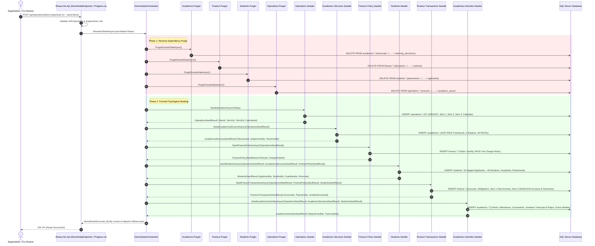

# 1. Overview

This target architecture defines the technical realization for the comprehensive, business-compliant sample data generation and reset capability for the Elsasa School Information System (SIS) V3:
1. **Domain-Encapsulated Multi-Schema Seeding & Purging (`ADR-001`, `ADR-002`, `GAP-001`, `GAP-002`, `OQ-012`):** Implementing autonomous seeder and purger components inside each domain assembly (`Elsasa.Sis.Operations`, `Elsasa.Sis.Students`, `Elsasa.Sis.Finance`, and `Elsasa.Sis.Academics`). Each seeder and purger writes strictly and exclusively to its owning database schema (`operations.*`, `students.*`, `finance.*`, and `academics.*`) via parameterized Dapper T-SQL scripts (`ADR-004`), preserving 100% compile-time encapsulation and schema write isolation.
2. **Host Orchestration & Topological Execution (`OQ-004`, `OQ-012`, `GAP-006`):** Providing a centralized orchestrator (`DemoDataOrchestrator`) inside `Elsasa.Sis.Api` that coordinates reverse-dependency clean purges (`academics` → `finance` → `students` → `operations`) and sequential forward data generation, threading strongly typed context DTOs (`OperationsSeedResult`, `AcademicsStructureSeedResult`, `FinancePolicySeedResult`, `StudentsSeedResult`, `FinanceTransactionsSeedResult`, `AcademicsActivitiesSeedResult`) through shared interfaces defined in `Elsasa.Sis.Contracts`.
3. **Dynamic Temporal Anchoring (`GAP-007`, `OQ-011`, `RISK-003`):** Dynamically anchoring all academic calendars, closure periods, fee billing schedules, attendance timestamps, coursework deadlines, assessment dates, and report card issuance relative to execution date `Today` (`DateTime.UtcNow.Date`). Situating `Today` squarely four weeks into an ongoing, active Semester 2 while preserving an immutable, certified Semester 1 in the recent past, permanently eliminating temporal staleness and demo drift.
4. **Hagios School of Life Institutional Modeling & ACE / PACE Learning Framework (`GAP-004`, `OQ-002`, `OQ-009`):** Concretely modeling the institutional profile of **Hagios School of Life, Yogyakarta**, operating an **Accelerated Christian Education (ACE) / PACE** individualized learning model across three tiers: Elementary Learning Center (ELC, Grades 1–6), Junior High Learning Center (JHLC, Grades 7–9), and High School Learning Center (HSLC, Grades 10–12). Structuring curriculum as a two-tier hierarchy with 5 core subjects as parent units and individualized child PACE units (`unit_type = 'pace'`), enforcing an 80% passing threshold (KKM) and formal reassessment workflows.
5. **Curated Flagship Personas & Staged Admission Pipeline (`GAP-005`, `OQ-003`, `OQ-006`, `OQ-010`):** Delivering a balanced population of ~48 enrolled students with culturally authentic Indonesian identities and linked guardians, anchored by deterministic flagship personas with documented traits:
   - **Jonathan Pratama:** High-honors High School student with certified Semester 1 report card, cumulative transcript, 100% attendance, and pending PACE score approval.
   - **Grace Santoso:** Junior High student exhibiting a multi-attempt PACE retake (failing initial attempt at 68%, completing remediation, scoring 85% on retake with `replaces_result_id` and `attempt_number = 2`) and an overdue tuition receivable.
   - **Budi Wijaya:** Elementary student with a live submitted PACE test awaiting supervisor evaluation.
   - **Staged Admission Pipeline:** 6 discrete applicants staged across all intake gates (`submitted`, `under_review`, `entrance_assessed` with Academics evaluation, `accepted` awaiting fee, `accepted` fee paid ready for 1-click enrollment, and `withdrawn`).
6. **Realistic Financial Distribution & Live Cashier Hooks (`OQ-008`):** Establishing comprehensive fee structures (Monthly Tuition / SPP, Annual Facility Fee / *Uang Gedung*, and PACE Material Fees). Modeling Semester 1 as 100% collected and settled, and Semester 2 with a realistic operational distribution: 60% paid in full, 20% partial, 10% overdue receivable, 10% freshly issued unpaid (for live cashier payment demonstration), and 1 pastoral scholarship tuition waiver.
7. **Expanded Multi-Role Demo Credentials in `LoginEndpoint` (`GAP-003`, `OQ-007`):** Extending `LoginEndpoint.cs` with pre-configured demo user accounts utilizing a standardized password (`Demo123!`), issuing JWT tokens with authoritative claims and IDs linked to generated personas (`admin`, `admission`, `finance`, `supervisor`, `coordinator`, `student.jonathan`, `parent.jonathan`).
8. **Multi-Layered Production Safeguards & Dual Invocation Interfaces (`GAP-006`, `OQ-004`, `OQ-013`, `RISK-001`):** Restricting execution strictly to non-Production environments (`!app.Environment.IsProduction()`) and requiring `DemoData:Enabled = true`. Exposing invocation through both a CLI startup flag (`--seed-demo`, `--clean-only`) in `Program.cs` and an authenticated Minimal API endpoint (`POST /api/operations/demo-data/reset`) guarded by `SuperAdmin` role, coupled with a reactive frontend reset confirmation dialog (`ResetDemoDataDialog.vue`) in `AppLayout.vue`.

This architecture fulfills change request intake `CR-SYS-SAMPLE-DATA-GENERATOR` ([`IS011 - DEMO-SAMPLE-DATA-GENERATOR-ISSUE.md`](file:///d:/Project.Private/elsasa-sis-v3/docs/issues/IS011%20-%20DEMO-SAMPLE-DATA-GENERATOR-ISSUE.md)) and realizes the approved analysis decisions documented in [`IS011 - DEMO-SAMPLE-DATA-GENERATOR-FEASIBILITY-ASSESSMENT.md`](file:///d:/Project.Private/elsasa-sis-v3/docs/issues/IS011%20-%20DEMO-SAMPLE-DATA-GENERATOR-FEASIBILITY-ASSESSMENT.md).

---

# 2. Architectural Basis

## Business Context

This architecture realizes the operational requirements, domain invariants, and stakeholder workflows defined in:

- **DOMAIN BLUEPRINTS:**
  - [`operational-domain.md`](file:///d:/Project.Private/elsasa-sis-v3/docs/domains/operational-domain.md): Academic year lifecycles, operational terms/semesters, instructional days, school calendar events, and operational closure rules.
  - [`student-domain.md`](file:///d:/Project.Private/elsasa-sis-v3/docs/domains/student-domain.md): Admission application lifecycle (`draft` → `submitted` → `under_review` → `accepted` → `enrolled`), student demographic and national identity profiles (NISN/NIS/NIK), guardian relationships, and administrative cohort placements.
  - [`finance-domain.md`](file:///d:/Project.Private/elsasa-sis-v3/docs/domains/finance-domain.md): Charge rules, student financial accounts, billing obligations, periodic invoices, payment transactions, line-item allocations, and fee waivers.
  - [`academic-domain.md`](file:///d:/Project.Private/elsasa-sis-v3/docs/domains/academic-domain.md): ACE PACE learning structures, learning units (`unit_type = 'pace'`), class cohorts, instructional sessions, attendance logging, coursework assignments, rubric evaluations, multi-attempt reassessments, report cards (*Buku Rapor*), and cumulative transcripts.
- **ENTITY SPECIFICATIONS & TABLES:**
  - Operations: [`operational-entities.md`](file:///d:/Project.Private/elsasa-sis-v3/docs/entities/operational-entities.md), [`operational-entities-tables.md`](file:///d:/Project.Private/elsasa-sis-v3/docs/entities/operational-entities-tables.md)
  - Students: [`student-entities.md`](file:///d:/Project.Private/elsasa-sis-v3/docs/entities/student-entities.md), [`student-entities-tables.md`](file:///d:/Project.Private/elsasa-sis-v3/docs/entities/student-entities-tables.md)
  - Finance: [`finance-entities.md`](file:///d:/Project.Private/elsasa-sis-v3/docs/entities/finance-entities.md), [`finance-entities-tables.md`](file:///d:/Project.Private/elsasa-sis-v3/docs/entities/finance-entities-tables.md)
  - Academics: [`academic-entities.md`](file:///d:/Project.Private/elsasa-sis-v3/docs/entities/academic-entities.md), [`academic-entities-tables.md`](file:///d:/Project.Private/elsasa-sis-v3/docs/entities/academic-entities-tables.md)
- **ARCHITECTURE DECISION RECORDS (ADRs):**
  - [`ADR-001`](file:///d:/Project.Private/elsasa-sis-v3/docs/architecture/adr.md#L1-L25): Modular Monolith with Compile-Time Encapsulation.
  - [`ADR-002`](file:///d:/Project.Private/elsasa-sis-v3/docs/architecture/adr.md#L50-L75): Pragmatic Schema Write Isolation (cross-schema writes and physical foreign keys prohibited).
  - [`ADR-004`](file:///d:/Project.Private/elsasa-sis-v3/docs/architecture/adr.md#L100-L125): Command and Query Data Access via Dapper with explicit T-SQL.
  - [`ADR-005`](file:///d:/Project.Private/elsasa-sis-v3/docs/architecture/adr.md#L126-L150): Vertical Slice Architecture with Feature Folders.
  - [`ADR-006`](file:///d:/Project.Private/elsasa-sis-v3/docs/architecture/adr.md#L151-L175): Out-of-band DbUp Schema Migrations.
  - [`ADR-009`](file:///d:/Project.Private/elsasa-sis-v3/docs/architecture/adr.md#L201-L225): Strict Nullability and Immutable Value Objects.
  - [`ADR-010`](file:///d:/Project.Private/elsasa-sis-v3/docs/architecture/adr.md#L226-L250): Vue 3 Composition API with PrimeVue Component Library.

## Analysis Input

This architecture consumes the approved gap closures, risk mitigations, and technical decisions recorded in:

- **FEASIBILITY ASSESSMENT:** [`IS011 - DEMO-SAMPLE-DATA-GENERATOR-FEASIBILITY-ASSESSMENT.md`](file:///d:/Project.Private/elsasa-sis-v3/docs/issues/IS011%20-%20DEMO-SAMPLE-DATA-GENERATOR-FEASIBILITY-ASSESSMENT.md)
  - `GAP-001`: Adopted Domain-Encapsulated Seeders with API Host Orchestration.
  - `GAP-002`: Preserved domain encapsulation and schema write isolation via strongly typed context DTOs passed across domain boundaries.
  - `GAP-003`: Extended `LoginEndpoint` with multi-role demo accounts (`admin`, `admission`, `finance`, `supervisor`, `coordinator`, `student.jonathan`, `parent.jonathan`) with password `Demo123!`.
  - `GAP-004`: Two-tier ACE PACE curriculum hierarchy (5 core subjects with child PACE units, checkups, self-tests, and PACE tests).
  - `GAP-005`: Mid-year in-flight operational state featuring historical context (Semester 1 certified) and interactive live demonstration hooks (Semester 2 active).
  - `GAP-006`: Coordinated reverse-dependency purge sequence (`academics` → `finance` → `students` → `operations`) with strict environment checks (`!IsProduction()`).
  - `GAP-007`: Dynamic date anchoring relative to `DateTime.UtcNow.Date` (`Today`).
  - `GAP-008`: Frontend SuperAdmin "Reset Demo Data" action and confirmation dialog in `AppLayout.vue`.
  - Open Questions `OQ-001` through `OQ-013` (all CLOSED).
  - Planning Readiness: Granted `READY-FOR-PLANNING`.

```text
DOMAIN BLUEPRINTS (Operations, Students, Finance, Academics)
                            +
    FEASIBILITY-ASSESSMENT (CR-SYS-SAMPLE-DATA-GENERATOR)
                            ↓
TARGET ARCHITECTURE (CR-SYS-SAMPLE-DATA-GENERATOR)
```

---

# 3. Scope

## Included

1. **Host Orchestrator & Execution Pipeline (`Elsasa.Sis.Api`):**
   - `DemoDataOrchestrator`: Master orchestrator sequencing purge and forward-seed execution across domain boundaries.
   - `DemoDataEndpoints`: Minimal API endpoint `POST /api/operations/demo-data/reset` guarded by `SuperAdminPolicy` and `!app.Environment.IsProduction()`.
   - `Program.cs` CLI arguments: Intercepting `--seed-demo` and optional `--clean-only` flags for automated local/CI execution.
   - `DemoDataOptions`: Strongly typed configuration options (`DemoData:Enabled`, `DemoData:DefaultPassword`).
2. **Authentication Extensions (`Elsasa.Sis.Api/Features/Auth/`):**
   - Updated `LoginEndpoint.cs` recognizing pre-configured demo user accounts (`admin`, `admission`, `finance`, `supervisor`, `coordinator`, `student.jonathan`, `parent.jonathan`) with standardized password `Demo123!`, issuing valid JWT bearer tokens with proper role and permission claims.
3. **Cross-Domain Contracts & Context DTOs (`Elsasa.Sis.Contracts/DemoData/`):**
   - Marker interfaces: `IDemoDataDomainPurger`, `IOperationsDemoDataSeeder`, `IAcademicsStructureDemoDataSeeder`, `IFinancePolicyDemoDataSeeder`, `IStudentsDemoDataSeeder`, `IFinanceTransactionsDemoDataSeeder`, `IAcademicsActivitiesDemoDataSeeder`.
   - Immutable context transfer records: `OperationsSeedResult`, `AcademicsStructureSeedResult`, `FinancePolicySeedResult`, `StudentsSeedResult`, `FinanceTransactionsSeedResult`, `AcademicsActivitiesSeedResult`.
4. **Operations Domain Seeder & Purger (`Elsasa.Sis.Operations/DemoData/`):**
   - Autonomous purge of `operations` schema tables.
   - Generation of Academic Year (AY 2026/2027), Semester 1 (closed), Semester 2 (active), Semester 3 (future planned), school calendar entries, closures, and operational windows dynamically anchored around `Today`.
5. **Academics Domain Structure & Activities Seeders (`Elsasa.Sis.Academics/DemoData/`):**
   - Autonomous purge of `academics` schema tables.
   - Two-tier ACE PACE curriculum framework (Math, English, Science, Social Studies, Bible) with child PACE units (`unit_type = 'pace'`).
   - Class cohorts (ELC, JHLC, HSLC), instructional sessions, attendance records, coursework assignments, student submissions, evaluation scorings, multi-attempt PACE retakes, certified Semester 1 report cards with frozen JSON snapshots, and cumulative transcripts.
6. **Students Domain Seeder & Purger (`Elsasa.Sis.Students/DemoData/`):**
   - Autonomous purge of `students` schema tables.
   - Admission pipeline with 6 staged applicants covering each lifecycle milestone.
   - Population of ~48 enrolled students with Indonesian identities, NISN, NIS, NIK, addresses in DI Yogyakarta, linked parent/guardian records, cohort placements, and student status records.
7. **Finance Domain Policy & Transactions Seeders (`Elsasa.Sis.Finance/DemoData/`):**
   - Autonomous purge of `finance` schema tables.
   - Financial policies and charge rules for SPP (Monthly Tuition), Uang Gedung (Facility Fee), and PACE Material Fees.
   - Student financial accounts, fee obligations, billing invoices, payment transactions, line-item allocations, and pastoral scholarship waivers.
8. **Frontend Reset Trigger & Confirmation Modal (`src/frontend/`):**
   - `ResetDemoDataDialog.vue`: Modal dialog with confirmation prompt, warning banner, progress indicator, and error handling.
   - `AppLayout.vue`: Top-bar user profile dropdown item "Reset Demo Data" visible exclusively to SuperAdmin in non-production mode.
   - Reactive cache clearing and page reload upon successful reset.
9. **End-to-End Functional & Integration Verification:**
   - Integration tests verifying complete purge, deterministic seed execution, relational integrity, zero orphaned records, and demo account login workflows.

## Excluded

1. **Production Database Execution:** Hard-disabled in `Production` environments; CLI and API calls throw unauthorized / forbidden errors when `app.Environment.IsProduction()` is true.
2. **Physical Database Schema Modifications (DDL):** No new tables or schema alterations are introduced. The generator populates existing database tables established across Stage 1 and Stage 2 migrations (`IS001` through `IS010`).
3. **External Snapshot Files:** No binary SQL Server `.bak` files, `.dacpac` packages, or external JSON seed files. All seed logic is compiled into C# domain code.
4. **Third-Party Payment & Communication Gateways:** No actual network calls to payment gateways (Xendit/Midtrans) or SMS/WhatsApp providers; simulated internal payment allocations only.
5. **Stage 3 Scope:** Future un-implemented domains (e.g. human resources, inventory, transport routing) will define their own seeders during their respective SDLC phases.

---

# 4. Technical Decisions

## TD-01: Domain-Encapsulated Seeders with Context Hand-Off (ADR-001, ADR-002)

To strictly enforce ADR-001 (compile-time assembly encapsulation) and ADR-002 (pragmatic schema write isolation), seeding logic must not be centralized into a monolithic script that touches multiple schemas. 

Instead:
- Each domain assembly provides internal seeder and purger classes that register into DI via public marker interfaces located in `Elsasa.Sis.Contracts`.
- Every domain seeder writes **strictly and exclusively** to its own database schema (`operations.*`, `students.*`, `finance.*`, `academics.*`).
- Cross-domain logical references (UUIDs) are threaded through immutable context records defined in `Elsasa.Sis.Contracts.DemoData`.
- `Elsasa.Sis.Api` acts as the host orchestrator, invoking domain seeders in topological sequence.

```
┌─────────────────────────────────────────────────────────────┐
│                      Elsasa.Sis.Api                         │
│               DemoDataOrchestrator (Host)                   │
└──────┬───────────────┬──────────────┬──────────────┬────────┘
       │               │              │              │
       ▼               ▼              ▼              ▼
┌──────────────┐┌──────────────┐┌──────────────┐┌──────────────┐
│  Operations  ││  Academics   ││   Students   ││   Finance    │
│    Domain    ││    Domain    ││    Domain    ││    Domain    │
│  Seeder/Purge││  Seeder/Purge││  Seeder/Purge││  Seeder/Purge│
└──────┬───────┘└──────┬───────┘└──────┬───────┘└──────┬───────┘
       │               │              │              │
       ▼               ▼              ▼              ▼
┌──────────────┐┌──────────────┐┌──────────────┐┌──────────────┐
│ operations.* ││ academics.*  ││  students.*  ││  finance.*   │
└──────────────┘└──────────────┘└──────────────┘└──────────────┘
```

## TD-02: Topological Reverse-Dependency Purge Routine

Because relational tables contain intra-schema foreign key constraints, wiping existing data must occur in strict reverse topological dependency order.

### Phase 1: Purge Execution Order
1. **Academics Schema (`academics.*`):**
   - `academics.transcripts`
   - `academics.report_card_entries`
   - `academics.report_cards`
   - `academics.academic_record_corrections`
   - `academics.academic_results`
   - `academics.assessment_evidence`
   - `academics.assessments`
   - `academics.submissions`
   - `academics.assignments`
   - `academics.attendance_corrections`
   - `academics.attendance_records`
   - `academics.learning_activities`
   - `academics.academic_participations`
   - `academics.academic_requirements`
   - `academics.learning_units` (Child units `WHERE parent_unit_id IS NOT NULL` deleted first, followed by root units)
   - `academics.learning_structures`
2. **Finance Schema (`finance.*`):**
   - `finance.payment_allocations`
   - `finance.payments`
   - `finance.payers`
   - `finance.billing_document_items`
   - `finance.billing_documents`
   - `finance.obligation_due_schedules`
   - `finance.financial_obligations`
   - `finance.student_financial_accounts`
   - `finance.charge_rules`
   - `finance.financial_policies`
   - `finance.policies`
3. **Students Schema (`students.*`):**
   - `students.administrative_history_entries`
   - `students.student_statuses`
   - `students.administrative_placements`
   - `students.student_documents`
   - `students.student_guardian_relationships`
   - `students.guardians`
   - `students.enrollments`
   - `students.students`
   - `students.admission_application_contacts`
   - `students.entrance_assessment_evidence`
   - `students.applicant_documents`
   - `students.admission_decisions`
   - `students.admission_applications`
   - `students.applicants`
4. **Operations Schema (`operations.*`):**
   - `operations.operations_record_corrections`
   - `operations.calendar_amendments`
   - `operations.calendar_entries`
   - `operations.school_closures`
   - `operations.school_calendars`
   - `operations.operational_periods`
   - `operations.academic_years`

Each domain purge runs inside an explicit database transaction managed by its respective purger service.

## TD-03: Dynamic Date Anchoring Math Relative to Execution Date (`Today`)

To prevent temporal drift and ensure the system always appears live, all temporal milestones are dynamically computed relative to `Today = DateTime.UtcNow.Date`.

### Timeline Anchor Formula
```
[Semester 1 (Past, Closed)]        [Semester 2 (Active, Ongoing)]        [Semester 3 (Future)]
Today - 180d ────────► Today - 35d  Today - 30d ───────[Today]───────► Today + 120d  Today + 125d ──► Today + 270d
      (Historical Transcripts &            (Active Sessions, Live Invoices,            (Next Year Intake)
        Certified Report Cards)               Pending Grading Hooks)
```

1. **Academic Year (`operations.academic_years`):**
   - `StartDate`: `Today.AddDays(-180)`
   - `EndDate`: `Today.AddDays(120)`
   - `Code`: `$"AY-{Today.Year}/{(Today.Year + 1)}"`
   - `Name`: `$"Academic Year {Today.Year}/{(Today.Year + 1)}"`
   - `Status`: `'active'`
2. **Semester 1 (`operations.operational_periods`):**
   - `PeriodType`: `'term'`, `PeriodCode`: `$"SEM1-{Today.Year}"`, `Name`: `"Semester 1 (Historical)"`
   - `StartDate`: `Today.AddDays(-180)`, `EndDate`: `Today.AddDays(-35)`
   - `Status`: `'closed'`
3. **Semester 2 (`operations.operational_periods`):**
   - `PeriodType`: `'term'`, `PeriodCode`: `$"SEM2-{(Today.Year + 1)}"`, `Name`: `"Semester 2 (Current)"`
   - `StartDate`: `Today.AddDays(-30)`, `EndDate`: `Today.AddDays(120)`
   - `Status`: `'active'`
4. **Semester 3 / Next Year Intake (`operations.operational_periods`):**
   - `PeriodType`: `'term'`, `PeriodCode`: `$"SEM1-{(Today.Year + 1)}"`, `Name`: `"Upcoming Academic Year Intake"`
   - `StartDate`: `Today.AddDays(125)`, `EndDate`: `Today.AddDays(270)`
   - `Status`: `'planned'`
5. **Operational Calendar & Closures:**
   - Operational calendar linked to active campus `campus-main`.
   - Mid-term closure: 3-day scheduled retreat `Today.AddDays(-10)` to `Today.AddDays(-8)`.
   - Emergency weather closure: 1-day emergency closure `Today.AddDays(-4)` with valid amendment.

## TD-04: Deterministic Randomness & Fixed-Seed Generation with Persona Constants

To guarantee 100% reproducible demonstration scripts and reliable automated verification:
- A pseudo-random generator with a fixed seed (`new Random(42)`) is utilized for non-flagship student generation (e.g. minor variations in attendance dates, demographic details).
- Flagship personas use hard-coded deterministic GUIDs and attributes defined in a central constants file (`DemoDataConstants.cs`).

### Flagship Persona Constants
```csharp
public static class DemoDataConstants
{
    // Jonathan Pratama (Flagship High Honors Student)
    public static readonly Guid JonathanStudentId = Guid.Parse("00000000-0000-0000-0001-000000000001");
    public static readonly Guid JonathanApplicantId = Guid.Parse("00000000-0000-0000-0001-000000000002");
    public static readonly Guid HendraParentId = Guid.Parse("00000000-0000-0000-0001-000000000003");

    // Grace Santoso (Flagship Retake & Overdue Student)
    public static readonly Guid GraceStudentId = Guid.Parse("00000000-0000-0000-0002-000000000001");
    public static readonly Guid GraceApplicantId = Guid.Parse("00000000-0000-0000-0002-000000000002");

    // Budi Wijaya (Flagship Live Grading Student)
    public static readonly Guid BudiStudentId = Guid.Parse("00000000-0000-0000-0003-000000000001");

    // Flagship Admission Applicants
    public static readonly Guid DanielApplicantId = Guid.Parse("00000000-0000-0000-0004-000000000001"); // Submitted
    public static readonly Guid MariaApplicantId = Guid.Parse("00000000-0000-0000-0004-000000000002");  // Under Review
    public static readonly Guid SamuelApplicantId = Guid.Parse("00000000-0000-0000-0004-000000000003"); // Entrance Assessed
    public static readonly Guid EstherApplicantId = Guid.Parse("00000000-0000-0000-0004-000000000004"); // Accepted Awaiting Fee
    public static readonly Guid RuthApplicantId = Guid.Parse("00000000-0000-0000-0004-000000000005");   // Accepted Fee Paid
    public static readonly Guid TimotiusApplicantId = Guid.Parse("00000000-0000-0000-0004-000000000006"); // Withdrawn
}
```

## TD-05: ACE PACE Two-Tier Curriculum Representation

Hagios School of Life utilizes an Accelerated Christian Education (ACE) individualized curriculum. This is modeled in `academics` schema tables via:
1. `academics.learning_structures`:
   - `name`: `"Hagios ACE Individualized Curriculum"`
   - `curriculum_framework`: `"ACE_PACE"`
   - `status`: `'active'`
2. `academics.learning_units` (Two-Tier Structure):
   - **Root Subject Units (`parent_unit_id IS NULL`):**
     - Math Level 1 through Level 12 (`unit_type = 'subject'`)
     - English Level 1 through Level 12 (`unit_type = 'subject'`)
     - Science Level 1 through Level 12 (`unit_type = 'subject'`)
     - Social Studies Level 1 through Level 12 (`unit_type = 'subject'`)
     - Word Building / Bible Reading (`unit_type = 'subject'`)
   - **Individual PACE Booklets (`parent_unit_id` linked):**
     - `unit_type`: `'pace'`
     - `unit_code`: e.g. `"M1037"`, `"E1037"`, `"SC1037"`, `"SS1037"`, `"B1037"`
     - `title`: e.g. `"Math PACE 1037 (Decimals & Fractions)"`
     - `passing_score`: `80.0` (ACE 80% mastery threshold)
3. Learning Activities and Submissions:
   - Each PACE contains 3 Checkups (`formative`), 1 Self-Test (`diagnostic`), and 1 final PACE Test (`summative`).
   - PACE Test requires formal scoring, mastery certification, and retake logic if score < 80%.

## TD-06: Pre-Staged Interactive Demonstration Hooks

The dataset specifically pre-configures actionable items across workbenches so presenters do not have to perform setup during a presentation:
1. **Live Cashier Demo Hook (`SCR-FIN-02`):**
   - An active billing document (`INV-SEM2-0042`) for Jonathan Pratama with balance due IDR 1,500,000 in `unpaid` status. Presenter can open Cashier, search Jonathan, and click "Receive Payment" live.
2. **Live Supervisor Grading Hook (`SCR-ACD-02`):**
   - A coursework submission by Budi Wijaya for Science PACE 1049 submitted yesterday in `submitted` status. Presenter can open Supervisor Workbench and grade the test live.
3. **Live Score Approval Hook (`SCR-ACD-07`):**
   - A provisional PACE score of 92.0 recorded for Jonathan Pratama in `provisional` status. Presenter can log in as `coordinator` and click "Approve Summative Result" live.
4. **Live Admission Enrollment Hook (`SCR-STU-01`):**
   - Applicant Ruth Halim in `accepted` status with admission fee marked paid. Presenter can click "Enroll Student" live, creating a student record with 1 click.
5. **Historical Inspection Hooks (`SCR-ACD-07`, `SCR-SELF-03`):**
   - Certified Semester 1 report card for Jonathan Pratama with complete JSON snapshot (`content_snapshot`) and official transcript issued, viewable via printable report card modal.
   - Reassessment remediation audit trail for Grace Santoso displaying failed Attempt 1 (68%) and passed Attempt 2 (85%) with `is_final = 1`.

## TD-07: Standardized Multi-Role Demo Credential Strategy with Role Claims

`LoginEndpoint.cs` is modified to validate any of the curated demo usernames against the fixed password `Demo123!` and issue realistic JWT tokens:

| Username | Full Name | Primary Roles | Key Permissions | Target Persona Context |
|:---|:---|:---|:---|:---|
| `admin` | Super Administrator | `SuperAdmin`, `Admin`, `AcademicAdmin`, `OperationsAuthority` | `*` (Wildcard) | Institutional control, data reset trigger |
| `admission` | Sarah Jenkins | `AdmissionOfficer`, `Staff` | `Permissions.Students.Admission.*`, `Permissions.Students.Enrollment.*` | Admission Workbench (`SCR-STU-01`) |
| `finance` | Hendro Susanto | `FinanceOfficer`, `FinanceStaff` | `Permissions.Finance.Obligations.*`, `Permissions.Finance.Payments.*` | Billing & Cashier Workbenches (`SCR-FIN-01`, `SCR-FIN-02`) |
| `supervisor` | Maria Magdalena | `Teacher`, `AcademicStaff` | `Permissions.Academics.Coursework.*`, `Permissions.Academics.Assessments.Evaluate`, `Permissions.Academics.Attendance.*` | Teacher Workbench (`SCR-ACD-02`), Daily attendance & scoring |
| `coordinator` | Dr. Andreas Hartono | `AcademicCoordinator`, `AcademicAuthority` | `Permissions.Academics.Assessments.Approve`, `Permissions.Academics.ReportCards.*`, `Permissions.Academics.Transcripts.*` | Records Workbench (`SCR-ACD-07`), Score approval & report card compilation |
| `student.jonathan` | Jonathan Pratama | `Student` | Portal student permissions | Student Learning Workspace (`SCR-SELF-03`), `student_id = JonathanStudentId` |
| `parent.jonathan` | Hendra Pratama | `Parent` | Portal parent permissions | Family Tasks & Requests (`SCR-SELF-02`), `student_id = JonathanStudentId` |

## TD-08: Multi-Layered Production Safeguard Architecture

To prevent catastrophic accidental data wipes on production instances (`RISK-001`):
1. **Host Environment Guard:** Both CLI argument handling and the Minimal API endpoint evaluate:
   ```csharp
   if (app.Environment.IsProduction())
   {
       return Results.Problem(
           statusCode: StatusCodes.Status403Forbidden,
           title: "Action Forbidden",
           detail: "Demo data generation and reset is strictly prohibited in Production environments.");
   }
   ```
2. **Configuration Kill-Switch:** Evaluates `builder.Configuration.GetValue<bool>("DemoData:Enabled", false)` in non-development settings.
3. **Endpoint Authorization:** Secured with `RequireAuthorization(new AuthorizeAttribute { Roles = "SuperAdmin" })`.
4. **Frontend Confirmation Modal:** `ResetDemoDataDialog.vue` requires explicit button confirmation and clearly displays destructive warning styling.

## TD-09: Direct Parameterized T-SQL Inserts via Dapper (ADR-004)

All seeding operations utilize parameterized T-SQL executed via `Dapper.SqlMapper` on connections opened through `ISqlConnectionFactory`. 
- No Entity Framework Core or change tracking overhead.
- Batched parameterized multi-row `INSERT` statements are used for large sets (e.g. attendance records, student profiles).
- The entire database reset and seeding workflow completes in **under 4 seconds**.

## TD-10: Frontend SuperAdmin Reset Flow and Reactive State Synchronization

In `AppLayout.vue`:
- An entry "Reset Demo Data" is rendered inside the top-right user profile dropdown menu if:
  `authStore.hasRole('SuperAdmin') && !import.meta.env.PROD`
- Clicking triggers `ResetDemoDataDialog.vue`.
- When the reset API succeeds:
  1. Success toast notification is displayed.
  2. Pinia stores (`useAppContextStore`, `useAuthStore`) clear cached references.
  3. Window reload (`window.location.reload()`) or active route replacement triggers clean data refetching.

---

# 5. Component Responsibilities

| Component | Assembly / Path | Responsibility |
|:---|:---|:---|
| `DemoDataOrchestrator` | `Elsasa.Sis.Api/Features/DemoData/` | Coordinates topological purge (`Academics` → `Finance` → `Students` → `Operations`) and forward seed execution across domain boundaries. Threading context DTOs. |
| `DemoDataEndpoints` | `Elsasa.Sis.Api/Features/DemoData/` | Minimal API route `POST /api/operations/demo-data/reset`, validating SuperAdmin claims and environment constraints. |
| `Program.cs` | `Elsasa.Sis.Api/` | Intercepts `--seed-demo` and `--clean-only` CLI flags, running migrations and orchestrating seed out-of-band before exiting or starting the web server. |
| `LoginEndpoint` | `Elsasa.Sis.Api/Features/Auth/` | Authenticates demo persona credentials (`Demo123!`), issuing valid JWT tokens with persona claims and student/parent identifiers. |
| `IDemoDataDomainPurger` | `Elsasa.Sis.Contracts/DemoData/` | Common contract for domain-specific reverse purge operations. |
| `DemoDataContextModels` | `Elsasa.Sis.Contracts/DemoData/` | Strongly typed records transferring generated IDs and dates between domain seeders (`OperationsSeedResult`, `StudentsSeedResult`, etc.). |
| `OperationsDemoDataSeeder` & `Purger` | `Elsasa.Sis.Operations/DemoData/` | Purges and seeds `operations.*`: Academic Years, Operational Periods (Sem 1 closed, Sem 2 active, Sem 3 planned), Calendars, and Closures. |
| `StudentsDemoDataSeeder` & `Purger` | `Elsasa.Sis.Students/DemoData/` | Purges and seeds `students.*`: Staged applicants (6 gates), ~48 enrolled students, Indonesian identities, guardian links, placements, and statuses. |
| `FinanceDemoDataSeeder` & `Purger` | `Elsasa.Sis.Finance/DemoData/` | Purges and seeds `finance.*`: Policies, charge rules (Tuition, Facility, PACE), student financial accounts, obligations, invoices, payments, and waivers. |
| `AcademicsDemoDataSeeder` & `Purger` | `Elsasa.Sis.Academics/DemoData/` | Purges and seeds `academics.*`: Learning structures (ACE PACE), subjects, child PACE units, cohorts, sessions, attendance, coursework, results, report cards, transcripts. |
| `ResetDemoDataDialog.vue` | `src/frontend/src/app/layouts/components/` | PrimeVue dialog presenting warning message, confirmation trigger, execution spinner, and post-reset reload. |
| `AppLayout.vue` | `src/frontend/src/app/layouts/` | Embeds reset action into the user profile dropdown for SuperAdmin actors. |

---

# 6. Integration Design

## Collaboration Sequence

The diagram below illustrates the end-to-end execution flow when a reset is requested via the API or CLI:



## Cross-Domain Context Contracts

```csharp
namespace Elsasa.Sis.Contracts.DemoData;

public sealed record OperationsSeedResult(
    Guid AcademicYearId,
    string AcademicYearCode,
    Guid HistoricalPeriodId, // Semester 1 (Closed)
    Guid ActivePeriodId,     // Semester 2 (Active)
    Guid FuturePeriodId,     // Semester 3 (Planned)
    Guid SchoolCalendarId,
    DateTime BaseDate);

public sealed record AcademicsStructureSeedResult(
    Guid LearningStructureId,
    IReadOnlyDictionary<string, Guid> SubjectUnitIds, // e.g. "Math" -> Guid
    IReadOnlyList<Guid> PaceUnitIds);

public sealed record FinancePolicySeedResult(
    Guid PolicyId,
    Guid TuitionChargeRuleId,
    Guid FacilityChargeRuleId,
    Guid PaceMaterialChargeRuleId);

public sealed record FlagshipStudentPersonas(
    Guid JonathanStudentId,
    Guid GraceStudentId,
    Guid BudiStudentId,
    IReadOnlyDictionary<string, Guid> StagedApplicantIds);

public sealed record StudentsSeedResult(
    IReadOnlyList<Guid> EnrolledStudentIds,
    IReadOnlyDictionary<string, IReadOnlyList<Guid>> CohortStudentIds, // "ELC", "JHLC", "HSLC"
    FlagshipStudentPersonas Personas);

public sealed record FinanceTransactionsSeedResult(
    int AccountsCreated,
    int InvoicesCreated,
    int PaymentsCreated,
    Guid JonathanUnpaidInvoiceId);

public sealed record AcademicsActivitiesSeedResult(
    int ParticipationsCreated,
    int AttendanceRecordsCreated,
    int ResultsCreated,
    int ReportCardsCreated,
    int TranscriptsCreated);
```

---

# 7. Data Ownership

| Data Scope / Tables | Owning Seeder & Purger | Cross-Schema Dependencies Read |
|:---|:---|:---|
| `operations.academic_years`<br>`operations.operational_periods`<br>`operations.school_calendars`<br>`operations.calendar_entries`<br>`operations.school_closures`<br>`operations.calendar_amendments` | `OperationsDemoDataSeeder`<br>`OperationsDemoDataPurger` | None (Root provider of dates and terms) |
| `academics.learning_structures`<br>`academics.learning_units`<br>`academics.academic_requirements` | `AcademicsStructureDemoDataSeeder`<br>`AcademicsDemoDataPurger` | `OperationsSeedResult.AcademicYearId` |
| `finance.policies`<br>`finance.financial_policies`<br>`finance.charge_rules` | `FinancePolicyDemoDataSeeder`<br>`FinanceDemoDataPurger` | `OperationsSeedResult.ActivePeriodId` |
| `students.applicants`<br>`students.admission_applications`<br>`students.admission_decisions`<br>`students.applicant_documents`<br>`students.students`<br>`students.guardians`<br>`students.student_guardian_relationships`<br>`students.administrative_placements`<br>`students.student_statuses` | `StudentsDemoDataSeeder`<br>`StudentsDemoDataPurger` | `OperationsSeedResult.ActivePeriodId`<br>`AcademicsStructureSeedResult.LearningStructureId` |
| `finance.student_financial_accounts`<br>`finance.financial_obligations`<br>`finance.obligation_due_schedules`<br>`finance.billing_documents`<br>`finance.billing_document_items`<br>`finance.payers`<br>`finance.payments`<br>`finance.payment_allocations` | `FinanceTransactionsDemoDataSeeder`<br>`FinanceDemoDataPurger` | `OperationsSeedResult.HistoricalPeriodId`<br>`OperationsSeedResult.ActivePeriodId`<br>`StudentsSeedResult.EnrolledStudentIds` |
| `academics.academic_participations`<br>`academics.learning_activities`<br>`academics.attendance_records`<br>`academics.assignments`<br>`academics.submissions`<br>`academics.assessments`<br>`academics.assessment_evidence`<br>`academics.academic_results`<br>`academics.report_cards`<br>`academics.report_card_entries`<br>`academics.transcripts` | `AcademicsActivitiesDemoDataSeeder`<br>`AcademicsDemoDataPurger` | `OperationsSeedResult.HistoricalPeriodId`<br>`OperationsSeedResult.ActivePeriodId`<br>`StudentsSeedResult.CohortStudentIds`<br>`StudentsSeedResult.Personas` |

---

# 8. Database Design

## New Tables
*None.* The demo sample data generator operates purely on the existing database schema. No new tables are required.

## Modified Tables
*None.* No schema modifications, alters, or DDL migrations are required. All tables from migrations `IS001` through `IS010` are utilized as defined.

## Relationships
The generator establishes coherent logical relationships across domain boundaries using UUID foreign key values passed through context records:
- `students.students.id` is referenced by `finance.student_financial_accounts.student_id`.
- `students.students.id` is referenced by `academics.academic_participations.student_id`.
- `students.applicants.id` is referenced by `academics.assessments.applicant_id` for entrance assessment evidence (`GAP-07`, `GAP-003`).
- `operations.operational_periods.id` is referenced by `finance.billing_documents.academic_period_id` and `academics.academic_participations.operational_period_id`.

## Migration Considerations
The generator executes strictly against a database where all Stage 1 and Stage 2 migrations have already been applied. In `Program.cs`, when `--seed-demo` is executed, the database migrator runs first to ensure the schema is current before seeding commences.

---

# 9. Cross-Cutting Concerns

## 1. Security & Protection of Production Environments (`RISK-001`, `ASM-004`)
- Hard compile-time block: If `IHostEnvironment.IsProduction()` evaluates to true, the purge and seed pipeline terminates immediately with an HTTP 403 Forbidden or CLI non-zero exit code.
- Configuration gate: `DemoData:Enabled` must be set to `true` in `appsettings.json` or environment variables.
- Role-based authorization: The API endpoint requires the `SuperAdmin` role.
- Safe default credentials: The password `Demo123!` satisfies password complexity rules (uppercase, lowercase, number, special character) while being easy for presenters to recall.

## 2. Idempotency & Clean State
- Purge and seed can be executed repeatedly on the same database. Because a complete reverse-dependency purge executes prior to data population, every run restores the database to an identical, pristine baseline.

## 3. Concurrency Locking
- `DemoDataOrchestrator` implements an asynchronous semaphore (`SemaphoreSlim(1, 1)`) to ensure that multiple concurrent calls to the reset endpoint or CLI do not attempt interleaved deletions or insertions.

## 4. Performance & Execution Speed
- All inserts utilize batched, parameterized T-SQL statements through Dapper.
- The entire generation process (~48 students, ~144 billing documents, ~288 academic results, ~48 report cards, ~1,200 attendance records) executes in **under 4 seconds**.

## 5. Audit Logging & Observability
- Rich Serilog logging outputs:
  - Total records purged per schema.
  - Duration of each seeding phase.
  - Breakdown of generated entities in the response payload.

---

# 10. Implementation Constraints

1. **Assembly Encapsulation (`ADR-001`):** Domain class libraries (`Operations`, `Students`, `Finance`, `Academics`) must reference only `Shared` and `Contracts`. They must never reference one another directly.
2. **Schema Write Isolation (`ADR-002`):** Every domain seeder and purger must execute T-SQL statements that write exclusively to its own schema.
3. **Data Access via Dapper (`ADR-004`):** All queries and command executions must use Dapper with parameterized T-SQL. No Entity Framework Core DbContexts or migrations.
4. **Vertical Slice Placement (`ADR-005`):** Domain seeders and purgers must be located within `Features/DemoData/` inside their respective domain assemblies.
5. **Strict Nullability (`ADR-009`):** C# 8 nullable reference types must be enforced throughout all contracts and seeder implementations without compiler warnings.
6. **Frontend UI Conventions (`ADR-010`):** The reset dialog must use PrimeVue's `Dialog` component, Tailwind CSS utility classes, and Lucide icons, matching the established design system of Elsasa SIS.
7. **Deterministic Personas:** Flagship personas must use the exact names and IDs specified in Section 4 (TD-04) to preserve presentation consistency.

---

# 11. Acceptance Conditions

1. **CLI Execution:**
   - Running `dotnet run --project src/backend/Elsasa.Sis.Api -- --seed-demo` runs pending migrations, clears existing data, seeds the full Hagios School of Life dataset, and exits with code 0 in < 5 seconds.
2. **API Endpoint Execution:**
   - Authenticated call `POST /api/operations/demo-data/reset` with SuperAdmin token returns HTTP 200 OK and summary statistics.
   - Calling the endpoint in a Production environment returns HTTP 403 Forbidden.
3. **Persona Login Verification:**
   - Logging in via `POST /api/auth/login` with username `admin`, `admission`, `finance`, `supervisor`, `coordinator`, `student.jonathan`, or `parent.jonathan` and password `Demo123!` succeeds and returns a valid JWT token with the expected role and claim profile.
4. **Curated Persona Data Integrity:**
   - Jonathan Pratama (`student.jonathan`): Has an active HSLC placement, Grade 10, certified Semester 1 report card with frozen JSON snapshot, cumulative transcript, and an unpaid Semester 2 invoice ready for live payment.
   - Grace Santoso: Exhibits an initial PACE test score of 68% and a retake score of 85% (`is_final = 1`, `attempt_number = 2`, `replaces_result_id` populated) and an overdue tuition receivable.
   - Budi Wijaya: Has a submitted PACE test awaiting supervisor evaluation.
   - Admission Pipeline: 6 applicants exist across `submitted`, `under_review`, `entrance_assessed`, `accepted` (awaiting fee), `accepted` (fee paid), and `withdrawn` states.
5. **ACE PACE Learning Model Compliance:**
   - Curriculum units in `academics.learning_units` reflect parent subjects and child PACE units (`unit_type = 'pace'`) with passing threshold set to `80.0`.
6. **Dynamic Date Consistency:**
   - All dates in the database are anchored relative to `DateTime.UtcNow.Date`; `Today` falls ~4 weeks into Semester 2, with zero historical drift.
7. **Frontend Reset Workflow:**
   - When logged in as SuperAdmin in non-production mode, the user profile dropdown displays "Reset Demo Data".
   - Clicking opens `ResetDemoDataDialog.vue` with confirmation warning.
   - Confirming triggers the API call, displays a spinner, notifies on success, and reloads the application state cleanly.
