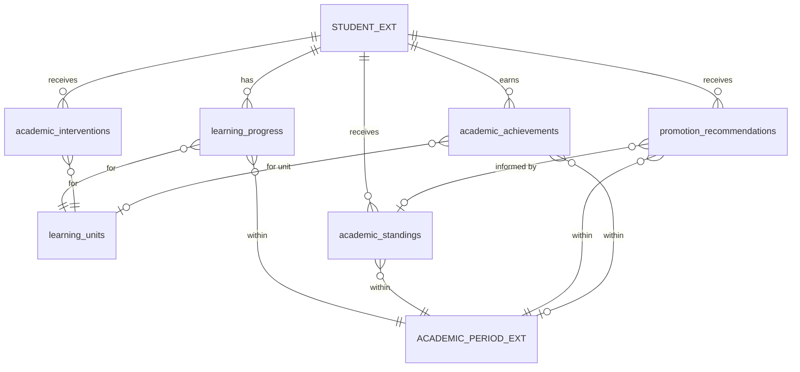

# 1. Overview

This target architecture defines the technical realization for the core scope of Stage 2 "Standing & Progression" under the Academic domain in Elsasa School Information System (SIS) V3:

1. **Learning Progress & Completion (`ACD-WF-11`, `UC-ACD-12`, `SCR-ACD-07`):**
   - Recording and tracking student advancement toward defined learning expectations for specific learning units (`academics.learning_progress`).
   - Enforcing the Phase-2 minimal progress model: `not_started`, `in_progress`, `completed`, `needs_remediation`, `exempted` (percentage-based progress tracking is strictly prohibited in Phase 2).
   - Guaranteeing that learning progress strictly originates from authorized operational evidence (`assessment_evidence`, `learning_work`, or an explicit `authorized_decision`); completion must never be inferred solely from calendar boundaries, administrative placement, or attendance alone.
   - Supporting completion stamped outside academic period boundaries with an explicit completion date (`completion_date`), accommodating self-paced modular packets (e.g. PACE), holiday completion, and post-term remediation.
   - Enabling direct recording of transferred or externally recognized learning (`status = 'completed'`, `basis = 'authorized_decision'`).
   - Enabling Academic Coordinators to review completion criteria and formally conclude learning unit participation (`UC-ACD-12`).

2. **Academic Standing Determination (`ACD-WF-13`, `UC-ACD-17`, `SCR-ACD-09`):**
   - Recording formal academic conclusions regarding a student's overall academic condition within an academic period (`academics.academic_standings`).
   - Enforcing the core domain principle that Academic Standing is an academic determination based on institutional policy and approved evidence, not a simple numerical grade or GPA.
   - Supporting the standard standing classification model: `good_standing`, `conditional_standing`, and `not_in_good_standing`.
   - Capturing governing policy references (`policy_reference`) and mandatory stipulations/conditions when standing is conditional (`conditions`).
   - Embedding governance attributes directly on decision records for exceptions: `is_exception`, `exception_reason`, `committee_reference` (e.g., formal decree or meeting minutes reference such as *SK Dewan Guru*), and approving `authorized_by`.
   - Providing authoritative academic standing records to downstream progression, retention, and graduation processes without altering the student's administrative status.

3. **Promotion & Retention Recommendation (`ACD-WF-13`, `UC-ACD-17`, `SCR-ACD-09`, `SCR-STU-03`):**
   - Recording Academics' formal evaluation and recommendations regarding student advancement to the next educational level or grade (`academics.promotion_recommendations`).
   - Supporting standard recommendation outcomes: `promotion_eligible`, `retention_recommended`, and `conditional_promotion`.
   - Recording current level (`from_level`), recommended destination level (`recommended_to_level`, nullable for retention), mandatory conditional requirements (`conditions`), supporting evidence summary (`supporting_evidence`), and linked academic standing (`academic_standing_id`).
   - Embedding governance attributes directly on exception records (`is_exception`, `exception_reason`, `committee_reference`, `authorized_by`).
   - Enforcing the cross-domain boundary rule: Academics owns promotion and retention eligibility recommendations; the Students domain is the sole authority that executes official administrative promotion or retention transitions (`STD-WF-08`, `SCR-STU-03`).

4. **Academic Intervention (`ACD-WF-10`, `UC-ACD-11`, `SCR-ACD-06`):**
   - Recording and managing structured academic actions taken when a student requires additional learning support or educational challenge (`academics.academic_interventions`).
   - Supporting standard intervention types: `remediation`, `reassessment`, `tutoring_recommendation`, `extension_work`, `recovery_plan`, `learning_plan_adjustment`, and `academic_warning`.
   - Implementing the dual-trigger intake model:
     - System Early-Warning alerts triggered by objective academic indicators (`assessment_below_threshold`, `missing_work`, `attendance_concern`, `standing_concern`).
     - Staff-initiated educator referrals (`teacher_referral`) based on classroom observations, learning difficulties, or gifted/accelerated learning needs.
   - Managing the intervention lifecycle: `planned`, `in_progress`, `completed`, `cancelled`.
   - Capturing intervention plans, target learning units, initiating actors, milestone dates, recorded outcomes, and notes.
   - Enforcing domain boundaries: Academics owns interventions directly tied to academic performance and learning; behavioural, psychological, counselling, and pastoral interventions belong strictly to the Development domain (`Development Referral & Wellbeing`). Academic interventions do not independently alter official administrative enrollment status.

5. **Academic Achievement Recognition (`ACD-WF-19`, `UC-ACD-21`, `SCR-ACD-09`):**
   - Formally recording and conferring achievements derived from academic learning or assessment (`academics.academic_achievements`).
   - Supporting standard academic achievement types: `subject_distinction`, `academic_honors` (e.g., honor roll / *Juara Umum*), `mastery_recognition`, `academic_certification`, and `academic_competition` (curriculum-recognized academic contests).
   - Capturing achievement title, linked learning unit (where applicable), academic period, evaluation criteria, supporting academic result evidence, recognizing authority, and recognition date.
   - Enforcing domain boundaries: Academics owns achievements derived from academic learning and assessment; Development owns extracurricular, non-academic, and service achievements.

6. **Demo Sample Data Generator & Purger Support:**
   - Extending `AcademicsActivitiesDemoDataSeeder` to generate realistic standing, progression recommendations, interventions, and achievements for Hagios School of Life student personas (Rina Kusuma, Budi Santoso, Timotius).
   - Updating `AcademicsDemoDataPurger` to clean the 5 new tables in strict reverse-dependency order.

It fulfills change request intake `CR-ACD-STANDING-PROGRESSION` ([`IS012 - ACD-STANDING-PROGRESSION-ISSUE.md`](file:///d:/Project.Private/elsasa-sis-v3/docs/issues/IS012%20-%20ACD-STANDING-PROGRESSION-ISSUE.md)) and realizes the approved analysis decisions documented in [`IS012 - ACD-STANDING-PROGRESSION-FEASIBILITY-ASSESSMENT.md`](file:///d:/Project.Private/elsasa-sis-v3/docs/issues/IS012%20-%20ACD-STANDING-PROGRESSION-FEASIBILITY-ASSESSMENT.md).

---

# 2. Architectural Basis

## Business Context

This architecture realizes the business knowledge, operational workflows, and domain rules specified in:

- **DOMAIN BLUEPRINT:** [`academic-domain.md`](file:///d:/Project.Private/elsasa-sis-v3/docs/domains/academic-domain.md)
  - Learning Progress & Completion Tracking (lines 142–165)
  - Academic Standing & Institutional Policy Evaluation (lines 370–405)
  - Promotion & Retention Recommendations (lines 407–438)
  - Academic Interventions & Dual-Trigger Intake Model (lines 440–475)
  - Academic Achievements & Honors Conferral (lines 477–505)
  - Cross-domain boundaries: Academics recommends; Students executes administrative lifecycle transitions (lines 414–418)
- **ROADMAP & COMPLETION CRITERIA:** [`sub-modul-and-development-phases.md`](file:///d:/Project.Private/elsasa-sis-v3/docs/sub-modul-and-development-phases.md)
  - Stage 2 Module: Standing & Progression (Submodule 4)
  - **Criterion 6:** *"Academic standing has been determined for at least one student. A promotion or retention recommendation has been issued."*
  - **Criterion 9 (Cross-Domain Enablement):** *"A student has been promoted or retained based on an academic recommendation."* (Progression recommendation input provided to Students)
- **WORKFLOWS & USE CASES:**
  - [`operational-workflow-discovery.md`](file:///d:/Project.Private/elsasa-sis-v3/docs/operational-workflow-discovery.md):
    - `ACD-WF-10`: Initiate and Manage Academic Intervention
    - `ACD-WF-11`: Track Learning Progress & Conclude Participation
    - `ACD-WF-13`: Determine Academic Standing & Issue Progression Recommendation
    - `ACD-WF-19`: Formally Confer and Record Academic Achievements
  - [`use-cases.md`](file:///d:/Project.Private/elsasa-sis-v3/docs/use-cases.md):
    - `UC-ACD-11`: Initiate Academic Intervention
    - `UC-ACD-12`: Conclude Learning Unit Participation
    - `UC-ACD-15`: Correct Non-Grade Academic Record (Standing & Progression records)
    - `UC-ACD-17`: Determine Academic Standing and Progression
    - `UC-ACD-21`: Confer Academic Achievement
- **ACTORS:** [`actors.md`](file:///d:/Project.Private/elsasa-sis-v3/docs/actors.md)
  - Teacher (`ACT-09`): Educator referrals (`teacher_referral`), milestone intervention reviews.
  - Academic Coordinator (`ACT-07`): Progress review, out-of-period completion stamping, participation conclusion (`UC-ACD-12`), intervention intake and tracking (`UC-ACD-11`).
  - Academic Authority (`ACT-08`): Cohort standing determination, promotion/retention recommendation approval, exception decrees (*SK Dewan Guru*), academic honors conferral (`UC-ACD-17`, `UC-ACD-21`).
  - Student Administration Officer (`ACT-03`): Ingestion of progression recommendations in `SCR-STU-03` for official administrative grade promotion or retention.
- **DATA SPECIFICATIONS:**
  - [`academic-entities.md`](file:///d:/Project.Private/elsasa-sis-v3/docs/entities/academic-entities.md): Submodule 4 (Standing & Progression), Core Entities, Dual-Trigger Model, Embedded Exception Attributes.
  - [`academic-entities-tables.md`](file:///d:/Project.Private/elsasa-sis-v3/docs/entities/academic-entities-tables.md): Submodule 4 tables (`academics.learning_progress`, `academics.academic_standings`, `academics.promotion_recommendations`, `academics.academic_interventions`, `academics.academic_achievements`, lines 674–950).
- **SCREEN INVENTORY:** [`screen-inventory.md`](file:///d:/Project.Private/elsasa-sis-v3/docs/screen-inventory.md)
  - `SCR-ACD-06`: Academic Intervention Workbench (Work Queue pattern, Academic Coordinator)
  - `SCR-ACD-07`: Academic Records Workbench — Learning Progress & Completion Tab (Work Queue pattern, Academic Coordinator)
  - `SCR-ACD-09`: Cohort Academic Review (Work Queue pattern, Academic Authority)
  - `SCR-STU-03`: Student Lifecycle Workbench (Consumer of progression recommendations, Student Administration Officer)

## Analysis Input

This architecture consumes the approved gap closures, risk mitigations, and technical decisions recorded in:

- **FEASIBILITY ASSESSMENT:** [`IS012 - ACD-STANDING-PROGRESSION-FEASIBILITY-ASSESSMENT.md`](file:///d:/Project.Private/elsasa-sis-v3/docs/issues/IS012%20-%20ACD-STANDING-PROGRESSION-FEASIBILITY-ASSESSMENT.md)
  - `GAP-001`: Submodule 4 database schema provisioning via DbUp migration script `20261107_0401_Academics_StandingProgression_Tables.sql`.
  - `GAP-002`: Backend vertical slice implementation under `src/backend/Elsasa.Sis.Academics/Features/`.
  - `GAP-003 / OQ-002, OQ-004`: Standing & progression determination engine adopting **Batch Evaluation Preview & Approval** with the Completion & Passing Threshold Rule and embedded *SK Dewan Guru* exception overrides.
  - `GAP-004 / OQ-003`: Academic intervention dual-trigger intake adopting **On-Demand At-Risk Query** over live assessment scores, missing work, attendance, and standing concerns, coupled with manual educator referral intake modals.
  - `GAP-005`: Learning progress tracking enforcing Phase-2 minimal progress model (`not_started`, `in_progress`, `completed`, `needs_remediation`, `exempted`), out-of-period explicit `completion_date` stamping, and authorized prior learning recognition.
  - `GAP-006 / OQ-001`: Frontend workbench distribution scaffolding `features/academics/interventions/` (`SCR-ACD-06`), `features/academics/cohort-review/` (`SCR-ACD-09`), and extending `features/academics/records/` (`SCR-ACD-07`).
  - `GAP-007 / OQ-005`: Cross-domain synchronous inquiry methods on `IAcademicsModule` and asynchronous MediatR domain events.
  - `GAP-008 / OQ-006`: Extending `AcademicsActivitiesDemoDataSeeder` with Hagios personas (Rina, Budi, Timotius) and updating `AcademicsDemoDataPurger` in reverse-dependency order.
  - `GAP-009`: Non-grade record correction protocol (`UC-ACD-15`) integrating standing and progression modifications into `academics.academic_record_corrections`.
  - Planning Readiness: Granted `READY-FOR-PLANNING`.

```text
DOMAIN (academic-domain.md) + FEATURE (use-cases.md, screen-inventory.md)
                            +
        FEASIBILITY-ASSESSMENT (CR-ACD-STANDING-PROGRESSION)
                            ↓
      TARGET ARCHITECTURE (ACD-STANDING-PROGRESSION)
```

---

# 3. Scope

## Included

1. **Database Schema & Migrations (`Elsasa.Sis.Database`):**
   - Migration script `20261107_0401_Academics_StandingProgression_Tables.sql` targeting Microsoft SQL Server 2022 ([`ADR-002`](file:///d:/Project.Private/elsasa-sis-v3/docs/architecture/adr.md#L50-L75), [`ADR-006`](file:///d:/Project.Private/elsasa-sis-v3/docs/architecture/adr.md#L152-L176)).
   - Creation of 5 authoritative relational tables in schema `academics`:
     - `academics.learning_progress`: Tracks student advancement toward unit learning expectations, minimal progress states (`not_started`, `in_progress`, `completed`, `needs_remediation`, `exempted`), basis (`assessment_evidence`, `learning_work`, `authorized_decision`), out-of-period explicit `completion_date`, and updater metadata.
     - `academics.academic_standings`: Formal period academic condition determination (`good_standing`, `conditional_standing`, `not_in_good_standing`), policy reference, mandatory condition text, embedded exception attributes (`is_exception`, `exception_reason`, `committee_reference` e.g. *SK Dewan Guru*), and authorizing Academic Authority.
     - `academics.promotion_recommendations`: Advancement evaluation recommendations (`promotion_eligible`, `retention_recommended`, `conditional_promotion`), source and target levels (`from_level`, `recommended_to_level`), mandatory condition text, supporting evidence summary, linked `academic_standing_id`, and embedded exception attributes.
     - `academics.academic_interventions`: Structured learning support actions (`remediation`, `reassessment`, `tutoring_recommendation`, `extension_work`, `recovery_plan`, `learning_plan_adjustment`, `academic_warning`), dual-trigger source (`assessment_below_threshold`, `missing_work`, `attendance_concern`, `standing_concern`, `teacher_referral`), lifecycle status (`planned`, `in_progress`, `completed`, `cancelled`), target learning unit, and outcomes.
     - `academics.academic_achievements`: Achievements derived from academic learning or assessment (`subject_distinction`, `academic_honors`, `mastery_recognition`, `academic_certification`, `academic_competition`), title, optional learning unit link, criteria, supporting result references, and recognizing authority.
   - Provisioning of indexes, intra-schema foreign key constraints, and check constraints while preserving zero physical foreign keys across domain schemas ([`ADR-001`](file:///d:/Project.Private/elsasa-sis-v3/docs/architecture/adr.md#L24-L48)).

2. **Backend Domain Architecture & Vertical Slices (`Elsasa.Sis.Academics`):**
   - **Learning Progress Slices (`Features/LearningProgress/`):**
     - `RecordLearningProgress` (`POST /api/v1/academics/learning-progress`): Records or updates student advancement, supporting out-of-period explicit `completion_date` and recognized transfer learning (`UC-ACD-12`).
     - `ConcludeParticipation` (`POST /api/v1/academics/learning-progress/conclude`): Formal conclusion of learning unit participation, verifying completion criteria and publishing `ParticipationConcludedEvent` (`UC-ACD-12`).
     - `GetStudentLearningProgress` (`GET /api/v1/academics/students/{studentId}/learning-progress`): Queries progress ledger across enrolled units for a period.
     - `GetUnitLearningProgress` (`GET /api/v1/academics/learning-units/{unitId}/progress`): Queries participant progress roster for a specific learning unit.
   - **Academic Standings Slices (`Features/AcademicStandings/`):**
     - `EvaluateCohortStanding` (`POST /api/v1/academics/cohort-review/evaluate-standing`): Dynamic evaluation of proposed academic standing for all students in a cohort based on approved results, completion states, and attendance metrics.
     - `DetermineAcademicStanding` (`POST /api/v1/academics/academic-standings`): Academic Authority formal single standing determination with embedded exception fields (`UC-ACD-17`).
     - `BatchDetermineCohortStanding` (`POST /api/v1/academics/academic-standings/batch`): Academic Authority batch commitment of standing determinations.
     - `GetStudentStandings` (`GET /api/v1/academics/students/{studentId}/standings`): Queries standing history for a student across academic periods.
     - `GetCohortStandings` (`GET /api/v1/academics/cohort-review/standings`): Queries standing determinations for a period and grade level.
   - **Promotion Recommendations Slices (`Features/PromotionRecommendations/`):**
     - `EvaluateCohortProgression` (`POST /api/v1/academics/cohort-review/evaluate-progression`): Dynamic evaluation of proposed promotion/retention recommendations based on standing determinations and result thresholds.
     - `IssuePromotionRecommendation` (`POST /api/v1/academics/promotion-recommendations`): Academic Authority formal single progression recommendation with supporting evidence and condition text (`UC-ACD-17`).
     - `BatchIssuePromotionRecommendations` (`POST /api/v1/academics/promotion-recommendations/batch`): Academic Authority batch commitment of progression recommendations.
     - `GetStudentPromotionRecommendations` (`GET /api/v1/academics/students/{studentId}/promotion-recommendations`): Queries student progression recommendation history.
     - `GetCohortPromotionRecommendations` (`GET /api/v1/academics/cohort-review/promotion-recommendations`): Queries recommendations for a period and grade level.
   - **Academic Interventions Slices (`Features/AcademicInterventions/`):**
     - `GetAtRiskLearnersQuery` (`GET /api/v1/academics/interventions/at-risk`): Live query dynamically detecting at-risk learners based on approved assessment scores below passing threshold, missing submissions, low attendance (<75%), or standing concerns.
     - `InitiateAcademicIntervention` (`POST /api/v1/academics/interventions`): Formulate structured intervention plan from early-warning alert or teacher referral (`UC-ACD-11`).
     - `UpdateInterventionStatus` (`PATCH /api/v1/academics/interventions/{id}/status`): Updates intervention lifecycle status (`in_progress`, `completed`, `cancelled`) with recorded outcome narrative.
     - `GetActiveInterventions` (`GET /api/v1/academics/interventions`): Filterable work queue of active and completed interventions.
     - `GetInterventionById` (`GET /api/v1/academics/interventions/{id}`): Detailed intervention plan inspection with target learning units and notes.
   - **Academic Achievements Slices (`Features/AcademicAchievements/`):**
     - `ConferAcademicAchievement` (`POST /api/v1/academics/achievements`): Formal conferral of subject distinction, academic honors (*Juara Umum*), or competition recognition by Academic Authority (`UC-ACD-21`).
     - `GetStudentAchievements` (`GET /api/v1/academics/students/{studentId}/achievements`): Queries student achievements across periods.
     - `GetPeriodAchievements` (`GET /api/v1/academics/cohort-review/achievements`): Queries achievements conferred for a period.
   - **Record Corrections Slices (`Features/RecordCorrections/`):**
     - `CorrectAcademicStanding` (`POST /api/v1/academics/academic-standings/{id}/correct`): Auditable in-place correction of an approved standing determination requiring mandatory reason (min 10 chars) and Academic Authority authorization, recording audit entry into `academic_record_corrections` (`record_type = 'academic_standing'`) (`UC-ACD-15`).
     - `CorrectPromotionRecommendation` (`POST /api/v1/academics/promotion-recommendations/{id}/correct`): Auditable in-place correction of an approved promotion recommendation requiring mandatory reason and Academic Authority authorization, recording audit entry into `academic_record_corrections` (`record_type = 'promotion_recommendation'`) (`UC-ACD-15`).
   - **Demo Data Extensions (`Features/DemoData/`):**
     - Extend `AcademicsActivitiesDemoDataSeeder` to seed progress, standing, progression, intervention, and achievement records for Hagios student personas (Rina Kusuma, Budi Santoso, Timotius).
     - Extend `AcademicsDemoDataPurger` to clean the 5 Submodule 4 tables in strict reverse-dependency order.

3. **Cross-Domain Contracts & Domain Events (`Elsasa.Sis.Contracts`):**
   - Extending `IAcademicsModule` with synchronous query methods:
     - `GetStudentAcademicStandingAsync(Guid studentId, Guid academicPeriodId, CancellationToken ct = default)`
     - `GetPromotionRecommendationAsync(Guid studentId, Guid academicPeriodId, CancellationToken ct = default)`
     - `GetStudentAcademicAchievementsAsync(Guid studentId, Guid? academicPeriodId = null, CancellationToken ct = default)`
     - `GetStudentLearningProgressSummaryAsync(Guid studentId, Guid academicPeriodId, CancellationToken ct = default)`
   - Defining post-commit in-memory domain events in `Elsasa.Sis.Contracts/Academics/Events/`:
     - `LearningProgressUpdatedEvent`
     - `AcademicStandingDeterminedEvent`
     - `PromotionRecommendationIssuedEvent`
     - `AcademicInterventionInitiatedEvent`
     - `AcademicInterventionConcludedEvent`
     - `AcademicAchievementConferredEvent`
     - `AcademicStandingCorrectedEvent`
     - `PromotionRecommendationCorrectedEvent`

4. **Frontend Workbenches & Client Integration (`src/frontend`):**
   - **`SCR-ACD-06` Academic Intervention Workbench (`/academics/interventions`):**
     - Tab 1: **Active Interventions Work Queue** (DataTable filtered by status, type, student; action drawer to update progress or record conclusion).
     - Tab 2: **At-Risk Learners** (live query listing students with active alerts: failing scores, missing work, attendance < 75%; 1-click "Initiate Intervention" button pre-populating modal).
     - Modals: `InterventionPlanModal.vue` (support plan creation with measurable targets), `InterventionDetailDrawer.vue` (review checkpoints and outcome logging).
   - **`SCR-ACD-09` Cohort Academic Review (`/academics/cohort-review`):**
     - Period & Grade selector bar.
     - Tab 1: **Standing & Progression Review** (batch preview grid displaying enrolled students, completed units, failed units, attendance %, proposed standing, proposed progression; inline override with exception checkbox, rationale, and *SK Dewan Guru* decree reference; "Approve & Commit Cohort" batch button).
     - Tab 2: **Academic Honors & Achievements** (conferral form and list of conferred honors for the period).
     - Modals: `StandingOverrideModal.vue` / inline exception editor, `ConferAchievementModal.vue`, `StandingCorrectionModal.vue` for post-approval amendments (`UC-ACD-15`).
   - **`SCR-ACD-07` Academic Records Workbench Extension (`/academics/records`):**
     - Add Tab: **"Learning Progress & Completion"** (`LearningProgressTab.vue`): Roster showing student enrollments, Phase-2 progress badge (`not_started`, `in_progress`, `completed`, `needs_remediation`, `exempted`), basis, explicit `completion_date` picker (supporting out-of-period completion), and action button "Conclude Participation" (`UC-ACD-12`).
   - **`SCR-STU-03` Student Lifecycle Workbench Integration:**
     - Displays authoritative academic progression recommendations (`promotion_eligible`, `retention_recommended`, `conditional_promotion`) retrieved from `IAcademicsModule` to unblock administrative promotion or retention execution.

## Excluded

1. **Graduation Eligibility Determination (`ACD-WF-14`, `UC-ACD-18`, `academics.graduation_eligibilities`):** Formally determining cumulative graduation eligibility against multi-year program requirements is deferred to **Stage 3** per `sub-modul-and-development-phases.md`.
2. **Purpose-Specific Academic Clearance (`ACD-WF-16`, `ACD-WF-17`, `UC-ACD-14`, `UC-ACD-20`, `SCR-ACD-08`, `academics.academic_clearances`):** Evaluating academic clearance for transfer-out is deferred to **Stage 3** per `sub-modul-and-development-phases.md`.
3. **Administrative Lifecycle Transition Execution:** Executing official grade promotion, retention, campus/program reassignment, or homeroom cohort rollover belongs exclusively to `Student Placement & Status` in the Students domain (`SCR-STU-03`, `STD-WF-08`). Academics only provides the recommendation.
4. **Individualized Learning Plans (SLP):** Formulation, adjustments (accommodations, substitutions, exemptions), and formal approvals of individualized student learning plans belong to `Student Learning Plan` (`SCR-ACD-04`).
5. **Non-Academic Support & Interventions:** Pastoral, behavioural, disciplinary, and clinical counselling interventions belong strictly to the Development domain (`SCR-DEV-01` to `SCR-DEV-04`).
6. **Financial Merit Benefits Execution:** Assessing tuition fee scholarships, discounts, or bursaries based on conferred academic honors belongs to `Finance Benefits` (`SCR-FIN-04`).

---

# 4. Technical Decisions

## TD-01: Authoritative Submodule 4 Relational Schema & Partitioning

### Context
Stage 2 Standing & Progression introduces 5 core entities: `learning_progress`, `academic_standings`, `promotion_recommendations`, `academic_interventions`, and `academic_achievements`. We must persist these entities in SQL Server adhering to ADR-001, ADR-002, and ADR-006.

### Decision
1. Provision 5 new authoritative relational tables in schema `academics` via DbUp script `20261107_0401_Academics_StandingProgression_Tables.sql`:
   - `academics.learning_progress`
   - `academics.academic_standings`
   - `academics.promotion_recommendations`
   - `academics.academic_interventions`
   - `academics.academic_achievements`
2. Enforce zero physical foreign keys across domain schemas: external identifiers (`student_id`, `academic_period_id`) are stored as `UNIQUEIDENTIFIER NOT NULL` without physical SQL foreign key constraints to `students.*` or `operations.*`.
3. Enforce intra-schema physical foreign keys where relationships belong strictly within `academics`:
   - `learning_progress.learning_unit_id` → `learning_units(id)`
   - `promotion_recommendations.academic_standing_id` → `academic_standings(id)`
   - `academic_interventions.learning_unit_id` → `learning_units(id)`
   - `academic_achievements.learning_unit_id` → `learning_units(id)` (nullable)
4. Enforce domain data integrity via database check constraints (`CK_...`) for all discrete enumerated states.

### Impact
Clean schema isolation, total compile-time and runtime independence between domains, and strict relational integrity within the Academics domain.

---

## TD-02: Phase-2 Minimal Progress Ledger & Evidence-Based Completion Stamping

### Context
`academic-domain.md` establishes that:
- Phase-2 progress tracking strictly follows the minimal categorical model (`not_started`, `in_progress`, `completed`, `needs_remediation`, `exempted`). Continuous percentage-based tracking (e.g. 74.5%) is prohibited in Phase 2.
- Progress must strictly originate from authorized operational evidence (`assessment_evidence`, `learning_work`, or an explicit `authorized_decision`).
- Completion must never be inferred solely from calendar boundaries, administrative placement, or attendance alone.
- Students completing modular units (e.g. PACE packets) mid-term, during holidays, or post-term during remediation require explicit completion date stamping (`completion_date`).
- Transferred or externally recognized learning is stamped directly with `status = 'completed'` and `basis = 'authorized_decision'`.

### Decision
1. Persist categorical states in `academics.learning_progress`:
   - `status`: constrained to `'not_started'`, `'in_progress'`, `'completed'`, `'needs_remediation'`, `'exempted'`.
   - `basis`: constrained to `'assessment_evidence'`, `'learning_work'`, `'authorized_decision'`.
   - `completion_date`: nullable `DATE`, populated when `status = 'completed'`. This date may precede or succeed the official academic period boundaries.
2. In `RecordLearningProgressHandler`, validate that:
   - If `status = 'completed'`, an explicit `completion_date` is provided (defaults to current date if omitted).
   - If `status != 'completed'`, `completion_date` is set to `NULL`.
   - If `basis = 'authorized_decision'`, the updater must supply explanatory `notes`.
3. In `ConcludeParticipationHandler` (`UC-ACD-12`), verify that:
   - The student has an active participation record for the unit.
   - Operative results meet the passing threshold (KKM).
   - Upon conclusion, update `learning_progress` to `'completed'`, update `academic_participations.status` to `'completed'`, and publish `ParticipationConcludedEvent`.

### Impact
Guarantees full alignment with institutional non-linear learning policies (Hagios School of Life PACE model and Kurikulum Merdeka) without premature percentage calculation complexity.

---

## TD-03: Batch Evaluation Preview & Committee Exception Governance Model

### Context
During end-of-period academic reviews (`SCR-ACD-09`, `UC-ACD-17`), Academic Authorities must evaluate cohort academic performance across hundreds of students. Manual single-student data entry causes severe fatigue and errors. Conversely, opaque background daemons removing human decision-making violate governance requirements. Furthermore, exceptional cases (e.g. promoting a student with 2 failed units due to illness) require formal decree references (*SK Dewan Guru*).

### Decision
1. Implement a two-phase **Batch Evaluation Preview & Approval** workflow:
   - **Phase 1 (Dynamic Evaluation Query):** When the Academic Authority selects an academic period and grade level, `EvaluateCohortStandingHandler` and `EvaluateCohortProgressionHandler` execute on-demand T-SQL aggregations over approved results (`academic_results WHERE is_final = 1 AND result_status = 'approved'`), unit progress, and attendance.
   - Proposals are calculated in-memory applying the **Completion & Passing Threshold Rule**:
     - `Good Standing` + `Promotion Eligible`: 100% of required units passed, no active alerts.
     - `Conditional Standing` + `Conditional Promotion`: 1–2 units below passing threshold or requiring remediation. Mandatory condition text is pre-populated.
     - `Not In Good Standing` + `Retention Recommended`: >2 units failed or major requirements unfulfilled.
   - **Phase 2 (Review & Batch Commitment):** The Academic Authority reviews the proposal grid in `SCR-ACD-09`. The Authority can accept the system proposal or adjust individual records:
     - If adjusted to an exception (e.g. promoting a student eligible for retention), the Authority checks `is_exception = true`, enters `exception_reason`, and inputs `committee_reference` (e.g., `SK-DG/2026/11-04`).
   - The Authority clicks "Approve & Commit Cohort". The backend executes `BatchDetermineCohortStandingHandler` and `BatchIssuePromotionRecommendationsHandler` within a single `SqlTransaction`, atomically writing `academic_standings` and `promotion_recommendations`.
2. Post-commit, publish `AcademicStandingDeterminedEvent` and `PromotionRecommendationIssuedEvent` for each student.

### Impact
Eliminates data entry fatigue, delivers immediate cohort visibility, and guarantees 100% auditability and legal compliance with Indonesian school governance decrees (*SK Dewan Guru*).

---

## TD-04: On-Demand At-Risk Query Engine for Academic Interventions

### Context
Academic Interventions (`ACD-WF-10`, `UC-ACD-11`, `SCR-ACD-06`) follow a **dual-trigger model**:
1. System Early-Warning alerts based on objective academic criteria.
2. Educator referrals (`teacher_referral`) based on qualitative teacher observations or gifted/extension needs.
Creating persistent alert tables with cron jobs adds daemon failure points, synchronization drift, and schema bloat.

### Decision
1. Implement an **On-Demand At-Risk Query Engine** (`GetAtRiskLearnersQuery`):
   - A single optimized T-SQL query that evaluates current operational metrics in real-time:
     - `assessment_below_threshold`: Operative assessment score < passing score (`passing_score` / KKM) in active period.
     - `missing_work`: Overdue assignments without submissions (`submissions IS NULL AND due_date < SYSUTCDATETIME()`).
     - `attendance_concern`: Attendance presence rate < 75% for active participations.
     - `standing_concern`: Most recent academic standing is `conditional_standing` or `not_in_good_standing`.
   - Results are surfaced in `SCR-ACD-06` under the **"At-Risk Learners"** tab.
2. In `SCR-ACD-06`, clicking "Initiate Intervention" on an at-risk learner row opens `InterventionPlanModal.vue` pre-populated with:
   - `student_id`, `learning_unit_id`
   - `trigger_type` (e.g., `assessment_below_threshold`)
   - `trigger_description` (e.g., `Score 52.00 on Mid-Term Math below KKM 70.00`)
3. For educator referrals, teachers or coordinators click "New Referral", selecting `trigger_type = 'teacher_referral'` with custom observation notes or `extension_work` plans.
4. Persist structured intervention plans in `academics.academic_interventions` with lifecycle statuses: `planned` → `in_progress` → `completed` (or `cancelled`).

### Impact
Zero background daemon overhead, zero alert queue desynchronization, instant response to grade or attendance updates, and seamless support for both struggling and gifted learners.

---

## TD-05: Non-Grade Record Correction Protocol via Unified Audit Table

### Context
Per `academic-domain.md` and `use-cases.md` (`UC-ACD-15`), once an academic standing or promotion recommendation is formally approved by the Academic Authority, it represents a certified institutional determination. It must never be silently or destructively overwritten in-place.

### Decision
1. Re-use the existing `academics.academic_record_corrections` table established in Stage 2 Assessment & Results (`IS010`).
   - The table check constraint already supports `record_type IN ('academic_result', 'attendance_record', 'academic_standing', 'promotion_recommendation')`.
2. Implement dedicated correction endpoints:
   - `POST /api/v1/academics/academic-standings/{id}/correct`
   - `POST /api/v1/academics/promotion-recommendations/{id}/correct`
3. In the correction handlers, execute within a `SqlTransaction`:
   - Validate that the correction requester has `Academic Authority` permissions.
   - Validate that `reason` is at least 10 characters long.
   - Fetch the current record and serialize its state to `original_value` JSON.
   - Update the operative record with the new values.
   - Serialize the new state to `corrected_value` JSON.
   - Insert the audit entry into `academics.academic_record_corrections`.
   - Commit the transaction and publish `AcademicStandingCorrectedEvent` or `PromotionRecommendationCorrectedEvent`.

### Impact
Guarantees 100% regulatory compliance, full historical forensic traceability, and zero duplicate correction schema infrastructure.

---

## TD-06: Cross-Domain Synchronous Contracts & Post-Commit Domain Events

### Context
Downstream domains require authoritative academic progression data:
- `Students` (`SCR-STU-03`, `STD-WF-08`) needs promotion and retention recommendations to execute administrative grade transitions.
- `Finance` (`Finance Benefits`) needs academic honors and distinctions to evaluate merit scholarships.
Per ADR-001, ADR-002, and ADR-003, cross-domain assembly references and cross-schema database foreign keys are strictly prohibited.

### Decision
1. **Synchronous Inquiries (`IAcademicsModule`):**
   - Extend `IAcademicsModule` in `Elsasa.Sis.Contracts` with explicit query methods:
     ```csharp
     Task<Result<StudentAcademicStandingDto?>> GetStudentAcademicStandingAsync(
         Guid studentId, Guid academicPeriodId, CancellationToken ct = default);

     Task<Result<PromotionRecommendationDto?>> GetPromotionRecommendationAsync(
         Guid studentId, Guid academicPeriodId, CancellationToken ct = default);

     Task<Result<IReadOnlyList<AcademicAchievementDto>>> GetStudentAcademicAchievementsAsync(
         Guid studentId, Guid? academicPeriodId = null, CancellationToken ct = default);

     Task<Result<IReadOnlyList<LearningProgressSummaryDto>>> GetStudentLearningProgressSummaryAsync(
         Guid studentId, Guid academicPeriodId, CancellationToken ct = default);
     ```
   - Implement these methods in `Elsasa.Sis.Academics.Services.AcademicsModule` using parameterized read-only T-SQL queries.
2. **Asynchronous In-Memory Domain Events (`IDomainEvent`):**
   - Emit granular post-commit MediatR notifications via `IPublisher`:
     - `LearningProgressUpdatedEvent`
     - `AcademicStandingDeterminedEvent`
     - `PromotionRecommendationIssuedEvent`
     - `AcademicInterventionInitiatedEvent`
     - `AcademicInterventionConcludedEvent`
     - `AcademicAchievementConferredEvent`
     - `AcademicStandingCorrectedEvent`
     - `PromotionRecommendationCorrectedEvent`

### Impact
Total compile-time isolation between domains, high-speed parameterized synchronous reads for administrative validation, and decoupled asynchronous event notifications.

---

## TD-07: Role-Aligned Frontend Workbenches Slicing

### Context
`screen-inventory.md` allocates Standing & Progression responsibilities across distinct screens:
- `SCR-ACD-06`: Academic Intervention Workbench (Academic Coordinator).
- `SCR-ACD-07`: Academic Records Workbench — Learning Progress & Completion Tab (Academic Coordinator).
- `SCR-ACD-09`: Cohort Academic Review (Academic Authority).
- `SCR-STU-03`: Student Lifecycle Workbench (Student Administration Officer consuming recommendations).

### Decision
1. Structure the frontend codebase into cohesive vertical feature folders adhering to `frontend-architecture.md`:
   - `src/frontend/src/features/academics/interventions/`: Owns `SCR-ACD-06` (work queue, at-risk learners tab, intervention plan modal, progress review drawer).
   - `src/frontend/src/features/academics/cohort-review/`: Owns `SCR-ACD-09` (batch standing review grid, progression recommendations, honors conferral modal, record correction modal).
   - `src/frontend/src/features/academics/records/`: Extends `SCR-ACD-07` with `LearningProgressTab.vue` for learning unit conclusion and out-of-period completion stamping.
2. Use TanStack Query Vue (`useQuery`, `useMutation`) for all server state interactions, strictly invalidating related query keys upon mutation.
3. Use PrimeVue primitives (`DataTable`, `Tag`, `Dialog`, `Drawer`, `Button`, `Select`, `DatePicker`, `Textarea`) styled with Tailwind CSS.

### Impact
Strict role ergonomics, clean navigation boundaries, zero screen bloat, and consistent user experience across administrative roles.

---

## TD-08: Hagios Personas Demo Data Seeding & Reverse Purge Orchestration

### Context
To support stakeholder demonstration and end-to-end verification of Stage 2 completion criteria, the demo data pipeline must seed realistic standing, progression, intervention, and achievement records for established Hagios student personas (Rina Kusuma, Budi Santoso, Timotius). When resetting the database (`--seed-demo`), data must be purged without foreign key constraint violations.

### Decision
1. **Seeding (`AcademicsActivitiesDemoDataSeeder.cs`):**
   - Immediately following approved results, seed Submodule 4 tables:
     - `learning_progress`: Seed `completed` for Rina Kusuma across all Grade 4 units; seed `needs_remediation` for Budi Santoso in Mathematics; seed `completed` with out-of-period date for Timotius in Christian Education.
     - `academic_standings`: Seed `good_standing` for Rina Kusuma; seed `conditional_standing` with *SK Dewan Guru* decree `SK-DG/2026/06-01` for Budi Santoso; seed `not_in_good_standing` for Timotius.
     - `promotion_recommendations`: Seed `promotion_eligible` (to Grade 5) for Rina Kusuma; seed `conditional_promotion` (to Grade 5, with math tutoring conditions) for Budi Santoso; seed `retention_recommended` (retain Grade 4) for Timotius.
     - `academic_interventions`: Seed active remediation plan for Budi Santoso (Math); seed extension work plan for Rina Kusuma (Advanced Math / Olympiad preparation).
     - `academic_achievements`: Seed `subject_distinction` (*Nilai Tertinggi Matematika*) and `academic_honors` (*Juara Umum Grade 4*) for Rina Kusuma.
2. **Purging (`AcademicsDemoDataPurger.cs`):**
   - Prepend deletion commands in strict reverse-dependency order:
     ```sql
     DELETE FROM academics.academic_achievements;
     DELETE FROM academics.promotion_recommendations;
     DELETE FROM academics.academic_standings;
     DELETE FROM academics.academic_interventions;
     DELETE FROM academics.learning_progress;
     ```
   - Followed by `transcripts`, `report_cards`, `academic_results`, etc.

### Impact
Deterministic sample data seeding, zero FK violation errors during database purge, and immediate presentation-ready workbenches.

---

# 5. Component Responsibilities

| Component | Responsibility |
|---|---|
| `Elsasa.Sis.Database` | Authoritative DbUp migration script `20261107_0401_Academics_StandingProgression_Tables.sql` provisioning 5 tables, indexes, and constraints. |
| `Elsasa.Sis.Contracts` | Cross-domain interface `IAcademicsModule` and in-memory domain events (`AcademicStandingDeterminedEvent`, etc.). |
| `Elsasa.Sis.Academics.Features.LearningProgress` | Vertical slices managing student learning unit progress ledger, out-of-period completion dates, and formal participation conclusion (`UC-ACD-12`). |
| `Elsasa.Sis.Academics.Features.AcademicStandings` | Vertical slices managing dynamic cohort standing proposal evaluation, single and batch standing determination, and standing queries (`UC-ACD-17`). |
| `Elsasa.Sis.Academics.Features.PromotionRecommendations` | Vertical slices managing dynamic progression proposal evaluation, single and batch progression recommendation issuance, and queries (`UC-ACD-17`). |
| `Elsasa.Sis.Academics.Features.AcademicInterventions` | Vertical slices managing the real-time at-risk query engine, intervention plan formulation, lifecycle tracking, and outcome logging (`UC-ACD-11`). |
| `Elsasa.Sis.Academics.Features.AcademicAchievements` | Vertical slices managing formal conferral and retrieval of academic honors, subject distinctions, and competition awards (`UC-ACD-21`). |
| `Elsasa.Sis.Academics.Features.RecordCorrections` | Dedicated endpoints executing auditable in-place corrections on approved standing and promotion recommendations via `academic_record_corrections` (`UC-ACD-15`). |
| `Elsasa.Sis.Academics.Features.DemoData` | Seeding realistic standing, progression, interventions, and achievements for Hagios personas, and purging Submodule 4 tables in reverse-dependency order. |
| `Elsasa.Sis.Academics.Services.AcademicsModule` | Parameterized Dapper query implementation of `IAcademicsModule` for cross-domain synchronous consumption. |
| `src/frontend/.../interventions` | `SCR-ACD-06` UI components: active intervention work queue, at-risk learners tab, intervention plan modal, and review drawer. |
| `src/frontend/.../cohort-review` | `SCR-ACD-09` UI components: cohort evaluation preview grid, inline exception override dialog, batch approval bar, honors conferral modal, and correction modal. |
| `src/frontend/.../records` | `SCR-ACD-07` UI extension: "Learning Progress & Completion" tab for reviewing completion criteria and stamping explicit completion dates. |

---

# 6. Integration Design

| Source | Target | Purpose | Protocol / Mechanism |
|---|---|---|---|
| `SCR-ACD-07` (Progress Tab) | `LearningProgress` API | Record progress, stamp completion dates, conclude unit participation | HTTP POST/GET via Axios |
| `SCR-ACD-06` (Interventions) | `AcademicInterventions` API | Query live at-risk learners, formulate intervention plans, update status | HTTP POST/GET/PATCH via Axios |
| `SCR-ACD-09` (Cohort Review) | `AcademicStandings` API | Compute cohort standing proposals, commit batch standing determinations | HTTP POST/GET via Axios |
| `SCR-ACD-09` (Cohort Review) | `PromotionRecommendations` API | Compute progression proposals, commit batch progression recommendations | HTTP POST/GET via Axios |
| `SCR-ACD-09` (Cohort Review) | `AcademicAchievements` API | Confer academic honors and subject distinctions | HTTP POST/GET via Axios |
| `SCR-ACD-09` (Cohort Review) | `RecordCorrections` API | Auditable correction of approved standing or progression determinations | HTTP POST via Axios |
| `Elsasa.Sis.Academics` | `Elsasa.Sis.Database` | Query and persist standing, progression, progress, interventions, and achievements | Parameterized T-SQL via Dapper |
| `Elsasa.Sis.Students` (`SCR-STU-03`) | `IAcademicsModule` | Synchronous inquiry of approved promotion recommendations to unblock administrative grade progression | In-process C# method invocation |
| `Elsasa.Sis.Finance` (`Finance Benefits`) | `IAcademicsModule` | Synchronous inquiry of conferred academic achievements to assess merit scholarships | In-process C# method invocation |
| `Elsasa.Sis.Academics` | Downstream subscribers | Post-commit notification of standing determined, promotion recommended, achievement conferred | In-memory MediatR `IPublisher.Publish` |

---

# 7. Data Ownership

| Data Entity | Owning Bounded Context | Justification |
|---|---|---|
| `academics.learning_progress` | Academics | Tracks student academic advancement against curriculum learning expectations. |
| `academics.academic_standings` | Academics | Formal academic evaluation of overall student condition based on academic policy. |
| `academics.promotion_recommendations` | Academics | Academics' evaluation and recommendation regarding grade advancement eligibility. |
| `academics.academic_interventions` | Academics | Educational support plans directly tied to academic performance and learning needs. |
| `academics.academic_achievements` | Academics | Formal honors and recognitions derived from academic learning and assessment. |
| `academics.academic_record_corrections` | Academics | Unified immutable audit ledger for corrections to approved academic results, standings, and progression recommendations. |
| Student Administrative Placement & Grade Rollover | Students (`students.*`) | The Students domain alone executes official enrollment, cohort rollover, grade promotion, or retention. |
| Non-Academic / Pastoral Interventions | Development (`development.*`) | Counselling, behaviour, wellbeing, and pastoral care belong strictly to Development. |
| Financial Scholarships & Discounts | Finance (`finance.*`) | Assessing monetary adjustments based on academic honors belongs strictly to Finance. |

---

# 8. Database Design

## New Tables

| Table | Purpose |
|---|---|
| `academics.learning_progress` | Records student advancement toward unit learning expectations using Phase-2 minimal model (`not_started`, `in_progress`, `completed`, `needs_remediation`, `exempted`), operational basis, and explicit completion date. |
| `academics.academic_standings` | Records formal academic conclusions regarding a student's condition in an academic period (`good_standing`, `conditional_standing`, `not_in_good_standing`), governing policy, and embedded exception governance. |
| `academics.promotion_recommendations` | Records Academics' recommendation regarding student advancement (`promotion_eligible`, `retention_recommended`, `conditional_promotion`), source and target levels, conditions, supporting evidence, and exception decree references. |
| `academics.academic_interventions` | Records learning support plans (`remediation`, `extension_work`, etc.), dual-trigger indicators (`assessment_below_threshold`, `teacher_referral`), lifecycle statuses, target units, and recorded outcomes. |
| `academics.academic_achievements` | Records formal achievements derived from academic learning or assessment (`subject_distinction`, `academic_honors`, etc.), criteria, supporting evidence, and recognizing authority. |

## Modified Tables

| Table | Change |
|---|---|
| None | Zero existing tables altered. `academics.academic_record_corrections` is reused as provisioned in `IS010`. |

## Relationships



### Key Foreign Key Constraints:
- `academics.learning_progress`:
  - `CONSTRAINT FK_academics_learning_progress_unit FOREIGN KEY (learning_unit_id) REFERENCES academics.learning_units (id) ON DELETE NO ACTION`
- `academics.promotion_recommendations`:
  - `CONSTRAINT FK_academics_promotion_recommendations_standing FOREIGN KEY (academic_standing_id) REFERENCES academics.academic_standings (id) ON DELETE SET NULL`
- `academics.academic_interventions`:
  - `CONSTRAINT FK_academics_academic_interventions_unit FOREIGN KEY (learning_unit_id) REFERENCES academics.learning_units (id) ON DELETE NO ACTION`
- `academics.academic_achievements`:
  - `CONSTRAINT FK_academics_academic_achievements_unit FOREIGN KEY (learning_unit_id) REFERENCES academics.learning_units (id) ON DELETE SET NULL`

### Key Indexes:
- `IX_academics_learning_progress_student_unit_period`: UNIQUE `(student_id, learning_unit_id, academic_period_id)`
- `IX_academics_learning_progress_unit`: `(learning_unit_id)`
- `IX_academics_academic_standings_student_period`: UNIQUE `(student_id, academic_period_id)`
- `IX_academics_academic_standings_period`: `(academic_period_id)`
- `IX_academics_promotion_recommendations_student_period`: UNIQUE `(student_id, academic_period_id)`
- `IX_academics_promotion_recommendations_standing`: `(academic_standing_id)`
- `IX_academics_academic_interventions_student`: `(student_id)`
- `IX_academics_academic_interventions_unit`: `(learning_unit_id)`
- `IX_academics_academic_interventions_status`: `(status)`
- `IX_academics_academic_achievements_student`: `(student_id)`
- `IX_academics_academic_achievements_period`: `(academic_period_id)`

## Migration Considerations

1. **Sequential Migration Execution:**
   - Migration script `20261107_0401_Academics_StandingProgression_Tables.sql` runs sequentially via DbUp.
   - Script is strictly idempotent (`IF OBJECT_ID(...) IS NULL`).
2. **Zero Cross-Schema FKs:**
   - Script references only tables within schema `academics` (`learning_units`, `academic_standings`).
3. **Data Backfill / Seed Compatibility:**
   - Seeder script populates demo data cleanly without touching historical migrations.
   - Reverse purger handles Submodule 4 tables before Submodule 3 and Submodule 1 tables.

---

# 9. Cross-Cutting Concerns

## Security & Authorization
- **Role Guards:**
  - `Academic Authority`: Exclusive authorization to determine academic standing, approve promotion/retention recommendations, confer academic achievements, and execute record corrections (`SCR-ACD-09`).
  - `Academic Coordinator`: Authorized to record learning progress, stamp completion dates, conclude unit participation, initiate academic interventions, and update intervention plans (`SCR-ACD-06`, `SCR-ACD-07`).
  - `Teacher`: Authorized to submit educator referrals (`teacher_referral`) and log review checkpoints.
  - `Student Administration Officer`: Read-only access to promotion recommendations in `SCR-STU-03` to execute administrative placement.
- **Tenant & Campus Context:**
  - Operations execute within the active school and academic period context.

## Audit & Traceability
- **Audit Columns:**
  - Every table includes `created_at`, `created_by`, `updated_at`, `updated_by`.
- **Embedded Governance Columns:**
  - Exceptional decisions record `is_exception = 1`, mandatory `exception_reason`, formal `committee_reference` (e.g. *SK Dewan Guru* decree number), and authorizing `authorized_by`.
- **Non-Grade Record Correction Protocol (`UC-ACD-15`):**
  - Any post-approval modification to `academic_standings` or `promotion_recommendations` writes serialized before/after snapshots to `academics.academic_record_corrections` with mandatory reason (min 10 chars) and Academic Authority identity.

## Concurrency & Performance
- **Atomic Batch Approvals:**
  - Cohort standing and progression batch commitments execute within a single ADO.NET / Dapper `SqlTransaction`.
- **Fast On-Demand Aggregations:**
  - Covered indexes on `academic_results` (`assessment_id`, `student_id`, `is_final`, `result_status`) ensure cohort standing and at-risk queries execute in < 50ms without persistent caching tables.
- **Optimistic Concurrency:**
  - Unique composite constraints prevent duplicate standing determinations or progress records for the same student, unit, and period.

---

# 10. Implementation Constraints

1. **Dapper Raw SQL Only (ADR-005):**
   - No Entity Framework Core or generic repository layers. Explicit parameterized T-SQL queries executed via Dapper.
2. **SQL Server 2022 Schema Isolation (ADR-002):**
   - Tables live in schema `academics.*`. Zero physical foreign keys to `students.*` or `operations.*`.
3. **Minimal APIs & Locality of Behavior (ADR-004):**
   - Group by feature slices under `Features/<Submodule>/<Action>/`.
   - Direct handler invocation returning `Result<T>` or `Result`.
4. **MediatR In-Memory Events Only (ADR-003):**
   - MediatR is strictly reserved for post-commit domain event pub/sub. No MediatR commands or queries.
5. **Phase-2 Minimal Progress Model:**
   - Progress status must be one of `not_started`, `in_progress`, `completed`, `needs_remediation`, `exempted`. Percentage-based progress is prohibited.
6. **Domain Separation of Concerns:**
   - Academics issues progression recommendations only. Administrative grade promotion or retention is executed exclusively by Students (`SCR-STU-03`).
   - Academics manages learning performance interventions only. Behavioural, pastoral, and counselling interventions belong strictly to Development (`SCR-DEV-01` to `SCR-DEV-04`).

---

# 11. Acceptance Conditions

Implementation of this architecture is complete when all of the following conditions are verified:

1. **Schema Migration:**
   - `20261107_0401_Academics_StandingProgression_Tables.sql` runs successfully via DbUp, idempotently provisioning all 5 tables, check constraints, foreign keys, and indexes in schema `academics`.
2. **Learning Progress & Out-of-Period Completion (`UC-ACD-12`, `SCR-ACD-07`):**
   - Student advancement can be recorded in `learning_progress` with valid categorical states and basis.
   - An explicit `completion_date` can be stamped on completed units, including dates outside academic period boundaries.
   - Academic Coordinator can conclude learning unit participation, updating status to `completed` and emitting `ParticipationConcludedEvent`.
3. **Standing & Progression Determination (`UC-ACD-17`, `SCR-ACD-09`):**
   - Cohort evaluation preview dynamically computes proposed standing and progression from approved results against threshold rules.
   - Academic Authority can adjust individual records with exception rationale and decree reference (*SK Dewan Guru*).
   - Academic Authority can batch-commit cohort standing determinations and progression recommendations in a single SQL transaction.
   - `AcademicStandingDeterminedEvent` and `PromotionRecommendationIssuedEvent` are emitted post-commit.
4. **Academic Interventions (`UC-ACD-11`, `SCR-ACD-06`):**
   - At-Risk Learners query dynamically detects students with failing scores, missing submissions, attendance < 75%, or standing concerns.
   - 1-click action pre-populates intervention modal from at-risk detection.
   - Manual educator referrals (`teacher_referral`) can be registered with custom support plans.
   - Interventions transition through `planned` → `in_progress` → `completed` with recorded outcomes.
5. **Academic Achievements (`UC-ACD-21`, `SCR-ACD-09`):**
   - Academic Authority can confer and publish academic honors, subject distinctions, and competition awards linked to approved results.
   - Conferred achievements are retrievable by student profile and academic period.
6. **Auditable Non-Grade Corrections (`UC-ACD-15`):**
   - Post-approval alterations to standing or progression records write pre/post snapshots to `academics.academic_record_corrections` with mandatory reason text (min 10 chars).
7. **Cross-Domain Integration & Enablement:**
   - `IAcademicsModule` methods return valid standing, progression, achievement, and progress summary data.
   - Authoritative promotion recommendations are available to `Students` domain (`SCR-STU-03`), fulfilling Roadmap Stage 2 Completion Criteria 6 and 9.
8. **Demo Data Seeding & Purging:**
   - `AcademicsActivitiesDemoDataSeeder` seeds realistic progress, standing, progression, intervention, and achievement records for Hagios personas (Rina Kusuma, Budi Santoso, Timotius).
   - `AcademicsDemoDataPurger` cleanly purges all Submodule 4 tables in reverse-dependency order with zero FK constraint violations.
9. **Automated Test Coverage:**
   - Integration tests verify endpoint execution, Dapper database transactions, constraint validations, and cross-domain inquiries.
   - NetArchTest tests verify domain assembly isolation and architectural dependency rules.
