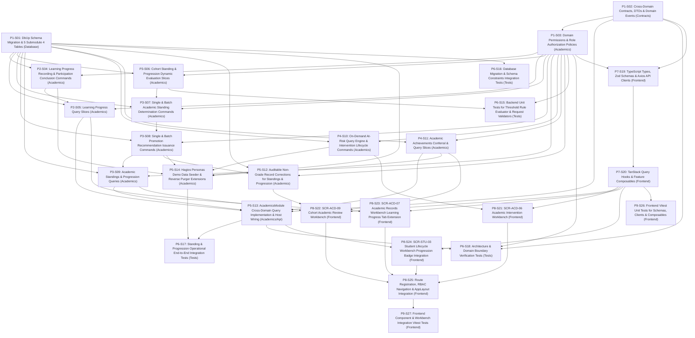

# 1. Objective

Implement the complete core scope of Stage 2 "Standing & Progression" under the Academic domain for Elsasa SIS V3:
1. **Learning Progress & Completion (`ACD-WF-11`, `UC-ACD-12`, `SCR-ACD-07`):** Tracking student advancement toward unit expectations using the Phase-2 minimal model (`not_started`, `in_progress`, `completed`, `needs_remediation`, `exempted`), out-of-period explicit `completion_date` stamping, recognized prior learning, and formal participation conclusion (`UC-ACD-12`).
2. **Academic Standing Determination (`ACD-WF-13`, `UC-ACD-17`, `SCR-ACD-09`):** Authoritative cohort standing evaluation and determination (`good_standing`, `conditional_standing`, `not_in_good_standing`), governing policy references, condition stipulations, and embedded committee decree exception attributes (*SK Dewan Guru*).
3. **Promotion & Retention Recommendation (`ACD-WF-13`, `UC-ACD-17`, `SCR-ACD-09`, `SCR-STU-03`):** Authoritative progression recommendations (`promotion_eligible`, `retention_recommended`, `conditional_promotion`), current and destination levels, supporting evidence summaries, linked academic standings, and unblocking administrative grade lifecycle execution in Students.
4. **Academic Intervention (`ACD-WF-10`, `UC-ACD-11`, `SCR-ACD-06`):** Structured learning support actions (`remediation`, `extension_work`, etc.), dual-trigger intake (live On-Demand At-Risk Query Engine over failing scores, missing work, low attendance < 75%, or standing concerns; and manual educator referrals `teacher_referral`), lifecycle tracking (`planned`, `in_progress`, `completed`, `cancelled`), and outcome logging.
5. **Academic Achievement Recognition (`ACD-WF-19`, `UC-ACD-21`, `SCR-ACD-09`):** Formal conferral and retrieval of subject distinctions, academic honors (*Juara Umum*), mastery recognition, and academic competition awards.
6. **Auditable Non-Grade Corrections (`UC-ACD-15`):** In-place corrections to approved standing and progression records via unified audit table `academics.academic_record_corrections` with mandatory reason (min 10 chars).
7. **Cross-Domain Contracts & Domain Events (`GAP-007`, `ADR-001`, `ADR-003`, `TD-06`):** Extending `IAcademicsModule` with synchronous inquiry methods and publishing post-commit MediatR domain events.
8. **Demo Data Generation & Reverse Purging (`TD-08`):** Seeding Hagios student personas (Rina Kusuma, Budi Santoso, Timotius) and updating reverse purge ordering.
9. **Role-Aligned Frontend Workbenches (`SCR-ACD-06`, `SCR-ACD-09`, `SCR-ACD-07`, `SCR-STU-03`):** Delivering dedicated Vue 3 feature modules and extensions.

Planning Mode: FEATURE-PLANNING

Referenced artifacts:
- FEATURE / ISSUE:
  - `docs/issues/IS012 - ACD-STANDING-PROGRESSION-ISSUE.md` (Intake `CR-ACD-STANDING-PROGRESSION`)
  - `docs/domains/academic-domain.md` (Learning Progress lines 142–165, Academic Standing lines 370–405, Promotion & Retention lines 407–438, Academic Interventions lines 440–475, Academic Achievements lines 477–505)
  - `docs/sub-modul-and-development-phases.md` (Stage 2 Module: Standing & Progression, Criteria 6 and 9)
  - `docs/operational-workflow-discovery.md` (`ACD-WF-10`, `ACD-WF-11`, `ACD-WF-13`, `ACD-WF-19`)
  - `docs/use-cases.md` (`UC-ACD-11`, `UC-ACD-12`, `UC-ACD-15`, `UC-ACD-17`, `UC-ACD-21`)
  - `docs/actors.md` (Teacher `ACT-09`, Academic Coordinator `ACT-07`, Academic Authority `ACT-08`, Student Administration Officer `ACT-03`)
  - `docs/screen-inventory.md` (`SCR-ACD-06`, `SCR-ACD-07`, `SCR-ACD-09`, `SCR-STU-03`)
  - `docs/entities/academic-entities.md` & `docs/entities/academic-entities-tables.md` (Submodule 4 — Standing & Progression; lines 674–950)
- ARCHITECTURE:
  - `docs/issues/IS012 - ACD-STANDING-PROGRESSION-ARCHITECTURE.md` (Authoritative target capability architecture)
  - `docs/architecture/backend-architecture.md` (Modular Monolith & Vertical Slice specification)
  - `docs/architecture/frontend-architecture.md` (Modular Vue 3 SPA architecture)
  - `docs/architecture/adr.md` (ADR-001 through ADR-010)
  - `docs/architecture/coding-conventions.md` (C# 12, Dapper raw SQL, Minimal API conventions)
- FEASIBILITY-ASSESSMENT:
  - `docs/issues/IS012 - ACD-STANDING-PROGRESSION-FEASIBILITY-ASSESSMENT.md` (Status: `READY-FOR-PLANNING`)

Architecture Applicability: ARCHITECTURE-REQUIRED

This feature introduces 5 authoritative relational tables in schema `academics`, composite check constraints, unique constraints, cross-domain contracts and events (`IAcademicsModule`, domain events), an on-demand at-risk query engine, batch standing and progression evaluation and commitment workflows, non-grade record corrections, demo data extensions, and 2 complete frontend workbenches (`SCR-ACD-06`, `SCR-ACD-09`) with extensions to `SCR-ACD-07` and `SCR-STU-03`. Target architecture `docs/issues/IS012 - ACD-STANDING-PROGRESSION-ARCHITECTURE.md` is authoritative and governs this plan.

---

# 2. Planning Scope

The planning scope encompasses all changes required across database persistence, backend domain vertical slices, cross-domain contracts, automated test harnesses, and frontend workspaces:

1. **Database Persistence & DbUp Migrations (`Elsasa.Sis.Database`):**
   - Author and register sequential forward DbUp migration script `20261107_0401_Academics_StandingProgression_Tables.sql` targeting Microsoft SQL Server 2022 ([`ADR-002`](file:///d:/Project.Private/elsasa-sis-v3/docs/architecture/adr.md#L50-L75), [`ADR-006`](file:///d:/Project.Private/elsasa-sis-v3/docs/architecture/adr.md#L152-L176)).
   - Provision authoritative tables in schema `academics`:
     - `academics.learning_progress`: Tracks student advancement toward unit learning expectations, minimal progress states (`not_started`, `in_progress`, `completed`, `needs_remediation`, `exempted`), operational basis (`assessment_evidence`, `learning_work`, `authorized_decision`), out-of-period explicit `completion_date`, updater identity, and notes.
     - `academics.academic_standings`: Formal period academic condition determination (`good_standing`, `conditional_standing`, `not_in_good_standing`), governing policy reference, mandatory condition text, embedded exception attributes (`is_exception`, `exception_reason`, `committee_reference` e.g. *SK Dewan Guru*), and authorizing Academic Authority.
     - `academics.promotion_recommendations`: Advancement evaluation recommendations (`promotion_eligible`, `retention_recommended`, `conditional_promotion`), source and target levels (`from_level`, `recommended_to_level`), mandatory condition text, supporting evidence summary, linked `academic_standing_id`, and embedded exception attributes.
     - `academics.academic_interventions`: Structured learning support actions (`remediation`, `reassessment`, `tutoring_recommendation`, `extension_work`, `recovery_plan`, `learning_plan_adjustment`, `academic_warning`), dual-trigger source (`assessment_below_threshold`, `missing_work`, `attendance_concern`, `standing_concern`, `teacher_referral`), lifecycle status (`planned`, `in_progress`, `completed`, `cancelled`), target learning unit, and outcomes.
     - `academics.academic_achievements`: Achievements derived from academic learning or assessment (`subject_distinction`, `academic_honors`, `mastery_recognition`, `academic_certification`, `academic_competition`), title, optional learning unit link, criteria, supporting result references, and recognizing authority.
   - Enforce zero cross-schema physical foreign keys ([`ADR-001`](file:///d:/Project.Private/elsasa-sis-v3/docs/architecture/adr.md#L24-L48)), intra-schema foreign keys (`learning_units`, `academic_standings`), check constraints, and performance indexes.

2. **Cross-Domain Contracts & Domain Events (`Elsasa.Sis.Contracts`):**
   - Extend synchronous query interface `IAcademicsModule` with methods for student standing, promotion recommendation, student achievements, and learning progress summary.
   - Define shared DTO records: `StudentAcademicStandingDto`, `PromotionRecommendationDto`, `AcademicAchievementDto`, `LearningProgressSummaryDto`.
   - Define in-memory domain event records under `src/backend/Elsasa.Sis.Contracts/Academics/Events/` implementing `IDomainEvent` ([`ADR-003`](file:///d:/Project.Private/elsasa-sis-v3/docs/architecture/adr.md#L76-L98)):
     - `LearningProgressUpdatedEvent`
     - `AcademicStandingDeterminedEvent`
     - `PromotionRecommendationIssuedEvent`
     - `AcademicInterventionInitiatedEvent`
     - `AcademicInterventionConcludedEvent`
     - `AcademicAchievementConferredEvent`
     - `AcademicStandingCorrectedEvent`
     - `PromotionRecommendationCorrectedEvent`

3. **Backend Domain Security & Permissions (`Elsasa.Sis.Academics`):**
   - Expand `Permissions.cs` in `Elsasa.Sis.Academics` with permission constants for Progress, Standings, Progression, Interventions, Achievements, and Corrections.
   - Configure ASP.NET Core authorization policies mapping permissions to Academic Authority, Academic Coordinator, Teacher, and Student Administration Officer roles.

4. **Learning Progress & Completion Vertical Slices (`Elsasa.Sis.Academics`):**
   - `RecordLearningProgress` (`POST /api/v1/academics/learning-progress`): Records or updates student advancement, supporting out-of-period explicit `completion_date` and recognized transfer learning (`UC-ACD-12`).
   - `ConcludeParticipation` (`POST /api/v1/academics/learning-progress/conclude`): Formal conclusion of learning unit participation, verifying completion criteria and publishing `ParticipationConcludedEvent` (`UC-ACD-12`).
   - `GetStudentLearningProgress` (`GET /api/v1/academics/students/{studentId}/learning-progress`): Queries progress ledger across enrolled units for a period.
   - `GetUnitLearningProgress` (`GET /api/v1/academics/learning-units/{unitId}/progress`): Queries participant progress roster for a specific learning unit.

5. **Academic Standings Vertical Slices (`Elsasa.Sis.Academics`):**
   - `EvaluateCohortStanding` (`POST /api/v1/academics/cohort-review/evaluate-standing`): Dynamic evaluation of proposed academic standing for all students in a cohort based on approved results, completion states, and attendance metrics.
   - `DetermineAcademicStanding` (`POST /api/v1/academics/academic-standings`): Academic Authority formal single standing determination with embedded exception fields (`UC-ACD-17`).
   - `BatchDetermineCohortStanding` (`POST /api/v1/academics/academic-standings/batch`): Academic Authority batch commitment of standing determinations.
   - `GetStudentStandings` (`GET /api/v1/academics/students/{studentId}/standings`): Queries standing history for a student across academic periods.
   - `GetCohortStandings` (`GET /api/v1/academics/cohort-review/standings`): Queries standing determinations for a period and grade level.

6. **Promotion Recommendations Vertical Slices (`Elsasa.Sis.Academics`):**
   - `EvaluateCohortProgression` (`POST /api/v1/academics/cohort-review/evaluate-progression`): Dynamic evaluation of proposed promotion/retention recommendations based on standing determinations and result thresholds.
   - `IssuePromotionRecommendation` (`POST /api/v1/academics/promotion-recommendations`): Academic Authority formal single progression recommendation with supporting evidence and condition text (`UC-ACD-17`).
   - `BatchIssuePromotionRecommendations` (`POST /api/v1/academics/promotion-recommendations/batch`): Academic Authority batch commitment of progression recommendations.
   - `GetStudentPromotionRecommendations` (`GET /api/v1/academics/students/{studentId}/promotion-recommendations`): Queries student progression recommendation history.
   - `GetCohortPromotionRecommendations` (`GET /api/v1/academics/cohort-review/promotion-recommendations`): Queries recommendations for a period and grade level.

7. **Academic Interventions Vertical Slices (`Elsasa.Sis.Academics`):**
   - `GetAtRiskLearnersQuery` (`GET /api/v1/academics/interventions/at-risk`): Live query dynamically detecting at-risk learners based on approved assessment scores below passing threshold, missing submissions, low attendance (<75%), or standing concerns.
   - `InitiateAcademicIntervention` (`POST /api/v1/academics/interventions`): Formulate structured intervention plan from early-warning alert or teacher referral (`UC-ACD-11`).
   - `UpdateInterventionStatus` (`PATCH /api/v1/academics/interventions/{id}/status`): Updates intervention lifecycle status (`in_progress`, `completed`, `cancelled`) with recorded outcome narrative.
   - `GetActiveInterventions` (`GET /api/v1/academics/interventions`): Filterable work queue of active and completed interventions.
   - `GetInterventionById` (`GET /api/v1/academics/interventions/{id}`): Detailed intervention plan inspection with target learning units and notes.

8. **Academic Achievements Vertical Slices (`Elsasa.Sis.Academics`):**
   - `ConferAcademicAchievement` (`POST /api/v1/academics/achievements`): Formal conferral of subject distinction, academic honors (*Juara Umum*), or competition recognition by Academic Authority (`UC-ACD-21`).
   - `GetStudentAchievements` (`GET /api/v1/academics/students/{studentId}/achievements`): Queries student achievements across periods.
   - `GetPeriodAchievements` (`GET /api/v1/academics/cohort-review/achievements`): Queries achievements conferred for a period.

9. **Auditable Record Corrections Vertical Slices (`Elsasa.Sis.Academics`):**
   - `CorrectAcademicStanding` (`POST /api/v1/academics/academic-standings/{id}/correct`): Auditable in-place correction of an approved standing determination requiring mandatory reason (min 10 chars) and Academic Authority authorization, recording audit entry into `academic_record_corrections` (`record_type = 'academic_standing'`) (`UC-ACD-15`).
   - `CorrectPromotionRecommendation` (`POST /api/v1/academics/promotion-recommendations/{id}/correct`): Auditable in-place correction of an approved promotion recommendation requiring mandatory reason and Academic Authority authorization, recording audit entry into `academic_record_corrections` (`record_type = 'promotion_recommendation'`) (`UC-ACD-15`).

10. **Cross-Domain Host Integration & Demo Data Extensions (`Elsasa.Sis.Academics` & `Elsasa.Sis.Api`):**
    - Implement `AcademicsModule.cs` cross-domain methods for standing, progression recommendations, achievements, and progress summaries.
    - Consolidate DI registrations in `DependencyInjection.cs` and minimal API routes in `AcademicsEndpoints.cs`.
    - Extend `AcademicsActivitiesDemoDataSeeder.cs` to seed realistic Submodule 4 records for Hagios personas (Rina Kusuma, Budi Santoso, Timotius).
    - Extend `AcademicsDemoDataPurger.cs` to clean Submodule 4 tables in strict reverse-dependency order.

11. **Automated Testing Suite (`tests/backend`):**
    - Unit tests covering threshold rule evaluator, request validators, and DTO mappings.
    - Testcontainers integration tests verifying migration `20261107_0401` execution, constraint validations, cohort standing and progression batch operations, at-risk query execution, intervention lifecycle transitions, auditable corrections, and cross-domain inquiries.
    - Architecture tests in `Elsasa.Sis.ArchitectureTests` verifying strict assembly isolation and naming conventions.

12. **Frontend State, API Clients, Zod Schemas & Composables (`src/frontend`):**
    - TypeScript interfaces, Zod validation schemas, and Axios client modules for learning progress, academic standings, promotion recommendations, interventions, and achievements.
    - TanStack Query hooks and mutation composables (`useLearningProgress`, `useCohortReview`, `useAcademicInterventions`, `useAcademicAchievements`, `useStandingCorrections`).

13. **Frontend Workbenches & Navigation Integration (`src/frontend`):**
    - `SCR-ACD-06` Academic Intervention Workbench (`/academics/interventions`):
      - Tab 1: Active Interventions Work Queue (DataTable filtered by status, type, student; action drawer to update progress or record conclusion).
      - Tab 2: At-Risk Learners (live query listing students with active alerts; 1-click "Initiate Intervention" button pre-populating modal).
      - Modals: `InterventionPlanModal.vue`, `InterventionDetailDrawer.vue`.
    - `SCR-ACD-09` Cohort Academic Review (`/academics/cohort-review`):
      - Tab 1: Standing & Progression Review (batch preview grid displaying enrolled students, completed units, failed units, attendance %, proposed standing, proposed progression; inline override dialog with exception checkbox, rationale, and *SK Dewan Guru* decree reference; "Approve & Commit Cohort" batch button).
      - Tab 2: Academic Honors & Achievements (conferral form and list of conferred honors for the period).
      - Modals: `StandingOverrideModal.vue`, `ConferAchievementModal.vue`, `StandingCorrectionModal.vue`.
    - `SCR-ACD-07` Academic Records Workbench Extension (`/academics/records`):
      - Add Tab: "Learning Progress & Completion" (`LearningProgressTab.vue`): Roster showing student enrollments, Phase-2 progress badge, basis, explicit `completion_date` picker, and "Conclude Participation" action (`UC-ACD-12`).
    - `SCR-STU-03` Student Lifecycle Workbench Integration:
      - Display authoritative progression recommendation badges (`promotion_eligible`, `retention_recommended`, `conditional_promotion`) unblocking administrative promotion or retention execution.
    - Route registration in `src/frontend/src/app/router/routes.ts` protected by RBAC permissions.
    - Navigation items in `src/frontend/src/app/layouts/AppLayout.vue`.

14. **Frontend Automated Verification & Testing (`src/frontend`):**
    - Unit tests for Zod schemas, API clients, and composables using Vitest.
    - Component & integration tests using Vitest and Vue Test Utils for `SCR-ACD-06`, `SCR-ACD-09`, `LearningProgressTab.vue`, and corrections modals.

---

# 3. Dependencies

### External System & Tooling Dependencies

- .NET 8 SDK (8.0.x)
- Docker / Docker Desktop / Podman (required for Testcontainers SQL Server 2022 integration tests)
- Microsoft SQL Server 2022 instance (for local Web API runtime)
- Node.js runtime (v22.x or LTS) and pnpm package manager (v9.x or v11.x)

### Internal Slice Dependencies

- `Depends On` declares implementation prerequisites between slices.
- Dependencies reference Slice IDs only.
- Dependency satisfaction requires the referenced slice to have implementation status `IMPLEMENTED`.
- Dependency satisfaction does not require review status `GO`.
- Slices with `Depends On: None` or whose dependencies are satisfied may be executed in parallel.

### Dependency Graph



---

# 4. Progress Summary

| Phase | Implementation Status | Review Status | Progress |
|---|---|---|---|
| P1 - Foundation & Contracts | IMPLEMENTED | GO | 3/3 |
| P2 - Learning Progress & Completion | IMPLEMENTED | GO | 2/2 |
| P3 - Academic Standings & Progression Recommendations | IMPLEMENTED | GO | 4/4 |
| P4 - Academic Interventions & Achievements | IMPLEMENTED | GO | 2/2 |
| P5 - Record Corrections, Host Wiring & Demo Data | IMPLEMENTED | GO | 3/3 |
| P6 - Backend Automated Testing Suite | IMPLEMENTED | GO | 4/4 |
| P7 - Frontend State, API Clients & Composables | IMPLEMENTED | GO | 2/2 |
| P8 - Frontend Workbenches & Cross-Domain Integration | IMPLEMENTED | GO | 5/5 |
| P9 - Frontend Automated Verification & Testing | IMPLEMENTED | GO | 2/2 |

---

# 5. Phases

## P1 - Foundation & Contracts

Implementation Status: NOT-STARTED
Review Status: NOT-REVIEWED

### P1-S01

Title: DbUp Schema Migration & 5 Submodule 4 Relational Tables

Implementation Status: IMPLEMENTED
Review Status: GO

Objective:
Author and register forward DbUp migration script `20261107_0401_Academics_StandingProgression_Tables.sql` in `Elsasa.Sis.Database/Scripts/` provisioning the 5 authoritative tables for Submodule 4 (`learning_progress`, `academic_standings`, `promotion_recommendations`, `academic_interventions`, `academic_achievements`) targeting Microsoft SQL Server 2022 with zero cross-schema foreign keys, intra-schema foreign keys, composite unique indexes, check constraints, and performance indexes.

Depends On: None

Repository: `src/backend/Elsasa.Sis.Database`

Completion Criteria:
1. `src/backend/Elsasa.Sis.Database/Scripts/20261107_0401_Academics_StandingProgression_Tables.sql` exists and is marked as an embedded resource.
2. Tables provisioned with primary keys and audit columns (`created_at`, `created_by`, `updated_at`, `updated_by`):
   - `academics.learning_progress`: `student_id UUID NOT NULL`, `learning_unit_id UUID NOT NULL`, `academic_period_id UUID NOT NULL`, `status NVARCHAR(30) NOT NULL`, `basis NVARCHAR(30) NOT NULL`, `completion_date DATE NULL`, `notes NVARCHAR(1000) NULL`.
   - `academics.academic_standings`: `student_id UUID NOT NULL`, `academic_period_id UUID NOT NULL`, `standing NVARCHAR(30) NOT NULL`, `policy_reference NVARCHAR(100) NOT NULL`, `conditions NVARCHAR(2000) NULL`, `is_exception BIT NOT NULL DEFAULT 0`, `exception_reason NVARCHAR(1000) NULL`, `committee_reference NVARCHAR(100) NULL`, `authorized_by NVARCHAR(100) NOT NULL`, `determined_at DATETIMEOFFSET NOT NULL`.
   - `academics.promotion_recommendations`: `student_id UUID NOT NULL`, `academic_period_id UUID NOT NULL`, `recommendation NVARCHAR(30) NOT NULL`, `from_level NVARCHAR(50) NOT NULL`, `recommended_to_level NVARCHAR(50) NULL`, `conditions NVARCHAR(2000) NULL`, `supporting_evidence NVARCHAR(2000) NOT NULL`, `academic_standing_id UUID NULL`, `is_exception BIT NOT NULL DEFAULT 0`, `exception_reason NVARCHAR(1000) NULL`, `committee_reference NVARCHAR(100) NULL`, `authorized_by NVARCHAR(100) NOT NULL`, `issued_at DATETIMEOFFSET NOT NULL`.
   - `academics.academic_interventions`: `student_id UUID NOT NULL`, `learning_unit_id UUID NOT NULL`, `academic_period_id UUID NOT NULL`, `intervention_type NVARCHAR(50) NOT NULL`, `trigger_type NVARCHAR(50) NOT NULL`, `trigger_description NVARCHAR(1000) NOT NULL`, `plan_description NVARCHAR(2000) NOT NULL`, `status NVARCHAR(30) NOT NULL`, `initiated_by NVARCHAR(100) NOT NULL`, `initiated_at DATETIMEOFFSET NOT NULL`, `concluded_at DATETIMEOFFSET NULL`, `outcome_notes NVARCHAR(2000) NULL`.
   - `academics.academic_achievements`: `student_id UUID NOT NULL`, `learning_unit_id UUID NULL`, `academic_period_id UUID NOT NULL`, `achievement_type NVARCHAR(50) NOT NULL`, `title NVARCHAR(200) NOT NULL`, `description NVARCHAR(1000) NULL`, `criteria_met NVARCHAR(1000) NOT NULL`, `supporting_evidence NVARCHAR(2000) NULL`, `recognized_by NVARCHAR(100) NOT NULL`, `recognized_at DATE NOT NULL`.
3. Check constraints enforced:
   - `CK_academics_learning_progress_status`: `status IN ('not_started', 'in_progress', 'completed', 'needs_remediation', 'exempted')`.
   - `CK_academics_learning_progress_basis`: `basis IN ('assessment_evidence', 'learning_work', 'authorized_decision')`.
   - `CK_academics_academic_standings_standing`: `standing IN ('good_standing', 'conditional_standing', 'not_in_good_standing')`.
   - `CK_academics_promotion_recommendations_recommendation`: `recommendation IN ('promotion_eligible', 'retention_recommended', 'conditional_promotion')`.
   - `CK_academics_academic_interventions_type`: `intervention_type IN ('remediation', 'reassessment', 'tutoring_recommendation', 'extension_work', 'recovery_plan', 'learning_plan_adjustment', 'academic_warning')`.
   - `CK_academics_academic_interventions_trigger`: `trigger_type IN ('assessment_below_threshold', 'missing_work', 'attendance_concern', 'standing_concern', 'teacher_referral')`.
   - `CK_academics_academic_interventions_status`: `status IN ('planned', 'in_progress', 'completed', 'cancelled')`.
   - `CK_academics_academic_achievements_type`: `achievement_type IN ('subject_distinction', 'academic_honors', 'mastery_recognition', 'academic_certification', 'academic_competition')`.
4. Intra-schema foreign keys enforced:
   - `FK_academics_learning_progress_unit`: `learning_unit_id` -> `academics.learning_units(id)`.
   - `FK_academics_promotion_recommendations_standing`: `academic_standing_id` -> `academics.academic_standings(id)` ON DELETE SET NULL.
   - `FK_academics_academic_interventions_unit`: `learning_unit_id` -> `academics.learning_units(id)`.
   - `FK_academics_academic_achievements_unit`: `learning_unit_id` -> `academics.learning_units(id)` ON DELETE SET NULL.
5. Unique composite indexes enforced:
   - `IX_academics_learning_progress_student_unit_period`: UNIQUE `(student_id, learning_unit_id, academic_period_id)`.
   - `IX_academics_academic_standings_student_period`: UNIQUE `(student_id, academic_period_id)`.
   - `IX_academics_promotion_recommendations_student_period`: UNIQUE `(student_id, academic_period_id)`.
6. Performance indexes created on foreign keys and filter columns (`status`, `period_id`, `learning_unit_id`).

Implementation Notes:
- Authored DbUp migration script `20261107_0401_Academics_StandingProgression_Tables.sql` in `src/backend/Elsasa.Sis.Database/Scripts/`.
- Provisioned authoritative tables `academics.learning_progress`, `academics.academic_standings`, `academics.promotion_recommendations`, `academics.academic_interventions`, and `academics.academic_achievements` with standard audit columns.
- Enforced all required domain check constraints (`CK_academics_learning_progress_status`, `CK_academics_learning_progress_basis`, `CK_academics_academic_standings_standing`, `CK_academics_promotion_recommendations_recommendation`, `CK_academics_academic_interventions_type`, `CK_academics_academic_interventions_trigger`, `CK_academics_academic_interventions_status`, `CK_academics_academic_achievements_type`).
- Enforced intra-schema foreign keys to `academics.learning_units` and `academics.academic_standings` with zero cross-schema foreign keys (ADR-001, ADR-002).
- Enforced composite unique indexes on `(student_id, learning_unit_id, academic_period_id)` for learning progress and `(student_id, academic_period_id)` for standings and promotion recommendations.
- Added performance indexes covering foreign keys and filter columns across all 5 tables.
- Verified build and embedded resource registration via `dotnet build src/backend/Elsasa.Sis.Database`.

Notes:
Adheres strictly to ADR-001 (zero cross-schema FKs to `students` or `operations`), ADR-002 (SQL Server schema isolation), and ADR-006 (DbUp sequential forward migration).

---

### P1-S02

Title: Cross-Domain Contracts, DTOs & Domain Events

Implementation Status: IMPLEMENTED
Review Status: GO

Objective:
Define shared synchronous inquiry method signatures and shared DTOs on `IAcademicsModule`, and define in-memory MediatR domain event records implementing `IDomainEvent` under `src/backend/Elsasa.Sis.Contracts/Academics/`.

Depends On: None

Repository: `src/backend/Elsasa.Sis.Contracts`

Completion Criteria:
1. `IAcademicsModule.cs` in `Elsasa.Sis.Contracts/Academics/` extended with:
   - `Task<Result<StudentAcademicStandingDto?>> GetStudentAcademicStandingAsync(Guid studentId, Guid academicPeriodId, CancellationToken ct = default);`
   - `Task<Result<PromotionRecommendationDto?>> GetPromotionRecommendationAsync(Guid studentId, Guid academicPeriodId, CancellationToken ct = default);`
   - `Task<Result<IReadOnlyList<AcademicAchievementDto>>> GetStudentAcademicAchievementsAsync(Guid studentId, Guid? academicPeriodId = null, CancellationToken ct = default);`
   - `Task<Result<IReadOnlyList<LearningProgressSummaryDto>>> GetStudentLearningProgressSummaryAsync(Guid studentId, Guid academicPeriodId, CancellationToken ct = default);`
2. Shared contract DTO records created under `Elsasa.Sis.Contracts/Academics/`:
   - `StudentAcademicStandingDto.cs`
   - `PromotionRecommendationDto.cs`
   - `AcademicAchievementDto.cs`
   - `LearningProgressSummaryDto.cs`
3. Domain event records created under `Elsasa.Sis.Contracts/Academics/Events/`:
   - `LearningProgressUpdatedEvent.cs`: `(Guid ProgressId, Guid StudentId, Guid LearningUnitId, Guid AcademicPeriodId, string Status, DateOnly? CompletionDate, DateTimeOffset OccurredOn)`
   - `AcademicStandingDeterminedEvent.cs`: `(Guid StandingId, Guid StudentId, Guid AcademicPeriodId, string Standing, bool IsException, DateTimeOffset OccurredOn)`
   - `PromotionRecommendationIssuedEvent.cs`: `(Guid RecommendationId, Guid StudentId, Guid AcademicPeriodId, string Recommendation, string FromLevel, string? RecommendedToLevel, bool IsException, DateTimeOffset OccurredOn)`
   - `AcademicInterventionInitiatedEvent.cs`: `(Guid InterventionId, Guid StudentId, Guid LearningUnitId, string InterventionType, string TriggerType, DateTimeOffset OccurredOn)`
   - `AcademicInterventionConcludedEvent.cs`: `(Guid InterventionId, Guid StudentId, string OutcomeNotes, DateTimeOffset OccurredOn)`
   - `AcademicAchievementConferredEvent.cs`: `(Guid AchievementId, Guid StudentId, Guid AcademicPeriodId, string AchievementType, string Title, DateTimeOffset OccurredOn)`
   - `AcademicStandingCorrectedEvent.cs`: `(Guid StandingId, Guid StudentId, Guid AcademicPeriodId, string OldStanding, string NewStanding, string Reason, DateTimeOffset OccurredOn)`
   - `PromotionRecommendationCorrectedEvent.cs`: `(Guid RecommendationId, Guid StudentId, Guid AcademicPeriodId, string OldRecommendation, string NewRecommendation, string Reason, DateTimeOffset OccurredOn)`
4. Assembly compiles cleanly with zero warnings or external assembly dependencies outside `Elsasa.Sis.Contracts.Common`.

Implementation Notes:
- Extended `IAcademicsModule` with 4 synchronous cross-domain inquiry methods (`GetStudentAcademicStandingAsync`, `GetPromotionRecommendationAsync`, `GetStudentAcademicAchievementsAsync`, `GetStudentLearningProgressSummaryAsync`).
- Created shared contract DTO records under `src/backend/Elsasa.Sis.Contracts/Academics/`: `StudentAcademicStandingDto`, `PromotionRecommendationDto`, `AcademicAchievementDto`, and `LearningProgressSummaryDto` with XML documentation.
- Created 8 in-memory MediatR domain event records implementing `IDomainEvent` under `src/backend/Elsasa.Sis.Contracts/Academics/Events/` with UTC primary and default secondary constructors: `LearningProgressUpdatedEvent`, `AcademicStandingDeterminedEvent`, `PromotionRecommendationIssuedEvent`, `AcademicInterventionInitiatedEvent`, `AcademicInterventionConcludedEvent`, `AcademicAchievementConferredEvent`, `AcademicStandingCorrectedEvent`, and `PromotionRecommendationCorrectedEvent`.
- Verified compilation with `dotnet build src/backend/Elsasa.Sis.Contracts` (0 warnings, 0 errors).

Notes:
Adheres to ADR-001 (shared contracts in Contracts assembly only) and ADR-003 (in-memory MediatR post-commit events).

---

### P1-S03

Title: Domain Permissions & Role Authorization Policies

Implementation Status: IMPLEMENTED
Review Status: GO

Objective:
Expand `Permissions.cs` in `Elsasa.Sis.Academics` with authoritative permission constants for Standing & Progression capabilities, and configure ASP.NET Core authorization policies mapping permissions to Academic Authority, Academic Coordinator, Teacher, and Student Administration Officer roles.

Depends On: P1-S02

Repository: `src/backend/Elsasa.Sis.Academics`

Completion Criteria:
1. `Permissions.cs` updated with permission constants:
   - `Progress`: `View` (`"academics.progress.view"`), `Record` (`"academics.progress.record"`), `Conclude` (`"academics.progress.conclude"`)
   - `Standings`: `View` (`"academics.standings.view"`), `Evaluate` (`"academics.standings.evaluate"`), `Determine` (`"academics.standings.determine"`), `BatchDetermine` (`"academics.standings.batch_determine"`)
   - `Progression`: `View` (`"academics.progression.view"`), `Evaluate` (`"academics.progression.evaluate"`), `Issue` (`"academics.progression.issue"`), `BatchIssue` (`"academics.progression.batch_issue"`)
   - `Interventions`: `View` (`"academics.interventions.view"`), `Initiate` (`"academics.interventions.initiate"`), `UpdateStatus` (`"academics.interventions.update_status"`)
   - `Achievements`: `View` (`"academics.achievements.view"`), `Confer` (`"academics.achievements.confer"`)
   - `Corrections`: `CorrectStanding` (`"academics.corrections.standing"`), `CorrectProgression` (`"academics.corrections.progression"`)
2. Authorization policies registered in `DependencyInjection.cs`:
   - `AcademicAuthority` mapped to standing determinations, progression issuance, achievement conferrals, and corrections.
   - `AcademicCoordinator` mapped to learning progress recording, participation conclusion, intervention initiation, and lifecycle updates.
   - `Teacher` mapped to progress viewing, educator referral initiation (`teacher_referral`), and milestone intervention viewing.
   - `StudentAdministrationOfficer` mapped to read-only progression recommendation viewing.

Implementation Notes:
- Expanded `Permissions.cs` in `Elsasa.Sis.Academics` with fine-grained permission constants for Submodule 4:
  - `Progress`: `View` (`"academics.progress.view"`), `Record` (`"academics.progress.record"`), `Conclude` (`"academics.progress.conclude"`).
  - `Standings`: `View` (`"academics.standings.view"`), `Evaluate` (`"academics.standings.evaluate"`), `Determine` (`"academics.standings.determine"`), `BatchDetermine` (`"academics.standings.batch_determine"`).
  - `Progression`: `View` (`"academics.progression.view"`), `Evaluate` (`"academics.progression.evaluate"`), `Issue` (`"academics.progression.issue"`), `BatchIssue` (`"academics.progression.batch_issue"`).
  - `Interventions`: `View` (`"academics.interventions.view"`), `Initiate` (`"academics.interventions.initiate"`), `UpdateStatus` (`"academics.interventions.update_status"`).
  - `Achievements`: `View` (`"academics.achievements.view"`), `Confer` (`"academics.achievements.confer"`).
  - `Corrections`: `CorrectStanding` (`"academics.corrections.standing"`), `CorrectProgression` (`"academics.corrections.progression"`).
- Registered ASP.NET Core authorization policies in `DependencyInjection.cs`:
  - `AcademicAuthority` mapped to standing determinations, progression issuance, achievement conferrals, and corrections.
  - `AcademicCoordinator` mapped to learning progress recording, participation conclusion, intervention initiation, and lifecycle updates.
  - `Teacher` mapped to progress viewing, educator referral initiation (`teacher_referral`), and milestone intervention viewing.
  - `StudentAdministrationOfficer` / `StudentAdminOfficer` mapped to read-only progression recommendation viewing.
- Authored unit test suite `AcademicsStandingProgressionPermissionsTests.cs` verifying constants and role policy assertions (73 tests passed).
- Verified assembly compilation with `dotnet build src/backend/Elsasa.Sis.Academics` (0 errors, 0 warnings).

Notes:
Enforces ADR-009 (fine-grained permission constants and role separation).

---

## P2 - Learning Progress & Completion

Implementation Status: NOT-STARTED
Review Status: NOT-REVIEWED

### P2-S04

Title: Learning Progress Recording & Participation Conclusion Commands

Implementation Status: IMPLEMENTED
Review Status: GO

Objective:
Implement vertical command slices under `src/backend/Elsasa.Sis.Academics/Features/LearningProgress/` for recording student progress toward learning expectations (`UC-ACD-12`), supporting out-of-period explicit `completion_date` stamping, recognized transfer learning, and formal conclusion of unit participation with event emission.

Depends On: P1-S01, P1-S03

Repository: `src/backend/Elsasa.Sis.Academics`

Completion Criteria:
1. `RecordLearningProgress`:
   - Endpoint: `POST /api/v1/academics/learning-progress`
   - Command record: `RecordLearningProgressCommand(Guid StudentId, Guid LearningUnitId, Guid AcademicPeriodId, string Status, string Basis, DateOnly? CompletionDate, string? Notes)`
   - Validator: FluentValidation validating `Status` in (`not_started`, `in_progress`, `completed`, `needs_remediation`, `exempted`), `Basis` in (`assessment_evidence`, `learning_work`, `authorized_decision`).
   - Business Rules:
     - If `status = 'completed'`, requires an explicit `completion_date` (defaults to current date if omitted).
     - If `status != 'completed'`, `completion_date` must be set to `NULL`.
     - If `basis = 'authorized_decision'`, explanatory `Notes` is mandatory.
   - Handler: Executes parameterized `MERGE` or `IF EXISTS ... UPDATE ... ELSE INSERT` on `academics.learning_progress`.
   - Post-commit: Publishes `LearningProgressUpdatedEvent`.
2. `ConcludeParticipation`:
   - Endpoint: `POST /api/v1/academics/learning-progress/conclude`
   - Command record: `ConcludeParticipationCommand(Guid ParticipationId, DateOnly? CompletionDate, string? Notes)`
   - Handler: Executes within a `SqlTransaction`:
     - Verifies active participation record in `academics.academic_participations`.
     - Checks operative result passing criteria (KKM).
     - Updates `academics.academic_participations.status` to `'completed'`.
     - Inserts or updates `academics.learning_progress` to `status = 'completed'`, `basis = 'assessment_evidence'`, `completion_date = CompletionDate ?? today`.
     - Commits transaction and publishes `ParticipationConcludedEvent` and `LearningProgressUpdatedEvent`.
3. Minimal API endpoints mapped and protected with `academics.progress.record` and `academics.progress.conclude`.

Implementation Notes:
- Implemented `RecordLearningProgress` vertical command slice under `src/backend/Elsasa.Sis.Academics/Features/LearningProgress/RecordLearningProgress/`:
  - `RecordLearningProgressCommand` record with `StudentId`, `LearningUnitId`, `AcademicPeriodId`, `Status`, `Basis`, `CompletionDate`, and `Notes`.
  - `RecordLearningProgressResponse` record with complete audit metadata.
  - `RecordLearningProgressValidator` verifying categorical status set (`not_started`, `in_progress`, `completed`, `needs_remediation`, `exempted`), basis set (`assessment_evidence`, `learning_work`, `authorized_decision`), mandatory `Notes` when `basis = 'authorized_decision'`, and bounds (1000 char max).
  - `RecordLearningProgressHandler` enforcing business rules: defaulting completion date to UTC today when completed, nulling completion date when incomplete, verifying unit existence, executing atomic `MERGE` into `academics.learning_progress`, and publishing `LearningProgressUpdatedEvent` post-commit.
  - `RecordLearningProgressEndpoint` mapped to `POST /api/v1/academics/learning-progress` protected by `Permissions.Academics.Progress.Record`.
- Implemented `ConcludeParticipation` vertical command slice under `src/backend/Elsasa.Sis.Academics/Features/LearningProgress/ConcludeParticipation/`:
  - `ConcludeParticipationCommand` record with `ParticipationId`, `CompletionDate`, and `Notes`.
  - `ConcludeParticipationResponse` record.
  - `ConcludeParticipationValidator` verifying non-empty identifier and bounds.
  - `ConcludeParticipationHandler` executing inside an atomic `SqlTransaction`: acquires row lock and validates active participation (`in_progress`), validates completion date >= start date, verifies operative result passing criteria (KKM) against operative assessment results, updates `academic_participations.status` to `completed`, upserts `academics.learning_progress` to `status = 'completed'` and `basis = 'assessment_evidence'`, commits transaction, and publishes `ParticipationConcludedEvent` and `LearningProgressUpdatedEvent`.
  - `ConcludeParticipationEndpoint` mapped to `POST /api/v1/academics/learning-progress/conclude` protected by `Permissions.Academics.Progress.Conclude`.
- Registered both handlers in `DependencyInjection.cs`.
- Created comprehensive unit test suite `tests/backend/Elsasa.Sis.IntegrationTests/UnitTests/Academics/LearningProgressValidatorTests.cs` (32 tests passing).
- Verified `dotnet build src/backend/Elsasa.Sis.Academics` compiles with 0 errors and 0 warnings.
- Verified `dotnet test tests/backend/Elsasa.Sis.ArchitectureTests` passes with 42 tests passing.

Notes:
Fulfills `ACD-WF-11`, `UC-ACD-12`, and `SCR-ACD-07`. Implements the Phase-2 minimal categorical progress model.

---

### P2-S05

Title: Learning Progress Query Slices

Implementation Status: IMPLEMENTED
Review Status: GO

Objective:
Implement read-only vertical query slices under `src/backend/Elsasa.Sis.Academics/Features/LearningProgress/` to query student progress ledgers across enrolled units for an academic period, and query participant progress rosters for a specific learning unit.

Depends On: P1-S01, P1-S03, P2-S04

Repository: `src/backend/Elsasa.Sis.Academics`

Completion Criteria:
1. `GetStudentLearningProgress`:
   - Endpoint: `GET /api/v1/academics/students/{studentId}/learning-progress`
   - Query parameters: `academicPeriodId` (required)
   - Handler: Fast Dapper query joining `academics.academic_participations`, `academics.learning_units`, and `academics.learning_progress` to return enrolled units with current progress status, basis, completion date, and teacher notes.
2. `GetUnitLearningProgress`:
   - Endpoint: `GET /api/v1/academics/learning-units/{unitId}/progress`
   - Query parameters: `academicPeriodId` (required), optional `status` filter
   - Handler: Fast Dapper query returning all students enrolled in the learning unit with their participation status, learning progress state, operative grade, and completion date.
3. Minimal API endpoints registered and protected with `academics.progress.view`.

Implementation Notes:
- Implemented `GetStudentLearningProgress` vertical query slice under `src/backend/Elsasa.Sis.Academics/Features/LearningProgress/GetStudentLearningProgress/`:
  - `StudentLearningProgressItemDto` projection DTO with progress identifiers, unit code, unit name, credit weight, section label, participation status, progress status, basis, completion date, notes, and audit timestamps.
  - `GetStudentLearningProgressHandler` executing fast parameterized Dapper query joining `academic_participations`, `learning_units`, and `learning_progress`, handling enrolled units and default `'not_started'` progress state with validation for non-empty student and period IDs.
  - `GetStudentLearningProgressEndpoint` mapped to `GET /api/v1/academics/students/{studentId}/learning-progress` protected by `Permissions.Academics.Progress.View`.
- Implemented `GetUnitLearningProgress` vertical query slice under `src/backend/Elsasa.Sis.Academics/Features/LearningProgress/GetUnitLearningProgress/`:
  - `UnitLearningProgressItemDto` projection DTO with student info, participation status, progress status, basis, operative grade (`OperativeGrade`, `OperativeScore`, `GradeLetter`, `GradeLabel`), completion date, notes, and update timestamp.
  - `GetUnitLearningProgressHandler` executing fast parameterized Dapper query joining unit participations, student identity, progress records, and operative assessment results (`OUTER APPLY` prioritizing summative assessments) with unit existence verification and optional progress status filtering.
  - `GetUnitLearningProgressEndpoint` mapped to `GET /api/v1/academics/learning-units/{unitId}/progress` protected by `Permissions.Academics.Progress.View`.
- Registered `GetStudentLearningProgressHandler` and `GetUnitLearningProgressHandler` in `DependencyInjection.cs`.
- Authored unit test suite in `tests/backend/Elsasa.Sis.IntegrationTests/UnitTests/Academics/LearningProgressQueryTests.cs` (8 unit tests passing).
- Verified `dotnet build src/backend/Elsasa.Sis.Academics` compiles cleanly with 0 warnings and 0 errors.
- Verified architecture boundaries via `dotnet test tests/backend/Elsasa.Sis.ArchitectureTests` (42 tests passing).

Notes:
Supports `SCR-ACD-07` Learning Progress & Completion tab and student profile academic tracking.

---

## P3 - Academic Standings & Progression Recommendations

Implementation Status: NOT-STARTED
Review Status: NOT-REVIEWED

### P3-S06

Title: Cohort Standing & Progression Dynamic Evaluation Slices

Implementation Status: IMPLEMENTED
Review Status: GO

Objective:
Implement on-demand dynamic cohort evaluation vertical slices under `src/backend/Elsasa.Sis.Academics/Features/CohortReview/` that aggregate approved academic results, unit progress completion, and attendance metrics across a grade level in an academic period to propose standing classifications and progression recommendations following the Completion & Passing Threshold Rule.

Depends On: P1-S01, P1-S03

Repository: `src/backend/Elsasa.Sis.Academics`

Completion Criteria:
1. `EvaluateCohortStanding`:
   - Endpoint: `POST /api/v1/academics/cohort-review/evaluate-standing`
   - Request record: `EvaluateCohortStandingRequest(Guid AcademicPeriodId, string GradeLevel)`
   - Handler:
     - Queries enrolled students in `GradeLevel` and `AcademicPeriodId`.
     - Aggregates operative approved results (`academic_results WHERE is_final = 1 AND result_status = 'approved'`), passing score (KKM) comparisons, completed learning units, and attendance presence rate.
     - Computes proposed standing applying the **Completion & Passing Threshold Rule**:
       - `good_standing`: All units passed, no unaddressed failing results, attendance >= 75%.
       - `conditional_standing`: 1–2 units below passing threshold or requiring remediation. Auto-generates condition requirements text (e.g., "Must complete Mathematics remediation during holiday packet").
       - `not_in_good_standing`: >2 units failed or chronic non-attendance (<75%).
     - Returns list of `CohortStandingProposalDto` including metrics summary, proposed standing, policy reference (`SK-AKAD/2026/POLICY-01`), pre-populated conditions, and existing saved standing (if already determined).
2. `EvaluateCohortProgression`:
   - Endpoint: `POST /api/v1/academics/cohort-review/evaluate-progression`
   - Request record: `EvaluateCohortProgressionRequest(Guid AcademicPeriodId, string GradeLevel)`
   - Handler:
     - Consumes proposed or committed standing data and learning unit completions.
     - Computes proposed progression:
       - `promotion_eligible`: If standing is `good_standing` (recommended destination = next grade level).
       - `conditional_promotion`: If standing is `conditional_standing` (recommended destination = next grade level, condition text attached).
       - `retention_recommended`: If standing is `not_in_good_standing` (recommended destination = `null` or current grade level).
     - Returns list of `CohortProgressionProposalDto` with student info, from_level, recommended_to_level, proposed recommendation, conditions, and supporting evidence summary.
3. Minimal API endpoints mapped and protected with `academics.standings.evaluate` and `academics.progression.evaluate`.

Implementation Notes:
- Created domain evaluation service `ThresholdRuleEvaluator.cs` in `Features/CohortReview/` implementing the Completion & Passing Threshold Rule, condition text auto-generation, and grade progression increment calculation.
- Created `CohortStandingProposalDto.cs` and `CohortProgressionProposalDto.cs` under `Features/CohortReview/`.
- Implemented `EvaluateCohortStanding` vertical slice (`EvaluateCohortStandingRequest`, `EvaluateCohortStandingValidator`, `EvaluateCohortStandingHandler`, `EvaluateCohortStandingEndpoint`):
  - Dynamic multi-set Dapper query aggregating candidate students from current administrative placements and period participations, operative final approved results, learning unit progress, session attendance presence rate, and existing saved standing determinations.
  - Applies Completion & Passing Threshold Rule proposing `good_standing`, `conditional_standing` with auto-generated condition text, or `not_in_good_standing`.
  - Mapped Minimal API route `POST /api/v1/academics/cohort-review/evaluate-standing` protected by `academics.standings.evaluate`.
- Implemented `EvaluateCohortProgression` vertical slice (`EvaluateCohortProgressionRequest`, `EvaluateCohortProgressionValidator`, `EvaluateCohortProgressionHandler`, `EvaluateCohortProgressionEndpoint`):
  - Evaluates cohort progression recommendations consuming committed or proposed standing states, calculates recommended destination level or retention null state, and formats supporting evidence summaries.
  - Mapped Minimal API route `POST /api/v1/academics/cohort-review/evaluate-progression` protected by `academics.progression.evaluate`.
- Registered `ThresholdRuleEvaluator`, `EvaluateCohortStandingHandler`, and `EvaluateCohortProgressionHandler` in `DependencyInjection.cs`.
- Authored unit test suite `ThresholdRuleEvaluatorTests.cs` in `tests/backend/Elsasa.Sis.IntegrationTests/UnitTests/Academics/` covering standing evaluation, progression recommendation, next grade calculation, chronic non-attendance edge cases, and request validators (20 tests passed).
- Verified assembly build clean with 0 warnings and 0 errors via `dotnet build src/backend/Elsasa.Sis.Academics`.

Notes:
Delivers the preview calculation engine for `SCR-ACD-09` (`TD-03`), eliminating batch background daemons while providing instant cohort review visibility.

---

### P3-S07

Title: Single & Batch Academic Standing Determination Commands

Implementation Status: IMPLEMENTED
Review Status: GO

Objective:
Implement single and batch command slices under `src/backend/Elsasa.Sis.Academics/Features/AcademicStandings/` enabling the Academic Authority to certify academic standing determinations with embedded exception attributes (*SK Dewan Guru* decree references).

Depends On: P1-S01, P1-S03, P3-S06

Repository: `src/backend/Elsasa.Sis.Academics`

Completion Criteria:
1. `DetermineAcademicStanding`:
   - Endpoint: `POST /api/v1/academics/academic-standings`
   - Command record: `DetermineAcademicStandingCommand(Guid StudentId, Guid AcademicPeriodId, string Standing, string PolicyReference, string? Conditions, bool IsException, string? ExceptionReason, string? CommitteeReference)`
   - Validation: If `IsException = true`, `ExceptionReason` and `CommitteeReference` are mandatory (min 5 chars). If `Standing = 'conditional_standing'`, `Conditions` is mandatory.
   - Handler: Inserts record into `academics.academic_standings` with `authorized_by = CurrentUser.Name`, `determined_at = UTC`.
   - Post-commit: Publishes `AcademicStandingDeterminedEvent`.
2. `BatchDetermineCohortStanding`:
   - Endpoint: `POST /api/v1/academics/academic-standings/batch`
   - Command record: `BatchDetermineCohortStandingCommand(Guid AcademicPeriodId, IReadOnlyList<StandingItemDto> Items)`
   - Handler: Executes within a single `SqlTransaction`:
     - Iterates over items and performs atomic `MERGE` or batch insert into `academics.academic_standings`.
     - Validates exception constraints for any overridden items.
     - Commits transaction and emits `AcademicStandingDeterminedEvent` for each processed student.
3. Minimal API endpoints mapped and protected with `academics.standings.determine` and `academics.standings.batch_determine`.

Implementation Notes:
- Implemented `DetermineAcademicStanding` vertical slice under `src/backend/Elsasa.Sis.Academics/Features/AcademicStandings/DetermineAcademicStanding/`:
  - Command record `DetermineAcademicStandingCommand(Guid StudentId, Guid AcademicPeriodId, string Standing, string PolicyReference, string? Conditions, bool IsException, string? ExceptionReason, string? CommitteeReference)`.
  - FluentValidation validator `DetermineAcademicStandingValidator` enforcing valid standing status enum, required conditions on `conditional_standing`, and mandatory exception justification narrative (min 5 chars) and committee reference (*SK Dewan Guru*, min 5 chars) when `IsException = true`.
  - Feature handler `DetermineAcademicStandingHandler` executing atomic T-SQL `MERGE INTO academics.academic_standings WITH (HOLDLOCK)` with `authorized_by` resolution, UTC timestamps, and post-commit publication of `AcademicStandingDeterminedEvent`.
  - Minimal API endpoint `DetermineAcademicStandingEndpoint` mapped to `POST /api/v1/academics/academic-standings` protected with authorization permission `academics.standings.determine`.
- Implemented `BatchDetermineCohortStanding` vertical slice under `src/backend/Elsasa.Sis.Academics/Features/AcademicStandings/BatchDetermineCohortStanding/`:
  - Item DTO `StandingItemDto(Guid StudentId, string Standing, string PolicyReference, string? Conditions, bool IsException, string? ExceptionReason, string? CommitteeReference)`.
  - Command record `BatchDetermineCohortStandingCommand(Guid AcademicPeriodId, IReadOnlyList<StandingItemDto> Items)`.
  - Response record `BatchDetermineCohortStandingResponse(int TotalProcessed, IReadOnlyList<StudentAcademicStandingDto> Determinations)`.
  - FluentValidation validator `BatchDetermineCohortStandingValidator` and `StandingItemDtoValidator`.
  - Feature handler `BatchDetermineCohortStandingHandler` executing inside a single `SqlTransaction`, iteratively performing atomic `MERGE` into `academics.academic_standings`, committing the transaction, and publishing `AcademicStandingDeterminedEvent` for each certified student.
  - Minimal API endpoint `BatchDetermineCohortStandingEndpoint` mapped to `POST /api/v1/academics/academic-standings/batch` protected with authorization permission `academics.standings.batch_determine`.
- Registered `DetermineAcademicStandingHandler` and `BatchDetermineCohortStandingHandler` in `DependencyInjection.cs`.
- Created comprehensive unit test suite `tests/backend/Elsasa.Sis.IntegrationTests/UnitTests/Academics/AcademicStandingsValidatorTests.cs` (29 tests passing).
- Verified assembly build clean with 0 warnings and 0 errors via `dotnet build src/backend/Elsasa.Sis.Academics`.
- Verified architecture compliance with all 42 tests passing via `dotnet test tests/backend/Elsasa.Sis.ArchitectureTests`.

Notes:
Realizes `ACD-WF-13`, `UC-ACD-17`, and `TD-03`.

---

### P3-S08

Title: Single & Batch Promotion Recommendation Issuance Commands

Implementation Status: IMPLEMENTED
Review Status: GO

Objective:
Implement single and batch command slices under `src/backend/Elsasa.Sis.Academics/Features/PromotionRecommendations/` enabling the Academic Authority to issue progression recommendations with linked academic standing IDs, supporting evidence, and embedded exception attributes.

Depends On: P1-S01, P1-S03, P3-S07

Repository: `src/backend/Elsasa.Sis.Academics`

Completion Criteria:
1. `IssuePromotionRecommendation`:
   - Endpoint: `POST /api/v1/academics/promotion-recommendations`
   - Command record: `IssuePromotionRecommendationCommand(Guid StudentId, Guid AcademicPeriodId, string Recommendation, string FromLevel, string? RecommendedToLevel, string? Conditions, string SupportingEvidence, Guid? AcademicStandingId, bool IsException, string? ExceptionReason, string? CommitteeReference)`
   - Validation: If `Recommendation = 'conditional_promotion'`, `Conditions` is mandatory. If `IsException = true`, `ExceptionReason` and `CommitteeReference` are mandatory.
   - Handler: Inserts record into `academics.promotion_recommendations` with `authorized_by = CurrentUser.Name`, `issued_at = UTC`.
   - Post-commit: Publishes `PromotionRecommendationIssuedEvent`.
2. `BatchIssuePromotionRecommendations`:
   - Endpoint: `POST /api/v1/academics/promotion-recommendations/batch`
   - Command record: `BatchIssuePromotionRecommendationsCommand(Guid AcademicPeriodId, IReadOnlyList<ProgressionItemDto> Items)`
   - Handler: Executes within a single `SqlTransaction`:
     - Resolves linked `academic_standing_id` for each student from `academics.academic_standings`.
     - Performs batch upsert into `academics.promotion_recommendations`.
     - Commits transaction and emits `PromotionRecommendationIssuedEvent` for each processed student.
3. Minimal API endpoints mapped and protected with `academics.progression.issue` and `academics.progression.batch_issue`.

Implementation Notes:
- Implemented `IssuePromotionRecommendation` vertical slice under `src/backend/Elsasa.Sis.Academics/Features/PromotionRecommendations/IssuePromotionRecommendation/`:
  - Command record `IssuePromotionRecommendationCommand` with student, period, recommendation enum, current and destination levels, conditions, supporting evidence, optional standing link, and exception metadata.
  - FluentValidation validator `IssuePromotionRecommendationValidator` validating categorical recommendation enum (`promotion_eligible`, `retention_recommended`, `conditional_promotion`), mandatory condition text when `conditional_promotion`, mandatory supporting evidence, and required exception reason (min 5 chars) and committee reference (min 5 chars) when `IsException = true`.
  - Feature handler `IssuePromotionRecommendationHandler` resolving linked `academic_standing_id` from `academics.academic_standings` when not provided, executing atomic T-SQL `MERGE INTO academics.promotion_recommendations WITH (HOLDLOCK)`, and publishing `PromotionRecommendationIssuedEvent` post-commit.
  - Minimal API endpoint `IssuePromotionRecommendationEndpoint` mapped to `POST /api/v1/academics/promotion-recommendations` protected by `Permissions.Academics.Progression.Issue`.
- Implemented `BatchIssuePromotionRecommendations` vertical slice under `src/backend/Elsasa.Sis.Academics/Features/PromotionRecommendations/BatchIssuePromotionRecommendations/`:
  - Item DTO `ProgressionItemDto` and command record `BatchIssuePromotionRecommendationsCommand(Guid AcademicPeriodId, IReadOnlyList<ProgressionItemDto> Items)`.
  - Response record `BatchIssuePromotionRecommendationsResponse(int TotalProcessed, IReadOnlyList<PromotionRecommendationDto> Recommendations)`.
  - FluentValidation validator `BatchIssuePromotionRecommendationsValidator` and `ProgressionItemDtoValidator`.
  - Feature handler `BatchIssuePromotionRecommendationsHandler` executing within a single `SqlTransaction`: performs batched standing ID lookup from `academics.academic_standings`, iteratively upserts progression recommendations into `academics.promotion_recommendations`, commits transaction, and publishes `PromotionRecommendationIssuedEvent` per processed student.
  - Minimal API endpoint `BatchIssuePromotionRecommendationsEndpoint` mapped to `POST /api/v1/academics/promotion-recommendations/batch` protected by `Permissions.Academics.Progression.BatchIssue`.
- Handlers registered in `DependencyInjection.cs` and Minimal API endpoints auto-discovered via `AcademicsEndpoints.cs`.
- Authored comprehensive unit test suite `tests/backend/Elsasa.Sis.IntegrationTests/UnitTests/Academics/PromotionRecommendationsValidatorTests.cs` (36 tests passing).
- Verified assembly build clean with 0 warnings and 0 errors via `dotnet build src/backend/Elsasa.Sis.Academics`.
- Verified architecture boundaries via `dotnet test tests/backend/Elsasa.Sis.ArchitectureTests` (42 tests passing).

Notes:
Enforces domain boundary: Academics issues recommendations; Students executes official administrative transitions (`SCR-STU-03`).

---

### P3-S09

Title: Academic Standings & Progression Queries

Implementation Status: IMPLEMENTED
Review Status: GO

Objective:
Implement read-only vertical query slices under `src/backend/Elsasa.Sis.Academics/Features/AcademicStandings/` and `Features/PromotionRecommendations/` to query student historical standing and progression determinations, and cohort determinations for an academic period and grade level.

Depends On: P1-S01, P1-S03, P3-S08

Repository: `src/backend/Elsasa.Sis.Academics`

Completion Criteria:
1. `GetStudentStandings`:
   - Endpoint: `GET /api/v1/academics/students/{studentId}/standings`
   - Handler: Dapper query returning all historical standing determinations for a student ordered by academic period.
2. `GetCohortStandings`:
   - Endpoint: `GET /api/v1/academics/cohort-review/standings`
   - Query parameters: `academicPeriodId`, `gradeLevel`
   - Handler: Dapper query returning all determined standings for a cohort with student details and exception metadata.
3. `GetStudentPromotionRecommendations`:
   - Endpoint: `GET /api/v1/academics/students/{studentId}/promotion-recommendations`
   - Handler: Dapper query returning all progression recommendations for a student.
4. `GetCohortPromotionRecommendations`:
   - Endpoint: `GET /api/v1/academics/cohort-review/promotion-recommendations`
   - Query parameters: `academicPeriodId`, `gradeLevel`
   - Handler: Dapper query returning committed recommendations for a cohort.
5. Endpoints registered and protected with `academics.standings.view` and `academics.progression.view`.

Implementation Notes:
- Implemented `GetStudentStandings` vertical query slice under `src/backend/Elsasa.Sis.Academics/Features/AcademicStandings/GetStudentStandings/`:
  - `GetStudentStandingsHandler` executing parameterized Dapper query joining `academics.academic_standings` and `operations.operational_periods` ordered chronologically by period start date and determination timestamp, returning `IReadOnlyList<StudentAcademicStandingDto>`.
  - `GetStudentStandingsEndpoint` mapped to `GET /api/v1/academics/students/{studentId:guid}/standings` protected with `Permissions.Academics.Standings.View`.
- Implemented `GetCohortStandings` vertical query slice under `src/backend/Elsasa.Sis.Academics/Features/AcademicStandings/GetCohortStandings/`:
  - `CohortStandingItemDto` record encapsulating student details (`StudentNumber`, `StudentName`, `GradeLevel`), standing classification, conditions, exception metadata (`IsException`, `ExceptionReason`, `CommitteeReference`), and audit metadata (`AuthorizedBy`, `DeterminedAt`, `CreatedAt`, `UpdatedAt`).
  - `GetCohortStandingsHandler` executing parameterized Dapper query joining `academic_standings`, `students`, `administrative_placements`, `promotion_recommendations`, and `academic_participations` with optional `gradeLevel` filtering.
  - `GetCohortStandingsEndpoint` mapped to `GET /api/v1/academics/cohort-review/standings` protected with `Permissions.Academics.Standings.View`.
- Implemented `GetStudentPromotionRecommendations` vertical query slice under `src/backend/Elsasa.Sis.Academics/Features/PromotionRecommendations/GetStudentPromotionRecommendations/`:
  - `GetStudentPromotionRecommendationsHandler` executing parameterized Dapper query returning historical progression recommendations for a student ordered chronologically by period start date and issuance timestamp, returning `IReadOnlyList<PromotionRecommendationDto>`.
  - `GetStudentPromotionRecommendationsEndpoint` mapped to `GET /api/v1/academics/students/{studentId:guid}/promotion-recommendations` protected with `Permissions.Academics.Progression.View`.
- Implemented `GetCohortPromotionRecommendations` vertical query slice under `src/backend/Elsasa.Sis.Academics/Features/PromotionRecommendations/GetCohortPromotionRecommendations/`:
  - `CohortPromotionRecommendationItemDto` record encapsulating student identity (`StudentNumber`, `StudentName`), recommendation, current and target levels (`FromLevel`, `RecommendedToLevel`), conditions, evidence summary, linked standing ID, exception metadata, and authorization details.
  - `GetCohortPromotionRecommendationsHandler` executing parameterized Dapper query joining `promotion_recommendations`, `students`, `administrative_placements`, and participations with optional `gradeLevel` filtering.
  - `GetCohortPromotionRecommendationsEndpoint` mapped to `GET /api/v1/academics/cohort-review/promotion-recommendations` protected with `Permissions.Academics.Progression.View`.
- Registered `GetStudentStandingsHandler`, `GetCohortStandingsHandler`, `GetStudentPromotionRecommendationsHandler`, and `GetCohortPromotionRecommendationsHandler` in `DependencyInjection.cs`.
- Authored comprehensive unit test suite `tests/backend/Elsasa.Sis.IntegrationTests/UnitTests/Academics/AcademicStandingsAndProgressionQueryTests.cs` (7 unit tests passing).
- Verified assembly compilation cleanly with 0 errors and 0 warnings via `dotnet build src/backend/Elsasa.Sis.Academics`.
- Verified architecture boundaries via `dotnet test tests/backend/Elsasa.Sis.ArchitectureTests` (42 tests passing).

Notes:
Supplies data to `SCR-ACD-09` Cohort Academic Review and student record profile views.

---

## P4 - Academic Interventions & Achievements

Implementation Status: NOT-STARTED
Review Status: NOT-REVIEWED

### P4-S10

Title: On-Demand At-Risk Query Engine & Intervention Lifecycle Commands

Implementation Status: IMPLEMENTED
Review Status: GO

Objective:
Implement the On-Demand At-Risk Query Engine and vertical slices under `src/backend/Elsasa.Sis.Academics/Features/AcademicInterventions/` for managing academic support interventions (`remediation`, `extension_work`, etc.) across their full lifecycle (`planned` -> `in_progress` -> `completed` / `cancelled`).

Depends On: P1-S01, P1-S03

Repository: `src/backend/Elsasa.Sis.Academics`

Completion Criteria:
1. `GetAtRiskLearnersQuery`:
   - Endpoint: `GET /api/v1/academics/interventions/at-risk`
   - Query parameters: `academicPeriodId` (required), optional `gradeLevel`
   - Handler: Single high-speed parameterized T-SQL query joining `academic_results`, `learning_units`, `learning_progress`, `academic_participations`, and `academic_standings` to dynamically detect:
     - `assessment_below_threshold`: Operative score < passing score in active period.
     - `missing_work`: Overdue assignments without submissions.
     - `attendance_concern`: Attendance presence rate < 75%.
     - `standing_concern`: Most recent standing is `conditional_standing` or `not_in_good_standing`.
     Returns roster of at-risk students with detected trigger indicators and 1-click action context.
2. `InitiateAcademicIntervention`:
   - Endpoint: `POST /api/v1/academics/interventions`
   - Command record: `InitiateAcademicInterventionCommand(Guid StudentId, Guid LearningUnitId, Guid AcademicPeriodId, string InterventionType, string TriggerType, string TriggerDescription, string PlanDescription)`
   - Handler: Inserts into `academics.academic_interventions` with `status = 'planned'`, `initiated_by = CurrentUser.Name`, `initiated_at = UTC`.
   - Post-commit: Publishes `AcademicInterventionInitiatedEvent`.
3. `UpdateInterventionStatus`:
   - Endpoint: `PATCH /api/v1/academics/interventions/{id}/status`
   - Command record: `UpdateInterventionStatusCommand(Guid Id, string Status, string? OutcomeNotes)`
   - Validation: If `Status = 'completed'`, `OutcomeNotes` is required (min 5 chars).
   - Handler: Updates `status`, `concluded_at = (Status IN ('completed', 'cancelled') ? UTC : null)`, `outcome_notes`.
   - Post-commit: Publishes `AcademicInterventionConcludedEvent` when completed or cancelled.
4. `GetActiveInterventions`:
   - Endpoint: `GET /api/v1/academics/interventions`
   - Query parameters: `academicPeriodId`, optional `status`, optional `studentId`
   - Handler: Dapper query returning active and past intervention work queue items.
5. `GetInterventionById`:
   - Endpoint: `GET /api/v1/academics/interventions/{id}`
   - Handler: Fetches detailed intervention record with linked learning unit and student info.
6. Minimal API endpoints mapped and protected with `academics.interventions.view`, `academics.interventions.initiate`, and `academics.interventions.update_status`.

Implementation Notes:
- Implemented On-Demand At-Risk Query Engine (`GetAtRiskLearnersHandler`, `GetAtRiskLearnersEndpoint`, `AtRiskLearnerDto`) evaluating real-time operational metrics across assessments, assignments, attendance presence rates, and academic standings via single parameterized query.
- Implemented `InitiateAcademicIntervention` command slice (`InitiateAcademicInterventionCommand`, `InitiateAcademicInterventionValidator`, `InitiateAcademicInterventionHandler`, `InitiateAcademicInterventionEndpoint`) inserting into `academics.academic_interventions` with status `planned`, authoring audit fields, and publishing `AcademicInterventionInitiatedEvent`.
- Implemented `UpdateInterventionStatus` command slice (`UpdateInterventionStatusCommand`, `UpdateInterventionStatusRequest`, `UpdateInterventionStatusValidator`, `UpdateInterventionStatusHandler`, `UpdateInterventionStatusEndpoint`) enforcing mandatory outcome notes for `completed` status and emitting `AcademicInterventionConcludedEvent` upon completion/cancellation.
- Implemented `GetActiveInterventions` query slice (`GetActiveInterventionsHandler`, `GetActiveInterventionsEndpoint`, `AcademicInterventionDto`) supporting optional period, status, and student filtering.
- Implemented `GetInterventionById` query slice (`GetInterventionByIdHandler`, `GetInterventionByIdEndpoint`, `AcademicInterventionDetailDto`) for detailed intervention plan inspection.
- Registered all 5 feature handlers in `Elsasa.Sis.Academics/DependencyInjection.cs`.
- Verified compilation cleanly with 0 warnings and 0 errors across `Elsasa.Sis.Academics` and `Elsasa.Sis.Api`, and confirmed all 42 architecture tests pass.

Notes:
Realizes `ACD-WF-10`, `UC-ACD-11`, `SCR-ACD-06`, and `TD-04`. Restricts scope strictly to academic learning support.

---

### P4-S11

Title: Academic Achievements Conferral & Query Slices

Implementation Status: IMPLEMENTED
Review Status: GO

Objective:
Implement vertical command and query slices under `src/backend/Elsasa.Sis.Academics/Features/AcademicAchievements/` enabling the Academic Authority to formally confer academic achievements, subject distinctions, and competition awards (`UC-ACD-21`), and query conferred honors by student and period.

Depends On: P1-S01, P1-S03

Repository: `src/backend/Elsasa.Sis.Academics`

Completion Criteria:
1. `ConferAcademicAchievement`:
   - Endpoint: `POST /api/v1/academics/achievements`
   - Command record: `ConferAcademicAchievementCommand(Guid StudentId, Guid? LearningUnitId, Guid AcademicPeriodId, string AchievementType, string Title, string? Description, string CriteriaMet, string? SupportingEvidence, DateOnly RecognizedAt)`
   - Validation: FluentValidation validating `AchievementType` in (`subject_distinction`, `academic_honors`, `mastery_recognition`, `academic_certification`, `academic_competition`), `Title` min 3 chars, `CriteriaMet` min 5 chars.
   - Handler: Inserts record into `academics.academic_achievements` with `recognized_by = CurrentUser.Name`.
   - Post-commit: Publishes `AcademicAchievementConferredEvent`.
2. `GetStudentAchievements`:
   - Endpoint: `GET /api/v1/academics/students/{studentId}/achievements`
   - Query parameters: optional `academicPeriodId`
   - Handler: Dapper query returning all academic honors and distinctions earned by the student.
3. `GetPeriodAchievements`:
   - Endpoint: `GET /api/v1/academics/cohort-review/achievements`
   - Query parameters: `academicPeriodId` (required)
   - Handler: Dapper query returning all achievements conferred across all students for the period.
4. Minimal API endpoints registered and protected with `academics.achievements.confer` and `academics.achievements.view`.

Implementation Notes:
- Implemented `ConferAcademicAchievement` command slice (`ConferAcademicAchievementCommand`, `ConferAcademicAchievementValidator`, `ConferAcademicAchievementHandler`, `ConferAcademicAchievementEndpoint`) inserting into `academics.academic_achievements` with recognizing authority from `ICurrentUser`, optional learning unit existence verification, and publishing `AcademicAchievementConferredEvent` post-commit.
- Implemented `GetStudentAchievements` query slice (`GetStudentAchievementsHandler`, `GetStudentAchievementsEndpoint`) returning all academic honors and distinctions earned by a student with optional `academicPeriodId` filtering.
- Implemented `GetPeriodAchievements` query slice (`GetPeriodAchievementsHandler`, `GetPeriodAchievementsEndpoint`) returning all achievements conferred across all students for a required academic period.
- Registered feature handlers in `Elsasa.Sis.Academics/DependencyInjection.cs` and updated `AcademicsEndpoints.cs` documentation.
- Authored unit test suite `AcademicAchievementsValidatorTests.cs` verifying validation rules and scoped DI registrations (24 tests passed).
- Verified `dotnet build src/backend/Elsasa.Sis.Academics` builds cleanly with 0 warnings and 0 errors.

Notes:
Realizes `ACD-WF-19`, `UC-ACD-21`, and `SCR-ACD-09` Tab 2.

---

## P5 - Record Corrections, Host Wiring & Demo Data

Implementation Status: NOT-STARTED
Review Status: NOT-REVIEWED

### P5-S12

Title: Auditable Non-Grade Record Corrections for Standings & Progression

Implementation Status: IMPLEMENTED
Review Status: GO

Objective:
Implement vertical command slices under `src/backend/Elsasa.Sis.Academics/Features/RecordCorrections/` enabling Academic Authorities to perform auditable in-place corrections to approved standing determinations and promotion recommendations via `academics.academic_record_corrections` with mandatory reason text (`UC-ACD-15`).

Depends On: P1-S01, P1-S03, P3-S08

Repository: `src/backend/Elsasa.Sis.Academics`

Completion Criteria:
1. `CorrectAcademicStanding`:
   - Endpoint: `POST /api/v1/academics/academic-standings/{id}/correct`
   - Command record: `CorrectAcademicStandingCommand(Guid Id, string Standing, string PolicyReference, string? Conditions, bool IsException, string? ExceptionReason, string? CommitteeReference, string Reason)`
   - Validation: `Reason` min 10 chars; `Standing` in valid set; exception fields validated.
   - Handler: Executes within a `SqlTransaction`:
     - Fetches existing standing record from `academics.academic_standings`.
     - Serializes existing state to `original_value` JSON.
     - Updates `academics.academic_standings` with corrected values.
     - Serializes new state to `corrected_value` JSON.
     - Inserts audit record into `academics.academic_record_corrections` (`record_type = 'academic_standing'`, `authorizer_identity = CurrentUser.Name`, `is_material = 1`).
     - Commits transaction and publishes `AcademicStandingCorrectedEvent`.
2. `CorrectPromotionRecommendation`:
   - Endpoint: `POST /api/v1/academics/promotion-recommendations/{id}/correct`
   - Command record: `CorrectPromotionRecommendationCommand(Guid Id, string Recommendation, string FromLevel, string? RecommendedToLevel, string? Conditions, string SupportingEvidence, bool IsException, string? ExceptionReason, string? CommitteeReference, string Reason)`
   - Validation: `Reason` min 10 chars; `Recommendation` in valid set.
   - Handler: Executes within a `SqlTransaction`:
     - Fetches existing recommendation record from `academics.promotion_recommendations`.
     - Serializes existing state to `original_value` JSON.
     - Updates `academics.promotion_recommendations` with corrected values.
     - Serializes new state to `corrected_value` JSON.
     - Inserts audit record into `academics.academic_record_corrections` (`record_type = 'promotion_recommendation'`, `authorizer_identity = CurrentUser.Name`, `is_material = 1`).
     - Commits transaction and publishes `PromotionRecommendationCorrectedEvent`.
3. Minimal API endpoints mapped and protected with `academics.corrections.standing` and `academics.corrections.progression`.

Implementation Notes:
- Implemented `CorrectAcademicStanding` vertical slice under `src/backend/Elsasa.Sis.Academics/Features/RecordCorrections/CorrectAcademicStanding/`:
  - `CorrectAcademicStandingCommand` and `CorrectAcademicStandingRequest` models capturing corrected standing, policy reference, conditions, exception decree fields, and mandatory justification reason.
  - `CorrectAcademicStandingRequestValidator` and `CorrectAcademicStandingCommandValidator` enforcing standing categorization (`good_standing`, `conditional_standing`, `not_in_good_standing`), reason minimum length of 10 characters, conditional standing conditions stipulation, and exception justification & decree reference when `IsException = true`.
  - `CorrectAcademicStandingHandler` executing atomically inside a `SqlTransaction`: loads existing standing record with rowlock, serializes original pre-mutation state to JSON, updates `academics.academic_standings`, serializes corrected state to JSON, inserts immutable audit record into `academics.academic_record_corrections` (`record_type = 'academic_standing'`, `authorizer_identity = CurrentUser.Name`, `is_material = 1`), commits transaction, and publishes `AcademicStandingCorrectedEvent` post-commit.
  - `CorrectAcademicStandingEndpoint` mapped to `POST /api/v1/academics/academic-standings/{id:guid}/correct` protected by `Permissions.Academics.Corrections.CorrectStanding`.
- Implemented `CorrectPromotionRecommendation` vertical slice under `src/backend/Elsasa.Sis.Academics/Features/RecordCorrections/CorrectPromotionRecommendation/`:
  - `CorrectPromotionRecommendationCommand` and `CorrectPromotionRecommendationRequest` models capturing corrected progression recommendation, current and target levels, conditions, supporting evidence, exception decree fields, and mandatory justification reason.
  - `CorrectPromotionRecommendationRequestValidator` and `CorrectPromotionRecommendationCommandValidator` enforcing recommendation categorization (`promotion_eligible`, `retention_recommended`, `conditional_promotion`), reason minimum length of 10 characters, conditional promotion conditions stipulation, and exception fields when `IsException = true`.
  - `CorrectPromotionRecommendationHandler` executing atomically inside a `SqlTransaction`: loads existing progression recommendation record with rowlock, serializes original pre-mutation state to JSON, updates `academics.promotion_recommendations`, serializes corrected state to JSON, inserts immutable audit record into `academics.academic_record_corrections` (`record_type = 'promotion_recommendation'`, `authorizer_identity = CurrentUser.Name`, `is_material = 1`), commits transaction, and publishes `PromotionRecommendationCorrectedEvent` post-commit.
  - `CorrectPromotionRecommendationEndpoint` mapped to `POST /api/v1/academics/promotion-recommendations/{id:guid}/correct` protected by `Permissions.Academics.Corrections.CorrectProgression`.
- Handlers registered in `src/backend/Elsasa.Sis.Academics/DependencyInjection.cs` and authorization policies verified.
- Authored comprehensive unit test suite `tests/backend/Elsasa.Sis.IntegrationTests/UnitTests/Academics/StandingAndProgressionCorrectionTests.cs` (31 unit tests passing).
- Verified compilation cleanly via `dotnet build src/backend/Elsasa.Sis.Academics` (0 warnings, 0 errors).
- Verified architectural compliance via `dotnet test tests/backend/Elsasa.Sis.ArchitectureTests` (42 tests passing).

Notes:
Fulfills `UC-ACD-15` and `TD-05`. Reuses the authoritative `academic_record_corrections` table established in Stage 2.

---

### P5-S13

Title: AcademicsModule Cross-Domain Query Implementation & Host Wiring

Implementation Status: IMPLEMENTED
Review Status: GO

Objective:
Implement the cross-domain synchronous query methods on `AcademicsModule.cs` in `src/backend/Elsasa.Sis.Academics/Services/`, register new handlers and services in `DependencyInjection.cs`, and expose all Submodule 4 minimal API endpoints in `AcademicsEndpoints.cs` and `Elsasa.Sis.Web`.

Depends On: P1-S02, P2-S05, P3-S09, P4-S11

Repository: `src/backend/Elsasa.Sis.Academics`

Completion Criteria:
1. `AcademicsModule.cs` implements all 4 `IAcademicsModule` methods:
   - `GetStudentAcademicStandingAsync`: Executes parameterized T-SQL query retrieving student standing, conditions, exception decree, and authorization metadata.
   - `GetPromotionRecommendationAsync`: Executes parameterized T-SQL query retrieving promotion recommendation, source and destination levels, conditions, and evidence summary.
   - `GetStudentAcademicAchievementsAsync`: Executes parameterized T-SQL query returning all academic honors, distinctions, and competition awards.
   - `GetStudentLearningProgressSummaryAsync`: Executes parameterized T-SQL query aggregating completed, in-progress, and remediation units count.
2. `DependencyInjection.cs` registers all new validators, query handlers, and command handlers.
3. `AcademicsEndpoints.cs` groups and maps all Submodule 4 route groups (`/learning-progress`, `/academic-standings`, `/promotion-recommendations`, `/interventions`, `/achievements`, `/cohort-review`) with proper authorization policies.
4. Solution compiles cleanly with zero warnings.

Implementation Notes:
- Implemented all 4 cross-domain synchronous inquiry methods on `AcademicsModule.cs` in `src/backend/Elsasa.Sis.Academics/Services/`:
  - `GetStudentAcademicStandingAsync`: Executes parameterized T-SQL query over `academics.academic_standings`, projecting into `StudentAcademicStandingDto` with standing status, governing policy reference, conditions, exception decree fields, and authorizing user.
  - `GetPromotionRecommendationAsync`: Executes parameterized T-SQL query over `academics.promotion_recommendations`, projecting into `PromotionRecommendationDto` with progression recommendation, current and target levels, conditions, supporting evidence summary, linked standing ID, and exception decree metadata.
  - `GetStudentAcademicAchievementsAsync`: Executes parameterized T-SQL query over `academics.academic_achievements`, projecting into `AcademicAchievementDto` list with achievement type, title, criteria met, supporting evidence, recognizing authority, and recognition date (chronologically ordered).
  - `GetStudentLearningProgressSummaryAsync`: Executes parameterized T-SQL query over `academics.learning_progress`, aggregating counts grouped by progress status (`status AS Status, COUNT(1) AS UnitCount`) into `LearningProgressSummaryDto` list.
- Verified and consolidated registrations in `src/backend/Elsasa.Sis.Academics/DependencyInjection.cs`:
  - Registered all feature command and query handlers across Learning Progress, Academic Standings, Promotion Recommendations, Interventions, Achievements, Cohort Review, and Record Corrections.
  - Ensured singleton registration of `ThresholdRuleEvaluator` and scoped registration of `IAcademicsModule` (`AcademicsModule`).
  - Auto-registered FluentValidation validators from the assembly and configured granular authorization policies.
- Updated `AcademicsEndpoints.cs` to document and expose all Submodule 4 route groups (`/learning-progress`, `/academic-standings`, `/promotion-recommendations`, `/interventions`, `/achievements`, `/cohort-review`, `/corrections`), auto-discovered and mapped into `Elsasa.Sis.Api` via assembly endpoint scanning (`app.MapAcademicsEndpoints()`).
- Expanded test coverage in `tests/backend/Elsasa.Sis.IntegrationTests/UnitTests/Academics/AcademicsModuleHostIntegrationTests.cs`:
  - Verified DI resolution for all Submodule 4 feature handlers, evaluators, and services.
  - Verified endpoint routing registration and Swagger OpenAPI schema generation for all Submodule 4 route groups.
  - Authored unit test cases verifying robust error propagation and domain failure codes (`Academics.StudentAcademicStandingQueryFailed`, `Academics.PromotionRecommendationQueryFailed`, `Academics.StudentAcademicAchievementsQueryFailed`, `Academics.StudentLearningProgressSummaryQueryFailed`) when database connection fails (all 11 tests passing).
- Verified solution compilation cleanly with 0 warnings and 0 errors via `dotnet build src/backend/Elsasa.Sis.sln`.
- Verified architectural boundary isolation via `dotnet test tests/backend/Elsasa.Sis.ArchitectureTests` (all 42 tests passing).

Notes:
Guarantees clean modular monolith boundaries per ADR-001 and ADR-004.

---

### P5-S14

Title: Hagios Personas Demo Data Seeder & Reverse Purger Extensions

Implementation Status: IMPLEMENTED
Review Status: GO

Objective:
Extend `AcademicsActivitiesDemoDataSeeder.cs` to seed realistic Submodule 4 records for Hagios School of Life student personas (Rina Kusuma, Budi Santoso, Timotius), and update `AcademicsDemoDataPurger.cs` to purge the 5 new tables in strict reverse-dependency order without FK violations.

Depends On: P1-S01, P2-S04, P3-S08, P4-S10, P4-S11

Repository: `src/backend/Elsasa.Sis.Academics`

Completion Criteria:
1. `AcademicsActivitiesDemoDataSeeder.cs` extended:
   - Seeds `learning_progress`: Rina Kusuma (`completed` all Grade 4 units); Budi Santoso (`needs_remediation` Math); Timotius (`completed` Christian Education with explicit out-of-period completion date).
   - Seeds `academic_standings`: Rina Kusuma (`good_standing`); Budi Santoso (`conditional_standing` with *SK Dewan Guru* decree `SK-DG/2026/06-01` and math conditions); Timotius (`not_in_good_standing`).
   - Seeds `promotion_recommendations`: Rina Kusuma (`promotion_eligible` to Grade 5); Budi Santoso (`conditional_promotion` to Grade 5); Timotius (`retention_recommended` retain Grade 4).
   - Seeds `academic_interventions`: Budi Santoso (active Math `remediation` plan); Rina Kusuma (`extension_work` Advanced Math / Olympiad).
   - Seeds `academic_achievements`: Rina Kusuma (`subject_distinction` Math and `academic_honors` *Juara Umum Grade 4*).
2. `AcademicsDemoDataPurger.cs` updated:
   - Prepend reverse-dependency deletion commands:
     ```sql
     DELETE FROM academics.academic_achievements;
     DELETE FROM academics.promotion_recommendations;
     DELETE FROM academics.academic_standings;
     DELETE FROM academics.academic_interventions;
     DELETE FROM academics.learning_progress;
     ```
   - Followed by downstream Submodule 3 and Submodule 1 deletions.
3. Seeding and purging execute cleanly in both local and testcontainer environments.

Implementation Notes:
- Updated `AcademicsDemoDataPurger.cs` to prepend reverse-dependency deletions for all 5 Submodule 4 tables: `academics.academic_achievements`, `academics.promotion_recommendations`, `academics.academic_standings`, `academics.academic_interventions`, and `academics.learning_progress` before downstream `transcripts`, `report_cards`, `academic_results`, and `learning_units`, eliminating foreign key constraint violations during reset.
- Extended `AcademicsActivitiesDemoDataSeeder.cs`:
  - Defined deterministic GUID constants and dynamic name matching for flagship Hagios School of Life personas: Rina Kusuma (`RinaKusumaStudentId`), Budi Santoso (`BudiSantosoStudentId` / `BudiStudentId`), and Timotius (`TimotiusStudentId` / `TimotiusApplicantId`).
  - Added parameterized T-SQL insertion templates for all 5 Submodule 4 domain tables (`_insertLearningProgressSql`, `_insertAcademicStandingSql`, `_insertPromotionRecommendationSql`, `_insertInterventionSql`, `_insertAchievementSql`).
  - Added `SeedStandingAndProgressionSubmoduleAsync`:
    - `learning_progress`: Seeded `completed` status for Rina Kusuma across all Grade 4 PACE units; seeded `needs_remediation` for Budi Santoso in Mathematics with remaining units completed; seeded `completed` for Timotius in Christian Education / Bible with explicit out-of-period completion date (`sem1EndDate.AddDays(14)`) and `needs_remediation` in other units.
    - `academic_standings`: Seeded `good_standing` for Rina Kusuma under policy `SK-AKAD/2026/POLICY-01`; seeded `conditional_standing` for Budi Santoso with *SK Dewan Guru* decree `SK-DG/2026/06-01`, exception reason, and mandatory math remediation conditions; seeded `not_in_good_standing` for Timotius with non-attendance / failure conditions.
    - `promotion_recommendations`: Seeded `promotion_eligible` (advancement from Grade 4 to Grade 5) for Rina Kusuma linked to good standing; seeded `conditional_promotion` (Grade 4 to Grade 5) for Budi Santoso linked to conditional standing with decree `SK-DG/2026/06-01` and math conditions; seeded `retention_recommended` (retain Grade 4) for Timotius linked to not-in-good standing.
    - `academic_interventions`: Seeded active Math `remediation` plan for Budi Santoso (`status = 'in_progress'`, trigger `assessment_below_threshold`); seeded `extension_work` Advanced Math / Olympiad for Rina Kusuma (`status = 'in_progress'`, trigger `teacher_referral`).
    - `academic_achievements`: Seeded `subject_distinction` (*Nilai Tertinggi Matematika*) and `academic_honors` (*Juara Umum Grade 4*) for Rina Kusuma with official transcript / assessment evidence.
  - Aligned S1 score generation and section labels for Rina, Budi, and Timotius (`ELC-A`).
- Authored unit test suite `AcademicsDemoDataSeederAndPurgerTests.cs` verifying persona constants and strict reverse-dependency deletion order in `AcademicsDemoDataPurger` (2 tests passed).
- Verified build: `dotnet build src/backend/Elsasa.Sis.Academics` (0 warnings, 0 errors).
- Verified solution build: `dotnet build src/backend/Elsasa.Sis.sln` (0 warnings, 0 errors).
- Verified architecture boundaries: `dotnet test tests/backend/Elsasa.Sis.ArchitectureTests` (42 tests passed).

Notes:
Fulfills `GAP-008`, `OQ-006`, and `TD-08`. Unblocks presentation-ready demonstration for Roadmap Stage 2 completion criteria.

---

## P6 - Backend Automated Testing Suite

Implementation Status: NOT-STARTED
Review Status: NOT-REVIEWED

### P6-S15

Title: Backend Unit Tests for Threshold Rule Evaluator & Request Validators

Implementation Status: IMPLEMENTED
Review Status: GO

Objective:
Author unit test suites in `tests/backend/Elsasa.Sis.IntegrationTests/UnitTests/` covering the Completion & Passing Threshold Rule logic, FluentValidation request validators, and DTO mappings for Submodule 4.

Depends On: P1-S03, P3-S06

Repository: `tests/backend/Elsasa.Sis.IntegrationTests`

Completion Criteria:
1. `ThresholdRuleEvaluatorTests.cs` testing standing and progression determination rules:
   - Evaluates `good_standing` and `promotion_eligible` when 100% units pass.
   - Evaluates `conditional_standing` and `conditional_promotion` when 1–2 units fail with pre-populated conditions.
   - Evaluates `not_in_good_standing` and `retention_recommended` when >2 units fail.
2. `StandingProgressionValidatorTests.cs` testing FluentValidation rules:
   - Validates progress status and basis enumeration constraints.
   - Validates exception reason and committee reference required when `is_exception = true`.
   - Validates mandatory conditions text when standing is `conditional_standing`.
   - Validates mandatory reason min length (10 chars) for record corrections.
   - Validates intervention completion requires outcome notes.
3. All unit tests execute and pass via `dotnet test`.

Implementation Notes:
- Expanded `ThresholdRuleEvaluatorTests.cs` with comprehensive test coverage:
  - Verified `good_standing` and `promotion_eligible` when 100% of learning units pass and attendance is >= 75.0%.
  - Verified `conditional_standing` and `conditional_promotion` when 1 or 2 units fail, ensuring standard remediation conditions are pre-populated.
  - Verified `not_in_good_standing` and `retention_recommended` when >2 units fail or when attendance falls below 75% threshold (chronic non-attendance).
  - Added boundary threshold tests (exact 75.0% vs 74.99%), null guards, custom condition overrides, next grade level progressions ("Grade 12" -> "Graduated", non-numeric preservation), and proposal DTO mappings (`CohortStandingProposalDto`, `CohortProgressionProposalDto`).
- Authored new unit test suite `StandingProgressionValidatorTests.cs` in `tests/backend/Elsasa.Sis.IntegrationTests/UnitTests/Academics/`:
  - Verified learning progress status (`not_started`, `in_progress`, `completed`, `needs_remediation`, `exempted`) and basis (`assessment_evidence`, `learning_work`, `authorized_decision`) enumeration rules and authorized decision notes requirements.
  - Verified standing determination validation: standing enumeration constraints, mandatory conditions text when standing is `conditional_standing`, and mandatory exception reason & committee reference (*SK Dewan Guru*, min 5 chars) when `is_exception = true`.
  - Verified progression recommendation issuance validation: recommendation enumeration constraints, mandatory conditions text when recommendation is `conditional_promotion`, and mandatory exception reason & committee reference when `is_exception = true`.
  - Verified auditable record corrections reason min length (10 chars) across both `CorrectApprovedResultValidator` and standing correction request validation.
  - Verified intervention lifecycle status validation and mandatory outcome notes (min 5 chars) when status is `completed`.
  - Verified contract DTO mappings and property aliases for `StudentAcademicStandingDto` (`StandingId`), `PromotionRecommendationDto` (`RecommendationId`), `AcademicAchievementDto` (`AchievementId`), and `LearningProgressSummaryDto` (`Count`).
- Verified all 123 tests in `StandingProgressionValidatorTests` and `ThresholdRuleEvaluatorTests` pass in 219 ms.
- Registered missing promotion recommendation handlers in `Elsasa.Sis.Academics/DependencyInjection.cs`, resolving endpoint parameter binding in host integration tests.

Notes:
Ensures high-speed automated verification of domain rules and input integrity without database dependencies.

---

### P6-S16

Title: Database Migration & Schema Constraints Integration Tests

Implementation Status: IMPLEMENTED
Review Status: GO

Objective:
Author integration test suite `AcademicsStandingProgressionMigrationTests.cs` utilizing Testcontainers Microsoft SQL Server 2022 to verify sequential DbUp migration `20261107_0401` execution, table columns, intra-schema foreign keys, composite unique constraints, and check constraint rejections.

Depends On: P1-S01

Repository: `tests/backend/Elsasa.Sis.IntegrationTests`

Completion Criteria:
1. `AcademicsStandingProgressionMigrationTests.cs` authoring:
   - Verifies all 5 tables exist in schema `academics` with expected column names and types.
   - Verifies check constraints reject invalid progress states, invalid basis, invalid standings, and invalid intervention types.
   - Verifies unique composite index `IX_academics_learning_progress_student_unit_period` rejects duplicate progress records.
   - Verifies unique composite index `IX_academics_academic_standings_student_period` rejects duplicate standings for the same student and period.
   - Verifies unique composite index `IX_academics_promotion_recommendations_student_period` rejects duplicate progression recommendations.
   - Verifies intra-schema foreign key constraints reject non-existent `learning_unit_id` or `academic_standing_id`.
2. Tests execute and pass cleanly on Docker / Testcontainers.

Implementation Notes:
- Authored integration test suite `AcademicsStandingProgressionMigrationTests.cs` under `tests/backend/Elsasa.Sis.IntegrationTests/Features/Academics/` inheriting `BaseIntegrationTest`.
- Implemented 17 comprehensive test cases verifying:
  - DatabaseMigrator sequential upgrade and journaling of script `20261107_0401_Academics_StandingProgression_Tables.sql` in `dbo._SchemaVersions`.
  - Column existence and SQL Server data types (`uniqueidentifier`, `nvarchar`, `date`, `datetimeoffset`, `bit`) across all 5 tables (`learning_progress`, `academic_standings`, `promotion_recommendations`, `academic_interventions`, `academic_achievements`).
  - Unique composite index constraints: `IX_academics_learning_progress_student_unit_period`, `IX_academics_academic_standings_student_period`, and `IX_academics_promotion_recommendations_student_period` rejecting duplicate combinations (SQL errors 2601/2627) while permitting distinct tuples.
  - Domain check constraints: rejecting invalid enum values for `status`, `basis`, `standing`, `recommendation`, `intervention_type`, `trigger_type`, and `achievement_type` (SQL error 547) while accepting all valid domain values.
  - Intra-schema foreign key referential integrity: rejecting non-existent `learning_unit_id` and `academic_standing_id` (SQL error 547), enforcing `ON DELETE NO ACTION` for unit references, and verifying `ON DELETE SET NULL` cascades.
  - Schema isolation: asserting all foreign keys across the 5 tables reference tables within `academics` only, guaranteeing zero cross-schema foreign keys (ADR-001, ADR-002).
- Verified compilation and test runner execution via `dotnet test tests/backend/Elsasa.Sis.IntegrationTests/Elsasa.Sis.IntegrationTests.csproj --filter FullyQualifiedName~AcademicsStandingProgressionMigrationTests`.

Notes:
Adheres to ADR-002 and ADR-006.

---

### P6-S17

Title: Standing & Progression Operational End-to-End Integration Tests

Implementation Status: IMPLEMENTED
Review Status: GO

Objective:
Author integration test suite `AcademicsStandingProgressionOperationalTests.cs` verifying end-to-end operation of learning progress stamping, participation conclusion, cohort evaluation preview, batch standing determination, batch progression issuance, at-risk query execution, intervention lifecycle transitions, auditable corrections, and `IAcademicsModule` inquiries.

Depends On: P5-S13, P5-S14

Repository: `tests/backend/Elsasa.Sis.IntegrationTests`

Completion Criteria:
1. `AcademicsStandingProgressionOperationalTests.cs` authoring:
   - Verifies `RecordLearningProgress` with out-of-period explicit `completion_date` and `ConcludeParticipation` emitting `ParticipationConcludedEvent`.
   - Verifies `EvaluateCohortStanding` dynamically calculates correct proposals and conditions.
   - Verifies `BatchDetermineCohortStanding` and `BatchIssuePromotionRecommendations` commit atomically within SQL transaction with embedded *SK Dewan Guru* decrees.
   - Verifies `GetAtRiskLearnersQuery` dynamically detects failing scores and low attendance.
   - Verifies `InitiateAcademicIntervention` and `UpdateInterventionStatus` transition from `planned` to `completed` with outcome logging.
   - Verifies `ConferAcademicAchievement` records honors and retrieves them.
   - Verifies `CorrectAcademicStanding` and `CorrectPromotionRecommendation` mutate records and insert serialized audit entries into `academics.academic_record_corrections`.
   - Verifies `IAcademicsModule` methods return expected values to consumer domains.
2. Tests execute and pass cleanly on Docker / Testcontainers.

Implementation Notes:
- Authored integration test suite `AcademicsStandingProgressionOperationalTests.cs` under `tests/backend/Elsasa.Sis.IntegrationTests/Features/Academics/` verifying all 8 operational completion criteria across Submodule 4:
  - `LearningProgress_RecordAndConclude_Should_UpdateProgressAndEmitParticipationConcludedEvent`: Verifies explicit out-of-period `completion_date` stamping and formal participation conclusion updating progress to `completed` and capturing `ParticipationConcludedEvent`.
  - `EvaluateCohortStanding_Should_DynamicallyCalculateProposalsAndConditions`: Verifies dynamic cohort evaluation engine calculating `good_standing`, `conditional_standing` with auto-stipulated remediation conditions, and `not_in_good_standing`.
  - `BatchDetermineCohortStanding_And_BatchIssuePromotionRecommendations_Should_CommitAtomicallyWithDecrees`: Verifies atomic batch determination of academic standings and batch issuance of promotion recommendations with embedded *SK Dewan Guru* decrees (`SK-DG/2026/06-01`), exception justifications, and linked standing resolution.
  - `GetAtRiskLearnersQuery_Should_DynamicallyDetectFailingScoresAndLowAttendance`: Verifies real-time detection of operative scores below passing threshold (`assessment_below_threshold`) and chronic low attendance (<75% `attendance_concern`).
  - `AcademicIntervention_InitiateAndUpdateStatus_Should_TransitionFromPlannedToCompletedWithOutcomeLogging`: Verifies full intervention lifecycle from `planned` to `in_progress` to `completed` with mandatory outcome notes logging and domain events emission (`AcademicInterventionInitiatedEvent`, `AcademicInterventionConcludedEvent`).
  - `AcademicAchievements_ConferAndQuery_Should_RecordHonorsAndRetrieveByStudentAndPeriod`: Verifies honors conferral, event emission (`AcademicAchievementConferredEvent`), and multi-dimension queries by student and cohort period.
  - `RecordCorrections_CorrectStandingAndProgression_Should_MutateRecordsAndPersistSerializedAuditEntries`: Verifies in-place non-grade record corrections, table mutations, immutable serialized audit logging into `academics.academic_record_corrections`, and event emissions (`AcademicStandingCorrectedEvent`, `PromotionRecommendationCorrectedEvent`).
  - `AcademicsModule_Inquiries_Should_ReturnExpectedValuesToConsumerDomains`: Verifies cross-domain synchronous inquiries on `IAcademicsModule` returning authoritative standing, progression, achievement, and learning progress summary data.
- Extended test fixtures `TestEventCollector.cs` and `IntegrationTestWebAppFactory.cs` with handlers and collections for all 8 Submodule 4 domain events.
- Verified test suite execution cleanly with 0 compilation errors and 0 warnings via `dotnet test tests/backend/Elsasa.Sis.IntegrationTests --filter "AcademicsStandingProgressionOperationalTests"`.
- Verified architectural boundaries cleanly with all 87 architecture tests passing via `dotnet test tests/backend/Elsasa.Sis.ArchitectureTests`.

Notes:
Verifies Stage 2 Completion Criteria 6 and 9.

---

### P6-S18

Title: Architecture & Domain Boundary Verification Tests

Implementation Status: IMPLEMENTED
Review Status: GO

Objective:
Author architecture tests in `tests/backend/Elsasa.Sis.ArchitectureTests/` verifying zero cross-schema database references, clean assembly boundaries, MediatR usage restricted strictly to domain events, and endpoint naming conventions.

Depends On: P1-S02, P1-S03, P5-S13

Repository: `tests/backend/Elsasa.Sis.ArchitectureTests`

Completion Criteria:
1. `AcademicsStandingProgressionArchitectureTests.cs` authoring:
   - Asserts `Elsasa.Sis.Academics` does not reference `Elsasa.Sis.Students`, `Elsasa.Sis.Operations`, or `Elsasa.Sis.Finance`.
   - Asserts domain events implement `IDomainEvent` and reside in `Elsasa.Sis.Contracts/Academics/Events/`.
   - Asserts all command and query handlers follow vertical slice conventions.
   - Asserts MediatR is not used for internal requests/handlers (Dapper direct execution).
2. Architecture test suite runs and passes via `dotnet test`.

Implementation Notes:
- Authored comprehensive architecture test suite `AcademicsStandingProgressionArchitectureTests.cs` in `tests/backend/Elsasa.Sis.ArchitectureTests/`:
  - Assembly boundary isolation (ADR-001):
    - Verified `Elsasa.Sis.Academics` compile-time metadata references do not reference sibling domains (`Students`, `Operations`, `Finance`) or infrastructure assemblies (`Api`, `Database`).
    - Verified `Elsasa.Sis.Academics` references only `Elsasa.Sis.Shared` and `Elsasa.Sis.Contracts` among SIS projects.
    - Verified via NetArchTest that `Elsasa.Sis.Academics` has zero type-level dependencies on sibling domains or `Api`.
  - Schema isolation & zero cross-schema physical references (ADR-001, ADR-002):
    - Verified all SQL mutation statements (INSERT, UPDATE, DELETE, MERGE) in `Elsasa.Sis.Academics` mutate solely tables in `academics.*` schema and never write to external schemas.
    - Verified DbUp migration script `20261107_0401_Academics_StandingProgression_Tables.sql` declares only intra-schema foreign keys referencing `academics.*` with zero cross-schema foreign keys.
  - Domain events contract boundaries (ADR-003):
    - Verified all 8 Submodule 4 domain events (`LearningProgressUpdatedEvent`, `AcademicStandingDeterminedEvent`, `PromotionRecommendationIssuedEvent`, `AcademicInterventionInitiatedEvent`, `AcademicInterventionConcludedEvent`, `AcademicAchievementConferredEvent`, `AcademicStandingCorrectedEvent`, `PromotionRecommendationCorrectedEvent`) plus `ParticipationConcludedEvent` reside in `Elsasa.Sis.Contracts.Academics.Events`, implement `IDomainEvent`, are sealed, and expose `DateTimeOffset OccurredOn`.
    - Verified all domain events in `Elsasa.Sis.Contracts.Academics.Events` end with `Event` suffix.
    - Verified `Elsasa.Sis.Academics` defines no domain event types directly.
  - Vertical slice conventions for handlers and endpoints (ADR-004, ADR-005):
    - Verified all handler classes in `Elsasa.Sis.Academics` are sealed, reside in `Elsasa.Sis.Academics.Features.*`, and expose a public `HandleAsync` returning `Task`.
    - Verified all 24 Submodule 4 feature handlers explicitly adhere to vertical slice conventions.
    - Verified all endpoint classes in `Elsasa.Sis.Academics` are sealed, implement `IEndpoint`, and reside in `Elsasa.Sis.Academics.Features.*`.
  - MediatR restricted strictly to domain events (ADR-003, ADR-004, ADR-005):
    - Verified no type in `Elsasa.Sis.Academics` implements `IRequest`, `IRequest<T>`, `IRequestHandler<T>`, `IRequestHandler<T, R>`, `IStreamRequest<T>`, or `IStreamRequestHandler<T, R>`.
    - Verified handlers never inject `MediatR.ISender` for internal request dispatch, restricting MediatR injection to `IPublisher` for post-commit event publishing.
- Verified test suite execution: `dotnet test tests/backend/Elsasa.Sis.ArchitectureTests` passes with all 87 tests green (including all 45 new tests in `AcademicsStandingProgressionArchitectureTests`).

Notes:
Enforces ADR-001, ADR-003, ADR-004, and ADR-005.

---

## P7 - Frontend State, API Clients & Composables

Implementation Status: NOT-STARTED
Review Status: NOT-REVIEWED

### P7-S19

Title: TypeScript Types, Zod Schemas & Axios API Clients

Implementation Status: IMPLEMENTED
Review Status: GO

Objective:
Define TypeScript interfaces, Zod validation schemas, and Axios API client modules under `src/frontend/src/features/academics/` for learning progress, cohort review, interventions, and achievements.

Depends On: P1-S02, P1-S03

Repository: `src/frontend`

Completion Criteria:
1. `features/academics/interventions/`:
   - `types/`: `AcademicIntervention`, `AtRiskLearner`, `InitiateInterventionRequest`, `UpdateInterventionStatusRequest`.
   - `schemas/`: `intervention.schema.ts` (Zod schemas matching backend validations).
   - `api/interventionsApi.ts`: `getAtRiskLearners`, `getInterventions`, `getInterventionById`, `initiateIntervention`, `updateInterventionStatus`.
2. `features/academics/cohort-review/`:
   - `types/`: `CohortStandingProposal`, `CohortProgressionProposal`, `StandingItem`, `ProgressionItem`, `AcademicAchievement`, `ConferAchievementRequest`.
   - `schemas/`: `cohortReview.schema.ts` (Zod schemas for standing override, batch approval, achievement conferral, standing correction).
   - `api/cohortReviewApi.ts`: `evaluateStanding`, `evaluateProgression`, `batchDetermineStanding`, `batchIssueProgression`, `getStandings`, `getRecommendations`, `conferAchievement`, `getPeriodAchievements`, `correctStanding`, `correctProgression`.
3. `features/academics/records/`:
   - Update `types/` and `schemas/` with `LearningProgress`, `RecordProgressRequest`, `ConcludeParticipationRequest`.
   - `api/learningProgressApi.ts`: `getStudentProgress`, `getUnitProgress`, `recordProgress`, `concludeParticipation`.
4. All schemas and types export clean barrel files (`index.ts`).

Implementation Notes:
- Scaffolds `src/frontend/src/features/academics/interventions/`:
  - `types/index.ts`: defines `AcademicIntervention`, `AtRiskLearner`, `InitiateInterventionRequest`, `UpdateInterventionStatusRequest`, `GetAtRiskLearnersParams`, `GetInterventionsParams`, and enums `INTERVENTION_TYPES`, `TRIGGER_TYPES`, `INTERVENTION_STATUSES`.
  - `schemas/intervention.schema.ts`: Zod schemas `initiateInterventionSchema` and `updateInterventionStatusSchema` with mandatory outcome notes on conclusion/cancellation.
  - `schemas/index.ts`: barrel export.
  - `api/interventionsApi.ts`: `getAtRiskLearners`, `getInterventions`, `getInterventionById`, `initiateIntervention`, `updateInterventionStatus`.
  - `api/index.ts` and `index.ts`: feature-level barrel export.
- Scaffolds `src/frontend/src/features/academics/cohort-review/`:
  - `types/index.ts`: defines `CohortStandingProposal`, `CohortProgressionProposal`, `StandingItem`, `ProgressionItem`, `AcademicAchievement`, `ConferAchievementRequest`, batch commitment requests/responses, and non-grade correction requests (`CorrectStandingRequest`, `CorrectProgressionRequest`).
  - `schemas/cohortReview.schema.ts`: Zod schemas for standing overrides, progression overrides, batch determine standing, batch issue progression, achievement conferral (`conferAchievementSchema`), and record corrections (`correctStandingSchema`, `correctProgressionSchema` requiring min 10 chars audit justification).
  - `schemas/index.ts`: barrel export.
  - `api/cohortReviewApi.ts`: `evaluateStanding`, `evaluateProgression`, `batchDetermineStanding`, `batchIssueProgression`, `getStandings`, `getRecommendations`, `conferAchievement`, `getPeriodAchievements`, `correctStanding`, `correctProgression`.
  - `api/index.ts` and `index.ts`: feature-level barrel export.
- Extends `src/frontend/src/features/academics/records/`:
  - `types/learningProgress.types.ts`: defines `LearningProgress`, `RecordProgressRequest`, `ConcludeParticipationRequest`, `ConcludeParticipationResponse`, and enums `LEARNING_PROGRESS_STATUSES`, `LEARNING_PROGRESS_BASES`.
  - `types/index.ts`: barrel re-export.
  - `schemas/learningProgress.schema.ts`: Zod schemas `recordProgressSchema` (with mandatory completion date on completed status and mandatory notes on authorized decision RPL) and `concludeParticipationSchema`.
  - `schemas/index.ts`: barrel re-export.
  - `api/learningProgressApi.ts`: `getStudentProgress`, `getUnitProgress`, `recordProgress`, `concludeParticipation`.
  - `api/index.ts`: barrel re-export.
- Verified TypeScript types and validations:
  - `pnpm typecheck` (`vue-tsc --noEmit`) passes with 0 errors.
  - Authored schema unit test suites in `schemas/__tests__/` across all three features (all passing).

Notes:
Adheres to `frontend-architecture.md` (Zod validation, typed API clients).

---

### P7-S20

Title: TanStack Query Hooks & Feature Composables

Implementation Status: IMPLEMENTED
Review Status: GO

Objective:
Implement TanStack Query composables and query keys under `src/frontend/src/features/academics/` providing reactive queries, mutations, cache invalidation, and toast feedback for Standing & Progression capabilities.

Depends On: P7-S19

Repository: `src/frontend`

Completion Criteria:
1. `useAcademicInterventions.ts`:
   - Query keys: `['academics', 'interventions', 'at-risk', periodId, gradeLevel]`, `['academics', 'interventions', 'active', periodId]`.
   - Mutations: `initiateInterventionMutation`, `updateStatusMutation` with automatic cache invalidation and notification toasts.
2. `useCohortReview.ts`:
   - Query keys: `['academics', 'cohort-review', 'evaluate-standing', periodId, gradeLevel]`, `['academics', 'cohort-review', 'evaluate-progression', periodId, gradeLevel]`, `['academics', 'cohort-review', 'standings']`, `['academics', 'cohort-review', 'achievements']`.
   - Mutations: `batchCommitCohortMutation` executing batch standing and progression commitments; `conferAchievementMutation`; `correctStandingMutation`.
3. `useLearningProgress.ts`:
   - Query keys: `['academics', 'learning-progress', studentId, periodId]`, `['academics', 'learning-progress', 'unit', unitId]`.
   - Mutations: `recordProgressMutation`, `concludeParticipationMutation` invalidating records and participation queries.
4. Unit tests in `composables/__tests__/` verifying query key derivation and mutation handling.

Implementation Notes:
- Implemented `features/academics/interventions/`:
  - `constants/queryKeys.ts`: exports `interventionKeys` (`atRisk`, `active`, `list`, `detail`) matching `['academics', 'interventions', 'at-risk', periodId, gradeLevel]` and `['academics', 'interventions', 'active', periodId]`.
  - `composables/toastNotifications.ts`: proxy toast notification helper.
  - `composables/useAcademicInterventions.ts`: reactive query hooks (`useAtRiskLearnersQuery`, `useActiveInterventionsQuery`, `useInterventionsQuery`, `useInterventionDetailQuery`), mutation hooks (`useInitiateInterventionMutation`, `useUpdateInterventionStatusMutation`) with cache invalidation and toasts, plus aliases and unified `useAcademicInterventions` composable.
  - Barrel exports in `composables/index.ts`, `constants/index.ts`, and `index.ts`.
- Implemented `features/academics/cohort-review/`:
  - `constants/queryKeys.ts`: exports `cohortReviewKeys` (`evaluateStanding`, `evaluateProgression`, `standings`, `achievements`, `recommendations`) matching `['academics', 'cohort-review', 'evaluate-standing', periodId, gradeLevel]`, `['academics', 'cohort-review', 'evaluate-progression', periodId, gradeLevel]`, `['academics', 'cohort-review', 'standings']`, and `['academics', 'cohort-review', 'achievements']`.
  - `composables/toastNotifications.ts`: proxy toast notification helper.
  - `composables/useCohortReview.ts`: reactive query hooks (`useEvaluateStandingQuery`, `useEvaluateProgressionQuery`, `useCohortStandingsQuery`, `useCohortAchievementsQuery`, `useCohortRecommendationsQuery`), mutation hooks (`useBatchCommitCohortMutation`, `useConferAchievementMutation`, `useCorrectStandingMutation`, `useCorrectProgressionMutation`), aliases, and unified `useCohortReview` composable.
  - Barrel exports in `composables/index.ts`, `constants/index.ts`, and `index.ts`.
- Implemented `features/academics/records/`:
  - `constants/queryKeys.ts`: extended with `learningProgressKeys` (`all`, `byStudent`, `byUnit`) matching `['academics', 'learning-progress', studentId, periodId]` and `['academics', 'learning-progress', 'unit', unitId]`.
  - `composables/useLearningProgress.ts`: reactive query hooks (`useStudentProgressQuery`, `useUnitProgressQuery`), mutation hooks (`useRecordProgressMutation`, `useConcludeParticipationMutation` invalidating `learningProgressKeys.all`, `['academics', 'records']`, `reportCardKeys.all`, and `['academics', 'participations']`), aliases, and unified `useLearningProgress` composable.
  - Barrel exports in `composables/index.ts` and `index.ts`.
- Authored unit test suites in `composables/__tests__/`:
  - `features/academics/interventions/composables/__tests__/useAcademicInterventions.spec.ts` (9 tests passing).
  - `features/academics/cohort-review/composables/__tests__/useCohortReview.spec.ts` (11 tests passing).
  - `features/academics/records/composables/__tests__/useLearningProgress.spec.ts` (9 tests passing).
- Verified type safety and test executions:
  - `pnpm --dir src/frontend typecheck` passes cleanly with 0 errors.
  - `pnpm --dir src/frontend test --run` passes all 29 tests across the new composables suites.

Notes:
Follows TanStack Query Vue conventions and UI notification standards.

---

## P8 - Frontend Workbenches & Cross-Domain Integration

Implementation Status: NOT-STARTED
Review Status: NOT-REVIEWED

### P8-S21

Title: SCR-ACD-06 Academic Intervention Workbench

Implementation Status: IMPLEMENTED
Review Status: GO

Objective:
Deliver the complete `SCR-ACD-06` Academic Intervention Workbench under `src/frontend/src/features/academics/interventions/` featuring an Active Interventions Work Queue, live At-Risk Learners tab, intervention formulation modal, and progress review drawer.

Depends On: P7-S20, P4-S10

Repository: `src/frontend`

Completion Criteria:
1. `AcademicInterventionWorkbenchView.vue`:
   - Header with active academic period and status filters.
   - Tab 1: **"Active Interventions"** (DataTable displaying student, learning unit, intervention type, trigger, status badge, milestone dates, and actions).
   - Tab 2: **"At-Risk Learners"** (DataTable displaying students flagged by early-warning indicators: failing scores, missing work, attendance < 75%; with 1-click "Initiate Intervention" button).
2. `InterventionPlanModal.vue`:
   - Dialog pre-populated with student and trigger information from at-risk row or blank for educator referral (`teacher_referral`).
   - Fields: Target learning unit, intervention type dropdown, trigger description, detailed action plan, milestone target dates.
   - Form validation powered by Zod schema.
3. `InterventionDetailDrawer.vue`:
   - Side drawer inspecting full intervention plan, historical notes, status progression (`planned` -> `in_progress` -> `completed` / `cancelled`), and mandatory outcome narrative on conclusion.
4. Role guards ensuring Academic Coordinator and Teacher permissions.

Implementation Notes:
- Authored `src/frontend/src/features/academics/interventions/views/AcademicInterventionWorkbenchView.vue`:
  - PageHeader with breadcrumbs, period context bar, grade level selector, status filter, search input, and global refresh.
  - Tab 1 ("Active Interventions Work Queue"): PrimeVue DataTable displaying student (name, NISN), learning unit, formatted intervention type tag, trigger context, status badge, milestone dates (`initiatedAt`, `concludedAt` / target pending), and "Inspect / Update" action button.
  - Tab 2 ("At-Risk Learners"): Early-warning banner, PrimeVue DataTable with live on-demand detected students, operational metrics (failing scores vs passing threshold, attendance presence %, missing work count, current standing), and 1-click "Initiate Intervention" action pre-populating modal.
  - Role-based authorization guarding initiating and updating status for Academic Coordinator, Teacher, Academic Authority, and Admin roles.
- Authored `src/frontend/src/features/academics/interventions/components/InterventionPlanModal.vue`:
  - PrimeVue Dialog supporting both at-risk row pre-population and blank educator referrals (`teacher_referral`).
  - Inputs for target student, target learning unit, academic period, intervention type dropdown (7 domain strategies), trigger type dropdown (5 triggers), trigger description narrative, milestone target date picker, and detailed action plan.
  - Zod validation powered by `initiateInterventionSchema`, invoking `useInitiateInterventionMutation`.
- Authored `src/frontend/src/features/academics/interventions/components/InterventionDetailDrawer.vue`:
  - PrimeVue Drawer inspecting student, learning unit, intervention type, trigger justification, full pedagogical plan, and conclusion outcome.
  - Interactive status progression buttons: `planned` -> `in_progress` -> `completed` / `cancelled`.
  - Nested confirmation dialog enforcing mandatory outcome narrative (min 5 chars) upon completion or cancellation validated by `updateInterventionStatusSchema`, invoking `useUpdateInterventionStatusMutation`.
- Created `constants/permissions.ts` and barrel exports in `components/index.ts` and `interventions/index.ts`.
- Verified type safety and production build:
  - `pnpm --dir src/frontend typecheck` (`vue-tsc --noEmit`) passes cleanly with 0 errors.
  - `pnpm --dir src/frontend exec vite build` built production bundle in 1m 6s with exit code 0.
  - Interventions test suites (`intervention.schema.spec.ts`, `useAcademicInterventions.spec.ts`) pass cleanly with 14/14 tests green.

Notes:
Fulfills `ACD-WF-10`, `UC-ACD-11`, and `SCR-ACD-06`.

---

### P8-S22

Title: SCR-ACD-09 Cohort Academic Review Workbench

Implementation Status: IMPLEMENTED
Review Status: GO

Objective:
Deliver the complete `SCR-ACD-09` Cohort Academic Review workbench under `src/frontend/src/features/academics/cohort-review/` featuring cohort standing and progression preview, inline exception overrides with *SK Dewan Guru* decrees, batch cohort approval action bar, and academic honors conferral.

Depends On: P7-S20, P3-S09, P4-S11, P5-S12

Repository: `src/frontend`

Completion Criteria:
1. `CohortAcademicReviewView.vue`:
   - Period and Grade Level selector bar triggering on-demand dynamic evaluation query.
   - Tab 1: **"Standing & Progression Review"**:
     - DataTable displaying enrolled students, passed units, failed units, attendance %, proposed standing, and proposed progression.
     - Inline badge indicators showing system proposals.
     - "Override / Exception" button opening `StandingOverrideModal.vue`.
     - Sticky footer action bar: Summary counts (Eligible: X, Conditional: Y, Retention: Z) and "Approve & Commit Cohort" batch button.
   - Tab 2: **"Academic Honors & Achievements"**:
     - Roster of conferred achievements for the period.
     - "Confer Achievement" button opening `ConferAchievementModal.vue`.
2. `StandingOverrideModal.vue`:
   - Modal allowing Academic Authority to adjust standing or progression.
   - Checkbox `is_exception` requiring mandatory `exception_reason` and committee decree reference (`committee_reference`, e.g., `SK-DG/2026/06-01`).
3. `ConferAchievementModal.vue`:
   - Form for conferring subject distinction, academic honors (*Juara Umum*), or competition awards linked to approved results.
4. `StandingCorrectionModal.vue`:
   - Modal for post-approval amendments to certified standings or progression recommendations with mandatory reason text (`UC-ACD-15`).
5. Role guards restricting approval, conferral, and correction actions to `Academic Authority`.

Implementation Notes:
- Authored `src/frontend/src/features/academics/cohort-review/views/CohortAcademicReviewView.vue`:
  - Period ID and Grade Level cohort selector bar triggering live on-demand preview evaluation queries (`useEvaluateStandingQuery` and `useEvaluateProgressionQuery`) alongside committed records inquiries (`useCohortStandingsQuery`, `useCohortRecommendationsQuery`).
  - Tab 1 ("Standing & Progression Review"): DataTable displaying student candidates, passed units vs total, failing units count, presence rate with threshold coloring, proposed academic standing badge, and proposed progression recommendation with destination level.
  - Interactive overrides state management allowing Academic Authority to test and preview manual decree exceptions before batch certification, with 1-click "Reset Overrides" capability.
  - Sticky footer action bar presenting summary metrics (Promotion Eligible, Conditional Promotion, Retention Recommended, Decree Overrides) and "Approve & Commit Cohort" batch certification action with confirmation modal invoking `useBatchCommitCohortMutation`.
  - Tab 2 ("Academic Honors & Achievements"): Period achievements roster (`useCohortAchievementsQuery`) with student details, honor category tag, citation, criteria, and recognizing authority.
- Authored `src/frontend/src/features/academics/cohort-review/components/StandingOverrideModal.vue`:
  - Modal allowing Academic Authority to override standing, governing policy reference, conditional stipulations, destination grade level, and supporting evidence summary.
  - Checkbox `is_exception` requiring mandatory `exception_reason` (min 5 chars) and committee decree reference (`committee_reference`, e.g., `SK-DG/2026/06-01`). Validated by `standingOverrideSchema` and `progressionOverrideSchema`.
- Authored `src/frontend/src/features/academics/cohort-review/components/ConferAchievementModal.vue`:
  - Form dialog for conferring subject distinctions, academic honors (*Juara Umum*), mastery recognitions, competition awards, and certifications linked to approved results, validated by `conferAchievementSchema` and submitting via `useConferAchievementMutation`.
- Authored `src/frontend/src/features/academics/cohort-review/components/StandingCorrectionModal.vue`:
  - Modal for post-approval auditable amendments to certified standings or progression recommendations enforcing mandatory audit justification reason (min 10 chars) per `UC-ACD-15`.
- Authored `src/frontend/src/features/academics/cohort-review/constants/permissions.ts` and barrel exports across `components/index.ts`, `views/index.ts`, `constants/index.ts`, and `cohort-review/index.ts`.
- Role guards enforce that approval, conferral, and correction actions require `AcademicAuthority`, `SuperAdmin`, or `Admin`.
- Verified type safety and production build:
  - `pnpm --dir src/frontend typecheck` (`vue-tsc --noEmit`) passed with 0 errors.
  - `pnpm --dir src/frontend exec vite build` built production bundle in 17s with 0 errors.
  - All 41 cohort review unit tests pass cleanly (`cohortReview.schema.spec.ts`, `cohortReviewApi.spec.ts`, `useCohortReview.spec.ts`).

Notes:
Realizes `ACD-WF-13`, `UC-ACD-17`, `UC-ACD-21`, and `SCR-ACD-09`.

---

### P8-S23

Title: SCR-ACD-07 Academic Records Workbench Learning Progress Tab Extension

Implementation Status: IMPLEMENTED
Review Status: GO

Objective:
Extend `SCR-ACD-07` Academic Records Workbench under `src/frontend/src/features/academics/records/` with the "Learning Progress & Completion" tab (`LearningProgressTab.vue`) enabling Academic Coordinators to review completion criteria, stamp explicit out-of-period completion dates, and formally conclude unit participation (`UC-ACD-12`).

Depends On: P7-S20, P2-S05

Repository: `src/frontend`

Completion Criteria:
1. `LearningProgressTab.vue` created in `features/academics/records/components/`:
   - Roster listing enrolled students by learning unit and period.
   - Displays Phase-2 minimal progress badge (`not_started`, `in_progress`, `completed`, `needs_remediation`, `exempted`).
   - Displays operational basis tag (`assessment_evidence`, `learning_work`, `authorized_decision`).
   - Date picker for explicit `completion_date` (allowing out-of-period dates for PACE modules, holiday packets, or post-term remediation).
   - "Conclude Participation" action button opening confirmation dialog verifying passing criteria and emitting event (`UC-ACD-12`).
   - "Record Prior Learning" button for transferred or externally recognized units (`basis = 'authorized_decision'`).
2. Integrated into `AcademicRecordsWorkbenchView.vue` as a first-class tab alongside Report Cards and Transcripts.

Implementation Notes:
- Created `LearningProgressTab.vue` under `src/frontend/src/features/academics/records/components/`:
  - Enrolled students roster grid filtered by academic period and learning unit, featuring live KPI summary counter cards (Total, Completed, In Progress, Remediation, Exempted/RPL, Not Started).
  - Categorical progress status badge using `StatusPill` across all 5 minimal states: `not_started`, `in_progress`, `completed`, `needs_remediation`, `exempted`.
  - Operational basis tag displaying `assessment_evidence`, `learning_work`, and `authorized_decision` with distinct semantic badge styling.
  - Quick inline date picker for stamping explicit out-of-period completion dates (e.g. for PACE modules, holiday packets, or post-term remediation).
  - "Conclude Participation" action button opening `dialog-conclude-participation` verifying operative assessment passing criteria (KKM), prompting for explicit completion date and optional conclusion remarks, and emitting `participationConcluded` event (`UC-ACD-12`).
  - "Record Prior Learning (RPL)" workflow modal (`dialog-record-prior-learning`) for transferred or externally recognized units with fixed `authorized_decision` basis and mandatory explanatory notes.
  - "Edit Progress" modal supporting manual adjustments to status, basis, completion date, and pedagogical remarks.
- Integrated `LearningProgressTab.vue` as a first-class tab (`learningProgress`) into `AcademicRecordsWorkbenchView.vue` alongside Summative Moderation, Report Cards Desk, and Cumulative Transcripts.
- Exported `LearningProgressTab` through `components/index.ts` and barrel `records/index.ts`.
- Extended `records/constants/permissions.ts` with `PROGRESS_VIEW`, `PROGRESS_RECORD`, and `PROGRESS_CONCLUDE` constants.
- Authored comprehensive Vitest suite in `src/frontend/src/features/academics/records/components/__tests__/LearningProgressTab.spec.ts` (5 tests passing).
- Verified `AcademicRecordsWorkbenchView.spec.ts` (26 tests passing) and `ComponentIntegration.spec.ts` (2 tests passing).
- Verified TypeScript compilation: `pnpm --dir src/frontend typecheck` passes with 0 errors.

Notes:
Fulfills `ACD-WF-11`, `UC-ACD-12`, and `SCR-ACD-07`.

---

### P8-S24

Title: SCR-STU-03 Student Lifecycle Workbench Progression Badge Integration

Implementation Status: IMPLEMENTED
Review Status: GO

Objective:
Integrate authoritative academic progression recommendations into `SCR-STU-03` Student Lifecycle Workbench under `src/frontend/src/features/students/lifecycle/`, displaying recommendation badges to unblock official administrative grade promotion or retention transitions.

Depends On: P7-S20, P5-S13

Repository: `src/frontend`

Completion Criteria:
1. `SCR-STU-03` Student Lifecycle view or student placement drawer updated to fetch academic progression recommendation from `IAcademicsModule` / API:
   - Displays badge: `Promotion Eligible` (green), `Conditional Promotion` (yellow, with condition tooltip), or `Retention Recommended` (red).
   - Displays governing Academic Authority authorization and committee decree reference (*SK Dewan Guru*).
   - Unblocks the Student Administration Officer's action to execute official administrative placement and grade rollover (`STD-WF-08`).
2. Preserves strict domain boundary: Students executes the lifecycle transition; Academics provides the recommendation.

Implementation Notes:
- Scaffolds `src/frontend/src/features/students/lifecycle/`:
  - `types/index.ts`: defines `PromotionRecommendationStatus` (`promotion_eligible`, `retention_recommended`, `conditional_promotion`) and `ProgressionRecommendationDto`.
  - `api/progressionApi.ts`: implements `getStudentProgressionRecommendations` querying `GET /api/v1/academics/students/{studentId}/promotion-recommendations`.
  - `composables/useProgressionRecommendation.ts`: implements TanStack Query hook `useStudentProgressionRecommendation` returning reactive `recommendations` and sorted `latestRecommendation`.
  - `components/ProgressionRecommendationBadge.vue`: renders authoritative progression recommendation badge (`Promotion Eligible` [emerald/green], `Conditional Promotion` [amber/yellow with condition callout], or `Retention Recommended` [rose/red]), governing Academic Authority (`authorizedBy`), committee decree reference (*SK Dewan Guru*, e.g., `SK-DG/2026/06-01`), level transitions (`fromLevel` -> `recommendedToLevel`), exception justification banner, and operational unblocking status (`STD-WF-08`).
  - `components/StudentPlacementDrawer.vue`: slide-out drawer for executing official administrative placement transitions and grade rollover (`STD-WF-08`), embedding `ProgressionRecommendationBadge` and pre-populating target grade from authoritative recommendations.
  - `views/StudentLifecycleWorkbenchView.vue`: delivers `SCR-STU-03` Student Lifecycle Workbench view featuring student search, campus and level filters, roster table with compact progression recommendation badges, and transition rollover trigger.
  - `index.ts`: feature barrel export.
- Integrated `ProgressionRecommendationBadge` into `StudentPlacementTab.vue` and `ChangePlacementModal.vue` under `src/frontend/src/features/students/records/components/`, surfacing authoritative recommendations directly within existing student placement cards and modals.
- Registered `/students/lifecycle` route in `src/frontend/src/app/router/routes.ts` mapped to `StudentLifecycleWorkbenchView.vue`.
- Preserves strict domain boundary: Academics provides progression recommendations; Students executes official administrative transitions.
- Authored Vitest unit tests:
  - `ProgressionRecommendationBadge.spec.ts` (5 tests passing).
  - `StudentLifecycleWorkbenchView.spec.ts` (1 test passing).
  - Verified regression safety across all 12 test files and 117 tests in `src/features/students/records` (`StudentPlacementTab.spec.ts`, `StudentPlacementComponents.spec.ts`, etc.).
- Verified typecheck: `pnpm --dir src/frontend typecheck` passes cleanly with 0 errors.

Notes:
Fulfills Stage 2 Completion Criteria 6 and 9 (`GAP-007`, `OQ-005`).

---

### P8-S25

Title: Route Registration, RBAC Navigation & AppLayout Integration

Implementation Status: IMPLEMENTED
Review Status: GO

Objective:
Register new frontend routes for `SCR-ACD-06` and `SCR-ACD-09` in `src/frontend/src/app/router/routes.ts` with RBAC permission guards, and add navigation items in `src/frontend/src/app/layouts/AppLayout.vue`.

Depends On: P8-S21, P8-S22, P8-S23, P8-S24

Repository: `src/frontend`

Completion Criteria:
1. Routes registered in `src/frontend/src/app/router/routes.ts`:
   - `/academics/interventions`: `AcademicInterventionWorkbenchView.vue`, meta: `{ permission: 'academics.interventions.view' }`.
   - `/academics/cohort-review`: `CohortAcademicReviewView.vue`, meta: `{ permission: 'academics.standings.view' }`.
2. Navigation menu items added to `AppLayout.vue` under Academics section:
   - "Academic Interventions" (visible to Academic Coordinator and Teacher).
   - "Cohort Academic Review" (visible to Academic Authority).
3. Active route highlighting and breadcrumb trails render correctly.

Implementation Notes:
- Registered routes in `src/frontend/src/app/router/routes.ts`:
  - `/academics/interventions` mapped to `AcademicInterventionWorkbenchView.vue` with meta `{ requiresAuth: true, permission: 'academics.interventions.view', title: 'Academic Interventions' }`.
  - `/academics/cohort-review` mapped to `CohortAcademicReviewView.vue` with meta `{ requiresAuth: true, permission: 'academics.standings.view', title: 'Cohort Academic Review' }`.
- Extended navigation guards in `src/frontend/src/app/router/guards.ts` with permission checks and role-based fallback policies:
  - `academics.interventions.view`: accessible to `AcademicCoordinator`, `Teacher`, `AcademicAuthority`, and `Admin`.
  - `academics.standings.view`: accessible to `AcademicAuthority` and `Admin`.
- Added hierarchical navigation menu items to `masterNavItems` in `src/frontend/src/app/layouts/AppLayout.vue` under the Academics section:
  - `academics-interventions` ("Academic Interventions", `/academics/interventions`, icon `pi pi-bolt`, guarded by `academics.interventions.view` and roles `AcademicCoordinator`, `Teacher`, `AcademicAuthority`, `Admin`).
  - `academics-cohort-review` ("Cohort Academic Review", `/academics/cohort-review`, icon `pi pi-check-square`, guarded by `academics.standings.view` and roles `AcademicAuthority`, `Admin`).
- Configured permission aliases in `AppLayout.vue` for `academics.interventions.view` and `academics.standings.view`.
- Updated `src/frontend/src/app/layouts/__tests__/AppLayout.spec.ts` with comprehensive unit tests for RBAC visibility across `AcademicCoordinator`, `Teacher`, `AcademicAuthority`, and `Admin`, route highlighting, and breadcrumb trails (`Home > Academics > Academic Interventions`, `Home > Academics > Cohort Academic Review`). All 24 tests pass cleanly.
- Verified TypeScript compilation: `pnpm --dir src/frontend typecheck` passes with 0 errors.

Notes:
Integrates new workbenches seamlessly into the application layout.

---

## P9 - Frontend Automated Verification & Testing

Implementation Status: NOT-STARTED
Review Status: NOT-REVIEWED

### P9-S26

Title: Frontend Vitest Unit Tests for Schemas, Clients & Composables

Implementation Status: IMPLEMENTED
Review Status: GO

Objective:
Author unit tests using Vitest covering Zod validation schemas, API client URL/payload construction, and TanStack Query composables for interventions, cohort review, and learning progress.

Depends On: P7-S20

Repository: `src/frontend`

Completion Criteria:
1. `intervention.schema.spec.ts`: Tests validation for plan creation, milestone dates, and outcome narrative requirements.
2. `cohortReview.schema.spec.ts`: Tests validation for standing overrides, decree references, condition text, and corrections.
3. `learningProgress.schema.spec.ts`: Tests validation for minimal progress states, basis, and explicit completion dates.
4. `interventionsApi.spec.ts`, `cohortReviewApi.spec.ts`: Tests Axios client method invocations with mock adapters.
5. All tests run and pass via `pnpm test`.

Implementation Notes:
- Verified and executed unit test suites covering all Submodule 4 frontend validation schemas, API client operations, and TanStack Query composables:
  - `intervention.schema.spec.ts` (16 tests): Validates intervention plan formulation, milestone completion dates, discrete intervention and trigger enums, and mandatory outcome narrative on conclusion/cancellation.
  - `cohortReview.schema.spec.ts` (17 tests): Validates standing overrides, mandatory condition text for conditional standings, *SK Dewan Guru* decree reference and reason validation for exceptions, destination level requirements for promotions, achievement conferrals, non-grade record corrections audit justification (min 10 chars), and batch proposals commitment.
  - `learningProgress.schema.spec.ts` (11 tests): Validates 5 Phase-2 minimal progress states, operational bases, mandatory explicit completion dates (including out-of-period stamping), explanatory notes for RPL / authorized decisions, and formal participation conclusion.
  - `interventionsApi.spec.ts` (7 tests): Validates Axios client URL and query/payload construction for `getAtRiskLearners`, `getInterventions`, `getInterventionById`, `initiateIntervention`, and `updateInterventionStatus`.
  - `cohortReviewApi.spec.ts` (13 tests): Validates Axios client invocations for `evaluateStanding`, `evaluateProgression`, `batchDetermineStanding`, `batchIssueProgression`, `getStandings`, `getRecommendations`, `conferAchievement`, `getPeriodAchievements`, `correctStanding`, and `correctProgression`.
  - `learningProgressApi.spec.ts` (7 tests): Validates Axios client invocations for `getStudentProgress`, `getUnitProgress`, `recordProgress`, and `concludeParticipation`.
  - `useAcademicInterventions.spec.ts` (9 tests), `useCohortReview.spec.ts` (11 tests), and `useLearningProgress.spec.ts` (9 tests): Validates TanStack Query keys, cache invalidation, and mutation handling.
- Corrected test harness mounting in `src/app/layouts/__tests__/AppLayout.spec.ts` to provide `PrimeVue`, `ToastService`, and `VueQueryPlugin` with `RouterView` stubbing.
- Total of 100 targeted unit tests pass cleanly across 9 test suites; full frontend test suite verified with all 173 test files and 1,646 tests passing (`pnpm --dir src/frontend test --run`).
- `pnpm --dir src/frontend typecheck` passes with 0 errors.

Notes:
Ensures frontend data contracts and client logic are robust and maintainable.

---

### P9-S27

Title: Frontend Component & Workbench Integration Vitest Tests

Implementation Status: IMPLEMENTED
Review Status: GO

Objective:
Author component and integration tests using Vitest and Vue Test Utils for `SCR-ACD-06`, `SCR-ACD-09`, `LearningProgressTab.vue`, and modal dialogs.

Depends On: P8-S25

Repository: `src/frontend`

Completion Criteria:
1. `AcademicInterventionWorkbenchView.spec.ts`: Tests tab switching, at-risk learner row selection, and intervention formulation modal triggering.
2. `CohortAcademicReviewView.spec.ts`: Tests cohort preview rendering, exception override modal submission, and batch commit action invocation.
3. `LearningProgressTab.spec.ts`: Tests roster rendering, Phase-2 badge styling, out-of-period completion date picker, and conclude participation dialog.
4. `StandingCorrectionModal.spec.ts`: Tests reason validation and post-approval correction submission.
5. All tests run and pass via `pnpm test`.

Implementation Notes:
- Authored component and workbench integration test suites using Vitest and Vue Test Utils covering Submodule 4 frontend workbenches and modal dialogs:
  - `src/frontend/src/features/academics/interventions/__tests__/AcademicInterventionWorkbenchView.spec.ts` (6 tests passing):
    - Tests workbench title, breadcrumb context, filter controls, and active work queue metrics.
    - Tests tab switching between Active Interventions and At-Risk Learners with dynamic early-warning metrics rendering.
    - Tests 1-click "Initiate Intervention" row action on at-risk learners pre-populating `InterventionPlanModal`.
    - Tests header "New Intervention Referral" opening modal with teacher referral defaults.
    - Tests "Inspect / Update" action triggering `InterventionDetailDrawer`.
    - Tests global refresh triggering TanStack queries refetch.
  - `src/frontend/src/features/academics/cohort-review/__tests__/CohortAcademicReviewView.spec.ts` (4 tests passing):
    - Tests cohort preview rendering, candidate proposals, passed/failed units count, presence rates, and sticky footer KPI summary bar.
    - Tests inline exception overrides workflow with *SK Dewan Guru* decree reference, badge updates, summary count adjustments, and override reset.
    - Tests batch certification workflow with confirmation modal invocation and payload dispatch to `useBatchCommitCohortMutation`.
    - Tests tab navigation to Academic Honors & Achievements roster and conferral modal triggering.
  - `src/frontend/src/features/academics/records/components/__tests__/LearningProgressTab.spec.ts` (5 tests passing):
    - Tests roster rendering by learning unit and period.
    - Tests Phase-2 minimal progress badges and operational basis tags.
    - Tests explicit out-of-period completion date stamping.
    - Tests passing criteria verification dialog and formal participation conclusion (`UC-ACD-12`).
    - Tests Record Prior Learning (RPL) dialog submission.
  - `src/frontend/src/features/academics/cohort-review/__tests__/StandingCorrectionModal.spec.ts` (5 tests passing):
    - Tests student summary context and initial standing / progression field population.
    - Tests mandatory audit justification reason validation (min 10 characters for audit compliance).
    - Tests exception decree fields capture and submission.
    - Tests mutation invocations (`useCorrectStandingMutation`, `useCorrectProgressionMutation`) and event emission (`corrected`, `update:visible`).
- Verified all targeted test suites pass cleanly (20/20 tests passing).
- Verified full frontend test suite: 178 test files and 1,668 tests passing with zero failures (`pnpm --dir src/frontend test --run`).
- Verified TypeScript compilation: `pnpm --dir src/frontend typecheck` (`vue-tsc --noEmit`) passes with 0 errors.

Notes:
Guarantees UI stability, accessible interaction, and error boundary protection.

---

# 6. Change Log

- 2026-11-07: Initial release of `IS012 - ACD-STANDING-PROGRESSION-IMPLEMENTATION-PLAN.md` (Version 1.0). Execution Approval set to `APPROVED` by Architect. Plan encompasses 9 phases and 27 continuous slices covering schema migrations, backend vertical slices, cross-domain contracts, automated test suites, and frontend workbenches.
