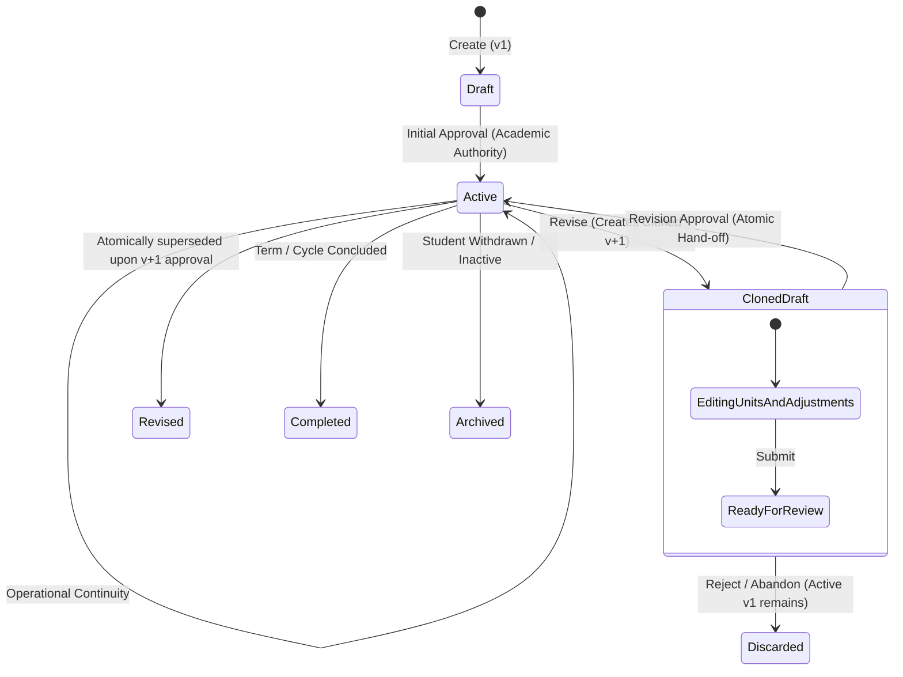
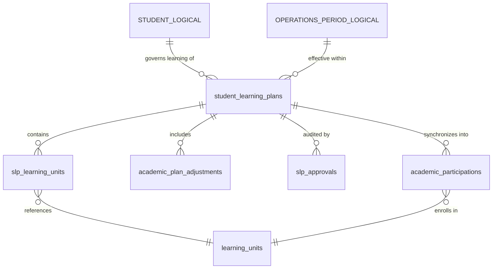

# 1. Overview

This target architecture defines the technical realization for the full scope of Stage 2 "Student Learning Plan" under the Academic domain in Elsasa School Information System (SIS) V3:

1. **SLP Formulation & Revision Lifecycle (`ACD-WF-02`, `UC-ACD-09`, `SCR-ACD-04`):**
   - Formulating, maintaining, and updating individualized Student Learning Plans (SLP) for students requiring individualized academic pathways or exceptional learning adaptations (`academics.student_learning_plans`).
   - Enforcing the foundational domain constraint: default academic operation proceeds without an SLP; when created, a student may have at most one `active` SLP per academic period.
   - Implementing the standard SLP lifecycle status model: `draft`, `active`, `revised`, `completed`, and `archived`.
   - Managing linear plan versioning (`version`), incrementing the plan version (`v+1`) upon each revision while preserving prior versions for historical and legal auditability.
   - Enabling Academic Coordinators to create draft plans, update plan notes and scope, and submit plans for Academic Authority review.

2. **Constituent Learning Units Mapping (`ACD-WF-02`, `UC-ACD-09`, `SCR-ACD-04`):**
   - Linking a Student Learning Plan to its constituent Learning Units (`academics.slp_learning_units`).
   - Capturing required sequence ordering (`sequence_order`), mandatory vs elective requirements (`is_required`), and level/adaptation explanatory notes (e.g. remediation at Grade 3 level while placed in Grade 4).

3. **Academic Plan Adjustments (`ACD-WF-02`, `UC-ACD-09`, `SCR-ACD-04`):**
   - Recording formal academic accommodations, course substitutions, and exemptions applied to a Student Learning Plan (`academics.academic_plan_adjustments`).
   - Supporting all three standard adjustment categories under a unified model:
     - `accommodation` (e.g., extended time for written assessments, assistive media, alternative format).
     - `substitution` (e.g., replacing standard physical education with adaptive physical education).
     - `exemption` (e.g., waiving a non-core elective requirement based on verified documentation).
   - Capturing adjustment metadata: adjustment type, description, justification rationale, effective date (`effective_date`), optional conclusion date (`end_date`), and approving authority reference.

4. **SLP Authority Approval & Governance Audit Trail (`ACD-WF-02`, `UC-ACD-09`, `SCR-ACD-04`):**
   - Recording formal Academic Authority approval and re-approval decisions (`academics.slp_approvals`).
   - Supporting approval types: `initial_approval` (activating an initial draft plan) and `revision_approval` (activating an amended plan version).
   - Enforcing governance rules: every new plan version requires explicit Academic Authority approval before transitioning to `active`; approving a revision automatically transitions the previous active version to `revised`.
   - Maintaining an immutable audit chain of approvals including approving authority (`approved_by`), approval timestamp (`approved_date`), plan version (`plan_version`), approval type, and governance notes.

5. **Downstream Consumer Alignment & Participation Synchronization (`SCR-ACD-05`, `SCR-ACD-07`):**
   - Providing an explicit "Sync Participations from Plan" action in `SCR-ACD-04` to register or reconcile `academics.academic_participations` with `source = 'learning_plan'` and `student_learning_plan_id`.
   - Surfacing governing learning plan context and active adjustments as informative badges in `Participation & Roster Workbench` (`SCR-ACD-05`) and `Academic Records Workbench` (`SCR-ACD-07`).

6. **Cross-Domain Contracts & Domain Events (`Elsasa.Sis.Contracts`):**
   - Exposing synchronous contract inquiry `GetActiveStudentLearningPlanAsync` on `IAcademicsModule`.
   - Publishing MediatR post-commit in-memory domain events (`StudentLearningPlanCreatedEvent`, `StudentLearningPlanApprovedEvent`, `StudentLearningPlanRevisedEvent`, `StudentLearningPlanParticipationsSyncedEvent`).

7. **Demo Data Generator & Purger Support:**
   - Extending `AcademicsActivitiesDemoDataSeeder` to seed realistic Hagios student scenarios: an active revised v2 SLP for Budi Santoso (with Grade 3 Remedial Math, Adaptive PJOK substitution, and 50% extra exam time accommodation) and a pending draft v1 SLP for Timotius.
   - Updating `AcademicsDemoDataPurger` to clean the 4 new tables in strict reverse-dependency order.

This architecture fulfills change request intake `CR-ACD-STUDENT-LEARNING-PLAN` ([`IS013 - ACD-STUDENT-LEARNING-PLAN-ISSUE.md`](file:///d:/Project.Private/elsasa-sis-v3/docs/issues/IS013%20-%20ACD-STUDENT-LEARNING-PLAN-ISSUE.md)), realizes the approved analysis decisions in [`IS013 - ACD-STUDENT-LEARNING-PLAN-FEASIBILITY-ASSESSMENT.md`](file:///d:/Project.Private/elsasa-sis-v3/docs/issues/IS013%20-%20ACD-STUDENT-LEARNING-PLAN-FEASIBILITY-ASSESSMENT.md), and satisfies SIS Implementation Roadmap Stage 2 Completion Criterion 12: *"A student learning plan is created, approved, and governs an exceptional student's learning."*

---

# 2. Architectural Basis

## Business Context

This architecture realizes the business knowledge, operational workflows, and domain rules specified in:

- **DOMAIN BLUEPRINT:** [`academic-domain.md`](file:///d:/Project.Private/elsasa-sis-v3/docs/domains/academic-domain.md)
  - Student Learning Plan scope, governance, and concurrency rules (lines 108–141)
  - Unified Academic Plan Adjustments model (accommodations, substitutions, exemptions) (lines 136–137)
  - Separation between academic learning plans and official administrative placement (lines 138–140)
  - Non-grade record correction protocol (`UC-ACD-15`, line 1680)
- **ROADMAP & COMPLETION CRITERIA:** [`sub-modul-and-development-phases.md`](file:///d:/Project.Private/elsasa-sis-v3/docs/sub-modul-and-development-phases.md)
  - Stage 2 Module: Student Learning Plan (Submodule 5)
  - **Criterion 12:** *"A student learning plan is created, approved, and governs an exceptional student's learning."*
- **WORKFLOWS & USE CASES:**
  - [`operational-workflow-discovery.md`](file:///d:/Project.Private/elsasa-sis-v3/docs/operational-workflow-discovery.md):
    - `ACD-WF-02`: Establish Student Learning Plan (Stage 2)
    - `ACD-WF-03`: Start Academic Participation (Stage 2)
  - [`use-cases.md`](file:///d:/Project.Private/elsasa-sis-v3/docs/use-cases.md):
    - `UC-ACD-09`: Establish Student Learning Plan
    - `UC-ACD-10`: Register Academic Participation
- **ACTORS:** [`actors.md`](file:///d:/Project.Private/elsasa-sis-v3/docs/actors.md)
  - Academic Coordinator (`ACT-07`): Primary actor for plan formulation, revision drafting, unit configuration, and participation synchronization.
  - Academic Authority (`ACT-08`): Sole authority for initial plan approval, revision re-approval, and adjustment authorization (*Curriculum Lead, Academic Head, VP Academics*).
  - Teacher (`ACT-09`): Consumes active adjustments (e.g. accommodations) during classroom conduct and assessment administration.
  - Student Development Officer (`ACT-10`): Informs academic plan formulation via pastoral/developmental observations without exercising approval authority.
- **DATA SPECIFICATIONS:**
  - [`academic-entities.md`](file:///d:/Project.Private/elsasa-sis-v3/docs/entities/academic-entities.md): Submodule 5 Core Entities and Supporting Entities.
  - [`academic-entities-tables.md`](file:///d:/Project.Private/elsasa-sis-v3/docs/entities/academic-entities-tables.md): Submodule 5 tables (`academics.student_learning_plans`, `academics.slp_learning_units`, `academics.academic_plan_adjustments`, `academics.slp_approvals`, lines 960–1090).
- **SCREEN INVENTORY:** [`screen-inventory.md`](file:///d:/Project.Private/elsasa-sis-v3/docs/screen-inventory.md)
  - `SCR-ACD-04`: Learning Plan Workspace (Planning pattern, Academic Coordinator)
  - `SCR-ACD-05`: Participation & Roster Workbench (Work Queue pattern, Academic Coordinator)
  - `SCR-ACD-07`: Academic Records Workbench (Work Queue pattern, Academic Coordinator / Academic Authority)
- **ARCHITECTURE DECISION RECORDS:** [`adr.md`](file:///d:/Project.Private/elsasa-sis-v3/docs/architecture/adr.md)
  - ADR-001 (Monolith Assembly Structure & Domain Isolation)
  - ADR-002 (Single SQL Database with Schema Partitioning)
  - ADR-004 (Vertical Slice Architecture)
  - ADR-005 (Explicit T-SQL over Micro-ORMs)
  - ADR-006 (DbUp for Database Migrations)
  - ADR-010 (Hybrid Cross-Domain Communication Model)

## Analysis Input

This architecture directly consumes the approved gap closures, risk mitigations, and technical decisions recorded in:

- **FEASIBILITY ASSESSMENT:** [`IS013 - ACD-STUDENT-LEARNING-PLAN-FEASIBILITY-ASSESSMENT.md`](file:///d:/Project.Private/elsasa-sis-v3/docs/issues/IS013%20-%20ACD-STUDENT-LEARNING-PLAN-FEASIBILITY-ASSESSMENT.md)
  - `GAP-001`: Submodule 5 database schema provisioning via DbUp migration script `20261107_0402_Academics_StudentLearningPlan_Tables.sql`.
  - `GAP-002`: Backend vertical slice implementation under `src/backend/Elsasa.Sis.Academics/Features/StudentLearningPlans/`.
  - `GAP-003 / OQ-001`: SLP lifecycle and revision workflow adopting **Clone-on-Revise with Atomic Status Hand-off** backed by SQL Server partial unique index `UQ_academics_slp_active`.
  - `GAP-004 / OQ-002`: Academic plan adjustment governance adopting **Plan-Coupled Unified Governance**.
  - `GAP-005 / OQ-003`: Downstream participation synchronization adopting **Explicit Roster Sync Action + Contextual Badge**.
  - `GAP-006 / OQ-004`: Frontend workbench architecture adopting **Dedicated Master-Detail Workspace (`SCR-ACD-04` at `/academics/learning-plans`)**.
  - `GAP-007 / OQ-006`: Cross-domain synchronous inquiry method on `IAcademicsModule` and asynchronous MediatR domain events.
  - `GAP-008 / OQ-005`: Dual-persona demo scenario in `AcademicsActivitiesDemoDataSeeder` (Budi Santoso v2 active revised, Timotius v1 draft) and reverse-dependency purger update.
  - `GAP-009`: Contextual adjustment visibility in `SCR-ACD-05` and `SCR-ACD-07`.
  - Planning Readiness: Granted `READY-FOR-PLANNING`.

```text
DOMAIN (academic-domain.md) + FEATURE (use-cases.md, screen-inventory.md)
                            +
       FEASIBILITY-ASSESSMENT (CR-ACD-STUDENT-LEARNING-PLAN)
                            ↓
      TARGET ARCHITECTURE (ACD-STUDENT-LEARNING-PLAN)
```

---

# 3. Scope

## Included

1. **Database Schema & Migrations (`Elsasa.Sis.Database`):**
   - Migration script `20261107_0402_Academics_StudentLearningPlan_Tables.sql` targeting Microsoft SQL Server 2022 ([`ADR-002`](file:///d:/Project.Private/elsasa-sis-v3/docs/architecture/adr.md#L50-L75), [`ADR-006`](file:///d:/Project.Private/elsasa-sis-v3/docs/architecture/adr.md#L152-L176)).
   - Creation of 4 authoritative relational tables in schema `academics`:
     - `academics.student_learning_plans`: Core plan record, tracking student, academic period, status (`draft`, `active`, `revised`, `completed`, `archived`), version, and notes.
     - `academics.slp_learning_units`: Supporting table linking constituent learning units to a plan, with sequence ordering, required flag, and level/adaptation notes.
     - `academics.academic_plan_adjustments`: Core table recording accommodations, substitutions, and exemptions, with description, rationale, effective dates, and approving authority.
     - `academics.slp_approvals`: Supporting audit table recording immutable initial approval and revision approval decisions.
   - Creation of SQL Server partial unique index `UQ_academics_slp_active` on `(student_id, academic_period_id) WHERE status = 'active'` guaranteeing at most one active plan per student per period.
   - Addition of intra-schema foreign key `FK_academics_academic_participations_slp` from `academics.academic_participations.student_learning_plan_id` to `academics.student_learning_plans(id)`.
   - Preservation of zero physical foreign keys across domain schemas ([`ADR-001`](file:///d:/Project.Private/elsasa-sis-v3/docs/architecture/adr.md#L24-L48), [`ADR-002`](file:///d:/Project.Private/elsasa-sis-v3/docs/architecture/adr.md#L50-L75)).

2. **Backend Domain Architecture & Vertical Slices (`Elsasa.Sis.Academics`):**
   - Feature directory `src/backend/Elsasa.Sis.Academics/Features/StudentLearningPlans/`:
     - `CreateStudentLearningPlan` (`POST /api/v1/academics/learning-plans`): Formulates initial draft plan (v1) for an enrolled student and academic period (`UC-ACD-09`).
     - `UpdateStudentLearningPlan` (`PUT /api/v1/academics/learning-plans/{id}`): Modifies plan-level metadata and notes while in `draft` status.
     - `GetStudentLearningPlanById` (`GET /api/v1/academics/learning-plans/{id}`): Queries a specific plan version with its constituent units, adjustments, and approval history.
     - `GetStudentLearningPlans` (`GET /api/v1/academics/learning-plans`): Queries paginated/filterable learning plan roster (by period, status, student search).
     - `GetActiveStudentLearningPlan` (`GET /api/v1/academics/students/{studentId}/learning-plans/active`): Quick inquiry for a student's active plan in an academic period.
     - `AddSlpLearningUnit` (`POST /api/v1/academics/learning-plans/{id}/units`): Links a learning unit with sequence order, required flag, and adaptation notes to a draft plan.
     - `RemoveSlpLearningUnit` (`DELETE /api/v1/academics/learning-plans/{id}/units/{unitId}`): Removes a constituent learning unit from a draft plan.
     - `AddAcademicPlanAdjustment` (`POST /api/v1/academics/learning-plans/{id}/adjustments`): Adds an accommodation, substitution, or exemption to a draft plan.
     - `RemoveAcademicPlanAdjustment` (`DELETE /api/v1/academics/learning-plans/{id}/adjustments/{adjustmentId}`): Removes an adjustment from a draft plan.
     - `SubmitStudentLearningPlan` (`POST /api/v1/academics/learning-plans/{id}/submit`): Submits a draft plan for Academic Authority review.
     - `ApproveStudentLearningPlan` (`POST /api/v1/academics/learning-plans/{id}/approve`): Academic Authority formal approval (`initial_approval` or `revision_approval`), atomically transitioning status, archiving previous active plan if revision, stamping adjustment approvals, and recording immutable audit entry in `slp_approvals` (`UC-ACD-09`).
     - `ReviseStudentLearningPlan` (`POST /api/v1/academics/learning-plans/{id}/revise`): Clones an active plan, its constituent units, and its adjustments into a new draft plan with `version = version + 1`, leaving the active plan operative.
     - `ArchiveStudentLearningPlan` (`POST /api/v1/academics/learning-plans/{id}/archive`): Retires an active or revised plan to `archived` or marks a completed plan as `completed`.
     - `SyncSlpParticipations` (`POST /api/v1/academics/learning-plans/{id}/sync-participations`): Synchronizes approved SLP constituent units into `academics.academic_participations` with `source = 'learning_plan'` (`UC-ACD-10`).
   - Feature registration in `DependencyInjection.cs` via assembly scanning.

3. **Cross-Domain Contracts & Domain Events (`Elsasa.Sis.Contracts`):**
   - Synchronous query method on `IAcademicsModule`:
     - `Task<Result<ActiveStudentLearningPlanDto?>> GetActiveStudentLearningPlanAsync(Guid studentId, Guid academicPeriodId, CancellationToken ct = default);`
   - Contract DTOs in `Elsasa.Sis.Contracts/Academics/`:
     - `ActiveStudentLearningPlanDto.cs`
     - `StudentLearningPlanDto.cs`
     - `SlpLearningUnitDto.cs`
     - `AcademicPlanAdjustmentDto.cs`
     - `SlpApprovalDto.cs`
   - In-memory domain events in `Elsasa.Sis.Contracts/Academics/Events/`:
     - `StudentLearningPlanCreatedEvent.cs`
     - `StudentLearningPlanApprovedEvent.cs`
     - `StudentLearningPlanRevisedEvent.cs`
     - `StudentLearningPlanParticipationsSyncedEvent.cs`

4. **Frontend Workbenches & Client Integration (`src/frontend`):**
   - Dedicated planning workbench `SCR-ACD-04` (`src/frontend/src/features/academics/learning-plans/`):
     - `LearningPlanWorkspaceView.vue`: Master-Detail layout with left filter sidebar (Academic Period, Status filter, Student search) and main planning workspace.
     - `SlpHeaderBanner.vue`: Displays selected student name, NIS, administrative placement context, plan version, status badge, and role-based action buttons (`Submit for Approval`, `Approve`, `Revise Plan`, `Sync Participations`, `Archive`).
     - `SlpLearningUnitsTab.vue`: Data table of constituent units with sequence order, required badge, adaptation notes, and Add Unit modal (`AddSlpUnitModal.vue`).
     - `SlpAdjustmentsTab.vue`: Data table of accommodations, substitutions, and exemptions with category badges, description, rationale, dates, and Add Adjustment modal (`AddAdjustmentModal.vue`).
     - `SlpApprovalHistoryTab.vue`: Chronological audit trail showing plan versions, approval types, approving authority, approval date, and governance notes.
     - `learningPlansApi.ts`: TanStack Query composables and typed Axios API methods.
   - Route registration: `/academics/learning-plans` mapped to `LearningPlanWorkspaceView.vue` in `src/frontend/src/app/router/routes.ts`.
   - UI Badges & Contextual Linkage:
     - In `SCR-ACD-05` (`Participation & Roster Workbench`): Display "Active Learning Plan" badge on students with an active SLP; pre-link `source = 'learning_plan'` and plan ID during manual additions.
     - In `SCR-ACD-07` (`Academic Records Workbench`): Surface active adjustments as contextual badges and tooltips during evaluation and result review.

5. **Demo Data Seeding & Purging Support:**
   - Extend `AcademicsActivitiesDemoDataSeeder.cs` to seed:
     - Active revised v2 SLP for Budi Santoso (Grade 3 Remedial Math, Adaptive PJOK substitution, 50% extra exam time accommodation, full approval history, and linked `academic_participations`).
     - Pending draft v1 SLP for Timotius (proposed accommodations awaiting Academic Authority review).
   - Update `AcademicsDemoDataPurger.cs` to clean `academics.*` tables in strict reverse-dependency order:
     - `academic_participations` → `slp_approvals` → `academic_plan_adjustments` → `slp_learning_units` → `student_learning_plans` → remaining tables.

## Excluded

1. **Administrative Enrollment and Placement:** An SLP does not modify the student's official administrative placement (campus, grade level, homeroom cohort) or administrative enrollment status (`SCR-STU-01`, `SCR-STU-02`, `SCR-STU-03`), which remain strictly owned by the Students domain (`Placement & Status`).
2. **Foundational Curriculum & Learning Units:** Definition, syllabus configuration, and requirement versioning for standard learning units belong to `Learning Structure & Requirements` (`IS008`).
3. **Instructional Delivery & Daily Attendance:** Conducting classes, tracking session attendance, and logging daily coursework belong to `Participation & Learning Activities` (`IS009`).
4. **Assessment Scoring & Report Cards:** Evaluating assessments, scoring rubrics, grade approval, and report cards belong to `Assessment & Results` (`IS010`).
5. **Academic Standing & Progression:** Determining academic standing, completion tracking, and promotion recommendations belong to `Standing & Progression` (`IS012`).
6. **Non-Academic Interventions & Pastoral Support:** Pastoral care, wellbeing referrals, counselling cases, and behavioural discipline belong strictly to the Development domain (`SCR-DEV-03`, `SCR-DEV-02`). Development recommendations may inform an SLP referral but do not approve or govern academic plans.
7. **Financial Adjustments & Scholarships:** Fee waivers, tuition discounts, and scholarship stacking belong exclusively to the Finance domain (`Benefits`, `Obligations & Billing`).
8. **Phase-2 Advanced Planning Constructs:** Goals, milestones, competencies, intervention plans, and rubrics are explicitly prohibited in Phase 2 per `academic-domain.md` line 130.

---

# 4. Technical Decisions

## TD-01: Authoritative Submodule 5 Relational Schema & Partitioning

### Context
Stage 2 Student Learning Plan introduces 4 new entities: `student_learning_plans`, `slp_learning_units`, `academic_plan_adjustments`, and `slp_approvals`. In addition, `academic_participations` already contains `student_learning_plan_id` which must be linked. The database must adhere strictly to ADR-001 (compile-time isolation), ADR-002 (single database with schema partitioning), and ADR-006 (DbUp migrations).

### Decision
1. Provision 4 new authoritative relational tables in schema `academics` via DbUp migration script `20261107_0402_Academics_StudentLearningPlan_Tables.sql`:
   - `academics.student_learning_plans`
   - `academics.slp_learning_units`
   - `academics.academic_plan_adjustments`
   - `academics.slp_approvals`
2. Enforce zero physical foreign keys across domain schemas: external identifiers (`student_id`, `academic_period_id`) are stored as `UNIQUEIDENTIFIER NOT NULL` without physical SQL foreign key constraints to `students.*` or `operations.*`.
3. Enforce intra-schema physical foreign keys where relationships belong strictly within `academics`:
   - `slp_learning_units.student_learning_plan_id` → `student_learning_plans(id)` ON DELETE CASCADE
   - `slp_learning_units.learning_unit_id` → `learning_units(id)` ON DELETE NO ACTION
   - `academic_plan_adjustments.student_learning_plan_id` → `student_learning_plans(id)` ON DELETE CASCADE
   - `slp_approvals.student_learning_plan_id` → `student_learning_plans(id)` ON DELETE CASCADE
4. Add intra-schema foreign key on existing table `academics.academic_participations`:
   - `FK_academics_academic_participations_slp`: `academic_participations.student_learning_plan_id` → `student_learning_plans(id)` ON DELETE SET NULL.
5. Enforce domain data integrity via database check constraints (`CK_...`) for all discrete enumerated states:
   - `student_learning_plans.status IN ('draft', 'active', 'revised', 'completed', 'archived')`
   - `academic_plan_adjustments.adjustment_type IN ('accommodation', 'substitution', 'exemption')`
   - `slp_approvals.approval_type IN ('initial_approval', 'revision_approval')`
6. Enforce the single-active-plan-per-period invariant with a SQL Server partial unique index:
   ```sql
   CREATE UNIQUE NONCLUSTERED INDEX [UQ_academics_slp_active]
   ON [academics].[student_learning_plans] ([student_id], [academic_period_id])
   WHERE [status] = 'active';
   ```

### Impact
Guarantees absolute compile-time and runtime independence between domains, maintains strict relational integrity within the Academics domain, and physically prevents conflicting active plans at the storage layer.

---

## TD-02: Clone-on-Revise Lifecycle & Atomic Status Hand-Off Engine

### Context
`academic-domain.md` mandates that:
- A student may have at most one active SLP per Academic Period.
- An existing active plan must remain operative and uninterrupted while an amendment is drafted.
- Historical versions must be preserved for audit and regulatory compliance.
- Every revision requires formal re-approval by the Academic Authority before becoming active.

### Decision
Implement the **Clone-on-Revise with Atomic Status Hand-off** lifecycle pattern:
1. **Initial Formulation:** A plan begins as `draft` with `version = 1`. Academic Coordinators can freely edit notes, add/remove constituent learning units, and configure adjustments.
2. **Initial Approval:** When the Academic Authority executes `ApproveStudentLearningPlanCommand` on a draft plan:
   - Validates that no active plan currently exists for this student and period.
   - Transitions `status` from `'draft'` to `'active'`.
   - Records an `'initial_approval'` record in `academics.slp_approvals`.
   - Stamped `approved_by` and `approved_date` across all linked adjustments.
   - Publishes `StudentLearningPlanApprovedEvent`.
3. **Plan Revision (Cloning):** When an active plan needs modification, the Academic Coordinator executes `ReviseStudentLearningPlanCommand`:
   - Clones the active plan record into a new row with `status = 'draft'` and `version = current_version + 1`.
   - Clones all constituent learning units from `academics.slp_learning_units` into new rows linked to the new draft plan ID.
   - Clones all adjustments from `academics.academic_plan_adjustments` into new rows linked to the new draft plan ID.
   - The original active plan remains strictly `'active'` and operative in production; active class participations continue undisturbed.
4. **Revision Approval (Atomic Hand-Off):** When the Academic Authority reviews and approves the revision draft:
   - In a single database transaction (`SqlTransaction`):
     1. Transitions the prior active plan record from `'active'` to `'revised'`.
     2. Transitions the draft plan record from `'draft'` to `'active'`.
     3. Inserts an approval audit record into `academics.slp_approvals` with `approval_type = 'revision_approval'`.
     4. Updates `approved_by = @authority` and `approved_date = @today` across all adjustments linked to the new active plan.
   - Commits the transaction. The partial unique index `UQ_academics_slp_active` guarantees that zero window exists with multiple active plans.
   - Publishes `StudentLearningPlanRevisedEvent`.
5. **Rejection or Abandonment:** If the Academic Authority rejects the revision or the coordinator abandons it, only the cloned draft plan is discarded or set to `'archived'`. The running active plan is never disturbed.



### Impact
Zero operational downtime, deterministic audit history, linear versioning, and mathematically impossible concurrency conflicts.

---

## TD-03: Plan-Coupled Unified Adjustment Governance Model

### Context
`academic-domain.md` establishes that accommodations, substitutions, and exemptions are treated as a single unified category — **Academic Plan Adjustment**. All adjustments require explicit Academic Authority approval, must preserve rationale, approving authority, and effective dates, and do not modify administrative enrollment or student status. We must prevent fragmented approval sub-queues while preserving strict authority governance and immutable audit trails.

### Decision
1. Persist all adjustments in a single table `academics.academic_plan_adjustments` linked to `student_learning_plan_id`.
2. Categorize adjustments via `adjustment_type`:
   - `'accommodation'`: Learning adaptations (e.g., 50% extra exam time, enlarged print, assistive technology).
   - `'substitution'`: Replacing a standard unit with an alternative unit (e.g., adaptive physical education instead of regular PJOK).
   - `'exemption'`: Waiving a standard requirement based on documented medical or external educational grounds.
3. **Plan-Coupled Approval:** Adjustments are formulated directly inside the SLP drafting or revision workspace. When the Academic Authority approves the SLP (`initial_approval` or `revision_approval`), the backend handler stamps `approved_by` and `approved_date` across all adjustments linked to the plan in the same transaction.
4. **Immutability of Active Adjustments:** Adjustments on an `active` plan cannot be modified or deleted in-place. If adjustments must be altered, added, or removed, the coordinator must initiate a plan revision (creating draft v+1), ensuring that any change is formally re-evaluated and re-approved by the Academic Authority.

### Impact
Eliminates separate micro-approval workflows, eliminates orphan adjustments, and provides 100% audit compliance with school governance policies.

---

## TD-04: Explicit Roster Sync Action & Downstream Participation Linkage

### Context
`academic_participations` connects students to specific learning units. When an SLP is approved, its constituent units must be registered into student participations (`source = 'learning_plan'`, `student_learning_plan_id`). We must balance coordinator control against automation, avoiding opaque side-effects while preventing roster omission errors.

### Decision
1. **Explicit Roster Sync Action:**
   - In `SCR-ACD-04` (Learning Plan Workspace), provide an explicit "Sync Participations from Plan" action button.
   - When executed, `SyncSlpParticipationsHandler` runs an idempotent merge against `academics.academic_participations`:
     ```sql
     -- Idempotent registration of SLP units into academic_participations
     INSERT INTO academics.academic_participations (
         id, student_id, learning_unit_id, academic_period_id,
         participation_type, source, status, start_date,
         student_learning_plan_id, created_at, created_by
     )
     SELECT 
         NEWID(), slp.student_id, slu.learning_unit_id, slp.academic_period_id,
         'standard', 'learning_plan', 'in_progress', @today,
         slp.id, SYSUTCDATETIME(), @currentUser
     FROM academics.slp_learning_units slu
     INNER JOIN academics.student_learning_plans slp ON slp.id = slu.student_learning_plan_id
     WHERE slp.id = @slpId
       AND slp.status = 'active'
       AND slu.is_required = 1
       AND NOT EXISTS (
           SELECT 1 
           FROM academics.academic_participations ap
           WHERE ap.student_id = slp.student_id
             AND ap.learning_unit_id = slu.learning_unit_id
             AND ap.academic_period_id = slp.academic_period_id
       );
     ```
   - For any existing participation for the same unit/student/period that was created without the SLP link, update `student_learning_plan_id = @slpId` and `source = 'learning_plan'`.
   - Returns a structured result: `{ syncedCount, updatedCount, totalUnits }`.
   - Publishes `StudentLearningPlanParticipationsSyncedEvent`.
2. **Contextual Badge in Participation & Roster Workbench (`SCR-ACD-05`):**
   - In `SCR-ACD-05`, students with an active SLP display an "Active Learning Plan" badge.
   - When an Academic Coordinator manually registers a student who has an active SLP into a unit, the UI automatically defaults `source = 'learning_plan'` and pre-links the active plan ID.

### Impact
Empowers coordinators with total transparency and deliberate operational control, while preventing duplicate enrollments or broken roster links.

---

## TD-05: Dedicated Master-Detail Planning Workbench (`SCR-ACD-04`)

### Context
`docs/screen-inventory.md` designates `SCR-ACD-04` as `Learning Plan Workspace` following the **Planning** pattern, owned by the Academic Coordinator, with Academic Authority approval actions. We must deliver an ergonomic, intuitive user experience adhering to frontend architecture conventions (Vue 3, Tailwind CSS 4, PrimeVue 4, TanStack Query).

### Decision
1. Implement `SCR-ACD-04` at route `/academics/learning-plans` in directory `src/frontend/src/features/academics/learning-plans/`:
   - `LearningPlanWorkspaceView.vue`: Top-level page container with Master-Detail layout.
2. **Master Sidebar (Left Pane, ~320px):**
   - Academic Period selector dropdown.
   - Status Filter: `All`, `Active`, `Draft`, `Revised / Archived`.
   - Search input: Filter by student name or NIS.
   - List of student cards displaying student avatar, name, NIS, grade level, and active/draft plan badge.
   - "+ Formulate New Plan" button (triggers `CreatePlanModal.vue`).
3. **Detail Workspace (Right Pane):**
   - **Header Banner (`SlpHeaderBanner.vue`):** Selected student profile summary, current administrative placement (grade level, campus, homeroom), effective academic period, plan version (`v1`, `v2`), lifecycle status badge, and role-based action buttons:
     - `Submit for Review` (Academic Coordinator; visible when `draft`)
     - `Approve Plan` / `Reject Plan` (Academic Authority; visible when `draft` / submitted)
     - `Revise Plan (v+1)` (Academic Coordinator; visible when `active`)
     - `Sync Participations` (Academic Coordinator; visible when `active`)
     - `Archive Plan` (Academic Authority; visible when `active` or `revised`)
   - **Three Cohesive Tabs:**
     - **Tab 1: Constituent Learning Units (`SlpLearningUnitsTab.vue`):** Data table showing sequence order, unit code, unit title, required/optional badge, adaptation/level notes, and inline actions. Includes "+ Add Learning Unit" button opening `AddSlpUnitModal.vue`.
     - **Tab 2: Academic Plan Adjustments (`SlpAdjustmentsTab.vue`):** Data table showing adjustment type badge (`Accommodation`, `Substitution`, `Exemption`), description, justification rationale, effective date, conclusion date, and approving authority. Includes "+ Add Adjustment" button opening `AddAdjustmentModal.vue`.
     - **Tab 3: Approval History & Versions (`SlpApprovalHistoryTab.vue`):** Visual timeline showing the chronological sequence of plan versions and approvals (`initial_approval`, `revision_approval`), approving authority, date, and governance notes.

```
+---------------------------------------------------------------------------------------------------+
|  Learning Plan Workspace (SCR-ACD-04)                                                             |
+------------------------------+--------------------------------------------------------------------+
|  FILTERS                     |  STUDENT LEARNING PLAN HEADER                                      |
|  Period: [ Sem 1 2029/2030 ] |  Budi Santoso (NIS: 0071234567) | Grade 4 Reguler | Campus Utama   |
|  Status: [ All Active     ]  |  Plan Version: v2 | Status: [ ACTIVE ]                             |
|  Search: [ Budi            ] |  Actions: [ Revise Plan (v3) ] [ Sync Participations ] [ Archive ] |
+------------------------------+--------------------------------------------------------------------+
|  STUDENT LIST                |  [ Constituent Units (3) ]  [ Adjustments (2) ]  [ History & Audit ]|
|                              |  ----------------------------------------------------------------- |
|  * Budi Santoso      [v2 Act]|  Seq | Code      | Unit Title         | Type     | Adaptation Notes|
|    Grade 4 | 2 Adjustments   |  ----+-----------+--------------------+----------+-----------------|
|                              |   1  | MAT-03-S1 | Remedial Math G3   | Required | Grade 3 level   |
|  * Timotius          [v1 Drf]|   2  | IND-04-S1 | Bahasa Indonesia 4 | Required | Regular pacing  |
|    Grade 4 | Pending Review  |   3  | AD-PJK-04 | Adaptive PJOK      | Required | Medical adapt.  |
|                              |  ----------------------------------------------------------------- |
|  [ + Formulate New Plan ]    |  [ + Add Learning Unit ]                                            |
+------------------------------+--------------------------------------------------------------------+
```

### Impact
Delivers a dedicated, unified operational workspace matching existing UI ergonomics (`CurriculumWorkspaceView.vue`, `CohortAcademicReviewView.vue`) without UI fragmentation.

---

## TD-06: Cross-Domain Contract Inquiries & Domain Events

### Context
Downstream consumers across SIS modules require authoritative SLP information:
- `Participation & Roster Workbench` (`SCR-ACD-05`) needs to know if an active SLP governs a student's unit registrations.
- `Academic Records Workbench` (`SCR-ACD-07`) needs to display accommodations (e.g. 50% extra exam time) so evaluators apply correct criteria.
- External modules (e.g., `Students`) must be able to verify active SLP status via compile-time isolated contracts without cross-project database dependencies (ADR-001, ADR-003, ADR-010).

### Decision
1. **Synchronous Contract Inquiry on `IAcademicsModule`:**
   ```csharp
   Task<Result<ActiveStudentLearningPlanDto?>> GetActiveStudentLearningPlanAsync(
       Guid studentId,
       Guid academicPeriodId,
       CancellationToken ct = default);
   ```
   - Returns `ActiveStudentLearningPlanDto`:
     - `PlanId`, `Version`, `Status`, `Notes`
     - `ConstituentUnits`: Read-only list of `{ LearningUnitId, UnitCode, Title, SequenceOrder, IsRequired, Notes }`
     - `Adjustments`: Read-only list of `{ Id, AdjustmentType, Description, Rationale, EffectiveDate, EndDate, ApprovedBy, ApprovedDate }`
   - Returns `null` when the student has no active SLP for the period.
2. **Post-Commit In-Memory Domain Events:**
   Published via MediatR after transaction commit:
   - `StudentLearningPlanCreatedEvent(Guid PlanId, Guid StudentId, Guid AcademicPeriodId, int Version, string CreatedBy)`
   - `StudentLearningPlanApprovedEvent(Guid PlanId, Guid StudentId, Guid AcademicPeriodId, int Version, string ApprovalType, string ApprovedBy)`
   - `StudentLearningPlanRevisedEvent(Guid PriorPlanId, Guid NewPlanId, Guid StudentId, Guid AcademicPeriodId, int NewVersion, string RevisedBy)`
   - `StudentLearningPlanParticipationsSyncedEvent(Guid PlanId, Guid StudentId, int SyncedCount, string SyncedBy)`
3. **Contextual Badges in Academic Records (`SCR-ACD-07`):**
   - Query projections in `GetStudentAcademicRecordHandler` include active adjustments.
   - In `AcademicRecordsWorkbenchView.vue`, an adjustment badge is displayed next to the student header (e.g., `⚡ Accommodation: 50% Extra Exam Time`, `🔄 Substitution: Adaptive PJOK`).

### Impact
Preserves strict compile-time domain isolation while providing seamless cross-domain visibility and event-driven responsiveness.

---

## TD-07: Dual-Persona Demo Data Seeding & Reverse-Dependency Purging Strategy

### Context
Demonstrating and verifying the SLP lifecycle requires realistic demo data showcasing both an **active revised plan (v2)** and a **pending draft plan (v1)**. Furthermore, running `--seed-demo` multiple times must never fail due to foreign key constraint violations during purge.

### Decision
1. **Extend `AcademicsActivitiesDemoDataSeeder.cs`:**
   - **Persona 1: Budi Santoso (`BudiStudentId` / `budiStudentId`):**
     - Formulate v1 SLP for Semester 1 TP 2029/2030 with Remedial Grade 3 Math (`lu-mat-3-s1`) and Bahasa Indonesia (`lu-bi-4-s1`).
     - Record initial approval in `slp_approvals` by Ibu Ratna (VP Academics).
     - Formulate v2 SLP revision adding Adaptive PJOK substitution (`lu-pjok-4-s1` adaptive) and 50% extra exam time accommodation.
     - Record revision approval in `slp_approvals`.
     - Atomically persist v1 as `'revised'` and v2 as `'active'`.
     - Seed linked `academic_participations` with `source = 'learning_plan'` and `student_learning_plan_id = v2.Id`.
   - **Persona 2: Timotius (`TimotiusStudentId` / `timotiusId`):**
     - Formulate v1 SLP for Semester 1 TP 2029/2030 with draft accommodations awaiting Academic Authority review.
     - Persist with `status = 'draft'`.
2. **Update `AcademicsDemoDataPurger.cs`:**
   - Execute deletion in strict reverse-dependency order:
     ```csharp
     // 1. Delete academic_participations first (removes FK reference to student_learning_plans)
     DELETE FROM academics.academic_participations;
     // 2. Delete child tables of student_learning_plans
     DELETE FROM academics.slp_approvals;
     DELETE FROM academics.academic_plan_adjustments;
     DELETE FROM academics.slp_learning_units;
     // 3. Delete student_learning_plans parent table
     DELETE FROM academics.student_learning_plans;
     // 4. Continue with remaining tables in existing reverse-dependency order
     DELETE FROM academics.academic_requirements;
     DELETE FROM academics.learning_units WHERE parent_unit_id IS NOT NULL;
     DELETE FROM academics.learning_units WHERE parent_unit_id IS NULL;
     DELETE FROM academics.learning_structures;
     ```

### Impact
Enables immediate out-of-the-box demonstration of the full SLP lifecycle, revision diffs, authority approval actions, and participation syncing, with 100% reliable automated database purges.

---

# 5. Component Responsibilities

| Component | Responsibility |
|---|---|
| `academics.student_learning_plans` | Relational table storing core SLP records, version, status, notes, and academic period. |
| `academics.slp_learning_units` | Relational table linking constituent learning units, sequence order, required flag, and adaptation notes. |
| `academics.academic_plan_adjustments` | Relational table storing accommodations, substitutions, and exemptions with rationales and validity dates. |
| `academics.slp_approvals` | Immutable audit table recording Academic Authority approvals and re-approvals. |
| `UQ_academics_slp_active` | SQL Server partial unique index enforcing at most one active plan per student per period. |
| `CreateStudentLearningPlanHandler` | Vertical slice handler creating initial draft plan (v1) in `academics.student_learning_plans`. |
| `UpdateStudentLearningPlanHandler` | Vertical slice handler updating plan-level metadata on draft plans. |
| `GetStudentLearningPlanByIdHandler` | Vertical slice handler returning complete plan details (units, adjustments, approvals). |
| `GetStudentLearningPlansHandler` | Vertical slice handler returning paginated/filterable list of learning plans. |
| `GetActiveStudentLearningPlanHandler` | Vertical slice handler returning active plan for a student in an academic period. |
| `AddSlpLearningUnitHandler` | Vertical slice handler linking a constituent learning unit to a draft plan. |
| `RemoveSlpLearningUnitHandler` | Vertical slice handler removing a constituent unit from a draft plan. |
| `AddAcademicPlanAdjustmentHandler` | Vertical slice handler adding an accommodation, substitution, or exemption to a draft plan. |
| `RemoveAcademicPlanAdjustmentHandler` | Vertical slice handler removing an adjustment from a draft plan. |
| `SubmitStudentLearningPlanHandler` | Vertical slice handler validating plan completeness and queuing it for Academic Authority review. |
| `ApproveStudentLearningPlanHandler` | Vertical slice handler executing atomic approval: transitions status, archives prior version if revision, stamps adjustments, and inserts `slp_approvals`. |
| `ReviseStudentLearningPlanHandler` | Vertical slice handler cloning an active plan, its units, and adjustments into a new draft v+1. |
| `ArchiveStudentLearningPlanHandler` | Vertical slice handler transitioning a plan to `archived` or `completed`. |
| `SyncSlpParticipationsHandler` | Vertical slice handler performing batch idempotent merge into `academics.academic_participations`. |
| `IAcademicsModule` | Synchronous cross-domain inquiry interface exposing `GetActiveStudentLearningPlanAsync`. |
| `AcademicsModuleImpl` | Implementation of `IAcademicsModule` executing targeted Dapper SQL queries. |
| `LearningPlanWorkspaceView.vue` (`SCR-ACD-04`) | Master-Detail Vue 3 page component hosting student list and plan detail workspace. |
| `SlpHeaderBanner.vue` | Header component presenting student placement, plan version, status, and role actions. |
| `SlpLearningUnitsTab.vue` | Tab component displaying constituent units and managing sequence/requirements. |
| `SlpAdjustmentsTab.vue` | Tab component displaying and configuring accommodations, substitutions, and exemptions. |
| `SlpApprovalHistoryTab.vue` | Tab component rendering chronological approval audit timeline and prior versions. |
| `learningPlansApi.ts` | Frontend API client and TanStack Query composables for SLP queries and mutations. |
| `AcademicsActivitiesDemoDataSeeder.cs` | Seeds realistic SLPs and linked participations for Budi Santoso (v2 active) and Timotius (v1 draft). |
| `AcademicsDemoDataPurger.cs` | Cleans Submodule 5 tables in strict reverse-dependency order. |

---

# 6. Integration Design

| Source | Target | Purpose | Protocol / Collaboration |
|---|---|---|---|
| `LearningPlanWorkspaceView.vue` (`SCR-ACD-04`) | Backend Minimal API endpoints (`/api/v1/academics/learning-plans/*`) | Formulate, revise, configure units/adjustments, submit, approve, and sync SLP | HTTPS REST via Axios (`src/frontend/src/features/academics/learning-plans/api/learningPlansApi.ts`) |
| Backend Minimal API Endpoints | Feature Handlers (`Elsasa.Sis.Academics.Features.StudentLearningPlans.*`) | Dispatch validated HTTP requests to vertical slice handlers | Direct C# method invocation with `Result<T>` pattern |
| Feature Handlers | Microsoft SQL Server (`academics.*`) | Persist and query plans, units, adjustments, approvals, and participations | Parameterized T-SQL via Dapper `CommandDefinition` |
| `ApproveStudentLearningPlanHandler` | MediatR `IPublisher` | Publish post-commit notification of plan approval | In-memory asynchronous `StudentLearningPlanApprovedEvent` |
| `ReviseStudentLearningPlanHandler` | MediatR `IPublisher` | Publish post-commit notification of plan revision | In-memory asynchronous `StudentLearningPlanRevisedEvent` |
| `SyncSlpParticipationsHandler` | `academics.academic_participations` | Idempotent insertion and reconciliation of student participations | Single-transaction batch T-SQL merge/insert |
| `Participation & Roster Workbench` (`SCR-ACD-05`) | `academics.academic_participations` & `student_learning_plans` | Display active SLP badge and pre-fill `source = 'learning_plan'` | Frontend REST query to `/api/v1/academics/students/{id}/learning-plans/active` |
| `Academic Records Workbench` (`SCR-ACD-07`) | `academics.academic_plan_adjustments` | Display active accommodations/substitutions badges on grading roster | Query projection inclusion in records endpoint |
| External Modules (`Students`, `Operations`) | `IAcademicsModule` | Synchronous inquiry for student's active learning plan | In-process DI interface call (`GetActiveStudentLearningPlanAsync`) |
| `AcademicsDemoDataPurger` | Microsoft SQL Server (`academics.*`) | Clean all SLP tables without foreign key constraint violations | Sequential T-SQL script in reverse-dependency order |

---

# 7. Data Ownership

| Data Asset | Authoritative Owner | Non-Authoritative Consumers | Boundary Rules |
|---|---|---|---|
| `academics.student_learning_plans` | Academics | Students, Teaching, Operations | Owned exclusively by Academics. Academic Coordinators draft; Academic Authorities approve. |
| `academics.slp_learning_units` | Academics | Teaching (rosters) | Defines constituent units expected for an individualized plan. |
| `academics.academic_plan_adjustments` | Academics | Records Workbench (`SCR-ACD-07`), Teaching | Accommodations, substitutions, exemptions. Immutable once plan is active. |
| `academics.slp_approvals` | Academics | Audit / Administration | Append-only immutable approval audit log. |
| `academics.academic_participations` | Academics | Operations, Teaching, Students | Contains `student_learning_plan_id` and `source = 'learning_plan'`. |
| Student Identity & Placement (`student_id`) | Students (`students.*`) | Academics | Read-only logical UUID. SLP does not alter student administrative placement. |
| Academic Period (`academic_period_id`) | Operations (`operations.*`) | Academics | Read-only logical UUID. SLP is effective within a declared academic period. |

---

# 8. Database Design

## New Tables

### 1. `academics.student_learning_plans`
Stores the master record for an individualized Student Learning Plan.

```sql
CREATE TABLE [academics].[student_learning_plans] (
    [id]                    UNIQUEIDENTIFIER  NOT NULL CONSTRAINT [DF_academics_slp_id] DEFAULT (NEWID()),
    [student_id]            UNIQUEIDENTIFIER  NOT NULL, -- Logical reference to students.students(id)
    [academic_period_id]    UNIQUEIDENTIFIER  NOT NULL, -- Logical reference to operations.operational_periods(id)
    [academic_period_label] NVARCHAR(100)     NOT NULL,
    [status]                NVARCHAR(30)      NOT NULL CONSTRAINT [DF_academics_slp_status] DEFAULT ('draft'),
    [version]               INT               NOT NULL CONSTRAINT [DF_academics_slp_version] DEFAULT (1),
    [notes]                 NVARCHAR(MAX)     NULL,
    [created_at]            DATETIMEOFFSET(7) NOT NULL CONSTRAINT [DF_academics_slp_created_at] DEFAULT (SYSUTCDATETIME()),
    [created_by]            NVARCHAR(256)     NOT NULL,
    [updated_at]            DATETIMEOFFSET(7) NULL,
    [updated_by]            NVARCHAR(256)     NULL,
    CONSTRAINT [PK_academics_student_learning_plans] PRIMARY KEY CLUSTERED ([id]),
    CONSTRAINT [CK_academics_slp_status] CHECK ([status] IN ('draft', 'active', 'revised', 'completed', 'archived')),
    CONSTRAINT [CK_academics_slp_version] CHECK ([version] >= 1)
);

-- Concurrency Invariant: At most ONE active SLP per student per academic period
CREATE UNIQUE NONCLUSTERED INDEX [UQ_academics_slp_active]
ON [academics].[student_learning_plans] ([student_id], [academic_period_id])
WHERE [status] = 'active';

CREATE NONCLUSTERED INDEX [IX_academics_slp_student_period]
ON [academics].[student_learning_plans] ([student_id], [academic_period_id], [status]);
```

### 2. `academics.slp_learning_units`
Links constituent learning units to a Student Learning Plan.

```sql
CREATE TABLE [academics].[slp_learning_units] (
    [id]                      UNIQUEIDENTIFIER  NOT NULL CONSTRAINT [DF_academics_slp_units_id] DEFAULT (NEWID()),
    [student_learning_plan_id] UNIQUEIDENTIFIER NOT NULL,
    [learning_unit_id]        UNIQUEIDENTIFIER  NOT NULL,
    [sequence_order]          INT               NULL,
    [is_required]             BIT               NOT NULL CONSTRAINT [DF_academics_slp_units_required] DEFAULT (1),
    [notes]                   NVARCHAR(MAX)     NULL,
    [created_at]              DATETIMEOFFSET(7) NOT NULL CONSTRAINT [DF_academics_slp_units_created_at] DEFAULT (SYSUTCDATETIME()),
    [created_by]              NVARCHAR(256)     NOT NULL,
    CONSTRAINT [PK_academics_slp_learning_units] PRIMARY KEY CLUSTERED ([id]),
    CONSTRAINT [FK_academics_slp_units_plan] FOREIGN KEY ([student_learning_plan_id])
        REFERENCES [academics].[student_learning_plans] ([id]) ON DELETE CASCADE,
    CONSTRAINT [FK_academics_slp_units_unit] FOREIGN KEY ([learning_unit_id])
        REFERENCES [academics].[learning_units] ([id]) ON DELETE NO ACTION,
    CONSTRAINT [UQ_academics_slp_units_plan_unit] UNIQUE NONCLUSTERED ([student_learning_plan_id], [learning_unit_id])
);
```

### 3. `academics.academic_plan_adjustments`
Records accommodations, substitutions, and exemptions applied to a plan.

```sql
CREATE TABLE [academics].[academic_plan_adjustments] (
    [id]                      UNIQUEIDENTIFIER  NOT NULL CONSTRAINT [DF_academics_adjustments_id] DEFAULT (NEWID()),
    [student_learning_plan_id] UNIQUEIDENTIFIER NOT NULL,
    [adjustment_type]         NVARCHAR(30)      NOT NULL,
    [description]             NVARCHAR(MAX)     NOT NULL,
    [rationale]               NVARCHAR(MAX)     NOT NULL,
    [effective_date]          DATE              NOT NULL,
    [end_date]                DATE              NULL,
    [approved_by]             NVARCHAR(256)     NOT NULL,
    [approved_date]           DATE              NOT NULL,
    [notes]                   NVARCHAR(MAX)     NULL,
    [created_at]              DATETIMEOFFSET(7) NOT NULL CONSTRAINT [DF_academics_adjustments_created_at] DEFAULT (SYSUTCDATETIME()),
    [created_by]              NVARCHAR(256)     NOT NULL,
    [updated_at]              DATETIMEOFFSET(7) NULL,
    [updated_by]              NVARCHAR(256)     NULL,
    CONSTRAINT [PK_academics_academic_plan_adjustments] PRIMARY KEY CLUSTERED ([id]),
    CONSTRAINT [FK_academics_adjustments_plan] FOREIGN KEY ([student_learning_plan_id])
        REFERENCES [academics].[student_learning_plans] ([id]) ON DELETE CASCADE,
    CONSTRAINT [CK_academics_adjustments_type] CHECK ([adjustment_type] IN ('accommodation', 'substitution', 'exemption'))
);

CREATE NONCLUSTERED INDEX [IX_academics_adjustments_plan]
ON [academics].[academic_plan_adjustments] ([student_learning_plan_id], [adjustment_type]);
```

### 4. `academics.slp_approvals`
Maintains an immutable audit chain of plan approvals.

```sql
CREATE TABLE [academics].[slp_approvals] (
    [id]                      UNIQUEIDENTIFIER  NOT NULL CONSTRAINT [DF_academics_slp_approvals_id] DEFAULT (NEWID()),
    [student_learning_plan_id] UNIQUEIDENTIFIER NOT NULL,
    [plan_version]            INT               NOT NULL,
    [approved_by]             NVARCHAR(256)     NOT NULL,
    [approved_date]           DATE              NOT NULL,
    [approval_type]           NVARCHAR(30)      NOT NULL,
    [notes]                   NVARCHAR(MAX)     NULL,
    [created_at]              DATETIMEOFFSET(7) NOT NULL CONSTRAINT [DF_academics_slp_approvals_created_at] DEFAULT (SYSUTCDATETIME()),
    [created_by]              NVARCHAR(256)     NOT NULL,
    CONSTRAINT [PK_academics_slp_approvals] PRIMARY KEY CLUSTERED ([id]),
    CONSTRAINT [FK_academics_slp_approvals_plan] FOREIGN KEY ([student_learning_plan_id])
        REFERENCES [academics].[student_learning_plans] ([id]) ON DELETE CASCADE,
    CONSTRAINT [CK_academics_slp_approvals_type] CHECK ([approval_type] IN ('initial_approval', 'revision_approval')),
    CONSTRAINT [CK_academics_slp_approvals_version] CHECK ([plan_version] >= 1)
);

CREATE NONCLUSTERED INDEX [IX_academics_slp_approvals_plan]
ON [academics].[slp_approvals] ([student_learning_plan_id], [plan_version]);
```

---

## Modified Tables

### `academics.academic_participations`
Add intra-schema physical foreign key linking existing column `student_learning_plan_id` to `academics.student_learning_plans(id)`:

```sql
IF NOT EXISTS (
    SELECT 1 
    FROM sys.foreign_keys 
    WHERE [name] = N'FK_academics_academic_participations_slp'
)
BEGIN
    ALTER TABLE [academics].[academic_participations]
    ADD CONSTRAINT [FK_academics_academic_participations_slp]
        FOREIGN KEY ([student_learning_plan_id])
        REFERENCES [academics].[student_learning_plans] ([id])
        ON DELETE SET NULL;
END;
```

---

## Relationships



---

## Migration Considerations

- **DbUp Script:** `src/backend/Elsasa.Sis.Database/Scripts/20261107_0402_Academics_StudentLearningPlan_Tables.sql`.
- **Idempotency:** Every table, index, check constraint, and foreign key is guarded by `IF OBJECT_ID(...) IS NULL` or `IF NOT EXISTS (...)` checks.
- **Reverse-Dependency Purge Order:** When executing automated purges in `AcademicsDemoDataPurger`:
  1. `DELETE FROM academics.academic_participations;` (clears SLP reference)
  2. `DELETE FROM academics.slp_approvals;`
  3. `DELETE FROM academics.academic_plan_adjustments;`
  4. `DELETE FROM academics.slp_learning_units;`
  5. `DELETE FROM academics.student_learning_plans;`
  6. Remainder of Academics tables (`academic_requirements`, `learning_units`, `learning_structures`).

---

# 9. Cross-Cutting Concerns

## Security & Authorization

Enforce granular role-based permissions on all Minimal API endpoints via `.RequireAuthorization(...)`:

| Permission String | Authorized Actors | Operations Permitted |
|---|---|---|
| `Permissions.Academics.LearningPlans.View` | Academic Coordinator, Academic Authority, Teacher, Student Development Officer | Read learning plans, constituent units, adjustments, and approval history |
| `Permissions.Academics.LearningPlans.Manage` | Academic Coordinator | Create draft plans, update notes, add/remove units, add/remove adjustments, submit for review, sync participations |
| `Permissions.Academics.LearningPlans.Approve` | Academic Authority (*Curriculum Lead, Academic Head, VP Academics*) | Approve initial plans, approve revisions, reject plans, archive plans |
| `Permissions.Academics.LearningPlans.Revise` | Academic Coordinator, Academic Authority | Initiate plan revision (triggers clone-on-revise engine) |

## Auditability & Immutability

1. **Immutable Approvals:** Records in `academics.slp_approvals` are append-only. No `UPDATE` or `DELETE` endpoints exist for approval records.
2. **Version Immutability:** Once an SLP transitions to `'active'`, it cannot be modified directly. All alterations require cloning to a new draft (v+1).
3. **Traceability:** Every record captures `created_at`, `created_by`, and (where mutable) `updated_at`, `updated_by` using UTC timestamps (`SYSUTCDATETIME()`) and authenticated username references.

## Concurrency & Data Integrity

1. **Dual-Layer Concurrency Enforcement:**
   - Layer 1 (Application): Handlers check for active plans before setting status to `active`.
   - Layer 2 (Database): Filtered unique index `UQ_academics_slp_active` on `(student_id, academic_period_id) WHERE status = 'active'` physically prohibits race conditions from committing duplicate active plans.
2. **Atomic Status Hand-off:** Revision approval transitions the prior active plan to `revised`, sets the draft to `active`, stamps adjustments, and writes the approval record in a single database transaction.

## Observability & Logging

1. **Correlation Tracking:** All requests propagate `X-Correlation-ID` header through HTTP middleware.
2. **Structured Logging:** Handlers log key lifecycle transitions using Serilog:
   - `SLP {PlanId} formulated for Student {StudentId} in Period {PeriodId} (Version {Version})`
   - `SLP {PlanId} submitted for Academic Authority review by {Username}`
   - `SLP {PlanId} (v{Version}) approved by {ApprovedBy}. ApprovalType: {ApprovalType}`
   - `SLP {PriorPlanId} revised to {NewPlanId} (v{NewVersion}) by {Username}`
   - `SLP {PlanId} synced {Count} participations into academic_participations`

---

# 10. Implementation Constraints

## Backend Architectural Rules

1. **Vertical Slice Purity:** Feature slices must be placed in `src/backend/Elsasa.Sis.Academics/Features/StudentLearningPlans/<SliceName>/`.
2. **Clean Minimal APIs:** Each slice provides an endpoint implementing `IEndpoint` with explicit routing (`/api/v1/academics/learning-plans/*`), `.WithName(...)`, `.WithTags("StudentLearningPlans")`, and FluentValidation filter.
3. **Explicit T-SQL with Dapper:** No ORM or generic repositories. SQL keywords must be uppercase, table names explicitly schema-qualified (`academics.student_learning_plans`), and parameterized using `CommandDefinition` with cancellation token.
4. **Primary Constructors & File-Scoped Namespaces:** Follow C# 12 and .NET 8 idioms. Handlers must return `Result<T>` or `Result` without throwing business exceptions.
5. **No Cross-Schema Foreign Keys:** External references (`student_id`, `academic_period_id`) must remain logical UUIDs.

## Frontend Architectural Rules

1. **Feature Module Locality:** All UI components, composables, and types must reside in `src/frontend/src/features/academics/learning-plans/`.
2. **Idiomatic Vue 3:** Components must use `<script setup lang="ts">` with typed props and emits.
3. **State Separation:** Server state must be managed via TanStack Query Vue (`useQuery`, `useMutation`), client session in Pinia, and ephemeral UI state in Vue refs.
4. **Form Management & Validation:** Modals must use VeeValidate and Zod schemas for client-side validation.
5. **UI Primitives:** Use PrimeVue components styled with Tailwind CSS utility classes. Arbitrary custom CSS rules are prohibited.
6. **Date Formatting:** Use `date-fns` for consistent date display matching backend ISO-8601 strings.

---

# 11. Acceptance Conditions

For the implementation to be considered architecturally complete, all of the following conditions must be satisfied:

1. **Database Schema & Constraints:**
   - Migration `20261107_0402_Academics_StudentLearningPlan_Tables.sql` executes idempotently without errors.
   - Tables `student_learning_plans`, `slp_learning_units`, `academic_plan_adjustments`, and `slp_approvals` exist in schema `academics`.
   - Partial unique index `UQ_academics_slp_active` prevents two rows with `status = 'active'` for the same `student_id` and `academic_period_id`.
   - Foreign key `FK_academics_academic_participations_slp` exists on `academic_participations`.

2. **Formulation & Modification:**
   - Academic Coordinator can create a draft SLP (v1) for an enrolled student.
   - Constituent learning units can be added and removed with sequence numbers, required flags, and adaptation notes.
   - Accommodations, substitutions, and exemptions can be added and removed with category, description, rationale, and validity dates.

3. **Approval & Concurrency Governance:**
   - Academic Authority can approve an initial draft plan, transitioning it to `active` and generating an `initial_approval` record in `slp_approvals`.
   - All adjustments linked to the approved plan receive `approved_by` and `approved_date`.
   - Attempting to activate a second plan for a student who already has an active plan in the same period fails with a domain conflict error.

4. **Clone-on-Revise Workflow:**
   - Executing `ReviseStudentLearningPlan` on an active plan clones the plan, its constituent units, and adjustments into a draft plan with `version = version + 1`.
   - The active plan remains `active` and operative during revision drafting.
   - Approving the revision atomically marks the prior plan as `revised`, marks the draft as `active`, stamps adjustments, and creates a `revision_approval` record in a single SQL transaction.

5. **Participation Synchronization:**
   - Executing "Sync Participations from Plan" populates or reconciles `academics.academic_participations` with `source = 'learning_plan'` and `student_learning_plan_id`.
   - Pre-existing participations for the same unit/student/period are reconciled without throwing duplicate key exceptions.

6. **Frontend Workbench (`SCR-ACD-04`):**
   - Route `/academics/learning-plans` renders `LearningPlanWorkspaceView.vue`.
   - Left sidebar allows filtering by period, status, and student search.
   - Main workspace renders selected student header, version, status, and role actions.
   - Tab 1 displays constituent units and supports adding/removing units.
   - Tab 2 displays adjustments and supports adding/removing adjustments.
   - Tab 3 displays chronological approval history and prior plan versions.

7. **Cross-Domain Integration & Badging:**
   - `IAcademicsModule.GetActiveStudentLearningPlanAsync` returns active plan details to callers with zero domain leakage.
   - `SCR-ACD-05` (Participation & Roster Workbench) displays "Active Learning Plan" badge on students with an active SLP.
   - `SCR-ACD-07` (Academic Records Workbench) displays active adjustment badges and tooltips.

8. **Demo Data & Purging:**
   - `AcademicsActivitiesDemoDataSeeder` seeds Budi Santoso (v2 active revised SLP with remedial math, adaptive PJOK, 50% extra exam time accommodation, approvals, and linked participations) and Timotius (v1 draft SLP).
   - `AcademicsDemoDataPurger` deletes all Submodule 5 tables cleanly in reverse-dependency order with zero foreign key violations.
