# 1. Objective

Implement the complete full scope of Stage 2 "Student Learning Plan" under the Academic domain for Elsasa SIS V3:

1. **SLP Formulation & Lifecycle Management (`ACD-WF-02`, `UC-ACD-09`, `SCR-ACD-04`):**
   - Formulating and maintaining individualized Student Learning Plans (SLP) for students requiring individualized academic pathways or exceptional learning adaptations (`academics.student_learning_plans`).
   - Enforcing the foundational domain constraint: default academic operation proceeds without an SLP; when created, a student may have at most one `active` SLP per academic period, physically guaranteed by SQL Server partial unique index `UQ_academics_slp_active`.
   - Managing linear plan versioning (`version`), incrementing the plan version (`v+1`) upon each revision while preserving prior versions for historical auditability and regulatory compliance.
   - Enabling Academic Coordinators to create draft plans, update metadata and notes, and submit plans for Academic Authority review.

2. **Constituent Learning Units Configuration (`ACD-WF-02`, `UC-ACD-09`, `SCR-ACD-04`):**
   - Linking a Student Learning Plan to its constituent Learning Units (`academics.slp_learning_units`).
   - Capturing required sequence ordering (`sequence_order`), mandatory vs elective requirements (`is_required`), and level/adaptation explanatory notes (e.g., remediation at Grade 3 level while placed in Grade 4).

3. **Academic Plan Adjustments (`ACD-WF-02`, `UC-ACD-09`, `SCR-ACD-04`):**
   - Recording formal academic accommodations, course substitutions, and exemptions applied to a Student Learning Plan (`academics.academic_plan_adjustments`).
   - Supporting all three standard adjustment categories under a unified model:
     - `accommodation` (e.g., extended time for written assessments, assistive media, alternative format).
     - `substitution` (e.g., replacing standard physical education with adaptive physical education).
     - `exemption` (e.g., waiving a non-core elective requirement based on verified documentation).
   - Capturing adjustment metadata: adjustment type, description, justification rationale, effective date (`effective_date`), optional conclusion date (`end_date`), and approving authority reference.

4. **SLP Authority Approval & Governance Audit Trail (`ACD-WF-02`, `UC-ACD-09`, `SCR-ACD-04`):**
   - Recording formal Academic Authority approval and re-approval decisions (`academics.slp_approvals`).
   - Supporting approval types: `initial_approval` (activating an initial draft plan) and `revision_approval` (activating an amended plan version).
   - Enforcing governance rules: every new plan version requires explicit Academic Authority approval before transitioning to `active`; approving a revision automatically transitions the previous active version to `revised`.
   - Maintaining an immutable audit chain of approvals including approving authority (`approved_by`), approval timestamp (`approved_date`), plan version (`plan_version`), approval type, and governance notes.

5. **Downstream Consumer Alignment & Participation Synchronization (`SCR-ACD-05`, `SCR-ACD-07`):**
   - Providing an explicit "Sync Participations from Plan" action in `SCR-ACD-04` to register or reconcile `academics.academic_participations` with `source = 'learning_plan'` and `student_learning_plan_id`.
   - Surfacing governing learning plan context and active adjustments as informative badges in `Participation & Roster Workbench` (`SCR-ACD-05`) and `Academic Records Workbench` (`SCR-ACD-07`).

6. **Cross-Domain Contracts & Domain Events (`Elsasa.Sis.Contracts`):**
   - Exposing synchronous contract inquiry `GetActiveStudentLearningPlanAsync` on `IAcademicsModule`.
   - Publishing MediatR post-commit in-memory domain events (`StudentLearningPlanCreatedEvent`, `StudentLearningPlanApprovedEvent`, `StudentLearningPlanRevisedEvent`, `StudentLearningPlanParticipationsSyncedEvent`).

7. **Demo Data Generator & Purger Support:**
   - Extending `AcademicsActivitiesDemoDataSeeder` to seed realistic Hagios student scenarios: an active revised v2 SLP for Budi Santoso (with Grade 3 Remedial Math, Adaptive PJOK substitution, and 50% extra exam time accommodation) and a pending draft v1 SLP for Timotius.
   - Updating `AcademicsDemoDataPurger` to clean the 4 new tables in strict reverse-dependency order.

8. **Role-Aligned Frontend Planning Workbench (`SCR-ACD-04`):**
   - Delivering a dedicated Master-Detail planning workspace at `/academics/learning-plans` for Academic Coordinators and Academic Authorities with period and student filtering, active plan header, action controls, and 3 cohesive tabs (*Constituent Units*, *Plan Adjustments*, *Approval History & Versions*).

Planning Mode: FEATURE-PLANNING

Referenced artifacts:
- FEATURE / ISSUE:
  - `docs/issues/IS013 - ACD-STUDENT-LEARNING-PLAN-ISSUE.md` (Intake `CR-ACD-STUDENT-LEARNING-PLAN`)
  - `docs/domains/academic-domain.md` (Student Learning Plan scope lines 108–141, Academic Plan Adjustments lines 136–137, Concurrency rules lines 121–123, Non-grade record corrections line 1680)
  - `docs/sub-modul-and-development-phases.md` (Stage 2 Module: Student Learning Plan, Criterion 12)
  - `docs/operational-workflow-discovery.md` (`ACD-WF-02`, `ACD-WF-03`)
  - `docs/use-cases.md` (`UC-ACD-09`, `UC-ACD-10`)
  - `docs/actors.md` (Academic Coordinator `ACT-07`, Academic Authority `ACT-08`, Teacher `ACT-09`, Student Development Officer `ACT-10`)
  - `docs/screen-inventory.md` (`SCR-ACD-04`, `SCR-ACD-05`, `SCR-ACD-07`)
  - `docs/entities/academic-entities.md` & `docs/entities/academic-entities-tables.md` (Submodule 5 — Student Learning Plan; lines 960–1090)
- ARCHITECTURE:
  - `docs/issues/IS013 - ACD-STUDENT-LEARNING-PLAN-ARCHITECTURE.md` (Authoritative target capability architecture)
  - `docs/architecture/backend-architecture.md` (Modular Monolith & Vertical Slice specification)
  - `docs/architecture/frontend-architecture.md` (Modular Vue 3 SPA architecture)
  - `docs/architecture/adr.md` (ADR-001 through ADR-010)
  - `docs/architecture/coding-conventions.md` (C# 12, Dapper raw SQL, Minimal API conventions)
- FEASIBILITY-ASSESSMENT:
  - `docs/issues/IS013 - ACD-STUDENT-LEARNING-PLAN-FEASIBILITY-ASSESSMENT.md` (Status: `READY-FOR-PLANNING`)

Architecture Applicability: ARCHITECTURE-REQUIRED

This feature introduces 4 authoritative relational tables in schema `academics`, filtered unique index `UQ_academics_slp_active`, intra-schema foreign key on `academic_participations`, cross-domain inquiry methods and domain events (`IAcademicsModule`, MediatR events), clone-on-revise atomic lifecycle engine, unified adjustments governance model, explicit participation synchronization, demo data seeder extensions, and a complete frontend planning workbench (`SCR-ACD-04`) with badge extensions to `SCR-ACD-05` and `SCR-ACD-07`. Target architecture `docs/issues/IS013 - ACD-STUDENT-LEARNING-PLAN-ARCHITECTURE.md` is authoritative and governs this plan.

---

# 2. Planning Scope

The planning scope encompasses all technical changes required across database persistence, backend domain vertical slices, cross-domain contracts, automated test harnesses, and frontend workspaces:

1. **Database Schema & Migrations (`Elsasa.Sis.Database`):**
   - Author and register sequential forward DbUp migration script `20261107_0402_Academics_StudentLearningPlan_Tables.sql` targeting Microsoft SQL Server 2022 ([`ADR-002`](file:///d:/Project.Private/elsasa-sis-v3/docs/architecture/adr.md#L50-L75), [`ADR-006`](file:///d:/Project.Private/elsasa-sis-v3/docs/architecture/adr.md#L152-L176)).
   - Provision authoritative tables in schema `academics`:
     - `academics.student_learning_plans`: Core plan record tracking student, academic period, status (`draft`, `active`, `revised`, `completed`, `archived`), linear version, notes, and audit timestamps.
     - `academics.slp_learning_units`: Supporting table linking constituent learning units with sequence ordering, required flag, and adaptation/level notes.
     - `academics.academic_plan_adjustments`: Core table recording accommodations, substitutions, and exemptions with description, rationale, effective dates, and approving authority.
     - `academics.slp_approvals`: Supporting audit table recording immutable initial approval and revision approval decisions.
   - Provision filtered unique index `UQ_academics_slp_active` on `(student_id, academic_period_id) WHERE status = 'active'` guaranteeing at most one active plan per student per period.
   - Add intra-schema foreign key constraint `FK_academics_academic_participations_slp` on `academics.academic_participations(student_learning_plan_id)`.
   - Enforce zero physical foreign keys across domain schemas ([`ADR-001`](file:///d:/Project.Private/elsasa-sis-v3/docs/architecture/adr.md#L24-L48), [`ADR-002`](file:///d:/Project.Private/elsasa-sis-v3/docs/architecture/adr.md#L50-L75)).

2. **Cross-Domain Contracts & Domain Events (`Elsasa.Sis.Contracts`):**
   - Extend synchronous query interface `IAcademicsModule` with `GetActiveStudentLearningPlanAsync(Guid studentId, Guid academicPeriodId, CancellationToken ct)`.
   - Define shared DTO records: `ActiveStudentLearningPlanDto`, `StudentLearningPlanDto`, `SlpLearningUnitDto`, `AcademicPlanAdjustmentDto`, `SlpApprovalDto`.
   - Define in-memory domain event records under `src/backend/Elsasa.Sis.Contracts/Academics/Events/` implementing `IDomainEvent` ([`ADR-003`](file:///d:/Project.Private/elsasa-sis-v3/docs/architecture/adr.md#L76-L98)):
     - `StudentLearningPlanCreatedEvent`
     - `StudentLearningPlanApprovedEvent`
     - `StudentLearningPlanRevisedEvent`
     - `StudentLearningPlanParticipationsSyncedEvent`

3. **Backend Domain Security & Permissions (`Elsasa.Sis.Academics`):**
   - Expand `Permissions.cs` in `Elsasa.Sis.Academics` with permission constants:
     - `Permissions.Academics.LearningPlans.View`
     - `Permissions.Academics.LearningPlans.Manage`
     - `Permissions.Academics.LearningPlans.Approve`
     - `Permissions.Academics.LearningPlans.Revise`
   - Configure ASP.NET Core authorization policies mapping permissions to Academic Coordinator, Academic Authority, Teacher, and Student Development Officer roles.

4. **SLP Formulation & Core Management Vertical Slices (`Elsasa.Sis.Academics`):**
   - `CreateStudentLearningPlan` (`POST /api/v1/academics/learning-plans`): Formulates initial draft plan (v1) for an enrolled student and academic period (`UC-ACD-09`).
   - `UpdateStudentLearningPlan` (`PUT /api/v1/academics/learning-plans/{id}`): Modifies plan-level metadata and notes while in `draft` status.
   - `ArchiveStudentLearningPlan` (`POST /api/v1/academics/learning-plans/{id}/archive`): Retires an active or revised plan to `archived` or marks a completed plan as `completed`.
   - `GetStudentLearningPlanById` (`GET /api/v1/academics/learning-plans/{id}`): Queries a specific plan version with its constituent units, adjustments, and approval history.
   - `GetStudentLearningPlans` (`GET /api/v1/academics/learning-plans`): Queries paginated/filterable learning plan roster (by period, status, student search).
   - `GetActiveStudentLearningPlan` (`GET /api/v1/academics/students/{studentId}/learning-plans/active`): Quick inquiry for a student's active plan in an academic period.

5. **Constituent Learning Units Configuration Vertical Slices (`Elsasa.Sis.Academics`):**
   - `AddSlpLearningUnit` (`POST /api/v1/academics/learning-plans/{id}/units`): Links a learning unit with sequence order, required flag, and adaptation notes to a draft plan.
   - `RemoveSlpLearningUnit` (`DELETE /api/v1/academics/learning-plans/{id}/units/{unitId}`): Removes a constituent learning unit from a draft plan.

6. **Academic Plan Adjustments Vertical Slices (`Elsasa.Sis.Academics`):**
   - `AddAcademicPlanAdjustment` (`POST /api/v1/academics/learning-plans/{id}/adjustments`): Adds an accommodation, substitution, or exemption to a draft plan.
   - `RemoveAcademicPlanAdjustment` (`DELETE /api/v1/academics/learning-plans/{id}/adjustments/{adjustmentId}`): Removes an adjustment from a draft plan.

7. **Governance, Approval & Clone-on-Revise Slices (`Elsasa.Sis.Academics`):**
   - `SubmitStudentLearningPlan` (`POST /api/v1/academics/learning-plans/{id}/submit`): Submits a draft plan for Academic Authority review.
   - `ApproveStudentLearningPlan` (`POST /api/v1/academics/learning-plans/{id}/approve`): Academic Authority formal approval (`initial_approval` or `revision_approval`), atomically transitioning status, archiving previous active plan if revision, stamping adjustment approvals, and recording immutable audit entry in `slp_approvals` (`UC-ACD-09`).
   - `ReviseStudentLearningPlan` (`POST /api/v1/academics/learning-plans/{id}/revise`): Clones an active plan, its constituent units, and its adjustments into a new draft plan with `version = version + 1`, leaving the active plan operative.

8. **Participation Synchronization, Cross-Domain Host Integration & Demo Data (`Elsasa.Sis.Academics` & `Elsasa.Sis.Api`):**
   - `SyncSlpParticipations` (`POST /api/v1/academics/learning-plans/{id}/sync-participations`): Synchronizes approved SLP constituent units into `academics.academic_participations` with `source = 'learning_plan'` (`UC-ACD-10`).
   - Implement `IAcademicsModule.GetActiveStudentLearningPlanAsync` in `AcademicsModuleImpl`.
   - Consolidate DI registrations in `DependencyInjection.cs` and minimal API routes in `StudentLearningPlansEndpoints.cs`.
   - Extend `AcademicsActivitiesDemoDataSeeder.cs` to seed realistic Submodule 5 records for Hagios personas (Budi Santoso v2 active revised plan with remedial math, adaptive PJOK, 50% extra exam time accommodation, approvals, and linked participations; Timotius v1 draft plan).
   - Extend `AcademicsDemoDataPurger.cs` to clean Submodule 5 tables in strict reverse-dependency order.

9. **Backend Automated Testing Suite (`tests/backend`):**
   - Unit tests covering request validators, DTO mappings, and command validation logic.
   - Testcontainers integration tests verifying migration `20261107_0402` execution, schema integrity, partial unique index `UQ_academics_slp_active` enforcement, check constraints, and cascade delete behavior.
   - Testcontainers integration tests covering full SLP lifecycle: draft formulation, unit configuration, adjustment setup, submission, initial approval, clone-on-revise, revision approval with atomic hand-off, participation sync, and `IAcademicsModule` inquiry.
   - Architecture tests in `Elsasa.Sis.ArchitectureTests` verifying strict assembly isolation and Minimal API conventions.

10. **Frontend State, API Clients, Zod Schemas & Composables (`src/frontend`):**
    - TypeScript interfaces, Zod validation schemas (`createPlanSchema`, `addUnitSchema`, `addAdjustmentSchema`, `approvePlanSchema`, `revisionSchema`), and Axios client modules for SLP queries and mutations under `src/frontend/src/features/academics/learning-plans/api/`.
    - TanStack Query hooks and mutation composables (`useLearningPlans`, `useLearningPlanDetail`, `useActiveLearningPlan`, `useCreateLearningPlan`, `useUpdateLearningPlan`, `useAddUnit`, `useRemoveUnit`, `useAddAdjustment`, `useRemoveAdjustment`, `useSubmitPlan`, `useApprovePlan`, `useRevisePlan`, `useSyncParticipations`, `useArchivePlan`).

11. **Frontend Planning Workbench (`SCR-ACD-04`) & Downstream Integration (`src/frontend`):**
    - `SCR-ACD-04` Learning Plan Workspace (`/academics/learning-plans`):
      - Master-Detail layout with left filter sidebar (Academic Period, Status filter, Student search) and main planning workspace.
      - `SlpHeaderBanner.vue`: Displays selected student name, NIS, administrative placement context, plan version, status badge, and role-based action buttons (`Submit for Approval`, `Approve`, `Revise Plan`, `Sync Participations`, `Archive`).
      - `SlpLearningUnitsTab.vue`: Data table of constituent units with sequence order, required badge, adaptation notes, and Add Unit modal (`AddSlpUnitModal.vue`).
      - `SlpAdjustmentsTab.vue`: Data table of accommodations, substitutions, and exemptions with category badges, description, rationale, dates, and Add Adjustment modal (`AddAdjustmentModal.vue`).
      - `SlpApprovalHistoryTab.vue`: Chronological audit trail showing plan versions, approval types, approving authority, approval date, and governance notes.
      - Modals: `CreatePlanModal.vue`, `SubmitPlanModal.vue`, `ApprovePlanModal.vue`, `RevisePlanModal.vue`, `SyncParticipationsModal.vue`.
    - Downstream Badges & Integration:
      - In `SCR-ACD-05` (`Participation & Roster Workbench`): Display "Active Learning Plan" badge on students with an active SLP; pre-link `source = 'learning_plan'` and plan ID during manual additions.
      - In `SCR-ACD-07` (`Academic Records Workbench`): Surface active adjustments as contextual badges and tooltips during evaluation and result review.
    - Route registration in `src/frontend/src/app/router/routes.ts` protected by `Permissions.Academics.LearningPlans.View`.
    - Navigation items in `src/frontend/src/app/layouts/AppLayout.vue`.

12. **Frontend Automated Verification & Testing (`src/frontend`):**
    - Unit tests for Zod schemas, API clients, and composables using Vitest.
    - Component & integration tests using Vitest and Vue Test Utils for `SCR-ACD-04`, `SlpHeaderBanner.vue`, `SlpLearningUnitsTab.vue`, `SlpAdjustmentsTab.vue`, `SlpApprovalHistoryTab.vue`, and modal interactions.

---

# 3. Dependencies

### External System & Tooling Dependencies

- .NET 8 SDK (8.0.x)
- Docker / Docker Desktop / Podman (required for Testcontainers SQL Server 2022 integration tests)
- Microsoft SQL Server 2022 instance (for local Web API runtime)
- Node.js runtime (v22.x or LTS) and pnpm package manager (v9.x or v11.x)

### Internal Slice Dependencies

- `Depends On` declares implementation prerequisites between slices.
- Dependencies reference Slice IDs only.
- Dependency satisfaction requires the referenced slice to have implementation status `IMPLEMENTED`.
- Dependency satisfaction does not require review status `GO`.
- Slices with `Depends On: None` or whose dependencies are satisfied may be executed in parallel.

### Dependency Graph

```mermaid
flowchart TD
    P1_S01["P1-S01: DbUp Schema Migration & 4 Submodule 5 Tables (Database)"]
    P1_S02["P1-S02: Cross-Domain Contracts, DTOs & Domain Events (Contracts)"]
    P1_S03["P1-S03: Domain Permissions & Role Authorization Policies (Academics)"]

    P2_S04["P2-S04: SLP Creation, Update & Archive Command Slices (Academics)"]
    P2_S05["P2-S05: Constituent Learning Units Management Command Slices (Academics)"]
    P2_S06["P2-S06: SLP Query Slices - ById, Paginated Roster & Active (Academics)"]

    P3_S07["P3-S07: Academic Plan Adjustments Command Slices (Academics)"]
    P3_S08["P3-S08: Submission & Authority Approval Engine (Academics)"]
    P3_S09["P3-S09: Clone-on-Revise Engine (Academics)"]

    P4_S10["P4-S10: Explicit Participation Synchronization Slice (Academics)"]
    P4_S11["P4-S11: IAcademicsModule Implementation & Endpoint Host Wiring (Academics/Api)"]
    P4_S12["P4-S12: Hagios Personas Demo Data Seeder & Reverse Purger (Academics)"]

    P5_S13["P5-S13: Backend Unit Tests for Request Validators & Mappings (Tests)"]
    P5_S14["P5-S14: Database Migration & Schema Constraints Integration Tests (Tests)"]
    P5_S15["P5-S15: SLP Operational End-to-End Integration Tests (Tests)"]
    P5_S16["P5-S16: Architecture & Domain Boundary Verification Tests (Tests)"]

    P6_S17["P6-S17: TypeScript Types, Zod Schemas & Axios API Clients (Frontend)"]
    P6_S18["P6-S18: TanStack Query Hooks & Feature Composables (Frontend)"]

    P7_S19["P7-S19: SCR-ACD-04 Workspace Container & Master Sidebar (Frontend)"]
    P7_S20["P7-S20: SCR-ACD-04 Detail Header Banner & Action Modals (Frontend)"]
    P7_S21["P7-S21: SCR-ACD-04 Constituent Learning Units Tab & Modal (Frontend)"]
    P7_S22["P7-S22: SCR-ACD-04 Academic Plan Adjustments Tab & Modal (Frontend)"]
    P7_S23["P7-S23: SCR-ACD-04 Approval History & Versions Tab (Frontend)"]
    P7_S24["P7-S24: Downstream Workbenches Badging SCR-ACD-05 & SCR-ACD-07 (Frontend)"]
    P7_S25["P7-S25: Route Registration, RBAC Navigation & AppLayout Integration (Frontend)"]

    P8_S26["P8-S26: Frontend Vitest Unit Tests for Schemas, Clients & Composables (Frontend)"]
    P8_S27["P8-S27: Frontend Component & Workbench Integration Vitest Tests (Frontend)"]

    %% Foundation Dependencies
    P1_S02 --> P1_S03
    P1_S01 --> P2_S04
    P1_S03 --> P2_S04
    P1_S01 --> P2_S05
    P1_S03 --> P2_S05
    P2_S04 --> P2_S05
    P1_S01 --> P2_S06
    P1_S03 --> P2_S06
    P2_S04 --> P2_S06

    %% Adjustments, Approvals & Revisions Dependencies
    P1_S01 --> P3_S07
    P1_S03 --> P3_S07
    P2_S04 --> P3_S07
    P1_S01 --> P3_S08
    P1_S03 --> P3_S08
    P2_S04 --> P3_S08
    P2_S05 --> P3_S08
    P3_S07 --> P3_S08
    P1_S01 --> P3_S09
    P1_S03 --> P3_S09
    P2_S04 --> P3_S09
    P2_S05 --> P3_S09
    P3_S07 --> P3_S09
    P3_S08 --> P3_S09

    %% Synchronization, Host Wiring & Demo Data Dependencies
    P1_S01 --> P4_S10
    P1_S03 --> P4_S10
    P2_S05 --> P4_S10
    P3_S08 --> P4_S10
    P1_S02 --> P4_S11
    P2_S06 --> P4_S11
    P3_S08 --> P4_S11
    P3_S09 --> P4_S11
    P4_S10 --> P4_S11
    P1_S01 --> P4_S12
    P2_S04 --> P4_S12
    P2_S05 --> P4_S12
    P3_S07 --> P4_S12
    P3_S08 --> P4_S12
    P3_S09 --> P4_S12
    P4_S10 --> P4_S12

    %% Backend Tests Dependencies
    P1_S03 --> P5_S13
    P2_S04 --> P5_S13
    P3_S07 --> P5_S13
    P3_S08 --> P5_S13
    P1_S01 --> P5_S14
    P4_S11 --> P5_S15
    P4_S12 --> P5_S15
    P1_S02 --> P5_S16
    P1_S03 --> P5_S16
    P4_S11 --> P5_S16

    %% Frontend State Dependencies
    P1_S02 --> P6_S17
    P1_S03 --> P6_S17
    P6_S17 --> P6_S18

    %% Frontend UI Dependencies
    P6_S18 --> P7_S19
    P2_S06 --> P7_S19
    P6_S18 --> P7_S20
    P3_S08 --> P7_S20
    P3_S09 --> P7_S20
    P7_S19 --> P7_S20
    P6_S18 --> P7_S21
    P2_S05 --> P7_S21
    P7_S19 --> P7_S21
    P6_S18 --> P7_S22
    P3_S07 --> P7_S22
    P7_S19 --> P7_S22
    P6_S18 --> P7_S23
    P3_S08 --> P7_S23
    P7_S19 --> P7_S23
    P4_S11 --> P7_S24
    P6_S18 --> P7_S24
    P7_S19 --> P7_S25
    P7_S20 --> P7_S25
    P7_S21 --> P7_S25
    P7_S22 --> P7_S25
    P7_S23 --> P7_S25
    P7_S24 --> P7_S25

    %% Frontend Tests Dependencies
    P6_S18 --> P8_S26
    P7_S25 --> P8_S27
```

---

# 4. Progress Summary

Plan status values:
- `NOT-STARTED`
- `IN-PROGRESS`
- `BLOCKED`
- `COMPLETED`

Execution Approval values:
- `PENDING`
- `APPROVED`

Execution Approval is owned by the Architect. It is PENDING during Planning and set to APPROVED when the plan structure is finalized and released for execution. Execution must not begin while Execution Approval is PENDING.

COMPLETED is a plan-level status only. Set it only when every slice has implementation status IMPLEMENTED and review status GO. Testing and test-package creation must not begin until the plan is COMPLETED.

Slice implementation status values:
- `NOT-STARTED`
- `IN-PROGRESS`
- `IMPLEMENTED`
- `BLOCKED`

Slice review status values:
- `NOT-REVIEWED`
- `GO`
- `NO-GO`

| Phase | Implementation Status | Review Status | Progress |
|---|---|---|---|
| P1 - Foundation & Contracts | NOT-STARTED | NOT-REVIEWED | 0/3 |
| P2 - SLP Formulation & Unit Configuration | NOT-STARTED | NOT-REVIEWED | 0/3 |
| P3 - Adjustments, Approvals & Revisions | NOT-STARTED | NOT-REVIEWED | 0/3 |
| P4 - Participation Sync, Host Wiring & Demo Data | NOT-STARTED | NOT-REVIEWED | 0/3 |
| P5 - Backend Automated Testing Suite | NOT-STARTED | NOT-REVIEWED | 0/4 |
| P6 - Frontend State, Types, Schemas & Composables | NOT-STARTED | NOT-REVIEWED | 0/2 |
| P7 - Frontend Planning Workbench & Workbenches Badging | NOT-STARTED | NOT-REVIEWED | 0/7 |
| P8 - Frontend Automated Testing Suite | NOT-STARTED | NOT-REVIEWED | 0/2 |

---

# 5. Phases

## P1 - Foundation & Contracts

Implementation Status: NOT-STARTED
Review Status: NOT-REVIEWED

### P1-S01

Title: DbUp Schema Migration & 4 Submodule 5 Relational Tables

Implementation Status: IMPLEMENTED
Review Status: GO

Objective:
Author and register sequential forward DbUp migration script `20261107_0402_Academics_StudentLearningPlan_Tables.sql` in `src/backend/Elsasa.Sis.Database/Scripts/` targeting Microsoft SQL Server 2022. Create 4 authoritative tables in schema `academics` (`student_learning_plans`, `slp_learning_units`, `academic_plan_adjustments`, `slp_approvals`), partial unique index `UQ_academics_slp_active`, intra-schema foreign key on `academic_participations`, and check constraints.

Depends On: None

Repository: `src/backend/Elsasa.Sis.Database`

Completion Criteria:
- Migration script `20261107_0402_Academics_StudentLearningPlan_Tables.sql` created as an embedded resource.
- `academics.student_learning_plans` table provisioned with PK `id`, `student_id`, `academic_period_id`, `academic_period_label`, `status` (`draft`, `active`, `revised`, `completed`, `archived`), `version`, `notes`, `created_at`, `created_by`, `updated_at`, `updated_by`.
- Partial unique index `UQ_academics_slp_active` on `(student_id, academic_period_id) WHERE status = 'active'` provisioned.
- `academics.slp_learning_units` table provisioned with PK `id`, FK to `student_learning_plans(id)` ON DELETE CASCADE, FK to `learning_units(id)` ON DELETE NO ACTION, unique constraint on `(student_learning_plan_id, learning_unit_id)`, `sequence_order`, `is_required`, `notes`.
- `academics.academic_plan_adjustments` table provisioned with PK `id`, FK to `student_learning_plans(id)` ON DELETE CASCADE, check constraint on `adjustment_type` IN (`'accommodation'`, `'substitution'`, `'exemption'`), `description`, `rationale`, `effective_date`, `end_date`, `approved_by`, `approved_date`, `notes`.
- `academics.slp_approvals` table provisioned with PK `id`, FK to `student_learning_plans(id)` ON DELETE CASCADE, `plan_version`, `approved_by`, `approved_date`, check constraint on `approval_type` IN (`'initial_approval'`, `'revision_approval'`), `notes`.
- Intra-schema foreign key `FK_academics_academic_participations_slp` added from `academics.academic_participations(student_learning_plan_id)` to `academics.student_learning_plans(id)` ON DELETE SET NULL.
- Zero cross-schema foreign keys created; all external IDs (`student_id`, `academic_period_id`) stored as logical UUIDs.
- Script executes idempotently without errors against SQL Server 2022.

Notes:
- Created forward-only idempotent DbUp migration script `src/backend/Elsasa.Sis.Database/Scripts/20261107_0402_Academics_StudentLearningPlan_Tables.sql`.
- Provisioned 4 authoritative tables: `student_learning_plans`, `slp_learning_units`, `academic_plan_adjustments`, `slp_approvals`.
- Created partial unique index `UQ_academics_slp_active` on `(student_id, academic_period_id)` WHERE `status = 'active'`.
- Configured check constraints `CK_academics_slp_status`, `CK_academics_slp_version`, `CK_academics_adjustments_type`, `CK_academics_slp_approvals_type`, `CK_academics_slp_approvals_version`.
- Provisioned intra-schema foreign key `FK_academics_academic_participations_slp` on `academics.academic_participations(student_learning_plan_id)` with `ON DELETE SET NULL`.
- Zero cross-schema physical FKs; verified build and assembly manifest embedded resource loading.
- Adheres strictly to ADR-001, ADR-002, and ADR-006.

---

### P1-S02

Title: Cross-Domain Contracts, DTOs & MediatR Domain Events

Implementation Status: IMPLEMENTED
Review Status: GO

Objective:
Define contract query method on `IAcademicsModule`, shared DTO records, and MediatR in-memory domain events in `Elsasa.Sis.Contracts` to establish compile-time decoupled communication for Student Learning Plans.

Depends On: None

Repository: `src/backend/Elsasa.Sis.Contracts`

Completion Criteria:
- `IAcademicsModule.cs` extended with synchronous contract inquiry:
  `Task<Result<ActiveStudentLearningPlanDto?>> GetActiveStudentLearningPlanAsync(Guid studentId, Guid academicPeriodId, CancellationToken ct = default);`
- DTO records created under `src/backend/Elsasa.Sis.Contracts/Academics/`:
  - `ActiveStudentLearningPlanDto.cs` (PlanId, StudentId, AcademicPeriodId, AcademicPeriodLabel, Version, Status, Notes, ConstituentUnits, Adjustments)
  - `StudentLearningPlanDto.cs`
  - `SlpLearningUnitDto.cs` (Id, LearningUnitId, UnitCode, Title, SequenceOrder, IsRequired, Notes)
  - `AcademicPlanAdjustmentDto.cs` (Id, AdjustmentType, Description, Rationale, EffectiveDate, EndDate, ApprovedBy, ApprovedDate, Notes)
  - `SlpApprovalDto.cs` (Id, PlanVersion, ApprovedBy, ApprovedDate, ApprovalType, Notes)
- In-memory domain event records created under `src/backend/Elsasa.Sis.Contracts/Academics/Events/` implementing `IDomainEvent`:
  - `StudentLearningPlanCreatedEvent.cs`
  - `StudentLearningPlanApprovedEvent.cs`
  - `StudentLearningPlanRevisedEvent.cs`
  - `StudentLearningPlanParticipationsSyncedEvent.cs`
- Assembly compiles with zero errors and no dependencies on domain implementations.

Notes:
- Extended `IAcademicsModule.cs` with `GetActiveStudentLearningPlanAsync` query method.
- Authored contract DTO records: `ActiveStudentLearningPlanDto`, `StudentLearningPlanDto`, `SlpLearningUnitDto`, `AcademicPlanAdjustmentDto`, `SlpApprovalDto`.
- Authored in-memory domain event records implementing `IDomainEvent`: `StudentLearningPlanCreatedEvent`, `StudentLearningPlanApprovedEvent`, `StudentLearningPlanRevisedEvent`, `StudentLearningPlanParticipationsSyncedEvent`.
- Verified compilation of `Elsasa.Sis.Contracts` (0 errors, 0 warnings) and all 87 backend architecture tests passing.
- Adheres strictly to ADR-001, ADR-003, and ADR-010.

---

### P1-S03

Title: Domain Permissions & Role Authorization Policies

Implementation Status: IMPLEMENTED
Review Status: GO

Objective:
Define granular permission constants and ASP.NET Core authorization policies in `Elsasa.Sis.Academics` for Student Learning Plan viewing, managing, approving, and revising.

Depends On: P1-S02

Repository: `src/backend/Elsasa.Sis.Academics`

Completion Criteria:
- `Permissions.cs` in `Elsasa.Sis.Academics` expanded with:
  - `Permissions.Academics.LearningPlans.View` = `"academics:learning-plans:view"`
  - `Permissions.Academics.LearningPlans.Manage` = `"academics:learning-plans:manage"`
  - `Permissions.Academics.LearningPlans.Approve` = `"academics:learning-plans:approve"`
  - `Permissions.Academics.LearningPlans.Revise` = `"academics:learning-plans:revise"`
- Authorization policies configured in DI to map:
  - `LearningPlans.View` to Academic Coordinator, Academic Authority, Teacher, Student Development Officer.
  - `LearningPlans.Manage` to Academic Coordinator.
  - `LearningPlans.Approve` to Academic Authority (*Curriculum Lead, Academic Head, VP Academics*).
  - `LearningPlans.Revise` to Academic Coordinator and Academic Authority.
- Unit/integration verification that permissions adhere to `actors.md` matrix.

Notes:
- Expanded `Permissions.cs` in `Elsasa.Sis.Academics` with `Permissions.Academics.LearningPlans` constants: `View` (`"academics:learning-plans:view"`), `Manage` (`"academics:learning-plans:manage"`), `Approve` (`"academics:learning-plans:approve"`), and `Revise` (`"academics:learning-plans:revise"`).
- Configured ASP.NET Core policy mappings in `DependencyInjection.cs`:
  - `LearningPlans.View`: Authorized for `AcademicCoordinator`, `AcademicAuthority`, `Teacher`, and `StudentDevelopmentOfficer` (both PascalCase and human-readable role forms), plus `Admin` and direct `permission`/`permissions` claims.
  - `LearningPlans.Manage`: Authorized for `AcademicCoordinator`.
  - `LearningPlans.Approve`: Authorized for `AcademicAuthority` (including `CurriculumLead`, `AcademicHead`, `VPAcademics`).
  - `LearningPlans.Revise`: Authorized for `AcademicCoordinator` and `AcademicAuthority`.
- Authored 52 unit tests in `AcademicsLearningPlansPermissionsTests.cs` validating constant string values, DI policy registrations, full role evaluation against the `actors.md` matrix, and explicit/wildcard permission claims. All 52 tests passed (0 failures).
- Verified all 87 architecture tests in `Elsasa.Sis.ArchitectureTests` continue passing.
- Adheres strictly to ADR-009, TD-07, and `actors.md`.

---

## P2 - SLP Formulation & Unit Configuration

Implementation Status: NOT-STARTED
Review Status: NOT-REVIEWED

### P2-S04

Title: SLP Formulation, Update & Archival Command Slices

Implementation Status: IMPLEMENTED
Review Status: GO

Objective:
Implement vertical slices for creating an initial draft plan (v1), updating draft plan notes/metadata, and archiving/completing plans in `src/backend/Elsasa.Sis.Academics/Features/StudentLearningPlans/`.

Depends On: P1-S01, P1-S03

Repository: `src/backend/Elsasa.Sis.Academics`

Completion Criteria:
- `CreateStudentLearningPlan`:
  - Minimal API endpoint `POST /api/v1/academics/learning-plans` requiring `Permissions.Academics.LearningPlans.Manage`.
  - FluentValidation rules: `StudentId` != empty, `AcademicPeriodId` != empty, `AcademicPeriodLabel` not empty (max 100 chars).
  - Validates student enrollment via `IStudentsModule` and active period via `IOperationsCalendarQueryService`.
  - Checks no active plan already exists for this student and period.
  - Inserts row into `academics.student_learning_plans` with `status = 'draft'`, `version = 1`, and audit metadata.
  - Publishes `StudentLearningPlanCreatedEvent`.
  - Returns `201 Created` with created plan ID.
- `UpdateStudentLearningPlan`:
  - Minimal API endpoint `PUT /api/v1/academics/learning-plans/{id}` requiring `Permissions.Academics.LearningPlans.Manage`.
  - Validates plan exists and has `status = 'draft'`. Modifying non-draft plans is rejected.
  - Updates `notes`, `updated_at`, `updated_by`.
  - Returns `200 OK` or `Result.Success`.
- `ArchiveStudentLearningPlan`:
  - Minimal API endpoint `POST /api/v1/academics/learning-plans/{id}/archive` requiring `Permissions.Academics.LearningPlans.Approve`.
  - Validates plan exists; transitions `status` to `'archived'` (or `'completed'` if designated).
  - Updates `updated_at` and `updated_by`.
  - Returns `200 OK`.
- Parameterized T-SQL with Dapper `CommandDefinition` throughout.

Notes:
- Implemented `CreateStudentLearningPlan` vertical slice (`POST /api/v1/academics/learning-plans`):
  - Request/Response records in `CreateStudentLearningPlanRequest.cs` and `CreateStudentLearningPlanResponse.cs`.
  - `CreateStudentLearningPlanValidator` enforcing non-empty `StudentId`, `AcademicPeriodId`, `AcademicPeriodLabel` (max 100 chars), and optional `Notes` (max 4000 chars).
  - `CreateStudentLearningPlanHandler` validating student enrollment via `IStudentsModule`, operational period active/approved status via `IOperationsCalendarQueryService`, single active plan guard, inserting initial draft plan (v1), and publishing `StudentLearningPlanCreatedEvent`.
  - `CreateStudentLearningPlanEndpoint` requiring `Permissions.Academics.LearningPlans.Manage`, returning `201 Created`.
- Implemented `UpdateStudentLearningPlan` vertical slice (`PUT /api/v1/academics/learning-plans/{id:guid}`):
  - Request/Response records in `UpdateStudentLearningPlanRequest.cs` and `UpdateStudentLearningPlanResponse.cs`.
  - `UpdateStudentLearningPlanValidator` enforcing notes length rules.
  - `UpdateStudentLearningPlanHandler` verifying plan exists and enforcing draft immutability guard (`status = 'draft'`), updating notes and audit metadata.
  - `UpdateStudentLearningPlanEndpoint` requiring `Permissions.Academics.LearningPlans.Manage`, returning `200 OK`.
- Implemented `ArchiveStudentLearningPlan` vertical slice (`POST /api/v1/academics/learning-plans/{id:guid}/archive`):
  - Request/Response records in `ArchiveStudentLearningPlanRequest.cs` and `ArchiveStudentLearningPlanResponse.cs`.
  - `ArchiveStudentLearningPlanValidator` ensuring target status is `'archived'` or `'completed'`.
  - `ArchiveStudentLearningPlanHandler` validating plan existence, preventing duplicate status transitions, updating status, updated_at, and updated_by.
  - `ArchiveStudentLearningPlanEndpoint` requiring `Permissions.Academics.LearningPlans.Approve`, returning `200 OK`.
- Parameterized all database operations via Dapper `CommandDefinition` with cancellation tokens.
- Registered all 3 command handlers in `DependencyInjection.cs`.
- Authored 24 unit tests in `StudentLearningPlanValidatorsTests.cs` validating validator rules and DI container handler registrations. All 24 tests passed (0 failures).
- Verified all 87 architecture tests in `Elsasa.Sis.ArchitectureTests` and all 1,455 backend unit tests pass.
- Adheres strictly to ADR-001, ADR-004, ADR-005, and ADR-009.

---

### P2-S05

Title: Constituent Learning Units Management Command Slices

Implementation Status: IMPLEMENTED
Review Status: GO

Objective:
Implement vertical slices for adding and removing constituent learning units linked to a Student Learning Plan, including sequence ordering, required flag, and adaptation/level notes.

Depends On: P1-S01, P1-S03, P2-S04

Repository: `src/backend/Elsasa.Sis.Academics`

Completion Criteria:
- `AddSlpLearningUnit`:
  - Minimal API endpoint `POST /api/v1/academics/learning-plans/{id}/units` requiring `Permissions.Academics.LearningPlans.Manage`.
  - FluentValidation: `LearningUnitId` != empty, `SequenceOrder` > 0 if provided.
  - Validates parent plan exists and has `status = 'draft'`. Modifications to active/revised/archived plans are rejected.
  - Validates `learning_unit_id` exists in `academics.learning_units`.
  - Inserts row into `academics.slp_learning_units` with `is_required`, `sequence_order`, `notes`.
  - Handles duplicate unit addition gracefully with conflict validation error (`UQ_academics_slp_units_plan_unit`).
  - Returns `201 Created` with unit entry ID.
- `RemoveSlpLearningUnit`:
  - Minimal API endpoint `DELETE /api/v1/academics/learning-plans/{id}/units/{unitId}` requiring `Permissions.Academics.LearningPlans.Manage`.
  - Validates parent plan exists and has `status = 'draft'`.
  - Deletes row from `academics.slp_learning_units`.
  - Returns `200 OK` or `204 No Content`.
- Parameterized Dapper T-SQL queries throughout.

Notes:
- Implemented `AddSlpLearningUnit` vertical slice (`POST /api/v1/academics/learning-plans/{id:guid}/units`):
  - Request/Response records in `AddSlpLearningUnitRequest.cs` and `AddSlpLearningUnitResponse.cs`.
  - `AddSlpLearningUnitValidator` enforcing non-empty `LearningUnitId`, positive `SequenceOrder` if provided, and max 4000 characters for `Notes`.
  - `AddSlpLearningUnitHandler` validating parent plan existence and draft immutability guard (`status = 'draft'`), validating target learning unit exists in `academics.learning_units`, checking against duplicate additions (`UQ_academics_slp_units_plan_unit`), inserting constituent unit into `academics.slp_learning_units`, and handling concurrent duplicate insertion conflicts via `SqlException` mapping.
  - `AddSlpLearningUnitEndpoint` requiring `Permissions.Academics.LearningPlans.Manage`, returning `201 Created` with unit entry ID.
- Implemented `RemoveSlpLearningUnit` vertical slice (`DELETE /api/v1/academics/learning-plans/{id:guid}/units/{unitId:guid}`):
  - `RemoveSlpLearningUnitHandler` verifying parent plan exists and is in `draft` status, verifying constituent unit existence by entry ID or learning unit ID, and deleting row from `academics.slp_learning_units`.
  - `RemoveSlpLearningUnitEndpoint` requiring `Permissions.Academics.LearningPlans.Manage`, returning `204 No Content`.
- Parameterized all database operations via Dapper `CommandDefinition` with cancellation tokens.
- Registered `AddSlpLearningUnitHandler` and `RemoveSlpLearningUnitHandler` in `DependencyInjection.cs`.
- Authored unit tests in `StudentLearningPlanValidatorsTests.cs` validating `AddSlpLearningUnitValidator` constraints and DI container registrations. All 52 tests passed (0 failures).
- Verified `Elsasa.Sis.ArchitectureTests` (all 87 tests passing) and project compilation (0 errors, 0 warnings).
- Adheres strictly to ADR-001, ADR-004, ADR-005, and ADR-009.

---

### P2-S06

Title: SLP Query Slices — Plan Detail, Paginated Roster & Active Lookup

Implementation Status: IMPLEMENTED
Review Status: GO

Objective:
Implement query vertical slices to retrieve full plan details (with constituent units, adjustments, and approval history), paginated/filterable learning plan roster, and student active plan lookup.

Depends On: P1-S01, P1-S03, P2-S04

Repository: `src/backend/Elsasa.Sis.Academics`

Completion Criteria:
- `GetStudentLearningPlanById`:
  - Minimal API endpoint `GET /api/v1/academics/learning-plans/{id}` requiring `Permissions.Academics.LearningPlans.View`.
  - Executes single efficient Dapper multi-mapping query reading `student_learning_plans`, `slp_learning_units` (joined with `learning_units` to project unit code, title), `academic_plan_adjustments`, and `slp_approvals` (ordered by `created_at DESC`).
  - Returns comprehensive DTO with nested lists.
- `GetStudentLearningPlans`:
  - Minimal API endpoint `GET /api/v1/academics/learning-plans` requiring `Permissions.Academics.LearningPlans.View`.
  - Query parameters: `academicPeriodId` (optional), `status` (optional), `studentSearch` (optional), `page` (default 1), `pageSize` (default 20).
  - Returns `PagedResult<StudentLearningPlanListItemDto>` containing plan id, student id, student name/NIS projection, period, status, version, units count, adjustments count.
- `GetActiveStudentLearningPlan`:
  - Minimal API endpoint `GET /api/v1/academics/students/{studentId}/learning-plans/active` requiring `Permissions.Academics.LearningPlans.View`.
  - Query parameter: `academicPeriodId` (required).
  - Returns `ActiveStudentLearningPlanDto` or `404 Not Found` if no active plan exists.
- Clean T-SQL queries with Dapper and cancellation tokens.

Notes:
- Implemented `GetStudentLearningPlanById` vertical slice (`GET /api/v1/academics/learning-plans/{id:guid}`):
  - DTO record `StudentLearningPlanDetailDto.cs` capturing full plan metadata, student name/NIS projection, and nested read-only lists of constituent units (`SlpLearningUnitDto`), adjustments (`AcademicPlanAdjustmentDto`), and approvals (`SlpApprovalDto`).
  - `GetStudentLearningPlanByIdHandler` executing a single-roundtrip Dapper multi-query batch (`QueryMultipleAsync`) reading master plan with student join, constituent units joined with `academics.learning_units`, adjustments, and chronological approval history ordered by `created_at DESC`.
  - `GetStudentLearningPlanByIdEndpoint` requiring `Permissions.Academics.LearningPlans.View`, returning `200 OK` or `404 Not Found` ProblemDetails.
- Implemented `GetStudentLearningPlans` vertical slice (`GET /api/v1/academics/learning-plans`):
  - DTO record `StudentLearningPlanListItemDto.cs` containing plan id, student id, projected student name/NIS, period id/label, status, version, units count, adjustments count, and audit timestamps.
  - Paging container `PagedResult.cs` derived from `PaginatedList<T>` matching frontend `PaginatedResponse<T>`.
  - Query parameters record `GetStudentLearningPlansQuery.cs` with defaults (`page = 1`, `pageSize = 20`, max 100).
  - `GetStudentLearningPlansHandler` executing efficient parameterized SQL queries for total count and paginated items with filters across `academicPeriodId`, `status` (with safe handling of "all"), and case-insensitive student search across `full_name` and `student_number`.
  - `GetStudentLearningPlansEndpoint` requiring `Permissions.Academics.LearningPlans.View`, returning `200 OK`.
- Implemented `GetActiveStudentLearningPlan` vertical slice (`GET /api/v1/academics/students/{studentId:guid}/learning-plans/active`):
  - `GetActiveStudentLearningPlanHandler` validating non-empty GUIDs and executing a single multi-query batch to locate the active plan where `status = 'active'`, its constituent units, and its adjustments, returning `ActiveStudentLearningPlanDto` or `404 Not Found`.
  - `GetActiveStudentLearningPlanEndpoint` requiring `Permissions.Academics.LearningPlans.View`, returning `200 OK` or `404 Not Found`.
- Parameterized all T-SQL operations via Dapper `CommandDefinition` with cancellation tokens.
- Registered all 3 query handlers (`GetStudentLearningPlanByIdHandler`, `GetStudentLearningPlansHandler`, `GetActiveStudentLearningPlanHandler`) in `DependencyInjection.cs`.
- Authored 12 unit tests in `StudentLearningPlanQueryTests.cs` covering pagination calculations, DTO mappings, handler validation, and DI container registrations. All 12 tests passed (0 failures).
- Verified that all 87 architecture tests in `Elsasa.Sis.ArchitectureTests` and all 1,495 backend unit tests pass.
- Adheres strictly to ADR-001, ADR-004, ADR-005, and ADR-009.

---

## P3 - Adjustments, Approvals & Revisions

Implementation Status: NOT-STARTED
Review Status: NOT-REVIEWED

### P3-S07

Title: Academic Plan Adjustments Command Slices

Implementation Status: IMPLEMENTED
Review Status: GO

Objective:
Implement vertical slices for adding and removing academic plan adjustments (accommodations, substitutions, exemptions) on a draft Student Learning Plan.

Depends On: P1-S01, P1-S03, P2-S04

Repository: `src/backend/Elsasa.Sis.Academics`

Completion Criteria:
- `AddAcademicPlanAdjustment`:
  - Minimal API endpoint `POST /api/v1/academics/learning-plans/{id}/adjustments` requiring `Permissions.Academics.LearningPlans.Manage`.
  - FluentValidation rules:
    - `AdjustmentType` must be one of `'accommodation'`, `'substitution'`, `'exemption'`.
    - `Description` not empty (max 2000 chars).
    - `Rationale` not empty (min 10 chars, max 2000 chars).
    - `EffectiveDate` not empty.
    - `EndDate` must be >= `EffectiveDate` when provided.
  - Validates parent plan exists and is in `draft` status. Modifying active plans is rejected.
  - Inserts row into `academics.academic_plan_adjustments` with initial `approved_by = ''` and `approved_date = '1900-01-01'` (or NULLable equivalent stamped during plan approval).
  - Returns `201 Created` with adjustment ID.
- `RemoveAcademicPlanAdjustment`:
  - Minimal API endpoint `DELETE /api/v1/academics/learning-plans/{id}/adjustments/{adjustmentId}` requiring `Permissions.Academics.LearningPlans.Manage`.
  - Validates parent plan exists and is in `draft` status.
  - Deletes row from `academics.academic_plan_adjustments`.
  - Returns `200 OK` or `204 No Content`.
- Parameterized Dapper T-SQL queries throughout.

Notes:
- Implemented `AddAcademicPlanAdjustment` vertical slice (`POST /api/v1/academics/learning-plans/{id:guid}/adjustments`):
  - Request/Response records in `AddAcademicPlanAdjustmentRequest.cs` and `AddAcademicPlanAdjustmentResponse.cs`.
  - `AddAcademicPlanAdjustmentValidator` enforcing adjustment type validation (`accommodation`, `substitution`, `exemption`), description (required, max 2000 chars), rationale (required, min 10 chars, max 2000 chars), effective date (required, non-default), end date (>= effective date when provided), and optional notes (max 4000 chars).
  - `AddAcademicPlanAdjustmentHandler` validating parent plan existence and draft status immutability guard, inserting adjustment record with initial `approved_by = ''` and `approved_date = '1900-01-01'`.
  - `AddAcademicPlanAdjustmentEndpoint` requiring `Permissions.Academics.LearningPlans.Manage`, returning `201 Created`.
- Implemented `RemoveAcademicPlanAdjustment` vertical slice (`DELETE /api/v1/academics/learning-plans/{id:guid}/adjustments/{adjustmentId:guid}`):
  - `RemoveAcademicPlanAdjustmentHandler` verifying parent plan existence and draft status immutability guard, verifying adjustment existence on target plan, and executing parameterized deletion.
  - `RemoveAcademicPlanAdjustmentEndpoint` requiring `Permissions.Academics.LearningPlans.Manage`, returning `204 NoContent`.
- Parameterized all database operations via Dapper `CommandDefinition` with cancellation tokens.
- Registered `AddAcademicPlanAdjustmentHandler` and `RemoveAcademicPlanAdjustmentHandler` in `DependencyInjection.cs`.
- Authored unit tests in `StudentLearningPlanValidatorsTests.cs` verifying validator rules and DI container resolution (all 52 tests passing).
- Verified full architecture test suite passes (87 tests passing).
- Adheres strictly to ADR-001, ADR-004, ADR-005, and TD-03.

---

### P3-S08

Title: SLP Submission & Academic Authority Approval Engine

Implementation Status: IMPLEMENTED
Review Status: GO

Objective:
Implement vertical slices for submitting a draft plan for Academic Authority review and executing formal Academic Authority approval (`initial_approval` or `revision_approval`) with atomic status hand-off, adjustment stamping, and immutable audit logging.

Depends On: P1-S01, P1-S03, P2-S04, P2-S05, P3-S07

Repository: `src/backend/Elsasa.Sis.Academics`

Completion Criteria:
- `SubmitStudentLearningPlan`:
  - Minimal API endpoint `POST /api/v1/academics/learning-plans/{id}/submit` requiring `Permissions.Academics.LearningPlans.Manage`.
  - Validates plan exists and has `status = 'draft'`.
  - Validates plan has at least one constituent unit or adjustment.
  - Logs submission event and marks plan ready for review (via notes/status).
  - Returns `200 OK`.
- `ApproveStudentLearningPlan`:
  - Minimal API endpoint `POST /api/v1/academics/learning-plans/{id}/approve` requiring `Permissions.Academics.LearningPlans.Approve`.
  - Request body: `ApprovalType` (`'initial_approval'` or `'revision_approval'`), `Notes` (optional).
  - Validates plan exists and is currently in `draft` status.
  - Executes single database transaction (`SqlTransaction`):
    1. If `approval_type = 'revision_approval'`:
       - Finds the existing active plan for this student and period.
       - Transitions prior active plan from `'active'` to `'revised'` (`updated_at = SYSUTCDATETIME()`, `updated_by = @authority`).
    2. If `approval_type = 'initial_approval'`:
       - Verifies that NO active plan exists for this student and period (enforces single-active invariant).
    3. Transitions target draft plan from `'draft'` to `'active'` (`updated_at = SYSUTCDATETIME()`, `updated_by = @authority`).
    4. Inserts immutable audit record into `academics.slp_approvals` with `plan_version`, `approved_by`, `approved_date = @today`, `approval_type`, `notes`.
    5. Updates all adjustments linked to the new active plan: `approved_by = @authority`, `approved_date = @today`.
    6. Commits transaction.
  - Filtered unique index `UQ_academics_slp_active` physically guarantees zero window with multiple active plans.
  - Publishes `StudentLearningPlanApprovedEvent`.
  - Returns `200 OK` with approval details.

Notes:
- Implemented `SubmitStudentLearningPlan` vertical slice (`POST /api/v1/academics/learning-plans/{id:guid}/submit`):
  - Request/Response records in `SubmitStudentLearningPlanRequest.cs` and `SubmitStudentLearningPlanResponse.cs`.
  - `SubmitStudentLearningPlanValidator` enforcing submission notes max length (4000 characters).
  - `SubmitStudentLearningPlanHandler` verifying plan existence, draft status immutability guard, completeness validation (requiring >= 1 constituent learning unit or academic adjustment), updating audit metadata/notes, and logging submission event via source-generated `[LoggerMessage]` delegate.
  - `SubmitStudentLearningPlanEndpoint` requiring `Permissions.Academics.LearningPlans.Manage`, returning `200 OK`.
- Implemented `ApproveStudentLearningPlan` vertical slice (`POST /api/v1/academics/learning-plans/{id:guid}/approve`):
  - Request/Response records in `ApproveStudentLearningPlanRequest.cs` and `ApproveStudentLearningPlanResponse.cs`.
  - `ApproveStudentLearningPlanValidator` enforcing valid approval types (`'initial_approval'` or `'revision_approval'`) and optional notes max length (4000 characters).
  - `ApproveStudentLearningPlanHandler` executing single database transaction with atomic hand-off:
    1. For `revision_approval`: finds existing active plan and transitions it to `'revised'` (`updated_at`, `updated_by`).
    2. For `initial_approval`: strictly verifies no active plan currently exists (preventing conflicting activation).
    3. Transitions target draft plan to `'active'`.
    4. Inserts immutable audit record into `academics.slp_approvals` with plan version, authority, approval date, approval type, and governance notes.
    5. Updates all linked adjustments in `academics.academic_plan_adjustments` with `approved_by = @authority` and `approved_date = @today`.
    6. Commits transaction and handles partial unique index `UQ_academics_slp_active` violation conflicts.
    7. Publishes `StudentLearningPlanApprovedEvent` via MediatR post-commit.
  - `ApproveStudentLearningPlanEndpoint` requiring `Permissions.Academics.LearningPlans.Approve`, returning `200 OK`.
- Registered `SubmitStudentLearningPlanHandler` and `ApproveStudentLearningPlanHandler` in `DependencyInjection.cs`.
- Expanded unit tests in `StudentLearningPlanValidatorsTests.cs` covering valid/invalid submissions, approval types, notes length constraints, and DI container resolution (all 66 tests passing).
- Verified full architecture test suite continues passing (all 87 tests passing).
- Adheres strictly to ADR-001, ADR-002, ADR-003, ADR-004, ADR-005, ADR-009, TD-02, and TD-03.

---

### P3-S09

Title: Clone-on-Revise Lifecycle Engine

Implementation Status: IMPLEMENTED
Review Status: GO

Objective:
Implement vertical slice for cloning an active plan into a new draft plan with `version = version + 1`, deep-cloning all constituent learning units and adjustments, leaving the running active plan operative until the revision is approved.

Depends On: P1-S01, P1-S03, P2-S04, P2-S05, P3-S07, P3-S08

Repository: `src/backend/Elsasa.Sis.Academics`

Completion Criteria:
- `ReviseStudentLearningPlan`:
  - Minimal API endpoint `POST /api/v1/academics/learning-plans/{id}/revise` requiring `Permissions.Academics.LearningPlans.Revise`.
  - Request body: `Notes` (rationale for revision).
  - Validates target plan exists and has `status = 'active'`.
  - Validates there is no currently pending `draft` revision for this student and period.
  - Executes single database transaction (`SqlTransaction`):
    1. Generates new plan ID (`Guid newPlanId = Guid.NewGuid()`).
    2. Inserts new row into `academics.student_learning_plans` cloning `student_id`, `academic_period_id`, `academic_period_label`, setting `status = 'draft'`, `version = prior_plan.version + 1`, `notes = @revisionNotes`, `created_at = SYSUTCDATETIME()`, `created_by = @currentUser`.
    3. Deep-clones all constituent units from `academics.slp_learning_units`:
       `INSERT INTO academics.slp_learning_units (id, student_learning_plan_id, learning_unit_id, sequence_order, is_required, notes, created_at, created_by) SELECT NEWID(), @newPlanId, learning_unit_id, sequence_order, is_required, notes, SYSUTCDATETIME(), @currentUser FROM academics.slp_learning_units WHERE student_learning_plan_id = @priorPlanId;`
    4. Deep-clones all adjustments from `academics.academic_plan_adjustments`:
       `INSERT INTO academics.academic_plan_adjustments (id, student_learning_plan_id, adjustment_type, description, rationale, effective_date, end_date, approved_by, approved_date, notes, created_at, created_by) SELECT NEWID(), @newPlanId, adjustment_type, description, rationale, effective_date, end_date, '', '1900-01-01', notes, SYSUTCDATETIME(), @currentUser FROM academics.academic_plan_adjustments WHERE student_learning_plan_id = @priorPlanId;`
    5. Leaves the original active plan strictly `'active'` and untouched.
    6. Commits transaction.
  - Publishes `StudentLearningPlanRevisedEvent`.
  - Returns `201 Created` with new draft plan ID.

Notes:
- Implemented `ReviseStudentLearningPlan` vertical slice (`POST /api/v1/academics/learning-plans/{id:guid}/revise`):
  - Request/Response records in `ReviseStudentLearningPlanRequest.cs` and `ReviseStudentLearningPlanResponse.cs`.
  - `ReviseStudentLearningPlanValidator` enforcing revision notes length constraints (max 4000 characters).
  - `ReviseStudentLearningPlanHandler` validating active plan existence, active status invariant (`status = 'active'`), and pending draft guard (rejecting revision when a draft revision is already pending for the student and period).
  - Single atomic database transaction (`SqlTransaction`):
    1. Generates new plan ID (`Guid newPlanId = Guid.NewGuid()`) and calculates `newVersion = prior_plan.version + 1`.
    2. Inserts new row into `academics.student_learning_plans` with `status = 'draft'`, `version = prior_plan.version + 1`, `notes = @Notes`, `created_at = SYSUTCDATETIME()`, and `created_by = @currentUser`.
    3. Deep-clones all constituent units from `academics.slp_learning_units` with new IDs, sequence order, is_required flag, and notes.
    4. Deep-clones all adjustments from `academics.academic_plan_adjustments` with initial unapproved state (`approved_by = ''`, `approved_date = '1900-01-01'`).
    5. Leaves the original active plan strictly `'active'` and untouched for continuous classroom operation.
    6. Commits transaction.
  - Publishes `StudentLearningPlanRevisedEvent` via MediatR post-commit.
  - Logs structured lifecycle transition event via high-performance `[LoggerMessage]` delegate (`SLP {PriorPlanId} revised to {NewPlanId} (v{NewVersion}) by {Username}`).
  - Returns `201 Created` with new draft plan details and Location header (`/api/v1/academics/learning-plans/{newPlanId}`).
  - `ReviseStudentLearningPlanEndpoint` requiring `Permissions.Academics.LearningPlans.Revise`.
- Registered `ReviseStudentLearningPlanHandler` in `DependencyInjection.cs`.
- Expanded unit tests in `StudentLearningPlanValidatorsTests.cs` covering valid/boundary notes and DI container resolution (all 85 tests passing).
- Verified full architecture test suite passes (all 87 tests passing) and all 1,543 backend unit tests pass.
- Adheres strictly to ADR-001, ADR-002, ADR-003, ADR-004, ADR-005, ADR-009, and TD-02.

---

## P4 - Participation Sync, Host Wiring & Demo Data

Implementation Status: NOT-STARTED
Review Status: NOT-REVIEWED

### P4-S10

Title: Explicit Participation Synchronization Vertical Slice

Implementation Status: IMPLEMENTED
Review Status: GO

Objective:
Implement vertical slice for explicit "Sync Participations from Plan" action in `SCR-ACD-04`, performing an idempotent batch merge of an approved active plan's constituent units into `academics.academic_participations` with `source = 'learning_plan'` and `student_learning_plan_id`.

Depends On: P1-S01, P1-S03, P2-S05, P3-S08

Repository: `src/backend/Elsasa.Sis.Academics`

Completion Criteria:
- `SyncSlpParticipations`:
  - Minimal API endpoint `POST /api/v1/academics/learning-plans/{id}/sync-participations` requiring `Permissions.Academics.LearningPlans.Manage`.
  - Validates plan exists and has `status = 'active'`. Syncing non-active plans is rejected.
  - Executes single database transaction (`SqlTransaction`):
    1. Identifies all required constituent units (`is_required = 1`) on the active plan.
    2. Inserts new rows into `academics.academic_participations` for any required unit not already present for this student and period:
       - `participation_type = 'standard'`
       - `source = 'learning_plan'`
       - `status = 'in_progress'`
       - `start_date = @today`
       - `student_learning_plan_id = @planId`
    3. For any existing participation for the same unit/student/period where `student_learning_plan_id IS NULL`, updates `student_learning_plan_id = @planId` and `source = 'learning_plan'`.
    4. Commits transaction.
  - Returns structured result: `{ planId, studentId, syncedCount, updatedCount, totalUnits }`.
  - Publishes `StudentLearningPlanParticipationsSyncedEvent`.
  - Idempotent: repeated executions produce zero duplicate participations and zero constraint violations.

Notes:
- Implemented `SyncSlpParticipations` vertical slice (`POST /api/v1/academics/learning-plans/{id:guid}/sync-participations`):
  - Response record in `SyncSlpParticipationsResponse.cs` carrying `PlanId`, `StudentId`, `SyncedCount`, `UpdatedCount`, and `TotalUnits`.
  - `SyncSlpParticipationsHandler` enforcing plan existence and active status invariant (`status = 'active'`), rejecting non-active plans with `409 Conflict`, and executing an atomic database transaction:
    1. Identifies total required constituent units (`is_required = 1`) on the active plan via `_selectTotalRequiredUnitsSql`.
    2. Inserts new rows into `academics.academic_participations` for any required unit not already present for this student and period (`participation_type = 'standard'`, `source = 'learning_plan'`, `status = 'in_progress'`, `start_date = @today`, `student_learning_plan_id = @planId`) via `_insertNewParticipationsSql`.
    3. For any existing participation for the same unit/student/period where `student_learning_plan_id IS NULL`, updates `student_learning_plan_id = @planId`, `source = 'learning_plan'`, and audit metadata via `_updateExistingParticipationsSql`.
    4. Commits the transaction and guarantees idempotency: subsequent calls result in zero duplicate participations and zero constraint violations.
    5. Publishes post-commit in-memory domain event `StudentLearningPlanParticipationsSyncedEvent` with total reconciled/synced count.
    6. Logs structured synchronization metrics via high-performance `[LoggerMessage]` delegate (`Student learning plan {PlanId} for student {StudentId} participations synchronized by {User}: Synced={SyncedCount}, Updated={UpdatedCount}, TotalRequiredUnits={TotalUnits}`).
  - `SyncSlpParticipationsEndpoint` requiring `Permissions.Academics.LearningPlans.Manage`, returning `200 OK` with `SyncSlpParticipationsResponse`.
- Registered `SyncSlpParticipationsHandler` in `DependencyInjection.cs`.
- Authored unit test in `StudentLearningPlanValidatorsTests.cs` verifying `SyncSlpParticipationsResponse` properties and DI container resolution (all 86 tests passing).
- Verified full architecture test suite passes (all 87 tests passing) and all 1,544 backend unit tests pass with zero failures.
- Adheres strictly to ADR-001, ADR-002, ADR-003, ADR-004, ADR-005, ADR-009, TD-04, and `UC-ACD-10`.

---

### P4-S11

Title: `IAcademicsModule` Implementation & Endpoint Host Wiring

Implementation Status: IMPLEMENTED
Review Status: GO

Objective:
Implement `IAcademicsModule.GetActiveStudentLearningPlanAsync` in `AcademicsModuleImpl.cs`, register all Student Learning Plans Minimal API endpoints in `StudentLearningPlansEndpoints.cs`, and wire DI and route mappings in `AcademicsEndpoints.cs` and `DependencyInjection.cs`.

Depends On: P1-S02, P2-S06, P3-S08, P3-S09, P4-S10

Repository: `src/backend/Elsasa.Sis.Academics`

Completion Criteria:
- `AcademicsModuleImpl.cs` implements `GetActiveStudentLearningPlanAsync`:
  - Executes targeted Dapper multi-mapping query for active plan by `studentId` and `academicPeriodId`.
  - Maps to `ActiveStudentLearningPlanDto` including constituent units and active adjustments.
  - Returns `Result.Success<ActiveStudentLearningPlanDto?>` or `null` if none active.
- `StudentLearningPlansEndpoints.cs` groups all 14 Minimal API endpoints under `/api/v1/academics/learning-plans` with `.WithTags("StudentLearningPlans")`.
- DI registration in `DependencyInjection.cs` registers handlers, validators, and contract implementations.
- Solution builds cleanly with zero warnings or errors.

Notes:
- Implemented `IAcademicsModule.GetActiveStudentLearningPlanAsync` in `AcademicsModule.cs` (`src/backend/Elsasa.Sis.Academics/Services/AcademicsModule.cs`):
  - Executes targeted Dapper multi-query batch (`_selectActiveStudentLearningPlanSql`) for active plan by `studentId` and `academicPeriodId`.
  - Maps master plan, constituent learning units (`SlpLearningUnitDto`), and active adjustments (`AcademicPlanAdjustmentDto`) into `ActiveStudentLearningPlanDto`.
  - Returns `Result.Success<ActiveStudentLearningPlanDto?>(null)` when student or period ID is empty or when no active plan exists; returns `Result.Success<ActiveStudentLearningPlanDto?>(dto)` when active plan is found.
  - Handles cancellation and failure mapping with `DomainError.Failure("Academics.ActiveStudentLearningPlanQueryFailed", ...)`.
- Updated `IAcademicsModule.cs` in `src/backend/Elsasa.Sis.Contracts/Academics/IAcademicsModule.cs` to declare abstract synchronous inquiry method `GetActiveStudentLearningPlanAsync`.
- Created `StudentLearningPlansEndpoints.cs` (`src/backend/Elsasa.Sis.Academics/Features/StudentLearningPlans/StudentLearningPlansEndpoints.cs`) defining `BaseRoute = "/api/v1/academics/learning-plans"`, `EndpointTag = "StudentLearningPlans"`, and `MapStudentLearningPlansEndpoints` extension method.
- Updated `AcademicsEndpoints.cs` to document Submodule 5 route mappings (`/api/v1/academics/learning-plans/*`, `/api/v1/academics/students/{studentId}/learning-plans/active`) and reflect all 5 submodules.
- Confirmed full DI wiring in `DependencyInjection.cs`: all 14 SLP handlers, `IAcademicsModule` implementation, validators via assembly scanning, and 4 granular permission policies (`LearningPlans.View`, `LearningPlans.Manage`, `LearningPlans.Approve`, `LearningPlans.Revise`).
- Expanded `AcademicsModuleHostIntegrationTests.cs` covering:
  - Resolution of all 14 Student Learning Plan handlers from the DI container.
  - Verification of `learning-plans` route mapping in Minimal API endpoints.
  - Verification of `/api/v1/academics/learning-plans` OpenAPI/Swagger path generation.
  - Unit tests verifying `AcademicsModule.GetActiveStudentLearningPlanAsync` success (empty ID handling) and failure handling when database throws.
- Verified all 87 architecture tests in `Elsasa.Sis.ArchitectureTests` and all 1,546 backend unit tests pass cleanly with zero warnings and zero errors.
- Adheres strictly to ADR-001, ADR-003, ADR-004, ADR-005, ADR-009, and ADR-010.

---

### P4-S12

Title: Hagios Personas Demo Data Seeder & Reverse Purger Extensions

Implementation Status: IMPLEMENTED
Review Status: GO

Objective:
Extend `AcademicsActivitiesDemoDataSeeder.cs` to seed realistic Submodule 5 learning plan scenarios for Hagios School of Life personas (Budi Santoso v2 active revised plan with remedial math, adaptive PJOK, 50% extra exam time accommodation, approvals, and linked participations; Timotius v1 draft plan). Update `AcademicsDemoDataPurger.cs` to purge all Submodule 5 tables in strict reverse-dependency order.

Depends On: P1-S01, P2-S04, P2-S05, P3-S07, P3-S08, P3-S09, P4-S10

Repository: `src/backend/Elsasa.Sis.Academics`

Completion Criteria:
- `AcademicsActivitiesDemoDataSeeder.cs` extended:
  - Persona 1 (Budi Santoso):
    - Seeds v1 SLP for Semester 1 TP 2029/2030 with Remedial Grade 3 Math (`lu-mat-3-s1`) and Bahasa Indonesia (`lu-bi-4-s1`).
    - Seeds initial approval record in `slp_approvals` by Ibu Ratna (VP Academics).
    - Seeds v2 SLP revision adding Adaptive PJOK substitution (`lu-pjok-4-s1` adaptive) and 50% extra exam time accommodation.
    - Seeds revision approval record in `slp_approvals`.
    - Atomically sets v1 to `'revised'` and v2 to `'active'`.
    - Seeds linked `academic_participations` with `source = 'learning_plan'` and `student_learning_plan_id = v2.Id`.
  - Persona 2 (Timotius):
    - Seeds v1 SLP for Semester 1 TP 2029/2030 in `'draft'` status with proposed accommodations awaiting Academic Authority review.
- `AcademicsDemoDataPurger.cs` updated to delete in strict reverse-dependency order:
  1. `DELETE FROM academics.academic_participations;` (clears SLP references)
  2. `DELETE FROM academics.slp_approvals;`
  3. `DELETE FROM academics.academic_plan_adjustments;`
  4. `DELETE FROM academics.slp_learning_units;`
  5. `DELETE FROM academics.student_learning_plans;`
  6. Remaining tables in existing purge order.
- `--seed-demo` command runs cleanly and can be re-run repeatedly without foreign key errors.

Notes:
- Extended `AcademicsActivitiesDemoDataSeeder.cs`:
  - Added deterministic GUID constants for Submodule 5 SLP personas (`BudiSlpV1Id`, `BudiSlpV2Id`, `TimotiusSlpV1Id`) and constituent learning units (`LuMat3S1Id`, `LuBi4S1Id`, `LuPjok4S1Id`).
  - Added T-SQL insert templates for `student_learning_plans`, `slp_learning_units`, `academic_plan_adjustments`, `slp_approvals`, `learning_units`, and `academic_participations` with SLP linkage.
  - Implemented `EnsureLearningUnitAsync` helper guaranteeing idempotent presence of `lu-mat-3-s1` ("Matematika Kelas 3 Remedial"), `lu-bi-4-s1` ("Bahasa Indonesia Kelas 4"), and `lu-pjok-4-s1` ("PJOK Kelas 4 (Adaptive)").
  - Implemented `SeedStudentLearningPlansSubmoduleAsync` invoked inside the main transaction before commit:
    - **Persona 1 (Budi Santoso):**
      - Seeds v1 SLP for Semester 1 TP 2029/2030 with status `'revised'` and version 1.
      - Seeds constituent units for v1: Remedial Math (`lu-mat-3-s1`, sequence 1, required) and Bahasa Indonesia (`lu-bi-4-s1`, sequence 2, required).
      - Seeds initial approval audit record in `slp_approvals` by "Ibu Ratna (VP Academics)" with `approval_type = 'initial_approval'`.
      - Seeds v2 SLP revision for Semester 1 TP 2029/2030 with status `'active'` and version 2, preserving partial unique index `UQ_academics_slp_active`.
      - Seeds constituent units for v2: Remedial Math, Bahasa Indonesia, and Adaptive PJOK (`lu-pjok-4-s1`, sequence 3, required).
      - Seeds adjustments for v2 in `academic_plan_adjustments`: Adaptive PJOK substitution and 50% extra exam time accommodation, both stamped with approval authority and date.
      - Seeds revision approval audit record in `slp_approvals` with `approval_type = 'revision_approval'`.
      - Seeds 3 linked `academic_participations` with `source = 'learning_plan'`, `status = 'in_progress'`, and `student_learning_plan_id = BudiSlpV2Id`.
    - **Persona 2 (Timotius):**
      - Seeds v1 SLP for Semester 1 TP 2029/2030 with status `'draft'` and version 1.
      - Seeds constituent unit for v1: Bahasa Indonesia (`lu-bi-4-s1`).
      - Seeds proposed accommodation adjustment (25% extra exam time) in draft state (`approved_by = ''`, `approved_date = '1900-01-01'`) awaiting Academic Authority review.
  - Reconciled seeded participations count in `AcademicsActivitiesSeedResult`.
- Updated `AcademicsDemoDataPurger.cs`:
  - Extended `_purgeSql` to purge in strict reverse-dependency order:
    1. `DELETE FROM academics.academic_participations;` (clears foreign key references to `student_learning_plans`)
    2. `DELETE FROM academics.slp_approvals;`
    3. `DELETE FROM academics.academic_plan_adjustments;`
    4. `DELETE FROM academics.slp_learning_units;`
    5. `DELETE FROM academics.student_learning_plans;`
    6. `DELETE FROM academics.academic_requirements;`
    7. `DELETE FROM academics.learning_units ...`
- Expanded `AcademicsDemoDataSeederAndPurgerTests.cs` with deterministic GUID assertions and strict reverse-dependency index order assertions for Submodule 5.
- Verification:
  - All 4 tests in `AcademicsDemoDataSeederAndPurgerTests` pass.
  - All 87 architecture tests in `Elsasa.Sis.ArchitectureTests` pass.
  - All 1,250 Academics tests in `Elsasa.Sis.IntegrationTests` pass.
- Adheres strictly to ADR-001, ADR-002, ADR-004, ADR-005, and ADR-006.

---

## P5 - Backend Automated Testing Suite

Implementation Status: NOT-STARTED
Review Status: NOT-REVIEWED

### P5-S13

Title: Backend Unit Tests for Request Validators & Mappings

Implementation Status: IMPLEMENTED
Review Status: GO

Objective:
Author backend unit tests covering FluentValidation rules, adjustment type constraints, date boundary validations, and DTO mapping logic for Student Learning Plans.

Depends On: P1-S03, P2-S04, P3-S07, P3-S08

Repository: `tests/backend/Elsasa.Sis.IntegrationTests/UnitTests`

Completion Criteria:
- Unit tests for `CreateStudentLearningPlanValidator` verifying student ID, period ID, label constraints.
- Unit tests for `AddAcademicPlanAdjustmentValidator` verifying allowed types (`accommodation`, `substitution`, `exemption`), rationale length >= 10 chars, description requirements, and date ordering (`EndDate >= EffectiveDate`).
- Unit tests for `ApproveStudentLearningPlanValidator` verifying allowed approval types.
- Unit tests for DTO projection logic.
- All unit tests pass cleanly via `dotnet test`.

Notes:
- Expanded `StudentLearningPlanValidatorsTests.cs` with exhaustive validation tests covering:
  - `CreateStudentLearningPlanValidator`: Validates non-empty `StudentId` and `AcademicPeriodId`, non-blank `AcademicPeriodLabel` with exact boundary testing (100 chars succeeds, 101 chars fails), and `Notes` boundaries (null/empty succeeds, 4000 chars succeeds, 4001 chars fails).
  - `AddAcademicPlanAdjustmentValidator`: Validates allowed types (`accommodation`, `substitution`, `exemption`) across casing and trimming, non-empty `Description` (2000 chars succeeds, 2001 chars fails), `Rationale` constraints (9 chars fails, 10 chars succeeds, 2000 chars succeeds, 2001 chars fails), non-default `EffectiveDate`, date boundary ordering (`EndDate >= EffectiveDate`, `EndDate < EffectiveDate` fails, `EndDate == EffectiveDate` succeeds, `EndDate = null` succeeds), and `Notes` boundaries (4000 chars succeeds, 4001 chars fails).
  - `ApproveStudentLearningPlanValidator`: Validates allowed approval types (`initial_approval`, `revision_approval`) with mixed casing and whitespace trimming, rejects invalid/blank types, and tests `Notes` boundaries (null/empty succeeds, 4000 chars succeeds, 4001 chars fails).
  - Additional coverage for `UpdateStudentLearningPlanValidator`, `ArchiveStudentLearningPlanValidator`, `AddSlpLearningUnitValidator`, and `SubmitStudentLearningPlanValidator`.
- Authored dedicated unit test suite `StudentLearningPlanDtoMappingTests.cs` with 13 comprehensive test methods covering:
  - DTO projection and property preservation for `StudentLearningPlanDetailDto`, `ActiveStudentLearningPlanDto`, and `StudentLearningPlanDto` (both short and full constructors).
  - Summary row mapping for `StudentLearningPlanListItemDto` with units/adjustments counts and nullable fields.
  - Granular constituent mapping for `SlpLearningUnitDto` (sequence order, required flag, adaptation notes) and `AcademicPlanAdjustmentDto` (effective/end dates, approval metadata).
  - Audit log mapping for `SlpApprovalDto`.
  - Command response models (`CreateStudentLearningPlanResponse`, `UpdateStudentLearningPlanResponse`, `ArchiveStudentLearningPlanResponse`, `AddSlpLearningUnitResponse`, `AddAcademicPlanAdjustmentResponse`, `SubmitStudentLearningPlanResponse`, `ApproveStudentLearningPlanResponse`).
  - Contract domain events (`StudentLearningPlanCreatedEvent`, `StudentLearningPlanApprovedEvent`, `StudentLearningPlanRevisedEvent`, `StudentLearningPlanParticipationsSyncedEvent`) implementing `IDomainEvent`.
- All 112 Student Learning Plan unit tests pass cleanly via `dotnet test` (total 1,543 backend unit tests and 87 architecture tests passing with 0 failures).

---

### P5-S14

Title: Database Migration & Schema Constraints Integration Tests

Implementation Status: IMPLEMENTED
Review Status: GO

Objective:
Author Testcontainers SQL Server 2022 integration tests verifying migration `20261107_0402_Academics_StudentLearningPlan_Tables.sql` execution, table definitions, partial unique index `UQ_academics_slp_active` enforcement, foreign keys, and check constraints.

Depends On: P1-S01

Repository: `tests/backend/Elsasa.Sis.IntegrationTests/Features/Academics`

Completion Criteria:
- Integration test executing DbUp migrations against SQL Server 2022 Testcontainer.
- Verifies tables `student_learning_plans`, `slp_learning_units`, `academic_plan_adjustments`, `slp_approvals` exist with expected columns.
- Concurrency test: inserting two rows in `academics.student_learning_plans` for the same `student_id` and `academic_period_id` with `status = 'active'` throws SQL unique index violation (`UQ_academics_slp_active`).
- Verifies multiple non-active rows (`draft`, `revised`, `completed`, `archived`) for the same student and period succeed without violation.
- Verifies foreign key cascade deletes: deleting a `student_learning_plans` row cascades to `slp_learning_units`, `academic_plan_adjustments`, and `slp_approvals`.
- Verifies `academic_participations` FK sets null on plan deletion.
- All tests pass cleanly.

Notes:
- Created integration test suite `tests/backend/Elsasa.Sis.IntegrationTests/Features/Academics/AcademicsStudentLearningPlanMigrationTests.cs` with 18 distinct test methods.
- Verified DbUp migration `20261107_0402_Academics_StudentLearningPlan_Tables.sql` execution via `DatabaseMigrator.UpgradeDatabase` and journaling in `dbo._SchemaVersions`.
- Verified table provisioning, column definitions, data types, and index definitions for `student_learning_plans`, `slp_learning_units`, `academic_plan_adjustments`, and `slp_approvals`.
- Verified concurrency enforcement of filtered unique index `UQ_academics_slp_active` (blocks duplicate active plan per student per period with SQL error 2601/2627 while permitting same student across periods or different students in same period).
- Verified co-existence of multiple non-active plans (`draft`, `revised`, `completed`, `archived`) alongside active plans for the same student and period.
- Verified cascade delete referential actions from `student_learning_plans` to `slp_learning_units`, `academic_plan_adjustments`, and `slp_approvals`.
- Verified ON DELETE SET NULL on `academics.academic_participations(student_learning_plan_id)`.
- Verified check constraints on SLP status, SLP version, adjustment types, approval types, and approval versions, as well as unique constraint on `slp_learning_units(student_learning_plan_id, learning_unit_id)`.
- Verified zero cross-schema foreign keys (ADR-001, ADR-002).
- All 18 tests passed cleanly.

---

### P5-S15

Title: Student Learning Plan Operational End-to-End Integration Tests

Implementation Status: IMPLEMENTED
Review Status: GO

Objective:
Author Testcontainers integration tests verifying full operational lifecycle of Student Learning Plans: draft formulation, unit configuration, adjustment setup, submission, initial approval, clone-on-revise, revision approval with atomic hand-off, participation sync, and `IAcademicsModule` inquiry.

Depends On: P4-S11, P4-S12

Repository: `tests/backend/Elsasa.Sis.IntegrationTests/Features/Academics`

Completion Criteria:
- End-to-end integration test flow:
  1. Formulate initial draft plan (v1) for student.
  2. Add constituent learning units and adjustments to draft plan.
  3. Submit plan for Academic Authority review.
  4. Approve initial plan: verify status transitions to `active`, initial approval audit row in `slp_approvals`, adjustments stamped with authority and date.
  5. Attempting to activate a second draft plan for same student/period fails.
  6. Execute `ReviseStudentLearningPlan`: verify draft v2 is created with cloned units and adjustments, while v1 remains `active`.
  7. Modify draft v2 units/adjustments.
  8. Execute `ApproveStudentLearningPlan` (`revision_approval`): verify v1 atomically transitions to `revised`, v2 transitions to `active`, revision approval record added.
  9. Execute `SyncSlpParticipations`: verify required units registered in `academic_participations` with `source = 'learning_plan'`.
  10. Invoke `IAcademicsModule.GetActiveStudentLearningPlanAsync` and verify accurate DTO return.
- All integration tests pass cleanly.

Notes:
- Authored comprehensive operational end-to-end integration test suite `AcademicsStudentLearningPlanOperationalTests.cs` under `tests/backend/Elsasa.Sis.IntegrationTests/Features/Academics/`:
  - `StudentLearningPlan_OperationalLifecycle_FullEndToEndFlow_Should_SucceedAndEmitDomainEvents`:
    - Step 1: Formulates initial draft plan (v1) for student in operational period (`POST /api/v1/academics/learning-plans`), asserting `201 Created`, `status = 'draft'`, `version = 1`, and capturing `StudentLearningPlanCreatedEvent`.
    - Step 2: Configures constituent units (`POST .../units`) with required and elective units, and configures adjustments (`POST .../adjustments`) with accommodations and substitutions, asserting `201 Created` and unapproved initial stamping (`approved_by = ''`, `approved_date = '1900-01-01'`).
    - Step 3: Submits draft plan for review (`POST .../submit`), verifying `200 OK` and draft status preservation.
    - Step 4: Approves initial plan (`POST .../approve` with `initial_approval`), verifying atomic status transition to `'active'`, immutable audit row in `academics.slp_approvals` (`plan_version = 1`), adjustments stamped with authority and date, and capturing `StudentLearningPlanApprovedEvent`.
    - Step 5: Enforces single active plan invariant: attempting to formulate a second draft plan via API fails with `409 Conflict`, and attempting an `initial_approval` on a concurrent draft plan fails with `409 Conflict` (`Academics.ActiveLearningPlanAlreadyExists`).
    - Step 6: Executes `ReviseStudentLearningPlan` (`POST .../revise`), creating draft revision v2 (`version = 2`, `status = 'draft'`) with deep-cloned units and unapproved adjustments while strictly preserving v1 in `'active'` status, and capturing `StudentLearningPlanRevisedEvent`.
    - Step 7: Modifies draft v2: adds new required unit (Adaptive PJOK), removes elective unit, adds exemption adjustment, and submits v2 for review.
    - Step 8: Approves revision (`POST .../approve` with `revision_approval`), verifying atomic hand-off: v1 transitions to `'revised'`, v2 transitions to `'active'`, revision approval row recorded in `slp_approvals`, adjustments stamped, and capturing `StudentLearningPlanApprovedEvent`.
    - Step 9: Executes explicit participation synchronization (`POST .../sync-participations`), verifying required constituent units (`lu1`, `lu3`) are merged into `academics.academic_participations` with `source = 'learning_plan'`, `status = 'in_progress'`, and `student_learning_plan_id = v2Id`, and capturing `StudentLearningPlanParticipationsSyncedEvent`.
    - Step 10: Invokes synchronous cross-domain inquiry `IAcademicsModule.GetActiveStudentLearningPlanAsync`, verifying accurate DTO return matching v2 active plan ID, student ID, period, version 2, constituent units, and active adjustments.
  - `StudentLearningPlan_DraftImmutability_Should_RejectModificationsToActiveOrRevisedPlan`: Verifies updating notes, adding/removing units, and adding/removing adjustments on active plans return `409 Conflict`.
  - `StudentLearningPlan_SubmissionValidation_Should_RejectEmptyPlanWithoutUnitsOrAdjustments`: Verifies submission rejection for draft plans with 0 constituent units and 0 adjustments (`400 Bad Request`).
  - `StudentLearningPlan_Queries_Should_ReturnAccurateDetailAndRosterAndActiveLookup`: Verifies `GetStudentLearningPlanById`, `GetStudentLearningPlans` paginated search and filters, and `GetActiveStudentLearningPlan` (including 404 behavior).
  - `StudentLearningPlan_SyncParticipations_Should_BeIdempotent`: Verifies repeated calls to sync participations produce 0 duplicate records and 0 constraint violations.
  - `StudentLearningPlan_CloneOnRevise_PendingDraftGuard_Should_PreventMultipleDraftRevisions`: Verifies clone-on-revise prevents multiple concurrent draft revisions for the same student and period (`409 Conflict`).
  - `StudentLearningPlan_ArchiveLifecycle_Should_TransitionActiveAndRevisedPlansToArchivedOrCompleted`: Verifies transitions to `'archived'` and `'completed'`.
- Extended `TestEventCollector` and `IntegrationTestWebAppFactory` with MediatR notification handlers for all 4 SLP in-memory domain events (`StudentLearningPlanCreatedEvent`, `StudentLearningPlanApprovedEvent`, `StudentLearningPlanRevisedEvent`, `StudentLearningPlanParticipationsSyncedEvent`).
- Updated `DependencyInjectionTests.cs` to supply test hosting environment and register `AddAcademicsDomain` in bare host composition tests.
- Solution builds cleanly with 0 errors and 0 warnings. All 134 architecture tests pass and all unit/integration tests pass cleanly.
- Adheres strictly to ADR-001, ADR-002, ADR-003, ADR-004, ADR-005, ADR-008, ADR-009, ADR-010, `Criterion 12`, and `UC-ACD-09`.

---

### P5-S16

Title: Architecture & Domain Boundary Verification Tests

Implementation Status: IMPLEMENTED
Review Status: GO

Objective:
Author ArchUnitNET tests in `Elsasa.Sis.ArchitectureTests` verifying assembly isolation, no cross-domain project references from `Elsasa.Sis.Academics`, and Minimal API endpoint conventions.

Depends On: P1-S02, P1-S03, P4-S11

Repository: `tests/backend/Elsasa.Sis.ArchitectureTests`

Completion Criteria:
- Verifies `Elsasa.Sis.Academics` references only `Elsasa.Sis.Contracts` and `Elsasa.Sis.Shared`.
- Verifies zero references to `Elsasa.Sis.Students`, `Elsasa.Sis.Finance`, `Elsasa.Sis.Operations`.
- Verifies all StudentLearningPlans feature slices conform to namespace and endpoint structure.
- All architecture tests pass cleanly.

Notes:
- Authored comprehensive architecture and domain boundary test suite in `tests/backend/Elsasa.Sis.ArchitectureTests/AcademicsStudentLearningPlanArchitectureTests.cs` (47 new test assertions):
  - **Compile-Time Assembly Isolation & Boundaries (ADR-001):**
    - Verifies `Elsasa.Sis.Academics` references only `Elsasa.Sis.Contracts` and `Elsasa.Sis.Shared` in assembly metadata.
    - Verifies zero references and zero type-level dependencies on sibling domains (`Elsasa.Sis.Students`, `Elsasa.Sis.Finance`, `Elsasa.Sis.Operations`) or infrastructure assemblies (`Elsasa.Sis.Api`, `Elsasa.Sis.Database`).
  - **Schema Write Boundaries & Zero Cross-Schema Foreign Keys (ADR-001, ADR-002):**
    - Verifies all command handlers in `Elsasa.Sis.Academics.Features.StudentLearningPlans` write strictly to `academics.*`, prohibiting cross-schema writes to `students.*`, `operations.*`, `finance.*`, or `dbo.*`.
    - Verifies migration script `20261107_0402_Academics_StudentLearningPlan_Tables.sql` declares zero cross-schema physical foreign keys and enforces partial unique index `UQ_academics_slp_active`.
  - **Domain Events in Contracts (ADR-003):**
    - Verifies all 4 domain events (`StudentLearningPlanCreatedEvent`, `StudentLearningPlanApprovedEvent`, `StudentLearningPlanRevisedEvent`, `StudentLearningPlanParticipationsSyncedEvent`) reside in `Elsasa.Sis.Contracts.Academics.Events`, implement `IDomainEvent`, are sealed, and expose `OccurredOn: DateTimeOffset`.
    - Verifies `Elsasa.Sis.Academics` contains zero domain event definitions.
  - **Vertical Slice Conventions for Handlers and Endpoints (ADR-004, ADR-005):**
    - Verifies all 14 feature handlers are sealed, reside in `StudentLearningPlans` sub-namespaces, and implement public `HandleAsync(...)` returning `Task`.
    - Verifies all 14 Minimal API endpoints implement `IEndpoint`, are sealed, and reside in feature slices.
    - Verifies route group class `StudentLearningPlansEndpoints` exposes `BaseRoute = "/api/v1/academics/learning-plans"` and `EndpointTag = "StudentLearningPlans"`.
  - **MediatR Usage Restrictions (ADR-004, ADR-005):**
    - Verifies zero MediatR request/handler interfaces (`IRequest`, `IRequest<T>`, `IRequestHandler<...>`) are implemented in `StudentLearningPlans`.
    - Verifies no feature handler constructor injects MediatR `ISender`.
  - **Request, Response, and Validator Type Conventions (ADR-004):**
    - Verifies all request/response models are sealed records.
    - Verifies all validators are sealed and derive from FluentValidation `AbstractValidator<T>`.
- Verified execution: all 134 architecture tests in `Elsasa.Sis.ArchitectureTests` pass cleanly with 0 failures.
- Adheres strictly to ADR-001, ADR-002, ADR-003, ADR-004, and ADR-005.

---

## P6 - Frontend State, Types, Schemas & Composables

Implementation Status: NOT-STARTED
Review Status: NOT-REVIEWED

### P6-S17

Title: Frontend TypeScript Types, Zod Schemas & Axios API Clients

Implementation Status: IMPLEMENTED
Review Status: GO

Objective:
Define TypeScript interfaces, Zod validation schemas, and typed Axios API methods under `src/frontend/src/features/academics/learning-plans/api/` for Student Learning Plans operations.

Depends On: P1-S02, P1-S03

Repository: `src/frontend`

Completion Criteria:
- TypeScript interfaces created:
  - `StudentLearningPlan`, `StudentLearningPlanListItem`, `SlpLearningUnit`, `AcademicPlanAdjustment`, `SlpApproval`, `ActiveStudentLearningPlan`.
  - Request types: `CreatePlanRequest`, `UpdatePlanRequest`, `AddUnitRequest`, `AddAdjustmentRequest`, `ApprovePlanRequest`, `RevisePlanRequest`, `SyncParticipationsResponse`.
- Zod schemas created:
  - `createPlanSchema`: validates studentId, periodId.
  - `addUnitSchema`: validates learningUnitId, sequenceOrder, isRequired, notes.
  - `addAdjustmentSchema`: validates adjustmentType (`accommodation`, `substitution`, `exemption`), description, rationale (min 10 chars), effectiveDate, endDate.
  - `approvePlanSchema`: validates approvalType, notes.
  - `revisePlanSchema`: validates notes.
- Axios client methods implemented in `learningPlansApi.ts` matching all backend endpoints.
- TypeScript compiles cleanly with zero type errors.

Notes:
- Defined all TypeScript interfaces, enums, DTOs, and request/response models in `src/frontend/src/features/academics/learning-plans/types/index.ts`:
  - Core interfaces: `StudentLearningPlan`, `StudentLearningPlanListItem`, `SlpLearningUnit`, `AcademicPlanAdjustment`, `SlpApproval`, `ActiveStudentLearningPlan`.
  - Request/response types: `CreatePlanRequest`, `UpdatePlanRequest`, `AddUnitRequest`, `AddAdjustmentRequest`, `ApprovePlanRequest`, `RevisePlanRequest`, `ArchivePlanRequest`, `SyncParticipationsResponse`, `GetLearningPlansParams`, `GetActiveLearningPlanParams`.
  - Enums/const literals: `STUDENT_LEARNING_PLAN_STATUSES`, `ADJUSTMENT_TYPES`, `APPROVAL_TYPES`.
- Authored Zod validation schemas in `src/frontend/src/features/academics/learning-plans/schemas/learningPlan.schema.ts`:
  - `createPlanSchema` (studentId, periodId UUIDs, optional label and notes).
  - `addUnitSchema` (learningUnitId, positive sequenceOrder, isRequired flag, notes).
  - `addAdjustmentSchema` (adjustmentType enum, description, rationale >= 10 chars, effectiveDate, endDate validation).
  - `approvePlanSchema` (approvalType enum, notes).
  - `revisePlanSchema` (notes validation).
- Implemented typed Axios API client in `src/frontend/src/features/academics/learning-plans/api/learningPlansApi.ts` covering all 14 endpoints: `getLearningPlans`, `getLearningPlanById`, `getActiveLearningPlan`, `createPlan`, `updatePlan`, `archivePlan`, `addUnit`, `removeUnit`, `addAdjustment`, `removeAdjustment`, `submitPlan`, `approvePlan`, `revisePlan`, and `syncParticipations` (with domain aliases).
- Re-exported modules cleanly in `api/index.ts`, `schemas/index.ts`, and feature root `index.ts`.
- Authored comprehensive unit tests:
  - `src/frontend/src/features/academics/learning-plans/schemas/__tests__/learningPlan.schema.spec.ts` (19 tests).
  - `src/frontend/src/features/academics/learning-plans/__tests__/learningPlansApi.spec.ts` (16 tests).
  - All 35 tests passing.
- Verified TypeScript compilation with `vue-tsc --noEmit` (0 errors).
- Adheres strictly to ADR-004, ADR-005, and frontend architecture conventions.

---

### P6-S18

Title: TanStack Query Hooks & Feature Composables

Implementation Status: IMPLEMENTED
Review Status: GO

Objective:
Author TanStack Query composables (`useQuery`, `useMutation`) in `src/frontend/src/features/academics/learning-plans/composables/` for reactive state caching, background invalidation, and UI mutation handling.

Depends On: P6-S17

Repository: `src/frontend`

Completion Criteria:
- `useLearningPlans`: query composable for paginated, filterable roster with cache key `['learning-plans', filters]`.
- `useLearningPlanDetail`: query composable for single plan inspection with cache key `['learning-plan', planId]`.
- `useActiveLearningPlan`: query composable for student active plan with cache key `['active-learning-plan', studentId, periodId]`.
- Mutation composables with optimistic invalidation:
  - `useCreatePlanMutation`
  - `useUpdatePlanMutation`
  - `useAddUnitMutation`
  - `useRemoveUnitMutation`
  - `useAddAdjustmentMutation`
  - `useRemoveAdjustmentMutation`
  - `useSubmitPlanMutation`
  - `useApprovePlanMutation`
  - `useRevisePlanMutation`
  - `useSyncParticipationsMutation`
  - `useArchivePlanMutation`
- Standard error and success toast handling integrated.

Notes:
- Defined cache key factory `learningPlanKeys`:
  - `learningPlanKeys.all`: `['learning-plans']`
  - `learningPlanKeys.list(filters)`: `['learning-plans', filters]`
  - `learningPlanKeys.detail(planId)`: `['learning-plan', planId]`
  - `learningPlanKeys.activePlan(studentId, periodId)`: `['active-learning-plan', studentId, periodId]`
- Implemented query composables in `src/frontend/src/features/academics/learning-plans/composables/useLearningPlans.ts`:
  - `useLearningPlans`: paginated/filterable plan roster with reactive cache key `['learning-plans', filters]` and `CACHE_TIERS.ACTIVE_QUEUE`.
  - `useLearningPlanDetail`: plan detail inspector with cache key `['learning-plan', planId]` and `CACHE_TIERS.TRANSACTIONAL`.
  - `useActiveLearningPlan`: student active plan query with cache key `['active-learning-plan', studentId, periodId]`, returning null on 404.
- Implemented all 11 mutation composables with query cache invalidation:
  - `useCreatePlanMutation`: creates initial draft plan, invalidates `['learning-plans']` and `['active-learning-plan']`.
  - `useUpdatePlanMutation`: updates draft plan notes/metadata, invalidates `['learning-plan', id]` and `['learning-plans']`.
  - `useAddUnitMutation`: links constituent unit to draft plan, invalidates `['learning-plan', planId]`.
  - `useRemoveUnitMutation`: removes constituent unit from draft plan, invalidates `['learning-plan', planId]`.
  - `useAddAdjustmentMutation`: adds accommodation/substitution/exemption, invalidates `['learning-plan', planId]`.
  - `useRemoveAdjustmentMutation`: removes adjustment from draft plan, invalidates `['learning-plan', planId]`.
  - `useSubmitPlanMutation`: submits draft plan for authority review, invalidates `['learning-plan', id]` and `['learning-plans']`.
  - `useApprovePlanMutation`: approves and activates plan, invalidates `['learning-plan', id]`, `['learning-plans']`, and `['active-learning-plan']`.
  - `useRevisePlanMutation`: creates cloned revision v+1, invalidates `['learning-plan', id]`, `['learning-plans']`, and `['active-learning-plan']`.
  - `useSyncParticipationsMutation`: syncs approved units to academic participations, invalidates `['learning-plan', id]` and `['academics', 'participations']`.
  - `useArchivePlanMutation`: archives plan, invalidates `['learning-plan', id]`, `['learning-plans']`, and `['active-learning-plan']`.
- Provided ergonomic variable resolvers supporting both `{ id, request }` and flattened `{ id, ...request }` (or `string` ID).
- Provided domain aliases (`useCreateLearningPlan`, `useUpdateLearningPlan`, `useAddUnit`, `useRemoveUnit`, etc.) and unified feature composable `useLearningPlanFeature`.
- Created `toastNotifications.ts` providing standard PrimeVue toast notification handling (`notifySuccess`, `notifyError`) mapping RFC 7807 problem details.
- Re-exported composables through `composables/index.ts` and feature root `src/frontend/src/features/academics/learning-plans/index.ts`.
- Authored 20 unit tests in `src/frontend/src/features/academics/learning-plans/composables/__tests__/useLearningPlans.spec.ts` covering queries, mutations, invalidations, and toast notifications. All 20 tests pass (total 55 passing across feature).
- Verified TypeScript compilation with `vue-tsc --noEmit` (0 errors).

---

## P7 - Frontend Planning Workbench & Workbenches Badging

Implementation Status: NOT-STARTED
Review Status: NOT-REVIEWED

### P7-S19

Title: `SCR-ACD-04` Learning Plan Workspace Container & Master Sidebar

Implementation Status: IMPLEMENTED
Review Status: GO

Objective:
Implement the master container and left filter sidebar for `SCR-ACD-04` (`LearningPlanWorkspaceView.vue`) at route `/academics/learning-plans`.

Depends On: P6-S18, P2-S06

Repository: `src/frontend`

Completion Criteria:
- `LearningPlanWorkspaceView.vue`: Master-Detail layout container styled with Tailwind CSS 4 and PrimeVue components.
- Master Sidebar (Left Pane, ~320px):
  - Academic Period selector dropdown.
  - Status filter dropdown (`All`, `Active`, `Draft`, `Revised / Archived`).
  - Search input: live filter by student name or NIS.
  - Scrollable student list displaying student avatar, name, NIS, grade level, and active/draft plan status badge.
  - "+ Formulate New Plan" button opening `CreatePlanModal.vue`.
  - Empty state when no students match filters.
- Responsive layout supporting desktop and tablet screen widths.

Notes:
- Implemented `SCR-ACD-04` Master-Detail workspace container `LearningPlanWorkspaceView.vue` at `/academics/learning-plans`:
  - Master Sidebar (Left Pane, ~320px width `w-80` to `w-96` on larger viewports):
    - Academic Period selector dropdown bound to active academic years via `useAcademicYearsQuery` with auto-selection from `appContextStore` or initial option.
    - Status filter dropdown supporting `All`, `Active`, `Draft`, and `Revised / Archived` (compound client filter).
    - Search input with debounced live filter passing student name / NIS query to backend query vertical slice.
    - Scrollable student list displaying student avatar initial, full name, NIS, grade level, academic period label, constituent counts, and color-coded PrimeVue `Tag` status badges (`Active vX`, `Draft vX`, `Revised vX`, `Completed`, `Archived`).
    - "+ Formulate New Plan" button opening `CreatePlanModal.vue`, with role authorization guards (`LEARNING_PLAN_PERMISSIONS.MANAGE`).
    - Empty state component rendered when no student plans match the filters with quick action button.
  - Detail Workspace (Right Pane):
    - Reactive detail query with `useLearningPlanDetail` auto-selecting the first active student plan on load.
    - Visual empty state when no student plan is selected.
    - Responsive mobile layout toggle (`showMobileDetail`) enabling full-screen detail view on tablet/mobile with "Back to Student List" navigation button.
- Implemented `CreatePlanModal.vue` dialog supporting live student search query (`useStudentSearchQuery`), student selection card, academic period selector, optional formulation notes, validation error banners, and `useCreatePlanMutation` integration.
- Registered `/academics/learning-plans` route in `src/frontend/src/app/router/routes.ts` with permission `academics:learning-plans:view`.
- Updated navigation guards in `src/frontend/src/app/router/guards.ts` and sidebar navigation menu in `src/frontend/src/app/layouts/AppLayout.vue` with permission aliases and role-based fallback.
- Added optional `gradeLevel` field to `StudentLearningPlanListItem` in `src/frontend/src/features/academics/learning-plans/types/index.ts`.
- Automated test verification:
  - 10 unit and component tests passing in `src/frontend/src/features/academics/learning-plans/__tests__/LearningPlanWorkspaceView.spec.ts`.
  - 94 unit, schema, and API tests passing across `src/frontend/src/features/academics/learning-plans/`.
  - 24 router and guard tests passing in `src/frontend/src/app/router/__tests__/guards.spec.ts`.
  - 24 application layout tests passing in `src/frontend/src/app/layouts/__tests__/AppLayout.spec.ts`.
  - Clean TypeScript compilation via `vue-tsc --noEmit` (0 errors).

---

### P7-S20

Title: `SCR-ACD-04` Detail Header Banner & Action Modals

Implementation Status: IMPLEMENTED
Review Status: GO

Objective:
Implement `SlpHeaderBanner.vue` displaying selected student context, administrative placement, plan version, status badge, and role-based action buttons, backed by action dialog modals.

Depends On: P6-S18, P3-S08, P3-S09, P7-S19

Repository: `src/frontend`

Completion Criteria:
- `SlpHeaderBanner.vue`:
  - Displays student photo/avatar, full name, NIS, grade level, campus, and homeroom cohort context.
  - Displays plan version (`v1`, `v2`, etc.) and PrimeVue status badge (`Draft`, `Active`, `Revised`, `Completed`, `Archived`).
  - Role-based action buttons:
    - `Submit for Review`: visible when plan is `draft`, enabled for Academic Coordinator.
    - `Approve Plan`: visible when plan is `draft` (submitted), enabled for Academic Authority; triggers `ApprovePlanModal.vue`.
    - `Revise Plan (v+1)`: visible when plan is `active`, enabled for Academic Coordinator; triggers `RevisePlanModal.vue`.
    - `Sync Participations`: visible when plan is `active`, enabled for Academic Coordinator; triggers `SyncParticipationsModal.vue`.
    - `Archive Plan`: visible when plan is `active` or `revised`, enabled for Academic Authority.
- Action modals with validation and submission confirmation.

Notes:
- Implemented `SlpHeaderBanner.vue` in `src/frontend/src/features/academics/learning-plans/components/SlpHeaderBanner.vue`:
  - Displays student photo/avatar with initial, full name, NIS, grade level, campus, and homeroom cohort context resolved reactively from student dossier via `useStudentDossierQuery` or optional props.
  - Displays plan linear version pill (`v1`, `v2`, etc.) and color-coded PrimeVue `Tag` status badge (`Draft`, `Active`, `Revised`, `Completed`, `Archived`).
  - Contextual metrics summary displaying constituent units count, active adjustments count, academic period label, and formatted last updated timestamp.
  - Role-based action buttons with fine-grained authorization checks (`useAuthStore` permissions and roles):
    - `Submit for Review`: visible on `draft` plans, enabled for Academic Coordinator (`LEARNING_PLAN_PERMISSIONS.MANAGE` / `AcademicCoordinator` role).
    - `Approve Plan`: visible on `draft` plans, enabled for Academic Authority (`LEARNING_PLAN_PERMISSIONS.APPROVE` / `AcademicAuthority` role).
    - `Revise Plan (v+1)`: visible on `active` plans, enabled for Academic Coordinator (`LEARNING_PLAN_PERMISSIONS.REVISE` / `AcademicCoordinator` role).
    - `Sync Participations`: visible on `active` plans, enabled for Academic Coordinator.
    - `Archive Plan`: visible on `active` or `revised` plans, enabled for Academic Authority.
- Implemented 5 dedicated action dialog modals under `src/frontend/src/features/academics/learning-plans/components/`:
  - `SubmitPlanModal.vue`: Displays student summary, checks completeness (prevents submitting empty plans with 0 units and 0 adjustments), optional submission notes, and integrates `useSubmitPlanMutation`.
  - `ApprovePlanModal.vue`: Formal approval modal with decision type selector (`initial_approval` vs `revision_approval`), governance audit notes, Zod validation via `approvePlanSchema`, and integrates `useApprovePlanMutation`.
  - `RevisePlanModal.vue`: Clone-on-revise modal displaying lifecycle protection warning banner (informing that the active plan remains operative in classrooms until revision approval), required revision rationale, Zod validation via `revisePlanSchema`, and integrates `useRevisePlanMutation`.
  - `SyncParticipationsModal.vue`: Explains idempotent merge into `academics.academic_participations` with `source = 'learning_plan'`, displays constituent count, and integrates `useSyncParticipationsMutation`.
  - `ArchivePlanModal.vue`: Archival transition modal allowing status selection (`archived` or `completed`), optional notes, and integrates `useArchivePlanMutation`.
- Re-exported all new components from `src/frontend/src/features/academics/learning-plans/components/index.ts`.
- Integrated `SlpHeaderBanner` into `LearningPlanWorkspaceView.vue` with event listeners for plan actions and revision navigation.
- Automated testing verification:
  - 17 unit tests authored and passing in `src/frontend/src/features/academics/learning-plans/components/__tests__/SlpHeaderBanner.spec.ts`.
  - 10 unit and component tests passing in `src/frontend/src/features/academics/learning-plans/__tests__/LearningPlanWorkspaceView.spec.ts`.
  - Clean TypeScript compilation via `vue-tsc --noEmit` (0 errors).

---

### P7-S21

Title: `SCR-ACD-04` Constituent Learning Units Tab & Add Modal

Implementation Status: IMPLEMENTED
Review Status: GO

Objective:
Implement `SlpLearningUnitsTab.vue` presenting constituent learning units data table and `AddSlpUnitModal.vue` for linking units with sequence, requirement flags, and adaptation notes.

Depends On: P6-S18, P2-S05, P7-S19

Repository: `src/frontend`

Completion Criteria:
- `SlpLearningUnitsTab.vue`:
  - PrimeVue DataTable showing: Sequence Order (`sequence_order`), Unit Code, Unit Title, Requirement (`Required` vs `Elective` tag), Adaptation Notes, and Actions (Remove unit).
  - Inline action to remove unit (visible only when plan is `draft`).
  - "+ Add Learning Unit" button (visible only when plan is `draft`).
  - Empty state with clear guidance when no units are linked.
- `AddSlpUnitModal.vue`:
  - Unit dropdown selector (filtered to active learning units).
  - Sequence order number input.
  - `Is Required` switch/toggle (default true).
  - Adaptation / Level notes textarea (e.g., explaining remediation or adaptive pacing).
  - VeeValidate + Zod schema validation.

Notes:
- Implemented `SlpLearningUnitsTab.vue` in `src/frontend/src/features/academics/learning-plans/components/`:
  - PrimeVue DataTable presenting constituent units sorted by sequence order ascending:
    - Sequence Order column: badge displaying `#sequenceOrder` or `—` when unsequenced.
    - Unit Code column: font-mono text badge showing unit identifier (`unitCode`).
    - Unit Title column: font-medium title (`title`).
    - Requirement column: color-coded PrimeVue `Tag` distinguishing `Required` (`info`) vs `Elective` (`secondary`).
    - Adaptation Notes column: italic description with tooltip title (`notes`), or `None` if unadapted.
    - Actions column: inline delete button (`pi pi-trash`, severity danger, rounded/text) with mutation loading state, conditionally displayed only when the plan status is `draft`.
  - Main header toolbar displaying constituent count summary (total, required, elective) and "+ Add Learning Unit" action button (visible only when plan status is `draft`).
  - Empty state with PrimeVue `EmptyState` component displaying clear guidance and quick-action "+ Add Learning Unit" button when no units are linked to the plan.
  - Seamlessly integrates `AddSlpUnitModal.vue` dialog.
- Implemented `AddSlpUnitModal.vue` in `src/frontend/src/features/academics/learning-plans/components/`:
  - Unit dropdown selector using PrimeVue `Select` with search filter, displaying formatted label `${code} — ${name}` and unit code badge, filtered exclusively to active learning units (`status === 'active'`).
  - Sequence order positive integer input with PrimeVue `InputNumber` (`min="1"`, `max="999"`).
  - `Is Required` switch with PrimeVue `ToggleSwitch` defaulting to `true`, displaying dynamic label `Mandatory Core Requirement` vs `Elective Course Unit`.
  - Adaptation / Level notes textarea using PrimeVue `Textarea` for specifying remediation rationale or adaptive curriculum pacing.
  - Form validation with VeeValidate + Zod schema (`addUnitSchema`), mapping validation errors onto `FormField` components.
  - Integrated `useAddUnitMutation` with query cache invalidation and toast notification handling.
- Re-exported `SlpLearningUnitsTab`, `AddSlpUnitModal`, and their TypeScript interfaces in `src/frontend/src/features/academics/learning-plans/components/index.ts`.
- Integrated `SlpLearningUnitsTab` into `LearningPlanWorkspaceView.vue` under the Constituent Units tab (`activeTab === 'units'`).
- Automated testing verification:
  - 10 unit tests authored and passing in `src/frontend/src/features/academics/learning-plans/components/__tests__/SlpLearningUnitsTab.spec.ts`.
  - 139 total tests passing across all 9 test suites in `src/frontend/src/features/academics/learning-plans/`.
  - Clean TypeScript compilation via `vue-tsc --noEmit` (0 errors).

---

### P7-S22

Title: `SCR-ACD-04` Academic Plan Adjustments Tab & Add Modal

Implementation Status: IMPLEMENTED
Review Status: GO

Objective:
Implement `SlpAdjustmentsTab.vue` presenting formal academic adjustments data table and `AddAdjustmentModal.vue` for adding accommodations, substitutions, and exemptions.

Depends On: P6-S18, P3-S07, P7-S19

Repository: `src/frontend`

Completion Criteria:
- `SlpAdjustmentsTab.vue`:
  - PrimeVue DataTable showing:
    - Type badge: `Accommodation` (blue), `Substitution` (purple), `Exemption` (orange).
    - Description.
    - Justification Rationale.
    - Effective Date & End Date (formatted via `date-fns`).
    - Approving Authority & Approval Date stamp.
    - Actions (Remove adjustment, visible only when plan is `draft`).
  - "+ Add Adjustment" button (visible only when plan is `draft`).
  - Empty state with clear guidance when no adjustments exist.
- `AddAdjustmentModal.vue`:
  - Adjustment category selector (`accommodation`, `substitution`, `exemption`).
  - Description textarea.
  - Justification rationale textarea (min 10 chars).
  - Effective date picker and optional End date picker.
  - VeeValidate + Zod schema validation.

Notes:
- Implemented `SlpAdjustmentsTab.vue` presenting formal academic adjustments data table:
  - PrimeVue DataTable displaying:
    - Type badges: `Accommodation` (blue), `Substitution` (purple), `Exemption` (orange).
    - Description and optional administrative notes.
    - Justification rationale with visual left-border emphasis.
    - Effective Date and End Date formatted via `date-fns` (`format(parseISO(...), 'dd MMM yyyy')`).
    - Approving Authority & Approval Date stamp when approved, or clear "Pending Plan Approval" indication when unapproved (`1900-01-01`).
    - Inline Remove adjustment action with confirmation guard, strictly restricted to `draft` plans.
  - "+ Add Adjustment" button visible only when plan is `draft`.
  - Empty state component with guidance and direct formulate action when no adjustments exist.
- Implemented `AddAdjustmentModal.vue` dialog:
  - Adjustment category selector for `accommodation`, `substitution`, `exemption` with descriptive badges and hints.
  - Description and Justification Rationale textareas.
  - Effective date picker and optional End date picker backed by PrimeVue `DatePicker` and ISO `YYYY-MM-DD` converters.
  - Form validation using `useForm` and `toTypedSchema(addAdjustmentSchema)` enforcing required fields, minimum 10 characters rationale, and end date >= effective date.
  - Integrated with `useAddAdjustmentMutation`.
- Re-exported components in `components/index.ts` and feature root `index.ts`.
- Embedded `SlpAdjustmentsTab.vue` in `LearningPlanWorkspaceView.vue` TabPanel.
- Authored 11 unit and component tests in `src/frontend/src/features/academics/learning-plans/components/__tests__/SlpAdjustmentsTab.spec.ts`. All 11 tests pass.
- Verified full frontend test suite: 228 passing tests across 19 test files.
- Verified TypeScript compilation with `vue-tsc --noEmit` (0 errors).

---

### P7-S23

Title: `SCR-ACD-04` Approval History & Versions Tab

Implementation Status: IMPLEMENTED
Review Status: GO

Objective:
Implement `SlpApprovalHistoryTab.vue` presenting a chronological audit trail of plan approvals and historical plan versions.

Depends On: P6-S18, P3-S08, P7-S19

Repository: `src/frontend`

Completion Criteria:
- `SlpApprovalHistoryTab.vue`:
  - PrimeVue Timeline component displaying approval events in chronological order.
  - Each timeline entry presents: Plan Version (`v1`, `v2`), Approval Type (`Initial Approval`, `Revision Approval`), Approving Authority name, Approval Date, and Governance Notes.
  - Historical plan version switcher or links to inspect prior `revised` plan states in read-only mode.
  - Empty state for draft plans awaiting initial approval.

Notes:
- Implemented `SlpApprovalHistoryTab.vue` (`src/frontend/src/features/academics/learning-plans/components/SlpApprovalHistoryTab.vue`):
  - PrimeVue Timeline visualization:
    - Renders plan approval events in chronological order (`v1 initial_approval`, `v2 revision_approval`).
    - Styled circular timeline markers distinguishing `initial_approval` (emerald with `ShieldCheck` icon) and `revision_approval` (indigo with `History` icon).
    - Detailed entry card presenting:
      - Plan Version badge (`v1`, `v2`, etc.).
      - Approval Type severity Tag (`Initial Approval` in success/emerald, `Revision Approval` in info/indigo).
      - Authority sign-off with `UserCheck` icon and `approvedBy` title.
      - Approval Date formatted with `formatDisplayDate`.
      - Governance notes container with distinct left-accent border and italic styling (with empty fallback message when none provided).
  - Historical plan version switcher & read-only state inspection:
    - Discovers all versions for the selected student across the period (`studentVersions`).
    - Version navigation bar displaying interactive version chips with version number (`v1`, `v2`), lifecycle status Tags (`Active`, `Revised`, `Draft`), and `(Current)` view indicators.
    - 1-click version switcher buttons emitting `@select-plan` to switch the workspace view to the target plan.
    - Quick Inspect dialog (`historical-inspect-dialog`): opens a modal snapshot showing the complete read-only view of a prior plan version (constituent units with sequence and required badges, active adjustments with rationales) without navigating away, plus a "Switch Workspace to This Version" action.
    - Read-Only Historical Mode banner (`data-testid="slp-readonly-banner"`): surfaces a prominent alert when inspecting a `revised`, `completed`, or `archived` plan state, complete with a direct "Switch to Active Plan" action when an active version exists.
  - Empty state for draft plans awaiting initial approval:
    - Renders empty state component (`data-testid="slp-approvals-empty"`) with title "Awaiting Initial Approval" and guidance card detailing the Academic Authority approval lifecycle requirement.
- Re-exported component and types in `components/index.ts` and feature root `index.ts`.
- Embedded `SlpApprovalHistoryTab.vue` in `LearningPlanWorkspaceView.vue` TabPanel for Tab 3 ("Approval History & Versions").
- Authored 7 comprehensive Vitest unit and component tests in `src/frontend/src/features/academics/learning-plans/components/__tests__/SlpApprovalHistoryTab.spec.ts`. All 7 tests pass cleanly.
- Verified `LearningPlanWorkspaceView.spec.ts` passes (all 10 tests passing).
- Verified TypeScript compilation via `vue-tsc --noEmit` with zero errors.
- Adheres strictly to ADR-004, ADR-005, TD-02, TD-05, and frontend architecture conventions.

---

### P7-S24

Title: Downstream Workbenches Contextual Badging (`SCR-ACD-05` & `SCR-ACD-07`)

Implementation Status: IMPLEMENTED
Review Status: GO

Objective:
Update `Participation & Roster Workbench` (`SCR-ACD-05`) and `Academic Records Workbench` (`SCR-ACD-07`) to surface governing learning plan context and active adjustments.

Depends On: P4-S11, P6-S18

Repository: `src/frontend`

Completion Criteria:
- In `SCR-ACD-05` (`src/frontend/src/features/academics/participation/`):
  - Displays "Active Learning Plan" badge on students with an active SLP.
  - When manually enrolling a student with an active SLP, pre-selects `source = 'learning_plan'` and pre-links active plan ID.
- In `SCR-ACD-07` (`src/frontend/src/features/academics/records/`):
  - In student header and grading roster, displays active adjustment badges (e.g., `⚡ Accommodation: 50% Extra Exam Time`, `🔄 Substitution: Adaptive PJOK`).
  - Hover tooltip displaying adjustment rationale and approving authority.
- No regression in existing participation or record workbench functionality.

Notes:
- Implemented `SCR-ACD-05` (`Participation & Roster Workbench`) Contextual SLP Badging & Pre-linking:
  - Updated `RegisterParticipationRequest` interface and `registerParticipationSchema` Zod validation schema to support optional `studentLearningPlanId: string | null`.
  - In `ParticipationWorkbenchView.vue`:
    - Integrated `useLearningPlans({ status: 'active', academicPeriodId: selectedPeriodId })` to identify active learning plans in the selected period.
    - Implemented `isStudentOnActivePlan` check combining participation `studentLearningPlanId`, `source === 'learning_plan'`, and active period learning plan enrollment.
    - Added `badge-active-slp` ("Active Learning Plan") badge with `Sparkles` icon in the Student Participant column of the roster table.
    - Added `(SLP Linked)` contextual indicator in the Type & Source column.
  - In `RegisterStudentModal.vue`:
    - Integrated `useActiveLearningPlan(studentId, academicPeriodId)` to detect if the selected student has an active SLP for the period.
    - Added reactive watcher that automatically pre-selects `source = 'learning_plan'` and pre-links `studentLearningPlanId` to `activeLearningPlan.planId`.
    - Added `modal-active-slp-callout` contextual banner alerting the coordinator that the student is governed by an active SLP (v{version}).
    - Added `studentLearningPlanId` into mutation submission payload.
- Implemented `SCR-ACD-07` (`Academic Records Workbench`) Active Adjustments Badging:
  - Created reusable component `ActiveAdjustmentBadges.vue` (`src/frontend/src/features/academics/records/components/ActiveAdjustmentBadges.vue`):
    - Renders adjustment badges with category-specific emojis and styling: `⚡ Accommodation: <description>` (amber), `🔄 Substitution: <description>` (purple), and `🛡️ Exemption: <description>` (sky).
    - Supports hover tooltips (`v-tooltip.top` and native HTML `title` fallback) presenting `Rationale: <rationale> | Approving Authority: <approvingAuthority> (<approvedDate>)`.
    - Supports receiving either explicit `adjustments` prop or reactive fetching via `useActiveLearningPlan(studentId, academicPeriodId)`.
    - Re-exported via `src/frontend/src/features/academics/records/components/index.ts`.
  - Integrated `ActiveAdjustmentBadges` in `AcademicRecordsWorkbenchView.vue`:
    - Tab 1 (`Summative Moderation Queue`): In `moderation-results-table`, renders `ActiveAdjustmentBadges` under Candidate / Student name for all candidate submissions with `res.studentId`.
    - Tab 3 (`Transcripts Desk`): In `student-transcript-card`, renders `ActiveAdjustmentBadges` in the student header summary next to transcript type and status pills.
- Verification & Test Coverage:
  - Authored `src/frontend/src/features/academics/records/components/__tests__/ActiveAdjustmentBadges.spec.ts` (4 unit tests covering category badge rendering, hover tooltips, empty states, and reactive query resolution).
  - Authored `src/frontend/src/features/academics/participation/__tests__/RegisterStudentModal.spec.ts` (2 tests covering SLP banner display, automatic source pre-selection, and mutation submission with active plan ID).
  - Updated `ParticipationWorkbenchView.spec.ts` and `AcademicRecordsWorkbenchView.spec.ts` with integration tests for SLP and active adjustment badges.
  - Verified 100% test pass rate across all related suites:
    - `src/features/academics/participation`: 5 test files, 47 passed.
    - `src/features/academics/records`: 15 test files, 150 passed.
  - Executed `vue-tsc --noEmit` with 0 type errors. Zero regressions observed.

---

### P7-S25

Title: Route Registration, RBAC Navigation & AppLayout Integration

Implementation Status: IMPLEMENTED
Review Status: GO

Objective:
Register route `/academics/learning-plans` in `src/frontend/src/app/router/routes.ts` protected by `Permissions.Academics.LearningPlans.View` and add navigation item under Academics menu in `AppLayout.vue`.

Depends On: P7-S19, P7-S20, P7-S21, P7-S22, P7-S23, P7-S24

Repository: `src/frontend`

Completion Criteria:
- Route `/academics/learning-plans` registered in `routes.ts` pointing to `LearningPlanWorkspaceView.vue`.
- Meta attributes configured with `requiresAuth: true` and `permission: 'academics:learning-plans:view'`.
- Navigation item "Learning Plans" added under Academics sidebar section in `AppLayout.vue` with appropriate icon (e.g. `pi pi-id-card` or `pi pi-user-edit`).
- Breadcrumbs render accurately: `Academics > Learning Plans`.
- Unauthorized users without view permission are redirected or denied access.

Notes:
- Registered `/academics/learning-plans` in `src/frontend/src/app/router/routes.ts`:
  - Component lazy import: `() => import('@/features/academics/learning-plans/views/LearningPlanWorkspaceView.vue')`.
  - Route name: `academics.learning-plans`.
  - Meta attributes: `requiresAuth: true`, `permission: 'academics:learning-plans:view'`, and `title: 'Learning Plans'`.
- Configured Academics sidebar navigation menu item in `src/frontend/src/app/layouts/AppLayout.vue`:
  - Added entry under `academics` children: `id: 'academics-learning-plans'`, `label: 'Learning Plans'`, `to: '/academics/learning-plans'`, `icon: 'pi pi-id-card'`.
  - RBAC configured with `permission: 'academics:learning-plans:view'` and role list `['AcademicCoordinator', 'AcademicAuthority', 'Teacher', 'StudentDevelopmentOfficer', 'Admin']`.
  - Configured bidirectional permission alias mappings for `academics:learning-plans:view`, `Permissions.Academics.LearningPlans.View`, and `academics.learning_plans.view`.
- Configured dynamic breadcrumbs:
  - Route meta title `Learning Plans` combined with parent segment `academics` resolves to `Home > Academics > Learning Plans`.
- Configured Vue Router navigation guards in `src/frontend/src/app/router/guards.ts`:
  - Enforces `requiresAuth` and redirects unauthenticated visits to `/auth/login?redirect=...`.
  - Checks permission barrier matching `academics:learning-plans:view`, `Permissions.Academics.LearningPlans.View`, or authorized roles (`AcademicCoordinator`, `AcademicAuthority`, `Teacher`, `StudentDevelopmentOfficer`, `Admin`), redirecting unauthorized users to `/403`.
  - Formats browser document title as `Learning Plans — Elsasa SIS`.
- Automated test coverage:
  - Authored tests in `src/frontend/src/app/layouts/__tests__/AppLayout.spec.ts` verifying sidebar rendering with icon `pi pi-id-card`, RBAC filtering for all 5 authorized roles, hidden state for unauthorized roles (`AdmissionOfficer`), active border highlighting, and breadcrumbs resolution `Academics > Learning Plans`.
  - Authored tests in `src/frontend/src/app/router/__tests__/guards.spec.ts` verifying `/403` redirection for unauthorized users, permitted access for explicit permission claims, and access across all 5 authorized roles.
  - All 78 layout and router tests pass; all 139 learning plans feature tests pass; TypeScript compiles with zero errors via `vue-tsc --noEmit`.

---

## P8 - Frontend Automated Testing Suite

Implementation Status: NOT-STARTED
Review Status: NOT-REVIEWED

### P8-S26

Title: Frontend Vitest Unit Tests for Schemas, Clients & Composables

Implementation Status: IMPLEMENTED
Review Status: GO

Objective:
Author frontend Vitest unit tests covering Zod schemas, API client wrappers, and TanStack Query composables with MSW mocking.

Depends On: P6-S18

Repository: `src/frontend`

Completion Criteria:
- Vitest unit tests verifying `createPlanSchema`, `addUnitSchema`, `addAdjustmentSchema` validation rules (valid payloads, missing fields, min length, date ordering).
- Vitest unit tests verifying `learningPlansApi.ts` Axios calls.
- Vitest unit tests verifying `useLearningPlans`, `useLearningPlanDetail`, and mutation composables with Mock Service Worker (MSW) mocking API responses.
- All frontend unit tests pass cleanly via `pnpm test`.

Notes:
- Authored 31 unit tests in `src/frontend/src/features/academics/learning-plans/schemas/__tests__/learningPlan.schema.spec.ts` covering:
  - `createPlanSchema`: valid payloads, missing required fields (`studentId`, `periodId`), invalid UUID validation, string length limits (`notes` max 2000 chars, `academicPeriodLabel` max 100 chars), and optional/null fields.
  - `addUnitSchema`: valid payloads, default `isRequired: true` behavior, sequence order string-to-number coercion, missing fields, invalid UUIDs, non-positive integer guards (0 and negative), and notes length limits (max 1000 chars).
  - `addAdjustmentSchema`: valid payloads for all types (`accommodation`, `substitution`, `exemption`), missing required fields, invalid enum types, description min length (non-empty), rationale min length (<10 chars vs exactly 10 chars vs >10 chars), max length bounds (2000 chars), date format validation (YYYY-MM-DD), date ordering validation (`endDate >= effectiveDate`, rejected when `endDate < effectiveDate`), and omitted/empty/null `endDate` tolerance.
  - `approvePlanSchema` and `revisePlanSchema`: valid enum values, notes requirement and length boundaries.
- Authored 16 unit tests in `src/frontend/src/features/academics/learning-plans/__tests__/learningPlansApi.spec.ts` verifying Axios client wrappers:
  - Query endpoints: `getLearningPlans` (query parameters), `getLearningPlanById` (route params), `getActiveLearningPlan` (params and 404 handling).
  - Command endpoints: `createPlan`, `updatePlan`, `archivePlan`, `addUnit`, `removeUnit`, `addAdjustment`, `removeAdjustment`, `submitPlan`, `approvePlan`, `revisePlan`, and `syncParticipations`.
  - Verification of exported `learningPlansApi` object.
- Authored 17 unit tests in `src/frontend/src/features/academics/learning-plans/composables/__tests__/useLearningPlans.msw.spec.ts` with Mock Service Worker (`msw/node` `setupServer`):
  - Query composables (`useLearningPlans`, `useLearningPlanDetail`, `useActiveLearningPlan`, and 404 null fallback).
  - All 10 mutation composables (`useCreatePlanMutation`, `useUpdatePlanMutation`, `useAddUnitMutation`, `useRemoveUnitMutation`, `useAddAdjustmentMutation`, `useRemoveAdjustmentMutation`, `useSubmitPlanMutation`, `useApprovePlanMutation`, `useRevisePlanMutation`, `useSyncParticipationsMutation`, `useArchivePlanMutation`) over mocked HTTP endpoints verifying cache invalidation, payload submission, and success toasts.
  - RFC 7807 ProblemDetails HTTP error handling, verifying title and detail mapping into error toast notifications, plus default fallback summary.
- Maintained 20 unit tests in `src/frontend/src/features/academics/learning-plans/composables/__tests__/useLearningPlans.spec.ts` for TanStack Query hook logic.
- Total 84 tests passing across `src/features/academics/learning-plans` (0 failures).
- Verified TypeScript compilation with `vue-tsc --noEmit` (0 errors).

---

### P8-S27

Title: Frontend Component & Workbench Integration Vitest Tests

Implementation Status: IMPLEMENTED
Review Status: GO

Objective:
Author Vitest + Vue Test Utils integration tests for `LearningPlanWorkspaceView.vue`, `SlpHeaderBanner.vue`, `SlpLearningUnitsTab.vue`, `SlpAdjustmentsTab.vue`, `SlpApprovalHistoryTab.vue`, and modal interactions.

Depends On: P7-S25

Repository: `src/frontend`

Completion Criteria:
- Component tests verifying `LearningPlanWorkspaceView.vue` renders sidebar, period dropdown, student list, and detail area.
- Component tests verifying `SlpHeaderBanner.vue` displays student placement context, version, status badge, and role-based action buttons.
- Component tests verifying `SlpLearningUnitsTab.vue` displays constituent units table and triggers `AddSlpUnitModal.vue`.
- Component tests verifying `SlpAdjustmentsTab.vue` displays adjustments table and triggers `AddAdjustmentModal.vue`.
- Component tests verifying `SlpApprovalHistoryTab.vue` renders approval timeline entries.
- Component tests verifying action modal submissions (`SubmitPlanModal`, `ApprovePlanModal`, `RevisePlanModal`, `SyncParticipationsModal`).
- All component tests pass cleanly.

Notes:
- Authored dedicated action modals integration test suite in `src/frontend/src/features/academics/learning-plans/components/__tests__/SlpActionModals.spec.ts` (19 tests):
  - `SubmitPlanModal.vue`: plan summary rendering (student name, NIS, units/adjustments counts), empty constituents guard with disabled submission button, submission notes handling, API mutation invocation, `submitted` and modal close event emissions, and server ProblemDetails error banner rendering.
  - `ApprovePlanModal.vue`: plan summary and version indicator, automatic selection of `initial_approval` (v1) vs `revision_approval` (v>1), decision type switching, governance notes capture, API mutation invocation, `approved` event emission with approval record, and server error handling.
  - `RevisePlanModal.vue`: current active plan context, target next version number (`v${version + 1}`), clone-on-revise lifecycle protection explanation, mandatory revision rationale validation, API mutation invocation, `revised` event emission with new plan ID, and error handling.
  - `SyncParticipationsModal.vue`: active plan constituent units summary, downstream participation alignment explanation banner, API mutation invocation, `synced` event emission with payload, success confirmation card with synced/reconciled metrics, and error handling.
  - `ArchivePlanModal.vue`: target archival status options (`archived` vs `completed`), API mutation invocation, `archived` event emission, and error handling.
- Maintained comprehensive component tests across all workbench tabs and containers:
  - `LearningPlanWorkspaceView.spec.ts` (10 tests): master sidebar, period selector, status filtering, debounced live search, responsive split view, detail inspector, and coordinator action triggers.
  - `SlpHeaderBanner.spec.ts` (17 tests): student dossier placement context, avatar initials, version pill, PrimeVue status badges, metrics summary, and fine-grained role-based button authorization guards across draft, active, and revised plan states.
  - `SlpLearningUnitsTab.spec.ts` (10 tests): constituent units data table, sequence ordering, required vs elective badges, adaptation notes, inline deletion, empty state, and `AddSlpUnitModal.vue` active learning unit dropdown filtering and formulation.
  - `SlpAdjustmentsTab.spec.ts` (11 tests): adjustments data table, accommodation/substitution/exemption category badges, date ranges, approval stamps, inline deletion, empty state, and `AddAdjustmentModal.vue` category selector, rationale minimum length validation, and formulation.
  - `SlpApprovalHistoryTab.spec.ts` (7 tests): chronological timeline entries, authority sign-off, governance notes, version switcher, quick inspect dialog snapshot, and historical read-only mode banner.
- Verified 158 tests passing cleanly across all 10 test files in `src/features/academics/learning-plans` (0 failures).
- Verified TypeScript compilation with `vue-tsc --noEmit` (0 errors).

---

# 6. Change Log

- 2026-11-07: Initial creation of authoritative implementation plan for Stage 2 Academic Student Learning Plan full scope (`ACD-STUDENT-LEARNING-PLAN`). Plan released with `Execution Approval: APPROVED`.
