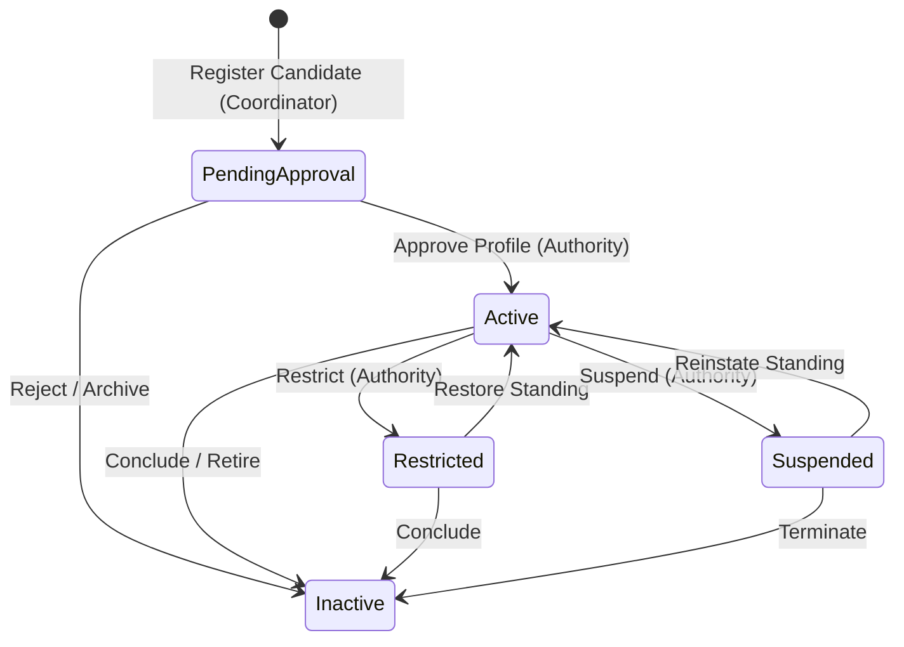
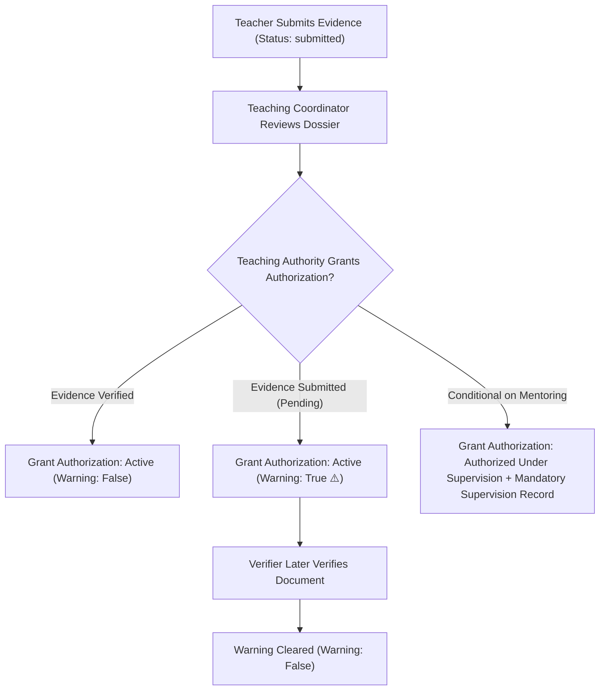
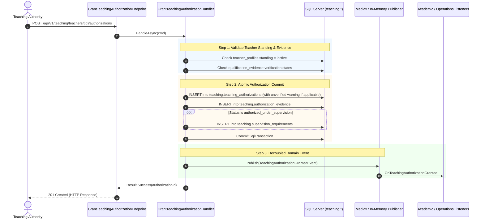
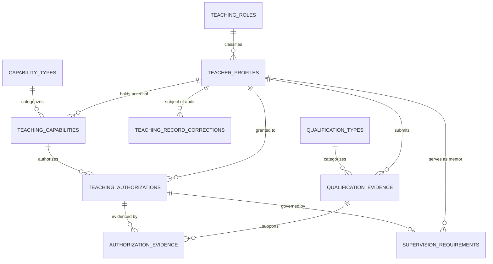

# 1. Overview

This target architecture defines the technical realization for the full scope of Stage 2 "Teacher Profile & Authorization" under the Teaching domain in Elsasa School Information System (SIS) V3:

1. **Teaching Profile Management (`TCH-WF-01`, `UC-TCH-02`, `SCR-TCH-01`):**
   - Establish and maintain authoritative records representing the school's recognized relationship with individuals as teaching resources (`teaching.teacher_profiles`).
   - Manage institutional teacher identifier (`teacher_number`), legal full name, professional display name with credentials, contact details, campus affiliation, and subject department.
   - Support configurable teaching roles (`teaching.teaching_roles`, e.g., Guru Tetap, Guru Kontrak, Guru Tamu, Relawan, Penilai Eksternal, Fasilitator) with qualification check mandates (`requires_qualification_check`).
   - Support non-employee teaching resources (visiting lecturers, external assessors, volunteers) by retaining a nullable employee reference (`employee_ref`) while guaranteeing identity uniqueness via national identity numbers (`national_id_or_external_ref`), strictly decoupling teaching identity from HR/payroll systems.
   - Track teacher standing states (`pending_approval`, `active`, `restricted`, `suspended`, `inactive`), standing justification rationale, effective dates (`effective_from`, `effective_to`), and formal school authority approval (`approved_by`, `approved_date`).

2. **Teaching Capability (`TCH-WF-01`, `UC-TCH-02`, `SCR-TCH-01`):**
   - Manage the institutional taxonomy and categories of teaching capabilities (`teaching.capability_types`, e.g., subject area, educational stage/level, delivery mode, language of instruction, specialist activity).
   - Record potential teaching capabilities for teacher profiles (`teaching.teaching_capabilities`), describing potential pedagogical suitability across subject domains, grade stages, delivery formats, and languages independent of specific curriculum structures.
   - Enforce the foundational architectural principle that a capability describes potential suitability only; it does not by itself authorize teaching or commit teaching capacity.

3. **Qualification Evidence & Verification (`TCH-WF-02`, `UC-TCH-03`, `SCR-TCH-01`):**
   - Define recognized qualification and certification types (`teaching.qualification_types`, e.g., Sertifikat Pendidik / Serdik, Ijazah S1/S2, Sertifikat P3K, Child Protection) with renewal requirements and validity duration rules (`requires_renewal`, `default_validity_months`).
   - Store documentary evidence supporting teacher capabilities and authorizations (`teaching.qualification_evidence`), tracking the full verification lifecycle: `claimed`, `submitted`, `verified`, `rejected`, `expired`, and `revoked`.
   - Capture issuing authority, credential identifier, issue date, renewal expiry date, secure document archive reference, verification authority (`verified_by`), verification date, verification notes, and rejection reasons.
   - Enforce strict conceptual separation between qualification verification and teaching authorization: verified qualification confirms documentary authenticity, but does not automatically grant authorization to teach or assign work.

4. **Teaching Authorization Lifecycle (`TCH-WF-03`, `UC-TCH-09`, `SCR-TCH-01`):**
   - Record formal school permissions for teaching resources to perform specified teaching work within defined scopes and effective dates (`teaching.teaching_authorizations`).
   - Manage authorization scope descriptions, campus boundaries, educational program scopes, grade level scopes, delivery mode scopes, and approving authority decisions (`decision_authority`, `approved_date`).
   - Support authorization lifecycle states: `active`, `authorized_under_supervision`, `restricted`, `suspended`, `revoked`, and `expired`.
   - Support permissive guidance gating: allow granting provisional/conditional authorizations when evidence is in `submitted` state, stamping an explicit `unverified_credential_warning` flag and notifying Teaching Authority.
   - Maintain explicit traceability linking authorizations to supporting qualification evidence (`teaching.authorization_evidence`).
   - Manage conditional supervision requirements (`teaching.supervision_requirements`) when authorization is granted under supervision, capturing designated supervising mentor teachers, supervision types (co-teaching, periodic observation, lesson plan review, mentorship), validity periods, and resolution notes.

5. **Auditable Record Corrections (`TCH-WF-12`, `UC-TCH-12`, `SCR-TCH-01`):**
   - Provision `teaching.teaching_record_corrections` (table 2.15) to execute auditable corrections on finalized faculty profiles and authorization records with mandatory justification logging and before/after delta tracking.
   - Implement role-aware direct application: Teaching Authority can apply corrections directly in a single atomic transaction, while non-authority coordinators submit a `requested` correction requiring Teaching Authority approval to apply.

6. **Frontend Faculty Resource Workspace (`SCR-TCH-01`):**
   - Implement a unified Work Queue and Master-Detail Workbench at `/teaching/faculty` with queue filters (All Faculty, Pending Profile Approval, Pending Verification, Pending Authorization, Corrections) and search.
   - Provide a teacher header with standing badges and 5 cohesive tabs (*Profile & Affiliation*, *Teaching Capabilities*, *Qualification Evidence*, *Authorizations & Supervision*, *Corrections Audit*).

7. **Cross-Domain Contracts & Domain Events (`Elsasa.Sis.Contracts`):**
   - Expose synchronous inquiry contract `ITeachingModule` (`GetTeacherProfileAsync`, `IsTeacherAuthorizedAsync`, `GetActiveTeachersAsync`) for consumption by downstream modules (Academics, Operations).
   - Publish in-memory MediatR post-commit domain events for profile approvals, standing modifications, and authorization state changes.

8. **Demo Data Generator & Purger Support:**
   - Establish `ITeachingDemoDataSeeder` and `ITeachingDemoDataPurger` wired into `DemoDataOrchestrator` in forward topological and reverse-purge order.
   - Seed 4 realistic Hagios School of Life personas: (1) Senior Permanent Teacher (Budi Hartono - active authorization, verified Serdik), (2) Contract Teacher under Supervision (Siti Nurhaliza - conditional authorization, co-teaching mentor assigned), (3) Non-Employee Visiting Teacher (John Miller - null employee_ref, passport identity), and (4) Pending Onboarding Candidate (Hendra Setiawan - pending profile approval & submitted credential awaiting verification).

This architecture fulfills change request intake `CR-TCH-TEACHER-PROFILE-AUTHORIZATION` ([IS014 - TCH-TEACHER-PROFILE-ISSUE.md](file:///d:/Project.Private/elsasa-sis-v3/docs/issues/IS014%20-%20TCH-TEACHER-PROFILE-ISSUE.md)) and realizes the approved analysis decisions in [IS014 - TCH-TEACHER-PROFILE-FEASIBILITY-ASSESSMENT.md](file:///d:/Project.Private/elsasa-sis-v3/docs/issues/IS014%20-%20TCH-TEACHER-PROFILE-FEASIBILITY-ASSESSMENT.md).

---

# 2. Architectural Basis

## Business Context

This architecture realizes the business knowledge, operational workflows, and domain rules specified in:

- **DOMAIN BLUEPRINT:** [teaching-domain.md](file:///d:/Project.Private/elsasa-sis-v3/docs/domains/teaching-domain.md)
  - Purpose, Scope, Teaching Profile, Capability, Qualification Evidence, Teaching Authorization, Record Corrections
  - Separation of Teaching Profile from HR/Payroll records (lines 40–58)
  - Capability describes potential suitability only; does not authorize work or commit capacity (lines 62–74)
  - Qualification verification confirms document authenticity; does not automatically authorize teaching (lines 78–92)
  - Teaching Authorization establishes legal eligibility; does not reserve capacity (lines 96–112)
  - Auditable Record Corrections: "No Silent Overwrites" protocol (`TCH-WF-12`, lines 165–185)
- **ROADMAP & COMPLETION CRITERIA:** [sub-modul-and-development-phases.md](file:///d:/Project.Private/elsasa-sis-v3/docs/sub-modul-and-development-phases.md)
  - Stage 2: Module 1 — Teacher Profile & Authorization (Submodules 1.1–1.4)
- **WORKFLOWS & USE CASES:**
  - [operational-workflow-discovery.md](file:///d:/Project.Private/elsasa-sis-v3/docs/operational-workflow-discovery.md):
    - `TCH-WF-01`: Register and Maintain Teacher Profile (Stage 2)
    - `TCH-WF-02`: Verify Teacher Qualifications (Stage 2)
    - `TCH-WF-03`: Determine Teaching Authorization (Stage 2)
    - `TCH-WF-12`: Correct Approved Teaching Record (Stage 2)
  - [use-cases.md](file:///d:/Project.Private/elsasa-sis-v3/docs/use-cases.md):
    - `UC-TCH-02`: Maintain Teaching Profile
    - `UC-TCH-03`: Verify Teacher Qualifications
    - `UC-TCH-09`: Determine Teaching Authorization
    - `UC-TCH-12`: Correct Approved Teaching Record
- **ACTORS:** [actors.md](file:///d:/Project.Private/elsasa-sis-v3/docs/actors.md)
  - Teaching Coordinator (`ACT-12`): Primary actor for profile intake, capability management, and qualification submission.
  - Teaching Authority (`ACT-13`): School leadership (*Kepala Sekolah / VP Academics*) exercising sole approval for profiles, authorizations, and record corrections.
  - Qualification Verifier (`ACT-14`): Verifies authenticity of credentials against external registers.
  - Teacher (`ACT-09`): Subject of the profile, capabilities, credentials, and authorizations.
- **DATA SPECIFICATIONS:**
  - [teaching-entities.md](file:///d:/Project.Private/elsasa-sis-v3/docs/entities/teaching-entities.md): Module 1 Entities and Submodule 2.15 Correction Entity.
  - [teaching-entities-tables.md](file:///d:/Project.Private/elsasa-sis-v3/docs/entities/teaching-entities-tables.md): Module 1 tables (`teaching_roles`, `teacher_profiles`, `capability_types`, `teaching_capabilities`, `qualification_types`, `qualification_evidence`, `teaching_authorizations`, `authorization_evidence`, `supervision_requirements`, lines 22–361; Table 2.15 `teaching_record_corrections`, lines 913–950).
- **SCREEN INVENTORY:** [screen-inventory.md](file:///d:/Project.Private/elsasa-sis-v3/docs/screen-inventory.md)
  - `SCR-TCH-01`: Faculty Resource Workspace (Work Queue pattern, Teaching Coordinator & Teaching Authority)
- **ARCHITECTURE DECISION RECORDS:** [adr.md](file:///d:/Project.Private/elsasa-sis-v3/docs/architecture/adr.md)
  - ADR-001 (Monolith Assembly Structure & Domain Isolation)
  - ADR-002 (Single SQL Database with Schema Partitioning)
  - ADR-004 (Vertical Slice Architecture)
  - ADR-005 (Explicit T-SQL over Micro-ORMs)
  - ADR-006 (DbUp for Database Migrations)
  - ADR-010 (Hybrid Cross-Domain Communication Model)

## Analysis Input

This architecture directly consumes the approved gap closures, risk mitigations, and technical decisions recorded in:

- **FEASIBILITY ASSESSMENT:** [IS014 - TCH-TEACHER-PROFILE-FEASIBILITY-ASSESSMENT.md](file:///d:/Project.Private/elsasa-sis-v3/docs/issues/IS014%20-%20TCH-TEACHER-PROFILE-FEASIBILITY-ASSESSMENT.md)
  - `GAP-001`: Scaffold backend class library `src/backend/Elsasa.Sis.Teaching/` referencing only `Elsasa.Sis.Shared` and `Elsasa.Sis.Contracts`, wired into `Elsasa.Sis.sln` and registered in `Elsasa.Sis.Api`. Update architecture tests in `TestAssemblies.cs` and `AssemblyDependencyTests.cs`.
  - `GAP-002 / OQ-001`: Provision isolated schema `teaching`, 9 Module 1 tables, and `teaching.teaching_record_corrections` (table 2.15) via DbUp migration `20261110_0501_Teaching_TeacherProfile_Tables.sql`.
  - `GAP-003 / OQ-002`: Adopt **Candidate Intake with Authority Approval** for teacher profile lifecycle (`pending_approval`, `active`, `restricted`, `suspended`, `inactive`).
  - `GAP-004 / OQ-003`: Adopt **Permissive Guidance Gate** for authorizations: support provisional authorization with evidence in `submitted` state, stamping `unverified_credential_warning` flag. Mandate `supervision_requirements` for `authorized_under_supervision`.
  - `GAP-005 / OQ-004`: Adopt **Role-Aware Direct Application** for auditable corrections: Teaching Authority applies corrections directly in a single atomic transaction; non-authority coordinators submit a `requested` correction requiring authority approval.
  - `GAP-006 / OQ-005`: Adopt **Unified Work Queue & Multi-Tab Workbench (`SCR-TCH-01` at `/teaching/faculty`)** with work queue filters and 5 cohesive tabs.
  - `GAP-007 / OQ-007`: Expose `ITeachingModule` on `Elsasa.Sis.Contracts` and publish MediatR in-memory domain events.
  - `GAP-008 / OQ-006`: Adopt **Multi-Persona Realism Scenario** seeding 4 Hagios personas and implementing reverse-dependency purging in `DemoDataOrchestrator`.
  - Planning Readiness: Granted `READY-FOR-PLANNING`.

```text
DOMAIN (teaching-domain.md) + FEATURE (use-cases.md, screen-inventory.md)
                            +
       FEASIBILITY-ASSESSMENT (CR-TCH-TEACHER-PROFILE-AUTHORIZATION)
                            ↓
       TARGET ARCHITECTURE (TCH-TEACHER-PROFILE-AUTHORIZATION)
```

---

# 3. Scope

## Included

1. **Database Schema & Migrations (`Elsasa.Sis.Database`):**
   - Migration script `20261110_0501_Teaching_TeacherProfile_Tables.sql` targeting Microsoft SQL Server 2022 ([ADR-002](file:///d:/Project.Private/elsasa-sis-v3/docs/architecture/adr.md#L50-L75), [ADR-006](file:///d:/Project.Private/elsasa-sis-v3/docs/architecture/adr.md#L152-L176)).
   - Creation of schema `teaching` and 10 authoritative relational tables:
     - `teaching.teaching_roles`: Configurable teaching role categories with qualification check mandates.
     - `teaching.teacher_profiles`: Authoritative faculty profile records with standing lifecycle and HR decoupling.
     - `teaching.capability_types`: Taxonomy categories of teaching capabilities.
     - `teaching.teaching_capabilities`: Potential pedagogical capabilities across subject, stage, mode, and language.
     - `teaching.qualification_types`: Categories of qualifications and certifications with renewal policies.
     - `teaching.qualification_evidence`: Documentary evidence tracking verification lifecycle (`claimed` → `verified`/`rejected`).
     - `teaching.teaching_authorizations`: Official permissions to teach within defined scopes and effective dates.
     - `teaching.authorization_evidence`: M:N junction linking authorizations to supporting qualification evidence.
     - `teaching.supervision_requirements`: Mentoring and supervision requirements for conditional authorizations.
     - `teaching.teaching_record_corrections`: Auditable before/after delta tracking and authority approval log.
   - Enforce zero physical cross-schema foreign keys ([ADR-001](file:///d:/Project.Private/elsasa-sis-v3/docs/architecture/adr.md#L24-L48), [ADR-002](file:///d:/Project.Private/elsasa-sis-v3/docs/architecture/adr.md#L50-L75)).

2. **Backend Domain Architecture & Vertical Slices (`Elsasa.Sis.Teaching`):**
   - Scaffold project `src/backend/Elsasa.Sis.Teaching/` referencing only `Elsasa.Sis.Shared` and `Elsasa.Sis.Contracts`.
   - Feature vertical slices under `src/backend/Elsasa.Sis.Teaching/Features/`:
     - **TeacherProfiles:**
       - `RegisterTeacherProfile` (`POST /api/v1/teaching/teachers`): Coordinator registers candidate profile into `pending_approval`.
       - `UpdateTeacherProfile` (`PUT /api/v1/teaching/teachers/{id}`): Modifies profile details while maintaining identity decoupling.
       - `ApproveTeacherProfile` (`POST /api/v1/teaching/teachers/{id}/approve`): Teaching Authority approves profile, setting `standing = 'active'`.
       - `ChangeTeacherStanding` (`POST /api/v1/teaching/teachers/{id}/standing`): Updates standing (`restricted`, `suspended`, `inactive`, `active`) with justification reason.
       - `GetTeacherProfileById` (`GET /api/v1/teaching/teachers/{id}`): Queries complete teacher profile with role, capabilities, qualifications, authorizations, and supervision.
       - `GetTeacherProfiles` (`GET /api/v1/teaching/teachers`): Queries work queue with status/filter parameters (`all`, `pending_approval`, `pending_verification`, `pending_authorization`, `corrections`, `standing`, `campus`, `search`).
       - `GetTeachingRoles` (`GET /api/v1/teaching/roles`): Returns configurable teaching roles.
     - **TeachingCapabilities:**
       - `AddTeachingCapability` (`POST /api/v1/teaching/teachers/{id}/capabilities`): Records potential teaching capability.
       - `RemoveTeachingCapability` (`DELETE /api/v1/teaching/teachers/{id}/capabilities/{capabilityId}`): Retires capability.
       - `GetCapabilityTypes` (`GET /api/v1/teaching/capability-types`): Returns capability taxonomy types.
     - **QualificationEvidence:**
       - `SubmitQualificationEvidence` (`POST /api/v1/teaching/teachers/{id}/qualifications`): Submits credential evidence.
       - `VerifyQualificationEvidence` (`POST /api/v1/teaching/qualifications/{id}/verify`): Records qualification verification outcome.
       - `RejectQualificationEvidence` (`POST /api/v1/teaching/qualifications/{id}/reject`): Records credential rejection with reason.
       - `GetQualificationTypes` (`GET /api/v1/teaching/qualification-types`): Returns qualification categories and renewal rules.
     - **TeachingAuthorizations:**
       - `GrantTeachingAuthorization` (`POST /api/v1/teaching/teachers/{id}/authorizations`): Authority grants authorization with scopes, links supporting evidence, and flags unverified warnings if applicable.
       - `UpdateTeachingAuthorizationStatus` (`POST /api/v1/teaching/authorizations/{id}/status`): Updates authorization status (`restricted`, `suspended`, `revoked`, `expired`) with justification.
       - `AddSupervisionRequirement` (`POST /api/v1/teaching/authorizations/{id}/supervision`): Attaches mentor and supervision condition.
       - `ResolveSupervisionRequirement` (`POST /api/v1/teaching/supervision/{id}/resolve`): Concludes supervision condition.
     - **RecordCorrections:**
       - `ApplyRecordCorrection` (`POST /api/v1/teaching/corrections`): Authority applies direct correction or Coordinator submits request.
       - `ApproveRecordCorrection` (`POST /api/v1/teaching/corrections/{id}/approve`): Authority approves and applies requested correction.
       - `GetRecordCorrections` (`GET /api/v1/teaching/corrections`): Queries correction audit log.
   - Module registration in `DependencyInjection.cs` via `services.AddTeachingModule()` and endpoint mapping via `app.MapTeachingEndpoints()`.

3. **Cross-Domain Contracts & Domain Events (`Elsasa.Sis.Contracts`):**
   - Synchronous query interface `ITeachingModule` with methods:
     - `GetTeacherProfileAsync(Guid teacherId, CancellationToken ct = default)`
     - `IsTeacherAuthorizedAsync(Guid teacherId, string subjectOrCapability, string campus, DateOnly effectiveDate, CancellationToken ct = default)`
     - `GetActiveTeachersAsync(string? campus = null, CancellationToken ct = default)`
   - Contract DTOs in `Elsasa.Sis.Contracts/Teaching/`:
     - `TeacherProfileDto.cs`, `TeacherSummaryDto.cs`, `TeachingRoleDto.cs`, `TeachingCapabilityDto.cs`, `QualificationEvidenceDto.cs`, `TeachingAuthorizationDto.cs`, `SupervisionRequirementDto.cs`, `TeachingRecordCorrectionDto.cs`
   - In-memory domain events in `Elsasa.Sis.Contracts/Teaching/Events/`:
     - `TeacherProfileCreatedEvent.cs`, `TeacherProfileApprovedEvent.cs`, `TeacherStandingChangedEvent.cs`, `QualificationEvidenceVerifiedEvent.cs`, `TeachingAuthorizationGrantedEvent.cs`, `TeachingAuthorizationStatusChangedEvent.cs`, `TeachingRecordCorrectedEvent.cs`

4. **Frontend Workbenches & Client Integration (`src/frontend`):**
   - Feature directory `src/frontend/src/features/teaching/faculty/`:
     - `FacultyResourceWorkspaceView.vue`: Master-Detail layout (`SCR-TCH-01`) implementing work queue and workbench.
     - `FacultyQueueSidebar.vue`: Filterable work list by queue category and search query.
     - `TeacherHeaderBanner.vue`: Teacher summary banner with standing badge and quick actions (`Approve Profile`, `Change Standing`, `Audit Correction`).
     - `ProfileAffiliationTab.vue`: General information, contact, NIK, employee ref, campus, department.
     - `TeachingCapabilitiesTab.vue`: Categorized capabilities list and Add Capability modal (`AddCapabilityModal.vue`).
     - `QualificationEvidenceTab.vue`: Credentials list, document links, verification badges, verify/reject dialogs, and Submit Evidence modal (`SubmitEvidenceModal.vue`).
     - `AuthorizationsSupervisionTab.vue`: Authorizations list, scope pills, supervision cards, Grant Authorization modal (`GrantAuthorizationModal.vue`), and Add Supervision modal (`AddSupervisionModal.vue`).
     - `CorrectionsAuditTab.vue`: Chronological before/after deltas from `teaching_record_corrections`.
     - `facultyApi.ts`: TanStack Query composables and typed Axios API methods.
   - Route registration: `/teaching/faculty` mapped to `FacultyResourceWorkspaceView.vue` in `src/frontend/src/app/router/routes.ts`.
   - Sidebar navigation: Add Teaching group with Faculty Resources item in `AppLayout.vue`.

5. **Demo Data Seeding & Purging Support:**
   - Implement `ITeachingDemoDataSeeder` and `ITeachingDemoDataPurger` in `Elsasa.Sis.Teaching/Features/DemoData/`.
   - Seed 4 realistic Hagios personas:
     1. `Budi Hartono, M.Pd.` (Senior Permanent Teacher, Guru Tetap, active standing, verified Serdik & S1, active authorization for Matematika SD Kelas 4–6).
     2. `Siti Nurhaliza, S.Pd.` (Contract Teacher under Supervision, Guru Kontrak, active standing, verified S1 Bahasa Inggris, authorized under supervision for Bahasa Inggris SMP with senior mentor Budi Hartono).
     3. `John Miller, B.Ed.` (Visiting Non-Employee Teacher, Guru Tamu, null employee_ref, passport ID, verified Cambridge CELTA, active authorization for English Immersion).
     4. `Hendra Setiawan` (Pending Candidate, Guru Kontrak, pending_approval standing, submitted coaching certificate awaiting verification).
   - Wire seeder and purger into `DemoDataOrchestrator.cs` in forward topological and reverse-purge order.

6. **Architecture Tests Verification:**
   - Update `TestAssemblies.cs` and `AssemblyDependencyTests.cs` in `tests/backend/Elsasa.Sis.ArchitectureTests/` to include `Elsasa.Sis.Teaching` and enforce ADR-001/ADR-010 domain isolation rules.

## Excluded

1. **Teaching Demand Intake & Assignment Allocation:** Receiving staffing demand from Academics, candidate eligibility evaluation, binding assignment approvals to learning units or homerooms, and assignment completions belong to `Assignment & Workload` (`TCH-WF-05`, `TCH-WF-06`, `TCH-WF-07`, `TCH-WF-11`, `SCR-TCH-02`).
2. **Teacher Availability & Workload Monitoring:** Teacher working hour declarations, blocked windows, capacity thresholds, overload monitoring, and workload exceptions belong to `Assignment & Workload` (`TCH-WF-04`, `TCH-WF-10`, `SCR-TCH-03`, `SCR-TCH-04`).
3. **Emergency Substitution:** Arranging substitute teachers and managing coverage workflows belong to `Assignment & Workload` (`TCH-WF-09`, `SCR-TCH-02`).
4. **Curriculum and Course Frameworks:** Defining learning units, course requirements, and syllabi belongs to Academic `Learning Structure & Requirements` (`IS008`, `SCR-ACD-03`).
5. **Instructional Delivery & Student Attendance:** Conducting classroom activities, recording student attendance, and logging coursework belong to Academic `Participation & Learning Activities` (`IS009`, `SCR-ACD-01`).
6. **Operational Timetabling & Room Allocations:** Room reservations, facility conflict resolution, and timetable occurrence management belong to Operational `Scheduling & Rooms` (`SCR-OPS-02`).
7. **Human Resources & Payroll Administration:** Employment contracts, salary scales, benefits, leave entitlements, and payroll processing are strictly outside the SIS Teaching domain. Teaching maintains only the minimal identity and qualification attributes necessary for academic authorization and staffing.

---

# 4. Technical Decisions

## TD-01: Authoritative Teaching Relational Schema & Partitioning

### Context
Stage 2 Teacher Profile & Authorization introduces 9 core and reference entities from Module 1 of `teaching-entities-tables.md`, plus the auditable corrections table (table 2.15). The database architecture must adhere strictly to ADR-001 (compile-time isolation), ADR-002 (single database with schema partitioning), and ADR-006 (DbUp migrations).

### Decision
1. Provision isolated schema `teaching` and 10 authoritative tables via DbUp migration script `20261110_0501_Teaching_TeacherProfile_Tables.sql`:
   - Reference Tables: `teaching.teaching_roles`, `teaching.capability_types`, `teaching.qualification_types`.
   - Core Tables: `teaching.teacher_profiles`, `teaching.teaching_capabilities`, `teaching.qualification_evidence`, `teaching.teaching_authorizations`.
   - Supporting / Junction Tables: `teaching.authorization_evidence`, `teaching.supervision_requirements`, `teaching.teaching_record_corrections`.
2. Enforce zero physical foreign keys across domain schemas: external identifiers (e.g., campus names, user strings, opaque employee refs) are stored as scalar values without physical SQL foreign key constraints to external schemas.
3. Enforce intra-schema physical foreign keys where relationships belong strictly within `teaching`:
   - `teacher_profiles.teaching_role_id` → `teaching_roles(id)` ON DELETE NO ACTION
   - `teaching_capabilities.teacher_profile_id` → `teacher_profiles(id)` ON DELETE CASCADE
   - `teaching_capabilities.capability_type_id` → `capability_types(id)` ON DELETE NO ACTION
   - `qualification_evidence.teacher_profile_id` → `teacher_profiles(id)` ON DELETE CASCADE
   - `qualification_evidence.qualification_type_id` → `qualification_types(id)` ON DELETE NO ACTION
   - `teaching_authorizations.teacher_profile_id` → `teacher_profiles(id)` ON DELETE CASCADE
   - `teaching_authorizations.authorized_capability_id` → `teaching_capabilities(id)` ON DELETE SET NULL
   - `authorization_evidence.authorization_id` → `teaching_authorizations(id)` ON DELETE CASCADE
   - `authorization_evidence.qualification_evidence_id` → `qualification_evidence(id)` ON DELETE CASCADE
   - `supervision_requirements.authorization_id` → `teaching_authorizations(id)` ON DELETE CASCADE
   - `supervision_requirements.supervising_teacher_id` → `teacher_profiles(id)` ON DELETE NO ACTION
   - `teaching_record_corrections.teacher_profile_id` → `teacher_profiles(id)` ON DELETE SET NULL
4. Enforce domain data integrity via database check constraints (`CK_...`) for all discrete enumerated states:
   - `teacher_profiles.standing IN ('pending_approval', 'active', 'restricted', 'suspended', 'inactive')`
   - `teaching_capabilities.status IN ('active', 'inactive')`
   - `qualification_evidence.verification_state IN ('claimed', 'submitted', 'verified', 'rejected', 'expired', 'revoked')`
   - `teaching_authorizations.status IN ('active', 'authorized_under_supervision', 'restricted', 'suspended', 'revoked', 'expired')`
   - `supervision_requirements.supervision_type IN ('co_teaching', 'periodic_observation', 'lesson_plan_review', 'general_mentorship')`
   - `supervision_requirements.status IN ('active', 'completed', 'waived', 'escalated')`
   - `teaching_record_corrections.status IN ('requested', 'approved', 'rejected', 'applied')`
5. Enforce uniqueness invariants:
   - Unique institutional teacher number: `UQ_teaching_teacher_profiles_number` on `teacher_number`.
   - Unique national identity number (when present): partial unique index `UQ_teaching_teacher_profiles_national_id` on `national_id_or_external_ref WHERE national_id_or_external_ref IS NOT NULL`.
   - Unique authorization number: `UQ_teaching_authorizations_number` on `authorization_number`.
   - Unique correction number: `UQ_teaching_record_corrections_number` on `correction_number`.
   - Unique capability per teacher: `UQ_teaching_capabilities_unique` on `(teacher_profile_id, capability_code, applicable_level, delivery_mode)`.

### Impact
Guarantees absolute compile-time and runtime independence between domains, maintains strict relational integrity within the Teaching domain, and physically prevents identity duplicates and invalid lifecycle states at the storage layer.

---

## TD-02: Compile-Time Domain Isolation & `Elsasa.Sis.Teaching` Vertical Slice Architecture

### Context
ADR-001 mandates that domain assemblies never reference each other, referencing only `Shared` and `Contracts`. ADR-004 dictates that features are implemented as end-to-end vertical slices. ADR-005 mandates explicit T-SQL via Dapper rather than ORMs.

### Decision
1. Create `src/backend/Elsasa.Sis.Teaching/Elsasa.Sis.Teaching.csproj` targeting `net8.0` with `<Nullable>enable</Nullable>`.
2. Reference only:
   - `..\Elsasa.Sis.Shared\Elsasa.Sis.Shared.csproj`
   - `..\Elsasa.Sis.Contracts\Elsasa.Sis.Contracts.csproj`
3. Structure the assembly by business capabilities:
   ```text
   src/backend/Elsasa.Sis.Teaching/
   ├── Features/
   │   ├── TeacherProfiles/
   │   │   ├── RegisterTeacherProfile/
   │   │   ├── UpdateTeacherProfile/
   │   │   ├── ApproveTeacherProfile/
   │   │   ├── ChangeTeacherStanding/
   │   │   ├── GetTeacherProfileById/
   │   │   ├── GetTeacherProfiles/
   │   │   └── GetTeachingRoles/
   │   ├── TeachingCapabilities/
   │   │   ├── AddTeachingCapability/
   │   │   ├── RemoveTeachingCapability/
   │   │   └── GetCapabilityTypes/
   │   ├── QualificationEvidence/
   │   │   ├── SubmitQualificationEvidence/
   │   │   ├── VerifyQualificationEvidence/
   │   │   ├── RejectQualificationEvidence/
   │   │   └── GetQualificationTypes/
   │   ├── TeachingAuthorizations/
   │   │   ├── GrantTeachingAuthorization/
   │   │   ├── UpdateTeachingAuthorizationStatus/
   │   │   ├── AddSupervisionRequirement/
   │   │   └── ResolveSupervisionRequirement/
   │   ├── RecordCorrections/
   │   │   ├── ApplyRecordCorrection/
   │   │   ├── ApproveRecordCorrection/
   │   │   └── GetRecordCorrections/
   │   └── DemoData/
   │       ├── TeachingDemoDataSeeder.cs
   │       └── TeachingDemoDataPurger.cs
   ├── Services/
   │   └── TeachingModuleImpl.cs
   ├── TeachingAssemblyMarker.cs
   ├── TeachingEndpoints.cs
   ├── DependencyInjection.cs
   └── Permissions.cs
   ```
4. Each slice contains its Request record, Response record, FluentValidation Validator, Dapper Handler, and Endpoint implementing `IEndpoint`.
5. Handlers return `Result<T>` and never throw domain exceptions.
6. Register in `Elsasa.Sis.Api` via `services.AddTeachingModule()` and `app.MapTeachingEndpoints()`.
7. Add `Elsasa.Sis.Teaching` to `TestAssemblies.cs` and `AssemblyDependencyTests.cs` to guarantee ADR-001 compliance.

### Impact
Enforces strict compile-time isolation, maximizes locality of behavior, and provides uniform maintainability matching Academics, Students, Finance, and Operations.

---

## TD-03: Candidate Intake with Authority Approval Lifecycle

### Context
Teacher onboarding in educational institutions follows a distinct lifecycle: Teaching Coordinators register new candidate files, collect credentials, and configure proposed teaching profiles. However, teaching resources must not be legally recognized or assigned to academic classes until formal approval is granted by the Teaching Authority (*Kepala Sekolah / VP Academics*).

### Decision
1. Implement a 5-state standing lifecycle in `teaching.teacher_profiles.standing`:
   - `'pending_approval'`: Initial intake state when a profile is registered by the Teaching Coordinator. The profile is incomplete or awaiting formal review. Not eligible for teaching assignments.
   - `'active'`: Fully approved teaching resource in good standing. Eligible for teaching authorization and assignments.
   - `'restricted'`: Profile under operational boundary restrictions (e.g., restricted from certain campuses or subject levels).
   - `'suspended'`: Temporarily barred from teaching duties pending administrative review. Automatically invalidates active assignments during scheduling.
   - `'inactive'`: Concluded or retired teaching relationship.
2. **Workflow Progression:**
   - **Intake:** Teaching Coordinator calls `POST /api/v1/teaching/teachers` with basic details, resulting in `standing = 'pending_approval'`.
   - **Review:** Candidate appears in `SCR-TCH-01` under the "Pending Profile Approval" work queue filter.
   - **Approval:** Teaching Authority reviews credentials and calls `POST /api/v1/teaching/teachers/{id}/approve`. The handler updates `standing = 'active'`, `approved_by = @currentUser`, and `approved_date = @today`, then publishes `TeacherProfileApprovedEvent`.
   - **Standing Modification:** Teaching Authority can transition an active profile to `restricted`, `suspended`, or `inactive` via `POST /api/v1/teaching/teachers/{id}/standing` with mandatory `standing_reason`.



### Impact
Eliminates unauthorized or accidental teacher activation, reflects real-world institutional governance, and provides clear intake queue segregation in `SCR-TCH-01`.

---

## TD-04: Non-Employee Faculty Identity Decoupling

### Context
`teaching-domain.md` establishes that a Teaching Profile is not an HR employee record. Educational institutions routinely engage non-employee teaching resources such as visiting lecturers, guest teachers, external assessors, and volunteers. These individuals do not exist in HR or payroll systems, but their teaching identity, qualifications, and authorizations must be rigorously managed by the SIS.

### Decision
1. Maintain `employee_ref` as a nullable `VARCHAR(100)` column in `teaching.teacher_profiles`.
2. Maintain `national_id_or_external_ref` as a nullable `VARCHAR(100)` column with a filtered unique index:
   ```sql
   CREATE UNIQUE NONCLUSTERED INDEX [UQ_teaching_teacher_profiles_national_id]
   ON [teaching].[teacher_profiles] ([national_id_or_external_ref])
   WHERE [national_id_or_external_ref] IS NOT NULL;
   ```
3. For regular employees, `employee_ref` stores the employee number (e.g., "EMP-2026-042").
4. For non-employees (visiting teachers, external assessors, volunteers), `employee_ref` is `NULL`. Uniqueness and identity authenticity are anchored by their national identity number (NIK) or passport number in `national_id_or_external_ref`.
5. The Teaching domain remains 100% decoupled from HR and payroll systems: zero tables, zero foreign keys, and zero service dependencies on employee contract or compensation data.

### Impact
Fully accommodates visiting specialists and volunteers without creating artificial HR payroll records, while preventing duplicate profiles and preserving identity auditability.

---

## TD-05: Permissive Guidance Gate for Teaching Authorization

### Context
Educational operations often face tight onboarding timelines where a teacher's formal qualification document has been submitted and is awaiting external verification, but classes are scheduled to begin. A rigid blocking gate (prohibiting authorization until 100% verified) causes administrative gridlock, while an unconstrained system risks assigning unqualified staff.

### Decision
Adopt the **Permissive Guidance Gate** model:
1. Teaching Authority may grant a `teaching_authorizations` record even if linked `qualification_evidence` is in `'submitted'` state (not yet `'verified'`).
2. When granted under these conditions:
   - The backend handler sets `unverified_credential_warning = 1` on `teaching.teaching_authorizations`.
   - An alert is logged and `TeachingAuthorizationGrantedEvent` is published with `HasUnverifiedWarning = true`.
   - In `SCR-TCH-01`, an amber warning badge (`⚠️ Unverified Credential`) is prominently displayed on the authorization card.
3. When the qualification is subsequently verified by the Qualification Verifier, the backend updates the linked authorization's `unverified_credential_warning = 0`.
4. If the qualification is rejected, the authorization status is automatically flagged or escalated for Teaching Authority review.
5. **Supervision Gating:** When an authorization is granted with status `'authorized_under_supervision'`, a linked record in `teaching.supervision_requirements` is **mandatory**. The handler validates that `supervision_type`, `description`, `start_date`, and optional `supervising_teacher_id` are provided in the command payload.



### Impact
Balances regulatory rigor with administrative practicality, preventing school operational stalls while maintaining 100% visibility into unverified credentials.

---

## TD-06: Role-Aware Atomic Record Corrections Workflow

### Context
`teaching-domain.md` mandates "No Silent Overwrites" (`TCH-WF-12`): approved Teaching records (profiles, authorizations) must never be updated in place without an immutable audit trail. However, forcing multi-step approval workflows for simple administrative typos creates excessive friction for authorized school leaders.

### Decision
Implement **Role-Aware Direct Application** backed by `teaching.teaching_record_corrections` (table 2.15):
1. **Teaching Authority Execution (Direct Application):**
   - When a user with the `TeachingAuthority` role submits a correction via `POST /api/v1/teaching/corrections`:
     - Reads the current value of the target field.
     - Within a single database transaction (`SqlTransaction`):
       1. Inserts a row into `teaching.teaching_record_corrections` with `status = 'applied'`, `original_value`, `corrected_value`, `reason_for_correction`, `approved_by = @currentUser`, and `approved_date = @today`.
       2. Updates the target column in `teaching.teacher_profiles` or `teaching.teaching_authorizations`.
     - Commits transaction and publishes `TeachingRecordCorrectedEvent`.
2. **Teaching Coordinator Execution (Requested Correction):**
   - When a non-authority Teaching Coordinator submits a correction:
     - Inserts a row into `teaching.teaching_record_corrections` with `status = 'requested'`, `approved_by = NULL`, and `approved_date = NULL`.
     - Target record is NOT updated.
     - Item appears in `SCR-TCH-01` under the "Corrections" queue filter.
3. **Teaching Authority Approval of Requested Correction:**
   - Teaching Authority calls `POST /api/v1/teaching/corrections/{id}/approve`:
     - Within a single database transaction:
       1. Updates `teaching_record_corrections` with `status = 'applied'`, `approved_by = @currentUser`, `approved_date = @today`.
       2. Updates the target table field with `corrected_value`.
     - Commits transaction.

### Impact
Zero bureaucratic friction for authorized school principals and academic directors, while non-authority changes are strictly gated and 100% of modifications are preserved with before/after audit deltas.

---

## TD-07: Unified Work Queue & Multi-Tab Workbench (`SCR-TCH-01`)

### Context
`docs/screen-inventory.md` designates `SCR-TCH-01` as `Faculty Resource Workspace` following the **Work Queue** pattern, jointly utilized by Teaching Coordinators and Teaching Authorities. We must deliver a cohesive, high-productivity interface adhering to frontend architecture standards (Vue 3, Tailwind CSS 4, PrimeVue 4, TanStack Query).

### Decision
1. Implement `SCR-TCH-01` at route `/teaching/faculty` in directory `src/frontend/src/features/teaching/faculty/`:
   - `FacultyResourceWorkspaceView.vue`: Master-Detail layout container.
2. **Master Sidebar (Left Pane, ~340px):**
   - Work Queue Filter Tabs:
     - `All Faculty`: Complete teacher directory.
     - `Pending Profile Approval`: Candidate profiles awaiting Teaching Authority approval.
     - `Pending Verification`: Teachers with submitted qualification evidence awaiting verification.
     - `Pending Authorization`: Teachers with active profiles but no valid teaching authorizations.
     - `Corrections`: Open record correction requests.
   - Search input: Filter by teacher name, teacher number, or NIK.
   - Status Filter: `All`, `Active`, `Restricted`, `Suspended`, `Inactive`.
   - List of teacher cards showing avatar, display name, teacher number, role pill, and standing badge.
   - "+ Register Faculty" button (opens `RegisterTeacherModal.vue`).
3. **Detail Workbench (Right Pane):**
   - **Header Banner (`TeacherHeaderBanner.vue`):** Display name, legal name, teacher number, role, campus affiliation, department, standing badge (`Active`, `Pending Approval`, `Suspended`), and role actions:
     - `Approve Profile` (Authority only; visible when `pending_approval`)
     - `Change Standing` (Authority only; opens `ChangeStandingModal.vue`)
     - `Audit Correction` (opens `RecordCorrectionModal.vue`)
   - **Five Cohesive Tabs:**
     - **Tab 1: Profile & Affiliation (`ProfileAffiliationTab.vue`):** Legal name, professional display name, institutional email, phone, NIK / passport, employee ref, campus, department, effective dates, approval authority stamp.
     - **Tab 2: Teaching Capabilities (`TeachingCapabilitiesTab.vue`):** Categorized list of potential capabilities (Subject, Level/Stage, Delivery Mode, Language), "+ Add Capability" button (`AddCapabilityModal.vue`), and remove action.
     - **Tab 3: Qualification Evidence (`QualificationEvidenceTab.vue`):** List of credentials with issuing authority, credential number, issue/expiry dates, verification status badge (`Claimed`, `Submitted`, `Verified`, `Rejected`, `Expired`), "+ Submit Evidence" button (`SubmitEvidenceModal.vue`), and inline `Verify` / `Reject` dialogs.
     - **Tab 4: Authorizations & Supervision (`AuthorizationsSupervisionTab.vue`):** Active/historic teaching authorizations, scope descriptions, unverified warning badges, linked qualification evidence pills, supervision requirement cards (mentor, supervision type, validity), "+ Grant Authorization" modal (`GrantAuthorizationModal.vue`), and "+ Add Supervision" modal (`AddSupervisionModal.vue`).
     - **Tab 5: Corrections Audit (`CorrectionsAuditTab.vue`):** Chronological table of auditable record corrections showing correction number, table name, field name, before value, after value, justification reason, requester, and approving authority.

```
+---------------------------------------------------------------------------------------------------------------+
|  Faculty Resource Workspace (SCR-TCH-01)                                                                      |
+-----------------------------------+---------------------------------------------------------------------------+
|  WORK QUEUE                       |  TEACHER HEADER BANNER                                                    |
|  [All] [Pending Appr] [Pending Ver] Budi Hartono, M.Pd. | TCH-2026-0012 | Guru Tetap | Kampus Utama          |
|  Search: [ Budi                 ] |  Standing: [ ACTIVE ]  |  Actions: [ Change Standing ] [ Record Correction ]|
+-----------------------------------+---------------------------------------------------------------------------+
|  FACULTY LIST                     |  [ Profile ] [ Capabilities ] [ Qualifications ] [ Authorizations ] [Audit]|
|                                   |  ------------------------------------------------------------------------ |
|  * Budi Hartono, M.Pd.   [ACTIVE] |  TEACHING AUTHORIZATIONS & SUPERVISION                                    |
|    Guru Tetap | Kampus Utama      |  ------------------------------------------------------------------------ |
|                                   |  Auth Number: AUTH-2026-0045 | Status: [ ACTIVE ]                         |
|  * Siti Nurhaliza, S.Pd. [ACTIVE] |  Scope: Matematika SD Kelas 4–6 Tatap Muka | Campus: Kampus Utama         |
|    Guru Kontrak | Under Superv.   |  Effective: 2026-07-01 to 2027-06-30 | Authority: Kepala Sekolah          |
|                                   |  Supporting Evidence: [ Serdik Matematika (Verified) ] [ S1 UPI ]        |
|  * Hendra Setiawan       [PENDING]|                                                                           |
|    Guru Kontrak | Pending Approval|  [ + Grant Teaching Authorization ]                                        |
|                                   |                                                                           |
|  [ + Register Faculty ]           |                                                                           |
+-----------------------------------+---------------------------------------------------------------------------+
```

### Impact
Delivers an ergonomic, unified workspace eliminating cognitive fragmentation between profile administration, credential verification, and authorization governance.

---

## TD-08: Cross-Domain Contract Inquiries & Domain Events

### Context
Downstream consumers across SIS modules require authoritative teacher information:
- Academics (`SCR-ACD-01`, `SCR-ACD-05`) must verify that an assigned teacher possesses a valid teaching authorization before scheduling class sessions.
- Operations (`SCR-OPS-02`) needs to query active faculty for timetable occurrences.
- Future Module 2 (`SCR-TCH-02`) requires verified faculty dossiers to evaluate teaching demand eligibility.
All interactions must strictly preserve compile-time domain isolation (ADR-001, ADR-010).

### Decision
1. **Synchronous Contract Inquiry on `ITeachingModule` (`Elsasa.Sis.Contracts/Teaching/`):**
   ```csharp
   namespace Elsasa.Sis.Contracts.Teaching;

   public interface ITeachingModule
   {
       Task<Result<TeacherProfileDto?>> GetTeacherProfileAsync(
           Guid teacherId,
           CancellationToken ct = default);

       Task<Result<bool>> IsTeacherAuthorizedAsync(
           Guid teacherId,
           string subjectOrCapability,
           string campus,
           DateOnly effectiveDate,
           CancellationToken ct = default);

       Task<Result<IReadOnlyList<TeacherSummaryDto>>> GetActiveTeachersAsync(
           string? campus = null,
           CancellationToken ct = default);
   }
   ```
2. **Post-Commit In-Memory Domain Events (`Elsasa.Sis.Contracts/Teaching/Events/`):**
   Published via MediatR after the database transaction has committed:
   - `TeacherProfileCreatedEvent(Guid TeacherProfileId, string TeacherNumber, string FullName, string Standing, string CreatedBy)`
   - `TeacherProfileApprovedEvent(Guid TeacherProfileId, string TeacherNumber, string ApprovedBy, DateOnly ApprovedDate)`
   - `TeacherStandingChangedEvent(Guid TeacherProfileId, string PreviousStanding, string NewStanding, string Reason, string ChangedBy)`
   - `QualificationEvidenceVerifiedEvent(Guid EvidenceId, Guid TeacherProfileId, string Title, string VerificationState, string VerifiedBy)`
   - `TeachingAuthorizationGrantedEvent(Guid AuthorizationId, Guid TeacherProfileId, string AuthorizationNumber, string Status, bool HasUnverifiedWarning, string GrantedBy)`
   - `TeachingAuthorizationStatusChangedEvent(Guid AuthorizationId, Guid TeacherProfileId, string PreviousStatus, string NewStatus, string Reason, string ChangedBy)`
   - `TeachingRecordCorrectedEvent(Guid CorrectionId, string CorrectionNumber, string TargetTable, Guid TargetRecordId, string FieldName, string ApprovedBy)`

### Impact
Preserves compile-time isolation with zero cross-project database dependencies while providing seamless read inquiries and event-driven notifications.

---

## TD-09: Multi-Persona Realism Demo Seeding & Reverse-Dependency Purging Strategy

### Context
Demonstrating and verifying the Teacher Profile & Authorization module requires realistic demo data showcasing diverse faculty personas. Furthermore, running `--seed-demo` or resetting demo data must execute cleanly without foreign key constraint violations.

### Decision
1. **Implement `TeachingDemoDataSeeder.cs`:**
   - **Persona 1: Budi Hartono, M.Pd. (`BudiHartonoTeacherId`):**
     - Role: `Guru Tetap` (PERMANENT), Kampus Utama, Department: Matematika & IPA.
     - Standing: `active` (approved by Kepala Sekolah).
     - Capabilities: Matematika SD (`MATH_PRIMARY`), IPA SD (`IPA_PRIMARY`).
     - Qualifications: Verified Sertifikat Pendidik Matematika (`SERDIK-2020-098234`) & Verified S1 Pendidikan Matematika (UPI).
     - Authorization: `active` for Matematika SD Kelas 4–6 Tatap Muka with linked Serdik & S1 evidence (`AUTH-2026-0045`).
   - **Persona 2: Siti Nurhaliza, S.Pd. (`SitiNurhalizaTeacherId`):**
     - Role: `Guru Kontrak` (CONTRACT), Kampus Utama, Department: Bahasa.
     - Standing: `active`.
     - Capabilities: Bahasa Inggris SMP (`ENG_JUNIOR`).
     - Qualifications: Verified S1 Pendidikan Bahasa Inggris (UNJ).
     - Authorization: `authorized_under_supervision` for Bahasa Inggris SMP (`AUTH-2026-0046`).
     - Supervision Requirement: `co_teaching` with senior mentor Budi Hartono for Semester 1 (`sup-001`).
   - **Persona 3: John Miller, B.Ed. (`JohnMillerTeacherId`):**
     - Role: `Guru Tamu` (VISITING), Kampus Utama. Non-employee (`employee_ref = NULL`), Passport ID (`national_id_or_external_ref = 'P-USA-8849201'`).
     - Standing: `active`.
     - Capabilities: English Immersion (`ENG_IMMERSION`).
     - Qualifications: Verified Cambridge CELTA certificate.
     - Authorization: `active` for English Immersion (`AUTH-2026-0047`).
   - **Persona 4: Hendra Setiawan (`HendraSetiawanTeacherId`):**
     - Role: `Guru Kontrak` (CONTRACT), Kampus Utama.
     - Standing: `pending_approval`.
     - Qualifications: Submitted coaching credential awaiting verification (`verification_state = 'submitted'`).
     - Authorization: None (intake candidate).
2. **Implement `TeachingDemoDataPurger.cs`:**
   - Execute deletion in strict reverse-dependency order:
     ```csharp
     // 1. Delete audit corrections
     DELETE FROM teaching.teaching_record_corrections;
     // 2. Delete supervision requirements
     DELETE FROM teaching.supervision_requirements;
     // 3. Delete junction authorization evidence
     DELETE FROM teaching.authorization_evidence;
     // 4. Delete authorizations
     DELETE FROM teaching.teaching_authorizations;
     // 5. Delete qualification evidence
     DELETE FROM teaching.qualification_evidence;
     // 6. Delete capabilities
     DELETE FROM teaching.teaching_capabilities;
     // 7. Delete teacher profiles
     DELETE FROM teaching.teacher_profiles;
     // 8. Delete reference tables
     DELETE FROM teaching.qualification_types;
     DELETE FROM teaching.capability_types;
     DELETE FROM teaching.teaching_roles;
     ```
3. **Wire into `DemoDataOrchestrator.cs`:**
   - **Reverse Purge:** Academics → Finance → Students → **Teaching** → Operations.
   - **Forward Seed:** Operations → **Teaching** → Academics Structure → Finance Policy → Students → Finance Transactions → Academics Activities.

### Impact
Enables immediate out-of-the-box demonstration of all 4 personas and all 4 submodules, with 100% reliable automated database purges.

---

# 5. Component Responsibilities

| Component | Responsibility |
|---|---|
| `teaching.teaching_roles` | Reference table defining recognized teaching roles, human-readable titles, and qualification check mandates. |
| `teaching.teacher_profiles` | Core table storing faculty profile records, standing lifecycle, contact details, campus affiliation, and HR reference decoupling. |
| `teaching.capability_types` | Reference table defining capability taxonomy categories (Subject, Stage/Level, Delivery Mode, Language). |
| `teaching.teaching_capabilities` | Core table storing potential pedagogical suitability across subjects, stages, modes, and languages. |
| `teaching.qualification_types` | Reference table defining qualification categories, renewal requirements, and default validity periods. |
| `teaching.qualification_evidence` | Core table tracking credential documentary evidence and verification lifecycle (`claimed` → `verified`/`rejected`). |
| `teaching.teaching_authorizations` | Core table recording official permissions to perform specified teaching work within defined scopes and effective dates. |
| `teaching.authorization_evidence` | Supporting M:N junction linking authorizations to supporting verified qualification evidence. |
| `teaching.supervision_requirements` | Supporting table defining mentoring conditions, supervising teacher assignments, and resolution notes. |
| `teaching.teaching_record_corrections` | Supporting table (table 2.15) tracking before/after deltas, justification rationale, and authority approvals for finalized records. |
| `RegisterTeacherProfileHandler` | Vertical slice handler creating a new teacher profile in `pending_approval` standing. |
| `UpdateTeacherProfileHandler` | Vertical slice handler updating mutable profile fields. |
| `ApproveTeacherProfileHandler` | Vertical slice handler transitioning a candidate profile to `active` standing with authority stamp. |
| `ChangeTeacherStandingHandler` | Vertical slice handler transitioning teacher standing (`restricted`, `suspended`, `inactive`, `active`) with rationale. |
| `GetTeacherProfileByIdHandler` | Vertical slice handler returning complete faculty dossier (profile, capabilities, credentials, authorizations, supervision). |
| `GetTeacherProfilesHandler` | Vertical slice handler returning filterable work queue and faculty directory. |
| `GetTeachingRolesHandler` | Vertical slice handler returning active teaching roles. |
| `AddTeachingCapabilityHandler` | Vertical slice handler recording a potential capability on a teacher profile. |
| `RemoveTeachingCapabilityHandler` | Vertical slice handler removing a potential capability. |
| `GetCapabilityTypesHandler` | Vertical slice handler returning taxonomy categories. |
| `SubmitQualificationEvidenceHandler` | Vertical slice handler adding a credential to a teacher profile in `submitted` state. |
| `VerifyQualificationEvidenceHandler` | Vertical slice handler recording verification outcome, verifier stamp, and validity dates. |
| `RejectQualificationEvidenceHandler` | Vertical slice handler recording credential rejection and rationale. |
| `GetQualificationTypesHandler` | Vertical slice handler returning qualification types and validity rules. |
| `GrantTeachingAuthorizationHandler` | Vertical slice handler granting formal authorization, linking evidence, and evaluating supervision/warning flags. |
| `UpdateTeachingAuthorizationStatusHandler`| Vertical slice handler updating authorization status (`suspended`, `revoked`, `restricted`) with justification. |
| `AddSupervisionRequirementHandler` | Vertical slice handler attaching a mentor and supervision condition to an authorization. |
| `ResolveSupervisionRequirementHandler` | Vertical slice handler marking supervision condition as completed or waived. |
| `ApplyRecordCorrectionHandler` | Vertical slice handler applying direct authority correction or recording requested correction. |
| `ApproveRecordCorrectionHandler` | Vertical slice handler approving a requested correction and applying the field change atomically. |
| `GetRecordCorrectionsHandler` | Vertical slice handler returning chronological audit trail of record corrections. |
| `ITeachingModule` | Synchronous cross-domain inquiry interface exposing `GetTeacherProfileAsync`, `IsTeacherAuthorizedAsync`, and `GetActiveTeachersAsync`. |
| `TeachingModuleImpl` | Implementation of `ITeachingModule` executing targeted Dapper SQL queries. |
| `FacultyResourceWorkspaceView.vue` (`SCR-TCH-01`) | Master-Detail Vue 3 container component hosting work queue sidebar and faculty workbench. |
| `FacultyQueueSidebar.vue` | Sidebar component rendering queue filter tabs, search input, and teacher list cards. |
| `TeacherHeaderBanner.vue` | Header banner displaying teacher identity, standing badge, and primary authority actions. |
| `ProfileAffiliationTab.vue` | Workbench tab presenting and editing legal name, display name, contacts, NIK, employee ref, and affiliation. |
| `TeachingCapabilitiesTab.vue` | Workbench tab displaying categorized potential capabilities and managing additions. |
| `QualificationEvidenceTab.vue` | Workbench tab displaying credentials, verification states, and verify/reject dialogs. |
| `AuthorizationsSupervisionTab.vue` | Workbench tab displaying teaching authorizations, scope pills, warnings, and supervision mentor cards. |
| `CorrectionsAuditTab.vue` | Workbench tab displaying chronological before/after audit history of record corrections. |
| `facultyApi.ts` | Frontend API client and TanStack Query composables for Teaching queries and mutations. |
| `TeachingDemoDataSeeder.cs` | Seeds 4 realistic Hagios faculty personas (Budi Hartono, Siti Nurhaliza, John Miller, Hendra Setiawan). |
| `TeachingDemoDataPurger.cs` | Cleans all 10 Teaching tables in strict reverse-dependency order. |

---

# 6. Integration Design

| Source | Target | Purpose | Protocol / Collaboration |
|---|---|---|---|
| `FacultyResourceWorkspaceView.vue` (`SCR-TCH-01`) | Backend Minimal API endpoints (`/api/v1/teaching/*`) | Manage faculty profiles, verify credentials, grant authorizations, apply corrections | HTTPS REST via Axios (`src/frontend/src/features/teaching/faculty/api/facultyApi.ts`) |
| Backend Minimal API Endpoints | Feature Handlers (`Elsasa.Sis.Teaching.Features.*`) | Dispatch validated HTTP requests to vertical slice handlers | Direct C# method invocation with `Result<T>` pattern |
| Feature Handlers | Microsoft SQL Server (`teaching.*`) | Persist and query profiles, capabilities, qualifications, authorizations, corrections | Parameterized T-SQL via Dapper `CommandDefinition` |
| `ApproveTeacherProfileHandler` | MediatR `IPublisher` | Publish post-commit notification of teacher profile approval | In-memory asynchronous `TeacherProfileApprovedEvent` |
| `ChangeTeacherStandingHandler` | MediatR `IPublisher` | Publish post-commit notification of standing changes | In-memory asynchronous `TeacherStandingChangedEvent` |
| `GrantTeachingAuthorizationHandler` | MediatR `IPublisher` | Publish post-commit notification of authorization granted | In-memory asynchronous `TeachingAuthorizationGrantedEvent` |
| `ApplyRecordCorrectionHandler` | MediatR `IPublisher` | Publish post-commit notification of applied record correction | In-memory asynchronous `TeachingRecordCorrectedEvent` |
| External Modules (`Academics`, `Operations`) | `ITeachingModule` | Synchronous inquiry for teacher authorization and profile details | In-process DI interface call (`IsTeacherAuthorizedAsync`, `GetTeacherProfileAsync`) |
| `DemoDataOrchestrator` | `TeachingDemoDataSeeder` & `TeachingDemoDataPurger` | Orchestrate demo reset and forward topological seeding | In-process C# interface execution |



---

# 7. Data Ownership

| Data Asset | Authoritative Owner | Non-Authoritative Consumers | Boundary Rules |
|---|---|---|---|
| `teaching.teaching_roles` | Teaching | Administration, Operations | System configuration of recognized teaching relationships and check mandates. |
| `teaching.teacher_profiles` | Teaching | Academics, Operations, Students | Authoritative teaching identity and standing. Decoupled from HR payroll records. |
| `teaching.capability_types` | Teaching | Academics | Taxonomy of teaching capabilities. |
| `teaching.teaching_capabilities` | Teaching | Academics, Operations | Potential pedagogical suitability. Does not authorize work or commit capacity. |
| `teaching.qualification_types` | Teaching | Compliance, Audit | Recognized certification types and renewal requirements. |
| `teaching.qualification_evidence` | Teaching | Audit, Compliance | Credential documentary evidence and verification lifecycle. |
| `teaching.teaching_authorizations` | Teaching | Academics, Operations | Official permission to teach within defined scopes. Governs assignment eligibility. |
| `teaching.authorization_evidence` | Teaching | Audit | Traceability linking authorizations to supporting qualification evidence. |
| `teaching.supervision_requirements` | Teaching | Operations, Mentors | Supervision conditions, mentor assignments, and resolution notes. |
| `teaching.teaching_record_corrections` | Teaching | Audit, Compliance | Immutable audit log of corrections applied to finalized teaching records. |
| Campus Locations | Operations (`operations.*`) | Teaching | Read-only string/identifier reference. Teaching does not alter campus definitions. |
| Academic Periods | Operations (`operations.*`) | Teaching | Read-only identifier reference. Authorization effective dates align with periods. |
| User Identity / Actors | Auth / Shared | Teaching | Authenticated username strings for `created_by`, `approved_by`, `verified_by`. |

---

# 8. Database Design

## New Tables

Target migration script: `src/backend/Elsasa.Sis.Database/Scripts/20261110_0501_Teaching_TeacherProfile_Tables.sql`.

### 1. `teaching.teaching_roles`
Defines configurable categories of teaching relationships recognized by the school.

```sql
CREATE TABLE [teaching].[teaching_roles] (
    [id]                          UNIQUEIDENTIFIER  NOT NULL CONSTRAINT [DF_teaching_roles_id] DEFAULT (NEWID()),
    [code]                        VARCHAR(50)       NOT NULL,
    [name]                        NVARCHAR(100)     NOT NULL,
    [description]                 NVARCHAR(MAX)     NULL,
    [requires_qualification_check] BIT              NOT NULL CONSTRAINT [DF_teaching_roles_req_qual] DEFAULT (1),
    [is_active]                   BIT               NOT NULL CONSTRAINT [DF_teaching_roles_active] DEFAULT (1),
    [created_at]                  DATETIMEOFFSET(7) NOT NULL CONSTRAINT [DF_teaching_roles_created_at] DEFAULT (SYSUTCDATETIME()),
    [created_by]                  NVARCHAR(256)     NOT NULL,
    [updated_at]                  DATETIMEOFFSET(7) NULL,
    [updated_by]                  NVARCHAR(256)     NULL,
    CONSTRAINT [PK_teaching_roles] PRIMARY KEY CLUSTERED ([id]),
    CONSTRAINT [UQ_teaching_roles_code] UNIQUE NONCLUSTERED ([code])
);
```

### 2. `teaching.teacher_profiles`
Authoritative record representing the school's recognized relationship with a person as a teaching resource.

```sql
CREATE TABLE [teaching].[teacher_profiles] (
    [id]                          UNIQUEIDENTIFIER  NOT NULL CONSTRAINT [DF_teaching_profiles_id] DEFAULT (NEWID()),
    [teacher_number]              VARCHAR(50)       NOT NULL,
    [full_name]                   NVARCHAR(200)     NOT NULL,
    [display_name]                NVARCHAR(200)     NULL,
    [employee_ref]                VARCHAR(100)      NULL, -- Opaque HR reference; nullable for non-employees
    [national_id_or_external_ref] VARCHAR(100)      NULL, -- NIK or passport for identity uniqueness
    [email]                       NVARCHAR(256)     NULL,
    [phone]                       VARCHAR(50)       NULL,
    [teaching_role_id]            UNIQUEIDENTIFIER  NOT NULL,
    [campus_affiliation]          NVARCHAR(100)     NOT NULL CONSTRAINT [DF_teaching_profiles_campus] DEFAULT ('All'),
    [department]                  NVARCHAR(100)     NULL,
    [standing]                    VARCHAR(30)       NOT NULL CONSTRAINT [DF_teaching_profiles_standing] DEFAULT ('pending_approval'),
    [effective_from]              DATE              NOT NULL,
    [effective_to]                DATE              NULL,
    [standing_reason]             NVARCHAR(MAX)     NULL,
    [approved_by]                 NVARCHAR(256)     NULL,
    [approved_date]               DATE              NULL,
    [notes]                       NVARCHAR(MAX)     NULL,
    [created_at]                  DATETIMEOFFSET(7) NOT NULL CONSTRAINT [DF_teaching_profiles_created_at] DEFAULT (SYSUTCDATETIME()),
    [created_by]                  NVARCHAR(256)     NOT NULL,
    [updated_at]                  DATETIMEOFFSET(7) NULL,
    [updated_by]                  NVARCHAR(256)     NULL,
    CONSTRAINT [PK_teaching_teacher_profiles] PRIMARY KEY CLUSTERED ([id]),
    CONSTRAINT [UQ_teaching_teacher_profiles_number] UNIQUE NONCLUSTERED ([teacher_number]),
    CONSTRAINT [FK_teaching_profiles_role] FOREIGN KEY ([teaching_role_id])
        REFERENCES [teaching].[teaching_roles] ([id]) ON DELETE NO ACTION,
    CONSTRAINT [CK_teaching_profiles_standing] CHECK ([standing] IN ('pending_approval', 'active', 'restricted', 'suspended', 'inactive'))
);

CREATE UNIQUE NONCLUSTERED INDEX [UQ_teaching_teacher_profiles_national_id]
ON [teaching].[teacher_profiles] ([national_id_or_external_ref])
WHERE [national_id_or_external_ref] IS NOT NULL;

CREATE NONCLUSTERED INDEX [IX_teaching_profiles_standing_campus]
ON [teaching].[teacher_profiles] ([standing], [campus_affiliation]);
```

### 3. `teaching.capability_types`
Defines taxonomy categories of teaching capabilities.

```sql
CREATE TABLE [teaching].[capability_types] (
    [id]          UNIQUEIDENTIFIER  NOT NULL CONSTRAINT [DF_teaching_captypes_id] DEFAULT (NEWID()),
    [code]        VARCHAR(50)       NOT NULL,
    [name]        NVARCHAR(100)     NOT NULL,
    [description] NVARCHAR(MAX)     NULL,
    [is_active]   BIT               NOT NULL CONSTRAINT [DF_teaching_captypes_active] DEFAULT (1),
    [created_at]  DATETIMEOFFSET(7) NOT NULL CONSTRAINT [DF_teaching_captypes_created_at] DEFAULT (SYSUTCDATETIME()),
    [created_by]  NVARCHAR(256)     NOT NULL,
    [updated_at]  DATETIMEOFFSET(7) NULL,
    [updated_by]  NVARCHAR(256)     NULL,
    CONSTRAINT [PK_teaching_capability_types] PRIMARY KEY CLUSTERED ([id]),
    CONSTRAINT [UQ_teaching_capability_types_code] UNIQUE NONCLUSTERED ([code])
);
```

### 4. `teaching.teaching_capabilities`
Records potential pedagogical capabilities of a teacher. Describes potential suitability only.

```sql
CREATE TABLE [teaching].[teaching_capabilities] (
    [id]                      UNIQUEIDENTIFIER  NOT NULL CONSTRAINT [DF_teaching_caps_id] DEFAULT (NEWID()),
    [teacher_profile_id]      UNIQUEIDENTIFIER  NOT NULL,
    [capability_type_id]      UNIQUEIDENTIFIER  NOT NULL,
    [capability_code]         VARCHAR(100)      NOT NULL,
    [capability_name]         NVARCHAR(200)     NOT NULL,
    [applicable_level]        NVARCHAR(100)     NULL,
    [delivery_mode]           VARCHAR(50)       NULL,
    [language_of_instruction] VARCHAR(50)       NULL,
    [status]                  VARCHAR(30)       NOT NULL CONSTRAINT [DF_teaching_caps_status] DEFAULT ('active'),
    [notes]                   NVARCHAR(MAX)     NULL,
    [created_at]              DATETIMEOFFSET(7) NOT NULL CONSTRAINT [DF_teaching_caps_created_at] DEFAULT (SYSUTCDATETIME()),
    [created_by]              NVARCHAR(256)     NOT NULL,
    [updated_at]              DATETIMEOFFSET(7) NULL,
    [updated_by]              NVARCHAR(256)     NULL,
    CONSTRAINT [PK_teaching_teaching_capabilities] PRIMARY KEY CLUSTERED ([id]),
    CONSTRAINT [FK_teaching_caps_profile] FOREIGN KEY ([teacher_profile_id])
        REFERENCES [teaching].[teacher_profiles] ([id]) ON DELETE CASCADE,
    CONSTRAINT [FK_teaching_caps_type] FOREIGN KEY ([capability_type_id])
        REFERENCES [teaching].[capability_types] ([id]) ON DELETE NO ACTION,
    CONSTRAINT [CK_teaching_caps_status] CHECK ([status] IN ('active', 'inactive')),
    CONSTRAINT [UQ_teaching_capabilities_unique] UNIQUE NONCLUSTERED (
        [teacher_profile_id], [capability_code], [applicable_level], [delivery_mode]
    )
);

CREATE NONCLUSTERED INDEX [IX_teaching_capabilities_teacher]
ON [teaching].[teaching_capabilities] ([teacher_profile_id], [status]);
```

### 5. `teaching.qualification_types`
Defines categories of qualifications and certifications recognized by the school.

```sql
CREATE TABLE [teaching].[qualification_types] (
    [id]                      UNIQUEIDENTIFIER  NOT NULL CONSTRAINT [DF_teaching_qtypes_id] DEFAULT (NEWID()),
    [code]                    VARCHAR(50)       NOT NULL,
    [name]                    NVARCHAR(150)     NOT NULL,
    [description]             NVARCHAR(MAX)     NULL,
    [requires_renewal]        BIT               NOT NULL,
    [default_validity_months] INT               NULL,
    [is_active]               BIT               NOT NULL CONSTRAINT [DF_teaching_qtypes_active] DEFAULT (1),
    [created_at]              DATETIMEOFFSET(7) NOT NULL CONSTRAINT [DF_teaching_qtypes_created_at] DEFAULT (SYSUTCDATETIME()),
    [created_by]              NVARCHAR(256)     NOT NULL,
    [updated_at]              DATETIMEOFFSET(7) NULL,
    [updated_by]              NVARCHAR(256)     NULL,
    CONSTRAINT [PK_teaching_qualification_types] PRIMARY KEY CLUSTERED ([id]),
    CONSTRAINT [UQ_teaching_qualification_types_code] UNIQUE NONCLUSTERED ([code])
);
```

### 6. `teaching.qualification_evidence`
Stores documentary evidence and tracks verification lifecycle.

```sql
CREATE TABLE [teaching].[qualification_evidence] (
    [id]                          UNIQUEIDENTIFIER  NOT NULL CONSTRAINT [DF_teaching_qev_id] DEFAULT (NEWID()),
    [teacher_profile_id]          UNIQUEIDENTIFIER  NOT NULL,
    [qualification_type_id]      UNIQUEIDENTIFIER  NOT NULL,
    [title]                       NVARCHAR(200)     NOT NULL,
    [issuing_authority]           NVARCHAR(200)     NOT NULL,
    [credential_identifier]       VARCHAR(100)      NULL,
    [issue_date]                  DATE              NOT NULL,
    [expiry_date]                 DATE              NULL,
    [document_reference]          NVARCHAR(500)     NULL,
    [verification_state]          VARCHAR(30)       NOT NULL CONSTRAINT [DF_teaching_qev_state] DEFAULT ('claimed'),
    [verified_by]                 NVARCHAR(256)     NULL,
    [verified_date]               DATE              NULL,
    [verification_notes]          NVARCHAR(MAX)     NULL,
    [rejection_reason]            NVARCHAR(MAX)     NULL,
    [restrictions_or_conditions]  NVARCHAR(MAX)     NULL,
    [created_at]                  DATETIMEOFFSET(7) NOT NULL CONSTRAINT [DF_teaching_qev_created_at] DEFAULT (SYSUTCDATETIME()),
    [created_by]                  NVARCHAR(256)     NOT NULL,
    [updated_at]                  DATETIMEOFFSET(7) NULL,
    [updated_by]                  NVARCHAR(256)     NULL,
    CONSTRAINT [PK_teaching_qualification_evidence] PRIMARY KEY CLUSTERED ([id]),
    CONSTRAINT [FK_teaching_qev_profile] FOREIGN KEY ([teacher_profile_id])
        REFERENCES [teaching].[teacher_profiles] ([id]) ON DELETE CASCADE,
    CONSTRAINT [FK_teaching_qev_type] FOREIGN KEY ([qualification_type_id])
        REFERENCES [teaching].[qualification_types] ([id]) ON DELETE NO ACTION,
    CONSTRAINT [CK_teaching_qev_state] CHECK (
        [verification_state] IN ('claimed', 'submitted', 'verified', 'rejected', 'expired', 'revoked')
    )
);

CREATE NONCLUSTERED INDEX [IX_teaching_qualification_evidence_teacher]
ON [teaching].[qualification_evidence] ([teacher_profile_id], [verification_state]);
```

### 7. `teaching.teaching_authorizations`
Official permission for a teacher to perform specified teaching work.

```sql
CREATE TABLE [teaching].[teaching_authorizations] (
    [id]                             UNIQUEIDENTIFIER  NOT NULL CONSTRAINT [DF_teaching_auth_id] DEFAULT (NEWID()),
    [authorization_number]           VARCHAR(50)       NOT NULL,
    [teacher_profile_id]             UNIQUEIDENTIFIER  NOT NULL,
    [authorized_capability_id]       UNIQUEIDENTIFIER  NULL,
    [scope_description]              NVARCHAR(MAX)     NOT NULL,
    [campus_scope]                   NVARCHAR(100)     NOT NULL CONSTRAINT [DF_teaching_auth_campus] DEFAULT ('All'),
    [program_scope]                  NVARCHAR(100)     NULL,
    [level_scope]                    NVARCHAR(100)     NULL,
    [delivery_mode_scope]            VARCHAR(50)       NULL,
    [status]                         VARCHAR(30)       NOT NULL CONSTRAINT [DF_teaching_auth_status] DEFAULT ('active'),
    [unverified_credential_warning] BIT               NOT NULL CONSTRAINT [DF_teaching_auth_unverified_warn] DEFAULT (0),
    [effective_start_date]           DATE              NOT NULL,
    [effective_end_date]             DATE              NULL,
    [conditions_or_restrictions]     NVARCHAR(MAX)     NULL,
    [decision_authority]             NVARCHAR(256)     NOT NULL,
    [approved_date]                  DATE              NOT NULL,
    [suspension_or_revocation_reason] NVARCHAR(MAX)    NULL,
    [notes]                          NVARCHAR(MAX)     NULL,
    [created_at]                     DATETIMEOFFSET(7) NOT NULL CONSTRAINT [DF_teaching_auth_created_at] DEFAULT (SYSUTCDATETIME()),
    [created_by]                     NVARCHAR(256)     NOT NULL,
    [updated_at]                     DATETIMEOFFSET(7) NULL,
    [updated_by]                     NVARCHAR(256)     NULL,
    CONSTRAINT [PK_teaching_teaching_authorizations] PRIMARY KEY CLUSTERED ([id]),
    CONSTRAINT [UQ_teaching_authorizations_number] UNIQUE NONCLUSTERED ([authorization_number]),
    CONSTRAINT [FK_teaching_auth_profile] FOREIGN KEY ([teacher_profile_id])
        REFERENCES [teaching].[teacher_profiles] ([id]) ON DELETE CASCADE,
    CONSTRAINT [FK_teaching_auth_capability] FOREIGN KEY ([authorized_capability_id])
        REFERENCES [teaching].[teaching_capabilities] ([id]) ON DELETE SET NULL,
    CONSTRAINT [CK_teaching_auth_status] CHECK (
        [status] IN ('active', 'authorized_under_supervision', 'restricted', 'suspended', 'revoked', 'expired')
    )
);

CREATE NONCLUSTERED INDEX [IX_teaching_authorizations_teacher]
ON [teaching].[teaching_authorizations] ([teacher_profile_id], [status]);
```

### 8. `teaching.authorization_evidence`
Supporting M:N junction linking authorizations to supporting qualification evidence.

```sql
CREATE TABLE [teaching].[authorization_evidence] (
    [authorization_id]          UNIQUEIDENTIFIER  NOT NULL,
    [qualification_evidence_id] UNIQUEIDENTIFIER  NOT NULL,
    [notes]                     NVARCHAR(500)     NULL,
    [created_at]                DATETIMEOFFSET(7) NOT NULL CONSTRAINT [DF_teaching_authev_created_at] DEFAULT (SYSUTCDATETIME()),
    [created_by]                NVARCHAR(256)     NOT NULL,
    CONSTRAINT [PK_teaching_authorization_evidence] PRIMARY KEY CLUSTERED ([authorization_id], [qualification_evidence_id]),
    CONSTRAINT [FK_teaching_authev_auth] FOREIGN KEY ([authorization_id])
        REFERENCES [teaching].[teaching_authorizations] ([id]) ON DELETE CASCADE,
    CONSTRAINT [FK_teaching_authev_evidence] FOREIGN KEY ([qualification_evidence_id])
        REFERENCES [teaching].[qualification_evidence] ([id]) ON DELETE CASCADE
);
```

### 9. `teaching.supervision_requirements`
Records mentoring requirements for conditional authorizations (`authorized_under_supervision`).

```sql
CREATE TABLE [teaching].[supervision_requirements] (
    [id]                    UNIQUEIDENTIFIER  NOT NULL CONSTRAINT [DF_teaching_sup_id] DEFAULT (NEWID()),
    [authorization_id]      UNIQUEIDENTIFIER  NOT NULL,
    [supervising_teacher_id] UNIQUEIDENTIFIER NULL,
    [supervision_type]      VARCHAR(50)       NOT NULL,
    [description]           NVARCHAR(MAX)     NOT NULL,
    [start_date]            DATE              NOT NULL,
    [end_date]              DATE              NULL,
    [status]                VARCHAR(30)       NOT NULL CONSTRAINT [DF_teaching_sup_status] DEFAULT ('active'),
    [resolution_notes]      NVARCHAR(MAX)     NULL,
    [created_at]            DATETIMEOFFSET(7) NOT NULL CONSTRAINT [DF_teaching_sup_created_at] DEFAULT (SYSUTCDATETIME()),
    [created_by]            NVARCHAR(256)     NOT NULL,
    [updated_at]            DATETIMEOFFSET(7) NULL,
    [updated_by]            NVARCHAR(256)     NULL,
    CONSTRAINT [PK_teaching_supervision_requirements] PRIMARY KEY CLUSTERED ([id]),
    CONSTRAINT [FK_teaching_sup_auth] FOREIGN KEY ([authorization_id])
        REFERENCES [teaching].[teaching_authorizations] ([id]) ON DELETE CASCADE,
    CONSTRAINT [FK_teaching_sup_mentor] FOREIGN KEY ([supervising_teacher_id])
        REFERENCES [teaching].[teacher_profiles] ([id]) ON DELETE NO ACTION,
    CONSTRAINT [CK_teaching_sup_type] CHECK (
        [supervision_type] IN ('co_teaching', 'periodic_observation', 'lesson_plan_review', 'general_mentorship')
    ),
    CONSTRAINT [CK_teaching_sup_status] CHECK (
        [status] IN ('active', 'completed', 'waived', 'escalated')
    )
);

CREATE NONCLUSTERED INDEX [IX_teaching_supervision_auth]
ON [teaching].[supervision_requirements] ([authorization_id], [status]);
```

### 10. `teaching.teaching_record_corrections`
Auditable record corrections log (Table 2.15) enforcing "No Silent Overwrites".

```sql
CREATE TABLE [teaching].[teaching_record_corrections] (
    [id]                          UNIQUEIDENTIFIER  NOT NULL CONSTRAINT [DF_teaching_trc_id] DEFAULT (NEWID()),
    [correction_number]           VARCHAR(50)       NOT NULL,
    [target_table_name]           VARCHAR(100)      NOT NULL,
    [target_record_id]            UNIQUEIDENTIFIER  NOT NULL,
    [teacher_profile_id]          UNIQUEIDENTIFIER  NULL,
    [field_name]                  VARCHAR(100)      NOT NULL,
    [original_value]              NVARCHAR(MAX)     NOT NULL,
    [corrected_value]             NVARCHAR(MAX)     NOT NULL,
    [reason_for_correction]       NVARCHAR(MAX)     NOT NULL,
    [supporting_evidence]         NVARCHAR(MAX)     NULL,
    [downstream_impact_reviewed]  BIT               NOT NULL CONSTRAINT [DF_teaching_trc_impact] DEFAULT (1),
    [effective_date_implications] NVARCHAR(MAX)     NULL,
    [requested_by]                NVARCHAR(256)     NOT NULL,
    [requested_date]              DATE              NOT NULL,
    [approved_by]                 NVARCHAR(256)     NULL,
    [approved_date]               DATE              NULL,
    [status]                      VARCHAR(30)       NOT NULL CONSTRAINT [DF_teaching_trc_status] DEFAULT ('requested'),
    [created_at]                  DATETIMEOFFSET(7) NOT NULL CONSTRAINT [DF_teaching_trc_created_at] DEFAULT (SYSUTCDATETIME()),
    [created_by]                  NVARCHAR(256)     NOT NULL,
    [updated_at]                  DATETIMEOFFSET(7) NULL,
    [updated_by]                  NVARCHAR(256)     NULL,
    CONSTRAINT [PK_teaching_teaching_record_corrections] PRIMARY KEY CLUSTERED ([id]),
    CONSTRAINT [UQ_teaching_record_corrections_number] UNIQUE NONCLUSTERED ([correction_number]),
    CONSTRAINT [FK_teaching_trc_teacher] FOREIGN KEY ([teacher_profile_id])
        REFERENCES [teaching].[teacher_profiles] ([id]) ON DELETE SET NULL,
    CONSTRAINT [CK_teaching_trc_status] CHECK (
        [status] IN ('requested', 'approved', 'rejected', 'applied')
    )
);

CREATE NONCLUSTERED INDEX [IX_teaching_record_corrections_target]
ON [teaching].[teaching_record_corrections] ([target_table_name], [target_record_id]);
```

## Modified Tables

None. The Teaching domain is a greenfield domain bounded context in Stage 2. All 10 tables are introduced under the newly provisioned schema `teaching` with zero modifications to external schemas.

## Relationships



## Migration Considerations

- **DbUp Script:** `src/backend/Elsasa.Sis.Database/Scripts/20261110_0501_Teaching_TeacherProfile_Tables.sql`.
- **Idempotency:** Every schema creation, table, index, check constraint, and foreign key is guarded by `IF NOT EXISTS (...)` or `IF OBJECT_ID(...) IS NULL`.
- **Reverse-Dependency Purge Order:** When executing automated purges in `TeachingDemoDataPurger`:
  1. `DELETE FROM teaching.teaching_record_corrections;`
  2. `DELETE FROM teaching.supervision_requirements;`
  3. `DELETE FROM teaching.authorization_evidence;`
  4. `DELETE FROM teaching.teaching_authorizations;`
  5. `DELETE FROM teaching.qualification_evidence;`
  6. `DELETE FROM teaching.teaching_capabilities;`
  7. `DELETE FROM teaching.teacher_profiles;`
  8. `DELETE FROM teaching.qualification_types;`
  9. `DELETE FROM teaching.capability_types;`
  10. `DELETE FROM teaching.teaching_roles;`

---

# 9. Cross-Cutting Concerns

## Security & Authorization

Enforce role-based permission policies on all Minimal API endpoints via `.RequireAuthorization(...)`:

| Permission String | Authorized Roles | Operations Permitted |
|---|---|---|
| `Permissions.Teaching.Faculty.View` | Teaching Coordinator, Teaching Authority, Admin | View faculty profiles, capabilities, qualification evidence, authorizations, and audit history |
| `Permissions.Teaching.Faculty.Manage` | Teaching Coordinator, Teaching Authority, Admin | Register candidate profiles, update profiles, add/remove capabilities, submit qualification evidence |
| `Permissions.Teaching.Faculty.Verify` | Qualification Verifier, Teaching Authority, Admin | Verify or reject submitted qualification evidence |
| `Permissions.Teaching.Faculty.Authorize` | Teaching Authority, Admin (*Kepala Sekolah / VP Academics*) | Approve candidate profiles, change standing, grant/update authorizations, configure supervision requirements |
| `Permissions.Teaching.Faculty.Correct` | Teaching Coordinator (request), Teaching Authority (direct apply) | Submit correction requests or directly apply approved corrections with audit deltas |

## Auditability & Immutability

1. **No Silent Overwrites:** Approved Teaching records (profiles, authorizations) are never updated in place without an auditable record in `teaching.teaching_record_corrections`.
2. **Before / After Delta Tracking:** Every correction captures `original_value`, `corrected_value`, `field_name`, `reason_for_correction`, `requested_by`, `requested_date`, `approved_by`, and `approved_date`.
3. **Traceability:** Every table captures `created_at`, `created_by`, `updated_at`, `updated_by` with UTC timestamps (`SYSUTCDATETIME()`) and authenticated username references.

## Concurrency & Data Integrity

1. **Identity Uniqueness:** Filtered unique index `UQ_teaching_teacher_profiles_national_id` ensures no two profiles share the same national ID (NIK / passport), preventing duplicate profiles across departments.
2. **Atomic Record Corrections:** Applying a correction writes the audit log row and updates the target entity field in a single atomic `SqlTransaction`.
3. **Atomic Authorization Grant:** Granting an authorization, linking evidence in `authorization_evidence`, and creating mandatory `supervision_requirements` executes within a single `SqlTransaction`.

## Observability & Logging

1. **Correlation Tracking:** All HTTP requests propagate `X-Correlation-ID` through ASP.NET Core middleware.
2. **Structured Logging:** Handlers log key lifecycle events using Serilog:
   - `Teacher profile {TeacherId} registered in pending_approval standing by {Username}`
   - `Teacher profile {TeacherId} approved by {ApprovedBy}. Standing set to active`
   - `Teacher {TeacherId} standing changed from {OldStanding} to {NewStanding}. Reason: {Reason}`
   - `Qualification evidence {EvidenceId} verified for Teacher {TeacherId} by {VerifiedBy}`
   - `Teaching authorization {AuthId} ({AuthNumber}) granted to Teacher {TeacherId}. Warning: {HasWarning}`
   - `Teaching record correction {CorrectionNumber} applied to {Table}.{Field} for Teacher {TeacherId} by {ApprovedBy}`

---

# 10. Implementation Constraints

## Backend Architectural Rules

1. **Vertical Slice Purity:** Feature slices must be placed in `src/backend/Elsasa.Sis.Teaching/Features/<Submodule>/<Action>/`.
2. **Clean Minimal APIs:** Each slice provides an endpoint implementing `IEndpoint` with explicit routing (`/api/v1/teaching/*`), `.WithName(...)`, `.WithTags("Teaching")`, and FluentValidation filter.
3. **Explicit T-SQL with Dapper:** No ORM or generic repositories. SQL keywords must be uppercase, table names explicitly schema-qualified (`teaching.teacher_profiles`), and parameterized using `CommandDefinition` with cancellation token.
4. **Primary Constructors & File-Scoped Namespaces:** Follow C# 12 and .NET 8 idioms. Handlers must return `Result<T>` or `Result` without throwing business exceptions.
5. **Compile-Time Domain Isolation:** `Elsasa.Sis.Teaching` references only `Shared` and `Contracts`. Zero references to `Academics`, `Students`, `Finance`, `Operations`, `Api`, or `Database`.

## Frontend Architectural Rules

1. **Feature Module Locality:** All UI components, composables, and types must reside in `src/frontend/src/features/teaching/faculty/`.
2. **Idiomatic Vue 3:** Components must use `<script setup lang="ts">` with typed props and emits.
3. **State Separation:** Server state must be managed via TanStack Query Vue (`useQuery`, `useMutation`), client session in Pinia, and ephemeral UI state in Vue refs.
4. **Form Management & Validation:** Modals must use VeeValidate and Zod schemas for client-side validation.
5. **UI Primitives:** Use PrimeVue components styled with Tailwind CSS utility classes. Arbitrary custom CSS rules are prohibited.
6. **Date Formatting:** Use `date-fns` for consistent date display matching backend ISO-8601 strings.

---

# 11. Acceptance Conditions

For the implementation to be considered architecturally complete, all of the following conditions must be satisfied:

1. **Database Schema & Constraints:**
   - Migration `20261110_0501_Teaching_TeacherProfile_Tables.sql` executes idempotently without errors.
   - Schema `teaching` and all 10 tables exist with primary keys, defaults, and foreign keys.
   - Unique constraints prevent duplicate `teacher_number`, `national_id_or_external_ref`, `authorization_number`, and `correction_number`.
   - Check constraints enforce valid values for standing, verification states, authorization statuses, supervision types, and correction states.

2. **Teacher Profile Lifecycle:**
   - Teaching Coordinator can register a new candidate profile into `pending_approval` standing.
   - Non-employee teachers can be registered with `employee_ref = null` and a unique NIK/passport number.
   - Teaching Authority can approve a candidate profile, setting `standing = 'active'`, `approved_by`, and `approved_date`.
   - Standing can be modified to `restricted`, `suspended`, or `inactive` with mandatory justification reason.

3. **Teaching Capabilities:**
   - Potential capabilities can be added to and removed from a teacher profile across subject, level, delivery mode, and language.
   - Adding a capability does not create a teaching authorization or modify teacher standing.

4. **Qualification Evidence & Verification:**
   - Documentary evidence can be submitted for a teacher profile in `submitted` state.
   - Qualification Verifier can verify evidence, setting `verification_state = 'verified'`, `verified_by`, and `verified_date`.
   - Qualification Verifier can reject evidence with mandatory rejection reason.

5. **Teaching Authorization & Supervision:**
   - Teaching Authority can grant formal teaching authorizations with defined scopes and effective dates.
   - Provisional authorizations can be granted with submitted evidence, correctly setting `unverified_credential_warning = 1`.
   - When granting authorization with status `authorized_under_supervision`, a linked `supervision_requirements` record is mandatory.
   - Authorizations link to supporting qualification evidence via `authorization_evidence`.
   - Supervision requirements can be marked as completed or waived with resolution notes.

6. **Auditable Record Corrections:**
   - Teaching Authority can directly apply a correction in an atomic transaction, updating the target field and logging before/after deltas in `teaching_record_corrections` with `status = 'applied'`.
   - Teaching Coordinator can submit a correction request (`status = 'requested'`), which updates the target field only after Teaching Authority approval.

7. **Frontend Workspace (`SCR-TCH-01`):**
   - Route `/teaching/faculty` renders `FacultyResourceWorkspaceView.vue`.
   - Left sidebar supports filtering by queue categories (`All`, `Pending Approval`, `Pending Verification`, `Pending Authorization`, `Corrections`) and search.
   - Header banner renders teacher summary, standing badge, and primary actions.
   - Five tabs render seamlessly: *Profile & Affiliation*, *Teaching Capabilities*, *Qualification Evidence*, *Authorizations & Supervision*, and *Corrections Audit*.

8. **Cross-Domain Integration & Architecture Tests:**
   - `ITeachingModule.IsTeacherAuthorizedAsync` returns authorization status to external callers.
   - `Elsasa.Sis.Teaching` references only `Shared` and `Contracts`.
   - NetArchTest in `AssemblyDependencyTests.cs` passes with zero violations for `Elsasa.Sis.Teaching`.

9. **Demo Data & Purging:**
   - `TeachingDemoDataSeeder` seeds the 4 Hagios personas (Budi Hartono, Siti Nurhaliza, John Miller, Hendra Setiawan).
   - `TeachingDemoDataPurger` cleanly deletes all 10 Teaching tables in strict reverse-dependency order with zero foreign key violations.
   - `DemoDataOrchestrator` successfully executes complete purge and seed cycles.
