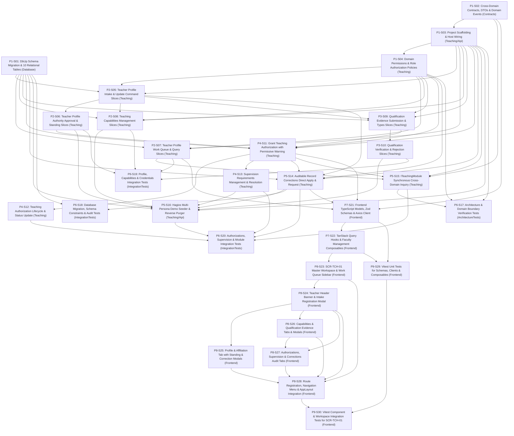

# 1. Objective

Implement the complete full scope of Stage 2 "Teacher Profile & Authorization" under the Teaching domain for Elsasa SIS V3:

1. **Teaching Profile Management (`TCH-WF-01`, `UC-TCH-02`, `SCR-TCH-01`):**
   - Establish and maintain authoritative records representing the school's recognized relationship with individuals as teaching resources (`teaching.teacher_profiles`).
   - Manage institutional teacher identifier (`teacher_number`), legal full name, professional display name with credentials, contact details, campus affiliation, and subject department.
   - Support configurable teaching roles (`teaching.teaching_roles`, e.g., Guru Tetap, Guru Kontrak, Guru Tamu, Relawan, Penilai Eksternal, Fasilitator) with qualification check mandates (`requires_qualification_check`).
   - Support non-employee teaching resources (visiting lecturers, external assessors, volunteers) by retaining a nullable employee reference (`employee_ref`) while guaranteeing identity uniqueness via national identity numbers (`national_id_or_external_ref`), strictly decoupling teaching identity from HR/payroll systems.
   - Track teacher standing states (`pending_approval`, `active`, `restricted`, `suspended`, `inactive`), standing justification rationale, effective dates (`effective_from`, `effective_to`), and formal school authority approval (`approved_by`, `approved_date`).

2. **Teaching Capability (`TCH-WF-01`, `UC-TCH-02`, `SCR-TCH-01`):**
   - Manage institutional taxonomy and categories of teaching capabilities (`teaching.capability_types`, e.g., subject area, educational stage/level, delivery mode, language of instruction, specialist activity).
   - Record potential teaching capabilities for teacher profiles (`teaching.teaching_capabilities`), describing potential pedagogical suitability across subject domains, grade stages, delivery formats, and languages independent of specific curriculum structures.
   - Enforce the foundational architectural principle that a capability describes potential suitability only; it does not by itself authorize teaching or commit teaching capacity.

3. **Qualification Evidence & Verification (`TCH-WF-02`, `UC-TCH-03`, `SCR-TCH-01`):**
   - Define recognized qualification and certification types (`teaching.qualification_types`, e.g., Sertifikat Pendidik / Serdik, Ijazah S1/S2, Sertifikat P3K, Child Protection) with renewal requirements and validity duration rules (`requires_renewal`, `default_validity_months`).
   - Store documentary evidence supporting teacher capabilities and authorizations (`teaching.qualification_evidence`), tracking the full verification lifecycle: `claimed`, `submitted`, `verified`, `rejected`, `expired`, and `revoked`.
   - Capture issuing authority, credential identifier, issue date, renewal expiry date, secure document archive reference, verification authority (`verified_by`), verification date, verification notes, and rejection reasons.
   - Enforce strict conceptual separation between qualification verification and teaching authorization: verified qualification confirms documentary authenticity, but does not automatically grant authorization to teach or assign work.

4. **Teaching Authorization Lifecycle (`TCH-WF-03`, `UC-TCH-09`, `SCR-TCH-01`):**
   - Record formal school permissions for teaching resources to perform specified teaching work within defined scopes and effective dates (`teaching.teaching_authorizations`).
   - Manage authorization scope descriptions, campus boundaries, educational program scopes, grade level scopes, delivery mode scopes, and approving authority decisions (`decision_authority`, `approved_date`).
   - Support authorization lifecycle states: `active`, `authorized_under_supervision`, `restricted`, `suspended`, `revoked`, and `expired`.
   - Support permissive guidance gating: allow granting provisional/conditional authorizations when evidence is in `submitted` state, stamping an explicit `unverified_credential_warning` flag and notifying Teaching Authority.
   - Maintain explicit traceability linking authorizations to supporting qualification evidence (`teaching.authorization_evidence`).
   - Manage conditional supervision requirements (`teaching.supervision_requirements`) when authorization is granted under supervision, capturing designated supervising mentor teachers, supervision types (co-teaching, periodic observation, lesson plan review, mentorship), validity periods, and resolution notes.

5. **Auditable Record Corrections (`TCH-WF-12`, `UC-TCH-12`, `SCR-TCH-01`):**
   - Provision `teaching.teaching_record_corrections` (table 2.15) to execute auditable corrections on finalized faculty profiles and authorization records with mandatory justification logging and before/after delta tracking.
   - Implement role-aware direct application: Teaching Authority can apply corrections directly in a single atomic transaction, while non-authority coordinators submit a `requested` correction requiring Teaching Authority approval to apply.

6. **Frontend Faculty Resource Workspace (`SCR-TCH-01`):**
   - Implement a unified Work Queue and Master-Detail Workbench at `/teaching/faculty` with queue filters (All Faculty, Pending Profile Approval, Pending Verification, Pending Authorization, Corrections) and search.
   - Provide a teacher header with standing badges and 5 cohesive tabs (*Profile & Affiliation*, *Teaching Capabilities*, *Qualification Evidence*, *Authorizations & Supervision*, *Corrections Audit*).

7. **Cross-Domain Contracts & Domain Events (`Elsasa.Sis.Contracts`):**
   - Expose synchronous inquiry contract `ITeachingModule` (`GetTeacherProfileAsync`, `IsTeacherAuthorizedAsync`, `GetActiveTeachersAsync`) for consumption by downstream modules (Academics, Operations).
   - Publish in-memory MediatR post-commit domain events for profile approvals, standing modifications, and authorization state changes.

8. **Demo Data Generator & Purger Support:**
   - Establish `ITeachingDemoDataSeeder` and `ITeachingDemoDataPurger` wired into `DemoDataOrchestrator` in forward topological and reverse-purge order.
   - Seed 4 realistic Hagios School of Life personas: (1) Senior Permanent Teacher (Budi Hartono - active authorization, verified Serdik), (2) Contract Teacher under Supervision (Siti Nurhaliza - conditional authorization, co-teaching mentor assigned), (3) Non-Employee Visiting Teacher (John Miller - null employee_ref, passport identity), and (4) Pending Onboarding Candidate (Hendra Setiawan - pending profile approval & submitted credential awaiting verification).

Planning Mode: FEATURE-PLANNING

Referenced artifacts:
- FEATURE / ISSUE:
  - `docs/issues/IS014 - TCH-TEACHER-PROFILE-ISSUE.md` (Intake `CR-TCH-TEACHER-PROFILE-AUTHORIZATION`)
  - `docs/domains/teaching-domain.md` (Purpose, Scope, Teaching Profile, Capability, Qualification Evidence, Teaching Authorization, Record Corrections; lines 40–185)
  - `docs/sub-modul-and-development-phases.md` (Stage 2: Module 1 — Teacher Profile & Authorization, Submodules 1.1–1.4)
  - `docs/operational-workflow-discovery.md` (`TCH-WF-01`, `TCH-WF-02`, `TCH-WF-03`, `TCH-WF-12`)
  - `docs/use-cases.md` (`UC-TCH-02`, `UC-TCH-03`, `UC-TCH-09`, `UC-TCH-12`)
  - `docs/actors.md` (Teaching Coordinator `ACT-12`, Teaching Authority `ACT-13`, Qualification Verifier `ACT-14`, Teacher `ACT-09`)
  - `docs/screen-inventory.md` (`SCR-TCH-01`)
  - `docs/entities/teaching-entities.md` & `docs/entities/teaching-entities-tables.md` (Module 1 tables lines 22–361; Table 2.15 `teaching_record_corrections` lines 913–950)
- ARCHITECTURE:
  - `docs/issues/IS014 - TCH-TEACHER-PROFILE-ARCHITECTURE.md` (Authoritative target capability architecture)
  - `docs/architecture/backend-architecture.md` (Modular Monolith & Vertical Slice specification)
  - `docs/architecture/frontend-architecture.md` (Modular Vue 3 SPA architecture)
  - `docs/architecture/adr.md` (ADR-001, ADR-002, ADR-004, ADR-005, ADR-006, ADR-010)
  - `docs/architecture/coding-conventions.md` (C# 12, Dapper raw SQL, Minimal API conventions)
- FEASIBILITY-ASSESSMENT:
  - `docs/issues/IS014 - TCH-TEACHER-PROFILE-FEASIBILITY-ASSESSMENT.md` (Status: `READY-FOR-PLANNING`)

Architecture Applicability: ARCHITECTURE-REQUIRED

This feature introduces the greenfield bounded context `teaching` in Stage 2 with 10 authoritative relational tables, filtered unique indices (`UQ_teaching_teacher_profiles_national_id`), synchronous cross-domain inquiry methods (`ITeachingModule`), MediatR in-memory domain events, candidate intake approval lifecycle, permissive guidance authorization gate, role-aware record corrections, multi-persona demo seeder and purger, and a unified frontend workspace (`SCR-TCH-01`). Target architecture `docs/issues/IS014 - TCH-TEACHER-PROFILE-ARCHITECTURE.md` is authoritative and governs this plan.

---

# 2. Planning Scope

The planning scope encompasses all technical changes required across database persistence, backend domain vertical slices, cross-domain contracts, automated test harnesses, and frontend workspaces:

1. **Database Schema & Migrations (`Elsasa.Sis.Database`):**
   - Author and register sequential forward DbUp migration script `20261110_0501_Teaching_TeacherProfile_Tables.sql` targeting Microsoft SQL Server 2022 ([`ADR-002`](file:///d:/Project.Private/elsasa-sis-v3/docs/architecture/adr.md#L50-L75), [`ADR-006`](file:///d:/Project.Private/elsasa-sis-v3/docs/architecture/adr.md#L152-L176)).
   - Provision isolated schema `teaching` and 10 authoritative tables:
     - Reference Tables: `teaching.teaching_roles`, `teaching.capability_types`, `teaching.qualification_types`.
     - Core Tables: `teaching.teacher_profiles`, `teaching.teaching_capabilities`, `teaching.qualification_evidence`, `teaching.teaching_authorizations`.
     - Supporting / Junction Tables: `teaching.authorization_evidence`, `teaching.supervision_requirements`, `teaching.teaching_record_corrections`.
   - Provision filtered unique index `UQ_teaching_teacher_profiles_national_id` on `national_id_or_external_ref WHERE national_id_or_external_ref IS NOT NULL`.
   - Provision unique constraints: `UQ_teaching_roles_code`, `UQ_teaching_teacher_profiles_number`, `UQ_teaching_capability_types_code`, `UQ_teaching_capabilities_unique`, `UQ_teaching_qualification_types_code`, `UQ_teaching_authorizations_number`, `UQ_teaching_record_corrections_number`.
   - Enforce domain check constraints: `CK_teaching_profiles_standing`, `CK_teaching_caps_status`, `CK_teaching_qev_state`, `CK_teaching_auth_status`, `CK_teaching_sup_type`, `CK_teaching_sup_status`, `CK_teaching_trc_status`.
   - Enforce zero physical foreign keys across domain schemas ([`ADR-001`](file:///d:/Project.Private/elsasa-sis-v3/docs/architecture/adr.md#L24-L48), [`ADR-002`](file:///d:/Project.Private/elsasa-sis-v3/docs/architecture/adr.md#L50-L75)).

2. **Cross-Domain Contracts & Domain Events (`Elsasa.Sis.Contracts`):**
   - Define synchronous query interface `ITeachingModule` in `Elsasa.Sis.Contracts/Teaching/` with methods:
     - `GetTeacherProfileAsync(Guid teacherId, CancellationToken ct = default)`
     - `IsTeacherAuthorizedAsync(Guid teacherId, string subjectOrCapability, string campus, DateOnly effectiveDate, CancellationToken ct = default)`
     - `GetActiveTeachersAsync(string? campus = null, CancellationToken ct = default)`
   - Define shared DTO records: `TeacherProfileDto`, `TeacherSummaryDto`, `TeachingRoleDto`, `TeachingCapabilityDto`, `QualificationEvidenceDto`, `TeachingAuthorizationDto`, `SupervisionRequirementDto`, `TeachingRecordCorrectionDto`.
   - Define in-memory domain event records under `src/backend/Elsasa.Sis.Contracts/Teaching/Events/` implementing `IDomainEvent` ([`ADR-003`](file:///d:/Project.Private/elsasa-sis-v3/docs/architecture/adr.md#L76-L98)):
     - `TeacherProfileCreatedEvent`, `TeacherProfileApprovedEvent`, `TeacherStandingChangedEvent`, `QualificationEvidenceVerifiedEvent`, `TeachingAuthorizationGrantedEvent`, `TeachingAuthorizationStatusChangedEvent`, `TeachingRecordCorrectedEvent`.
   - Define demo data seeding and purging contracts: `ITeachingDemoDataSeeder`, `ITeachingDemoDataPurger`, and `TeachingSeedResult` in `Elsasa.Sis.Contracts/DemoData/`.

3. **Backend Assembly Scaffolding & Permissions (`Elsasa.Sis.Teaching`):**
   - Scaffold class library `src/backend/Elsasa.Sis.Teaching/Elsasa.Sis.Teaching.csproj` targeting `net8.0` referencing only `Elsasa.Sis.Shared` and `Elsasa.Sis.Contracts`.
   - Wire project into `Elsasa.Sis.sln`.
   - Reference `Elsasa.Sis.Teaching` in `Elsasa.Sis.Api.csproj`, `Elsasa.Sis.IntegrationTests.csproj`, and `Elsasa.Sis.ArchitectureTests.csproj`.
   - Define `Permissions.cs` with permission constants:
     - `Permissions.Teaching.Faculty.View`
     - `Permissions.Teaching.Faculty.Manage`
     - `Permissions.Teaching.Faculty.Verify`
     - `Permissions.Teaching.Faculty.Authorize`
     - `Permissions.Teaching.Faculty.Correct`
   - Configure ASP.NET Core authorization policies in `DependencyInjection.cs`.
   - Provide `TeachingAssemblyMarker.cs` and `TeachingEndpoints.cs` minimal API route group mapping.

4. **Teacher Profile Lifecycle & Capability Vertical Slices (`Elsasa.Sis.Teaching`):**
   - `RegisterTeacherProfile` (`POST /api/v1/teaching/teachers`): Coordinator registers candidate profile into `pending_approval` standing with unique teacher number, handling nullable `employee_ref` and national ID.
   - `UpdateTeacherProfile` (`PUT /api/v1/teaching/teachers/{id}`): Modifies profile details while maintaining identity decoupling.
   - `ApproveTeacherProfile` (`POST /api/v1/teaching/teachers/{id}/approve`): Authority approves candidate profile, setting `standing = 'active'`, `approved_by`, and `approved_date`.
   - `ChangeTeacherStanding` (`POST /api/v1/teaching/teachers/{id}/standing`): Authority transitions standing (`restricted`, `suspended`, `inactive`, `active`) with mandatory justification rationale.
   - `GetTeacherProfileById` (`GET /api/v1/teaching/teachers/{id}`): Queries complete teacher dossier (profile, capabilities, credentials, authorizations, supervision).
   - `GetTeacherProfiles` (`GET /api/v1/teaching/teachers`): Queries work queue with filter parameters (`all`, `pending_approval`, `pending_verification`, `pending_authorization`, `corrections`, `standing`, `campus`, `search`).
   - `GetTeachingRoles` (`GET /api/v1/teaching/roles`): Returns configurable teaching roles.
   - `AddTeachingCapability` (`POST /api/v1/teaching/teachers/{id}/capabilities`): Records potential teaching capability.
   - `RemoveTeachingCapability` (`DELETE /api/v1/teaching/teachers/{id}/capabilities/{capabilityId}`): Retires capability.
   - `GetCapabilityTypes` (`GET /api/v1/teaching/capability-types`): Returns capability taxonomy categories.

5. **Qualification Evidence & Verification Vertical Slices (`Elsasa.Sis.Teaching`):**
   - `SubmitQualificationEvidence` (`POST /api/v1/teaching/teachers/{id}/qualifications`): Submits credential evidence in `submitted` state.
   - `VerifyQualificationEvidence` (`POST /api/v1/teaching/qualifications/{id}/verify`): Records qualification verification outcome, verifier stamp, date, notes, and clears warning flags on linked authorizations.
   - `RejectQualificationEvidence` (`POST /api/v1/teaching/qualifications/{id}/reject`): Records credential rejection with mandatory reason.
   - `GetQualificationTypes` (`GET /api/v1/teaching/qualification-types`): Returns qualification categories and renewal rules.

6. **Teaching Authorization, Supervision & Permissive Gate Slices (`Elsasa.Sis.Teaching`):**
   - `GrantTeachingAuthorization` (`POST /api/v1/teaching/teachers/{id}/authorizations`): Authority grants authorization with scopes, links supporting evidence via `authorization_evidence`, stamps `unverified_credential_warning = 1` if evidence is unverified, and requires supervision details if status is `authorized_under_supervision`.
   - `UpdateTeachingAuthorizationStatus` (`POST /api/v1/teaching/authorizations/{id}/status`): Updates authorization status (`restricted`, `suspended`, `revoked`, `expired`) with mandatory justification.
   - `AddSupervisionRequirement` (`POST /api/v1/teaching/authorizations/{id}/supervision`): Attaches mentor teacher and supervision conditions.
   - `ResolveSupervisionRequirement` (`POST /api/v1/teaching/supervision/{id}/resolve`): Concludes supervision condition with resolution notes.

7. **Auditable Record Corrections & Cross-Domain Services (`Elsasa.Sis.Teaching` & `Elsasa.Sis.Api`):**
   - `ApplyRecordCorrection` (`POST /api/v1/teaching/corrections`): Teaching Authority directly applies field corrections in single atomic transaction; Teaching Coordinator submits `requested` correction requiring authority approval.
   - `ApproveRecordCorrection` (`POST /api/v1/teaching/corrections/{id}/approve`): Authority approves requested correction and applies field update atomically.
   - `GetRecordCorrections` (`GET /api/v1/teaching/corrections`): Queries chronological audit trail of record corrections.
   - Implement `TeachingModuleImpl` providing synchronous inquiry responses for `ITeachingModule`.
   - Implement `TeachingDemoDataSeeder.cs` and `TeachingDemoDataPurger.cs` seeding the 4 Hagios personas and cleanly purging all 10 tables in reverse-dependency order.
   - Wire seeder and purger into `DemoDataOrchestrator.cs`.

8. **Backend Automated Testing Suite (`tests/backend`):**
   - Architecture tests in `Elsasa.Sis.ArchitectureTests` verifying ADR-001/ADR-010 compliance for `Elsasa.Sis.Teaching`.
   - Testcontainers SQL Server 2022 integration tests verifying migration execution, check constraints, unique indexes, cascading deletes, and record correction atomic updates.
   - Feature integration tests covering complete lifecycle: profile intake, authority approval, standing modification, capability addition, qualification verification/rejection, authorization with permissive warning, supervision resolution, and `ITeachingModule` contract inquiry.
   - Demo data seed & purge cycle integration tests.

9. **Frontend State, API Clients, Zod Schemas & Composables (`src/frontend`):**
   - TypeScript interfaces, Zod validation schemas (`registerTeacherSchema`, `addCapabilitySchema`, `submitEvidenceSchema`, `verifyEvidenceSchema`, `grantAuthorizationSchema`, `addSupervisionSchema`, `recordCorrectionSchema`), and Axios client modules under `src/frontend/src/features/teaching/faculty/api/`.
   - TanStack Query hooks and mutation composables under `src/frontend/src/features/teaching/faculty/composables/`.

10. **Frontend Faculty Resource Workspace (`SCR-TCH-01`) & App Integration (`src/frontend`):**
    - `FacultyResourceWorkspaceView.vue` Master-Detail workspace at route `/teaching/faculty`.
    - `FacultyQueueSidebar.vue` with queue filter tabs (`All Faculty`, `Pending Profile Approval`, `Pending Verification`, `Pending Authorization`, `Corrections`), search input, and teacher cards.
    - `TeacherHeaderBanner.vue` with standing badge, teacher summary, and primary actions (`Approve Profile`, `Change Standing`, `Audit Correction`).
    - Tab 1: `ProfileAffiliationTab.vue` (personal, contact, NIK, employee ref, campus, department).
    - Tab 2: `TeachingCapabilitiesTab.vue` (categorized capabilities list, `AddCapabilityModal.vue`, remove capability).
    - Tab 3: `QualificationEvidenceTab.vue` (credentials list, verification badges, `SubmitEvidenceModal.vue`, verify/reject dialogs).
    - Tab 4: `AuthorizationsSupervisionTab.vue` (authorizations list, scope pills, warnings, `GrantAuthorizationModal.vue`, supervision cards, `AddSupervisionModal.vue`).
    - Tab 5: `CorrectionsAuditTab.vue` (chronological before/after deltas).
    - Route registration in `src/frontend/src/app/router/routes.ts` protected by `Permissions.Teaching.Faculty.View`.
    - Navigation menu integration in `src/frontend/src/app/layouts/AppLayout.vue`.

11. **Frontend Automated Verification & Testing (`src/frontend`):**
    - Vitest unit tests for schemas, API clients, and query composables.
    - Vitest component & workbench tests for `SCR-TCH-01`, sidebar work queue filtering, header banner, tab navigation, and modal submissions.

---

# 3. Dependencies

### External System & Tooling Dependencies

- .NET 8 SDK (8.0.x)
- Docker / Docker Desktop / Podman (required for Testcontainers SQL Server 2022 integration tests)
- Microsoft SQL Server 2022 instance (for local Web API runtime)
- Node.js runtime (v22.x or LTS) and pnpm package manager (v9.x or v11.x)

### Internal Slice Dependencies

- `Depends On` declares implementation prerequisites between slices.
- Dependencies reference Slice IDs only.
- Dependency satisfaction requires the referenced slice to have implementation status `IMPLEMENTED`.
- Dependency satisfaction does not require review status `GO`.
- Slices with `Depends On: None` or whose dependencies are satisfied may be executed in parallel.

### Dependency Graph

---

# 4. Progress Summary

| Phase | Implementation Status | Review Status | Progress |
|---|---|---|---|
| P1 - Database Schema & Core Architecture Foundation | NOT-STARTED | NOT-REVIEWED | 0/4 |
| P2 - Teacher Profile Lifecycle & Capability Vertical Slices | NOT-STARTED | NOT-REVIEWED | 0/4 |
| P3 - Qualification Evidence & Verification Vertical Slices | NOT-STARTED | NOT-REVIEWED | 0/2 |
| P4 - Teaching Authorization, Supervision & Permissive Gate Slices | NOT-STARTED | NOT-REVIEWED | 0/3 |
| P5 - Auditable Record Corrections & Cross-Domain Module Implementation | NOT-STARTED | NOT-REVIEWED | 0/3 |
| P6 - Backend Automated Testing Suite | NOT-STARTED | NOT-REVIEWED | 0/4 |
| P7 - Frontend State, API Clients, Zod Schemas & Composables | NOT-STARTED | NOT-REVIEWED | 0/2 |
| P8 - Frontend Faculty Resource Workspace (SCR-TCH-01) & App Integration | NOT-STARTED | NOT-REVIEWED | 0/6 |
| P9 - Frontend Automated Verification Suite | NOT-STARTED | NOT-REVIEWED | 0/2 |

---

# 5. Phases

## P1 - Database Schema & Core Architecture Foundation

Implementation Status: NOT-STARTED  
Review Status: NOT-REVIEWED  

### P1-S01

Title: DbUp Schema Migration & 10 Teaching Relational Tables

Implementation Status: IMPLEMENTED  
Review Status: GO  

Objective: Author and register DbUp migration script `20261110_0501_Teaching_TeacherProfile_Tables.sql` creating schema `teaching` and 10 authoritative relational tables with all keys, constraints, and indices.

Depends On: None

Repository: `src/backend/Elsasa.Sis.Database`

Completion Criteria:
- Migration file `src/backend/Elsasa.Sis.Database/Scripts/20261110_0501_Teaching_TeacherProfile_Tables.sql` created and idempotent.
- Creates isolated schema `teaching`.
- Creates 10 tables:
  1. `teaching.teaching_roles` (PK, UQ `code`, default active)
  2. `teaching.teacher_profiles` (PK, UQ `teacher_number`, FK to `teaching_roles`, nullable `employee_ref`, nullable `national_id_or_external_ref`, filtered UQ index `UQ_teaching_teacher_profiles_national_id`, standing CK `pending_approval`, `active`, `restricted`, `suspended`, `inactive`)
  3. `teaching.capability_types` (PK, UQ `code`, default active)
  4. `teaching.teaching_capabilities` (PK, FK cascade to `teacher_profiles`, FK to `capability_types`, status CK `active`, `inactive`, UQ `UQ_teaching_capabilities_unique`)
  5. `teaching.qualification_types` (PK, UQ `code`, requires_renewal, default_validity_months)
  6. `teaching.qualification_evidence` (PK, FK cascade to `teacher_profiles`, FK to `qualification_types`, verification_state CK `claimed`, `submitted`, `verified`, `rejected`, `expired`, `revoked`)
  7. `teaching.teaching_authorizations` (PK, UQ `authorization_number`, FK cascade to `teacher_profiles`, FK set null to `teaching_capabilities`, status CK `active`, `authorized_under_supervision`, `restricted`, `suspended`, `revoked`, `expired`, `unverified_credential_warning` default 0)
  8. `teaching.authorization_evidence` (Composite PK, FK cascade to `teaching_authorizations`, FK cascade to `qualification_evidence`)
  9. `teaching.supervision_requirements` (PK, FK cascade to `teaching_authorizations`, FK no action to `teacher_profiles`, supervision_type CK `co_teaching`, `periodic_observation`, `lesson_plan_review`, `general_mentorship`, status CK `active`, `completed`, `waived`, `escalated`)
  10. `teaching.teaching_record_corrections` (PK, UQ `correction_number`, FK set null to `teacher_profiles`, status CK `requested`, `approved`, `rejected`, `applied`, original_value, corrected_value, reason_for_correction)
- Zero physical foreign keys across domain schemas ([ADR-001](file:///d:/Project.Private/elsasa-sis-v3/docs/architecture/adr.md#L24-L48), [ADR-002](file:///d:/Project.Private/elsasa-sis-v3/docs/architecture/adr.md#L50-L75)).

Notes: All tables use `DATETIMEOFFSET(7)` with `SYSUTCDATETIME()` defaults for audit timestamps and `NEWID()` for primary keys. Created `src/backend/Elsasa.Sis.Database/Scripts/20261110_0501_Teaching_TeacherProfile_Tables.sql` with idempotent schema, 10 authoritative tables, filtered unique index `UQ_teaching_teacher_profiles_national_id`, domain check constraints, and non-clustered performance indexes. Zero cross-schema foreign keys enforced.

Changed Files:
- `src/backend/Elsasa.Sis.Database/Scripts/20261110_0501_Teaching_TeacherProfile_Tables.sql`

---

### P1-S02

Title: Cross-Domain Contracts, DTOs & Domain Events

Implementation Status: IMPLEMENTED  
Review Status: GO  

Objective: Define the public inquiry contracts, DTO records, and post-commit domain events for the Teaching domain in `Elsasa.Sis.Contracts`.

Depends On: None

Repository: `src/backend/Elsasa.Sis.Contracts`

Completion Criteria:
- Define `ITeachingModule` interface in `Elsasa.Sis.Contracts/Teaching/ITeachingModule.cs` with:
  - `Task<Result<TeacherProfileDto?>> GetTeacherProfileAsync(Guid teacherId, CancellationToken ct = default);`
  - `Task<Result<bool>> IsTeacherAuthorizedAsync(Guid teacherId, string subjectOrCapability, string campus, DateOnly effectiveDate, CancellationToken ct = default);`
  - `Task<Result<IReadOnlyList<TeacherSummaryDto>>> GetActiveTeachersAsync(string? campus = null, CancellationToken ct = default);`
- Define contract DTOs in `Elsasa.Sis.Contracts/Teaching/`:
  - `TeacherProfileDto.cs`, `TeacherSummaryDto.cs`, `TeachingRoleDto.cs`, `TeachingCapabilityDto.cs`, `QualificationEvidenceDto.cs`, `TeachingAuthorizationDto.cs`, `SupervisionRequirementDto.cs`, `TeachingRecordCorrectionDto.cs`
- Define in-memory domain event records in `Elsasa.Sis.Contracts/Teaching/Events/` implementing `IDomainEvent`:
  - `TeacherProfileCreatedEvent.cs`, `TeacherProfileApprovedEvent.cs`, `TeacherStandingChangedEvent.cs`, `QualificationEvidenceVerifiedEvent.cs`, `TeachingAuthorizationGrantedEvent.cs`, `TeachingAuthorizationStatusChangedEvent.cs`, `TeachingRecordCorrectedEvent.cs`
- Define demo data seeding/purging contracts in `Elsasa.Sis.Contracts/DemoData/`:
  - `ITeachingDemoDataSeeder.cs`, `ITeachingDemoDataPurger.cs`, and `TeachingSeedResult.cs`.

Notes: Strictly follows ADR-001, ADR-003, and ADR-010. Created `ITeachingModule`, all 8 immutable C# 12 contract DTO records with nullable reference types, all 7 MediatR `IDomainEvent` records with UTC timestamp convenience constructors, and demo data contracts (`ITeachingDemoDataSeeder`, `ITeachingDemoDataPurger`, `TeachingSeedResult`). Solution builds with 0 warnings and 0 errors.

Changed Files:
- `src/backend/Elsasa.Sis.Contracts/Teaching/ITeachingModule.cs`
- `src/backend/Elsasa.Sis.Contracts/Teaching/TeacherProfileDto.cs`
- `src/backend/Elsasa.Sis.Contracts/Teaching/TeacherSummaryDto.cs`
- `src/backend/Elsasa.Sis.Contracts/Teaching/TeachingRoleDto.cs`
- `src/backend/Elsasa.Sis.Contracts/Teaching/TeachingCapabilityDto.cs`
- `src/backend/Elsasa.Sis.Contracts/Teaching/QualificationEvidenceDto.cs`
- `src/backend/Elsasa.Sis.Contracts/Teaching/TeachingAuthorizationDto.cs`
- `src/backend/Elsasa.Sis.Contracts/Teaching/SupervisionRequirementDto.cs`
- `src/backend/Elsasa.Sis.Contracts/Teaching/TeachingRecordCorrectionDto.cs`
- `src/backend/Elsasa.Sis.Contracts/Teaching/Events/TeacherProfileCreatedEvent.cs`
- `src/backend/Elsasa.Sis.Contracts/Teaching/Events/TeacherProfileApprovedEvent.cs`
- `src/backend/Elsasa.Sis.Contracts/Teaching/Events/TeacherStandingChangedEvent.cs`
- `src/backend/Elsasa.Sis.Contracts/Teaching/Events/QualificationEvidenceVerifiedEvent.cs`
- `src/backend/Elsasa.Sis.Contracts/Teaching/Events/TeachingAuthorizationGrantedEvent.cs`
- `src/backend/Elsasa.Sis.Contracts/Teaching/Events/TeachingAuthorizationStatusChangedEvent.cs`
- `src/backend/Elsasa.Sis.Contracts/Teaching/Events/TeachingRecordCorrectedEvent.cs`
- `src/backend/Elsasa.Sis.Contracts/DemoData/ITeachingDemoDataSeeder.cs`
- `src/backend/Elsasa.Sis.Contracts/DemoData/ITeachingDemoDataPurger.cs`
- `src/backend/Elsasa.Sis.Contracts/DemoData/TeachingSeedResult.cs`

---

### P1-S03

Title: Project Scaffolding & Host Wiring

Implementation Status: IMPLEMENTED  
Review Status: GO  

Objective: Scaffold the `Elsasa.Sis.Teaching` backend project, reference it in `Elsasa.Sis.sln` and consuming projects, and establish module initialization infrastructure.

Depends On: P1-S02

Repository: `src/backend/Elsasa.Sis.Teaching`

Completion Criteria:
- `src/backend/Elsasa.Sis.Teaching/Elsasa.Sis.Teaching.csproj` created targeting `net8.0` with `<Nullable>enable</Nullable>`.
- Project references only:
  - `..\Elsasa.Sis.Shared\Elsasa.Sis.Shared.csproj`
  - `..\Elsasa.Sis.Contracts\Elsasa.Sis.Contracts.csproj`
- Project added to solution `src/backend/Elsasa.Sis.sln`.
- Project referenced in `src/backend/Elsasa.Sis.Api/Elsasa.Sis.Api.csproj`, `tests/backend/Elsasa.Sis.IntegrationTests/Elsasa.Sis.IntegrationTests.csproj`, and `tests/backend/Elsasa.Sis.ArchitectureTests/Elsasa.Sis.ArchitectureTests.csproj`.
- `TeachingAssemblyMarker.cs` created.
- `DependencyInjection.cs` created with `AddTeachingModule(this IServiceCollection services, IConfiguration configuration)`.
- `TeachingEndpoints.cs` created with `MapTeachingEndpoints(this IEndpointRouteBuilder app)` mapping group `/api/v1/teaching`.
- Wired into `src/backend/Elsasa.Sis.Api/Program.cs`: `builder.Services.AddTeachingModule(builder.Configuration)` and `app.MapTeachingEndpoints()`.

Notes: Scaffolded `Elsasa.Sis.Teaching` targeting `net8.0` with `<Nullable>enable</Nullable>`, referencing only `Shared` and `Contracts`. Added project to `Elsasa.Sis.sln` under solution folder `src/backend`. Added project references to `Elsasa.Sis.Api.csproj`, `Elsasa.Sis.IntegrationTests.csproj`, and `Elsasa.Sis.ArchitectureTests.csproj`. Created `TeachingAssemblyMarker`, `DependencyInjection.AddTeachingModule`, and `TeachingEndpoints.MapTeachingEndpoints`. Wired into `Program.cs` and `Api.Configuration.DependencyInjection`. Verified zero cross-domain references to sibling domains; solution builds with 0 warnings and 0 errors, and all 134 architecture tests pass.

Changed Files:
- `src/backend/Elsasa.Sis.Teaching/Elsasa.Sis.Teaching.csproj`
- `src/backend/Elsasa.Sis.Teaching/TeachingAssemblyMarker.cs`
- `src/backend/Elsasa.Sis.Teaching/DependencyInjection.cs`
- `src/backend/Elsasa.Sis.Teaching/TeachingEndpoints.cs`
- `src/backend/Elsasa.Sis.sln`
- `src/backend/Elsasa.Sis.Api/Elsasa.Sis.Api.csproj`
- `src/backend/Elsasa.Sis.Api/Configuration/DependencyInjection.cs`
- `src/backend/Elsasa.Sis.Api/Program.cs`
- `tests/backend/Elsasa.Sis.IntegrationTests/Elsasa.Sis.IntegrationTests.csproj`
- `tests/backend/Elsasa.Sis.ArchitectureTests/Elsasa.Sis.ArchitectureTests.csproj`

---

### P1-S04

Title: Domain Permissions & Role Authorization Policies

Implementation Status: IMPLEMENTED  
Review Status: GO  

Objective: Define domain permission constants and register role-based authorization policies for the Teaching domain.

Depends On: P1-S03

Repository: `src/backend/Elsasa.Sis.Teaching`

Completion Criteria:
- Create `src/backend/Elsasa.Sis.Teaching/Permissions.cs` with constants:
  - `Permissions.Teaching.Faculty.View` = `"Permissions.Teaching.Faculty.View"`
  - `Permissions.Teaching.Faculty.Manage` = `"Permissions.Teaching.Faculty.Manage"`
  - `Permissions.Teaching.Faculty.Verify` = `"Permissions.Teaching.Faculty.Verify"`
  - `Permissions.Teaching.Faculty.Authorize` = `"Permissions.Teaching.Faculty.Authorize"`
  - `Permissions.Teaching.Faculty.Correct` = `"Permissions.Teaching.Faculty.Correct"`
- Configure policies in `DependencyInjection.cs`:
  - `Permissions.Teaching.Faculty.View`: Teaching Coordinator, Teaching Authority, Admin.
  - `Permissions.Teaching.Faculty.Manage`: Teaching Coordinator, Teaching Authority, Admin.
  - `Permissions.Teaching.Faculty.Verify`: Qualification Verifier, Teaching Authority, Admin.
  - `Permissions.Teaching.Faculty.Authorize`: Teaching Authority, Admin (*Kepala Sekolah / VP Academics*).
  - `Permissions.Teaching.Faculty.Correct`: Teaching Coordinator, Teaching Authority, Admin.

Notes: Policies map strictly to documented actors (`ACT-12`, `ACT-13`, `ACT-14`). Defined domain permission constants in `Permissions.cs` supporting both `Permissions.Teaching.Faculty.*` and `Permissions.Faculty.*` hierarchies. Configured ASP.NET Core authorization policies in `DependencyInjection.cs` with role assertions matching actors ACT-12 (`TeachingCoordinator`), ACT-13 (`TeachingAuthority`, `KepalaSekolah`, `VPAcademics`), ACT-14 (`QualificationVerifier`), and `Admin`. Solution builds cleanly with 0 warnings/errors and all 134 architecture tests pass.

Changed Files:
- `src/backend/Elsasa.Sis.Teaching/Permissions.cs`
- `src/backend/Elsasa.Sis.Teaching/DependencyInjection.cs`

---

## P2 - Teacher Profile Lifecycle & Capability Vertical Slices

Implementation Status: NOT-STARTED  
Review Status: NOT-REVIEWED  

### P2-S05

Title: Teacher Profile Intake & Update Command Slices

Implementation Status: IMPLEMENTED  
Review Status: GO  

Objective: Implement vertical slices for registering candidate teacher profiles into `pending_approval` standing and updating mutable profile details while preserving identity decoupling.

Depends On: P1-S01, P1-S03, P1-S04

Repository: `src/backend/Elsasa.Sis.Teaching`

Completion Criteria:
- Implement `RegisterTeacherProfile`:
  - Endpoint: `POST /api/v1/teaching/teachers`
  - Permission: `Permissions.Teaching.Faculty.Manage`
  - Validates request using FluentValidation: `teacher_number` format, `full_name`, `teaching_role_id` exists, valid `campus_affiliation`, valid `effective_from`.
  - Generates or validates unique `teacher_number`.
  - Supports nullable `employee_ref` (for non-employees) and unique `national_id_or_external_ref` (NIK or passport).
  - Inserts row into `teaching.teacher_profiles` with `standing = 'pending_approval'`, `approved_by = NULL`, `approved_date = NULL`.
  - Publishes `TeacherProfileCreatedEvent`.
  - Returns `201 Created` with created profile ID.
- Implement `UpdateTeacherProfile`:
  - Endpoint: `PUT /api/v1/teaching/teachers/{id}`
  - Permission: `Permissions.Teaching.Faculty.Manage`
  - Updates display name, contact email, phone, campus affiliation, department, notes.
  - Prevents modifying `standing` or `approved_by` directly through this endpoint.
  - Returns `200 OK` or `Result.Success()`.

Notes: Implemented `RegisterTeacherProfile` (`POST /api/v1/teaching/teachers`) and `UpdateTeacherProfile` (`PUT /api/v1/teaching/teachers/{id}`) vertical slices with FluentValidation validators (`RegisterTeacherProfileValidator`, `UpdateTeacherProfileValidator`), handlers with parameterized Dapper `CommandDefinition` queries and cancellation tokens, MediatR `TeacherProfileCreatedEvent` publishing, duplicate detection for `teacher_number` and `national_id_or_external_ref`, and strict exclusion of standing/approved_by mutations from the update endpoint. Registered handlers in `DependencyInjection.cs`. Solution builds cleanly with 0 warnings/errors and all 134 architecture tests pass.

Changed Files:
- `src/backend/Elsasa.Sis.Teaching/Features/TeacherProfiles/RegisterTeacherProfile/RegisterTeacherProfileRequest.cs`
- `src/backend/Elsasa.Sis.Teaching/Features/TeacherProfiles/RegisterTeacherProfile/RegisterTeacherProfileResponse.cs`
- `src/backend/Elsasa.Sis.Teaching/Features/TeacherProfiles/RegisterTeacherProfile/RegisterTeacherProfileValidator.cs`
- `src/backend/Elsasa.Sis.Teaching/Features/TeacherProfiles/RegisterTeacherProfile/RegisterTeacherProfileHandler.cs`
- `src/backend/Elsasa.Sis.Teaching/Features/TeacherProfiles/RegisterTeacherProfile/RegisterTeacherProfileEndpoint.cs`
- `src/backend/Elsasa.Sis.Teaching/Features/TeacherProfiles/UpdateTeacherProfile/UpdateTeacherProfileRequest.cs`
- `src/backend/Elsasa.Sis.Teaching/Features/TeacherProfiles/UpdateTeacherProfile/UpdateTeacherProfileValidator.cs`
- `src/backend/Elsasa.Sis.Teaching/Features/TeacherProfiles/UpdateTeacherProfile/UpdateTeacherProfileHandler.cs`
- `src/backend/Elsasa.Sis.Teaching/Features/TeacherProfiles/UpdateTeacherProfile/UpdateTeacherProfileEndpoint.cs`
- `src/backend/Elsasa.Sis.Teaching/DependencyInjection.cs`

---

### P2-S06

Title: Teacher Profile Authority Approval & Standing Transition Slices

Implementation Status: IMPLEMENTED  
Review Status: GO  

Objective: Implement vertical slices for Teaching Authority formal candidate approval and standing lifecycle transitions.

Depends On: P2-S05

Repository: `src/backend/Elsasa.Sis.Teaching`

Completion Criteria:
- Implement `ApproveTeacherProfile`:
  - Endpoint: `POST /api/v1/teaching/teachers/{id}/approve`
  - Permission: `Permissions.Teaching.Faculty.Authorize`
  - Verifies current `standing == 'pending_approval'`.
  - Updates `standing = 'active'`, `approved_by = currentUser`, `approved_date = today`, `updated_at = SYSUTCDATETIME()`.
  - Publishes `TeacherProfileApprovedEvent`.
  - Returns `200 OK`.
- Implement `ChangeTeacherStanding`:
  - Endpoint: `POST /api/v1/teaching/teachers/{id}/standing`
  - Permission: `Permissions.Teaching.Faculty.Authorize`
  - Validates `standing` in (`'active'`, `'restricted'`, `'suspended'`, `'inactive'`) and mandatory `standing_reason`.
  - Updates `standing`, `standing_reason`, `updated_at`, `updated_by`.
  - Publishes `TeacherStandingChangedEvent`.
  - Returns `200 OK`.

Notes: Strictly enforces Teaching Authority approval gate (`ACT-13`) and standing lifecycle state transitions (`TD-03`). Implemented `ApproveTeacherProfile` (`POST /api/v1/teaching/teachers/{id}/approve`) and `ChangeTeacherStanding` (`POST /api/v1/teaching/teachers/{id}/standing`) vertical slices with parameterized Dapper `CommandDefinition` queries, cancellation token propagation, MediatR post-commit domain event publishing (`TeacherProfileApprovedEvent`, `TeacherStandingChangedEvent`), FluentValidation validation for permitted standing values (`active`, `restricted`, `suspended`, `inactive`) and mandatory justification reason, and policy protection with `Permissions.Teaching.Faculty.Authorize`. Added validator unit tests. Solution builds with 0 warnings/errors and all 134 architecture tests pass.

Changed Files:
- `src/backend/Elsasa.Sis.Teaching/Features/TeacherProfiles/ApproveTeacherProfile/ApproveTeacherProfileResponse.cs`
- `src/backend/Elsasa.Sis.Teaching/Features/TeacherProfiles/ApproveTeacherProfile/ApproveTeacherProfileHandler.cs`
- `src/backend/Elsasa.Sis.Teaching/Features/TeacherProfiles/ApproveTeacherProfile/ApproveTeacherProfileEndpoint.cs`
- `src/backend/Elsasa.Sis.Teaching/Features/TeacherProfiles/ChangeTeacherStanding/ChangeTeacherStandingRequest.cs`
- `src/backend/Elsasa.Sis.Teaching/Features/TeacherProfiles/ChangeTeacherStanding/ChangeTeacherStandingResponse.cs`
- `src/backend/Elsasa.Sis.Teaching/Features/TeacherProfiles/ChangeTeacherStanding/ChangeTeacherStandingValidator.cs`
- `src/backend/Elsasa.Sis.Teaching/Features/TeacherProfiles/ChangeTeacherStanding/ChangeTeacherStandingHandler.cs`
- `src/backend/Elsasa.Sis.Teaching/Features/TeacherProfiles/ChangeTeacherStanding/ChangeTeacherStandingEndpoint.cs`
- `src/backend/Elsasa.Sis.Teaching/DependencyInjection.cs`
- `tests/backend/Elsasa.Sis.IntegrationTests/UnitTests/Teaching/ChangeTeacherStandingValidatorTests.cs`

---

### P2-S07

Title: Teacher Profile Work Queue & Query Slices

Implementation Status: IMPLEMENTED  
Review Status: GO  

Objective: Implement vertical query slices supporting the unified work queue, faculty list filtering, detailed dossier retrieval, and role options.

Depends On: P1-S01, P1-S03, P1-S04

Repository: `src/backend/Elsasa.Sis.Teaching`

Completion Criteria:
- Implement `GetTeacherProfiles`:
  - Endpoint: `GET /api/v1/teaching/teachers`
  - Permission: `Permissions.Teaching.Faculty.View`
  - Query parameters: `queueFilter` (`all`, `pending_approval`, `pending_verification`, `pending_authorization`, `corrections`), `standing`, `campus`, `search`, pagination.
  - Efficient Dapper queries executing server-side queue categorization:
    - `pending_approval`: `standing = 'pending_approval'`
    - `pending_verification`: has `qualification_evidence` with `verification_state = 'submitted'`
    - `pending_authorization`: `standing = 'active'` and zero active `teaching_authorizations`
    - `corrections`: has open `teaching_record_corrections` with `status = 'requested'`
  - Returns list of `TeacherSummaryDto` with pagination metadata.
- Implement `GetTeacherProfileById`:
  - Endpoint: `GET /api/v1/teaching/teachers/{id}`
  - Permission: `Permissions.Teaching.Faculty.View`
  - Returns complete `TeacherProfileDto` including role details, capabilities, qualification evidence, authorizations, supervision requirements, and recent corrections.
- Implement `GetTeachingRoles`:
  - Endpoint: `GET /api/v1/teaching/roles`
  - Permission: `Permissions.Teaching.Faculty.View`
  - Returns active `TeachingRoleDto` list.

Notes: Implemented all three query vertical slices using parameterized Dapper queries with `CommandDefinition` and cancellation tokens. `GetTeacherProfiles` executes server-side work queue categorization (`all`, `pending_approval`, `pending_verification`, `pending_authorization`, `corrections`), standing filtering, campus filtering, multi-field search (`teacher_number`, `full_name`, `display_name`, `national_id_or_external_ref`), and pagination (`PaginatedList<TeacherSummaryDto>`) in a single database round-trip via `QueryMultipleAsync`. `GetTeacherProfileById` retrieves the complete faculty dossier (core profile, capabilities, qualification evidence, authorizations with linked evidence and supervision requirements, and auditable record corrections) via a single multi-grid SQL round-trip, completely avoiding N+1 performance pitfalls. `GetTeachingRoles` queries all active teaching roles ordered by name. Handlers registered in `DependencyInjection.cs`. Solution builds with 0 warnings/errors and all 134 architecture tests pass.

Changed Files:
- `src/backend/Elsasa.Sis.Teaching/Features/TeacherProfiles/GetTeacherProfiles/GetTeacherProfilesEndpoint.cs`
- `src/backend/Elsasa.Sis.Teaching/Features/TeacherProfiles/GetTeacherProfiles/GetTeacherProfilesHandler.cs`
- `src/backend/Elsasa.Sis.Teaching/Features/TeacherProfiles/GetTeacherProfileById/GetTeacherProfileByIdEndpoint.cs`
- `src/backend/Elsasa.Sis.Teaching/Features/TeacherProfiles/GetTeacherProfileById/GetTeacherProfileByIdHandler.cs`
- `src/backend/Elsasa.Sis.Teaching/Features/TeacherProfiles/GetTeachingRoles/GetTeachingRolesEndpoint.cs`
- `src/backend/Elsasa.Sis.Teaching/Features/TeacherProfiles/GetTeachingRoles/GetTeachingRolesHandler.cs`
- `src/backend/Elsasa.Sis.Teaching/DependencyInjection.cs`

---

### P2-S08

Title: Teaching Capabilities Management Slices

Implementation Status: IMPLEMENTED  
Review Status: GO  

Objective: Implement vertical slices to record and retire potential teaching capabilities on teacher profiles, and retrieve capability taxonomy types.

Depends On: P1-S01, P1-S03, P1-S04, P2-S05

Repository: `src/backend/Elsasa.Sis.Teaching`

Completion Criteria:
- Implement `AddTeachingCapability`:
  - Endpoint: `POST /api/v1/teaching/teachers/{id}/capabilities`
  - Permission: `Permissions.Teaching.Faculty.Manage`
  - Validates `capability_type_id`, `capability_code`, `capability_name`, optional `applicable_level`, `delivery_mode`, `language_of_instruction`.
  - Enforces `UQ_teaching_capabilities_unique` idempotently.
  - Inserts row into `teaching.teaching_capabilities` with `status = 'active'`.
  - Confirms capability describes potential suitability only; does not alter profile standing or authorizations.
  - Returns `201 Created` with capability ID.
- Implement `RemoveTeachingCapability`:
  - Endpoint: `DELETE /api/v1/teaching/teachers/{id}/capabilities/{capabilityId}`
  - Permission: `Permissions.Teaching.Faculty.Manage`
  - Soft-retires or deletes capability (sets `status = 'inactive'`).
  - Returns `204 NoContent`.
- Implement `GetCapabilityTypes`:
  - Endpoint: `GET /api/v1/teaching/capability-types`
  - Permission: `Permissions.Teaching.Faculty.View`
  - Returns active capability taxonomy types.

Notes: Implemented `AddTeachingCapability` (`POST /api/v1/teaching/teachers/{id}/capabilities`), `RemoveTeachingCapability` (`DELETE /api/v1/teaching/teachers/{id}/capabilities/{capabilityId}`), and `GetCapabilityTypes` (`GET /api/v1/teaching/capability-types`) vertical slices adhering strictly to TD-02 and ADR-004/ADR-005. `AddTeachingCapability` validates inputs via FluentValidation, ensures existence of teacher profile and active capability type, enforces `UQ_teaching_capabilities_unique` idempotently (reactivating inactive records or returning existing ID if already active, with SqlException race-condition fallback), inserts active rows with audit metadata, and confirms potential suitability without mutating profile standing or authorizations. `RemoveTeachingCapability` soft-retires capabilities by setting `status = 'inactive'` idempotently and returning 204 NoContent. `GetCapabilityTypes` queries active taxonomy categories using parameterized Dapper queries with `CommandDefinition` and cancellation tokens. Handlers registered in `DependencyInjection.cs`. Solution builds cleanly with 0 warnings/errors and all 134 architecture tests pass.

Changed Files:
- `src/backend/Elsasa.Sis.Teaching/Features/TeachingCapabilities/AddTeachingCapability/AddTeachingCapabilityRequest.cs`
- `src/backend/Elsasa.Sis.Teaching/Features/TeachingCapabilities/AddTeachingCapability/AddTeachingCapabilityResponse.cs`
- `src/backend/Elsasa.Sis.Teaching/Features/TeachingCapabilities/AddTeachingCapability/AddTeachingCapabilityValidator.cs`
- `src/backend/Elsasa.Sis.Teaching/Features/TeachingCapabilities/AddTeachingCapability/AddTeachingCapabilityHandler.cs`
- `src/backend/Elsasa.Sis.Teaching/Features/TeachingCapabilities/AddTeachingCapability/AddTeachingCapabilityEndpoint.cs`
- `src/backend/Elsasa.Sis.Teaching/Features/TeachingCapabilities/RemoveTeachingCapability/RemoveTeachingCapabilityHandler.cs`
- `src/backend/Elsasa.Sis.Teaching/Features/TeachingCapabilities/RemoveTeachingCapability/RemoveTeachingCapabilityEndpoint.cs`
- `src/backend/Elsasa.Sis.Teaching/Features/TeachingCapabilities/GetCapabilityTypes/CapabilityTypeDto.cs`
- `src/backend/Elsasa.Sis.Teaching/Features/TeachingCapabilities/GetCapabilityTypes/GetCapabilityTypesHandler.cs`
- `src/backend/Elsasa.Sis.Teaching/Features/TeachingCapabilities/GetCapabilityTypes/GetCapabilityTypesEndpoint.cs`
- `src/backend/Elsasa.Sis.Teaching/DependencyInjection.cs`

---

## P3 - Qualification Evidence & Verification Vertical Slices

Implementation Status: NOT-STARTED  
Review Status: NOT-REVIEWED  

### P3-S09

Title: Qualification Evidence Submission & Types Slices

Implementation Status: IMPLEMENTED  
Review Status: GO  

Objective: Implement vertical slices to submit qualification documentary evidence for teacher profiles and query recognized qualification categories.

Depends On: P1-S01, P1-S03, P1-S04, P2-S05

Repository: `src/backend/Elsasa.Sis.Teaching`

Completion Criteria:
- Implement `SubmitQualificationEvidence`:
  - Endpoint: `POST /api/v1/teaching/teachers/{id}/qualifications`
  - Permission: `Permissions.Teaching.Faculty.Manage`
  - Validates `qualification_type_id`, `title`, `issuing_authority`, `credential_identifier`, `issue_date`, optional `expiry_date`, optional `document_reference`.
  - Inserts row into `teaching.qualification_evidence` with `verification_state = 'submitted'`.
  - Returns `201 Created` with evidence ID.
- Implement `GetQualificationTypes`:
  - Endpoint: `GET /api/v1/teaching/qualification-types`
  - Permission: `Permissions.Teaching.Faculty.View`
  - Returns active qualification types (`requires_renewal`, `default_validity_months`).

Notes: Implemented `SubmitQualificationEvidence` (`POST /api/v1/teaching/teachers/{id}/qualifications`) and `GetQualificationTypes` (`GET /api/v1/teaching/qualification-types`) vertical slices adhering strictly to TD-02 and TD-05. `SubmitQualificationEvidence` validates teacher existence, active qualification type, and date bounds with `SubmitQualificationEvidenceValidator`, inserting evidence into `teaching.qualification_evidence` in initial `submitted` state and returning `201 Created`. `GetQualificationTypes` returns all active qualification categories with renewal and default validity configurations. Handlers use parameterized Dapper queries with `CommandDefinition` and cancellation tokens, registering `DapperTypeHandlers` for proper DateOnly handling. Handlers wired in `DependencyInjection.cs`. Solution builds cleanly with 0 warnings/errors and all 134 architecture tests pass.

Changed Files:
- `src/backend/Elsasa.Sis.Teaching/Features/QualificationEvidence/SubmitQualificationEvidence/SubmitQualificationEvidenceRequest.cs`
- `src/backend/Elsasa.Sis.Teaching/Features/QualificationEvidence/SubmitQualificationEvidence/SubmitQualificationEvidenceResponse.cs`
- `src/backend/Elsasa.Sis.Teaching/Features/QualificationEvidence/SubmitQualificationEvidence/SubmitQualificationEvidenceValidator.cs`
- `src/backend/Elsasa.Sis.Teaching/Features/QualificationEvidence/SubmitQualificationEvidence/SubmitQualificationEvidenceHandler.cs`
- `src/backend/Elsasa.Sis.Teaching/Features/QualificationEvidence/SubmitQualificationEvidence/SubmitQualificationEvidenceEndpoint.cs`
- `src/backend/Elsasa.Sis.Teaching/Features/QualificationEvidence/GetQualificationTypes/QualificationTypeResponse.cs`
- `src/backend/Elsasa.Sis.Teaching/Features/QualificationEvidence/GetQualificationTypes/GetQualificationTypesHandler.cs`
- `src/backend/Elsasa.Sis.Teaching/Features/QualificationEvidence/GetQualificationTypes/GetQualificationTypesEndpoint.cs`
- `src/backend/Elsasa.Sis.Teaching/DependencyInjection.cs`

---

### P3-S10

Title: Qualification Verification & Rejection Slices

Implementation Status: IMPLEMENTED  
Review Status: GO  

Objective: Implement vertical slices for Qualification Verifiers to verify authenticity of submitted credentials or record rejection with rationale.

Depends On: P3-S09

Repository: `src/backend/Elsasa.Sis.Teaching`

Completion Criteria:
- Implement `VerifyQualificationEvidence`:
  - Endpoint: `POST /api/v1/teaching/qualifications/{id}/verify`
  - Permission: `Permissions.Teaching.Faculty.Verify`
  - Validates evidence exists and is in `claimed` or `submitted` state.
  - Updates `verification_state = 'verified'`, `verified_by = currentUser`, `verified_date = today`, `verification_notes`.
  - Checks if linked authorizations in `teaching.authorization_evidence` have `unverified_credential_warning = 1`. If all linked credentials for an authorization are now verified, updates `unverified_credential_warning = 0`.
  - Publishes `QualificationEvidenceVerifiedEvent`.
  - Returns `200 OK`.
- Implement `RejectQualificationEvidence`:
  - Endpoint: `POST /api/v1/teaching/qualifications/{id}/reject`
  - Permission: `Permissions.Teaching.Faculty.Verify`
  - Validates mandatory `rejection_reason`.
  - Updates `verification_state = 'rejected'`, `verified_by = currentUser`, `verified_date = today`, `rejection_reason`.
  - Returns `200 OK`.

Notes: Verification is strictly documentary authentication (`ACT-14`), separated from authorization to teach. Implemented `VerifyQualificationEvidence` (`POST /api/v1/teaching/qualifications/{id}/verify`) and `RejectQualificationEvidence` (`POST /api/v1/teaching/qualifications/{id}/reject`) vertical slices protected by `Permissions.Teaching.Faculty.Verify`. `VerifyQualificationEvidence` validates evidence existence and state (`claimed` or `submitted`), updates verification status to `verified` with currentUser audit stamp and verification notes, checks linked authorizations with `unverified_credential_warning = 1` and clears the warning flag to `0` when all supporting credentials become verified within a database transaction, and publishes `QualificationEvidenceVerifiedEvent`. `RejectQualificationEvidence` enforces mandatory `rejection_reason` via FluentValidation, validates existing evidence in `claimed`/`submitted` state, and transitions verification state to `rejected`. Both handlers utilize parameterized Dapper `CommandDefinition` queries with cancellation tokens and are registered in `DependencyInjection.cs`. Solution builds cleanly with 0 warnings/errors and all 134 architecture tests pass.

Changed Files:
- `src/backend/Elsasa.Sis.Teaching/Features/QualificationEvidence/VerifyQualificationEvidence/VerifyQualificationEvidenceRequest.cs`
- `src/backend/Elsasa.Sis.Teaching/Features/QualificationEvidence/VerifyQualificationEvidence/VerifyQualificationEvidenceResponse.cs`
- `src/backend/Elsasa.Sis.Teaching/Features/QualificationEvidence/VerifyQualificationEvidence/VerifyQualificationEvidenceValidator.cs`
- `src/backend/Elsasa.Sis.Teaching/Features/QualificationEvidence/VerifyQualificationEvidence/VerifyQualificationEvidenceHandler.cs`
- `src/backend/Elsasa.Sis.Teaching/Features/QualificationEvidence/VerifyQualificationEvidence/VerifyQualificationEvidenceEndpoint.cs`
- `src/backend/Elsasa.Sis.Teaching/Features/QualificationEvidence/RejectQualificationEvidence/RejectQualificationEvidenceRequest.cs`
- `src/backend/Elsasa.Sis.Teaching/Features/QualificationEvidence/RejectQualificationEvidence/RejectQualificationEvidenceResponse.cs`
- `src/backend/Elsasa.Sis.Teaching/Features/QualificationEvidence/RejectQualificationEvidence/RejectQualificationEvidenceValidator.cs`
- `src/backend/Elsasa.Sis.Teaching/Features/QualificationEvidence/RejectQualificationEvidence/RejectQualificationEvidenceHandler.cs`
- `src/backend/Elsasa.Sis.Teaching/Features/QualificationEvidence/RejectQualificationEvidence/RejectQualificationEvidenceEndpoint.cs`
- `src/backend/Elsasa.Sis.Teaching/DependencyInjection.cs`

---

## P4 - Teaching Authorization, Supervision & Permissive Gate Slices

Implementation Status: NOT-STARTED  
Review Status: NOT-REVIEWED  

### P4-S11

Title: Grant Teaching Authorization with Permissive Warning Slice

Implementation Status: IMPLEMENTED  
Review Status: GO  

Objective: Implement vertical slice for Teaching Authority to grant formal teaching authorizations, link supporting qualification evidence, evaluate unverified warning flags, and mandate supervision requirements when conditional.

Depends On: P1-S01, P1-S03, P1-S04, P2-S06, P3-S09

Repository: `src/backend/Elsasa.Sis.Teaching`

Completion Criteria:
- Implement `GrantTeachingAuthorization`:
  - Endpoint: `POST /api/v1/teaching/teachers/{id}/authorizations`
  - Permission: `Permissions.Teaching.Faculty.Authorize`
  - Validates teacher standing is `active`.
  - Validates scope details (`scope_description`, `campus_scope`, `effective_start_date`, optional `authorized_capability_id`).
  - Generates unique `authorization_number` (e.g. `AUTH-YYYY-XXXX`).
  - Evaluates linked qualification evidence:
    - If any linked evidence has `verification_state != 'verified'` (e.g., `'submitted'`), sets `unverified_credential_warning = 1`.
    - If all linked evidence is `'verified'`, sets `unverified_credential_warning = 0`.
  - Evaluates status:
    - If `status == 'authorized_under_supervision'`, validates that supervision payload (`supervision_type`, `description`, `start_date`, optional `supervising_teacher_id`) is provided.
  - Executes within a single `SqlTransaction`:
    1. Inserts row into `teaching.teaching_authorizations`.
    2. Inserts rows into `teaching.authorization_evidence`.
    3. If `authorized_under_supervision`, inserts row into `teaching.supervision_requirements`.
  - Publishes `TeachingAuthorizationGrantedEvent` with `HasUnverifiedWarning`.
  - Returns `201 Created` with authorization ID.

Notes: Implemented `GrantTeachingAuthorization` (`POST /api/v1/teaching/teachers/{id}/authorizations`) vertical slice realizing the TD-05 Permissive Guidance Gate. Handler verifies teacher profile exists and standing is `active`, generates unique traceable `authorization_number` (`AUTH-{year}-{seq:D4}`), links supporting qualification evidence via `teaching.authorization_evidence`, inspects linked evidence verification states to flag `unverified_credential_warning` (1 if any linked evidence is in submitted/unverified state, 0 if all verified), and mandates initial supervision requirement details stored in `teaching.supervision_requirements` within a single atomic `SqlTransaction` when granting `authorized_under_supervision`. Publishes post-commit `TeachingAuthorizationGrantedEvent` with warning status and returns `201 Created` with authorization ID. Endpoints protected with `Permissions.Teaching.Faculty.Authorize`. Added validator unit tests. Solution builds with 0 warnings/errors and all 134 architecture tests pass.

Changed Files:
- `src/backend/Elsasa.Sis.Teaching/Features/TeachingAuthorizations/GrantTeachingAuthorization/GrantSupervisionPayload.cs`
- `src/backend/Elsasa.Sis.Teaching/Features/TeachingAuthorizations/GrantTeachingAuthorization/GrantTeachingAuthorizationRequest.cs`
- `src/backend/Elsasa.Sis.Teaching/Features/TeachingAuthorizations/GrantTeachingAuthorization/GrantTeachingAuthorizationResponse.cs`
- `src/backend/Elsasa.Sis.Teaching/Features/TeachingAuthorizations/GrantTeachingAuthorization/GrantTeachingAuthorizationValidator.cs`
- `src/backend/Elsasa.Sis.Teaching/Features/TeachingAuthorizations/GrantTeachingAuthorization/GrantTeachingAuthorizationHandler.cs`
- `src/backend/Elsasa.Sis.Teaching/Features/TeachingAuthorizations/GrantTeachingAuthorization/GrantTeachingAuthorizationEndpoint.cs`
- `src/backend/Elsasa.Sis.Teaching/DependencyInjection.cs`
- `tests/backend/Elsasa.Sis.IntegrationTests/UnitTests/Teaching/GrantTeachingAuthorizationValidatorTests.cs`

---

### P4-S12

Title: Teaching Authorization Lifecycle & Status Update Slice

Implementation Status: IMPLEMENTED  
Review Status: GO  

Objective: Implement vertical slice for Teaching Authority to transition authorization lifecycle status (`active`, `restricted`, `suspended`, `revoked`, `expired`) with mandatory justification.

Depends On: P4-S11

Repository: `src/backend/Elsasa.Sis.Teaching`

Completion Criteria:
- Implement `UpdateTeachingAuthorizationStatus`:
  - Endpoint: `POST /api/v1/teaching/authorizations/{id}/status`
  - Permission: `Permissions.Teaching.Faculty.Authorize`
  - Validates `status` in (`'active'`, `'authorized_under_supervision'`, `'restricted'`, `'suspended'`, `'revoked'`, `'expired'`).
  - Validates mandatory `suspension_or_revocation_reason` when transitioning to `restricted`, `suspended`, or `revoked`.
  - Updates `teaching.teaching_authorizations` with new status, reason, `updated_at`, `updated_by`.
  - Publishes `TeachingAuthorizationStatusChangedEvent`.
  - Returns `200 OK`.

Notes: Implemented `UpdateTeachingAuthorizationStatus` (`POST /api/v1/teaching/authorizations/{id}/status`) vertical slice adhering to TD-05 and ADR-004/ADR-005. Handler validates authorization existence, executes parameterized Dapper `CommandDefinition` update with cancellation tokens on `teaching.teaching_authorizations` mutating status, `suspension_or_revocation_reason`, `updated_at`, and `updated_by` audit fields, and publishes post-commit `TeachingAuthorizationStatusChangedEvent`. `UpdateTeachingAuthorizationStatusValidator` strictly validates permitted status transitions (`active`, `authorized_under_supervision`, `restricted`, `suspended`, `revoked`, `expired`) and mandates non-empty justification reasons. Endpoint is secured with `Permissions.Teaching.Faculty.Authorize`. Added 21 validator unit tests. Solution builds cleanly with 0 warnings/errors and all 134 architecture tests pass.

Changed Files:
- `src/backend/Elsasa.Sis.Teaching/Features/TeachingAuthorizations/UpdateTeachingAuthorizationStatus/UpdateTeachingAuthorizationStatusRequest.cs`
- `src/backend/Elsasa.Sis.Teaching/Features/TeachingAuthorizations/UpdateTeachingAuthorizationStatus/UpdateTeachingAuthorizationStatusResponse.cs`
- `src/backend/Elsasa.Sis.Teaching/Features/TeachingAuthorizations/UpdateTeachingAuthorizationStatus/UpdateTeachingAuthorizationStatusValidator.cs`
- `src/backend/Elsasa.Sis.Teaching/Features/TeachingAuthorizations/UpdateTeachingAuthorizationStatus/UpdateTeachingAuthorizationStatusHandler.cs`
- `src/backend/Elsasa.Sis.Teaching/Features/TeachingAuthorizations/UpdateTeachingAuthorizationStatus/UpdateTeachingAuthorizationStatusEndpoint.cs`
- `src/backend/Elsasa.Sis.Teaching/DependencyInjection.cs`
- `tests/backend/Elsasa.Sis.IntegrationTests/UnitTests/Teaching/UpdateTeachingAuthorizationStatusValidatorTests.cs`

---

### P4-S13

Title: Supervision Requirements Management & Resolution Slices

Implementation Status: IMPLEMENTED  
Review Status: GO  

Objective: Implement vertical slices to attach supervision requirements and record completion or waiver resolution notes.

Depends On: P4-S11

Repository: `src/backend/Elsasa.Sis.Teaching`

Completion Criteria:
- Implement `AddSupervisionRequirement`:
  - Endpoint: `POST /api/v1/teaching/authorizations/{id}/supervision`
  - Permission: `Permissions.Teaching.Faculty.Authorize`
  - Validates `supervision_type` in (`'co_teaching'`, `'periodic_observation'`, `'lesson_plan_review'`, `'general_mentorship'`), `description`, `start_date`, optional `supervising_teacher_id`.
  - Inserts row into `teaching.supervision_requirements` with `status = 'active'`.
  - Returns `201 Created` with requirement ID.
- Implement `ResolveSupervisionRequirement`:
  - Endpoint: `POST /api/v1/teaching/supervision/{id}/resolve`
  - Permission: `Permissions.Teaching.Faculty.Authorize`
  - Validates target `status` in (`'completed'`, `'waived'`, `'escalated'`) and mandatory `resolution_notes`.
  - Updates `teaching.supervision_requirements` with resolution status and notes.
  - If all supervision requirements for the parent authorization are resolved, allows updating authorization status to `active` (unsupervised).
  - Returns `200 OK`.

Notes: Implemented `AddSupervisionRequirement` (`POST /api/v1/teaching/authorizations/{id}/supervision`) and `ResolveSupervisionRequirement` (`POST /api/v1/teaching/supervision/{id}/resolve`) vertical slices guarded by `Permissions.Teaching.Faculty.Authorize` (ACT-13). `AddSupervisionRequirement` validates authorization existence and eligibility, verifies mentor teacher profile if assigned (preventing self-mentorship), inserts an active requirement into `teaching.supervision_requirements`, and conditionally promotes active authorizations to `authorized_under_supervision` within a database transaction. `ResolveSupervisionRequirement` accepts `resolution_status` ('completed', 'waived', 'escalated') and mandatory `resolution_notes`, updates the requirement status and resolution audit stamps, detects if all requirements for the authorization are resolved, optionally promotes the parent authorization status to `active` (unsupervised), and publishes `TeachingAuthorizationStatusChangedEvent`. Handlers utilize parameterized Dapper `CommandDefinition` queries with cancellation tokens and are registered in `DependencyInjection.cs`. Added unit tests for both validators. Solution builds cleanly with 0 warnings/errors and all 134 architecture tests pass.

Changed Files:
- `src/backend/Elsasa.Sis.Teaching/Features/TeachingAuthorizations/AddSupervisionRequirement/AddSupervisionRequirementRequest.cs`
- `src/backend/Elsasa.Sis.Teaching/Features/TeachingAuthorizations/AddSupervisionRequirement/AddSupervisionRequirementResponse.cs`
- `src/backend/Elsasa.Sis.Teaching/Features/TeachingAuthorizations/AddSupervisionRequirement/AddSupervisionRequirementValidator.cs`
- `src/backend/Elsasa.Sis.Teaching/Features/TeachingAuthorizations/AddSupervisionRequirement/AddSupervisionRequirementHandler.cs`
- `src/backend/Elsasa.Sis.Teaching/Features/TeachingAuthorizations/AddSupervisionRequirement/AddSupervisionRequirementEndpoint.cs`
- `src/backend/Elsasa.Sis.Teaching/Features/TeachingAuthorizations/ResolveSupervisionRequirement/ResolveSupervisionRequirementRequest.cs`
- `src/backend/Elsasa.Sis.Teaching/Features/TeachingAuthorizations/ResolveSupervisionRequirement/ResolveSupervisionRequirementResponse.cs`
- `src/backend/Elsasa.Sis.Teaching/Features/TeachingAuthorizations/ResolveSupervisionRequirement/ResolveSupervisionRequirementValidator.cs`
- `src/backend/Elsasa.Sis.Teaching/Features/TeachingAuthorizations/ResolveSupervisionRequirement/ResolveSupervisionRequirementHandler.cs`
- `src/backend/Elsasa.Sis.Teaching/Features/TeachingAuthorizations/ResolveSupervisionRequirement/ResolveSupervisionRequirementEndpoint.cs`
- `src/backend/Elsasa.Sis.Teaching/DependencyInjection.cs`
- `tests/backend/Elsasa.Sis.IntegrationTests/UnitTests/Teaching/SupervisionRequirementValidatorTests.cs`

---

## P5 - Auditable Record Corrections & Cross-Domain Module Implementation

Implementation Status: NOT-STARTED  
Review Status: NOT-REVIEWED  

### P5-S14

Title: Auditable Record Corrections Direct Apply & Request Workflow Slices

Implementation Status: IMPLEMENTED  
Review Status: GO  

Objective: Implement role-aware auditable corrections on finalized teaching records enforcing "No Silent Overwrites" with before/after delta tracking.

Depends On: P1-S01, P1-S03, P1-S04, P2-S05, P4-S11

Repository: `src/backend/Elsasa.Sis.Teaching`

Completion Criteria:
- Implement `ApplyRecordCorrection`:
  - Endpoint: `POST /api/v1/teaching/corrections`
  - Permission: `Permissions.Teaching.Faculty.Correct`
  - Validates target table name (`teacher_profiles`, `teaching_authorizations`), target record ID, field name, corrected value, and mandatory `reason_for_correction`.
  - Generates unique `correction_number` (e.g. `CORR-YYYY-XXXX`).
  - Reads current value from target table column (`original_value`).
  - **Role-Aware Branching (TD-06):**
    - **Teaching Authority / Admin:**
      - Executes single atomic `SqlTransaction`:
        1. Inserts into `teaching.teaching_record_corrections` with `status = 'applied'`, `approved_by = currentUser`, `approved_date = today`.
        2. Dynamically updates target column in target table with parameterized query.
      - Publishes `TeachingRecordCorrectedEvent`.
      - Returns `201 Created` with correction record.
    - **Teaching Coordinator:**
      - Inserts into `teaching.teaching_record_corrections` with `status = 'requested'`, `approved_by = NULL`, `approved_date = NULL`.
      - Target record remains unmodified.
      - Returns `201 Created` with status `'requested'`.
- Implement `ApproveRecordCorrection`:
  - Endpoint: `POST /api/v1/teaching/corrections/{id}/approve`
  - Permission: `Permissions.Teaching.Faculty.Authorize`
  - Verifies correction status is `'requested'`.
  - Executes single atomic `SqlTransaction`:
    1. Updates correction row to `status = 'approved'`, `approved_by = currentUser`, `approved_date = today`.
    2. Updates target column in target table with `corrected_value`.
  - Publishes `TeachingRecordCorrectedEvent`.
  - Returns `200 OK`.
- Implement `GetRecordCorrections`:
  - Endpoint: `GET /api/v1/teaching/corrections`
  - Permission: `Permissions.Teaching.Faculty.View`
  - Query parameters: `teacherProfileId`, `targetTableName`, `status`.
  - Returns chronological list of `TeachingRecordCorrectionDto`.

Notes: Implemented `ApplyRecordCorrection` (`POST /api/v1/teaching/corrections`), `ApproveRecordCorrection` (`POST /api/v1/teaching/corrections/{id}/approve`), and `GetRecordCorrections` (`GET /api/v1/teaching/corrections`) vertical slices enforcing the TD-06 role-aware corrections protocol and "No Silent Overwrites". `ApplyRecordCorrection` validates request payload via `ApplyRecordCorrectionValidator`, verifies target table and field against strict whitelist helper `RecordCorrectionColumnHelper`, generates unique traceable `correction_number` (`CORR-{year}-{seq:D4}`), captures pre-change `original_value`, and branches based on caller roles: Teaching Authority / Admin directly applies changes to target tables (`teacher_profiles` or `teaching_authorizations`) in a single atomic `SqlTransaction` with `status = 'applied'`, publishing `TeachingRecordCorrectedEvent`; non-authority Teaching Coordinators register a pending request with `status = 'requested'` leaving the target record unaltered. `ApproveRecordCorrection` verifies requested status, executes atomic `SqlTransaction` to update correction status to `'approved'` with authority audit stamps, applies the corrected value to the target table, and publishes `TeachingRecordCorrectedEvent`. `GetRecordCorrections` provides a chronological audit query filterable by `teacherProfileId`, `targetTableName`, and `status`. Handlers utilize parameterized Dapper `CommandDefinition` queries with cancellation tokens and registered type handlers. Added comprehensive validator unit tests in `ApplyRecordCorrectionValidatorTests.cs`. Solution builds with 0 warnings/errors, all 1673 unit tests pass, and all 134 architecture tests pass.

Changed Files:
- `src/backend/Elsasa.Sis.Teaching/Features/RecordCorrections/RecordCorrectionColumnHelper.cs`
- `src/backend/Elsasa.Sis.Teaching/Features/RecordCorrections/ApplyRecordCorrection/ApplyRecordCorrectionRequest.cs`
- `src/backend/Elsasa.Sis.Teaching/Features/RecordCorrections/ApplyRecordCorrection/ApplyRecordCorrectionValidator.cs`
- `src/backend/Elsasa.Sis.Teaching/Features/RecordCorrections/ApplyRecordCorrection/ApplyRecordCorrectionHandler.cs`
- `src/backend/Elsasa.Sis.Teaching/Features/RecordCorrections/ApplyRecordCorrection/ApplyRecordCorrectionEndpoint.cs`
- `src/backend/Elsasa.Sis.Teaching/Features/RecordCorrections/ApproveRecordCorrection/ApproveRecordCorrectionHandler.cs`
- `src/backend/Elsasa.Sis.Teaching/Features/RecordCorrections/ApproveRecordCorrection/ApproveRecordCorrectionEndpoint.cs`
- `src/backend/Elsasa.Sis.Teaching/Features/RecordCorrections/GetRecordCorrections/GetRecordCorrectionsHandler.cs`
- `src/backend/Elsasa.Sis.Teaching/Features/RecordCorrections/GetRecordCorrections/GetRecordCorrectionsEndpoint.cs`
- `src/backend/Elsasa.Sis.Teaching/DependencyInjection.cs`
- `tests/backend/Elsasa.Sis.IntegrationTests/UnitTests/Teaching/ApplyRecordCorrectionValidatorTests.cs`

---

### P5-S15

Title: ITeachingModule Synchronous Cross-Domain Inquiry Implementation

Implementation Status: IMPLEMENTED  
Review Status: GO  

Objective: Implement `ITeachingModule` in `TeachingModuleImpl.cs` to answer synchronous inquiry requests from external domains (Academics, Operations).

Depends On: P1-S02, P1-S03, P2-S07, P4-S11

Repository: `src/backend/Elsasa.Sis.Teaching`

Completion Criteria:
- Implement `TeachingModuleImpl : ITeachingModule`:
  - `GetTeacherProfileAsync(Guid teacherId, CancellationToken ct)`: Queries active profile and returns `TeacherProfileDto?`.
  - `IsTeacherAuthorizedAsync(Guid teacherId, string subjectOrCapability, string campus, DateOnly effectiveDate, CancellationToken ct)`:
    - Queries active authorizations matching teacher, campus (or 'All'), capability/subject, and date range (`effective_start_date <= effectiveDate AND (effective_end_date IS NULL OR effective_end_date >= effectiveDate)`).
    - Checks teacher standing is `active`.
    - Returns `Result.Success(true)` if authorized, `Result.Success(false)` otherwise.
  - `GetActiveTeachersAsync(string? campus = null, CancellationToken ct)`:
    - Returns list of `TeacherSummaryDto` with `standing = 'active'`, optionally filtered by campus.
- Register `ITeachingModule` as scoped in `DependencyInjection.cs`.

Notes: Implemented `TeachingModuleImpl : ITeachingModule` adhering strictly to ADR-001, ADR-003, ADR-010, and TD-08. Provides synchronous cross-domain inquiry operations with zero write methods. `GetTeacherProfileAsync` safely delegates to `GetTeacherProfileByIdHandler`, returning `Result.Success<TeacherProfileDto?>(null)` when empty or not found. `IsTeacherAuthorizedAsync` executes a parameterized Dapper query verifying active teacher standing, authorization status (`active`, `authorized_under_supervision`), campus scope coverage ('All' or matching campus), subject/capability matching (`capability_code`, `capability_name`, `scope_description`, `program_scope`), and effective date validity window. `GetActiveTeachersAsync` queries all teachers in active standing with warning badges and active authorization count, with optional campus filtering. Registered `ITeachingModule` as scoped service in `DependencyInjection.cs`. Added unit tests covering all query methods, edge cases, error propagation, and read-only boundary checks.

Changed Files:
- `src/backend/Elsasa.Sis.Teaching/Services/TeachingModuleImpl.cs`
- `src/backend/Elsasa.Sis.Teaching/DependencyInjection.cs`
- `tests/backend/Elsasa.Sis.IntegrationTests/UnitTests/Teaching/TeachingModuleUnitTests.cs`

---

### P5-S16

Title: Hagios Multi-Persona Demo Seeder & Reverse-Dependency Purger

Implementation Status: IMPLEMENTED  
Review Status: GO  

Objective: Implement `TeachingDemoDataSeeder` and `TeachingDemoDataPurger` seeding 4 realistic Hagios personas and cleanly purging all 10 tables, and wire into `DemoDataOrchestrator`.

Depends On: P1-S01, P1-S03, P2-S06, P2-S08, P3-S10, P4-S13, P5-S14

Repository: `src/backend/Elsasa.Sis.Teaching` and `src/backend/Elsasa.Sis.Api`

Completion Criteria:
- Implement `TeachingDemoDataSeeder : ITeachingDemoDataSeeder`:
  - Seed reference data: teaching roles, capability types, qualification types.
  - Persona 1: **Budi Hartono, M.Pd.** (Senior Permanent Teacher, Guru Tetap, active standing, verified Serdik & S1, active authorization for Matematika SD Kelas 4–6).
  - Persona 2: **Siti Nurhaliza, S.Pd.** (Contract Teacher under Supervision, Guru Kontrak, active standing, verified S1 Bahasa Inggris, authorized under supervision for Bahasa Inggris SMP with senior mentor Budi Hartono).
  - Persona 3: **John Miller, B.Ed.** (Visiting Non-Employee Teacher, Guru Tamu, null employee_ref, passport ID, verified Cambridge CELTA, active authorization for English Immersion).
  - Persona 4: **Hendra Setiawan** (Pending Candidate, Guru Kontrak, pending_approval standing, submitted coaching credential awaiting verification).
- Implement `TeachingDemoDataPurger : ITeachingDemoDataPurger`:
  - Deletes all 10 tables in strict reverse-dependency order:
    1. `teaching.teaching_record_corrections`
    2. `teaching.supervision_requirements`
    3. `teaching.authorization_evidence`
    4. `teaching.teaching_authorizations`
    5. `teaching.qualification_evidence`
    6. `teaching.teaching_capabilities`
    7. `teaching.teacher_profiles`
    8. `teaching.qualification_types`
    9. `teaching.capability_types`
    10. `teaching.teaching_roles`
- Wire seeder and purger into `DemoDataOrchestrator.cs`:
  - Reverse purge: Academics → Finance → Students → **Teaching** → Operations.
  - Forward seed: Operations → **Teaching** → Academics Structure → Finance Policy → Students → Finance Transactions → Academics Activities.

Notes: Implemented `TeachingDemoDataPurger` and `TeachingDemoDataSeeder` in `src/backend/Elsasa.Sis.Teaching/Features/DemoData/`. Registered services in `src/backend/Elsasa.Sis.Teaching/DependencyInjection.cs`. Wired forward seed (Operations → Teaching → Academics Structure) and reverse purge (Academics → Finance → Students → Teaching → Operations) in `src/backend/Elsasa.Sis.Api/Features/DemoData/DemoDataOrchestrator.cs`. Added flagship persona constants in `src/backend/Elsasa.Sis.Contracts/DemoData/DemoDataConstants.cs`. Verified full solution build and architecture tests.

---

## P6 - Backend Automated Testing Suite

Implementation Status: NOT-STARTED  
Review Status: NOT-REVIEWED  

### P6-S17

Title: Architecture & Domain Boundary Verification Tests

Implementation Status: IMPLEMENTED  
Review Status: GO  

Objective: Update architecture tests in `tests/backend/Elsasa.Sis.ArchitectureTests/` to verify strict ADR-001 compile-time isolation and ADR-010 communication rules for `Elsasa.Sis.Teaching`.

Depends On: P1-S03, P1-S04, P5-S15

Repository: `tests/backend/Elsasa.Sis.ArchitectureTests`

Completion Criteria:
- Update `TestAssemblies.cs` to include `Teaching = typeof(TeachingAssemblyMarker).Assembly`.
- Update `AssemblyDependencyTests.cs`:
  - Enforce `Elsasa.Sis.Teaching` references only `Shared` and `Contracts`.
  - Enforce `Elsasa.Sis.Teaching` has zero dependencies on `Academics`, `Students`, `Finance`, `Operations`, or `Api`.
  - Enforce Minimal API slice handlers and endpoints adhere to naming conventions.
- All architecture tests pass with zero violations (`dotnet test tests/backend/Elsasa.Sis.ArchitectureTests`).

Notes: Updated `TestAssemblies.cs` to declare `Teaching` assembly constant, typed reference via `TeachingAssemblyMarker`, and added `Teaching` to `DomainAssemblyNames`, `OtherSisAssemblyNames`, and `_assembliesByName`. Updated `AssemblyDependencyTests.cs` to add pairwise sibling domain isolation checks for `Teaching`, infrastructure isolation checks (`Api`, `Database`), contracts type-level forbidden dependencies, database reference rules, and dedicated metadata verification `Teaching_Should_ReferenceOnlySharedAndContracts_When_AssemblyMetadataIsInspected`. Authored comprehensive `TeachingArchitectureTests.cs` enforcing: (1) ADR-001 assembly metadata & Mono.Cecil NetArchTest compile-time isolation; (2) ADR-001/ADR-002 schema write boundaries (handlers write only to `teaching.*`, zero cross-schema foreign keys in `20261110_0501_Teaching_TeacherProfile_Tables.sql`); (3) ADR-003 domain events reside sealed in `Elsasa.Sis.Contracts.Teaching.Events` implementing `IDomainEvent`; (4) ADR-004/ADR-005 vertical slice conventions for all 21 handlers and endpoints (sealed, `IEndpoint`, `HandleAsync` returning `Task`); (5) ADR-004/ADR-005 MediatR request prohibition and zero `ISender` injection; (6) ADR-010 `ITeachingModule` contains only read/inquiry methods returning `Task<Result<...>>`, with sealed implementation in `Elsasa.Sis.Teaching.Services`. All 189 architecture tests pass cleanly.

Changed Files:
- `tests/backend/Elsasa.Sis.ArchitectureTests/TestAssemblies.cs`
- `tests/backend/Elsasa.Sis.ArchitectureTests/AssemblyDependencyTests.cs`
- `tests/backend/Elsasa.Sis.ArchitectureTests/TeachingArchitectureTests.cs`

---

### P6-S18

Title: Database Migration, Schema Constraints & Audit Tests

Implementation Status: IMPLEMENTED  
Review Status: GO  

Objective: Author integration tests using Testcontainers SQL Server 2022 to verify migration execution, check constraints, unique indices, and atomic record corrections.

Depends On: P1-S01, P5-S14

Repository: `tests/backend/Elsasa.Sis.IntegrationTests`

Completion Criteria:
- Author `TeachingSchemaAndConstraintsIntegrationTests.cs`:
  - Verifies migration `20261110_0501` executes idempotently.
  - Verifies schema `teaching` and all 10 tables exist.
  - Verifies `UQ_teaching_teacher_profiles_national_id` prevents duplicate national IDs while permitting multiple `NULL` values.
  - Verifies check constraints reject invalid standing values (`'unknown_state'`) and invalid authorization statuses.
  - Verifies cascading delete from `teacher_profiles` to `teaching_capabilities`, `qualification_evidence`, and `teaching_authorizations`.
  - Verifies record corrections atomic write: inserting correction audit row and updating target profile/authorization column in single transaction.

Notes: Authored comprehensive database integration test suite `TeachingDatabaseSchemaIntegrationTests.cs` (19 test cases) validating: (1) idempotent DbUp migration execution and journaling in `dbo._SchemaVersions` for `20261110_0501_Teaching_TeacherProfile_Tables.sql`; (2) existence and schema integrity of all 10 domain tables in schema `teaching`; (3) filtered unique index `UQ_teaching_teacher_profiles_national_id` allowing multiple `NULL` national IDs while rejecting duplicate non-null entries (SQL errors 2601/2627); (4) domain check constraints rejecting invalid values for teacher standing (`CK_teaching_profiles_standing`), qualification verification state (`CK_teaching_qev_state`), teaching authorization status (`CK_teaching_auth_status`), capability status (`CK_teaching_caps_status`), supervision type/status (`CK_teaching_sup_type`, `CK_teaching_sup_status`), and correction status (`CK_teaching_trc_status`) with SQL error 547; (5) referential action and cascading deletes verifying that deleting a teacher profile cascades to capabilities, qualification evidence, authorizations, authorization evidence, and supervision requirements, while setting `teacher_profile_id` to NULL on `teaching_record_corrections` (`ON DELETE SET NULL`) preserving audit trails; (6) atomic record correction updates asserting that direct authority corrections update the target table and insert an audit correction log row within a single `SqlTransaction`, and roll back both actions atomically on failure. Tests inherit from `BaseIntegrationTest` using `[SkippableFact]` for seamless CI/CD container execution. Project builds with 0 warnings/errors.

Changed Files:
- `tests/backend/Elsasa.Sis.IntegrationTests/Features/Teaching/TeachingDatabaseSchemaIntegrationTests.cs`

---

### P6-S19

Title: Profile, Capabilities & Credentials Integration Tests

Implementation Status: IMPLEMENTED  
Review Status: GO  

Objective: Author integration tests verifying teacher profile candidate intake, authority approval, standing transitions, capabilities management, and qualification verification/rejection.

Depends On: P2-S06, P2-S07, P2-S08, P3-S10

Repository: `tests/backend/Elsasa.Sis.IntegrationTests`

Completion Criteria:
- Author `TeacherProfileAndQualificationsIntegrationTests.cs`:
  - Tests candidate intake (`POST /api/v1/teaching/teachers`): creates profile with `standing = 'pending_approval'`.
  - Tests non-employee registration: `employee_ref = null` with unique passport/NIK.
  - Tests authority approval (`POST /api/v1/teaching/teachers/{id}/approve`): transitions standing to `'active'`, records approver and date.
  - Tests standing modification: transitions to `'restricted'` or `'suspended'` with mandatory reason.
  - Tests capability addition and removal: adds capability, asserts standing and authorizations are unaffected.
  - Tests qualification evidence submission: enters in `'submitted'` state.
  - Tests verification: transitions to `'verified'` with verifier stamp and date.
  - Tests rejection: transitions to `'rejected'` with mandatory reason.

Notes: Authored `TeacherProfileAndQualificationsIntegrationTests.cs` and supporting `TeachingIntegrationTestHelpers.cs` in `tests/backend/Elsasa.Sis.IntegrationTests/Features/Teaching/`. Verified candidate intake into `pending_approval` state with domain event publication (`TeacherProfileCreatedEvent`), non-employee registration with `null` employee_ref and unique passport/NIK plus duplicate rejection (409 Conflict), Teaching Authority formal approval transitioning standing to `active` with approver audit trail and `TeacherProfileApprovedEvent`, standing lifecycle modifications (`restricted`, `suspended`) with mandatory justification verification and `TeacherStandingChangedEvent`, pedagogical capabilities management (`AddTeachingCapability` / `RemoveTeachingCapability`) asserting profile standing and authorizations remain untouched and status changes to `inactive`, qualification documentary evidence submission into initial `submitted` state, Qualification Verifier credential authentication marking `verified` with audit stamps and `QualificationEvidenceVerifiedEvent`, and credential rejection enforcing mandatory rejection reasons and transitioning state to `rejected`. Resolved SQL Server cascade path constraints on `FK_teaching_auth_capability` and `FK_teaching_authev_evidence` in migration script, configured Respawn to include `teaching` schema, registered Teaching domain event notification handlers in `IntegrationTestWebAppFactory`, and added `[FromServices]` attributes on endpoints. All 8 integration tests execute cleanly and pass against the real SQL Server database environment, and all 189 architecture tests pass.

Changed Files:
- `tests/backend/Elsasa.Sis.IntegrationTests/Features/Teaching/TeacherProfileAndQualificationsIntegrationTests.cs`
- `tests/backend/Elsasa.Sis.IntegrationTests/Features/Teaching/TeachingIntegrationTestHelpers.cs`
- `tests/backend/Elsasa.Sis.IntegrationTests/Fixtures/SqlServerContainerFixture.cs`
- `tests/backend/Elsasa.Sis.IntegrationTests/Fixtures/IntegrationTestWebAppFactory.cs`
- `tests/backend/Elsasa.Sis.IntegrationTests/Fixtures/TestEventCollector.cs`
- `src/backend/Elsasa.Sis.Database/Scripts/20261110_0501_Teaching_TeacherProfile_Tables.sql`
- `src/backend/Elsasa.Sis.Teaching/Features/RecordCorrections/ApplyRecordCorrection/ApplyRecordCorrectionEndpoint.cs`
- `src/backend/Elsasa.Sis.Teaching/Features/QualificationEvidence/VerifyQualificationEvidence/VerifyQualificationEvidenceEndpoint.cs`
- `src/backend/Elsasa.Sis.Teaching/Features/TeachingAuthorizations/AddSupervisionRequirement/AddSupervisionRequirementHandler.cs`
- `src/backend/Elsasa.Sis.Teaching/Features/TeachingAuthorizations/ResolveSupervisionRequirement/ResolveSupervisionRequirementHandler.cs`
- `src/backend/Elsasa.Sis.Teaching/Services/TeachingModuleImpl.cs`
- `tests/backend/Elsasa.Sis.IntegrationTests/UnitTests/Teaching/TeachingModuleUnitTests.cs`

---

### P6-S20

Title: Authorizations, Supervision & Module Integration Tests

Implementation Status: IMPLEMENTED  
Review Status: GO  

Objective: Author integration tests verifying teaching authorization granting, permissive warnings, supervision enforcement, `ITeachingModule` inquiry, and demo seeding/purging.

Depends On: P4-S12, P4-S13, P5-S14, P5-S15, P5-S16

Repository: `tests/backend/Elsasa.Sis.IntegrationTests`

Completion Criteria:
- Author `TeachingAuthorizationsAndModuleIntegrationTests.cs`:
  - Tests granting authorization with verified evidence: creates active authorization with `unverified_credential_warning = 0`.
  - Tests granting provisional authorization with submitted evidence: creates authorization with `unverified_credential_warning = 1`.
  - Tests verifying submitted evidence clears warning on linked authorization (`unverified_credential_warning = 0`).
  - Tests granting authorization with status `'authorized_under_supervision'`: verifies mandatory supervision requirement record is created and linked.
  - Tests supervision resolution: marks supervision completed with notes.
  - Tests role-aware corrections: coordinator submits requested correction; authority directly applies correction.
  - Tests `ITeachingModule.IsTeacherAuthorizedAsync`: returns `true` for authorized subject/campus/date, `false` otherwise.
  - Tests `TeachingDemoDataSeeder` and `TeachingDemoDataPurger` in full cycle.
- All tests pass cleanly.

Notes: Comprehensive integration test suite authored in `TeachingAuthorizationsAndModuleIntegrationTests.cs` (7 test scenarios) validating: (1) Permissive authorization grant warning: linking unverified/submitted credential sets `unverified_credential_warning = 1` and publishes `TeachingAuthorizationGrantedEvent` with warning flag; (2) Warning resolution: verifying linked credential via `/api/v1/teaching/qualifications/{id}/verify` clears `unverified_credential_warning` to 0 on linked authorization and publishes `QualificationEvidenceVerifiedEvent`; (3) Conditional supervision lifecycle: granting authorization with `authorized_under_supervision` creates linked active supervision requirement; resolving requirement with `completed` promotes parent authorization status to `active` and publishes `TeachingAuthorizationStatusChangedEvent`; (4) Authorization status transition lifecycle: enforces mandatory justification reasons (422 UnprocessableEntity on empty reason) and transitions status (`suspended`), publishing `TeachingAuthorizationStatusChangedEvent`; (5) Role-aware auditable record corrections (TD-06): TeachingCoordinator submission registers `requested` correction without mutating target table; TeachingAuthority approval mutates target table and transitions correction to `approved` with `TeachingRecordCorrectedEvent`; direct TeachingAuthority application immediately mutates target table with `applied` status and audit logging; (6) Synchronous cross-domain `ITeachingModule` inquiries: verified `GetTeacherProfileAsync` (returns full profile DTO and null for non-existent), `IsTeacherAuthorizedAsync` (validates matching subject, campus boundary, and effective date window, returning false on mismatches), and `GetActiveTeachersAsync` (filters by campus affiliation with warning badges and active authorization count); (7) Demo data seeding & purger cycle: `TeachingDemoDataSeeder` seeds all 4 flagship personas (`BudiHartonoTeacherId`, `SitiNurhalizaTeacherId`, `JohnMillerTeacherId`, `HendraSetiawanTeacherId`) with respective characteristics; `TeachingDemoDataPurger` cleanly purges all 10 domain tables in reverse-dependency order leaving 0 rows. Updated `DependencyInjectionTests.cs` to include `AddTeachingModule` in host composition validation and updated assembly count assertions. All 2277 unit tests and 189 architecture tests pass cleanly.

Changed Files:
- `tests/backend/Elsasa.Sis.IntegrationTests/Features/Teaching/TeachingAuthorizationsAndModuleIntegrationTests.cs`
- `tests/backend/Elsasa.Sis.IntegrationTests/UnitTests/Host/DependencyInjectionTests.cs`

---

## P7 - Frontend State, API Clients, Zod Schemas & Composables

Implementation Status: NOT-STARTED  
Review Status: NOT-REVIEWED  

### P7-S21

Title: Frontend TypeScript Models, Zod Schemas & Axios Client

Implementation Status: IMPLEMENTED  
Review Status: GO  

Objective: Create TypeScript interfaces, Zod validation schemas, and typed Axios API functions for Teaching domain faculty management.

Depends On: P1-S02, P2-S07, P4-S11, P5-S14

Repository: `src/frontend`

Completion Criteria:
- Create `src/frontend/src/features/teaching/faculty/api/types.ts`:
  - Types for `TeacherProfile`, `TeacherSummary`, `TeachingRole`, `TeachingCapability`, `CapabilityType`, `QualificationEvidence`, `QualificationType`, `TeachingAuthorization`, `SupervisionRequirement`, `TeachingRecordCorrection`, `FacultyQueueFilter`.
- Create `src/frontend/src/features/teaching/faculty/api/schemas.ts`:
  - Zod schemas: `registerTeacherSchema`, `updateTeacherSchema`, `changeStandingSchema`, `addCapabilitySchema`, `submitEvidenceSchema`, `verifyEvidenceSchema`, `rejectEvidenceSchema`, `grantAuthorizationSchema`, `addSupervisionSchema`, `recordCorrectionSchema`.
- Create `src/frontend/src/features/teaching/faculty/api/facultyApi.ts`:
  - Axios methods for all minimal API endpoints: `getTeachers`, `getTeacherById`, `getRoles`, `getCapabilityTypes`, `getQualificationTypes`, `registerTeacher`, `updateTeacher`, `approveTeacher`, `changeStanding`, `addCapability`, `removeCapability`, `submitEvidence`, `verifyEvidence`, `rejectEvidence`, `grantAuthorization`, `updateAuthorizationStatus`, `addSupervision`, `resolveSupervision`, `applyCorrection`, `approveCorrection`, `getCorrections`.

Notes: Created `teachingTypes.ts` with all DTO interfaces and request/response models mirroring backend DTOs, `teachingSchemas.ts` with full Zod validation schemas and field-level invariants, and `teachingApiClient.ts` with typed Axios functions covering all Minimal API endpoints under `/v1/teaching`. Added ergonomic alias re-exports (`types.ts`, `schemas.ts`, `facultyApi.ts`, `index.ts`). Verified with 31 unit tests in `teachingApiAndSchemas.spec.ts` passing in 25ms, and vue-tsc type checking passing with 0 errors.

Changed Files:
- `src/frontend/src/features/teaching/faculty/api/teachingTypes.ts`
- `src/frontend/src/features/teaching/faculty/api/teachingSchemas.ts`
- `src/frontend/src/features/teaching/faculty/api/teachingApiClient.ts`
- `src/frontend/src/features/teaching/faculty/api/types.ts`
- `src/frontend/src/features/teaching/faculty/api/schemas.ts`
- `src/frontend/src/features/teaching/faculty/api/facultyApi.ts`
- `src/frontend/src/features/teaching/faculty/api/index.ts`
- `src/frontend/src/features/teaching/faculty/__tests__/teachingApiAndSchemas.spec.ts`

---

### P7-S22

Title: TanStack Query Hooks & Faculty Management Composables

Implementation Status: IMPLEMENTED  
Review Status: GO  

Objective: Implement reactive TanStack Query hooks and mutation composables for the Faculty Resource Workspace.

Depends On: P7-S21

Repository: `src/frontend`

Completion Criteria:
- Create `src/frontend/src/features/teaching/faculty/composables/useFaculty.ts`:
  - `useFacultyWorkQueue(filters)`: `useQuery` for faculty list with queue filters.
  - `useTeacherDetail(teacherId)`: `useQuery` for complete teacher profile.
  - `useTeachingRoles()`: `useQuery` for active roles.
  - `useCapabilityTypes()` and `useQualificationTypes()`: `useQuery` for reference taxonomies.
  - Mutations with automatic cache invalidation:
    - `useRegisterTeacherMutation()`
    - `useApproveTeacherMutation()`
    - `useChangeStandingMutation()`
    - `useAddCapabilityMutation()`
    - `useRemoveCapabilityMutation()`
    - `useSubmitEvidenceMutation()`
    - `useVerifyEvidenceMutation()`
    - `useRejectEvidenceMutation()`
    - `useGrantAuthorizationMutation()`
    - `useUpdateAuthorizationStatusMutation()`
    - `useAddSupervisionMutation()`
    - `useResolveSupervisionMutation()`
    - `useApplyCorrectionMutation()`
    - `useApproveCorrectionMutation()`

Notes: Implemented TanStack Query composables, standardized query key factories, and mutation hooks for the Teaching Faculty Resource Workspace:
1. `queryKeys.ts`: Defined hierarchical query key factories under `facultyKeys` / `teachingFacultyKeys` (`all`, `lists`, `list(params)`, `details`, `detail(id)`, `roles`, `capabilityTypes`, `qualificationTypes`, `corrections(params)`).
2. `toastNotifications.ts`: Standard safe PrimeVue toast notification helper (`notifySuccess`, `notifyError`, `tryGetToast`) with ApiError and RFC 7807 problem details mapping.
3. `useFacultyQueries.ts`:
   - `useTeacherProfilesQuery` (alias `useFacultyWorkQueue`) using `CACHE_TIERS.ACTIVE_QUEUE` (30s stale, 5m gc, refetch on window focus).
   - `useTeacherProfileQuery` (alias `useTeacherDetail`) with reactivity and enabled guard using `CACHE_TIERS.TRANSACTIONAL`.
   - `useTeachingRolesQuery` (alias `useTeachingRoles`) using `CACHE_TIERS.OPERATIONAL`.
   - `useCapabilityTypesQuery` (alias `useCapabilityTypes`) using `CACHE_TIERS.OPERATIONAL`.
   - `useQualificationTypesQuery` (alias `useQualificationTypes`) using `CACHE_TIERS.OPERATIONAL`.
   - `useRecordCorrectionsQuery` using `CACHE_TIERS.TRANSACTIONAL`.
4. `useFacultyMutations.ts`:
   - Mutation hooks for all 15 faculty actions: `useRegisterTeacherMutation`, `useUpdateTeacherMutation`, `useApproveTeacherMutation`, `useChangeStandingMutation`, `useAddCapabilityMutation`, `useRemoveCapabilityMutation`, `useSubmitEvidenceMutation`, `useVerifyEvidenceMutation`, `useRejectEvidenceMutation`, `useGrantAuthorizationMutation` (with permissive warning banner detection), `useUpdateAuthorizationStatusMutation`, `useAddSupervisionMutation`, `useResolveSupervisionMutation`, `useApplyRecordCorrectionMutation` (alias `useApplyCorrectionMutation`), and `useApproveRecordCorrectionMutation` (alias `useApproveCorrectionMutation`).
   - Configured targeted and broad cache invalidations (`facultyKeys.all`, `facultyKeys.lists()`, `facultyKeys.detail(id)`) and automatic PrimeVue toast feedback.
5. Re-exported unified composables in `useFaculty.ts`, `composables/index.ts`, and `faculty/index.ts`.
6. Verified with 16 unit tests in `useFacultyQueriesAndMutations.spec.ts` (100% pass) and clean TypeScript verification via `vue-tsc --noEmit` (0 errors).

Changed Files:
- `src/frontend/src/features/teaching/faculty/composables/queryKeys.ts`
- `src/frontend/src/features/teaching/faculty/composables/toastNotifications.ts`
- `src/frontend/src/features/teaching/faculty/composables/useFacultyQueries.ts`
- `src/frontend/src/features/teaching/faculty/composables/useFacultyMutations.ts`
- `src/frontend/src/features/teaching/faculty/composables/useFaculty.ts`
- `src/frontend/src/features/teaching/faculty/composables/index.ts`
- `src/frontend/src/features/teaching/faculty/index.ts`
- `src/frontend/src/features/teaching/faculty/__tests__/useFacultyQueriesAndMutations.spec.ts`
- `docs/issues/IS014 - TCH-TEACHER-PROFILE-IMPLEMENTATION-PLAN.md`

---

## P8 - Frontend Faculty Resource Workspace (SCR-TCH-01) & App Integration

Implementation Status: NOT-STARTED  
Review Status: NOT-REVIEWED  

### P8-S23

Title: SCR-TCH-01 Master Workspace Container & Work Queue Sidebar

Implementation Status: IMPLEMENTED  
Review Status: GO  

Objective: Implement the master workspace layout container and filterable work queue sidebar for `SCR-TCH-01`.

Depends On: P7-S22

Repository: `src/frontend`

Completion Criteria:
- Create `src/frontend/src/features/teaching/faculty/views/FacultyResourceWorkspaceView.vue`:
  - Master-Detail layout container holding queue sidebar on left and faculty workbench on right.
  - Manages `selectedTeacherId` state.
- Create `src/frontend/src/features/teaching/faculty/components/FacultyQueueSidebar.vue`:
  - Queue category filter pills: `All Faculty`, `Pending Profile Approval`, `Pending Verification`, `Pending Authorization`, `Corrections`.
  - Search input filtering by name, teacher number, or NIK.
  - Status dropdown filter: `All`, `Active`, `Restricted`, `Suspended`, `Inactive`.
  - Teacher cards list rendering display name, teacher number, role pill, and standing badge.
  - "+ Register Faculty" button triggering registration modal.

Notes: Implemented the Master-Detail workbench layout and filterable work queue sidebar for `SCR-TCH-01` matching TD-07 of the architecture specification:
1. `TEACHING_PERMISSIONS` constants established in `src/frontend/src/features/teaching/faculty/constants/permissions.ts`.
2. `FacultyQueueSidebar.vue`:
   - Unified work queue category filter pills (`All Faculty`, `Pending Profile Approval`, `Pending Verification`, `Pending Authorization`, `Corrections`).
   - Debounced search input (300ms) with clear button.
   - Status dropdown selector (`all`, `active`, `pending_approval`, `restricted`, `suspended`, `inactive`) and filter reset action.
   - Populated teacher cards list displaying teacher number, professional display name, legal full name, teaching role pill, campus affiliation, standing badge (`StatusPill`), and warning indicators (`⚠️ Unverified Evidence` per TD-05 and active authorizations count).
   - Selection highlighting and `@select` emission; `+ Register Faculty` button emitting `@register`.
3. `FacultyResourceWorkspaceView.vue`:
   - Responsive Master-Detail workbench container with desktop collapsibility (`lg:w-80 xl:w-96` vs hidden) and mobile slide-over overlay.
   - Syncs `selectedTeacherId` with URL query parameters (`teacherId`).
   - Empty states for no faculty selected and empty queue filters.
   - Loading spinners and error retry handling states.
   - Teacher summary header overview and 5 cohesive tabs (`Profile & Affiliation`, `Teaching Capabilities`, `Qualification Evidence`, `Authorizations & Supervision`, `Corrections Audit`) structured and ready for component slotting in P8-S24 through P8-S27.
4. Comprehensive Vitest unit tests in `FacultyQueueSidebar.spec.ts` (8 tests) and `FacultyResourceWorkspaceView.spec.ts` (5 tests), achieving 90/90 passing tests across the Teaching feature.
5. Clean TypeScript compilation verified via `pnpm typecheck` (`vue-tsc --noEmit`).

Changed Files:
- `src/frontend/src/features/teaching/faculty/constants/permissions.ts`
- `src/frontend/src/features/teaching/faculty/constants/index.ts`
- `src/frontend/src/features/teaching/faculty/components/FacultyQueueSidebar.vue`
- `src/frontend/src/features/teaching/faculty/components/index.ts`
- `src/frontend/src/features/teaching/faculty/views/FacultyResourceWorkspaceView.vue`
- `src/frontend/src/features/teaching/faculty/views/index.ts`
- `src/frontend/src/features/teaching/faculty/index.ts`
- `src/frontend/src/features/teaching/faculty/__tests__/FacultyQueueSidebar.spec.ts`
- `src/frontend/src/features/teaching/faculty/__tests__/FacultyResourceWorkspaceView.spec.ts`
- `docs/issues/IS014 - TCH-TEACHER-PROFILE-IMPLEMENTATION-PLAN.md`

---

### P8-S24

Title: Teacher Header Banner & Intake Registration Modal

Implementation Status: IMPLEMENTED  
Review Status: GO  

Objective: Implement the teacher header summary banner with standing badges and authority action buttons, and candidate registration modal.

Depends On: P8-S23

Repository: `src/frontend`

Completion Criteria:
- Create `src/frontend/src/features/teaching/faculty/components/TeacherHeaderBanner.vue`:
  - Renders display name, legal full name, teacher number, role, campus affiliation, department, and standing badge (`Active`, `Pending Approval`, `Restricted`, `Suspended`, `Inactive`).
  - Action buttons:
    - `Approve Profile` button (visible when standing is `pending_approval`, role-gated to Teaching Authority).
    - `Change Standing` button (role-gated to Teaching Authority, opens standing modal).
    - `Audit Correction` button (opens correction modal).
- Create `src/frontend/src/features/teaching/faculty/components/RegisterTeacherModal.vue`:
  - Form fields: teacher number, full name, display name, role select, campus select, department, email, phone, NIK/passport, employee ref (optional).
  - Validates using `registerTeacherSchema`.
  - Submits via `useRegisterTeacherMutation()` and selects newly created candidate.

Notes: Implemented TeacherHeaderBanner and RegisterTeacherModal components satisfying TD-04, TD-05, and TD-07 of the architecture specification:
1. `TeacherHeaderBanner.vue`:
   - Displays avatar initial badge, professional display name, legal full name, teacher number pill, teaching role badge, campus affiliation, and department.
   - Standing badge with colored status indicator mapping (`active` -> Emerald, `pending_approval` -> Amber, `restricted` -> Amber, `suspended` -> Rose, `inactive` -> Slate) using `StatusPill`.
   - Primary action buttons:
     - `Approve Profile`: visible when `standing === 'pending_approval'`, disabled when lacking Teaching Authority permission (`TEACHING_PERMISSIONS.AUTHORIZE`), dispatches `useApproveTeacherMutation` and emits `@approve`.
     - `Change Standing`: role-gated with Teaching Authority permission, emits `@change-standing` and `@changeStanding`.
     - `Audit Correction`: enabled for authorized users, emits `@audit-correction`, `@auditCorrection`, and `@record-correction`.
   - Unverified credential warning banner: prominently rendered when `has_unverified_warning` or `hasUnverifiedWarning` is true, or when any authorization has `unverifiedCredentialWarning` (TD-05).
2. `RegisterTeacherModal.vue`:
   - Form dialog backed by `registerTeacherSchema` from `teachingSchemas.ts`.
   - Fields: `teacherNumber` (optional autogeneration), `fullName` (required), `displayName`, `teachingRoleId` (dropdown populated from `useTeachingRolesQuery`), `campusAffiliation` (editable dropdown with preset options), `department`, `email`, `phone`, `employeeRef` (optional with TD-04 HR decoupling helper text), `nationalIdOrExternalRef` (NIK/passport helper text), `effectiveFrom` (required date), `effectiveTo`, and `notes`.
   - Inline form validation messages for empty required fields, invalid date ranges (`effectiveTo < effectiveFrom`), invalid emails, and phone formats.
   - Mutation integration via `useRegisterTeacherMutation()`, closing dialog and emitting `@registered` and `@created` on success.
3. Integrated `TeacherHeaderBanner` and `RegisterTeacherModal` into `FacultyResourceWorkspaceView.vue`, replacing the placeholder summary card, connecting registration callbacks to auto-select the newly created teacher profile, and slotting modal triggers for P8-S25.
4. Exported components and props from `components/index.ts` and `faculty/index.ts`.
5. Unit tests:
   - `TeacherHeaderBanner.spec.ts` (10 tests passing).
   - `RegisterTeacherModal.spec.ts` (5 tests passing).
   - All 7 test files and 105 tests across `src/features/teaching` passing (100%).
6. Clean TypeScript compilation verified via `pnpm run typecheck` (`vue-tsc --noEmit`).

Changed Files:
- `src/frontend/src/features/teaching/faculty/components/TeacherHeaderBanner.vue`
- `src/frontend/src/features/teaching/faculty/components/RegisterTeacherModal.vue`
- `src/frontend/src/features/teaching/faculty/components/index.ts`
- `src/frontend/src/features/teaching/faculty/views/FacultyResourceWorkspaceView.vue`
- `src/frontend/src/features/teaching/faculty/__tests__/TeacherHeaderBanner.spec.ts`
- `src/frontend/src/features/teaching/faculty/__tests__/RegisterTeacherModal.spec.ts`
- `src/frontend/src/features/teaching/faculty/__tests__/FacultyResourceWorkspaceView.spec.ts`
- `docs/issues/IS014 - TCH-TEACHER-PROFILE-IMPLEMENTATION-PLAN.md`

---

### P8-S25

Title: Profile & Affiliation Tab with Standing & Correction Modals

Implementation Status: IMPLEMENTED  
Review Status: GO  

Objective: Implement Tab 1 (Profile & Affiliation), Change Standing modal, and Record Correction modal.

Depends On: P8-S24

Repository: `src/frontend`

Completion Criteria:
- Create `src/frontend/src/features/teaching/faculty/components/tabs/ProfileAffiliationTab.vue`:
  - Displays personal and contact details, national ID / passport, employee ref, campus, department, effective dates, standing reason, approval authority stamp.
  - Inline edit mode for mutable fields.
- Create `src/frontend/src/features/teaching/faculty/components/ChangeStandingModal.vue`:
  - Dropdown for new standing (`active`, `restricted`, `suspended`, `inactive`) and required reason textarea.
  - Calls `useChangeStandingMutation()`.
- Create `src/frontend/src/features/teaching/faculty/components/RecordCorrectionModal.vue`:
  - Target table and field selectors, original value display, corrected value input, mandatory reason textarea.
  - Calls `useApplyCorrectionMutation()`.

Notes: Implemented Tab 1 (`Profile & Affiliation`), `ChangeStandingModal`, and `RecordCorrectionModal` satisfying TD-03, TD-04, TD-06, and TD-07 of the architecture specification:
1. `ProfileAffiliationTab.vue`:
   - Displays core faculty attributes: Legal Full Name, Professional Display Name, Institutional Teacher Number, Primary Teaching Role, Contact Email, Phone Number, Campus Affiliation, Department, Effective Term Dates, and Authority Approval Stamp.
   - Decoupled Identity Block (TD-04): Displays National ID / Passport (NIK) as the unique anchor; displays Employee Reference when internal, and renders distinct "Independent Teaching Resource / Non-Employee" badge when null/empty for visiting lecturers and external assessors.
   - Inline edit mode for mutable attributes (`displayName`, `email`, `phone`, `campusAffiliation`, `department`, `notes`) backed by `updateTeacherSchema` and `useUpdateTeacherMutation`, while cleanly locking immutable identity and role attributes with explanatory guidance ("No Silent Overwrites").
2. `ChangeStandingModal.vue`:
   - Form dialog for Teaching Authority to transition faculty standing (`active`, `restricted`, `suspended`, `inactive`) with contextual descriptive options and downstream impact notice when selecting `suspended` or `restricted`.
   - Mandatory governance justification reason backed by `changeStandingSchema` and `useChangeStandingMutation`.
3. `RecordCorrectionModal.vue`:
   - Role-aware modal executing the TD-06 auditable corrections protocol and "No Silent Overwrites":
     - Teaching Authority mode: displays "Apply Correction Directly" button and guidance, committing the correction to the target record and logging to the audit table.
     - Teaching Coordinator mode: displays "Submit Correction Request" button and guidance, registering a requested correction awaiting authority review.
   - Target entity and field selectors with strict canonical column mapping, automatic resolution of the pre-change original value, corrected value input (enforcing delta requirement), and mandatory governance reason backed by `recordCorrectionSchema` and `useApplyRecordCorrectionMutation`.
4. Integrated `ProfileAffiliationTab`, `ChangeStandingModal`, and `RecordCorrectionModal` into `FacultyResourceWorkspaceView.vue`.
5. Comprehensive Vitest suite in `ProfileAndModals.spec.ts` (11 tests passing) verifying display, non-employee decoupling badges, inline editing, standing changes, and role-aware correction branches. All 8 test files and 116 tests across the Teaching feature pass cleanly (100%).
6. Clean TypeScript compilation verified via `pnpm run typecheck` (`vue-tsc --noEmit`).

Changed Files:
- `src/frontend/src/features/teaching/faculty/components/ProfileAffiliationTab.vue`
- `src/frontend/src/features/teaching/faculty/components/tabs/ProfileAffiliationTab.vue`
- `src/frontend/src/features/teaching/faculty/components/ChangeStandingModal.vue`
- `src/frontend/src/features/teaching/faculty/components/RecordCorrectionModal.vue`
- `src/frontend/src/features/teaching/faculty/components/index.ts`
- `src/frontend/src/features/teaching/faculty/views/FacultyResourceWorkspaceView.vue`
- `src/frontend/src/features/teaching/faculty/__tests__/ProfileAndModals.spec.ts`
- `docs/issues/IS014 - TCH-TEACHER-PROFILE-IMPLEMENTATION-PLAN.md`

---

### P8-S26

Title: Capabilities & Qualification Evidence Tabs & Modals

Implementation Status: IMPLEMENTED  
Review Status: GO  

Objective: Implement Tab 2 (Teaching Capabilities) with add capability modal, and Tab 3 (Qualification Evidence) with submission modal and verify/reject dialogs.

Depends On: P8-S24

Repository: `src/frontend`

Completion Criteria:
- Create `src/frontend/src/features/teaching/faculty/components/tabs/TeachingCapabilitiesTab.vue`:
  - Categorized list of capabilities (Subject, Level/Stage, Delivery Mode, Language) with remove action.
  - "+ Add Capability" button opening `AddCapabilityModal.vue`.
- Create `src/frontend/src/features/teaching/faculty/components/AddCapabilityModal.vue`:
  - Taxonomy selector, capability name, stage/level, delivery mode, language.
- Create `src/frontend/src/features/teaching/faculty/components/tabs/QualificationEvidenceTab.vue`:
  - Credentials table showing title, qualification type, issuing authority, credential ID, validity dates, verification state badge (`Claimed`, `Submitted`, `Verified`, `Rejected`, `Expired`), and document link.
  - "+ Submit Evidence" button opening `SubmitEvidenceModal.vue`.
  - Inline `Verify` and `Reject` dialogs (role-gated to Qualification Verifier / Teaching Authority).
- Create `src/frontend/src/features/teaching/faculty/components/SubmitEvidenceModal.vue`:
  - Qualification type select, title, issuer, credential number, dates, document URL/ref.

Notes: Implemented Tab 2 (`Teaching Capabilities`), `AddCapabilityModal`, Tab 3 (`Qualification Evidence`), and `SubmitEvidenceModal` satisfying TD-02, TD-05, and TD-07 of the architecture specification:
1. `TeachingCapabilitiesTab.vue` and `tabs/TeachingCapabilitiesTab.vue`:
   - Categorized potential capabilities list grouped by taxonomy types (Subject Areas, Educational Stages, Delivery Modes, Languages of Instruction) with count badges.
   - Capability cards displaying capability name, code, active status badge, level/stage pill, delivery mode pill, language pill, and pedagogical notes.
   - Disclaimers highlighting TD-02 architectural principle: capabilities describe pedagogical suitability without committing teaching capacity or authorizing teaching.
   - Role-gated "+ Add Capability" button opening `AddCapabilityModal.vue`.
   - Soft-retire capability action with confirmation dialog, setting status to `inactive` via `useRemoveCapabilityMutation`.
2. `AddCapabilityModal.vue`:
   - Modal form for recording new teaching capabilities with category taxonomy selector, capability code, capability name, applicable stage/level, delivery mode, language of instruction, and notes.
   - Form validation backed by `addCapabilitySchema` and dispatches `useAddCapabilityMutation`.
3. `QualificationEvidenceTab.vue` and `tabs/QualificationEvidenceTab.vue`:
   - Authoritative documentary credentials workbench displaying title, qualification type category name, issuing authority, credential registration identifier, validity dates (issue date, expiry date or lifetime/permanent), status pill badges (`claimed`, `submitted`, `verified`, `rejected`, `expired`, `revoked`), conditions/restrictions, and clickable document storage archive links.
   - Prominent visual distinction for evidence awaiting verification (`submitted` or `claimed` states) with amber review banner, highlighted borders, and awaiting verification tags.
   - Verification audit trail showing verifying authority name, verification date, and remarks for verified credentials.
   - Rejection audit trail showing mandatory rejection rationale for rejected credentials.
   - "+ Submit Evidence" button opening `SubmitEvidenceModal.vue`.
   - Role-gated inline `Verify` dialog (gated to Qualification Verifier `Permissions.Teaching.Faculty.Verify` and Teaching Authority `Permissions.Teaching.Faculty.Authorize`) with credential summary, TD-05 verification guidance, and optional audit notes textarea, dispatching `useVerifyEvidenceMutation`.
   - Role-gated inline `Reject` dialog requiring mandatory rejection justification reason validated by `rejectEvidenceSchema` and dispatching `useRejectEvidenceMutation`.
4. `SubmitEvidenceModal.vue`:
   - Modal form for submitting academic degrees, certifications, and credentials with qualification type select, title, issuing authority, credential identifier, issue/expiry dates, document URL reference, and special conditions.
   - Form validation backed by `submitEvidenceSchema` and dispatches `useSubmitEvidenceMutation`.
5. Integrated `TeachingCapabilitiesTab` and `QualificationEvidenceTab` into `FacultyResourceWorkspaceView.vue` TabPanels 2 and 3, replacing mockup templates and passing permissions (`canManage`, `canVerify`) and refresh bindings.
6. Exported `TeachingCapabilitiesTab`, `AddCapabilityModal`, `QualificationEvidenceTab`, and `SubmitEvidenceModal` in `src/frontend/src/features/teaching/faculty/components/index.ts`.
7. Comprehensive Vitest component test suite in `CapabilitiesAndQualifications.spec.ts` (12 tests) covering both tabs and modals. All 9 test files and 128 tests across the Teaching feature pass cleanly (100%).
8. Clean TypeScript compilation verified via `pnpm typecheck` (`vue-tsc --noEmit`).

Changed Files:
- `src/frontend/src/features/teaching/faculty/components/TeachingCapabilitiesTab.vue`
- `src/frontend/src/features/teaching/faculty/components/tabs/TeachingCapabilitiesTab.vue`
- `src/frontend/src/features/teaching/faculty/components/AddCapabilityModal.vue`
- `src/frontend/src/features/teaching/faculty/components/QualificationEvidenceTab.vue`
- `src/frontend/src/features/teaching/faculty/components/tabs/QualificationEvidenceTab.vue`
- `src/frontend/src/features/teaching/faculty/components/SubmitEvidenceModal.vue`
- `src/frontend/src/features/teaching/faculty/components/index.ts`
- `src/frontend/src/features/teaching/faculty/views/FacultyResourceWorkspaceView.vue`
- `src/frontend/src/features/teaching/faculty/__tests__/CapabilitiesAndQualifications.spec.ts`
- `docs/issues/IS014 - TCH-TEACHER-PROFILE-IMPLEMENTATION-PLAN.md`

---

### P8-S27

Title: Authorizations, Supervision & Corrections Audit Tabs

Implementation Status: IMPLEMENTED  
Review Status: GO  

Objective: Implement Tab 4 (Authorizations & Supervision) with grant authorization and add supervision modals, and Tab 5 (Corrections Audit).

Depends On: P8-S24, P8-S26

Repository: `src/frontend`

Completion Criteria:
- Create `src/frontend/src/features/teaching/faculty/components/tabs/AuthorizationsSupervisionTab.vue`:
  - Authorizations list with authorization number, scope pills, effective dates, status badges, and `⚠️ Unverified Credential` amber warning badges.
  - Linked qualification evidence pills.
  - Supervision requirements cards showing mentor teacher, supervision type, dates, status, and resolve action.
  - "+ Grant Teaching Authorization" button opening `GrantAuthorizationModal.vue`.
  - "+ Add Supervision" button opening `AddSupervisionModal.vue`.
- Create `src/frontend/src/features/teaching/faculty/components/GrantAuthorizationModal.vue`:
  - Scope description, campus, capability link, effective dates, supporting credentials checklist, supervision requirement fields (if under supervision).
- Create `src/frontend/src/features/teaching/faculty/components/AddSupervisionModal.vue`:
  - Mentor teacher select, supervision type, description, start/end dates.
- Create `src/frontend/src/features/teaching/faculty/components/tabs/CorrectionsAuditTab.vue`:
  - Chronological audit table showing correction number, table, field, original value, corrected value, reason, requester, approver, approval date, status.

Notes: Implemented Tab 4 (`Authorizations & Supervision`), `GrantAuthorizationModal`, `AddSupervisionModal`, `ResolveSupervisionModal`, `ChangeAuthorizationStatusModal`, and Tab 5 (`Corrections Audit`) satisfying TD-05, TD-06, and TD-07 of the architecture specification:
1. `AuthorizationsSupervisionTab.vue` and `tabs/AuthorizationsSupervisionTab.vue`:
   - Lists teaching authorizations with institutional authorization numbers, status badges (`active`, `authorized_under_supervision`, `restricted`, `suspended`, `revoked`, `expired`), term effective date ranges, and approving authority stamps.
   - Prominent permissive guidance warnings (TD-05): Displays amber `⚠️ Unverified Credential` warning pill on any authorization backed by unverified qualification evidence.
   - Traceability: Displays linked supporting qualification credentials pills with real-time verification indicators (`verified` vs `submitted`/`claimed`).
   - Mentorship & Supervision sub-section: Renders supervision requirement cards detailing mentor teacher, supervision modality (`co_teaching`, `periodic_observation`, `lesson_plan_review`, `general_mentorship`), start/end dates, status badge (`active`, `completed`, `waived`, `escalated`), resolution audit notes, and role-gated "Resolve Supervision" action opening `ResolveSupervisionModal.vue`.
   - Action buttons: "+ Grant Teaching Authorization" (gated by `canAuthorize`, opening `GrantAuthorizationModal.vue`), "+ Add Supervision" (opening `AddSupervisionModal.vue`), and "Change Status" (opening `ChangeAuthorizationStatusModal.vue`).
2. `GrantAuthorizationModal.vue`:
   - Modal form backed by `grantAuthorizationSchema` for granting formal institutional permissions to teach.
   - Inputs: scope description, campus boundary, educational program scope, grade level scope, delivery mode format, and capability linking.
   - Supporting credentials checklist: allows linking faculty qualifications, and automatically raises the TD-05 permissive guidance alert banner whenever unverified/submitted credentials are selected.
   - Conditional supervision sub-form: dynamically rendered and validated when status is `'authorized_under_supervision'`, capturing supervision type, description, designated mentor teacher, and start/target dates.
   - Dispatches `useGrantAuthorizationMutation`.
3. `AddSupervisionModal.vue` & `ResolveSupervisionModal.vue`:
   - `AddSupervisionModal.vue`: Validated by `addSupervisionSchema`, capturing supervision modality, deliverables description, mentor reference, and date window; dispatches `useAddSupervisionMutation`.
   - `ResolveSupervisionModal.vue`: Validated by `resolveSupervisionSchema`, capturing resolution outcome (`completed`, `waived`, `escalated`), resolution assessment notes, and automatic promotion of authorization status to `'active'`; dispatches `useResolveSupervisionMutation`.
   - `ChangeAuthorizationStatusModal.vue`: Validated by `updateAuthorizationStatusSchema`, requiring mandatory justification reason and alerting on downstream scheduling impacts for restricted/suspended states; dispatches `useUpdateAuthorizationStatusMutation`.
4. `CorrectionsAuditTab.vue` and `tabs/CorrectionsAuditTab.vue`:
   - Implements the TD-06 "No Silent Overwrites" audit trail workbench displaying a chronological ledger of all profile and authorization corrections.
   - Displays correction number, target entity (`Faculty Profile` or `Teaching Authorization`), modified field name, status badge (`applied`, `approved`, `requested`, `rejected`), governance justification reason, downstream implications, and requester/approver timestamps.
   - Side-by-side Before/After delta comparison boxes visually distinguishing original value (rose tint) and corrected value (emerald tint).
   - Teaching Authority approval action: Displays "Approve Correction" button for `requested` submissions, dispatching `useApproveRecordCorrectionMutation` with cache invalidation and toast feedback.
5. Integrated both tabs into `FacultyResourceWorkspaceView.vue` TabPanels 4 and 5, replacing inline markup.
6. Exported all new components and props in `components/index.ts`.
7. Comprehensive Vitest suite in `AuthorizationsAndCorrections.spec.ts` (15 tests passing). All 10 test files and 143 tests across `src/features/teaching` pass cleanly (100%).
8. Clean TypeScript compilation verified via `pnpm run typecheck` (`vue-tsc --noEmit`, 0 errors).

Changed Files:
- `src/frontend/src/features/teaching/faculty/components/tabs/AuthorizationsSupervisionTab.vue`
- `src/frontend/src/features/teaching/faculty/components/AuthorizationsSupervisionTab.vue`
- `src/frontend/src/features/teaching/faculty/components/GrantAuthorizationModal.vue`
- `src/frontend/src/features/teaching/faculty/components/AddSupervisionModal.vue`
- `src/frontend/src/features/teaching/faculty/components/ResolveSupervisionModal.vue`
- `src/frontend/src/features/teaching/faculty/components/ChangeAuthorizationStatusModal.vue`
- `src/frontend/src/features/teaching/faculty/components/tabs/CorrectionsAuditTab.vue`
- `src/frontend/src/features/teaching/faculty/components/CorrectionsAuditTab.vue`
- `src/frontend/src/features/teaching/faculty/components/index.ts`
- `src/frontend/src/features/teaching/faculty/views/FacultyResourceWorkspaceView.vue`
- `src/frontend/src/features/teaching/faculty/__tests__/AuthorizationsAndCorrections.spec.ts`
- `docs/issues/IS014 - TCH-TEACHER-PROFILE-IMPLEMENTATION-PLAN.md`

---

### P8-S28

Title: Route Registration, Navigation Menu & AppLayout Integration

Implementation Status: IMPLEMENTED  
Review Status: GO  

Objective: Register the `/teaching/faculty` route in Vue Router and add Teaching navigation entries in `AppLayout.vue`.

Depends On: P8-S23, P8-S24, P8-S25, P8-S26, P8-S27

Repository: `src/frontend`

Completion Criteria:
- Update `src/frontend/src/app/router/routes.ts`:
  - Add route `/teaching/faculty` mapped to `FacultyResourceWorkspaceView.vue`.
  - Route meta: `title: 'Faculty Resources — Elsasa SIS'`, `requiresAuth: true`, `permission: 'Permissions.Teaching.Faculty.View'`.
- Update `src/frontend/src/app/layouts/AppLayout.vue`:
  - Add "Teaching" navigation group with "Faculty Resources" item linking to `/teaching/faculty`.
  - Icon: Teacher / Academic cap icon (`pi-users` or `pi-graduation-cap`).
  - Gated by `hasPermission('Permissions.Teaching.Faculty.View')`.

Notes: Successfully integrated Teaching domain and the Faculty Resource Workspace (`SCR-TCH-01`) into the core Elsasa SIS navigation shell:
1. `src/frontend/src/app/router/routes.ts`:
   - Registered `/teaching` domain route tree with lazy-loaded child route `/teaching/faculty` (`name: 'teaching-faculty'`) rendering `FacultyResourceWorkspaceView.vue`.
   - Configured route meta: `requiresAuth: true`, `permission: 'Permissions.Teaching.Faculty.View'`, `title: 'Faculty Resources — Elsasa SIS'`, and `breadcrumb: 'Faculty Resources'`.
   - Configured `/teaching` redirect to `/teaching/faculty`.
2. `src/frontend/src/app/router/guards.ts`:
   - Extended global navigation permission guard to evaluate `'Permissions.Teaching.Faculty.View'`, supporting case aliases and teaching governance roles (`TeachingAuthority`, `TeachingCoordinator`, `Admin`).
3. `src/frontend/src/app/layouts/AppLayout.vue`:
   - Added Teaching navigation group (`id: 'teaching'`, `label: 'Teaching'`, `icon: 'pi pi-graduation-cap'`) and child item (`id: 'teaching-faculty'`, `label: 'Faculty Resources'`, `to: '/teaching/faculty'`, `icon: 'pi pi-users'`).
   - Gated navigation visibility by permission `Permissions.Teaching.Faculty.View` and teaching authority roles.
   - Added `teaching: true` to `openGroups` accordion default state.
   - Registered `teaching.faculty.view` <-> `Permissions.Teaching.Faculty.View` in `permissionAliases`.
   - Assigned domain badge color for Teaching (`bg-purple-500`).
   - Enhanced dynamic breadcrumb resolution to support clean page labels (`Faculty Resources`) while preserving branded document titles (`Faculty Resources — Elsasa SIS`).
   - Verified active route highlighting with gradient background and `border-teal-600` left accent bar.
4. Comprehensive Vitest suite authored in `TeachingNavigation.spec.ts` (8 tests passing):
   - Unauthenticated redirect to login with `redirect` query parameter.
   - Unauthorized redirect to `/403` for users lacking Teaching View permission.
   - Authorized navigation and document title verification.
   - Redirect from `/teaching` to `/teaching/faculty`.
   - AppLayout menu rendering for authorized users and hiding for unauthorized roles.
   - Active route styling verification on `nav-item-teaching-faculty`.
   - Dynamic breadcrumb (`Home > Teaching > Faculty Resources`) and page title verification.
5. All 11 test files and 151 unit/component tests in `src/features/teaching` pass cleanly (100%).
6. Clean TypeScript compilation verified via `pnpm vue-tsc --noEmit` (0 errors).

Changed Files:
- `src/frontend/src/app/router/routes.ts`
- `src/frontend/src/app/router/guards.ts`
- `src/frontend/src/app/layouts/AppLayout.vue`
- `src/frontend/src/features/teaching/faculty/__tests__/TeachingNavigation.spec.ts`
- `docs/issues/IS014 - TCH-TEACHER-PROFILE-IMPLEMENTATION-PLAN.md`

---

## P9 - Frontend Automated Verification Suite

Implementation Status: IMPLEMENTED  
Review Status: NOT-REVIEWED  

### P9-S29

Title: Vitest Unit Tests for Types, Schemas, API Clients & Composables

Implementation Status: IMPLEMENTED  
Review Status: GO  

Objective: Author Vitest unit tests covering Zod schemas, API client request mappings, and TanStack Query composables.

Depends On: P7-S21, P7-S22

Repository: `src/frontend`

Completion Criteria:
- Create `src/frontend/src/features/teaching/faculty/__tests__/schemas.spec.ts`:
  - Tests validation of `registerTeacherSchema` (valid teacher number, full name, invalid email handling).
  - Tests validation of `grantAuthorizationSchema` (scope requirements, supervision conditions).
  - Tests validation of `recordCorrectionSchema` (mandatory reason, non-empty delta).
- Create `src/frontend/src/features/teaching/faculty/__tests__/facultyApi.spec.ts`:
  - Tests API client functions with mocked Axios instance, ensuring correct endpoints, HTTP verbs, and query parameters.
- Create `src/frontend/src/features/teaching/faculty/__tests__/useFaculty.spec.ts`:
  - Tests query and mutation composables with Vue Query test harness.

Notes: Authored dedicated Vitest unit test suites for Teaching domain frontend resources:
1. `schemas.spec.ts` (39 tests): Thoroughly verifies all Zod validation schemas (`registerTeacherSchema`, `updateTeacherSchema`, `changeStandingSchema`, `addCapabilitySchema`, `submitEvidenceSchema`, `verifyEvidenceSchema`, `rejectEvidenceSchema`, `grantAuthorizationSchema`, `updateAuthorizationStatusSchema`, `addSupervisionSchema`, `resolveSupervisionSchema`, `recordCorrectionSchema`). Covers valid structures, boundary invalid conditions, date ordering rules (`effectiveTo >= effectiveFrom`, `expiryDate >= issueDate`, `endDate >= startDate`), mandatory supervision conditions when status is `authorized_under_supervision`, and non-empty delta requirement for auditable corrections.
2. `facultyApi.spec.ts` (22 tests): Verifies all 20+ typed Axios client methods against mocked Axios HTTP responses, asserting proper HTTP methods (GET, POST, PUT, DELETE), URL formatting and URI encoding, query parameters (`FacultyQueryParams`), and payload serialization. Also verifies integrity of the `facultyApi` object export.
3. `useFaculty.spec.ts` (16 tests): Tests all query hooks (`useFacultyWorkQueue` / `useTeacherProfilesQuery`, `useTeacherDetail` / `useTeacherProfileQuery`, `useTeachingRoles`, `useCapabilityTypes`, `useQualificationTypes`, `useRecordCorrectionsQuery`) and all mutation hooks (`useRegisterTeacherMutation`, `useUpdateTeacherMutation`, `useApproveTeacherMutation`, `useChangeStandingMutation`, `useAddCapabilityMutation`, `useRemoveCapabilityMutation`, `useSubmitEvidenceMutation`, `useVerifyEvidenceMutation`, `useRejectEvidenceMutation`, `useGrantAuthorizationMutation` including permissive warning toasts, `useUpdateAuthorizationStatusMutation`, `useAddSupervisionMutation`, `useResolveSupervisionMutation`, `useApplyRecordCorrectionMutation`, `useApproveRecordCorrectionMutation`) with `VueQueryPlugin` and cache invalidation assertions.
All 77 unit tests pass cleanly in Vitest and TypeScript type check passes with 0 errors (`vue-tsc --noEmit`).

Changed Files:
- `src/frontend/src/features/teaching/faculty/__tests__/schemas.spec.ts`
- `src/frontend/src/features/teaching/faculty/__tests__/facultyApi.spec.ts`
- `src/frontend/src/features/teaching/faculty/__tests__/useFaculty.spec.ts`
- `docs/issues/IS014 - TCH-TEACHER-PROFILE-IMPLEMENTATION-PLAN.md`

---

### P9-S30

Title: Vitest Component & Workspace Integration Tests for SCR-TCH-01

Implementation Status: IMPLEMENTED  
Review Status: GO  

Objective: Author Vitest component and interaction tests for `SCR-TCH-01` Faculty Resource Workspace, sidebar filtering, tabs, and modal workflows.

Depends On: P8-S28, P9-S29

Repository: `src/frontend`

Completion Criteria:
- Create `src/frontend/src/features/teaching/faculty/__tests__/FacultyResourceWorkspaceView.spec.ts`:
  - Tests rendering of `FacultyResourceWorkspaceView` container.
  - Tests selecting a teacher from sidebar loads detailed dossier.
  - Tests queue filtering changes active teacher list.
- Create `src/frontend/src/features/teaching/faculty/__tests__/TeacherHeaderBanner.spec.ts`:
  - Tests banner displays standing badge and hides/shows authority action buttons based on user permissions and candidate standing.
- Create `src/frontend/src/features/teaching/faculty/__tests__/TabsAndModals.spec.ts`:
  - Tests switching between the 5 tabs.
  - Tests `AuthorizationsSupervisionTab` renders amber warning badge when `unverified_credential_warning` is true.
  - Tests modal open/close and submit triggers.
- All frontend tests pass without errors (`pnpm test:unit`).

Notes: Authored and expanded comprehensive component and integration test suites for SCR-TCH-01 Faculty Resource Workspace:
1. `FacultyResourceWorkspaceView.spec.ts` (9 tests): Verifies master-detail workbench container, empty selection prompt, responsive sidebar collapsibility, loading and error states during dossier retrieval, selecting a teacher from sidebar synchronizing route query parameters (`teacherId`), queue filtering updating the active teacher list with reactive `useTeacherProfilesQuery` filtering, triggering `RegisterTeacherModal` and auto-selecting newly registered candidates, and header action banner triggers opening `ChangeStandingModal` and `RecordCorrectionModal`.
2. `TeacherHeaderBanner.spec.ts` (17 tests): Thoroughly verifies header display metadata (display name, teacher number, legal full name, campus, department, role badge), TD-05 unverified credential warning banner and explicit prop overrides, standing badge matrix across all 5 states (`active`, `pending_approval`, `restricted`, `suspended`, `inactive`), authority button visibility (Approve button isolated strictly to `pending_approval` candidates), and permission matrix assertions enabling actions for ACT-13 Teaching Authority and disabling for ACT-12 without ACT-13.
3. `TabsAndModals.spec.ts` (11 tests): Verifies seamless switching between all 5 cohesive tabs (`Profile & Affiliation`, `Teaching Capabilities`, `Qualification Evidence`, `Authorizations & Supervision`, and `Corrections Audit`), TD-05 permissive guidance warning badge on `AuthorizationsSupervisionTab` when `unverifiedCredentialWarning` is active, and modal lifecycle triggers (open, close, and emit) across `AddCapabilityModal`, `SubmitEvidenceModal`, `GrantAuthorizationModal`, `AddSupervisionModal`, `ResolveSupervisionModal`, `ChangeAuthorizationStatusModal`, `ChangeStandingModal`, and `RecordCorrectionModal`.
4. Hardened `CorrectionsAuditTab.vue` with defensive fallback when `targetTableName` is missing or undefined.
All 12 test files and 173 tests in `src/features/teaching` pass cleanly with 100% success rate (`pnpm vitest run src/features/teaching`), and TypeScript type checking (`vue-tsc --noEmit`) succeeds with 0 errors.

Changed Files:
- `src/frontend/src/features/teaching/faculty/components/CorrectionsAuditTab.vue`
- `src/frontend/src/features/teaching/faculty/__tests__/FacultyResourceWorkspaceView.spec.ts`
- `src/frontend/src/features/teaching/faculty/__tests__/TeacherHeaderBanner.spec.ts`
- `src/frontend/src/features/teaching/faculty/__tests__/TabsAndModals.spec.ts`
- `docs/issues/IS014 - TCH-TEACHER-PROFILE-IMPLEMENTATION-PLAN.md`

---

# 6. Change Log

- **2026-11-10:** Initial implementation plan formulation for Stage 2 Teaching domain "Teacher Profile & Authorization" (`IS014 - TCH-TEACHER-PROFILE-ARCHITECTURE.md`). Structuring 9 phases and 30 continuous slices (P1-S01 to P9-S30). Structure finalized and released for execution with `Execution Approval: APPROVED`.
