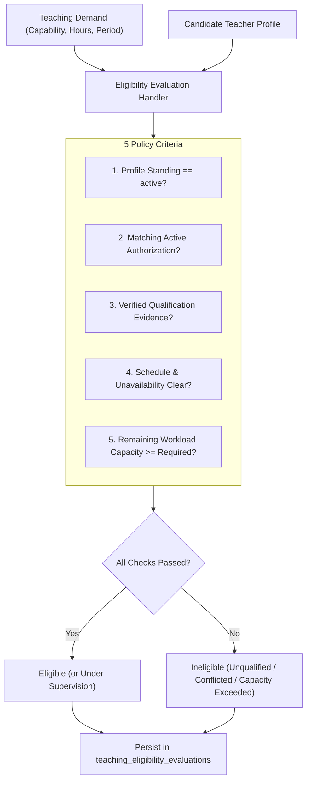
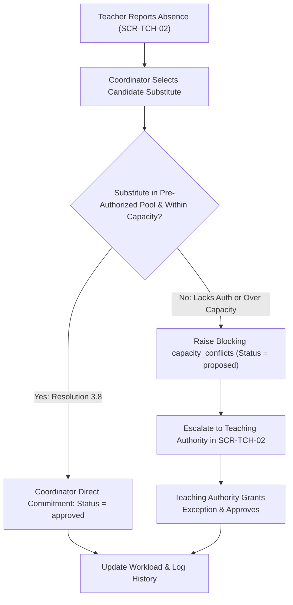

# 1. Overview

This target architecture defines the technical realization for the full scope of Stage 2 "Teaching Assignment & Workload" under the Teaching domain in Elsasa School Information System (SIS) V3:

1. **Teaching Demand Intake (`TCH-WF-05`, `UC-TCH-04`, `SCR-TCH-02`):**
   - Ingest and clarify formal teaching capacity requests (`teaching.teaching_demands`) originating from Academics (course learning units), Students (homeroom cohorts), and Development (extracurricular programs).
   - Store demand code (`demand_code`), requesting domain, opaque external work reference (`source_work_reference`), human-readable label (`source_work_label`), target academic period, required capability code, requested assignment role, estimated workload effort and unit, assessment authority mandate, requested date range, campus location, and teacher headcount.
   - Support demand lifecycle transitions: `received`, `accepted_for_staffing`, `returned_for_clarification`, `changed`, `cancelled`, `declined`, `staffed`.
   - Maintain strict separation of concerns: Teaching staffs the demand without redefining the underlying academic curriculum, student cohort, or operational timetable.

2. **Teacher Eligibility Evaluation Engine (`TCH-WF-06`, `UC-TCH-05`, `SCR-TCH-02`):**
   - Provide an explainable, policy-driven automated evaluation of candidate faculty against demand requirements (`teaching.teacher_eligibility_evaluations`).
   - Automatically evaluate 5 policy checks in memory: (1) active teacher profile standing, (2) matching active teaching authorization, (3) verified qualification evidence if required, (4) scheduling availability, and (5) remaining workload capacity.
   - Persist evaluation records with binary determination (`is_eligible`), detailed status (`eligible`, `eligible_under_supervision`, `ineligible_unqualified`, `ineligible_conflicted`, `ineligible_capacity_exceeded`), check breakdown flags, human-readable natural language explanation, and coordinator remarks.

3. **Teaching Assignment Approval & Homeroom Integration (`TCH-WF-07`, `TCH-WF-08`, `UC-TCH-10`, `UC-TCH-11`, `SCR-TCH-02`):**
   - Manage configurable assignment roles (`teaching.assignment_roles`, e.g., Guru Utama, Guru Pendamping, Asisten Guru, Penilai, Wali Kelas, Pembimbing Akademik, Fasilitator, Guru Pengganti) with lead role indicators and workload counting flags.
   - Connect eligible faculty to authorized teaching responsibilities through formal assignments (`teaching.teaching_assignments`), capturing assignment number, assigned teacher, demand link, assignment role, scope category (`learning_unit`, `cohort_group`, `individual_student`, `extracurricular_group`), scope reference/label, academic period, effective date range, committed workload, and authority approval metadata.
   - Manage assignment lifecycle: `proposed`, `approved`, `rejected`, `withdrawn`, `returned_for_revision`, `suspended`, `cancelled`, `completed`.
   - Support co-teaching and shared responsibility via distinct individual assignments referencing the same demand and scope.
   - Support homeroom advisory assignments (`assignment_role = 'HOMEROOM_ADVISOR'`) decoupled from student cohort placement (owned by Students) and physical homeroom allocation (owned by Operations).
   - Identify, classify, and track capacity conflicts (`teaching.capacity_conflicts`) with severity (`advisory` vs. `blocking`) and resolution tracking.

4. **Workload & Capacity Management (`TCH-WF-04`, `TCH-WF-10`, `UC-TCH-01`, `UC-TCH-07`, `SCR-TCH-03`, `SCR-TCH-04`):**
   - Enable teachers to declare weekly working availability, preferred teaching blocks, and recurring constraints across academic periods (`teaching.teacher_availabilities`, `SCR-TCH-04`).
   - Record explicit temporary unavailability windows (`teaching.teacher_unavailability_windows`, e.g., medical leave, official training, personal leave, blackout dates) without silently cancelling active assignments.
   - Establish versioned workload policies (`teaching.workload_policies`) defining measurement units, standard capacity limits, warning thresholds, prohibited capacity ceilings, and countable activity inclusions.
   - Atomically synchronize reproducible snapshots of planned, committed, and remaining teacher capacity per period (`teaching.workload_commitments`, `SCR-TCH-03`).
   - Manage formal workload exception requests (`teaching.workload_exceptions`) when an assignment requires exceeding prohibited capacity ceilings, enforcing strict governance: Coordinator Recommends → Teaching Authority Approves → Exception Granted (no self-approval).

5. **Substitution & Reassignment (`TCH-WF-09`, `UC-TCH-06`, `SCR-TCH-02`):**
   - Implement **Pre-Authorized Pool Delegation** (Resolution 3.8): Teaching Coordinator has unilateral authority to commit emergency substitutes (`teaching.teaching_substitutions`) holding active matching authorizations within workload caps. Escalates to Teaching Authority only if the substitute lacks authorization or breaches capacity ceilings.
   - Manage permanent reassignments (`teaching.teaching_reassignments`) transferring responsibility to a new teacher with predecessor links, formal justification, Teaching Authority approval, and syllabus/grading handover verification (`requires_handover`, `handover_status`).
   - Strictly preserve historical integrity: substitutions and reassignments take effect prospectively and never alter past academic or attendance records.

6. **Assignment Completion (`TCH-WF-11`, `UC-TCH-08`, `SCR-TCH-02`):**
   - Formally conclude teaching assignments upon reaching period end or milestones (`teaching.assignment_completions`).
   - Verify academic deliverables completion (grade submissions confirmed by Academics), confirm handover, and atomically release committed teacher capacity back to the available pool.

7. **Teaching History Preservation (`TCH-WF-12`, `UC-TCH-12`, `SCR-TCH-01`, `SCR-TCH-02`):**
   - Preserve an immutable append-only log of significant decisions, transitions, and domain events across a teacher's assignments and capacity lifecycle (`teaching.teaching_history_entries`).
   - Leverage existing `teaching.teaching_record_corrections` table provisioned in Stage 1 to support formal, auditable corrections on finalized assignments.

8. **Frontend Cohesive Workspaces (`SCR-TCH-02`, `SCR-TCH-03`, `SCR-TCH-04`):**
   - Implement `SCR-TCH-02` (`/teaching/assignments`) as a Work Queue workbench with tabs: *Demands Intake*, *Candidate Eligibility*, *Assignments & Homerooms*, *Coverage & Substitutions*, *Conclusions*.
   - Implement `SCR-TCH-03` (`/teaching/workload`) as a Monitoring workbench with period selector, policy indicators, faculty capacity cards, assignment drill-down drawer, and workload exception modal.
   - Implement `SCR-TCH-04` (`/teaching/my-availability`) as a Planning workbench with weekly recurring time grid and temporary unavailability windows modal.

9. **Two-Phase Demo Data Seeding & Purging Support:**
   - Update `DemoDataOrchestrator` to introduce `ITeachingAssignmentsDemoDataSeeder` as an explicit second-phase seeder running after Academics Structure and Students.
   - Bind real created Learning Units (e.g., Matematika SD) and Cohorts (e.g., Kelas 4A) to Hagios faculty personas: (1) Budi Hartono (Math Primary + Homeroom Advisor + Medical Leave), (2) Siti Nurhaliza (Co-teaching English + Emergency Substitute for Budi), (3) John Miller (Visiting Lecturer + Workload Exception), (4) Hendra Setiawan (Ineligible Candidate evaluation demo).
   - Update `ITeachingDemoDataPurger` to clean up assignment and workload tables in reverse dependency order.

This architecture fulfills change request intake `CR-TCH-ASSIGNMENT-WORKLOAD` ([IS015 - TCH-ASSIGNMENT-WORKLOAD-ISSUE.md](file:///d:/Project.Private/elsasa-sis-v3/docs/issues/IS015%20-%20TCH-ASSIGNMENT-WORKLOAD-ISSUE.md)) and realizes the approved analysis decisions in [IS015 - TCH-ASSIGNMENT-WORKLOAD-FEASIBILITY-ASSESSMENT.md](file:///d:/Project.Private/elsasa-sis-v3/docs/issues/IS015%20-%20TCH-ASSIGNMENT-WORKLOAD-FEASIBILITY-ASSESSMENT.md).

---

# 2. Architectural Basis

## Business Context

This architecture realizes the business knowledge, operational workflows, and domain rules specified in:

- **DOMAIN BLUEPRINT:** [teaching-domain.md](file:///d:/Project.Private/elsasa-sis-v3/docs/domains/teaching-domain.md)
  - Submodule 2.1: Teaching Demand Intake (lines 115–125)
  - Submodule 2.2: Teacher Eligibility Evaluation (lines 127–135)
  - Submodule 2.3: Teaching Assignment Approval (lines 137–148)
  - Submodule 2.4: Workload and Capacity Management (lines 150–158)
  - Submodule 2.5: Substitution and Reassignment (lines 160–169)
  - Submodule 2.6: Assignment Completion (lines 171–178)
  - Submodule 2.7: Teaching History (lines 180–187)
  - Cross-domain boundaries: Teaching staffs the work; Academics/Development owns the outcomes; Students owns cohort rosters; Operations owns physical room allocation (lines 200–225).
- **ROADMAP & COMPLETION CRITERIA:** [sub-modul-and-development-phases.md](file:///d:/Project.Private/elsasa-sis-v3/docs/sub-modul-and-development-phases.md)
  - Stage 2: Module 2 — Assignment & Workload (Submodules 2.1–2.7)
  - Criteria 7: Teacher has verified profile, granted authorization, and approved teaching assignment linking them to a learning unit.
  - Criteria 8: Teaching workload is visible and substitution for an absent teacher is recorded.
- **WORKFLOWS & USE CASES:**
  - [operational-workflow-discovery.md](file:///d:/Project.Private/elsasa-sis-v3/docs/operational-workflow-discovery.md):
    - `TCH-WF-04`: Declare and Maintain Teacher Availability
    - `TCH-WF-05`: Receive and Validate Teaching Demand
    - `TCH-WF-06`: Evaluate Candidate Eligibility and Capacity
    - `TCH-WF-07`: Assign Teacher to Learning Unit
    - `TCH-WF-08`: Assign Homeroom Advisory Teacher
    - `TCH-WF-09`: Arrange Emergency Substitution
    - `TCH-WF-10`: Monitor and Adjust Teaching Workload
    - `TCH-WF-11`: Conclude Teaching Assignment
    - `TCH-WF-12`: Preserve Teaching History and Auditable Corrections
  - [use-cases.md](file:///d:/Project.Private/elsasa-sis-v3/docs/use-cases.md):
    - `UC-TCH-01`: Declare Teaching Availability
    - `UC-TCH-04`: Process Teaching Demand
    - `UC-TCH-05`: Evaluate Teacher Eligibility and Capacity
    - `UC-TCH-06`: Arrange Substitute Teacher
    - `UC-TCH-07`: Monitor Faculty Workload
    - `UC-TCH-08`: Conclude Teaching Assignment
    - `UC-TCH-10`: Approve Teaching Assignment
    - `UC-TCH-11`: Modify or Cancel Teaching Assignment
    - `UC-TCH-12`: Correct Approved Teaching Record
- **ACTORS & GOVERNANCE:** [actors.md](file:///d:/Project.Private/elsasa-sis-v3/docs/actors.md)
  - Teaching Coordinator (`ACT-12`): Intake of demand, candidate eligibility evaluation, assignment proposal, emergency substitute arrangement from authorized pool, workload monitoring.
  - Teaching Authority (`ACT-13`): School leadership (*Kepala Sekolah / VP Academics*) exercising sole approval for teaching assignments, permanent reassignments, workload exceptions, and record corrections.
  - Teacher (`ACT-09`): Subject of assignments, declares weekly availability and temporary unavailability windows, acknowledges assigned responsibilities.
  - Resolution 3.8: Pre-Authorized Pool Delegation (Teaching Coordinator commits emergency substitutes directly within pre-authorized pools without awaiting Principal signature).
- **DATA SPECIFICATIONS:**
  - [teaching-entities.md](file:///d:/Project.Private/elsasa-sis-v3/docs/entities/teaching-entities.md): Module 2 Entities.
  - [teaching-entities-tables.md](file:///d:/Project.Private/elsasa-sis-v3/docs/entities/teaching-entities-tables.md): Module 2 Tables (lines 365–950, tables 2.1 to 2.14, and 2.15).
- **SCREEN INVENTORY:** [screen-inventory.md](file:///d:/Project.Private/elsasa-sis-v3/docs/screen-inventory.md)
  - `SCR-TCH-02`: Teaching Assignment & Coverage Workbench (Work Queue pattern)
  - `SCR-TCH-03`: Faculty Workload Monitoring (Monitoring pattern)
  - `SCR-TCH-04`: My Teaching Availability (Planning pattern)
- **ARCHITECTURE DECISION RECORDS:** [adr.md](file:///d:/Project.Private/elsasa-sis-v3/docs/architecture/adr.md)
  - ADR-001 (Monolith Assembly Structure & Domain Isolation)
  - ADR-002 (Single SQL Database with Schema Partitioning)
  - ADR-004 (Vertical Slice Architecture)
  - ADR-005 (Explicit T-SQL over Micro-ORMs)
  - ADR-006 (DbUp for Database Migrations)
  - ADR-010 (Hybrid Cross-Domain Communication Model)

## Analysis Input

This architecture directly consumes the approved gap closures, risk mitigations, and technical decisions recorded in:

- **FEASIBILITY ASSESSMENT:** [IS015 - TCH-ASSIGNMENT-WORKLOAD-FEASIBILITY-ASSESSMENT.md](file:///d:/Project.Private/elsasa-sis-v3/docs/issues/IS015%20-%20TCH-ASSIGNMENT-WORKLOAD-FEASIBILITY-ASSESSMENT.md)
  - `GAP-001 / OQ-001`: Author single cohesive migration script `20261110_0502_Teaching_AssignmentWorkload_Tables.sql` provisioning the 14 remaining Module 2 tables with indexes, unique invariants, check constraints, and intra-schema foreign keys.
  - `GAP-002`: Scaffold 7 vertical feature slices under `src/backend/Elsasa.Sis.Teaching/Features/`: `TeachingDemands`, `TeacherEligibility`, `TeachingAssignments`, `Workload`, `Substitutions`, `AssignmentCompletions`, and `TeachingHistory`. Map endpoints in `TeachingEndpoints.cs`.
  - `GAP-003 / OQ-003`: Adopt **Automated Rule Evaluation with Explainable Persistence**: evaluate the 5 policy checks in memory, generate human-readable explanations, and persist results in `teaching.teacher_eligibility_evaluations`.
  - `GAP-004 / OQ-004`: Adopt **Transactional Snapshot Synchronization with On-Demand Recalculation**: update `teaching.workload_commitments` atomically on assignment/substitution/exception state transitions, and provide an idempotent recalculation command for coordinators.
  - `GAP-005 / OQ-005`: Adopt **Pre-Authorized Pool Delegation with Exception Escalation (Resolution 3.8)**: Coordinator unilaterally commits substitutes from pre-authorized pools; exceptions (unauthorized substitute or workload ceiling breach) raise blocking `capacity_conflicts` requiring Teaching Authority approval.
  - `GAP-006 / OQ-006`: Adopt **Cohesive Sub-Features under `features/teaching/`**: implement `assignments/` (`SCR-TCH-02`), `workload/` (`SCR-TCH-03`), and `availability/` (`SCR-TCH-04`).
  - `GAP-007`: Extend `ITeachingModule` in `Elsasa.Sis.Contracts` with query methods for Academics and Operations, along with MediatR post-commit domain events.
  - `GAP-008 / OQ-002 / OQ-007`: Adopt **Explicit Two-Phase Seeding in Orchestrator**: retain Stage 1 faculty seeding at Step 2; introduce `ITeachingAssignmentsDemoDataSeeder` at Step 6/8 after Academics and Students to bind real learning units and cohorts to Hagios personas. Update `ITeachingDemoDataPurger`.
  - Planning Readiness: Granted `READY-FOR-PLANNING`.

```text
DOMAIN (teaching-domain.md) + FEATURE (use-cases.md, screen-inventory.md)
                            +
       FEASIBILITY-ASSESSMENT (CR-TCH-ASSIGNMENT-WORKLOAD)
                            ↓
       TARGET ARCHITECTURE (TCH-ASSIGNMENT-WORKLOAD)
```

---

# 3. Scope

## Included

1. **Database Schema & Migrations (`Elsasa.Sis.Database`):**
   - Migration script `20261110_0502_Teaching_AssignmentWorkload_Tables.sql` targeting Microsoft SQL Server 2022 ([ADR-002](file:///d:/Project.Private/elsasa-sis-v3/docs/architecture/adr.md#L50-L75), [ADR-006](file:///d:/Project.Private/elsasa-sis-v3/docs/architecture/adr.md#L152-L176)).
   - Creation of 14 authoritative tables in schema `teaching`:
     - `teaching.teaching_demands`: Core table for teaching capacity requests across domains.
     - `teaching.teacher_eligibility_evaluations`: Persisted explainable candidate evaluation results.
     - `teaching.assignment_roles`: Reference table for configured staffing roles.
     - `teaching.teaching_assignments`: Core operational entity linking teachers to academic/homeroom scopes.
     - `teaching.capacity_conflicts`: Supporting table tracking advisory and blocking staffing conflicts.
     - `teaching.workload_policies`: Reference/policy table for capacity rules and thresholds.
     - `teaching.teacher_availabilities`: Core table for recurring weekly availability.
     - `teaching.teacher_unavailability_windows`: Supporting table for leaves and blackout windows.
     - `teaching.workload_commitments`: Core table storing reproducible workload capacity snapshots.
     - `teaching.workload_exceptions`: Supporting table managing formal overload departure requests.
     - `teaching.teaching_substitutions`: Core table tracking emergency temporary coverage.
     - `teaching.teaching_reassignments`: Core table tracking permanent transfers and handovers.
     - `teaching.assignment_completions`: Supporting table managing completion and capacity release.
     - `teaching.teaching_history_entries`: Append-only audit log of teacher lifecycle events.
   - Reuse existing table `teaching.teaching_record_corrections` (table 2.15) provisioned in Stage 1.
   - Enforce zero physical cross-schema foreign keys ([ADR-001](file:///d:/Project.Private/elsasa-sis-v3/docs/architecture/adr.md#L24-L48), [ADR-002](file:///d:/Project.Private/elsasa-sis-v3/docs/architecture/adr.md#L50-L75)).

2. **Backend Domain Architecture & Vertical Slices (`Elsasa.Sis.Teaching`):**
   - Scaffold 7 vertical feature slices under `src/backend/Elsasa.Sis.Teaching/Features/`:
     - **TeachingDemands:**
       - `CreateTeachingDemand` (`POST /api/v1/teaching/demands`): Ingest capacity request.
       - `UpdateTeachingDemand` (`PUT /api/v1/teaching/demands/{id}`): Modify demand parameters.
       - `UpdateTeachingDemandStatus` (`POST /api/v1/teaching/demands/{id}/status`): Lifecycle transitions (`accepted_for_staffing`, `returned_for_clarification`, `declined`, `cancelled`).
       - `GetTeachingDemands` (`GET /api/v1/teaching/demands`): Filterable demand worklist.
       - `GetTeachingDemandById` (`GET /api/v1/teaching/demands/{id}`): Query detailed demand.
     - **TeacherEligibility:**
       - `EvaluateCandidateEligibility` (`POST /api/v1/teaching/eligibility/evaluate`): Automated 5-check policy evaluation with explainable persistence.
       - `GetCandidateEvaluations` (`GET /api/v1/teaching/eligibility/evaluations`): Query historical evaluation records.
     - **TeachingAssignments:**
       - `ProposeTeachingAssignment` (`POST /api/v1/teaching/assignments/propose`): Propose candidate staffing.
       - `ApproveTeachingAssignment` (`POST /api/v1/teaching/assignments/{id}/approve`): Authority approval; commits capacity.
       - `AcknowledgeTeachingAssignment` (`POST /api/v1/teaching/assignments/{id}/acknowledge`): Teacher acknowledgement.
       - `UpdateTeachingAssignmentStatus` (`POST /api/v1/teaching/assignments/{id}/status`): Lifecycle status modification (`suspended`, `cancelled`, `withdrawn`, `returned_for_revision`).
       - `GetTeachingAssignments` (`GET /api/v1/teaching/assignments`): Filterable assignments worklist.
       - `GetTeachingAssignmentById` (`GET /api/v1/teaching/assignments/{id}`): Detailed assignment query.
       - `GetAssignmentRoles` (`GET /api/v1/teaching/assignment-roles`): Query assignment roles catalog.
       - `GetCapacityConflicts` (`GET /api/v1/teaching/conflicts`): Query staffing conflicts.
       - `ResolveCapacityConflict` (`POST /api/v1/teaching/conflicts/{id}/resolve`): Record conflict resolution.
     - **Workload:**
       - `DeclareTeacherAvailability` (`POST /api/v1/teaching/teachers/{teacherId}/availability`): Submit recurring weekly availability.
       - `GetTeacherAvailability` (`GET /api/v1/teaching/teachers/{teacherId}/availability`): Query teacher availability.
       - `CreateUnavailabilityWindow` (`POST /api/v1/teaching/teachers/{teacherId}/unavailability`): Record leave or blackout window.
       - `CancelUnavailabilityWindow` (`POST /api/v1/teaching/unavailability/{id}/cancel`): Cancel leave window.
       - `GetTeacherUnavailabilityWindows` (`GET /api/v1/teaching/teachers/{teacherId}/unavailability`): Query leave windows.
       - `GetWorkloadPolicies` (`GET /api/v1/teaching/workload/policies`): Query workload policies.
       - `GetWorkloadCommitments` (`GET /api/v1/teaching/workload/commitments`): Query capacity monitoring snapshot.
       - `RecalculatePeriodWorkload` (`POST /api/v1/teaching/workload/recalculate`): Idempotent period recalculation.
       - `RequestWorkloadException` (`POST /api/v1/teaching/workload/exceptions`): Coordinator recommends exception.
       - `ApproveWorkloadException` (`POST /api/v1/teaching/workload/exceptions/{id}/approve`): Authority approves exception.
     - **Substitutions:**
       - `ArrangeEmergencySubstitution` (`POST /api/v1/teaching/substitutions`): Pre-Authorized Pool Delegation execution.
       - `GetTeachingSubstitutions` (`GET /api/v1/teaching/substitutions`): Query coverage worklist.
       - `CancelSubstitution` (`POST /api/v1/teaching/substitutions/{id}/cancel`): Cancel substitution.
       - `ProposePermanentReassignment` (`POST /api/v1/teaching/reassignments`): Propose permanent transfer.
       - `ApprovePermanentReassignment` (`POST /api/v1/teaching/reassignments/{id}/approve`): Authority approves reassignment.
       - `ConfirmReassignmentHandover` (`POST /api/v1/teaching/reassignments/{id}/handover`): Confirm syllabus/grading handover.
       - `GetTeachingReassignments` (`GET /api/v1/teaching/reassignments`): Query reassignments list.
     - **AssignmentCompletions:**
       - `ConcludeTeachingAssignment` (`POST /api/v1/teaching/assignments/{id}/conclude`): Confirm deliverables, mark completed, release capacity.
       - `GetAssignmentCompletions` (`GET /api/v1/teaching/completions`): Query completions list.
     - **TeachingHistory:**
       - `GetTeacherHistory` (`GET /api/v1/teaching/teachers/{teacherId}/history`): Append-only history query.
   - Module registration in `DependencyInjection.cs` and endpoint mapping in `TeachingEndpoints.cs`.

3. **Cross-Domain Contracts & Domain Events (`Elsasa.Sis.Contracts`):**
   - Synchronous inquiry methods on `ITeachingModule`:
     - `GetApprovedAssignmentForLearningUnitAsync(Guid learningUnitId, DateOnly effectiveDate, CancellationToken ct = default)`
     - `GetTeacherActiveAssignmentsAsync(Guid teacherId, Guid academicPeriodId, CancellationToken ct = default)`
     - `GetTeacherAvailabilityAsync(Guid teacherId, Guid academicPeriodId, CancellationToken ct = default)`
     - `IsTeacherAssignedToScopeAsync(Guid teacherId, string scopeType, Guid scopeReferenceId, DateOnly effectiveDate, CancellationToken ct = default)`
   - Contract DTOs in `Elsasa.Sis.Contracts/Teaching/`:
     - `TeachingDemandDto.cs`, `TeachingAssignmentDto.cs`, `AssignmentRoleDto.cs`, `TeacherAvailabilityDto.cs`, `TeacherUnavailabilityWindowDto.cs`, `WorkloadCommitmentDto.cs`, `TeachingSubstitutionDto.cs`, `TeachingReassignmentDto.cs`, `AssignmentCompletionDto.cs`, `TeacherEligibilityEvaluationDto.cs`.
   - In-memory post-commit domain events in `Elsasa.Sis.Contracts/Teaching/Events/`:
     - `TeachingDemandReceivedEvent.cs`, `TeachingAssignmentProposedEvent.cs`, `TeachingAssignmentApprovedEvent.cs`, `TeachingAssignmentCancelledEvent.cs`, `TeachingAssignmentCompletedEvent.cs`, `TeachingSubstitutionAssignedEvent.cs`, `WorkloadExceptionApprovedEvent.cs`.

4. **Frontend Workbenches & Client Integration (`src/frontend`):**
   - Feature submodules under `src/frontend/src/features/teaching/`:
     - `assignments/` (`SCR-TCH-02` at `/teaching/assignments`):
       - `TeachingAssignmentWorkspaceView.vue`: Master-detail work queue with 5 cohesive tabs (*Demands Intake*, *Candidate Eligibility*, *Assignments & Homerooms*, *Coverage & Substitutions*, *Conclusions*).
     - `workload/` (`SCR-TCH-03` at `/teaching/workload`):
       - `FacultyWorkloadMonitoringView.vue`: Monitoring workspace with period selector, KPI threshold cards, faculty workload table with visual capacity bars, assignment drill-down drawer, and workload exception modal.
     - `availability/` (`SCR-TCH-04` at `/teaching/my-availability`):
       - `MyTeachingAvailabilityView.vue`: Planning workspace with period selector, weekly recurring time grid, and temporary unavailability windows modal.
   - Route registrations in `src/frontend/src/app/router/routes.ts` and navigation links in `AppLayout.vue`.

5. **Two-Phase Demo Data Seeding & Purging:**
   - Introduce `ITeachingAssignmentsDemoDataSeeder` in `Elsasa.Sis.Teaching/Features/DemoData/` and wire into `DemoDataOrchestrator.cs` as an explicit phase running after Academics Structure and Students.
   - Seed realistic scenarios binding Budi Hartono, Siti Nurhaliza, John Miller, and Hendra Setiawan to real created learning units and student cohorts.
   - Update `TeachingDemoDataPurger` to clean all 24 tables in schema `teaching` in exact reverse foreign key order.

## Excluded

1. **Teacher Profile, Capabilities & Authorizations Maintenance:** Managed under Stage 1 `CR-TCH-TEACHER-PROFILE-AUTHORIZATION` (`SCR-TCH-01`).
2. **Curriculum Design, Syllabi & Course Frameworks:** Defining course units, lesson outlines, and learning requirements belongs to Academic `Learning Structure & Requirements` (`IS008`, `SCR-ACD-03`).
3. **Student Roster & Cohort Placement:** Creating cohorts, admitting learners, and enrolling students into classes belong to Student `Admission`, `Enrollment`, and `Placement` (`IS002`, `IS004`, `IS005`).
4. **Instructional Delivery & Student Grade Outcomes:** Conducting class sessions, recording attendance, and grading assignments belong to Academic `Participation & Activities` (`IS009`, `SCR-ACD-01`) and `Assessment & Results` (`IS010`, `SCR-ACD-02`).
5. **Physical Timetabling & Room Allocations:** Room reservations, equipment allocation, and timetable generation belong to Operational `Scheduling & Rooms` (`SCR-OPS-02`).
6. **HR & Payroll Administration:** Salary scales, employment contracts, leave quotas, and payroll processing are strictly outside the SIS Teaching domain.

---

# 4. Technical Decisions

## TD-01: Single Cohesive Migration Script for Module 2 Schema (`teaching.*`)

### Context
Stage 2 introduces 14 authoritative tables in schema `teaching`. The database architecture must adhere strictly to ADR-001 (compile-time isolation), ADR-002 (single database with schema partitioning), and ADR-006 (DbUp migrations). A single cohesive migration script guarantees atomicity, avoids migration script proliferation, and maintains deterministic ordering.

### Decision
1. Author DbUp migration script `20261110_0502_Teaching_AssignmentWorkload_Tables.sql` provisioning all 14 tables:
   - Reference/Policy: `teaching.assignment_roles`, `teaching.workload_policies`.
   - Core Tables: `teaching.teaching_demands`, `teaching.teacher_eligibility_evaluations`, `teaching.teaching_assignments`, `teaching.teacher_availabilities`, `teaching.workload_commitments`, `teaching.teaching_substitutions`, `teaching.teaching_reassignments`.
   - Supporting / Tracking Tables: `teaching.capacity_conflicts`, `teaching.teacher_unavailability_windows`, `teaching.workload_exceptions`, `teaching.assignment_completions`, `teaching.teaching_history_entries`.
2. Enforce zero physical cross-schema foreign keys: external references (`source_work_reference`, `scope_reference_id`, `academic_period_id`, `academic_year_id`) are stored as scalar `UNIQUEIDENTIFIER` columns without SQL Server physical foreign keys.
3. Enforce intra-schema physical foreign keys across tables within `teaching`:
   - `teaching_demands.required_assignment_role_id` → `assignment_roles(id)` ON DELETE NO ACTION
   - `teacher_eligibility_evaluations.teaching_demand_id` → `teaching_demands(id)` ON DELETE CASCADE
   - `teacher_eligibility_evaluations.teacher_profile_id` → `teacher_profiles(id)` ON DELETE CASCADE
   - `teaching_assignments.teaching_demand_id` → `teaching_demands(id)` ON DELETE NO ACTION
   - `teaching_assignments.teacher_profile_id` → `teacher_profiles(id)` ON DELETE NO ACTION
   - `teaching_assignments.assignment_role_id` → `assignment_roles(id)` ON DELETE NO ACTION
   - `teaching_assignments.predecessor_assignment_id` → `teaching_assignments(id)` ON DELETE NO ACTION
   - `capacity_conflicts.teaching_assignment_id` → `teaching_assignments(id)` ON DELETE SET NULL
   - `capacity_conflicts.teaching_demand_id` → `teaching_demands(id)` ON DELETE SET NULL
   - `capacity_conflicts.teacher_profile_id` → `teacher_profiles(id)` ON DELETE CASCADE
   - `teacher_availabilities.teacher_profile_id` → `teacher_profiles(id)` ON DELETE CASCADE
   - `teacher_unavailability_windows.teacher_profile_id` → `teacher_profiles(id)` ON DELETE CASCADE
   - `workload_commitments.teacher_profile_id` → `teacher_profiles(id)` ON DELETE CASCADE
   - `workload_commitments.workload_policy_id` → `workload_policies(id)` ON DELETE NO ACTION
   - `workload_exceptions.teaching_assignment_id` → `teaching_assignments(id)` ON DELETE CASCADE
   - `workload_exceptions.teacher_profile_id` → `teacher_profiles(id)` ON DELETE NO ACTION
   - `workload_exceptions.workload_policy_id` → `workload_policies(id)` ON DELETE NO ACTION
   - `teaching_substitutions.original_assignment_id` → `teaching_assignments(id)` ON DELETE NO ACTION
   - `teaching_substitutions.original_teacher_id` → `teacher_profiles(id)` ON DELETE NO ACTION
   - `teaching_substitutions.substitute_teacher_id` → `teacher_profiles(id)` ON DELETE NO ACTION
   - `teaching_reassignments.original_assignment_id` → `teaching_assignments(id)` ON DELETE NO ACTION
   - `teaching_reassignments.predecessor_teacher_id` → `teacher_profiles(id)` ON DELETE NO ACTION
   - `teaching_reassignments.new_teacher_id` → `teacher_profiles(id)` ON DELETE NO ACTION
   - `teaching_reassignments.replacement_assignment_id` → `teaching_assignments(id)` ON DELETE NO ACTION
   - `assignment_completions.teaching_assignment_id` → `teaching_assignments(id)` ON DELETE CASCADE
   - `teaching_history_entries.teacher_profile_id` → `teacher_profiles(id)` ON DELETE CASCADE
4. Enforce discrete lifecycle check constraints (`CK_...`):
   - `teaching_demands.status IN ('received', 'accepted_for_staffing', 'returned_for_clarification', 'changed', 'cancelled', 'declined', 'staffed')`
   - `teacher_eligibility_evaluations.eligibility_status IN ('eligible', 'eligible_under_supervision', 'ineligible_unqualified', 'ineligible_conflicted', 'ineligible_capacity_exceeded')`
   - `teaching_assignments.status IN ('proposed', 'approved', 'rejected', 'withdrawn', 'returned_for_revision', 'suspended', 'cancelled', 'completed')`
   - `capacity_conflicts.severity IN ('advisory', 'blocking')`
   - `capacity_conflicts.status IN ('unresolved', 'resolved', 'waived_with_exception')`
   - `workload_commitments.status IN ('normal', 'under_allocated', 'approaching_limit', 'overloaded_with_exception', 'breached')`
   - `workload_exceptions.status IN ('requested', 'recommended', 'approved', 'rejected')`
   - `teaching_substitutions.status IN ('proposed', 'approved', 'active', 'completed', 'cancelled')`
   - `teaching_reassignments.status IN ('proposed', 'approved', 'executed', 'cancelled')`
   - `assignment_completions.status IN ('completed', 'completed_with_exceptions')`
5. Enforce unique business invariants:
   - `demand_code` unique in `teaching_demands`.
   - `assignment_number` unique in `teaching_assignments`.
   - `exception_number` unique in `workload_exceptions`.
   - `substitution_number` unique in `teaching_substitutions`.
   - `reassignment_number` unique in `teaching_reassignments`.
   - Single active availability per teacher/period: partial unique index on `teacher_availabilities (teacher_profile_id, academic_period_id) WHERE status = 'active'`.
   - Single workload commitment snapshot per teacher/period: unique index on `workload_commitments (teacher_profile_id, academic_period_id)`.
   - Single completion record per assignment: unique index on `assignment_completions (teaching_assignment_id)`.

### Impact
Ensures storage atomicity, prevents invalid business states at the persistence layer, and protects data integrity without coupling schemas across domain boundaries.

---

## TD-02: Modular Backend Vertical Slices in `Elsasa.Sis.Teaching`

### Context
`Elsasa.Sis.Teaching` was established in Stage 1 with vertical slices for `TeacherProfiles`, `TeachingCapabilities`, `QualificationEvidence`, `TeachingAuthorizations`, and `RecordCorrections`. Stage 2 requires adding assignment and workload capabilities following ADR-004 (Vertical Slice Architecture), ADR-005 (Explicit T-SQL via Dapper), and `coding-conventions.md`.

### Decision
1. Organize the 7 new Stage 2 feature capabilities under `src/backend/Elsasa.Sis.Teaching/Features/`:
   ```text
   src/backend/Elsasa.Sis.Teaching/Features/
   ├── TeachingDemands/
   │   ├── CreateTeachingDemand/
   │   ├── UpdateTeachingDemand/
   │   ├── UpdateTeachingDemandStatus/
   │   ├── GetTeachingDemands/
   │   └── GetTeachingDemandById/
   ├── TeacherEligibility/
   │   ├── EvaluateCandidateEligibility/
   │   └── GetCandidateEvaluations/
   ├── TeachingAssignments/
   │   ├── ProposeTeachingAssignment/
   │   ├── ApproveTeachingAssignment/
   │   ├── AcknowledgeTeachingAssignment/
   │   ├── UpdateTeachingAssignmentStatus/
   │   ├── GetTeachingAssignments/
   │   ├── GetTeachingAssignmentById/
   │   ├── GetAssignmentRoles/
   │   ├── GetCapacityConflicts/
   │   └── ResolveCapacityConflict/
   ├── Workload/
   │   ├── DeclareTeacherAvailability/
   │   ├── GetTeacherAvailability/
   │   ├── CreateUnavailabilityWindow/
   │   ├── CancelUnavailabilityWindow/
   │   ├── GetTeacherUnavailabilityWindows/
   │   ├── GetWorkloadPolicies/
   │   ├── GetWorkloadCommitments/
   │   ├── RecalculatePeriodWorkload/
   │   ├── RequestWorkloadException/
   │   └── ApproveWorkloadException/
   ├── Substitutions/
   │   ├── ArrangeEmergencySubstitution/
   │   ├── GetTeachingSubstitutions/
   │   ├── CancelSubstitution/
   │   ├── ProposePermanentReassignment/
   │   ├── ApprovePermanentReassignment/
   │   ├── ConfirmReassignmentHandover/
   │   └── GetTeachingReassignments/
   ├── AssignmentCompletions/
   │   ├── ConcludeTeachingAssignment/
   │   └── GetAssignmentCompletions/
   └── TeachingHistory/
       └── GetTeacherHistory/
   ```
2. Each vertical slice is self-contained:
   - Endpoint implementing `IEndpoint` with `.WithName(...)`, `.WithTags("Teaching")`, `.RequireAuthorization(...)`, and `.AddEndpointFilter<ValidationFilter<TRequest>>()`.
   - Public Request record with primary constructor.
   - Public Response record with primary constructor.
   - FluentValidation validator inheriting `AbstractValidator<TRequest>`.
   - Handler class executing explicit uppercase T-SQL via Dapper and returning `Result<TResponse>` or `Result`.
3. Register slice handlers in `DependencyInjection.cs` and map routes in `TeachingEndpoints.cs`.

### Impact
Preserves high locality of behavior, enforces standard error handling (`Result<T>`), eliminates generic boilerplate abstractions, and aligns with the existing backend architecture.

---

## TD-03: Automated Rule Evaluation Engine with Explainable Persistence (`TCH-WF-06`, `UC-TCH-05`)

### Context
Educational institutions must verify that a candidate teacher is legally and operationally suitable before proposing an assignment. Relying on manual checklists is error-prone, while a purely opaque or dynamic rule engine creates maintenance complexity. Staffing decisions require full explainability and auditable persistence.

### Decision
1. Implement the Teacher Eligibility Evaluation Engine in `EvaluateCandidateEligibilityHandler` evaluating 5 policy criteria in memory against the database:
   - **Check 1 (Standing):** `teacher_profiles.standing = 'active'`. (Fails if `pending_approval`, `restricted`, `suspended`, or `inactive`).
   - **Check 2 (Authorization):** Teacher holds an active `teaching_authorizations` matching `required_capability_code` and `campus_scope`, with `effective_start_date <= demand.requested_start_date` and `(effective_end_date IS NULL OR effective_end_date >= demand.requested_end_date)`.
   - **Check 3 (Qualification):** If the matching authorization or role mandates verified qualification (`requires_qualification_check = 1`), verify that the supporting `qualification_evidence` has `verification_state = 'verified'`.
   - **Check 4 (Availability):** Verify teacher has no active `teacher_unavailability_windows` overlapping the demand's requested dates, and that the weekly schedule matches `recurring_available_schedule` in `teacher_availabilities`.
   - **Check 5 (Capacity):** Retrieve current snapshot from `workload_commitments`. Check if `committed_workload_hours + demand.expected_workload_hours <= max_capacity_limit_hours` under active `workload_policies`. If exceeded, check if a valid `workload_exceptions` record exists.
2. **Outcome Determination:**
   - If all 5 checks pass: `is_eligible = 1`, `eligibility_status = 'eligible'`.
   - If authorization is conditional: `is_eligible = 1`, `eligibility_status = 'eligible_under_supervision'`.
   - If Check 1, 2, or 3 fails: `is_eligible = 0`, `eligibility_status = 'ineligible_unqualified'`.
   - If Check 4 fails: `is_eligible = 0`, `eligibility_status = 'ineligible_conflicted'`.
   - If Check 5 fails: `is_eligible = 0`, `eligibility_status = 'ineligible_capacity_exceeded'`.
3. **Natural Language Explanation Generation:**
   Construct a human-readable explanation string summarizing the check results (e.g., *"Memiliki otorisasi aktif Matematika SD (SK-2026-042), ketersediaan jadwal terverifikasi, sisa kapasitas 7 jam (beban baru 5 jam). Memenuhi seluruh kriteria staffing."*).
4. **Persistence:**
   Insert an auditable record into `teaching.teacher_eligibility_evaluations` capturing all flags, determination, explanation, and coordinator remarks.
5. In `SCR-TCH-02` (Candidate Eligibility tab), render the 5 checks as visual status pills with the natural language explanation.



### Impact
Automates tedious verification, guarantees policy compliance, produces natural language audit trails for accreditation, and presents clear visual feedback to coordinators.

---

## TD-04: Transactional Snapshot Synchronization with On-Demand Recalculation (`TCH-WF-10`, `UC-TCH-07`)

### Context
`SCR-TCH-03` monitors faculty capacity against policy thresholds. Calculating workload dynamically by summing all assignment rows across all teachers on every screen load degrades query performance. Conversely, relying solely on batch recalculation risks stale data during rapid staffing sessions.

### Decision
1. Maintain materialized capacity snapshots in `teaching.workload_commitments` per `(teacher_profile_id, academic_period_id)`.
2. **Transactional Snapshot Updates:**
   Within the SQL transaction of assignment/substitution/exception handlers:
   - When assignment is **proposed**: `planned_workload_hours += workload_value`.
   - When assignment is **approved**: `planned_workload_hours -= workload_value`, `committed_workload_hours += workload_value`, `active_assignment_count += 1`.
   - When assignment is **suspended / cancelled / withdrawn**: `committed_workload_hours -= workload_value`, `active_assignment_count -= 1`.
   - When assignment is **completed**: `committed_workload_hours -= workload_value`, `active_assignment_count -= 1`.
   - When **workload exception is approved**: `approved_exception_count += 1`.
3. **Threshold Status Mapping:**
   Update `teaching.workload_commitments.status` according to active `workload_policies`:
   - `committed_workload_hours < warning_threshold` → `'normal'` (or `'under_allocated'` if below minimum threshold).
   - `committed_workload_hours >= warning_threshold AND <= prohibited_threshold` → `'approaching_limit'`.
   - `committed_workload_hours > prohibited_threshold` with approved exception → `'overloaded_with_exception'`.
   - `committed_workload_hours > prohibited_threshold` without exception → `'breached'`.
4. **Idempotent Reconciliation Endpoint:**
   Provide `POST /api/v1/teaching/workload/recalculate` enabling Teaching Coordinators to recalculate all commitments for a given academic period directly from active `teaching_assignments` and `workload_exceptions`, reconciling any potential drift.

### Impact
Eliminates expensive aggregations during monitoring queries in `SCR-TCH-03`, guarantees real-time capacity freshness, and provides a safe reconciliation mechanism.

---

## TD-05: Pre-Authorized Pool Delegation & Governance for Substitutions and Reassignments (Resolution 3.8, `TCH-WF-09`, `UC-TCH-06`)

### Context
Teacher illness or morning emergency absence requires immediate classroom coverage. A rigid requirement for Principal signature causes unattended classes. However, substituting an unqualified teacher or violating workload ceilings introduces institutional risk.

### Decision
1. **Pre-Authorized Pool Delegation (`TCH-WF-09`, `UC-TCH-06`):**
   - The Teaching Coordinator is authorized to immediately commit an emergency substitute teacher (`POST /api/v1/teaching/substitutions`) if the candidate:
     1. Holds an active `teaching_authorizations` matching the assignment's capability and campus.
     2. Has sufficient remaining capacity in `workload_commitments` (or the substitution hours do not breach the prohibited threshold).
   - If both conditions hold: the substitution is committed immediately with `status = 'approved'`, `approved_by = @currentUser` (Coordinator), and logged in `teaching_history_entries`.
2. **Exception Escalation to Teaching Authority:**
   - If the proposed substitute lacks matching authorization OR the temporary hours cause a workload ceiling breach:
     - The handler records a blocking `capacity_conflicts` row (`severity = 'blocking'`, `status = 'unresolved'`).
     - The substitution status is saved as `proposed`.
     - An alert is flagged in `SCR-TCH-02`, requiring explicit Teaching Authority approval (`POST /api/v1/teaching/substitutions/{id}/approve`) to grant an exception before the substitute is committed.
3. **Permanent Reassignments (`teaching.teaching_reassignments`):**
   - Permanent transfers of responsibility always require Teaching Authority approval (`POST /api/v1/teaching/reassignments/{id}/approve`).
   - Handler links predecessor assignment via `predecessor_assignment_id`.
   - Mandates syllabus and grading handover tracking (`requires_handover = 1`, `handover_status = 'pending'`).
   - Takes effect prospectively from `effective_date`. Historical academic participation, attendance logs, and grades recorded by the predecessor teacher are strictly preserved.



### Impact
Enables rapid morning coverage in seconds for pre-authorized teachers, prevents bureaucratic classroom delays, while strictly enforcing school leadership governance for exceptions.

---

## TD-06: Decoupled Homeroom Advisory Staffing Architecture (`TCH-WF-07`, `TCH-WF-08`, `UC-TCH-10`)

### Context
In primary and secondary education, homeroom teachers (*Wali Kelas*) perform vital pastoral, advisory, and administrative roles. However, student cohort placement belongs to Students domain (`students.students`), and physical classroom allocation belongs to Operations domain (`operations.rooms`). Teaching domain must staff the homeroom teacher without encroaching on student rosters or facility reservations.

### Decision
1. Represent homeroom advisory as a standard `teaching_assignments` record with:
   - `assignment_role_id` pointing to role with `code = 'HOMEROOM_ADVISOR'`.
   - `assignment_scope = 'cohort_group'`.
   - `scope_reference_id = @cohortId` (opaque UUID from Students domain).
   - `scope_label = "Kelas 4A (Wali Kelas)"`.
2. Teaching domain manages the teacher's availability, authorization, workload commitment (e.g., 2.00 hours/week), and substitution.
3. Students domain continues to own student cohort placement (`students.student_placements`).
4. Operations domain continues to own physical homeroom room allocation (`operations.room_allocations`).
5. Cross-domain inquiries query `ITeachingModule.IsTeacherAssignedToScopeAsync(teacherId, "cohort_group", cohortId, date)` to verify homeroom advisory standing.

### Impact
Maintains strict domain separation (ADR-001, ADR-002), prevents duplicate student lists in Teaching, and ensures homeroom advisory workload is counted uniformly in teacher capacity.

---

## TD-07: Frontend Workspace Architecture for `SCR-TCH-02`, `SCR-TCH-03`, `SCR-TCH-04`

### Context
`docs/screen-inventory.md` defines three primary Stage 2 screens for the Teaching domain:
- `SCR-TCH-02`: Teaching Assignment & Coverage Workbench (Work Queue pattern)
- `SCR-TCH-03`: Faculty Workload Monitoring (Monitoring pattern)
- `SCR-TCH-04`: My Teaching Availability (Planning pattern)
These must be implemented following Vue 3, Vite, Tailwind CSS 4, PrimeVue 4, and TanStack Query standards.

### Decision
Organize the screens under `src/frontend/src/features/teaching/`:

```text
src/frontend/src/features/teaching/
├── faculty/                 # SCR-TCH-01 (Stage 1 Teacher Profile & Authorization)
├── assignments/             # SCR-TCH-02 (Teaching Assignment & Coverage Workbench)
│   ├── api/                 # assignmentsApi.ts, queryKeys.ts
│   ├── components/          # DemandsIntakeTab.vue, CandidateEligibilityTab.vue,
│   │                        # ActiveAssignmentsTab.vue, CoverageSubstitutionsTab.vue,
│   │                        # ConclusionsTab.vue, ProposeAssignmentModal.vue,
│   │                        # ArrangeSubstituteModal.vue, ReassignmentModal.vue,
│   │                        # ConcludeAssignmentModal.vue
│   ├── composables/         # useAssignments.ts
│   └── views/
│       └── TeachingAssignmentWorkspaceView.vue # Route: /teaching/assignments
├── workload/                # SCR-TCH-03 (Faculty Workload Monitoring)
│   ├── api/                 # workloadApi.ts, queryKeys.ts
│   ├── components/          # WorkloadKpiCards.vue, FacultyWorkloadTable.vue,
│   │                        # WorkloadDrillDownDrawer.vue, RequestExceptionModal.vue,
│   │                        # ApproveExceptionModal.vue
│   ├── composables/         # useWorkload.ts
│   └── views/
│       └── FacultyWorkloadMonitoringView.vue   # Route: /teaching/workload
└── availability/            # SCR-TCH-04 (My Teaching Availability)
    ├── api/                 # availabilityApi.ts, queryKeys.ts
    ├── components/          # WeeklyTimeGrid.vue, UnavailabilityWindowsList.vue,
    │                        # AddUnavailabilityModal.vue
    ├── composables/         # useAvailability.ts
    └── views/
        └── MyTeachingAvailabilityView.vue      # Route: /teaching/my-availability
```

1. **`SCR-TCH-02` (`TeachingAssignmentWorkspaceView.vue` at `/teaching/assignments`):**
   - Work Queue pattern with period selector, search, and 5 tabs:
     - **Tab 1: Demands Intake:** Incoming staffing requests from Academics/Students; actions: Accept for Staffing, Clarify, Decline.
     - **Tab 2: Candidate Eligibility:** Demand selection and candidate evaluator running the 5 policy checks with visual check pills and natural language explanation.
     - **Tab 3: Assignments & Homerooms:** Active and proposed assignments, co-teaching groups, homeroom advisory filter, actions: Approve, Modify, Cancel.
     - **Tab 4: Coverage & Substitutions:** Emergency substitute arrangement from pre-authorized pool, permanent reassignment workflow with handover tracking.
     - **Tab 5: Conclusions:** Concluding assignments, deliverables confirmation, capacity release action.
2. **`SCR-TCH-03` (`FacultyWorkloadMonitoringView.vue` at `/teaching/workload`):**
   - Monitoring pattern with:
     - Header: Period selector and active Workload Policy summary.
     - KPI Summary Cards: Total Faculty, Normal, Approaching Limit, Overloaded with Exception, Breached.
     - Faculty Workload Table: Searchable list with capacity progress bars (`0–24 hrs`), threshold badges (`Normal`, `Approaching Limit`, `Overloaded`), and drill-down trigger.
     - Drill-Down Drawer: Line-item breakdown of assignments contributing to teacher's load.
     - Workload Exception Modal: Coordinator recommendation and Teaching Authority approval.
     - Recalculate Button: Trigger on-demand period capacity reconciliation.
3. **`SCR-TCH-04` (`MyTeachingAvailabilityView.vue` at `/teaching/my-availability`):**
   - Planning pattern with:
     - Weekly Recurring Time Grid: Visual interactive schedule editor (Monday–Friday time blocks).
     - Temporary Unavailability Windows: List of recorded leaves and blackout dates with status (`Active`, `Cancelled`, `Expired`).
     - Add Unavailability Modal: Captures date range, time range (optional), leave type (`medical_leave`, `official_training`, `personal_leave`, `blackout`), and justification.

### Impact
Delivers cohesive, purpose-built workspaces adhering strictly to `screen-inventory.md`, minimizing context switching and ensuring high operational ergonomics for teachers, coordinators, and principals.

---

## TD-08: Two-Phase Topological Demo Seeding & Reverse-Purge Pipeline

### Context
`DemoDataOrchestrator` resets and seeds sample data for testing and demonstrations. In Stage 1, Teaching was seeded at Step 2 (before Academics and Students). In Stage 2, Teaching Assignments link to Learning Units (Academics) and Student Cohorts (Students). Attempting to seed assignments at Step 2 causes foreign entity reference failures.

### Decision
1. Implement a **Two-Phase Seeding Model** in `DemoDataOrchestrator.cs`:
   - **Phase 1 (Step 2 - Baseline Faculty):** `ITeachingDemoDataSeeder` seeds the 4 faculty personas, roles, qualification evidence, authorizations, and baseline availability.
   - **Phase 2 (Step 7 - Assignments & Workload):** Introduce `ITeachingAssignmentsDemoDataSeeder` running after Academics Structure (Step 4) and Students (Step 5).
2. **Phase 2 Seeder Execution:**
   - Queries real created Learning Units (e.g., `Matematika SD Kelas 4`) and Student Cohorts (e.g., `Kelas 4A`).
   - Seeds Demands, Eligibility Evaluations, Assignments (Primary Teacher, Co-Teacher, Homeroom Advisor), Workload Policies, Workload Commitments, Unavailability Windows, Substitutions, and Completed Assignments binding the Stage 1 personas:
     1. **Budi Hartono:** Primary Teacher for Math SD 4A (5 hrs) + Homeroom Advisor for Kelas 4A (2 hrs) + Medical leave window.
     2. **Siti Nurhaliza:** Co-teacher for English SMP + Emergency substitute for Budi during his medical leave (5 hrs coverage).
     3. **John Miller:** Visiting Lecturer with approved Workload Exception (+3 hrs above prohibited ceiling).
     4. **Hendra Setiawan:** Candidate evaluated against demand demonstrating ineligible evaluation outcome (lacks authorization).
     5. **Concluded Assignment Example:** Concluded previous term assignment with capacity released.
3. **Reverse-Dependency Purging in `TeachingDemoDataPurger`:**
   Execute clean deletes across all 24 schema `teaching` tables in strict reverse order:
   ```text
   1.  teaching.teaching_history_entries
   2.  teaching.assignment_completions
   3.  teaching.teaching_reassignments
   4.  teaching.teaching_substitutions
   5.  teaching.workload_exceptions
   6.  teaching.workload_commitments
   7.  teaching.teacher_unavailability_windows
   8.  teaching.teacher_availabilities
   9.  teaching.capacity_conflicts
   10. teaching.teaching_assignments
   11. teaching.assignment_roles
   12. teaching.teacher_eligibility_evaluations
   13. teaching.teaching_demands
   14. teaching.workload_policies
   15. teaching.teaching_record_corrections
   16. teaching.supervision_requirements
   17. teaching.authorization_evidence
   18. teaching.teaching_authorizations
   19. teaching.qualification_evidence
   20. teaching.teaching_capabilities
   21. teaching.teacher_profiles
   22. teaching.qualification_types
   23. teaching.capability_types
   24. teaching.teaching_roles
   ```

### Impact
Guarantees 100% relational integrity during demo data reset, verifies Criteria 7 and 8 end-to-end, and prevents foreign key constraint violations during purges.

---

# 5. Component Responsibilities

| Component | Responsibility |
|---|---|
| `Elsasa.Sis.Database` | Executes migration script `20261110_0502_Teaching_AssignmentWorkload_Tables.sql` provisioning the 14 Module 2 tables, intra-schema foreign keys, indexes, and check constraints. |
| `TeachingDemands/` | Handles intake, parameter modification, status transitions, and query listings for formal teaching capacity requests (`teaching_demands`). |
| `TeacherEligibility/` | Executes the 5-factor automated policy evaluation engine in memory and persists explainable candidate evaluation records in `teacher_eligibility_evaluations`. |
| `TeachingAssignments/` | Manages assignment proposals, authority approvals, teacher acknowledgements, status lifecycle transitions, homeroom assignments, and capacity conflict resolution. |
| `Workload/` | Manages teacher weekly availability declarations, temporary unavailability windows, workload policies, transactional commitment snapshots, on-demand recalculation, and workload exceptions. |
| `Substitutions/` | Manages emergency substitute arrangements under Pre-Authorized Pool Delegation (Resolution 3.8), exception escalation, permanent reassignments, and handover tracking. |
| `AssignmentCompletions/` | Concludes teaching assignments, verifies academic deliverables completion, and formally releases committed capacity back to the available pool. |
| `TeachingHistory/` | Preserves and queries the immutable append-only log of significant teacher assignment, substitution, and workload events (`teaching_history_entries`). |
| `TeachingModuleImpl` | Implements `ITeachingModule` in `Elsasa.Sis.Contracts`, providing synchronous query methods for downstream domains (Academics, Operations). |
| `ITeachingAssignmentsDemoDataSeeder` | Seeds rich Stage 2 demo data binding real Learning Units and Cohorts to Hagios faculty personas in `DemoDataOrchestrator`. |
| `TeachingDemoDataPurger` | Cleanly deletes all 24 schema `teaching` tables in exact reverse foreign key order. |
| `features/teaching/assignments/` | Delivers `SCR-TCH-02` (`/teaching/assignments`) Work Queue workbench with 5 tabs (*Demands Intake*, *Candidate Eligibility*, *Assignments & Homerooms*, *Coverage & Substitutions*, *Conclusions*). |
| `features/teaching/workload/` | Delivers `SCR-TCH-03` (`/teaching/workload`) Monitoring workspace with period selector, threshold KPI cards, faculty capacity progress bars, and exception modals. |
| `features/teaching/availability/` | Delivers `SCR-TCH-04` (`/teaching/my-availability`) Planning workspace with weekly recurring schedule grid and temporary unavailability windows modal. |

---

# 6. Integration Design

| Source | Target | Purpose |
|---|---|---|
| `SCR-TCH-02` (Frontend) | `TeachingDemandsEndpoints` (Backend) | Ingests, updates, clarifies, and lists teaching capacity demands. |
| `SCR-TCH-02` (Frontend) | `TeacherEligibilityEndpoints` (Backend) | Evaluates candidate suitability against demand criteria with explainable breakdown. |
| `SCR-TCH-02` (Frontend) | `TeachingAssignmentsEndpoints` (Backend) | Proposes, approves, acknowledges, modifies, and cancels teaching assignments. |
| `SCR-TCH-02` (Frontend) | `SubstitutionsEndpoints` (Backend) | Arranges emergency substitutes from pre-authorized pool and manages permanent reassignments. |
| `SCR-TCH-02` (Frontend) | `AssignmentCompletionsEndpoints` (Backend) | Formally concludes assignments and releases committed capacity. |
| `SCR-TCH-03` (Frontend) | `WorkloadEndpoints` (Backend) | Queries capacity monitoring snapshots, triggers recalculation, and manages workload exceptions. |
| `SCR-TCH-04` (Frontend) | `WorkloadEndpoints` (Backend) | Declares recurring weekly availability and manages temporary unavailability windows. |
| `TeachingAssignments/ApproveTeachingAssignment` | `teaching.workload_commitments` (Database) | Atomically adds committed hours and increments active assignment count within transaction. |
| `AssignmentCompletions/ConcludeTeachingAssignment` | `teaching.workload_commitments` (Database) | Atomically deducts committed hours and releases capacity within transaction. |
| `TeachingAssignments/ApproveTeachingAssignment` | MediatR Publisher (In-Memory) | Publishes `TeachingAssignmentApprovedEvent` after transaction commits. |
| `Substitutions/ArrangeEmergencySubstitution` | MediatR Publisher (In-Memory) | Publishes `TeachingSubstitutionAssignedEvent` after transaction commits. |
| `Academics: Participation / Grading` | `ITeachingModule.IsTeacherAssignedToScopeAsync` | Verifies whether teacher has active approved assignment authority for learning unit. |
| `Operations: SchedulingWorkbench` | `ITeachingModule.GetTeacherAvailabilityAsync` | Checks teacher availability schedule and blackout windows before scheduling timetable occurrence. |
| `DemoDataOrchestrator` | `ITeachingAssignmentsDemoDataSeeder` | Executes second-phase demo data seeding after Academics and Students are created. |

---

# 7. Data Ownership

| Data Domain / Entity | Authoritative Owner | Non-Authoritative Consumers |
|---|---|---|
| Teaching Demands (`teaching_demands`) | **Teaching Domain** (intake and staffing status) | Academics / Development (originators of external work reference) |
| Candidate Eligibility Evaluations (`teacher_eligibility_evaluations`) | **Teaching Domain** | Teaching Coordinators, School Auditors |
| Assignment Roles (`assignment_roles`) | **Teaching Domain** | Operations, Academics |
| Teaching Assignments (`teaching_assignments`) | **Teaching Domain** | Academics (attendance/grading authority), Operations (timetabling) |
| Capacity Conflicts (`capacity_conflicts`) | **Teaching Domain** | Teaching Coordinators, Teaching Authority |
| Workload Policies (`workload_policies`) | **Teaching Domain** | Teaching Authority, Teaching Coordinators |
| Teacher Availability (`teacher_availabilities`) | **Teaching Domain** (declared by Teacher) | Operations (scheduling feasibility) |
| Unavailability Windows (`teacher_unavailability_windows`) | **Teaching Domain** | Operations (scheduling conflict detection) |
| Workload Commitments (`workload_commitments`) | **Teaching Domain** | Teaching Coordinators, School Leadership |
| Workload Exceptions (`workload_exceptions`) | **Teaching Domain** (approved by Authority) | Teaching Coordinators, School Leadership |
| Teaching Substitutions (`teaching_substitutions`) | **Teaching Domain** | Operations (timetable instructor override), Academics |
| Teaching Reassignments (`teaching_reassignments`) | **Teaching Domain** | Academics (syllabus handover), Operations |
| Assignment Completions (`assignment_completions`) | **Teaching Domain** | Academics (grade confirmation), Teaching Coordinators |
| Teaching History Entries (`teaching_history_entries`) | **Teaching Domain** (append-only log) | Teaching Authority, Auditors |
| Learning Units (`academics.learning_units`) | **Academics Domain** | Teaching (stored as opaque `source_work_reference`) |
| Student Cohorts (`students.cohort_groups`) | **Students Domain** | Teaching (stored as opaque `scope_reference_id`) |
| Academic Periods (`operations.operational_periods`) | **Operations Domain** | Teaching (stored as opaque `academic_period_id`) |

---

# 8. Database Design

## New Tables

The following 14 tables are provisioned in schema `teaching` via `20261110_0502_Teaching_AssignmentWorkload_Tables.sql`:

### 1. `teaching.assignment_roles`
Defines configured teaching roles and responsibility definitions.

```sql
CREATE TABLE [teaching].[assignment_roles] (
    [id]                     UNIQUEIDENTIFIER  NOT NULL CONSTRAINT [DF_teaching_asnr_id] DEFAULT (NEWID()),
    [code]                   VARCHAR(50)       NOT NULL,
    [name]                   NVARCHAR(100)     NOT NULL,
    [description]            NVARCHAR(MAX)     NULL,
    [is_lead_role]           BIT               NOT NULL CONSTRAINT [DF_teaching_asnr_lead] DEFAULT (0),
    [counts_toward_workload] BIT               NOT NULL CONSTRAINT [DF_teaching_asnr_counts] DEFAULT (1),
    [is_active]              BIT               NOT NULL CONSTRAINT [DF_teaching_asnr_active] DEFAULT (1),
    [created_at]             DATETIMEOFFSET(7) NOT NULL CONSTRAINT [DF_teaching_asnr_created_at] DEFAULT (SYSUTCDATETIME()),
    [created_by]             NVARCHAR(256)     NOT NULL,
    [updated_at]             DATETIMEOFFSET(7) NULL,
    [updated_by]             NVARCHAR(256)     NULL,
    CONSTRAINT [PK_teaching_assignment_roles] PRIMARY KEY CLUSTERED ([id]),
    CONSTRAINT [UQ_teaching_assignment_roles_code] UNIQUE NONCLUSTERED ([code])
);
```

### 2. `teaching.workload_policies`
Defines institutional policies governing workload limits, thresholds, and calculation rules.

```sql
CREATE TABLE [teaching].[workload_policies] (
    [id]                         UNIQUEIDENTIFIER  NOT NULL CONSTRAINT [DF_teaching_wpol_id] DEFAULT (NEWID()),
    [code]                       VARCHAR(50)       NOT NULL,
    [name]                       NVARCHAR(150)     NOT NULL,
    [academic_year_id]           UNIQUEIDENTIFIER  NOT NULL,
    [version]                    VARCHAR(20)       NOT NULL,
    [workload_unit]              VARCHAR(50)       NOT NULL CONSTRAINT [DF_teaching_wpol_unit] DEFAULT ('Teaching Hours'),
    [max_standard_capacity]      DECIMAL(5,2)      NOT NULL,
    [warning_threshold]          DECIMAL(5,2)      NOT NULL,
    [prohibited_threshold]       DECIMAL(5,2)      NOT NULL,
    [includes_assessment_effort] BIT               NOT NULL CONSTRAINT [DF_teaching_wpol_assess] DEFAULT (1),
    [includes_advising_effort]   BIT               NOT NULL CONSTRAINT [DF_teaching_wpol_advise] DEFAULT (1),
    [includes_preparation_time]  BIT               NOT NULL CONSTRAINT [DF_teaching_wpol_prep] DEFAULT (0),
    [calculation_rules_summary]  NVARCHAR(MAX)     NOT NULL,
    [effective_start_date]       DATE              NOT NULL,
    [effective_end_date]         DATE              NULL,
    [status]                     VARCHAR(30)       NOT NULL CONSTRAINT [DF_teaching_wpol_status] DEFAULT ('active'),
    [approved_by]                NVARCHAR(256)     NOT NULL,
    [approved_date]              DATE              NOT NULL,
    [created_at]                 DATETIMEOFFSET(7) NOT NULL CONSTRAINT [DF_teaching_wpol_created_at] DEFAULT (SYSUTCDATETIME()),
    [created_by]                 NVARCHAR(256)     NOT NULL,
    [updated_at]                 DATETIMEOFFSET(7) NULL,
    [updated_by]                 NVARCHAR(256)     NULL,
    CONSTRAINT [PK_teaching_workload_policies] PRIMARY KEY CLUSTERED ([id]),
    CONSTRAINT [UQ_teaching_workload_policies_code] UNIQUE NONCLUSTERED ([code]),
    CONSTRAINT [CK_teaching_wpol_status] CHECK ([status] IN ('draft', 'active', 'superseded', 'archived'))
);
```

### 3. `teaching.teaching_demands`
Represents formal requests for teaching capacity from Academics, Students, or Development.

```sql
CREATE TABLE [teaching].[teaching_demands] (
    [id]                             UNIQUEIDENTIFIER  NOT NULL CONSTRAINT [DF_teaching_dem_id] DEFAULT (NEWID()),
    [demand_code]                    VARCHAR(50)       NOT NULL,
    [source_domain]                  VARCHAR(50)       NOT NULL,
    [source_work_reference]          UNIQUEIDENTIFIER  NOT NULL,
    [source_work_label]              NVARCHAR(255)     NOT NULL,
    [academic_period_id]             UNIQUEIDENTIFIER  NOT NULL,
    [required_capability_code]       VARCHAR(100)      NOT NULL,
    [required_assignment_role_id]   UNIQUEIDENTIFIER  NOT NULL,
    [expected_workload_hours]        DECIMAL(5,2)      NOT NULL,
    [workload_unit]                  VARCHAR(50)       NOT NULL CONSTRAINT [DF_teaching_dem_unit] DEFAULT ('Teaching Hours'),
    [requires_assessment_authority] BIT               NOT NULL CONSTRAINT [DF_teaching_dem_auth] DEFAULT (1),
    [requested_start_date]           DATE              NOT NULL,
    [requested_end_date]             DATE              NOT NULL,
    [campus_scope]                   NVARCHAR(100)     NOT NULL CONSTRAINT [DF_teaching_dem_campus] DEFAULT ('Kampus Utama'),
    [required_teachers_count]        INT               NOT NULL CONSTRAINT [DF_teaching_dem_count] DEFAULT (1),
    [status]                         VARCHAR(30)       NOT NULL CONSTRAINT [DF_teaching_dem_status] DEFAULT ('received'),
    [requested_by]                   NVARCHAR(256)     NOT NULL,
    [requested_at]                   DATETIMEOFFSET(7) NOT NULL CONSTRAINT [DF_teaching_dem_requested_at] DEFAULT (SYSUTCDATETIME()),
    [decline_reason]                 NVARCHAR(MAX)     NULL,
    [clarification_notes]            NVARCHAR(MAX)     NULL,
    [created_at]                     DATETIMEOFFSET(7) NOT NULL CONSTRAINT [DF_teaching_dem_created_at] DEFAULT (SYSUTCDATETIME()),
    [created_by]                     NVARCHAR(256)     NOT NULL,
    [updated_at]                     DATETIMEOFFSET(7) NULL,
    [updated_by]                     NVARCHAR(256)     NULL,
    CONSTRAINT [PK_teaching_teaching_demands] PRIMARY KEY CLUSTERED ([id]),
    CONSTRAINT [UQ_teaching_demands_code] UNIQUE NONCLUSTERED ([demand_code]),
    CONSTRAINT [FK_teaching_dem_role] FOREIGN KEY ([required_assignment_role_id])
        REFERENCES [teaching].[assignment_roles] ([id]) ON DELETE NO ACTION,
    CONSTRAINT [CK_teaching_dem_status] CHECK (
        [status] IN ('received', 'accepted_for_staffing', 'returned_for_clarification', 'changed', 'cancelled', 'declined', 'staffed')
    )
);

CREATE NONCLUSTERED INDEX [IX_teaching_demands_period_status]
ON [teaching].[teaching_demands] ([academic_period_id], [status]);
```

### 4. `teaching.teacher_eligibility_evaluations`
Persists the policy evaluation of candidate teachers against teaching demands.

```sql
CREATE TABLE [teaching].[teacher_eligibility_evaluations] (
    [id]                          UNIQUEIDENTIFIER  NOT NULL CONSTRAINT [DF_teaching_tee_id] DEFAULT (NEWID()),
    [teaching_demand_id]          UNIQUEIDENTIFIER  NOT NULL,
    [teacher_profile_id]          UNIQUEIDENTIFIER  NOT NULL,
    [evaluation_date]             DATE              NOT NULL,
    [evaluated_by]                NVARCHAR(256)     NOT NULL,
    [is_eligible]                 BIT               NOT NULL,
    [eligibility_status]          VARCHAR(50)       NOT NULL,
    [profile_active_check]        BIT               NOT NULL,
    [authorization_check_passed]  BIT               NOT NULL,
    [qualification_check_passed]  BIT               NOT NULL,
    [availability_check_passed]   BIT               NOT NULL,
    [capacity_check_passed]       BIT               NOT NULL,
    [explanation]                 NVARCHAR(MAX)     NOT NULL,
    [notes]                       NVARCHAR(MAX)     NULL,
    [created_at]                  DATETIMEOFFSET(7) NOT NULL CONSTRAINT [DF_teaching_tee_created_at] DEFAULT (SYSUTCDATETIME()),
    [created_by]                  NVARCHAR(256)     NOT NULL,
    CONSTRAINT [PK_teaching_teacher_eligibility_evaluations] PRIMARY KEY CLUSTERED ([id]),
    CONSTRAINT [FK_teaching_tee_demand] FOREIGN KEY ([teaching_demand_id])
        REFERENCES [teaching].[teaching_demands] ([id]) ON DELETE CASCADE,
    CONSTRAINT [FK_teaching_tee_profile] FOREIGN KEY ([teacher_profile_id])
        REFERENCES [teaching].[teacher_profiles] ([id]) ON DELETE CASCADE,
    CONSTRAINT [CK_teaching_tee_status] CHECK (
        [eligibility_status] IN ('eligible', 'eligible_under_supervision', 'ineligible_unqualified', 'ineligible_conflicted', 'ineligible_capacity_exceeded')
    )
);

CREATE NONCLUSTERED INDEX [IX_teaching_tee_demand_teacher]
ON [teaching].[teacher_eligibility_evaluations] ([teaching_demand_id], [teacher_profile_id]);
```

### 5. `teaching.teaching_assignments`
Core operational entity connecting an authorized teacher to a teaching responsibility.

```sql
CREATE TABLE [teaching].[teaching_assignments] (
    [id]                          UNIQUEIDENTIFIER  NOT NULL CONSTRAINT [DF_teaching_asn_id] DEFAULT (NEWID()),
    [assignment_number]           VARCHAR(50)       NOT NULL,
    [teaching_demand_id]          UNIQUEIDENTIFIER  NOT NULL,
    [teacher_profile_id]          UNIQUEIDENTIFIER  NOT NULL,
    [assignment_role_id]          UNIQUEIDENTIFIER  NOT NULL,
    [assignment_scope]            VARCHAR(50)       NOT NULL,
    [scope_reference_id]          UNIQUEIDENTIFIER  NOT NULL,
    [scope_label]                 NVARCHAR(255)     NOT NULL,
    [academic_period_id]          UNIQUEIDENTIFIER  NOT NULL,
    [effective_start_date]        DATE              NOT NULL,
    [effective_end_date]          DATE              NOT NULL,
    [workload_commitment_value]   DECIMAL(5,2)      NOT NULL,
    [workload_unit]               VARCHAR(50)       NOT NULL CONSTRAINT [DF_teaching_asn_unit] DEFAULT ('Teaching Hours'),
    [status]                      VARCHAR(30)       NOT NULL CONSTRAINT [DF_teaching_asn_status] DEFAULT ('proposed'),
    [approved_by]                 NVARCHAR(256)     NULL,
    [approved_date]               DATE              NULL,
    [teacher_acknowledged]        BIT               NOT NULL CONSTRAINT [DF_teaching_asn_ack] DEFAULT (0),
    [teacher_acknowledged_date]   DATE              NULL,
    [predecessor_assignment_id]   UNIQUEIDENTIFIER  NULL,
    [notes]                       NVARCHAR(MAX)     NULL,
    [created_at]                  DATETIMEOFFSET(7) NOT NULL CONSTRAINT [DF_teaching_asn_created_at] DEFAULT (SYSUTCDATETIME()),
    [created_by]                  NVARCHAR(256)     NOT NULL,
    [updated_at]                  DATETIMEOFFSET(7) NULL,
    [updated_by]                  NVARCHAR(256)     NULL,
    CONSTRAINT [PK_teaching_teaching_assignments] PRIMARY KEY CLUSTERED ([id]),
    CONSTRAINT [UQ_teaching_assignments_number] UNIQUE NONCLUSTERED ([assignment_number]),
    CONSTRAINT [FK_teaching_asn_demand] FOREIGN KEY ([teaching_demand_id])
        REFERENCES [teaching].[teaching_demands] ([id]) ON DELETE NO ACTION,
    CONSTRAINT [FK_teaching_asn_teacher] FOREIGN KEY ([teacher_profile_id])
        REFERENCES [teaching].[teacher_profiles] ([id]) ON DELETE NO ACTION,
    CONSTRAINT [FK_teaching_asn_role] FOREIGN KEY ([assignment_role_id])
        REFERENCES [teaching].[assignment_roles] ([id]) ON DELETE NO ACTION,
    CONSTRAINT [FK_teaching_asn_predecessor] FOREIGN KEY ([predecessor_assignment_id])
        REFERENCES [teaching].[teaching_assignments] ([id]) ON DELETE NO ACTION,
    CONSTRAINT [CK_teaching_asn_status] CHECK (
        [status] IN ('proposed', 'approved', 'rejected', 'withdrawn', 'returned_for_revision', 'suspended', 'cancelled', 'completed')
    ),
    CONSTRAINT [CK_teaching_asn_scope] CHECK (
        [assignment_scope] IN ('learning_unit', 'cohort_group', 'individual_student', 'extracurricular_group')
    )
);

CREATE NONCLUSTERED INDEX [IX_teaching_assignments_teacher_period]
ON [teaching].[teaching_assignments] ([teacher_profile_id], [academic_period_id], [status]);

CREATE NONCLUSTERED INDEX [IX_teaching_assignments_scope]
ON [teaching].[teaching_assignments] ([assignment_scope], [scope_reference_id], [status]);
```

### 6. `teaching.capacity_conflicts`
Records conflict conditions (overload, schedule, authorization expiry) requiring resolution or exceptions.

```sql
CREATE TABLE [teaching].[capacity_conflicts] (
    [id]                      UNIQUEIDENTIFIER  NOT NULL CONSTRAINT [DF_teaching_cnf_id] DEFAULT (NEWID()),
    [teaching_assignment_id]  UNIQUEIDENTIFIER  NULL,
    [teaching_demand_id]      UNIQUEIDENTIFIER  NULL,
    [teacher_profile_id]      UNIQUEIDENTIFIER  NOT NULL,
    [conflict_type]           VARCHAR(50)       NOT NULL,
    [conflict_classification] VARCHAR(30)       NOT NULL,
    [severity]                VARCHAR(20)       NOT NULL,
    [description]             NVARCHAR(MAX)     NOT NULL,
    [detected_date]           DATE              NOT NULL,
    [status]                  VARCHAR(30)       NOT NULL CONSTRAINT [DF_teaching_cnf_status] DEFAULT ('unresolved'),
    [resolution_action]       VARCHAR(50)       NULL,
    [resolved_by]             NVARCHAR(256)     NULL,
    [resolved_date]           DATE              NULL,
    [resolution_notes]        NVARCHAR(MAX)     NULL,
    [created_at]              DATETIMEOFFSET(7) NOT NULL CONSTRAINT [DF_teaching_cnf_created_at] DEFAULT (SYSUTCDATETIME()),
    [created_by]              NVARCHAR(256)     NOT NULL,
    [updated_at]              DATETIMEOFFSET(7) NULL,
    [updated_by]              NVARCHAR(256)     NULL,
    CONSTRAINT [PK_teaching_capacity_conflicts] PRIMARY KEY CLUSTERED ([id]),
    CONSTRAINT [FK_teaching_cnf_asn] FOREIGN KEY ([teaching_assignment_id])
        REFERENCES [teaching].[teaching_assignments] ([id]) ON DELETE SET NULL,
    CONSTRAINT [FK_teaching_cnf_dem] FOREIGN KEY ([teaching_demand_id])
        REFERENCES [teaching].[teaching_demands] ([id]) ON DELETE SET NULL,
    CONSTRAINT [FK_teaching_cnf_teacher] FOREIGN KEY ([teacher_profile_id])
        REFERENCES [teaching].[teacher_profiles] ([id]) ON DELETE CASCADE,
    CONSTRAINT [CK_teaching_cnf_severity] CHECK ([severity] IN ('advisory', 'blocking')),
    CONSTRAINT [CK_teaching_cnf_status] CHECK ([status] IN ('unresolved', 'resolved', 'waived_with_exception'))
);

CREATE NONCLUSTERED INDEX [IX_teaching_conflicts_teacher_status]
ON [teaching].[capacity_conflicts] ([teacher_profile_id], [status]);
```

### 7. `teaching.teacher_availabilities`
Records baseline weekly capacity and recurring availability slots for a teacher.

```sql
CREATE TABLE [teaching].[teacher_availabilities] (
    [id]                           UNIQUEIDENTIFIER  NOT NULL CONSTRAINT [DF_teaching_tav_id] DEFAULT (NEWID()),
    [teacher_profile_id]           UNIQUEIDENTIFIER  NOT NULL,
    [academic_period_id]           UNIQUEIDENTIFIER  NOT NULL,
    [max_available_hours]          DECIMAL(5,2)      NOT NULL,
    [campus_scope]                 NVARCHAR(100)     NOT NULL CONSTRAINT [DF_teaching_tav_campus] DEFAULT ('All'),
    [available_delivery_modes]     VARCHAR(100)      NOT NULL CONSTRAINT [DF_teaching_tav_modes] DEFAULT ('All'),
    [recurring_available_schedule] NVARCHAR(MAX)     NULL,
    [effective_start_date]         DATE              NOT NULL,
    [effective_end_date]           DATE              NOT NULL,
    [status]                       VARCHAR(30)       NOT NULL CONSTRAINT [DF_teaching_tav_status] DEFAULT ('active'),
    [notes]                        NVARCHAR(MAX)     NULL,
    [created_at]                   DATETIMEOFFSET(7) NOT NULL CONSTRAINT [DF_teaching_tav_created_at] DEFAULT (SYSUTCDATETIME()),
    [created_by]                   NVARCHAR(256)     NOT NULL,
    [updated_at]                   DATETIMEOFFSET(7) NULL,
    [updated_by]                   NVARCHAR(256)     NULL,
    CONSTRAINT [PK_teaching_teacher_availabilities] PRIMARY KEY CLUSTERED ([id]),
    CONSTRAINT [FK_teaching_tav_teacher] FOREIGN KEY ([teacher_profile_id])
        REFERENCES [teaching].[teacher_profiles] ([id]) ON DELETE CASCADE,
    CONSTRAINT [CK_teaching_tav_status] CHECK ([status] IN ('active', 'revoked', 'superseded'))
);

CREATE UNIQUE NONCLUSTERED INDEX [UQ_teaching_teacher_availabilities_active]
ON [teaching].[teacher_availabilities] ([teacher_profile_id], [academic_period_id])
WHERE [status] = 'active';
```

### 8. `teaching.teacher_unavailability_windows`
Records temporary leaves, illness, or blackout dates restricting availability.

```sql
CREATE TABLE [teaching].[teacher_unavailability_windows] (
    [id]                        UNIQUEIDENTIFIER  NOT NULL CONSTRAINT [DF_teaching_unav_id] DEFAULT (NEWID()),
    [teacher_profile_id]        UNIQUEIDENTIFIER  NOT NULL,
    [start_date]                DATE              NOT NULL,
    [end_date]                  DATE              NOT NULL,
    [start_time]                TIME              NULL,
    [end_time]                  TIME              NULL,
    [unavailability_type]       VARCHAR(50)       NOT NULL,
    [external_source_reference] VARCHAR(100)      NULL,
    [reason]                    NVARCHAR(MAX)     NOT NULL,
    [status]                    VARCHAR(30)       NOT NULL CONSTRAINT [DF_teaching_unav_status] DEFAULT ('active'),
    [notes]                     NVARCHAR(MAX)     NULL,
    [created_at]                DATETIMEOFFSET(7) NOT NULL CONSTRAINT [DF_teaching_unav_created_at] DEFAULT (SYSUTCDATETIME()),
    [created_by]                NVARCHAR(256)     NOT NULL,
    [updated_at]                DATETIMEOFFSET(7) NULL,
    [updated_by]                NVARCHAR(256)     NULL,
    CONSTRAINT [PK_teaching_teacher_unavailability_windows] PRIMARY KEY CLUSTERED ([id]),
    CONSTRAINT [FK_teaching_unav_teacher] FOREIGN KEY ([teacher_profile_id])
        REFERENCES [teaching].[teacher_profiles] ([id]) ON DELETE CASCADE,
    CONSTRAINT [CK_teaching_unav_status] CHECK ([status] IN ('active', 'cancelled', 'expired')),
    CONSTRAINT [CK_teaching_unav_type] CHECK (
        [unavailability_type] IN ('medical_leave', 'official_training', 'personal_leave', 'blackout')
    )
);

CREATE NONCLUSTERED INDEX [IX_teaching_unavailability_teacher_dates]
ON [teaching].[teacher_unavailability_windows] ([teacher_profile_id], [start_date], [end_date], [status]);
```

### 9. `teaching.workload_commitments`
Materialized capacity snapshot per teacher/period.

```sql
CREATE TABLE [teaching].[workload_commitments] (
    [id]                        UNIQUEIDENTIFIER  NOT NULL CONSTRAINT [DF_teaching_wcom_id] DEFAULT (NEWID()),
    [teacher_profile_id]        UNIQUEIDENTIFIER  NOT NULL,
    [academic_period_id]        UNIQUEIDENTIFIER  NOT NULL,
    [workload_policy_id]        UNIQUEIDENTIFIER  NOT NULL,
    [planned_workload_hours]    DECIMAL(5,2)      NOT NULL CONSTRAINT [DF_teaching_wcom_planned] DEFAULT (0.00),
    [committed_workload_hours]  DECIMAL(5,2)      NOT NULL CONSTRAINT [DF_teaching_wcom_committed] DEFAULT (0.00),
    [max_capacity_limit_hours]  DECIMAL(5,2)      NOT NULL,
    [remaining_capacity_hours]  DECIMAL(5,2)      NOT NULL,
    [status]                    VARCHAR(30)       NOT NULL CONSTRAINT [DF_teaching_wcom_status] DEFAULT ('normal'),
    [active_assignment_count]   INT               NOT NULL CONSTRAINT [DF_teaching_wcom_actcnt] DEFAULT (0),
    [approved_exception_count]  INT               NOT NULL CONSTRAINT [DF_teaching_wcom_exccnt] DEFAULT (0),
    [as_of_timestamp]           DATETIMEOFFSET(7) NOT NULL CONSTRAINT [DF_teaching_wcom_asof] DEFAULT (SYSUTCDATETIME()),
    [created_at]                DATETIMEOFFSET(7) NOT NULL CONSTRAINT [DF_teaching_wcom_created_at] DEFAULT (SYSUTCDATETIME()),
    [created_by]                NVARCHAR(256)     NOT NULL,
    [updated_at]                DATETIMEOFFSET(7) NULL,
    [updated_by]                NVARCHAR(256)     NULL,
    CONSTRAINT [PK_teaching_workload_commitments] PRIMARY KEY CLUSTERED ([id]),
    CONSTRAINT [UQ_teaching_workload_commitments_teacher_period] UNIQUE NONCLUSTERED ([teacher_profile_id], [academic_period_id]),
    CONSTRAINT [FK_teaching_wcom_teacher] FOREIGN KEY ([teacher_profile_id])
        REFERENCES [teaching].[teacher_profiles] ([id]) ON DELETE CASCADE,
    CONSTRAINT [FK_teaching_wcom_policy] FOREIGN KEY ([workload_policy_id])
        REFERENCES [teaching].[workload_policies] ([id]) ON DELETE NO ACTION,
    CONSTRAINT [CK_teaching_wcom_status] CHECK (
        [status] IN ('normal', 'under_allocated', 'approaching_limit', 'overloaded_with_exception', 'breached')
    )
);

CREATE NONCLUSTERED INDEX [IX_teaching_wcom_period_status]
ON [teaching].[workload_commitments] ([academic_period_id], [status]);
```

### 10. `teaching.workload_exceptions`
Records authorized departures allowing a teacher to exceed the prohibited capacity threshold.

```sql
CREATE TABLE [teaching].[workload_exceptions] (
    [id]                     UNIQUEIDENTIFIER  NOT NULL CONSTRAINT [DF_teaching_wex_id] DEFAULT (NEWID()),
    [exception_number]       VARCHAR(50)       NOT NULL,
    [teaching_assignment_id] UNIQUEIDENTIFIER  NOT NULL,
    [teacher_profile_id]     UNIQUEIDENTIFIER  NOT NULL,
    [workload_policy_id]     UNIQUEIDENTIFIER  NOT NULL,
    [exceeded_hours]         DECIMAL(5,2)      NOT NULL,
    [justification]          NVARCHAR(MAX)     NOT NULL,
    [recommended_by]         NVARCHAR(256)     NOT NULL,
    [recommended_date]       DATE              NOT NULL,
    [approved_by]            NVARCHAR(256)     NULL,
    [approved_date]          DATE              NULL,
    [effective_start_date]   DATE              NOT NULL,
    [effective_end_date]     DATE              NOT NULL,
    [status]                 VARCHAR(30)       NOT NULL CONSTRAINT [DF_teaching_wex_status] DEFAULT ('requested'),
    [decision_remarks]       NVARCHAR(MAX)     NULL,
    [created_at]             DATETIMEOFFSET(7) NOT NULL CONSTRAINT [DF_teaching_wex_created_at] DEFAULT (SYSUTCDATETIME()),
    [created_by]             NVARCHAR(256)     NOT NULL,
    [updated_at]             DATETIMEOFFSET(7) NULL,
    [updated_by]             NVARCHAR(256)     NULL,
    CONSTRAINT [PK_teaching_workload_exceptions] PRIMARY KEY CLUSTERED ([id]),
    CONSTRAINT [UQ_teaching_workload_exceptions_number] UNIQUE NONCLUSTERED ([exception_number]),
    CONSTRAINT [FK_teaching_wex_assignment] FOREIGN KEY ([teaching_assignment_id])
        REFERENCES [teaching].[teaching_assignments] ([id]) ON DELETE CASCADE,
    CONSTRAINT [FK_teaching_wex_teacher] FOREIGN KEY ([teacher_profile_id])
        REFERENCES [teaching].[teacher_profiles] ([id]) ON DELETE NO ACTION,
    CONSTRAINT [FK_teaching_wex_policy] FOREIGN KEY ([workload_policy_id])
        REFERENCES [teaching].[workload_policies] ([id]) ON DELETE NO ACTION,
    CONSTRAINT [CK_teaching_wex_status] CHECK ([status] IN ('requested', 'recommended', 'approved', 'rejected'))
);
```

### 11. `teaching.teaching_substitutions`
Records temporary substitute teacher arrangements covering an absent teacher.

```sql
CREATE TABLE [teaching].[teaching_substitutions] (
    [id]                     UNIQUEIDENTIFIER  NOT NULL CONSTRAINT [DF_teaching_sub_id] DEFAULT (NEWID()),
    [substitution_number]    VARCHAR(50)       NOT NULL,
    [original_assignment_id] UNIQUEIDENTIFIER  NOT NULL,
    [original_teacher_id]    UNIQUEIDENTIFIER  NOT NULL,
    [substitute_teacher_id]  UNIQUEIDENTIFIER  NOT NULL,
    [coverage_start_date]    DATE              NOT NULL,
    [coverage_end_date]      DATE              NOT NULL,
    [coverage_scope_type]    VARCHAR(30)       NOT NULL CONSTRAINT [DF_teaching_sub_scope] DEFAULT ('full'),
    [partial_scope_details]  NVARCHAR(MAX)     NULL,
    [reason]                 VARCHAR(50)       NOT NULL,
    [workload_impact_hours]  DECIMAL(5,2)      NOT NULL,
    [status]                 VARCHAR(30)       NOT NULL CONSTRAINT [DF_teaching_sub_status] DEFAULT ('proposed'),
    [handover_notes]         NVARCHAR(MAX)     NULL,
    [approved_by]            NVARCHAR(256)     NOT NULL,
    [approved_date]          DATE              NOT NULL,
    [created_at]             DATETIMEOFFSET(7) NOT NULL CONSTRAINT [DF_teaching_sub_created_at] DEFAULT (SYSUTCDATETIME()),
    [created_by]             NVARCHAR(256)     NOT NULL,
    [updated_at]             DATETIMEOFFSET(7) NULL,
    [updated_by]             NVARCHAR(256)     NULL,
    CONSTRAINT [PK_teaching_teaching_substitutions] PRIMARY KEY CLUSTERED ([id]),
    CONSTRAINT [UQ_teaching_substitutions_number] UNIQUE NONCLUSTERED ([substitution_number]),
    CONSTRAINT [FK_teaching_sub_assignment] FOREIGN KEY ([original_assignment_id])
        REFERENCES [teaching].[teaching_assignments] ([id]) ON DELETE NO ACTION,
    CONSTRAINT [FK_teaching_sub_orig_teacher] FOREIGN KEY ([original_teacher_id])
        REFERENCES [teaching].[teacher_profiles] ([id]) ON DELETE NO ACTION,
    CONSTRAINT [FK_teaching_sub_sub_teacher] FOREIGN KEY ([substitute_teacher_id])
        REFERENCES [teaching].[teacher_profiles] ([id]) ON DELETE NO ACTION,
    CONSTRAINT [CK_teaching_sub_status] CHECK ([status] IN ('proposed', 'approved', 'active', 'completed', 'cancelled')),
    CONSTRAINT [CK_teaching_sub_scope] CHECK ([coverage_scope_type] IN ('full', 'partial'))
);

CREATE NONCLUSTERED INDEX [IX_teaching_substitutions_assignment]
ON [teaching].[teaching_substitutions] ([original_assignment_id], [status]);
```

### 12. `teaching.teaching_reassignments`
Records permanent transfer of teaching responsibility, preserving predecessor links and handover status.

```sql
CREATE TABLE [teaching].[teaching_reassignments] (
    [id]                        UNIQUEIDENTIFIER  NOT NULL CONSTRAINT [DF_teaching_rea_id] DEFAULT (NEWID()),
    [reassignment_number]       VARCHAR(50)       NOT NULL,
    [original_assignment_id]    UNIQUEIDENTIFIER  NOT NULL,
    [predecessor_teacher_id]    UNIQUEIDENTIFIER  NOT NULL,
    [new_teacher_id]            UNIQUEIDENTIFIER  NOT NULL,
    [replacement_assignment_id] UNIQUEIDENTIFIER  NULL,
    [effective_date]            DATE              NOT NULL,
    [reassignment_type]         VARCHAR(50)       NOT NULL,
    [reason]                    NVARCHAR(MAX)     NOT NULL,
    [requires_handover]         BIT               NOT NULL CONSTRAINT [DF_teaching_rea_req_ho] DEFAULT (1),
    [handover_status]           VARCHAR(30)       NOT NULL CONSTRAINT [DF_teaching_rea_ho_status] DEFAULT ('pending'),
    [handover_completed_date]   DATE              NULL,
    [handover_notes]            NVARCHAR(MAX)     NULL,
    [status]                    VARCHAR(30)       NOT NULL CONSTRAINT [DF_teaching_rea_status] DEFAULT ('proposed'),
    [approved_by]               NVARCHAR(256)     NOT NULL,
    [approved_date]             DATE              NOT NULL,
    [created_at]                DATETIMEOFFSET(7) NOT NULL CONSTRAINT [DF_teaching_rea_created_at] DEFAULT (SYSUTCDATETIME()),
    [created_by]                NVARCHAR(256)     NOT NULL,
    [updated_at]                DATETIMEOFFSET(7) NULL,
    [updated_by]                NVARCHAR(256)     NULL,
    CONSTRAINT [PK_teaching_teaching_reassignments] PRIMARY KEY CLUSTERED ([id]),
    CONSTRAINT [UQ_teaching_reassignments_number] UNIQUE NONCLUSTERED ([reassignment_number]),
    CONSTRAINT [FK_teaching_rea_orig_assignment] FOREIGN KEY ([original_assignment_id])
        REFERENCES [teaching].[teaching_assignments] ([id]) ON DELETE NO ACTION,
    CONSTRAINT [FK_teaching_rea_pred_teacher] FOREIGN KEY ([predecessor_teacher_id])
        REFERENCES [teaching].[teacher_profiles] ([id]) ON DELETE NO ACTION,
    CONSTRAINT [FK_teaching_rea_new_teacher] FOREIGN KEY ([new_teacher_id])
        REFERENCES [teaching].[teacher_profiles] ([id]) ON DELETE NO ACTION,
    CONSTRAINT [FK_teaching_rea_repl_assignment] FOREIGN KEY ([replacement_assignment_id])
        REFERENCES [teaching].[teaching_assignments] ([id]) ON DELETE NO ACTION,
    CONSTRAINT [CK_teaching_rea_status] CHECK ([status] IN ('proposed', 'approved', 'executed', 'cancelled')),
    CONSTRAINT [CK_teaching_rea_handover] CHECK ([handover_status] IN ('pending', 'completed', 'waived'))
);
```

### 13. `teaching.assignment_completions`
Records formal completion of a teaching assignment and capacity release.

```sql
CREATE TABLE [teaching].[assignment_completions] (
    [id]                             UNIQUEIDENTIFIER  NOT NULL CONSTRAINT [DF_teaching_acmp_id] DEFAULT (NEWID()),
    [teaching_assignment_id]         UNIQUEIDENTIFIER  NOT NULL,
    [completion_date]                DATE              NOT NULL,
    [academic_confirmation_received] BIT               NOT NULL CONSTRAINT [DF_teaching_acmp_acad_conf] DEFAULT (1),
    [academic_confirmation_source]   NVARCHAR(256)     NULL,
    [handover_confirmed]             BIT               NOT NULL CONSTRAINT [DF_teaching_acmp_ho_conf] DEFAULT (1),
    [unresolved_items_status]        VARCHAR(30)       NOT NULL CONSTRAINT [DF_teaching_acmp_unres] DEFAULT ('none'),
    [unresolved_items_description]   NVARCHAR(MAX)     NULL,
    [capacity_released_date]         DATE              NOT NULL,
    [completed_by]                   NVARCHAR(256)     NOT NULL,
    [status]                         VARCHAR(30)       NOT NULL CONSTRAINT [DF_teaching_acmp_status] DEFAULT ('completed'),
    [notes]                          NVARCHAR(MAX)     NULL,
    [created_at]                     DATETIMEOFFSET(7) NOT NULL CONSTRAINT [DF_teaching_acmp_created_at] DEFAULT (SYSUTCDATETIME()),
    [created_by]                     NVARCHAR(256)     NOT NULL,
    [updated_at]                     DATETIMEOFFSET(7) NULL,
    [updated_by]                     NVARCHAR(256)     NULL,
    CONSTRAINT [PK_teaching_assignment_completions] PRIMARY KEY CLUSTERED ([id]),
    CONSTRAINT [UQ_teaching_assignment_completions_asn] UNIQUE NONCLUSTERED ([teaching_assignment_id]),
    CONSTRAINT [FK_teaching_acmp_assignment] FOREIGN KEY ([teaching_assignment_id])
        REFERENCES [teaching].[teaching_assignments] ([id]) ON DELETE CASCADE,
    CONSTRAINT [CK_teaching_acmp_status] CHECK ([status] IN ('completed', 'completed_with_exceptions')),
    CONSTRAINT [CK_teaching_acmp_unres] CHECK ([unresolved_items_status] IN ('none', 'resolved', 'escalated'))
);
```

### 14. `teaching.teaching_history_entries`
Append-only log preserving significant teaching decisions and transitions over time.

```sql
CREATE TABLE [teaching].[teaching_history_entries] (
    [id]                 UNIQUEIDENTIFIER  NOT NULL CONSTRAINT [DF_teaching_hist_id] DEFAULT (NEWID()),
    [teacher_profile_id] UNIQUEIDENTIFIER  NOT NULL,
    [event_type]         VARCHAR(100)      NOT NULL,
    [entity_type]        VARCHAR(100)      NOT NULL,
    [entity_id]          UNIQUEIDENTIFIER  NOT NULL,
    [effective_date]     DATE              NOT NULL,
    [event_timestamp]    DATETIMEOFFSET(7) NOT NULL CONSTRAINT [DF_teaching_hist_ts] DEFAULT (SYSUTCDATETIME()),
    [actor_role]         VARCHAR(100)      NOT NULL,
    [actor_id]           NVARCHAR(256)     NOT NULL,
    [event_summary]      NVARCHAR(MAX)     NOT NULL,
    [change_payload]     NVARCHAR(MAX)     NULL,
    [notes]              NVARCHAR(MAX)     NULL,
    [created_at]         DATETIMEOFFSET(7) NOT NULL CONSTRAINT [DF_teaching_hist_created_at] DEFAULT (SYSUTCDATETIME()),
    [created_by]         NVARCHAR(256)     NOT NULL,
    CONSTRAINT [PK_teaching_teaching_history_entries] PRIMARY KEY CLUSTERED ([id]),
    CONSTRAINT [FK_teaching_hist_teacher] FOREIGN KEY ([teacher_profile_id])
        REFERENCES [teaching].[teacher_profiles] ([id]) ON DELETE CASCADE
);

CREATE NONCLUSTERED INDEX [IX_teaching_history_teacher_timestamp]
ON [teaching].[teaching_history_entries] ([teacher_profile_id], [event_timestamp] DESC);
```

## Modified Tables

None. Schema `teaching` was established in Stage 1 with 10 tables. Stage 2 adds 14 new tables to schema `teaching` and reuses `teaching.teaching_record_corrections` (Table 2.15) as-is without requiring physical column modifications.

## Relationships

```mermaid
erDiagram
    TEACHER_PROFILES ||--o{ TEACHING_DEMANDS : "evaluates against"
    TEACHER_PROFILES ||--o{ TEACHER_ELIGIBILITY_EVALUATIONS : "evaluated"
    TEACHER_PROFILES ||--o{ TEACHING_ASSIGNMENTS : "assigned to"
    TEACHER_PROFILES ||--o{ CAPACITY_CONFLICTS : "affected by"
    TEACHER_PROFILES ||--o{ TEACHER_AVAILABILITIES : "declares"
    TEACHER_PROFILES ||--o{ TEACHER_UNAVAILABILITY_WINDOWS : "records leave"
    TEACHER_PROFILES ||--o{ WORKLOAD_COMMITMENTS : "capacity tracked"
    TEACHER_PROFILES ||--o{ WORKLOAD_EXCEPTIONS : "granted exception"
    TEACHER_PROFILES ||--o{ TEACHING_SUBSTITUTIONS : "covered / substitute"
    TEACHER_PROFILES ||--o{ TEACHING_REASSIGNMENTS : "predecessor / new"
    TEACHER_PROFILES ||--o{ TEACHING_HISTORY_ENTRIES : "subject of log"

    ASSIGNMENT_ROLES ||--o{ TEACHING_DEMANDS : "requested role"
    ASSIGNMENT_ROLES ||--o{ TEACHING_ASSIGNMENTS : "specifies role"

    WORKLOAD_POLICIES ||--o{ WORKLOAD_COMMITMENTS : "governs limits"
    WORKLOAD_POLICIES ||--o{ WORKLOAD_EXCEPTIONS : "departs from"

    TEACHING_DEMANDS ||--o{ TEACHER_ELIGIBILITY_EVALUATIONS : "generates evaluation"
    TEACHING_DEMANDS ||--o{ TEACHING_ASSIGNMENTS : "staffs demand"
    TEACHING_DEMANDS ||--o{ CAPACITY_CONFLICTS : "triggers conflict"

    TEACHING_ASSIGNMENTS ||--o{ CAPACITY_CONFLICTS : "triggers conflict"
    TEACHING_ASSIGNMENTS ||--o{ WORKLOAD_EXCEPTIONS : "causes excess"
    TEACHING_ASSIGNMENTS ||--o{ TEACHING_SUBSTITUTIONS : "temporarily covered"
    TEACHING_ASSIGNMENTS ||--o{ TEACHING_REASSIGNMENTS : "permanently transferred"
    TEACHING_ASSIGNMENTS ||--o| ASSIGNMENT_COMPLETIONS : "concluded by"
```



## Migration Considerations

- **DbUp Script:** `src/backend/Elsasa.Sis.Database/Scripts/20261110_0502_Teaching_AssignmentWorkload_Tables.sql`.
- **Idempotency:** Every table, index, default constraint, and foreign key is guarded by `IF OBJECT_ID(...) IS NULL` or `IF NOT EXISTS (...)`.
- **Reverse Purge Execution Order in `TeachingDemoDataPurger`:**
  1. `teaching.teaching_history_entries`
  2. `teaching.assignment_completions`
  3. `teaching.teaching_reassignments`
  4. `teaching.teaching_substitutions`
  5. `teaching.workload_exceptions`
  6. `teaching.workload_commitments`
  7. `teaching.teacher_unavailability_windows`
  8. `teaching.teacher_availabilities`
  9. `teaching.capacity_conflicts`
  10. `teaching.teaching_assignments`
  11. `teaching.assignment_roles`
  12. `teaching.teacher_eligibility_evaluations`
  13. `teaching.teaching_demands`
  14. `teaching.workload_policies`
  15. (Continues to Stage 1 tables: `teaching_record_corrections`, `supervision_requirements`, `authorization_evidence`, `teaching_authorizations`, `qualification_evidence`, `teaching_capabilities`, `teacher_profiles`, `qualification_types`, `capability_types`, `teaching_roles`).

---

# 9. Cross-Cutting Concerns

## Security & Authorization

Granular permissions registered in `Permissions.cs` and enforced on Minimal API routes:

| Permission String | Authorized Roles | Operations Permitted |
|---|---|---|
| `Permissions.Teaching.Assignments.View` | Teacher, Teaching Coordinator, Teaching Authority, Admin | View demands, assignments, homerooms, substitutions, completions |
| `Permissions.Teaching.Assignments.Manage` | Teaching Coordinator, Teaching Authority, Admin | Intake demands, evaluate candidates, propose assignments, modify status |
| `Permissions.Teaching.Assignments.Approve` | Teaching Authority, Admin (*Kepala Sekolah / VP Academics*) | Approve assignments, approve permanent reassignments, approve completions |
| `Permissions.Teaching.Substitutions.Arrange` | Teaching Coordinator, Teaching Authority, Admin | Arrange emergency substitutions under Pre-Authorized Pool Delegation |
| `Permissions.Teaching.Substitutions.ApproveException` | Teaching Authority, Admin | Approve emergency substitutions requiring authorization or workload exceptions |
| `Permissions.Teaching.Workload.View` | Teaching Coordinator, Teaching Authority, Admin | Monitor faculty workload snapshots, view capacity progress bars |
| `Permissions.Teaching.Workload.Recalculate` | Teaching Coordinator, Teaching Authority, Admin | Trigger on-demand period capacity recalculation |
| `Permissions.Teaching.Workload.RequestException` | Teaching Coordinator, Teaching Authority, Admin | Prepare and recommend workload exception requests |
| `Permissions.Teaching.Workload.ApproveException` | Teaching Authority, Admin | Formally approve workload exceptions (no teacher self-approval) |
| `Permissions.Teaching.Availability.Declare` | Teacher, Teaching Coordinator, Admin | Declare weekly availability schedule and record leave/blackout windows |

## Auditability & Immutability

1. **Immutable History Entries (`teaching.teaching_history_entries`):** All significant domain events (proposing, approving, substituting, reassigning, concluding, granting exceptions) append an immutable record capturing `effective_date`, `actor_role`, `actor_id`, and `event_summary`.
2. **Auditable Corrections (`teaching.teaching_record_corrections`):** Post-approval modifications to finalized assignments or workload records must go through Table 2.15 with mandatory `original_value`, `corrected_value`, and `reason_for_correction`.
3. **No Retroactive Record Erasure:** Reassignments and substitutions take effect prospectively. Past student attendance and assessment records submitted by predecessor teachers are never modified.

## Concurrency & Transaction Boundaries

1. **Atomic Snapshot Synchronization:** Updating `teaching_assignments` and updating `workload_commitments` MUST execute within a single explicit `SqlTransaction`.
2. **Emergency Substitution Atomicity:** Creating a `teaching_substitutions` row and logging the associated history entry executes within a single `SqlTransaction`.
3. **Idempotent Recalculation:** `RecalculatePeriodWorkload` uses a transaction to calculate and update snapshots per teacher, preventing partial or dirty updates during concurrent staffing sessions.

## Observability & Logging

1. **Correlation Tracking:** Middleware propagates `X-Correlation-ID` across all HTTP endpoints.
2. **Structured Logging (Serilog):**
   - `Teaching demand {DemandCode} ({SourceDomain}) accepted for staffing by {Username}`
   - `Candidate {TeacherId} evaluated for Demand {DemandCode}. Eligible: {IsEligible}, Status: {Status}`
   - `Teaching assignment {AssignmentNumber} proposed for Teacher {TeacherId} by {Username}`
   - `Teaching assignment {AssignmentNumber} approved by {ApprovedBy}. Committed workload: {Hours} hrs`
   - `Emergency substitution {SubNumber} arranged: Substitute {SubTeacherId} covering {OrigTeacherId}. Reason: {Reason}`
   - `Workload exception {ExceptionNumber} approved for Teacher {TeacherId} (+{Hours} hrs) by {ApprovedBy}`
   - `Teaching assignment {AssignmentNumber} concluded. Capacity released: {ReleasedDate}`

---

# 10. Implementation Constraints

## Backend Architectural Rules

1. **Vertical Slice Purity:** Feature slices must be placed in `src/backend/Elsasa.Sis.Teaching/Features/<Submodule>/<Action>/`.
2. **Clean Minimal APIs:** Each slice provides an endpoint implementing `IEndpoint` with explicit routing (`/api/v1/teaching/*`), `.WithName(...)`, `.WithTags("Teaching")`, and FluentValidation filter.
3. **Explicit T-SQL with Dapper:** No ORM or generic repositories. SQL keywords must be uppercase, table names explicitly schema-qualified (`teaching.teaching_assignments`), and parameterized using `CommandDefinition` with cancellation token.
4. **Primary Constructors & File-Scoped Namespaces:** Follow C# 12 and .NET 8 idioms. Handlers must return `Result<T>` or `Result` without throwing business exceptions.
5. **Compile-Time Domain Isolation:** `Elsasa.Sis.Teaching` references only `Shared` and `Contracts`. Zero direct references to `Academics`, `Students`, `Finance`, `Operations`, `Api`, or `Database`.

## Database Architectural Rules

1. **Zero Cross-Schema Physical Foreign Keys:** External references (`academic_period_id`, `source_work_reference`, `scope_reference_id`) must remain scalar `UNIQUEIDENTIFIER` columns without SQL Server physical foreign keys.
2. **Check Constraints for Discrete Lifecycles:** Check constraints must enforce all enumerated statuses.
3. **UTC Datetimeoffset:** All timestamps must use `DATETIMEOFFSET(7)` with default `SYSUTCDATETIME()`. Dates without time must use `DATE`.

## Frontend Architectural Rules

1. **Feature Module Locality:** Slices must reside in `src/frontend/src/features/teaching/` under `assignments/`, `workload/`, and `availability/`.
2. **Idiomatic Vue 3:** Components must use `<script setup lang="ts">` with typed props and emits.
3. **State Separation:** Server state must be managed via TanStack Query Vue (`useQuery`, `useMutation`), client session in Pinia, and ephemeral UI state in Vue refs.
4. **Form Management & Validation:** Modals must use VeeValidate and Zod schemas for client-side validation.
5. **UI Primitives:** Use PrimeVue components styled with Tailwind CSS utility classes. Arbitrary custom CSS rules are prohibited.
6. **Date Formatting:** Use `date-fns` for consistent date display matching backend ISO-8601 strings.

---

# 11. Acceptance Conditions

For the implementation to be considered architecturally complete, all of the following conditions must be satisfied:

1. **Database Schema & Constraints:**
   - Migration `20261110_0502_Teaching_AssignmentWorkload_Tables.sql` executes idempotently without errors.
   - All 14 Module 2 tables exist in schema `teaching` with primary keys, defaults, check constraints, and intra-schema foreign keys.
   - Unique constraints prevent duplicate `demand_code`, `assignment_number`, `exception_number`, `substitution_number`, and `reassignment_number`.
   - Partial unique index ensures at most one active availability record per teacher per academic period.
   - Unique index ensures at most one workload commitment snapshot per teacher per academic period.

2. **Teaching Demand Intake (`SCR-TCH-02`):**
   - Coordinator can ingest teaching demand specifying required capability, role, expected hours, period, and campus.
   - Lifecycle transitions (`received` → `accepted_for_staffing`, `returned_for_clarification`, `declined`, `cancelled`) function correctly with status updates.

3. **Teacher Eligibility Evaluation Engine (`SCR-TCH-02`):**
   - Evaluator runs all 5 policy checks automatically in memory.
   - Generates natural language explanation and persists determination in `teacher_eligibility_evaluations`.
   - Ineligible reasons (unqualified, conflicted, capacity exceeded) are distinctly identified and displayed as visual status pills.

4. **Teaching Assignment Approval & Homeroom Integration (`SCR-TCH-02`):**
   - Coordinator can propose an eligible candidate for an accepted demand.
   - Teaching Authority can approve the assignment, transitioning status to `approved` and stamping approval metadata.
   - Approving an assignment atomically updates `teaching.workload_commitments` within the same transaction.
   - Homeroom advisory assignments (`assignment_role = 'HOMEROOM_ADVISOR'`) can be created and approved with scope `cohort_group`.
   - Co-teaching is supported via distinct individual assignments referencing the same demand and scope.

5. **Workload & Capacity Management (`SCR-TCH-03`, `SCR-TCH-04`):**
   - Teachers can declare weekly recurring availability and temporary leave/unavailability windows (`SCR-TCH-04`).
   - `SCR-TCH-03` displays faculty workload progress bars and threshold badges (`Normal`, `Approaching Limit`, `Overloaded with Exception`, `Breached`).
   - On-demand period recalculation endpoint (`POST /api/v1/teaching/workload/recalculate`) reconciles snapshots idempotently.
   - Workload exceptions follow the governance chain: Coordinator Recommends → Authority Approves → Exception Granted (self-approval prohibited).

6. **Substitution & Reassignment (`SCR-TCH-02`):**
   - Coordinator can immediately commit an emergency substitute from the pre-authorized pool within workload caps (Resolution 3.8).
   - Attempting to substitute an unauthorized teacher or breach workload caps creates a blocking `capacity_conflicts` record requiring Teaching Authority approval.
   - Permanent reassignments link predecessor assignments, require handover confirmation, and preserve past academic records.

7. **Assignment Completion & Capacity Release (`SCR-TCH-02`):**
   - Completed assignments verify academic deliverable receipt and atomically deduct committed workload from `workload_commitments`.

8. **Teaching History & Auditable Corrections:**
   - Every significant assignment, substitution, exception, and completion event logs an immutable entry in `teaching.teaching_history_entries`.
   - Post-approval corrections to assignment attributes can be recorded in `teaching.teaching_record_corrections`.

9. **Two-Phase Demo Data Seeding & Purging:**
   - `ITeachingAssignmentsDemoDataSeeder` executes at Step 7 in `DemoDataOrchestrator`, successfully binding real Learning Units and Student Cohorts to Hagios personas.
   - `TeachingDemoDataPurger` cleanly deletes all 24 schema `teaching` tables in strict reverse-dependency order with zero foreign key violations.
   - Full reset cycle in `DemoDataOrchestrator` succeeds without errors.

10. **Architecture Tests & Quality Gates:**
    - NetArchTest in `AssemblyDependencyTests.cs` passes with zero violations for `Elsasa.Sis.Teaching`.
    - All unit and integration tests compile and pass.
