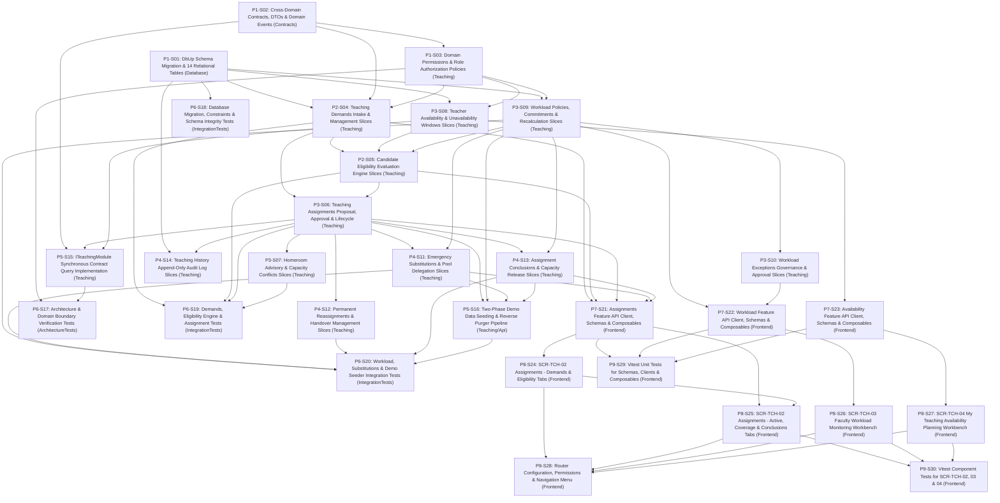

# 1. Objective

Implement the complete full scope of Stage 2 "Teaching Assignment & Workload" under the Teaching domain for Elsasa SIS V3:

1. **Teaching Demand Intake (`TCH-WF-05`, `UC-TCH-04`, `SCR-TCH-02`):**
   - Ingest and clarify formal teaching capacity requests (`teaching.teaching_demands`) originating from Academics (course learning units), Students (homeroom cohorts), and Development (extracurricular programs).
   - Capture demand code (`demand_code`), requesting domain, opaque external work reference (`source_work_reference`), human-readable label (`source_work_label`), target academic period, required capability code, requested assignment role, estimated workload effort and unit, assessment authority mandate, requested date range, campus location, and teacher headcount.
   - Support demand lifecycle transitions: `received`, `accepted_for_staffing`, `returned_for_clarification`, `changed`, `cancelled`, `declined`, `staffed`.
   - Maintain strict separation of concerns: Teaching staffs the demand without redefining the underlying academic curriculum, student cohort, or operational timetable.

2. **Teacher Eligibility Evaluation Engine (`TCH-WF-06`, `UC-TCH-05`, `SCR-TCH-02`):**
   - Provide an explainable, policy-driven automated evaluation of candidate faculty against demand requirements (`teaching.teacher_eligibility_evaluations`).
   - Automatically evaluate 5 policy checks in memory: (1) active teacher profile standing, (2) matching active teaching authorization, (3) verified qualification evidence if required, (4) scheduling availability, and (5) remaining workload capacity.
   - Persist evaluation records with binary determination (`is_eligible`), detailed status (`eligible`, `eligible_under_supervision`, `ineligible_unqualified`, `ineligible_conflicted`, `ineligible_capacity_exceeded`), check breakdown flags, human-readable natural language explanation, and coordinator remarks.

3. **Teaching Assignment Approval & Homeroom Integration (`TCH-WF-07`, `TCH-WF-08`, `UC-TCH-10`, `UC-TCH-11`, `SCR-TCH-02`):**
   - Manage configurable assignment roles (`teaching.assignment_roles`, e.g., Guru Utama, Guru Pendamping, Asisten Guru, Penilai, Wali Kelas, Pembimbing Akademik, Fasilitator, Guru Pengganti) with lead role indicators and workload counting flags.
   - Connect eligible faculty to authorized teaching responsibilities through formal assignments (`teaching.teaching_assignments`), capturing assignment number, assigned teacher, demand link, assignment role, scope category (`learning_unit`, `cohort_group`, `individual_student`, `extracurricular_group`), scope reference/label, academic period, effective date range, committed workload, and authority approval metadata.
   - Manage assignment lifecycle: `proposed`, `approved`, `rejected`, `withdrawn`, `returned_for_revision`, `suspended`, `cancelled`, `completed`.
   - Support co-teaching and shared responsibility via distinct individual assignments referencing the same demand and scope.
   - Support homeroom advisory assignments (`assignment_role = 'HOMEROOM_ADVISOR'`) decoupled from student cohort placement (owned by Students) and physical homeroom allocation (owned by Operations).
   - Identify, classify, and track capacity conflicts (`teaching.capacity_conflicts`) with severity (`advisory` vs. `blocking`) and resolution tracking.

4. **Workload & Capacity Management (`TCH-WF-04`, `TCH-WF-10`, `UC-TCH-01`, `UC-TCH-07`, `SCR-TCH-03`, `SCR-TCH-04`):**
   - Enable teachers to declare weekly working availability, preferred teaching blocks, and recurring constraints across academic periods (`teaching.teacher_availabilities`, `SCR-TCH-04`).
   - Record explicit temporary unavailability windows (`teaching.teacher_unavailability_windows`, e.g., medical leave, official training, personal leave, blackout dates) without silently cancelling active assignments.
   - Establish versioned workload policies (`teaching.workload_policies`) defining measurement units, standard capacity limits, warning thresholds, prohibited capacity ceilings, and countable activity inclusions.
   - Atomically synchronize reproducible snapshots of planned, committed, and remaining teacher capacity per period (`teaching.workload_commitments`, `SCR-TCH-03`).
   - Manage formal workload exception requests (`teaching.workload_exceptions`) when an assignment requires exceeding prohibited capacity ceilings, enforcing strict governance: Coordinator Recommends → Teaching Authority Approves → Exception Granted (no self-approval).

5. **Substitution & Reassignment (`TCH-WF-09`, `UC-TCH-06`, `SCR-TCH-02`):**
   - Implement **Pre-Authorized Pool Delegation** (Resolution 3.8): Teaching Coordinator has unilateral authority to commit emergency substitutes (`teaching.teaching_substitutions`) holding active matching authorizations within workload caps. Escalates to Teaching Authority only if the substitute lacks authorization or breaches capacity ceilings.
   - Manage permanent reassignments (`teaching.teaching_reassignments`) transferring responsibility to a new teacher with predecessor links, formal justification, Teaching Authority approval, and syllabus/grading handover verification (`requires_handover`, `handover_status`).
   - Strictly preserve historical integrity: substitutions and reassignments take effect prospectively and never alter past academic or attendance records.

6. **Assignment Completion (`TCH-WF-11`, `UC-TCH-08`, `SCR-TCH-02`):**
   - Formally conclude teaching assignments upon reaching period end or milestones (`teaching.assignment_completions`).
   - Verify academic deliverables completion (grade submissions confirmed by Academics), confirm handover, and atomically release committed teacher capacity back to the available pool.

7. **Teaching History Preservation (`TCH-WF-12`, `UC-TCH-12`, `SCR-TCH-01`, `SCR-TCH-02`):**
   - Preserve an immutable append-only log of significant decisions, transitions, and domain events across a teacher's assignments and capacity lifecycle (`teaching.teaching_history_entries`).
   - Leverage existing `teaching.teaching_record_corrections` table provisioned in Stage 1 to support formal, auditable corrections on finalized assignments.

8. **Frontend Cohesive Workspaces (`SCR-TCH-02`, `SCR-TCH-03`, `SCR-TCH-04`):**
   - Implement `SCR-TCH-02` (`/teaching/assignments`) as a Work Queue workbench with 5 cohesive tabs: *Demands Intake*, *Candidate Eligibility*, *Assignments & Homerooms*, *Coverage & Substitutions*, *Conclusions*.
   - Implement `SCR-TCH-03` (`/teaching/workload`) as a Monitoring workbench with period selector, policy indicators, faculty capacity cards, assignment drill-down drawer, and workload exception modal.
   - Implement `SCR-TCH-04` (`/teaching/my-availability`) as a Planning workbench with weekly recurring time grid and temporary unavailability windows modal.

9. **Two-Phase Demo Data Seeding & Purging Support:**
   - Update `DemoDataOrchestrator` to introduce `ITeachingAssignmentsDemoDataSeeder` as an explicit second-phase seeder running after Academics Structure and Students.
   - Bind real created Learning Units (e.g., Matematika SD) and Cohorts (e.g., Kelas 4A) to Hagios faculty personas: (1) Budi Hartono (Math Primary + Homeroom Advisor + Medical Leave), (2) Siti Nurhaliza (Co-teaching English + Emergency Substitute for Budi), (3) John Miller (Visiting Lecturer + Workload Exception), (4) Hendra Setiawan (Ineligible Candidate evaluation demo).
   - Update `ITeachingDemoDataPurger` to clean up all 24 tables in schema `teaching` in exact reverse dependency order.

Planning Mode: FEATURE-PLANNING

Referenced artifacts:
- FEATURE / ISSUE:
  - `docs/issues/IS015 - TCH-ASSIGNMENT-WORKLOAD-ISSUE.md` (Intake `CR-TCH-ASSIGNMENT-WORKLOAD`)
  - `docs/domains/teaching-domain.md` (Submodules 2.1–2.7, lines 115–187; Cross-domain boundaries lines 200–225)
  - `docs/sub-modul-and-development-phases.md` (Stage 2: Module 2 — Assignment & Workload, Criteria 7 & 8)
  - `docs/operational-workflow-discovery.md` (`TCH-WF-04`, `TCH-WF-05`, `TCH-WF-06`, `TCH-WF-07`, `TCH-WF-08`, `TCH-WF-09`, `TCH-WF-10`, `TCH-WF-11`, `TCH-WF-12`)
  - `docs/use-cases.md` (`UC-TCH-01`, `UC-TCH-04`, `UC-TCH-05`, `UC-TCH-06`, `UC-TCH-07`, `UC-TCH-08`, `UC-TCH-10`, `UC-TCH-11`, `UC-TCH-12`)
  - `docs/actors.md` (Teaching Coordinator `ACT-12`, Teaching Authority `ACT-13`, Teacher `ACT-09`, Resolution 3.8)
  - `docs/screen-inventory.md` (`SCR-TCH-02`, `SCR-TCH-03`, `SCR-TCH-04`)
  - `docs/entities/teaching-entities.md` & `docs/entities/teaching-entities-tables.md` (Module 2 tables lines 365–950, tables 2.1 to 2.14, and 2.15)
- ARCHITECTURE:
  - `docs/issues/IS015 - TCH-ASSIGNMENT-WORKLOAD-ARCHITECTURE.md` (Authoritative target capability architecture)
  - `docs/architecture/backend-architecture.md` (Modular Monolith & Vertical Slice specification)
  - `docs/architecture/frontend-architecture.md` (Modular Vue 3 SPA architecture)
  - `docs/architecture/adr.md` (ADR-001, ADR-002, ADR-004, ADR-005, ADR-006, ADR-010)
  - `docs/architecture/coding-conventions.md` (C# 12, Dapper explicit T-SQL, Minimal API conventions)
- FEASIBILITY-ASSESSMENT:
  - `docs/issues/IS015 - TCH-ASSIGNMENT-WORKLOAD-FEASIBILITY-ASSESSMENT.md` (Status: `READY-FOR-PLANNING`)

Architecture Applicability: ARCHITECTURE-REQUIRED

This feature introduces 14 authoritative relational tables in schema `teaching`, 7 backend vertical feature slices, automated 5-check eligibility evaluation engine, transactional workload commitment snapshots, Pre-Authorized Pool Delegation (Resolution 3.8), decoupled homeroom advisory integration, two-phase demo seeding, reverse-dependency purging across 24 tables, and 3 cohesive frontend workbenches (`SCR-TCH-02`, `SCR-TCH-03`, `SCR-TCH-04`). Target architecture `docs/issues/IS015 - TCH-ASSIGNMENT-WORKLOAD-ARCHITECTURE.md` is authoritative and governs this plan.

---

# 2. Planning Scope

The planning scope encompasses all technical changes required across database persistence, backend domain vertical slices, cross-domain contracts, automated test harnesses, and frontend workspaces:

1. **Database Schema & Migrations (`Elsasa.Sis.Database`):**
   - Author and register sequential forward DbUp migration script `20261110_0502_Teaching_AssignmentWorkload_Tables.sql` targeting Microsoft SQL Server 2022 ([ADR-002](file:///d:/Project.Private/elsasa-sis-v3/docs/architecture/adr.md#L50-L75), [ADR-006](file:///d:/Project.Private/elsasa-sis-v3/docs/architecture/adr.md#L152-L176)).
   - Provision 14 authoritative tables in schema `teaching`:
     - Reference / Policy: `teaching.assignment_roles`, `teaching.workload_policies`.
     - Core Tables: `teaching.teaching_demands`, `teaching.teacher_eligibility_evaluations`, `teaching.teaching_assignments`, `teaching.teacher_availabilities`, `teaching.workload_commitments`, `teaching.teaching_substitutions`, `teaching.teaching_reassignments`.
     - Supporting / Tracking Tables: `teaching.capacity_conflicts`, `teaching.teacher_unavailability_windows`, `teaching.workload_exceptions`, `teaching.assignment_completions`, `teaching.teaching_history_entries`.
   - Enforce zero physical foreign keys across domain schemas ([ADR-001](file:///d:/Project.Private/elsasa-sis-v3/docs/architecture/adr.md#L24-L48), [ADR-002](file:///d:/Project.Private/elsasa-sis-v3/docs/architecture/adr.md#L50-L75)).
   - Enforce intra-schema physical foreign keys across `teaching` tables.
   - Provision unique constraints and indexes: `UQ_teaching_assignment_roles_code`, `UQ_teaching_workload_policies_code`, `UQ_teaching_demands_code`, `UQ_teaching_assignments_number`, `UQ_teaching_workload_exceptions_number`, `UQ_teaching_substitutions_number`, `UQ_teaching_reassignments_number`, partial unique index on active `teacher_availabilities`, unique index on `workload_commitments`, unique index on `assignment_completions`.
   - Enforce check constraints on discrete lifecycles: `CK_teaching_dem_status`, `CK_teaching_eval_status`, `CK_teaching_asn_status`, `CK_teaching_conf_sev`, `CK_teaching_conf_status`, `CK_teaching_wcom_status`, `CK_teaching_wexc_status`, `CK_teaching_sub_status`, `CK_teaching_sub_scope`, `CK_teaching_rea_status`, `CK_teaching_rea_handover`, `CK_teaching_acmp_status`, `CK_teaching_acmp_unres`.

2. **Cross-Domain Contracts & Domain Events (`Elsasa.Sis.Contracts`):**
   - Extend synchronous inquiry interface `ITeachingModule` in `Elsasa.Sis.Contracts/Teaching/` with methods:
     - `GetApprovedAssignmentForLearningUnitAsync(Guid learningUnitId, DateOnly effectiveDate, CancellationToken ct = default)`
     - `GetTeacherActiveAssignmentsAsync(Guid teacherId, Guid academicPeriodId, CancellationToken ct = default)`
     - `GetTeacherAvailabilityAsync(Guid teacherId, Guid academicPeriodId, CancellationToken ct = default)`
     - `IsTeacherAssignedToScopeAsync(Guid teacherId, string scopeType, Guid scopeReferenceId, DateOnly effectiveDate, CancellationToken ct = default)`
   - Define shared contract DTO records under `Elsasa.Sis.Contracts/Teaching/`:
     - `TeachingDemandDto`, `TeachingAssignmentDto`, `AssignmentRoleDto`, `TeacherAvailabilityDto`, `TeacherUnavailabilityWindowDto`, `WorkloadCommitmentDto`, `TeachingSubstitutionDto`, `TeachingReassignmentDto`, `AssignmentCompletionDto`, `TeacherEligibilityEvaluationDto`, `CapacityConflictDto`, `WorkloadPolicyDto`, `WorkloadExceptionDto`, `TeachingHistoryEntryDto`.
   - Define in-memory domain event records under `Elsasa.Sis.Contracts/Teaching/Events/` implementing `IDomainEvent` ([ADR-003](file:///d:/Project.Private/elsasa-sis-v3/docs/architecture/adr.md#L76-L98)):
     - `TeachingDemandReceivedEvent`, `TeachingAssignmentProposedEvent`, `TeachingAssignmentApprovedEvent`, `TeachingAssignmentCancelledEvent`, `TeachingAssignmentCompletedEvent`, `TeachingSubstitutionAssignedEvent`, `WorkloadExceptionApprovedEvent`.
   - Define second-phase demo data contract: `ITeachingAssignmentsDemoDataSeeder` and `TeachingAssignmentsSeedResult` in `Elsasa.Sis.Contracts/DemoData/`.

3. **Domain Permissions & Role Authorization Policies (`Elsasa.Sis.Teaching`):**
   - Extend `Permissions.cs` with Stage 2 permission constants:
     - `Permissions.Teaching.Assignments.View`
     - `Permissions.Teaching.Assignments.Manage`
     - `Permissions.Teaching.Assignments.Approve`
     - `Permissions.Teaching.Substitutions.Arrange`
     - `Permissions.Teaching.Substitutions.ApproveException`
     - `Permissions.Teaching.Workload.View`
     - `Permissions.Teaching.Workload.Recalculate`
     - `Permissions.Teaching.Workload.RequestException`
     - `Permissions.Teaching.Workload.ApproveException`
     - `Permissions.Teaching.Availability.Declare`
   - Register ASP.NET Core authorization policies in `DependencyInjection.cs`.

4. **Teaching Demands Intake & Management Vertical Slices (`Elsasa.Sis.Teaching`):**
   - `CreateTeachingDemand` (`POST /api/v1/teaching/demands`): Coordinator ingests capacity request across domains.
   - `UpdateTeachingDemand` (`PUT /api/v1/teaching/demands/{id}`): Modifies demand parameters while in mutable status.
   - `UpdateTeachingDemandStatus` (`POST /api/v1/teaching/demands/{id}/status`): Executes lifecycle transitions (`accepted_for_staffing`, `returned_for_clarification`, `declined`, `cancelled`).
   - `GetTeachingDemands` (`GET /api/v1/teaching/demands`): Queries filterable demands work queue (`academicPeriodId`, `sourceDomain`, `status`, `campus`).
   - `GetTeachingDemandById` (`GET /api/v1/teaching/demands/{id}`): Returns detailed demand representation.

5. **Teacher Eligibility Evaluation Engine (`Elsasa.Sis.Teaching`):**
   - `EvaluateCandidateEligibility` (`POST /api/v1/teaching/eligibility/evaluate`): Automated 5-factor evaluation engine running in memory (standing, matching active authorization, verified qualification check if required, schedule & unavailability window check, remaining workload capacity check). Generates human-readable natural language explanation and persists determination in `teaching.teacher_eligibility_evaluations`.
   - `GetCandidateEvaluations` (`GET /api/v1/teaching/eligibility/evaluations`): Queries historical candidate evaluations for a demand or teacher.

6. **Teaching Assignments, Homerooms & Workload Management (`Elsasa.Sis.Teaching`):**
   - `ProposeTeachingAssignment` (`POST /api/v1/teaching/assignments/propose`): Proposes candidate assignment, updates planned workload.
   - `ApproveTeachingAssignment` (`POST /api/v1/teaching/assignments/{id}/approve`): Authority approval; atomically updates `teaching.workload_commitments` within transaction and publishes `TeachingAssignmentApprovedEvent`.
   - `AcknowledgeTeachingAssignment` (`POST /api/v1/teaching/assignments/{id}/acknowledge`): Teacher acknowledges assignment.
   - `UpdateTeachingAssignmentStatus` (`POST /api/v1/teaching/assignments/{id}/status`): Handles lifecycle states (`suspended`, `cancelled`, `withdrawn`, `returned_for_revision`).
   - `GetTeachingAssignments` (`GET /api/v1/teaching/assignments`): Filterable assignments worklist (`academicPeriodId`, `status`, `teacherProfileId`, `scopeType`, `assignmentRoleId`).
   - `GetTeachingAssignmentById` (`GET /api/v1/teaching/assignments/{id}`): Queries detailed assignment.
   - `GetAssignmentRoles` (`GET /api/v1/teaching/assignment-roles`): Queries assignment roles catalog.
   - `GetCapacityConflicts` (`GET /api/v1/teaching/conflicts`): Queries advisory and blocking staffing conflicts.
   - `ResolveCapacityConflict` (`POST /api/v1/teaching/conflicts/{id}/resolve`): Records conflict resolution with notes.
   - Homeroom advisory staffing (`assignment_role = 'HOMEROOM_ADVISOR'`) decoupled from student cohort placement.
   - Co-teaching support via distinct individual assignments linked to the same demand and scope.

7. **Workload & Capacity Management Vertical Slices (`Elsasa.Sis.Teaching`):**
   - `DeclareTeacherAvailability` (`POST /api/v1/teaching/teachers/{teacherId}/availability`): Teacher declares recurring weekly availability schedule.
   - `GetTeacherAvailability` (`GET /api/v1/teaching/teachers/{teacherId}/availability`): Queries teacher weekly availability for a period.
   - `CreateUnavailabilityWindow` (`POST /api/v1/teaching/teachers/{teacherId}/unavailability`): Records temporary leave or blackout window without cancelling assignments.
   - `CancelUnavailabilityWindow` (`POST /api/v1/teaching/unavailability/{id}/cancel`): Cancels an active leave window.
   - `GetTeacherUnavailabilityWindows` (`GET /api/v1/teaching/teachers/{teacherId}/unavailability`): Lists recorded leave windows.
   - `GetWorkloadPolicies` (`GET /api/v1/teaching/workload/policies`): Queries active workload policies and limits.
   - `GetWorkloadCommitments` (`GET /api/v1/teaching/workload/commitments`): Queries capacity monitoring snapshots (`normal`, `under_allocated`, `approaching_limit`, `overloaded_with_exception`, `breached`).
   - `RecalculatePeriodWorkload` (`POST /api/v1/teaching/workload/recalculate`): Idempotent period recalculation reconciling snapshots from assignments and exceptions.
   - `RequestWorkloadException` (`POST /api/v1/teaching/workload/exceptions`): Coordinator recommends exception for an overloaded teacher.
   - `ApproveWorkloadException` (`POST /api/v1/teaching/workload/exceptions/{id}/approve`): Authority approves workload exception; updates commitment status, increments exception count, and emits `WorkloadExceptionApprovedEvent`. Self-approval prohibited.

8. **Substitutions & Permanent Reassignments (`Elsasa.Sis.Teaching`):**
   - `ArrangeEmergencySubstitution` (`POST /api/v1/teaching/substitutions`): Pre-Authorized Pool Delegation (Resolution 3.8); direct approval if candidate holds matching authorization and is within workload cap; raises blocking `capacity_conflicts` requiring authority approval if unauthorized or over cap.
   - `GetTeachingSubstitutions` (`GET /api/v1/teaching/substitutions`): Queries substitution coverage worklist.
   - `CancelSubstitution` (`POST /api/v1/teaching/substitutions/{id}/cancel`): Cancels an active substitution.
   - `ProposePermanentReassignment` (`POST /api/v1/teaching/reassignments`): Proposes permanent transfer with predecessor links and handover mandate.
   - `ApprovePermanentReassignment` (`POST /api/v1/teaching/reassignments/{id}/approve`): Authority approves reassignment and creates replacement assignment.
   - `ConfirmReassignmentHandover` (`POST /api/v1/teaching/reassignments/{id}/handover`): Confirms syllabus and grading handover.
   - `GetTeachingReassignments` (`GET /api/v1/teaching/reassignments`): Queries reassignments list.
   - Historical preservation: reassignments take effect prospectively without mutating past records.

9. **Assignment Completions & Teaching History (`Elsasa.Sis.Teaching`):**
   - `ConcludeTeachingAssignment` (`POST /api/v1/teaching/assignments/{id}/conclude`): Formally concludes assignment upon academic deliverable verification, updates status to `completed`, and atomically releases committed workload hours.
   - `GetAssignmentCompletions` (`GET /api/v1/teaching/completions`): Queries completions list.
   - `GetTeacherHistory` (`GET /api/v1/teaching/teachers/{teacherId}/history`): Queries append-only audit trail from `teaching.teaching_history_entries`.

10. **Module Contracts Implementation & Two-Phase Demo Seeding (`Elsasa.Sis.Teaching` & `Elsasa.Sis.Api`):**
    - Implement the 4 synchronous queries in `TeachingModuleImpl.cs`.
    - Implement `TeachingAssignmentsDemoDataSeeder : ITeachingAssignmentsDemoDataSeeder` binding real created learning units and student cohorts to Hagios faculty personas: (1) Budi Hartono (Math Primary + Homeroom + Medical Leave), (2) Siti Nurhaliza (Co-teaching English + Emergency Substitute for Budi), (3) John Miller (Visiting Lecturer + Workload Exception), (4) Hendra Setiawan (Ineligible Candidate evaluation demo).
    - Update `TeachingDemoDataPurger` to clean all 24 schema `teaching` tables in strict reverse-dependency order.
    - Wire seeder and purger into `DemoDataOrchestrator.cs`.

11. **Backend Automated Testing Suite (`tests/backend`):**
    - Architecture tests in `Elsasa.Sis.ArchitectureTests` verifying ADR-001/ADR-010 compliance.
    - Testcontainers SQL Server 2022 integration tests verifying migration `20261110_0502_...`, schema constraints, partial unique indexes, cascading deletes.
    - Feature integration tests covering Demands intake, Eligibility 5-factor evaluation, Assignments proposal and approval, homeroom advisory, capacity conflicts, Workload commitment atomic updates, on-demand recalculation, Pre-Authorized Pool Delegation vs exception escalation, Permanent reassignments with handover, Completions with capacity release, and History audit logging.
    - Two-phase demo data seed & reverse purge integration tests.

12. **Frontend Models, API Clients, Zod Schemas & Composables (`src/frontend`):**
    - TypeScript interfaces, Zod schemas, API clients, and TanStack Query composables under `src/frontend/src/features/teaching/` (`assignments/`, `workload/`, `availability/`).

13. **Frontend Workbenches & Navigation Integration (`src/frontend`):**
    - `SCR-TCH-02`: `TeachingAssignmentWorkspaceView.vue` (`/teaching/assignments`) with 5 cohesive tabs (*Demands Intake*, *Candidate Eligibility*, *Assignments & Homerooms*, *Coverage & Substitutions*, *Conclusions*).
    - `SCR-TCH-03`: `FacultyWorkloadMonitoringView.vue` (`/teaching/workload`) with period selector, KPI threshold cards, faculty workload table with visual capacity progress bars, drill-down drawer, exception modals, and recalculate button.
    - `SCR-TCH-04`: `MyTeachingAvailabilityView.vue` (`/teaching/my-availability`) with weekly recurring time grid and temporary unavailability windows modal.
    - Route registrations in `src/frontend/src/app/router/routes.ts` and navigation links in `AppLayout.vue`.

14. **Frontend Automated Verification & Testing (`src/frontend`):**
    - Vitest unit tests for schemas, API clients, and query composables.
    - Vitest component & workbench tests for `SCR-TCH-02`, `SCR-TCH-03`, `SCR-TCH-04`.

---

# 3. Dependencies

### External System & Tooling Dependencies

- .NET 8 SDK (8.0.x)
- Docker / Docker Desktop / Podman (required for Testcontainers SQL Server 2022 integration tests)
- Microsoft SQL Server 2022 instance (for local Web API runtime)
- Node.js runtime (v22.x or LTS) and pnpm package manager (v9.x or v11.x)

### Internal Slice Dependencies

- `Depends On` declares implementation prerequisites between slices.
- Dependencies reference Slice IDs only.
- Dependency satisfaction requires the referenced slice to have implementation status `IMPLEMENTED`.
- Dependency satisfaction does not require review status `GO`.
- Slices with `Depends On: None` or whose dependencies are satisfied may be executed in parallel.

### Dependency Graph

---

# 4. Progress Summary

| Phase | Implementation Status | Review Status | Progress |
|---|---|---|---|
| P1 - Database Schema, Domain Contracts & Host Wiring | IMPLEMENTED | GO | 3/3 |
| P2 - Teaching Demands & Candidate Eligibility Engine | IMPLEMENTED | GO | 2/2 |
| P3 - Teaching Assignments, Homerooms & Workload Management | IMPLEMENTED | GO | 5/5 |
| P4 - Substitutions, Permanent Reassignments & Conclusions | IMPLEMENTED | GO | 4/4 |
| P5 - Cross-Domain Contract Implementation & Two-Phase Demo Seeding | IMPLEMENTED | GO | 2/2 |
| P6 - Backend Automated Integration & Architecture Testing | IMPLEMENTED | GO | 4/4 |
| P7 - Frontend Models, API Clients, Zod Schemas & Composables | IMPLEMENTED | GO | 3/3 |
| P8 - Frontend Workbenches & Navigation Integration | IMPLEMENTED | GO | 5/5 |
| P9 - Frontend Automated Verification & Testing | IMPLEMENTED | GO | 2/2 |

---

# 5. Phases

## P1 - Database Schema, Domain Contracts & Host Wiring

Implementation Status: NOT-STARTED  
Review Status: NOT-REVIEWED  

### P1-S01

Title: DbUp Schema Migration & 14 Relational Tables for Teaching Stage 2

Implementation Status: IMPLEMENTED  
Review Status: GO  

Objective: Author and register DbUp migration script `20261110_0502_Teaching_AssignmentWorkload_Tables.sql` provisioning all 14 Stage 2 tables in schema `teaching` with intra-schema foreign keys, indexes, check constraints, default constraints, and unique invariants.

Depends On: None  

Repository: `src/backend/Elsasa.Sis.Database`  

Completion Criteria:
- Author script `src/backend/Elsasa.Sis.Database/Scripts/20261110_0502_Teaching_AssignmentWorkload_Tables.sql`.
- Provision 14 tables in schema `teaching`:
  1. `teaching.assignment_roles`
  2. `teaching.workload_policies`
  3. `teaching.teaching_demands`
  4. `teaching.teacher_eligibility_evaluations`
  5. `teaching.teaching_assignments`
  6. `teaching.capacity_conflicts`
  7. `teaching.teacher_availabilities`
  8. `teaching.teacher_unavailability_windows`
  9. `teaching.workload_commitments`
  10. `teaching.workload_exceptions`
  11. `teaching.teaching_substitutions`
  12. `teaching.teaching_reassignments`
  13. `teaching.assignment_completions`
  14. `teaching.teaching_history_entries`
- Enforce zero physical cross-schema foreign keys (ADR-001, ADR-002). External IDs (`source_work_reference`, `scope_reference_id`, `academic_period_id`, `academic_year_id`) are scalar `UNIQUEIDENTIFIER` columns.
- Enforce intra-schema physical foreign keys across tables within `teaching` as defined in TD-01.
- Enforce check constraints on discrete lifecycles: `CK_teaching_dem_status`, `CK_teaching_eval_status`, `CK_teaching_asn_status`, `CK_teaching_conf_sev`, `CK_teaching_conf_status`, `CK_teaching_wcom_status`, `CK_teaching_wexc_status`, `CK_teaching_sub_status`, `CK_teaching_sub_scope`, `CK_teaching_rea_status`, `CK_teaching_rea_handover`, `CK_teaching_acmp_status`, `CK_teaching_acmp_unres`.
- Enforce unique constraints and indexes: `demand_code`, `assignment_number`, `exception_number`, `substitution_number`, `reassignment_number`, partial unique index on active `teacher_availabilities (teacher_profile_id, academic_period_id)`, unique index on `workload_commitments (teacher_profile_id, academic_period_id)`, unique index on `assignment_completions (teaching_assignment_id)`.
- All tables, constraints, and indexes guarded by idempotent checks (`IF OBJECT_ID(...) IS NULL`, `IF NOT EXISTS (...)`).

Implementation Notes:
- Authored sequential forward DbUp migration script `src/backend/Elsasa.Sis.Database/Scripts/20261110_0502_Teaching_AssignmentWorkload_Tables.sql`.
- Idempotently provisioned all 14 relational tables in schema `teaching` with primary keys, default constraints, and intra-schema foreign keys.
- Enforced zero cross-schema foreign keys (ADR-001/ADR-002) for external IDs (`source_work_reference`, `scope_reference_id`, `academic_period_id`, `academic_year_id`).
- Implemented all lifecycle check constraints (`CK_teaching_dem_status`, `CK_teaching_eval_status`, `CK_teaching_asn_status`, `CK_teaching_conf_sev`, `CK_teaching_conf_status`, `CK_teaching_wcom_status`, `CK_teaching_wexc_status`, `CK_teaching_sub_status`, `CK_teaching_sub_scope`, `CK_teaching_rea_status`, `CK_teaching_rea_handover`, `CK_teaching_acmp_status`, `CK_teaching_acmp_unres`, etc.).
- Created unique constraints, indexes, and filtered unique index `UQ_teaching_teacher_availabilities_active`.
- Verified clean compilation with `dotnet build src/backend/Elsasa.Sis.Database/Elsasa.Sis.Database.csproj` and full solution build.

Changed Files:
- `src/backend/Elsasa.Sis.Database/Scripts/20261110_0502_Teaching_AssignmentWorkload_Tables.sql`
- `docs/issues/IS015 - TCH-ASSIGNMENT-WORKLOAD-IMPLEMENTATION-PLAN.md`

---

### P1-S02

Title: Cross-Domain Contracts, DTOs & Domain Events for Assignments & Workload

Implementation Status: IMPLEMENTED  
Review Status: GO  

Objective: Define shared contract DTOs, in-memory domain event records, synchronous inquiry interface extensions on `ITeachingModule`, and demo seeder interfaces in `Elsasa.Sis.Contracts`.

Depends On: None  

Repository: `src/backend/Elsasa.Sis.Contracts`  

Completion Criteria:
- Extend `ITeachingModule` in `Elsasa.Sis.Contracts/Teaching/ITeachingModule.cs` with methods:
  - `Task<TeachingAssignmentDto?> GetApprovedAssignmentForLearningUnitAsync(Guid learningUnitId, DateOnly effectiveDate, CancellationToken ct = default);`
  - `Task<IReadOnlyList<TeachingAssignmentDto>> GetTeacherActiveAssignmentsAsync(Guid teacherId, Guid academicPeriodId, CancellationToken ct = default);`
  - `Task<TeacherAvailabilityDto?> GetTeacherAvailabilityAsync(Guid teacherId, Guid academicPeriodId, CancellationToken ct = default);`
  - `Task<bool> IsTeacherAssignedToScopeAsync(Guid teacherId, string scopeType, Guid scopeReferenceId, DateOnly effectiveDate, CancellationToken ct = default);`
- Define contract DTOs under `Elsasa.Sis.Contracts/Teaching/`:
  - `TeachingDemandDto.cs`, `TeachingAssignmentDto.cs`, `AssignmentRoleDto.cs`, `TeacherAvailabilityDto.cs`, `TeacherUnavailabilityWindowDto.cs`, `WorkloadCommitmentDto.cs`, `TeachingSubstitutionDto.cs`, `TeachingReassignmentDto.cs`, `AssignmentCompletionDto.cs`, `TeacherEligibilityEvaluationDto.cs`, `CapacityConflictDto.cs`, `WorkloadPolicyDto.cs`, `WorkloadExceptionDto.cs`, `TeachingHistoryEntryDto.cs`.
- Define in-memory domain events implementing `IDomainEvent` under `Elsasa.Sis.Contracts/Teaching/Events/`:
  - `TeachingDemandReceivedEvent.cs`, `TeachingAssignmentProposedEvent.cs`, `TeachingAssignmentApprovedEvent.cs`, `TeachingAssignmentCancelledEvent.cs`, `TeachingAssignmentCompletedEvent.cs`, `TeachingSubstitutionAssignedEvent.cs`, `WorkloadExceptionApprovedEvent.cs`.
- Define demo data seeder contracts under `Elsasa.Sis.Contracts/DemoData/`:
  - `ITeachingAssignmentsDemoDataSeeder.cs`
  - `TeachingAssignmentsSeedResult.cs`

Implementation Notes:
- Extended `ITeachingModule` with the 4 synchronous cross-domain inquiry methods with default interface implementations to ensure clean compilation across all projects prior to P5-S15.
- Defined all 14 strongly-typed contract DTO records under `Elsasa.Sis.Contracts/Teaching/` using C# 12 primary constructors, nullable annotations, and zero infrastructure/database dependencies.
- Defined all 7 in-memory post-commit domain events under `Elsasa.Sis.Contracts/Teaching/Events/` implementing `IDomainEvent` with default UTC timestamp constructors.
- Defined `ITeachingAssignmentsDemoDataSeeder` and `TeachingAssignmentsSeedResult` under `Elsasa.Sis.Contracts/DemoData/` for Stage 2 two-phase demo data orchestration.
- Verified clean build of `Elsasa.Sis.Contracts.csproj` and `Elsasa.Sis.Teaching.csproj`.
- Remediation (FINDING-P1-S02-01): Updated all 4 inquiry method signatures on `ITeachingModule` to wrap return types in `Task<Result<...>>` (`Task<Result<TeachingAssignmentDto?>>`, `Task<Result<IReadOnlyList<TeachingAssignmentDto>>>`, `Task<Result<TeacherAvailabilityDto?>>`, `Task<Result<bool>>`) conforming to ADR-010. Verified that all 189 tests in `Elsasa.Sis.ArchitectureTests` pass cleanly (including `ITeachingModule_Should_ContainOnlyInquiryMethods_ReturningTaskResult`) and the solution builds without warnings or errors.

Changed Files:
- `src/backend/Elsasa.Sis.Contracts/Teaching/ITeachingModule.cs`
- `src/backend/Elsasa.Sis.Contracts/Teaching/AssignmentRoleDto.cs`
- `src/backend/Elsasa.Sis.Contracts/Teaching/WorkloadPolicyDto.cs`
- `src/backend/Elsasa.Sis.Contracts/Teaching/TeachingDemandDto.cs`
- `src/backend/Elsasa.Sis.Contracts/Teaching/TeacherEligibilityEvaluationDto.cs`
- `src/backend/Elsasa.Sis.Contracts/Teaching/TeachingAssignmentDto.cs`
- `src/backend/Elsasa.Sis.Contracts/Teaching/CapacityConflictDto.cs`
- `src/backend/Elsasa.Sis.Contracts/Teaching/TeacherAvailabilityDto.cs`
- `src/backend/Elsasa.Sis.Contracts/Teaching/TeacherUnavailabilityWindowDto.cs`
- `src/backend/Elsasa.Sis.Contracts/Teaching/WorkloadCommitmentDto.cs`
- `src/backend/Elsasa.Sis.Contracts/Teaching/WorkloadExceptionDto.cs`
- `src/backend/Elsasa.Sis.Contracts/Teaching/TeachingSubstitutionDto.cs`
- `src/backend/Elsasa.Sis.Contracts/Teaching/TeachingReassignmentDto.cs`
- `src/backend/Elsasa.Sis.Contracts/Teaching/AssignmentCompletionDto.cs`
- `src/backend/Elsasa.Sis.Contracts/Teaching/TeachingHistoryEntryDto.cs`
- `src/backend/Elsasa.Sis.Contracts/Teaching/Events/TeachingDemandReceivedEvent.cs`
- `src/backend/Elsasa.Sis.Contracts/Teaching/Events/TeachingAssignmentProposedEvent.cs`
- `src/backend/Elsasa.Sis.Contracts/Teaching/Events/TeachingAssignmentApprovedEvent.cs`
- `src/backend/Elsasa.Sis.Contracts/Teaching/Events/TeachingAssignmentCancelledEvent.cs`
- `src/backend/Elsasa.Sis.Contracts/Teaching/Events/TeachingAssignmentCompletedEvent.cs`
- `src/backend/Elsasa.Sis.Contracts/Teaching/Events/TeachingSubstitutionAssignedEvent.cs`
- `src/backend/Elsasa.Sis.Contracts/Teaching/Events/WorkloadExceptionApprovedEvent.cs`
- `src/backend/Elsasa.Sis.Contracts/DemoData/ITeachingAssignmentsDemoDataSeeder.cs`
- `src/backend/Elsasa.Sis.Contracts/DemoData/TeachingAssignmentsSeedResult.cs`
- `docs/issues/IS015 - TCH-ASSIGNMENT-WORKLOAD-IMPLEMENTATION-PLAN.md`

---

### P1-S03

Title: Domain Permissions & Role Authorization Policies

Implementation Status: IMPLEMENTED  
Review Status: GO  

Objective: Define Stage 2 permission constants in `Permissions.cs` and configure authorization policies in `DependencyInjection.cs` under `Elsasa.Sis.Teaching`.

Depends On: P1-S02  

Repository: `src/backend/Elsasa.Sis.Teaching`  

Completion Criteria:
- Extend `Permissions.cs` with constants:
  - `Permissions.Teaching.Assignments.View`
  - `Permissions.Teaching.Assignments.Manage`
  - `Permissions.Teaching.Assignments.Approve`
  - `Permissions.Teaching.Substitutions.Arrange`
  - `Permissions.Teaching.Substitutions.ApproveException`
  - `Permissions.Teaching.Workload.View`
  - `Permissions.Teaching.Workload.Recalculate`
  - `Permissions.Teaching.Workload.RequestException`
  - `Permissions.Teaching.Workload.ApproveException`
  - `Permissions.Teaching.Availability.Declare`
- Update `DependencyInjection.cs` to register corresponding ASP.NET Core authorization policies mapping permissions to roles (`Teaching Coordinator`, `Teaching Authority`, `Teacher`, `Admin`).

Implementation Notes:
- Extended `Permissions.cs` with all 10 Stage 2 permission constants for Assignments, Substitutions, Workload, and Availability, supporting both flat nested and hierarchical `Permissions.Teaching.*` access.
- Updated `DependencyInjection.cs` to register corresponding ASP.NET Core authorization policies mapping permissions to their authorized roles (`Teacher`, `Teaching Coordinator`, `Teaching Authority`, `Admin`) according to Architecture Section 9.
- Verified compilation with `dotnet build src/backend/Elsasa.Sis.Teaching/Elsasa.Sis.Teaching.csproj` (0 errors, 0 warnings).

Changed Files:
- `src/backend/Elsasa.Sis.Teaching/Permissions.cs`
- `src/backend/Elsasa.Sis.Teaching/DependencyInjection.cs`
- `docs/issues/IS015 - TCH-ASSIGNMENT-WORKLOAD-IMPLEMENTATION-PLAN.md`

---

## P2 - Teaching Demands & Candidate Eligibility Engine

Implementation Status: NOT-STARTED  
Review Status: NOT-REVIEWED  

### P2-S04

Title: Teaching Demands Intake & Management Vertical Slices

Implementation Status: IMPLEMENTED  
Review Status: GO  

Objective: Implement vertical slices for teaching capacity demand intake, parameter modifications, status transitions, and query listings under `Features/TeachingDemands/`.

Depends On: P1-S01, P1-S02, P1-S03  

Repository: `src/backend/Elsasa.Sis.Teaching`  

Completion Criteria:
- Implement `CreateTeachingDemand`:
  - Endpoint `POST /api/v1/teaching/demands` with `Permissions.Teaching.Assignments.Manage`.
  - Request record, Response record, FluentValidation validator.
  - Handler inserts `teaching.teaching_demands` with generated unique `demand_code` (e.g. `DEM-2026-XXXX`), initial status `'received'`.
  - Publishes `TeachingDemandReceivedEvent`.
- Implement `UpdateTeachingDemand`:
  - Endpoint `PUT /api/v1/teaching/demands/{id}` with `Permissions.Teaching.Assignments.Manage`.
  - Updates demand parameters when in `received` or `returned_for_clarification` status.
- Implement `UpdateTeachingDemandStatus`:
  - Endpoint `POST /api/v1/teaching/demands/{id}/status` with `Permissions.Teaching.Assignments.Manage`.
  - Transitions lifecycle: `accepted_for_staffing`, `returned_for_clarification`, `declined` (with mandatory `decline_reason`), `cancelled`.
- Implement `GetTeachingDemands`:
  - Endpoint `GET /api/v1/teaching/demands` with `Permissions.Teaching.Assignments.View`.
  - Supports filters: `academicPeriodId`, `sourceDomain`, `status`, `campusScope`, `search`.
- Implement `GetTeachingDemandById`:
  - Endpoint `GET /api/v1/teaching/demands/{id}` with `Permissions.Teaching.Assignments.View`.
- Register endpoints in `TeachingEndpoints.cs` and handlers in `DependencyInjection.cs`.

Implementation Notes:
- Implemented `CreateTeachingDemand` endpoint (`POST /api/v1/teaching/demands`) requiring `Permissions.Teaching.Assignments.Manage`, with request/response records, FluentValidation validator enforcing field length and date ranges, explicit T-SQL handler generating `DEM-YYYY-XXXX` codes, and post-commit publishing of `TeachingDemandReceivedEvent`.
- Implemented `UpdateTeachingDemand` endpoint (`PUT /api/v1/teaching/demands/{id}`) requiring `Permissions.Teaching.Assignments.Manage`, allowing parameter modifications while in mutable statuses (`received`, `returned_for_clarification`) and rejecting mutations once locked.
- Implemented `UpdateTeachingDemandStatus` endpoint (`POST /api/v1/teaching/demands/{id}/status`) requiring `Permissions.Teaching.Assignments.Manage`, enforcing transition rules to `accepted_for_staffing`, `returned_for_clarification`, `declined` (with mandatory `decline_reason`), and `cancelled`.
- Implemented `GetTeachingDemands` endpoint (`GET /api/v1/teaching/demands`) requiring `Permissions.Teaching.Assignments.View` with pagination and dynamic filtering by `academicPeriodId`, `sourceDomain`, `status`, `campusScope`, and `search`.
- Implemented `GetTeachingDemandById` endpoint (`GET /api/v1/teaching/demands/{id}`) requiring `Permissions.Teaching.Assignments.View`, joining `assignment_roles` to return full demand details.
- Registered all 5 handlers in `DependencyInjection.cs` and confirmed endpoint discovery through `IEndpoint` assembly scanning in `TeachingEndpoints.cs`.
- Verified clean build across `Elsasa.Sis.Teaching` and full solution, and confirmed all 189 architecture tests pass.

Changed Files:
- `src/backend/Elsasa.Sis.Teaching/Features/TeachingDemands/CreateTeachingDemand/CreateTeachingDemandEndpoint.cs`
- `src/backend/Elsasa.Sis.Teaching/Features/TeachingDemands/CreateTeachingDemand/CreateTeachingDemandHandler.cs`
- `src/backend/Elsasa.Sis.Teaching/Features/TeachingDemands/CreateTeachingDemand/CreateTeachingDemandRequest.cs`
- `src/backend/Elsasa.Sis.Teaching/Features/TeachingDemands/CreateTeachingDemand/CreateTeachingDemandResponse.cs`
- `src/backend/Elsasa.Sis.Teaching/Features/TeachingDemands/CreateTeachingDemand/CreateTeachingDemandValidator.cs`
- `src/backend/Elsasa.Sis.Teaching/Features/TeachingDemands/UpdateTeachingDemand/UpdateTeachingDemandEndpoint.cs`
- `src/backend/Elsasa.Sis.Teaching/Features/TeachingDemands/UpdateTeachingDemand/UpdateTeachingDemandHandler.cs`
- `src/backend/Elsasa.Sis.Teaching/Features/TeachingDemands/UpdateTeachingDemand/UpdateTeachingDemandRequest.cs`
- `src/backend/Elsasa.Sis.Teaching/Features/TeachingDemands/UpdateTeachingDemand/UpdateTeachingDemandResponse.cs`
- `src/backend/Elsasa.Sis.Teaching/Features/TeachingDemands/UpdateTeachingDemand/UpdateTeachingDemandValidator.cs`
- `src/backend/Elsasa.Sis.Teaching/Features/TeachingDemands/UpdateTeachingDemandStatus/UpdateTeachingDemandStatusEndpoint.cs`
- `src/backend/Elsasa.Sis.Teaching/Features/TeachingDemands/UpdateTeachingDemandStatus/UpdateTeachingDemandStatusHandler.cs`
- `src/backend/Elsasa.Sis.Teaching/Features/TeachingDemands/UpdateTeachingDemandStatus/UpdateTeachingDemandStatusRequest.cs`
- `src/backend/Elsasa.Sis.Teaching/Features/TeachingDemands/UpdateTeachingDemandStatus/UpdateTeachingDemandStatusResponse.cs`
- `src/backend/Elsasa.Sis.Teaching/Features/TeachingDemands/UpdateTeachingDemandStatus/UpdateTeachingDemandStatusValidator.cs`
- `src/backend/Elsasa.Sis.Teaching/Features/TeachingDemands/GetTeachingDemands/GetTeachingDemandsEndpoint.cs`
- `src/backend/Elsasa.Sis.Teaching/Features/TeachingDemands/GetTeachingDemands/GetTeachingDemandsHandler.cs`
- `src/backend/Elsasa.Sis.Teaching/Features/TeachingDemands/GetTeachingDemandById/GetTeachingDemandByIdEndpoint.cs`
- `src/backend/Elsasa.Sis.Teaching/Features/TeachingDemands/GetTeachingDemandById/GetTeachingDemandByIdHandler.cs`
- `src/backend/Elsasa.Sis.Teaching/DependencyInjection.cs`
- `docs/issues/IS015 - TCH-ASSIGNMENT-WORKLOAD-IMPLEMENTATION-PLAN.md`

---

### P2-S05

Title: Candidate Eligibility Evaluation Engine Slices

Implementation Status: IMPLEMENTED  
Review Status: GO  

Objective: Implement the automated 5-check Teacher Eligibility Evaluation Engine in memory with natural language explanation generation and auditable persistence into `teaching.teacher_eligibility_evaluations`.

Depends On: P2-S04, P3-S08, P3-S09  

Repository: `src/backend/Elsasa.Sis.Teaching`  

Completion Criteria:
- Implement `EvaluateCandidateEligibility`:
  - Endpoint `POST /api/v1/teaching/eligibility/evaluate` with `Permissions.Teaching.Assignments.Manage`.
  - Request: `teachingDemandId`, `teacherProfileId`, optional `coordinatorRemarks`.
  - Handler executes the 5 policy checks in memory against SQL data:
    1. Check 1 (Standing): `teacher_profiles.standing = 'active'`.
    2. Check 2 (Authorization): active `teaching_authorizations` matching `required_capability_code` and `campus_scope`.
    3. Check 3 (Qualification): if required, supporting `qualification_evidence` has `verification_state = 'verified'`.
    4. Check 4 (Availability): no overlapping `teacher_unavailability_windows`, and weekly schedule matches `recurring_available_schedule`.
    5. Check 5 (Capacity): `committed_workload_hours + demand.expected_workload_hours <= max_capacity_limit_hours` under active `workload_policies` (or valid exception).
  - Generates natural language explanation string summarizing check results.
  - Determines `is_eligible` and `eligibility_status` (`eligible`, `eligible_under_supervision`, `ineligible_unqualified`, `ineligible_conflicted`, `ineligible_capacity_exceeded`).
  - Persists record into `teaching.teacher_eligibility_evaluations`.
  - Returns detailed response with check breakdown flags and explanation.
- Implement `GetCandidateEvaluations`:
  - Endpoint `GET /api/v1/teaching/eligibility/evaluations` with `Permissions.Teaching.Assignments.View`.
  - Queries evaluation history for a given `teachingDemandId` or `teacherProfileId`.
- Register in `TeachingEndpoints.cs` and `DependencyInjection.cs`.

Implementation Notes:
- Implemented `EvaluateCandidateEligibility` feature under `Features/TeacherEligibility/EvaluateCandidateEligibility/` with endpoint `POST /api/v1/teaching/eligibility/evaluate` requiring `Permissions.Teaching.Assignments.Manage`.
- The handler executes the 5 policy checks in memory against authoritative SQL tables:
  1. Profile Standing: Verifies `teacher_profiles.standing = 'active'`.
  2. Authorization: Matches active authorizations (`active` or `authorized_under_supervision`) covering capability code, campus scope, and requested date window.
  3. Qualification: If mandated by role or unverified warning flag, verifies existence of valid unexpired `qualification_evidence` with `verification_state = 'verified'`.
  4. Availability: Verifies absence of overlapping active `teacher_unavailability_windows` for the demand date range and inspects declared recurring availability.
  5. Capacity: Compares projected total workload against `workload_commitments.max_capacity_limit_hours` or active `workload_policies`, accounting for approved `workload_exceptions`.
- Implemented natural language explanation generator constructing human-readable Indonesian evaluation summaries covering each criteria check and final staffing conclusion.
- Enforced outcome determination for `is_eligible` and mapped `eligibility_status` enum constraint (`eligible`, `eligible_under_supervision`, `ineligible_unqualified`, `ineligible_conflicted`, `ineligible_capacity_exceeded`).
- Persists audit row into `teaching.teacher_eligibility_evaluations`.
- Implemented `GetCandidateEvaluations` feature under `Features/TeacherEligibility/GetCandidateEvaluations/` with endpoint `GET /api/v1/teaching/eligibility/evaluations` requiring `Permissions.Teaching.Assignments.View`, supporting filtering by `teachingDemandId` or `teacherProfileId` with joined demand code and teacher metadata.
- Registered handlers in `DependencyInjection.cs`. Endpoints are auto-discovered through `IEndpoint` assembly scanning in `TeachingEndpoints.cs`.
- Verified clean build (`dotnet build src/backend/Elsasa.Sis.sln`) with 0 warnings, 0 errors, and all 189 architecture tests passing cleanly.

Changed Files:
- `src/backend/Elsasa.Sis.Teaching/Features/TeacherEligibility/EvaluateCandidateEligibility/EvaluateCandidateEligibilityRequest.cs`
- `src/backend/Elsasa.Sis.Teaching/Features/TeacherEligibility/EvaluateCandidateEligibility/EvaluateCandidateEligibilityResponse.cs`
- `src/backend/Elsasa.Sis.Teaching/Features/TeacherEligibility/EvaluateCandidateEligibility/EvaluateCandidateEligibilityValidator.cs`
- `src/backend/Elsasa.Sis.Teaching/Features/TeacherEligibility/EvaluateCandidateEligibility/EvaluateCandidateEligibilityHandler.cs`
- `src/backend/Elsasa.Sis.Teaching/Features/TeacherEligibility/EvaluateCandidateEligibility/EvaluateCandidateEligibilityEndpoint.cs`
- `src/backend/Elsasa.Sis.Teaching/Features/TeacherEligibility/GetCandidateEvaluations/CandidateEvaluationSummaryDto.cs`
- `src/backend/Elsasa.Sis.Teaching/Features/TeacherEligibility/GetCandidateEvaluations/GetCandidateEvaluationsHandler.cs`
- `src/backend/Elsasa.Sis.Teaching/Features/TeacherEligibility/GetCandidateEvaluations/GetCandidateEvaluationsEndpoint.cs`
- `src/backend/Elsasa.Sis.Teaching/DependencyInjection.cs`
- `docs/issues/IS015 - TCH-ASSIGNMENT-WORKLOAD-IMPLEMENTATION-PLAN.md`

Notes: Check 4 uses data from P3-S08; Check 5 uses data from P3-S09.

---

## P3 - Teaching Assignments, Homerooms & Workload Management

Implementation Status: NOT-STARTED  
Review Status: NOT-REVIEWED  

### P3-S06

Title: Teaching Assignments Proposal, Approval & Lifecycle Slices

Implementation Status: IMPLEMENTED  
Review Status: GO  

Objective: Implement vertical slices for proposing teaching assignments, authority approval with atomic workload commitment updates, teacher acknowledgement, and status lifecycle handling under `Features/TeachingAssignments/`.

Depends On: P2-S04, P2-S05  

Repository: `src/backend/Elsasa.Sis.Teaching`  

Completion Criteria:
- Implement `ProposeTeachingAssignment`:
  - Endpoint `POST /api/v1/teaching/assignments/propose` with `Permissions.Teaching.Assignments.Manage`.
  - Generates unique `assignment_number` (e.g. `ASN-2026-XXXX`), creates row with status `'proposed'`.
  - Atomically increments `planned_workload_hours` in `teaching.workload_commitments`.
  - Publishes `TeachingAssignmentProposedEvent`.
- Implement `ApproveTeachingAssignment`:
  - Endpoint `POST /api/v1/teaching/assignments/{id}/approve` with `Permissions.Teaching.Assignments.Approve`.
  - Sets `status = 'approved'`, `approved_by`, `approved_date`.
  - Atomically in single `SqlTransaction`: decrements `planned_workload_hours`, increments `committed_workload_hours`, and increments `active_assignment_count` in `teaching.workload_commitments`.
  - Updates demand status to `staffed` if required headcount is fulfilled.
  - Publishes `TeachingAssignmentApprovedEvent`.
  - Appends record to `teaching.teaching_history_entries`.
- Implement `AcknowledgeTeachingAssignment`:
  - Endpoint `POST /api/v1/teaching/assignments/{id}/acknowledge` with `Permissions.Teaching.Assignments.View`.
  - Teacher stamps `acknowledged_at = SYSUTCDATETIME()`.
- Implement `UpdateTeachingAssignmentStatus`:
  - Endpoint `POST /api/v1/teaching/assignments/{id}/status` with `Permissions.Teaching.Assignments.Manage`.
  - Handles `suspended`, `cancelled`, `withdrawn`, `returned_for_revision`.
  - In single `SqlTransaction`, deducts committed hours from `workload_commitments` when cancelled or suspended.
  - Publishes `TeachingAssignmentCancelledEvent` if cancelled.
- Implement `GetTeachingAssignments` and `GetTeachingAssignmentById`:
  - Endpoints `GET /api/v1/teaching/assignments` and `GET /api/v1/teaching/assignments/{id}` with `Permissions.Teaching.Assignments.View`.
- Implement `GetAssignmentRoles`:
  - Endpoint `GET /api/v1/teaching/assignment-roles` with `Permissions.Teaching.Assignments.View`.
- Register in `TeachingEndpoints.cs` and `DependencyInjection.cs`.

Implementation Notes:
- Implemented `ProposeTeachingAssignment` (`POST /api/v1/teaching/assignments/propose`) requiring `Permissions.Teaching.Assignments.Manage`, auto-generating `ASN-YYYY-XXXX` identifiers, atomically incrementing `planned_workload_hours` in `teaching.workload_commitments` (or creating commitment row if non-existent), and publishing `TeachingAssignmentProposedEvent`.
- Implemented `ApproveTeachingAssignment` (`POST /api/v1/teaching/assignments/{id}/approve`) requiring `Permissions.Teaching.Assignments.Approve`, atomically within a single `SqlTransaction`: sets status `'approved'`, shifts hours from `planned_workload_hours` to `committed_workload_hours`, increments `active_assignment_count`, recalculates commitment status according to active policy thresholds, checks demand required headcount and marks demand `'staffed'` if fulfilled, records audit log in `teaching.teaching_history_entries`, and emits `TeachingAssignmentApprovedEvent`.
- Implemented `AcknowledgeTeachingAssignment` (`POST /api/v1/teaching/assignments/{id}/acknowledge`) requiring `Permissions.Teaching.Assignments.View`, stamping `teacher_acknowledged = 1` and `teacher_acknowledged_date = CAST(SYSUTCDATETIME() AS DATE)`.
- Implemented `UpdateTeachingAssignmentStatus` (`POST /api/v1/teaching/assignments/{id}/status`) requiring `Permissions.Teaching.Assignments.Manage`, handling discrete lifecycles (`suspended`, `cancelled`, `withdrawn`, `returned_for_revision`), atomically deducting committed hours and decrementing active assignments count from `workload_commitments` on cancellation/suspension (or planned hours on withdrawal/revision), reopening demands if headcount drops below required count, appending history log, and publishing `TeachingAssignmentCancelledEvent` on cancellation.
- Implemented `GetTeachingAssignments` (`GET /api/v1/teaching/assignments`) with dynamic filtering (`academicPeriodId`, `status`, `teacherProfileId`, `scopeType`, `assignmentRoleId`, `search`) and pagination returning `PaginatedList<TeachingAssignmentDto>`.
- Implemented `GetTeachingAssignmentById` (`GET /api/v1/teaching/assignments/{id}`) returning strongly-typed `TeachingAssignmentDto`.
- Implemented `GetAssignmentRoles` (`GET /api/v1/teaching/assignment-roles`) returning active assignment roles catalog.
- Registered all handlers in `DependencyInjection.cs`. Endpoints are discovered and mapped via `IEndpoint` assembly scanning in `TeachingEndpoints.cs`.
- Verified 0 warnings, 0 errors with `dotnet build src/backend/Elsasa.Sis.sln` and verified all 189 tests pass in `Elsasa.Sis.ArchitectureTests`.

Changed Files:
- `src/backend/Elsasa.Sis.Teaching/Features/TeachingAssignments/ProposeTeachingAssignment/ProposeTeachingAssignmentRequest.cs`
- `src/backend/Elsasa.Sis.Teaching/Features/TeachingAssignments/ProposeTeachingAssignment/ProposeTeachingAssignmentResponse.cs`
- `src/backend/Elsasa.Sis.Teaching/Features/TeachingAssignments/ProposeTeachingAssignment/ProposeTeachingAssignmentValidator.cs`
- `src/backend/Elsasa.Sis.Teaching/Features/TeachingAssignments/ProposeTeachingAssignment/ProposeTeachingAssignmentHandler.cs`
- `src/backend/Elsasa.Sis.Teaching/Features/TeachingAssignments/ProposeTeachingAssignment/ProposeTeachingAssignmentEndpoint.cs`
- `src/backend/Elsasa.Sis.Teaching/Features/TeachingAssignments/ApproveTeachingAssignment/ApproveTeachingAssignmentRequest.cs`
- `src/backend/Elsasa.Sis.Teaching/Features/TeachingAssignments/ApproveTeachingAssignment/ApproveTeachingAssignmentResponse.cs`
- `src/backend/Elsasa.Sis.Teaching/Features/TeachingAssignments/ApproveTeachingAssignment/ApproveTeachingAssignmentHandler.cs`
- `src/backend/Elsasa.Sis.Teaching/Features/TeachingAssignments/ApproveTeachingAssignment/ApproveTeachingAssignmentEndpoint.cs`
- `src/backend/Elsasa.Sis.Teaching/Features/TeachingAssignments/AcknowledgeTeachingAssignment/AcknowledgeTeachingAssignmentResponse.cs`
- `src/backend/Elsasa.Sis.Teaching/Features/TeachingAssignments/AcknowledgeTeachingAssignment/AcknowledgeTeachingAssignmentHandler.cs`
- `src/backend/Elsasa.Sis.Teaching/Features/TeachingAssignments/AcknowledgeTeachingAssignment/AcknowledgeTeachingAssignmentEndpoint.cs`
- `src/backend/Elsasa.Sis.Teaching/Features/TeachingAssignments/UpdateTeachingAssignmentStatus/UpdateTeachingAssignmentStatusRequest.cs`
- `src/backend/Elsasa.Sis.Teaching/Features/TeachingAssignments/UpdateTeachingAssignmentStatus/UpdateTeachingAssignmentStatusResponse.cs`
- `src/backend/Elsasa.Sis.Teaching/Features/TeachingAssignments/UpdateTeachingAssignmentStatus/UpdateTeachingAssignmentStatusValidator.cs`
- `src/backend/Elsasa.Sis.Teaching/Features/TeachingAssignments/UpdateTeachingAssignmentStatus/UpdateTeachingAssignmentStatusHandler.cs`
- `src/backend/Elsasa.Sis.Teaching/Features/TeachingAssignments/UpdateTeachingAssignmentStatus/UpdateTeachingAssignmentStatusEndpoint.cs`
- `src/backend/Elsasa.Sis.Teaching/Features/TeachingAssignments/GetTeachingAssignments/GetTeachingAssignmentsHandler.cs`
- `src/backend/Elsasa.Sis.Teaching/Features/TeachingAssignments/GetTeachingAssignments/GetTeachingAssignmentsEndpoint.cs`
- `src/backend/Elsasa.Sis.Teaching/Features/TeachingAssignments/GetTeachingAssignmentById/GetTeachingAssignmentByIdHandler.cs`
- `src/backend/Elsasa.Sis.Teaching/Features/TeachingAssignments/GetTeachingAssignmentById/GetTeachingAssignmentByIdEndpoint.cs`
- `src/backend/Elsasa.Sis.Teaching/Features/TeachingAssignments/GetAssignmentRoles/GetAssignmentRolesHandler.cs`
- `src/backend/Elsasa.Sis.Teaching/Features/TeachingAssignments/GetAssignmentRoles/GetAssignmentRolesEndpoint.cs`
- `src/backend/Elsasa.Sis.Teaching/DependencyInjection.cs`
- `docs/issues/IS015 - TCH-ASSIGNMENT-WORKLOAD-IMPLEMENTATION-PLAN.md`

Notes: Co-teaching is natively supported by creating multiple assignments referencing the same `teaching_demand_id` and scope.

---

### P3-S07

Title: Homeroom Advisory & Capacity Conflicts Slices

Implementation Status: IMPLEMENTED  
Review Status: GO  

Objective: Implement decoupled homeroom advisory assignment creation and capacity conflict identification, listing, and resolution under `Features/TeachingAssignments/`.

Depends On: P3-S06  

Repository: `src/backend/Elsasa.Sis.Teaching`  

Completion Criteria:
- Support homeroom advisory assignments in `ProposeTeachingAssignment` / `ApproveTeachingAssignment`:
  - Role with code `'HOMEROOM_ADVISOR'`.
  - Scope category `'cohort_group'`.
  - `scope_reference_id` stores opaque student cohort UUID; `scope_label` stores e.g. `"Kelas 4A (Wali Kelas)"`.
  - Workload counted towards teacher commitments.
- Implement `GetCapacityConflicts`:
  - Endpoint `GET /api/v1/teaching/conflicts` with `Permissions.Teaching.Assignments.View`.
  - Supports filters: `academicPeriodId`, `severity` (`advisory` vs `blocking`), `status` (`unresolved`, `resolved`, `waived_with_exception`), `teacherProfileId`.
- Implement `ResolveCapacityConflict`:
  - Endpoint `POST /api/v1/teaching/conflicts/{id}/resolve` with `Permissions.Teaching.Assignments.Manage`.
  - Sets `status = 'resolved'` or `'waived_with_exception'`, stamps `resolution_notes`, `resolved_by`, `resolved_at`.
- Register in `TeachingEndpoints.cs` and `DependencyInjection.cs`.

Implementation Notes:
- Verified and ensured homeroom advisory assignments support across proposal, approval, and query flows:
  - Role code `'HOMEROOM_ADVISOR'` (`counts_toward_workload = 1`).
  - Scope category `'cohort_group'` accepted and validated by `ProposeTeachingAssignmentValidator`.
  - `scope_reference_id` stores opaque student cohort UUID, `scope_label` stores descriptive cohort name (e.g. `"Kelas 4A (Wali Kelas)"`).
  - Workload effort dynamically increments planned workload upon proposal and shifts to committed workload upon approval.
- Implemented `GetCapacityConflicts` vertical slice under `Features/TeachingAssignments/GetCapacityConflicts/`:
  - Minimal API endpoint `GET /api/v1/teaching/conflicts` requiring `Permissions.Teaching.Assignments.View`.
  - Dynamic filtering by `academicPeriodId` (correlating via assignments, demands, and period commitments), `severity` (`advisory`, `blocking`), `status` (`unresolved`, `resolved`, `waived_with_exception`), and `teacherProfileId`.
  - Paginated list response using `PaginatedList<CapacityConflictDto>`.
- Implemented `ResolveCapacityConflict` vertical slice under `Features/TeachingAssignments/ResolveCapacityConflict/`:
  - Minimal API endpoint `POST /api/v1/teaching/conflicts/{id}/resolve` requiring `Permissions.Teaching.Assignments.Manage`.
  - FluentValidation validator `ResolveCapacityConflictValidator` enforcing valid transition statuses (`resolved`, `waived_with_exception`) and field limits.
  - Handler updates `teaching.capacity_conflicts` with target status, `resolution_action`, `resolved_by`, `resolved_date`, `resolution_notes`, and audit timestamps.
- Registered `GetCapacityConflictsHandler` and `ResolveCapacityConflictHandler` in `DependencyInjection.cs`. Minimal API endpoints are discovered automatically via `IEndpoint` assembly scanning in `TeachingEndpoints.cs`.
- Verified clean build (`dotnet build src/backend/Elsasa.Sis.sln`) with 0 warnings and 0 errors, and all 189 tests in `Elsasa.Sis.ArchitectureTests` passing cleanly.

Changed Files:
- `src/backend/Elsasa.Sis.Teaching/Features/TeachingAssignments/GetCapacityConflicts/GetCapacityConflictsEndpoint.cs`
- `src/backend/Elsasa.Sis.Teaching/Features/TeachingAssignments/GetCapacityConflicts/GetCapacityConflictsHandler.cs`
- `src/backend/Elsasa.Sis.Teaching/Features/TeachingAssignments/ResolveCapacityConflict/ResolveCapacityConflictRequest.cs`
- `src/backend/Elsasa.Sis.Teaching/Features/TeachingAssignments/ResolveCapacityConflict/ResolveCapacityConflictResponse.cs`
- `src/backend/Elsasa.Sis.Teaching/Features/TeachingAssignments/ResolveCapacityConflict/ResolveCapacityConflictValidator.cs`
- `src/backend/Elsasa.Sis.Teaching/Features/TeachingAssignments/ResolveCapacityConflict/ResolveCapacityConflictHandler.cs`
- `src/backend/Elsasa.Sis.Teaching/Features/TeachingAssignments/ResolveCapacityConflict/ResolveCapacityConflictEndpoint.cs`
- `src/backend/Elsasa.Sis.Teaching/DependencyInjection.cs`
- `docs/issues/IS015 - TCH-ASSIGNMENT-WORKLOAD-IMPLEMENTATION-PLAN.md`

Notes: Maintains strict separation: Teaching does not own student placement or physical room allocation.

---

### P3-S08

Title: Teacher Availability Declarations & Unavailability Windows Slices

Implementation Status: IMPLEMENTED  
Review Status: GO  

Objective: Implement vertical slices enabling teachers to declare recurring weekly availability and temporary unavailability / leave windows under `Features/Workload/`.

Depends On: P1-S01, P1-S03  

Repository: `src/backend/Elsasa.Sis.Teaching`  

Completion Criteria:
- Implement `DeclareTeacherAvailability`:
  - Endpoint `POST /api/v1/teaching/teachers/{teacherId}/availability` with `Permissions.Teaching.Availability.Declare`.
  - Accepts weekly recurring schedule JSON (Monday–Friday morning/afternoon blocks), max preferred hours, constraints description.
  - Enforces single active availability record per teacher per academic period (supersedes previous active record).
- Implement `GetTeacherAvailability`:
  - Endpoint `GET /api/v1/teaching/teachers/{teacherId}/availability` with `Permissions.Teaching.Assignments.View`.
- Implement `CreateUnavailabilityWindow`:
  - Endpoint `POST /api/v1/teaching/teachers/{teacherId}/unavailability` with `Permissions.Teaching.Availability.Declare`.
  - Captures start date, end date, leave type (`medical_leave`, `official_training`, `personal_leave`, `blackout`), reason, emergency coverage required flag.
  - Inserts `teaching.teacher_unavailability_windows` with status `'active'`.
  - Does NOT silently cancel active assignments; triggers conflict awareness in coordinator workbench.
- Implement `CancelUnavailabilityWindow`:
  - Endpoint `POST /api/v1/teaching/unavailability/{id}/cancel` with `Permissions.Teaching.Availability.Declare`.
  - Sets `status = 'cancelled'`.
- Implement `GetTeacherUnavailabilityWindows`:
  - Endpoint `GET /api/v1/teaching/teachers/{teacherId}/unavailability` with `Permissions.Teaching.Assignments.View`.
- Register in `TeachingEndpoints.cs` and `DependencyInjection.cs`.

Implementation Notes:
- Implemented `DeclareTeacherAvailability` under `Features/Workload/DeclareTeacherAvailability/` with endpoint `POST /api/v1/teaching/teachers/{teacherId}/availability`, transactionally superseding any previous active record for that teacher and academic period while inserting the new active declaration.
- Implemented `GetTeacherAvailability` under `Features/Workload/GetTeacherAvailability/` with endpoint `GET /api/v1/teaching/teachers/{teacherId}/availability`, querying the active declaration and including any active overlapping unavailability windows for scheduling feasibility checks.
- Implemented `CreateUnavailabilityWindow` under `Features/Workload/CreateUnavailabilityWindow/` with endpoint `POST /api/v1/teaching/teachers/{teacherId}/unavailability`, validating allowed leave types (`medical_leave`, `official_training`, `personal_leave`, `blackout`), inserting the active window, and calculating overlapping active assignments for coordinator awareness without cancelling assignments.
- Implemented `CancelUnavailabilityWindow` under `Features/Workload/CancelUnavailabilityWindow/` with endpoint `POST /api/v1/teaching/unavailability/{id}/cancel`, updating status to `cancelled` and stamping audit metadata.
- Implemented `GetTeacherUnavailabilityWindows` under `Features/Workload/GetTeacherUnavailabilityWindows/` with endpoint `GET /api/v1/teaching/teachers/{teacherId}/unavailability`, providing filtering by status and date range.
- Registered all handlers in `DependencyInjection.cs`; endpoint mapping is auto-discovered via `TeachingEndpoints.cs` and `TeachingAssemblyMarker`.
- Verified compilation and architecture tests passing cleanly (189/189 tests pass).

Changed Files:
- `src/backend/Elsasa.Sis.Teaching/Features/Workload/DeclareTeacherAvailability/DeclareTeacherAvailabilityRequest.cs`
- `src/backend/Elsasa.Sis.Teaching/Features/Workload/DeclareTeacherAvailability/DeclareTeacherAvailabilityResponse.cs`
- `src/backend/Elsasa.Sis.Teaching/Features/Workload/DeclareTeacherAvailability/DeclareTeacherAvailabilityValidator.cs`
- `src/backend/Elsasa.Sis.Teaching/Features/Workload/DeclareTeacherAvailability/DeclareTeacherAvailabilityHandler.cs`
- `src/backend/Elsasa.Sis.Teaching/Features/Workload/DeclareTeacherAvailability/DeclareTeacherAvailabilityEndpoint.cs`
- `src/backend/Elsasa.Sis.Teaching/Features/Workload/GetTeacherAvailability/GetTeacherAvailabilityHandler.cs`
- `src/backend/Elsasa.Sis.Teaching/Features/Workload/GetTeacherAvailability/GetTeacherAvailabilityEndpoint.cs`
- `src/backend/Elsasa.Sis.Teaching/Features/Workload/CreateUnavailabilityWindow/CreateUnavailabilityWindowRequest.cs`
- `src/backend/Elsasa.Sis.Teaching/Features/Workload/CreateUnavailabilityWindow/CreateUnavailabilityWindowResponse.cs`
- `src/backend/Elsasa.Sis.Teaching/Features/Workload/CreateUnavailabilityWindow/CreateUnavailabilityWindowValidator.cs`
- `src/backend/Elsasa.Sis.Teaching/Features/Workload/CreateUnavailabilityWindow/CreateUnavailabilityWindowHandler.cs`
- `src/backend/Elsasa.Sis.Teaching/Features/Workload/CreateUnavailabilityWindow/CreateUnavailabilityWindowEndpoint.cs`
- `src/backend/Elsasa.Sis.Teaching/Features/Workload/CancelUnavailabilityWindow/CancelUnavailabilityWindowResponse.cs`
- `src/backend/Elsasa.Sis.Teaching/Features/Workload/CancelUnavailabilityWindow/CancelUnavailabilityWindowHandler.cs`
- `src/backend/Elsasa.Sis.Teaching/Features/Workload/CancelUnavailabilityWindow/CancelUnavailabilityWindowEndpoint.cs`
- `src/backend/Elsasa.Sis.Teaching/Features/Workload/GetTeacherUnavailabilityWindows/GetTeacherUnavailabilityWindowsHandler.cs`
- `src/backend/Elsasa.Sis.Teaching/Features/Workload/GetTeacherUnavailabilityWindows/GetTeacherUnavailabilityWindowsEndpoint.cs`
- `src/backend/Elsasa.Sis.Teaching/DependencyInjection.cs`
- `docs/issues/IS015 - TCH-ASSIGNMENT-WORKLOAD-IMPLEMENTATION-PLAN.md`

Notes: Availability declarations feed into Eligibility Check 4 and Operations timetabling inquiries.

---

### P3-S09

Title: Workload Policies, Materialized Commitments & Recalculation Slices

Implementation Status: IMPLEMENTED  
Review Status: GO  

Objective: Implement vertical slices for workload policy management, capacity monitoring snapshots, and on-demand period recalculation under `Features/Workload/`.

Depends On: P1-S01, P1-S03  

Repository: `src/backend/Elsasa.Sis.Teaching`  

Completion Criteria:
- Implement `GetWorkloadPolicies`:
  - Endpoint `GET /api/v1/teaching/workload/policies` with `Permissions.Teaching.Workload.View`.
  - Queries active institutional workload policies (standard capacity, warning threshold, prohibited threshold).
- Implement `GetWorkloadCommitments`:
  - Endpoint `GET /api/v1/teaching/workload/commitments` with `Permissions.Teaching.Workload.View`.
  - Queries materialized capacity snapshots from `teaching.workload_commitments` joined with teacher profiles and active policies.
  - Returns `committed_workload_hours`, `planned_workload_hours`, `remaining_capacity_hours`, `active_assignment_count`, `approved_exception_count`, and threshold status (`normal`, `under_allocated`, `approaching_limit`, `overloaded_with_exception`, `breached`).
- Implement `RecalculatePeriodWorkload`:
  - Endpoint `POST /api/v1/teaching/workload/recalculate` with `Permissions.Teaching.Workload.Recalculate`.
  - Idempotently aggregates active `teaching_assignments` and `workload_exceptions` for a given `academicPeriodId`.
  - Reconciles and updates `workload_commitments` rows, correcting any drift.
- Register in `TeachingEndpoints.cs` and `DependencyInjection.cs`.

Implementation Notes:
- Implemented `GetWorkloadPolicies` feature under `Features/Workload/GetWorkloadPolicies/` with endpoint `GET /api/v1/teaching/workload/policies` requiring `Permissions.Teaching.Workload.View`, querying `teaching.workload_policies` with optional filtering by `academicYearId` and `status`.
- Implemented `GetWorkloadCommitments` feature under `Features/Workload/GetWorkloadCommitments/` with endpoint `GET /api/v1/teaching/workload/commitments` requiring `Permissions.Teaching.Workload.View`, querying materialized snapshots joined with teacher profiles and governing policies, returning committed, planned, remaining hours, assignment/exception counts, and mapped threshold status (`normal`, `under_allocated`, `approaching_limit`, `overloaded_with_exception`, `breached`).
- Implemented `RecalculatePeriodWorkload` feature under `Features/Workload/RecalculatePeriodWorkload/` with endpoint `POST /api/v1/teaching/workload/recalculate` requiring `Permissions.Teaching.Workload.Recalculate`, FluentValidation validator, and transactional set-based T-SQL MERGE handler idempotently aggregating planned/committed assignments and approved exceptions to reconcile commitments.
- Registered all 3 handlers in `DependencyInjection.cs`. Endpoints are auto-discovered through `IEndpoint` assembly scanning in `TeachingEndpoints.cs`.
- Verified clean build (`dotnet build src/backend/Elsasa.Sis.sln`) with 0 warnings and 0 errors, and all 189 tests in `Elsasa.Sis.ArchitectureTests` passing cleanly.

Changed Files:
- `src/backend/Elsasa.Sis.Teaching/Features/Workload/GetWorkloadPolicies/GetWorkloadPoliciesEndpoint.cs`
- `src/backend/Elsasa.Sis.Teaching/Features/Workload/GetWorkloadPolicies/GetWorkloadPoliciesHandler.cs`
- `src/backend/Elsasa.Sis.Teaching/Features/Workload/GetWorkloadCommitments/TeacherWorkloadCommitmentDto.cs`
- `src/backend/Elsasa.Sis.Teaching/Features/Workload/GetWorkloadCommitments/GetWorkloadCommitmentsEndpoint.cs`
- `src/backend/Elsasa.Sis.Teaching/Features/Workload/GetWorkloadCommitments/GetWorkloadCommitmentsHandler.cs`
- `src/backend/Elsasa.Sis.Teaching/Features/Workload/RecalculatePeriodWorkload/RecalculatePeriodWorkloadRequest.cs`
- `src/backend/Elsasa.Sis.Teaching/Features/Workload/RecalculatePeriodWorkload/RecalculatePeriodWorkloadResponse.cs`
- `src/backend/Elsasa.Sis.Teaching/Features/Workload/RecalculatePeriodWorkload/RecalculatePeriodWorkloadValidator.cs`
- `src/backend/Elsasa.Sis.Teaching/Features/Workload/RecalculatePeriodWorkload/RecalculatePeriodWorkloadEndpoint.cs`
- `src/backend/Elsasa.Sis.Teaching/Features/Workload/RecalculatePeriodWorkload/RecalculatePeriodWorkloadHandler.cs`
- `src/backend/Elsasa.Sis.Teaching/DependencyInjection.cs`
- `docs/issues/IS015 - TCH-ASSIGNMENT-WORKLOAD-IMPLEMENTATION-PLAN.md`

Notes: Ensures rapid sub-second monitoring queries on `SCR-TCH-03` without full table aggregations.

---

### P3-S10

Title: Workload Exceptions Governance & Approval Slices

Implementation Status: IMPLEMENTED  
Review Status: GO  

Objective: Implement formal workload exception request and authority approval workflow enforcing institutional governance under `Features/Workload/`.

Depends On: P3-S09  

Repository: `src/backend/Elsasa.Sis.Teaching`  

Completion Criteria:
- Implement `RequestWorkloadException`:
  - Endpoint `POST /api/v1/teaching/workload/exceptions` with `Permissions.Teaching.Workload.RequestException`.
  - Request: `teacherProfileId`, `academicPeriodId`, `teachingAssignmentId`, `requestedOverloadHours`, `coordinatorJustification`.
  - Generates unique `exception_number` (e.g. `WEX-2026-XXXX`).
  - Creates row in `teaching.workload_exceptions` with status `'recommended'` or `'requested'`.
- Implement `ApproveWorkloadException`:
  - Endpoint `POST /api/v1/teaching/workload/exceptions/{id}/approve` with `Permissions.Teaching.Workload.ApproveException`.
  - Enforces governance: Teaching Authority approves (prohibits teacher self-approval).
  - In single `SqlTransaction`:
    - Updates exception status to `'approved'`, stamps `approved_by`, `approved_date`.
    - Increments `approved_exception_count` in `teaching.workload_commitments`.
    - If commitment status was `'breached'`, updates to `'overloaded_with_exception'`.
    - Resolves any blocking `capacity_conflicts` associated with the exception.
    - Appends entry to `teaching.teaching_history_entries`.
  - Publishes `WorkloadExceptionApprovedEvent`.
- Register in `TeachingEndpoints.cs` and `DependencyInjection.cs`.

Implementation Notes:
- Implemented `RequestWorkloadException` vertical slice under `Features/Workload/RequestWorkloadException/`:
  - Minimal API endpoint `POST /api/v1/teaching/workload/exceptions` requiring `Permissions.Teaching.Workload.RequestException`.
  - Request validation via FluentValidation `RequestWorkloadExceptionValidator` (hours > 0 and <= 80, justification required and max 2000 chars, start <= end date, status in `requested`/`recommended`).
  - Handler resolves and verifies target teacher profile, target teaching assignment (explicit or active assignment in period), governing workload policy from commitments or active policy catalog, generates unique sequential code `WEX-YYYY-XXXX`, and persists into `teaching.workload_exceptions`.
- Implemented `ApproveWorkloadException` vertical slice under `Features/Workload/ApproveWorkloadException/`:
  - Minimal API endpoint `POST /api/v1/teaching/workload/exceptions/{id}/approve` requiring `Permissions.Teaching.Workload.ApproveException`.
  - Enforces institutional governance: verifies caller is not the teacher (self-approval prohibited by checking profile ID, email, and employee ref).
  - Executes single `SqlTransaction` that:
    1. Updates `teaching.workload_exceptions` status to `'approved'` and stamps `approved_by` and `approved_date`.
    2. Atomically increments `approved_exception_count` in `teaching.workload_commitments` and upgrades status from `'breached'` to `'overloaded_with_exception'`.
    3. Resolves associated blocking `capacity_conflicts` to `'waived_with_exception'` with audit notes.
    4. Appends audit history record into `teaching.teaching_history_entries` (`WorkloadExceptionApproved`).
  - Post-commit publishes in-memory `WorkloadExceptionApprovedEvent`.
- Implemented `GetWorkloadExceptions` query slice under `Features/Workload/GetWorkloadExceptions/` with endpoint `GET /api/v1/teaching/workload/exceptions` requiring `Permissions.Teaching.Workload.View` for workbench and modal queries.
- Registered all handlers in `DependencyInjection.cs`; endpoints auto-discovered via `TeachingEndpoints.cs`.
- Verified clean build (`dotnet build src/backend/Elsasa.Sis.sln`) with 0 warnings and 0 errors, and all 189 tests in `Elsasa.Sis.ArchitectureTests` passing cleanly.

Changed Files:
- `src/backend/Elsasa.Sis.Teaching/Features/Workload/RequestWorkloadException/RequestWorkloadExceptionRequest.cs`
- `src/backend/Elsasa.Sis.Teaching/Features/Workload/RequestWorkloadException/RequestWorkloadExceptionResponse.cs`
- `src/backend/Elsasa.Sis.Teaching/Features/Workload/RequestWorkloadException/RequestWorkloadExceptionValidator.cs`
- `src/backend/Elsasa.Sis.Teaching/Features/Workload/RequestWorkloadException/RequestWorkloadExceptionHandler.cs`
- `src/backend/Elsasa.Sis.Teaching/Features/Workload/RequestWorkloadException/RequestWorkloadExceptionEndpoint.cs`
- `src/backend/Elsasa.Sis.Teaching/Features/Workload/ApproveWorkloadException/ApproveWorkloadExceptionRequest.cs`
- `src/backend/Elsasa.Sis.Teaching/Features/Workload/ApproveWorkloadException/ApproveWorkloadExceptionResponse.cs`
- `src/backend/Elsasa.Sis.Teaching/Features/Workload/ApproveWorkloadException/ApproveWorkloadExceptionHandler.cs`
- `src/backend/Elsasa.Sis.Teaching/Features/Workload/ApproveWorkloadException/ApproveWorkloadExceptionEndpoint.cs`
- `src/backend/Elsasa.Sis.Teaching/Features/Workload/GetWorkloadExceptions/GetWorkloadExceptionsHandler.cs`
- `src/backend/Elsasa.Sis.Teaching/Features/Workload/GetWorkloadExceptions/GetWorkloadExceptionsEndpoint.cs`
- `src/backend/Elsasa.Sis.Teaching/DependencyInjection.cs`
- `docs/issues/IS015 - TCH-ASSIGNMENT-WORKLOAD-IMPLEMENTATION-PLAN.md`

Notes: Guarantees that exceeding prohibited capacity ceilings is formally governed by school leadership.

---

## P4 - Substitutions, Permanent Reassignments & Conclusions

Implementation Status: NOT-STARTED  
Review Status: NOT-REVIEWED  

### P4-S11

Title: Emergency Substitutions & Pre-Authorized Pool Delegation Slices

Implementation Status: IMPLEMENTED  
Review Status: GO  

Objective: Implement Pre-Authorized Pool Delegation (Resolution 3.8) for emergency substitutions with exception escalation under `Features/Substitutions/`.

Depends On: P3-S06, P3-S09  

Repository: `src/backend/Elsasa.Sis.Teaching`  

Completion Criteria:
- Implement `ArrangeEmergencySubstitution`:
  - Endpoint `POST /api/v1/teaching/substitutions` with `Permissions.Teaching.Substitutions.Arrange`.
  - Request: `originalAssignmentId`, `substituteTeacherId`, `startDate`, `endDate`, `coverageScopeType` (`full` vs `partial`), `reason`.
  - Handler checks candidate against pre-authorized pool criteria:
    1. Candidate holds active matching `teaching_authorizations`.
    2. Temporary substitution hours do not cause workload to breach prohibited threshold.
  - **Resolution 3.8 Path (Pool Delegation):** If both pass, Coordinator directly commits substitution: `status = 'approved'`, `approved_by = @currentUser` (Coordinator), logs to history.
  - **Exception Escalation Path:** If candidate lacks matching authorization OR breaches capacity ceiling:
    - Sets substitution `status = 'proposed'`.
    - Creates blocking row in `teaching.capacity_conflicts` (`severity = 'blocking'`, `status = 'unresolved'`).
    - Requires Teaching Authority approval (`POST /api/v1/teaching/substitutions/{id}/approve` with `Permissions.Teaching.Substitutions.ApproveException`) to commit.
  - Publishes `TeachingSubstitutionAssignedEvent`.
- Implement `GetTeachingSubstitutions`:
  - Endpoint `GET /api/v1/teaching/substitutions` with `Permissions.Teaching.Assignments.View`.
- Implement `CancelSubstitution`:
  - Endpoint `POST /api/v1/teaching/substitutions/{id}/cancel` with `Permissions.Teaching.Substitutions.Arrange`.
  - Sets `status = 'cancelled'`.
- Register in `TeachingEndpoints.cs` and `DependencyInjection.cs`.

Implementation Notes:
- Implemented `ArrangeEmergencySubstitution` with dual-path Pre-Authorized Pool Delegation (Resolution 3.8):
  - Check 1: Verifies active matching `teaching_authorizations` for the capability code and campus scope across the coverage period.
  - Check 2: Verifies projected committed workload against the active policy's `prohibited_threshold` (falling back to 28.00 hrs if no policy).
  - Direct delegation path commits with `status = 'approved'`, `approved_by = @currentUser`, appends history entry `SUBSTITUTION_APPROVED`, and publishes `TeachingSubstitutionAssignedEvent` (`IsDelegatedApproval = true`).
  - Escalation path sets `status = 'proposed'`, `approved_by = 'PENDING'`, inserts a blocking conflict in `teaching.capacity_conflicts` (`severity = 'blocking'`, `status = 'unresolved'`), and appends history entry `SUBSTITUTION_ESCALATED`.
  - Generates unique sequential substitution number in `SUB-YYYY-XXXX` format.
- Implemented `ApproveSubstitutionException` (`POST /api/v1/teaching/substitutions/{id}/approve` with `Permissions.Teaching.Substitutions.ApproveException`):
  - Allows Teaching Authority to approve escalated substitution, transitions status to `'approved'`, updates approver metadata, resolves blocking `capacity_conflicts` row, logs audit history entry, and publishes `TeachingSubstitutionAssignedEvent` (`IsDelegatedApproval = false`).
- Implemented `GetTeachingSubstitutions` (`GET /api/v1/teaching/substitutions` with `Permissions.Teaching.Assignments.View`):
  - Supports filtering by `originalAssignmentId`, `substituteTeacherId`, and `status` with pagination returning `PaginatedList<TeachingSubstitutionDto>`.
- Implemented `CancelSubstitution` (`POST /api/v1/teaching/substitutions/{id}/cancel` with `Permissions.Teaching.Substitutions.Arrange`):
  - Transitions substitution to `'cancelled'`, resolves pending blocking conflict if any, and appends audit history entry `SUBSTITUTION_CANCELLED`.
- Registered all handlers in `DependencyInjection.cs`. Endpoints are auto-discovered through `IEndpoint` assembly scanning in `TeachingEndpoints.cs`.
- Verified clean build (`dotnet build src/backend/Elsasa.Sis.sln`) with 0 warnings and 0 errors, and all 189 tests in `Elsasa.Sis.ArchitectureTests` passing cleanly.

Changed Files:
- `src/backend/Elsasa.Sis.Teaching/Features/Substitutions/ArrangeEmergencySubstitution/ArrangeEmergencySubstitutionRequest.cs`
- `src/backend/Elsasa.Sis.Teaching/Features/Substitutions/ArrangeEmergencySubstitution/ArrangeEmergencySubstitutionResponse.cs`
- `src/backend/Elsasa.Sis.Teaching/Features/Substitutions/ArrangeEmergencySubstitution/ArrangeEmergencySubstitutionValidator.cs`
- `src/backend/Elsasa.Sis.Teaching/Features/Substitutions/ArrangeEmergencySubstitution/ArrangeEmergencySubstitutionHandler.cs`
- `src/backend/Elsasa.Sis.Teaching/Features/Substitutions/ArrangeEmergencySubstitution/ArrangeEmergencySubstitutionEndpoint.cs`
- `src/backend/Elsasa.Sis.Teaching/Features/Substitutions/ApproveSubstitutionException/ApproveSubstitutionExceptionRequest.cs`
- `src/backend/Elsasa.Sis.Teaching/Features/Substitutions/ApproveSubstitutionException/ApproveSubstitutionExceptionResponse.cs`
- `src/backend/Elsasa.Sis.Teaching/Features/Substitutions/ApproveSubstitutionException/ApproveSubstitutionExceptionHandler.cs`
- `src/backend/Elsasa.Sis.Teaching/Features/Substitutions/ApproveSubstitutionException/ApproveSubstitutionExceptionEndpoint.cs`
- `src/backend/Elsasa.Sis.Teaching/Features/Substitutions/GetTeachingSubstitutions/GetTeachingSubstitutionsHandler.cs`
- `src/backend/Elsasa.Sis.Teaching/Features/Substitutions/GetTeachingSubstitutions/GetTeachingSubstitutionsEndpoint.cs`
- `src/backend/Elsasa.Sis.Teaching/Features/Substitutions/CancelSubstitution/CancelSubstitutionRequest.cs`
- `src/backend/Elsasa.Sis.Teaching/Features/Substitutions/CancelSubstitution/CancelSubstitutionResponse.cs`
- `src/backend/Elsasa.Sis.Teaching/Features/Substitutions/CancelSubstitution/CancelSubstitutionHandler.cs`
- `src/backend/Elsasa.Sis.Teaching/Features/Substitutions/CancelSubstitution/CancelSubstitutionEndpoint.cs`
- `src/backend/Elsasa.Sis.Teaching/DependencyInjection.cs`
- `docs/issues/IS015 - TCH-ASSIGNMENT-WORKLOAD-IMPLEMENTATION-PLAN.md`

Notes: Resolves morning emergency absences in seconds without administrative bottleneck.

---

### P4-S12

Title: Permanent Reassignments & Handover Management Slices

Implementation Status: IMPLEMENTED  
Review Status: GO  

Objective: Implement permanent teaching responsibility reassignments with predecessor traceability and handover verification under `Features/Substitutions/`.

Depends On: P3-S06  

Repository: `src/backend/Elsasa.Sis.Teaching`  

Completion Criteria:
- Implement `ProposePermanentReassignment`:
  - Endpoint `POST /api/v1/teaching/reassignments` with `Permissions.Teaching.Assignments.Manage`.
  - Captures `originalAssignmentId`, `newTeacherId`, `effectiveDate`, `reason`, `requiresHandover`.
  - Generates unique `reassignment_number` (e.g. `REA-2026-XXXX`), initial status `'proposed'`.
- Implement `ApprovePermanentReassignment`:
  - Endpoint `POST /api/v1/teaching/reassignments/{id}/approve` with `Permissions.Teaching.Assignments.Approve`.
  - Teaching Authority approval creates new replacement `teaching_assignments` row referencing predecessor (`predecessor_assignment_id`), transfers active workload, sets reassignment `status = 'approved'`.
- Implement `ConfirmReassignmentHandover`:
  - Endpoint `POST /api/v1/teaching/reassignments/{id}/handover` with `Permissions.Teaching.Assignments.Manage`.
  - Confirms syllabus, materials, and grading handover (`handover_status = 'completed'`).
- Implement `GetTeachingReassignments`:
  - Endpoint `GET /api/v1/teaching/reassignments` with `Permissions.Teaching.Assignments.View`.
- Register in `TeachingEndpoints.cs` and `DependencyInjection.cs`.

Implementation Notes:
- Implemented `ProposePermanentReassignment` under `Features/Reassignments/ProposePermanentReassignment/` with endpoint `POST /api/v1/teaching/reassignments` requiring `Permissions.Teaching.Assignments.Manage`. Validates that original assignment is in 'approved' status, validates replacement teacher exists with active standing and is not the predecessor teacher, auto-generates sequential `REA-YYYY-XXXX` identifier, and inserts into `teaching.teaching_reassignments`.
- Implemented `ApprovePermanentReassignment` under `Features/Reassignments/ApprovePermanentReassignment/` with endpoint `POST /api/v1/teaching/reassignments/{id}/approve` requiring `Permissions.Teaching.Assignments.Approve`. In a single `SqlTransaction`: verifies reassignment and original assignment, sets reassignment status `'approved'` with approver audit stamps, creates new replacement assignment in `teaching.teaching_assignments` with auto-generated `ASN-YYYY-XXXX` and `predecessor_assignment_id` link, marks original assignment `'completed'` (superseded), transfers workload commitment hours between predecessor and replacement teachers with status recalculation against governing workload policy thresholds, appends audit history entries for both teachers in `teaching.teaching_history_entries`, and emits `TeachingAssignmentApprovedEvent`.
- Implemented `ConfirmReassignmentHandover` under `Features/Reassignments/ConfirmReassignmentHandover/` with endpoint `POST /api/v1/teaching/reassignments/{id}/handover` requiring `Permissions.Teaching.Assignments.Manage`, updating `handover_status = 'completed'` (or `'waived'`), stamping `handover_completed_date = CAST(SYSUTCDATETIME() AS DATE)`, and recording optional handover notes.
- Implemented `GetTeachingReassignments` under `Features/Reassignments/GetTeachingReassignments/` with endpoint `GET /api/v1/teaching/reassignments` requiring `Permissions.Teaching.Assignments.View`, supporting filters by `originalAssignmentId`, `predecessorTeacherId`, `replacementTeacherId` (`newTeacherId`), and `status` with pagination returning `PaginatedList<TeachingReassignmentDto>`.
- Implemented `GetTeachingReassignmentById` under `Features/Reassignments/GetTeachingReassignmentById/` with endpoint `GET /api/v1/teaching/reassignments/{id}` requiring `Permissions.Teaching.Assignments.View`.
- Registered all handlers in `DependencyInjection.cs`; endpoints are auto-discovered through `IEndpoint` assembly scanning in `TeachingEndpoints.cs`.
- Verified clean build (`dotnet build src/backend/Elsasa.Sis.sln`) with 0 warnings, 0 errors, and all 189 tests passing cleanly in `Elsasa.Sis.ArchitectureTests`.

Changed Files:
- `src/backend/Elsasa.Sis.Teaching/Features/Reassignments/ProposePermanentReassignment/ProposePermanentReassignmentRequest.cs`
- `src/backend/Elsasa.Sis.Teaching/Features/Reassignments/ProposePermanentReassignment/ProposePermanentReassignmentResponse.cs`
- `src/backend/Elsasa.Sis.Teaching/Features/Reassignments/ProposePermanentReassignment/ProposePermanentReassignmentValidator.cs`
- `src/backend/Elsasa.Sis.Teaching/Features/Reassignments/ProposePermanentReassignment/ProposePermanentReassignmentHandler.cs`
- `src/backend/Elsasa.Sis.Teaching/Features/Reassignments/ProposePermanentReassignment/ProposePermanentReassignmentEndpoint.cs`
- `src/backend/Elsasa.Sis.Teaching/Features/Reassignments/ApprovePermanentReassignment/ApprovePermanentReassignmentRequest.cs`
- `src/backend/Elsasa.Sis.Teaching/Features/Reassignments/ApprovePermanentReassignment/ApprovePermanentReassignmentResponse.cs`
- `src/backend/Elsasa.Sis.Teaching/Features/Reassignments/ApprovePermanentReassignment/ApprovePermanentReassignmentHandler.cs`
- `src/backend/Elsasa.Sis.Teaching/Features/Reassignments/ApprovePermanentReassignment/ApprovePermanentReassignmentEndpoint.cs`
- `src/backend/Elsasa.Sis.Teaching/Features/Reassignments/ConfirmReassignmentHandover/ConfirmReassignmentHandoverRequest.cs`
- `src/backend/Elsasa.Sis.Teaching/Features/Reassignments/ConfirmReassignmentHandover/ConfirmReassignmentHandoverResponse.cs`
- `src/backend/Elsasa.Sis.Teaching/Features/Reassignments/ConfirmReassignmentHandover/ConfirmReassignmentHandoverValidator.cs`
- `src/backend/Elsasa.Sis.Teaching/Features/Reassignments/ConfirmReassignmentHandover/ConfirmReassignmentHandoverHandler.cs`
- `src/backend/Elsasa.Sis.Teaching/Features/Reassignments/ConfirmReassignmentHandover/ConfirmReassignmentHandoverEndpoint.cs`
- `src/backend/Elsasa.Sis.Teaching/Features/Reassignments/GetTeachingReassignments/GetTeachingReassignmentsHandler.cs`
- `src/backend/Elsasa.Sis.Teaching/Features/Reassignments/GetTeachingReassignments/GetTeachingReassignmentsEndpoint.cs`
- `src/backend/Elsasa.Sis.Teaching/Features/Reassignments/GetTeachingReassignmentById/GetTeachingReassignmentByIdHandler.cs`
- `src/backend/Elsasa.Sis.Teaching/Features/Reassignments/GetTeachingReassignmentById/GetTeachingReassignmentByIdEndpoint.cs`
- `src/backend/Elsasa.Sis.Teaching/DependencyInjection.cs`
- `docs/issues/IS015 - TCH-ASSIGNMENT-WORKLOAD-IMPLEMENTATION-PLAN.md`

Notes: Prospective effect only; past academic and attendance records remain strictly untouched.

---

### P4-S13

Title: Assignment Conclusions & Capacity Release Slices

Implementation Status: IMPLEMENTED  
Review Status: GO  

Objective: Implement formal assignment conclusion, academic deliverable verification, and atomic capacity release under `Features/AssignmentCompletions/`.

Depends On: P3-S06, P3-S09  

Repository: `src/backend/Elsasa.Sis.Teaching`  

Completion Criteria:
- Implement `ConcludeTeachingAssignment`:
  - Endpoint `POST /api/v1/teaching/assignments/{id}/conclude` with `Permissions.Teaching.Assignments.Approve`.
  - Request: `completionDate`, `academicConfirmationReceived`, `academicConfirmationSource`, `handoverConfirmed`, `unresolvedItemsStatus`, `notes`.
  - In single `SqlTransaction`:
    - Inserts row into `teaching.assignment_completions`.
    - Updates assignment `status = 'completed'`.
    - Deducts committed workload from `teaching.workload_commitments` and decrements `active_assignment_count`.
    - Appends entry into `teaching.teaching_history_entries`.
  - Publishes `TeachingAssignmentCompletedEvent`.
- Implement `GetAssignmentCompletions`:
  - Endpoint `GET /api/v1/teaching/completions` with `Permissions.Teaching.Assignments.View`.
- Register in `TeachingEndpoints.cs` and `DependencyInjection.cs`.

Implementation Notes:
- Implemented `ConcludeTeachingAssignment` vertical slice under `Features/AssignmentCompletions/ConcludeTeachingAssignment/`:
  - Minimal API endpoint `POST /api/v1/teaching/assignments/{id:guid}/conclude` requiring `Permissions.Teaching.Assignments.Approve`.
  - Request validation via FluentValidation `ConcludeTeachingAssignmentValidator` enforcing valid completion date, max lengths, and acceptable unresolved items statuses (`none`, `minor_pending`, `escalated_defect`, `resolved`, `escalated`).
  - Handler verifies target assignment exists with exclusive row lock (`UPDLOCK, ROWLOCK`), verifies status is `'approved'`, and checks that no duplicate conclusion record exists.
  - Executes in a single `SqlTransaction`:
    1. Inserts conclusion audit record into `teaching.assignment_completions` normalizing unresolved statuses to database check constraints (`'none'`, `'resolved'`, `'escalated'`) and setting status (`'completed'` or `'completed_with_exceptions'`).
    2. Updates `teaching.teaching_assignments` status to `'completed'`.
    3. Atomically deducts committed hours from `teaching.workload_commitments` (if role counts toward workload), decrements `active_assignment_count`, recalculates remaining capacity, and re-evaluates commitment threshold status (`normal`, `under_allocated`, `approaching_limit`, `overloaded_with_exception`, `breached`).
    4. Appends audit log into `teaching.teaching_history_entries` with event type `'AssignmentCompleted'` and serializes conclusion change payload.
  - Post-commit publishes in-memory domain event `TeachingAssignmentCompletedEvent`.
- Implemented `GetAssignmentCompletions` query slice under `Features/AssignmentCompletions/GetAssignmentCompletions/`:
  - Minimal API endpoint `GET /api/v1/teaching/completions` requiring `Permissions.Teaching.Assignments.View`.
  - Handler supports filtering by `academicPeriodId`, `teacherProfileId`, and `search` query across assignment numbers, teacher names, confirming sources, and notes, returning `IReadOnlyList<AssignmentCompletionDto>` ordered by `completion_date DESC, created_at DESC`.
- Registered `ConcludeTeachingAssignmentHandler` and `GetAssignmentCompletionsHandler` in `DependencyInjection.cs`. Endpoints are auto-discovered via `IEndpoint` scanning in `TeachingEndpoints.cs`.
- Verified build (`dotnet build src/backend/Elsasa.Sis.sln`) with 0 warnings and 0 errors, and all 189 tests in `Elsasa.Sis.ArchitectureTests` passing cleanly.

Changed Files:
- `src/backend/Elsasa.Sis.Teaching/Features/AssignmentCompletions/ConcludeTeachingAssignment/ConcludeTeachingAssignmentRequest.cs`
- `src/backend/Elsasa.Sis.Teaching/Features/AssignmentCompletions/ConcludeTeachingAssignment/ConcludeTeachingAssignmentResponse.cs`
- `src/backend/Elsasa.Sis.Teaching/Features/AssignmentCompletions/ConcludeTeachingAssignment/ConcludeTeachingAssignmentValidator.cs`
- `src/backend/Elsasa.Sis.Teaching/Features/AssignmentCompletions/ConcludeTeachingAssignment/ConcludeTeachingAssignmentHandler.cs`
- `src/backend/Elsasa.Sis.Teaching/Features/AssignmentCompletions/ConcludeTeachingAssignment/ConcludeTeachingAssignmentEndpoint.cs`
- `src/backend/Elsasa.Sis.Teaching/Features/AssignmentCompletions/GetAssignmentCompletions/GetAssignmentCompletionsHandler.cs`
- `src/backend/Elsasa.Sis.Teaching/Features/AssignmentCompletions/GetAssignmentCompletions/GetAssignmentCompletionsEndpoint.cs`
- `src/backend/Elsasa.Sis.Teaching/DependencyInjection.cs`
- `docs/issues/IS015 - TCH-ASSIGNMENT-WORKLOAD-IMPLEMENTATION-PLAN.md`

Notes: Releases teacher capacity back to the available pool for future terms.

---

### P4-S14

Title: Teaching History Append-Only Audit Log Slices

Implementation Status: IMPLEMENTED  
Review Status: GO  

Objective: Implement query endpoint for the immutable append-only teaching history log and verify that all significant lifecycle events persist history entries under `Features/TeachingHistory/`.

Depends On: P1-S01, P3-S06  

Repository: `src/backend/Elsasa.Sis.Teaching`  

Completion Criteria:
- Implement `GetTeacherHistory`:
  - Endpoint `GET /api/v1/teaching/teachers/{teacherId}/history` with `Permissions.Teaching.Assignments.View`.
  - Queries `teaching.teaching_history_entries` ordered by `event_timestamp DESC`.
  - Returns `eventType`, `entityType`, `entityId`, `effectiveDate`, `eventTimestamp`, `actorRole`, `actorId`, `eventSummary`, `changePayload`, `notes`.
- Verify that handlers across Assignments, Substitutions, Exceptions, and Completions append corresponding history entries within their transactions.
- Register in `TeachingEndpoints.cs` and `DependencyInjection.cs`.

Implementation Notes:
- Implemented `GetTeacherHistory` query vertical slice under `Features/TeachingHistory/GetTeacherHistory/`:
  - Minimal API endpoint `GET /api/v1/teaching/teachers/{teacherId:guid}/history` requiring `Permissions.Teaching.Assignments.View`.
  - `GetTeacherHistoryHandler` validates non-empty teacher ID, verifies teacher profile existence in `teaching.teacher_profiles`, and queries `teaching.teaching_history_entries` with optional `eventType` filter, ordered by `event_timestamp DESC, created_at DESC`.
  - Maps to `IReadOnlyList<TeachingHistoryEntryDto>` returning strongly typed fields: `id`, `teacherProfileId`, `eventType`, `entityType`, `entityId`, `effectiveDate`, `eventTimestamp`, `actorRole`, `actorId`, `eventSummary`, `changePayload`, `notes`, and `createdAt`.
- Verified that significant domain events across assignments, workload exceptions, substitutions, reassignments, and completions append corresponding immutable entries into `teaching.teaching_history_entries` within their database transactions:
  - `ApproveTeachingAssignmentHandler` (`AssignmentApproved`)
  - `UpdateTeachingAssignmentStatusHandler` (`AssignmentStatusUpdated`)
  - `ArrangeEmergencySubstitutionHandler` (`EmergencySubstitutionCommitted`)
  - `ApproveSubstitutionExceptionHandler` (`SubstitutionExceptionApproved`)
  - `CancelSubstitutionHandler` (`SubstitutionCancelled`)
  - `ApprovePermanentReassignmentHandler` (`ReassignmentApproved` for both predecessor and replacement teachers)
  - `ApproveWorkloadExceptionHandler` (`WorkloadExceptionApproved`)
  - `ConcludeTeachingAssignmentHandler` (`AssignmentCompleted`)
- Registered `GetTeacherHistoryHandler` in `DependencyInjection.cs`. Route discovery handled via `IEndpoint` assembly scanning in `TeachingEndpoints.cs`.
- Verified solution builds cleanly (`dotnet build src/backend/Elsasa.Sis.sln`) with 0 warnings, 0 errors, and all 189 architecture tests passing.

Changed Files:
- `src/backend/Elsasa.Sis.Teaching/Features/TeachingHistory/GetTeacherHistory/GetTeacherHistoryHandler.cs`
- `src/backend/Elsasa.Sis.Teaching/Features/TeachingHistory/GetTeacherHistory/GetTeacherHistoryEndpoint.cs`
- `src/backend/Elsasa.Sis.Teaching/DependencyInjection.cs`
- `docs/issues/IS015 - TCH-ASSIGNMENT-WORKLOAD-IMPLEMENTATION-PLAN.md`

Notes: Provides complete institutional audit trail for accreditation and inspections.

---

## P5 - Cross-Domain Contract Implementation & Two-Phase Demo Seeding

Implementation Status: NOT-STARTED  
Review Status: NOT-REVIEWED  

### P5-S15

Title: ITeachingModule Synchronous Contract Query Implementation

Implementation Status: IMPLEMENTED  
Review Status: GO  

Objective: Implement the 4 synchronous cross-domain inquiry methods in `TeachingModuleImpl.cs` satisfying `ITeachingModule` in `Elsasa.Sis.Contracts`.

Depends On: P1-S02, P3-S06, P3-S08  

Repository: `src/backend/Elsasa.Sis.Teaching`  

Completion Criteria:
- Update `src/backend/Elsasa.Sis.Teaching/Services/TeachingModuleImpl.cs`:
  - Implement `GetApprovedAssignmentForLearningUnitAsync`: queries active approved assignment for given `learningUnitId` and `effectiveDate`.
  - Implement `GetTeacherActiveAssignmentsAsync`: queries active assignments for given `teacherId` and `academicPeriodId`.
  - Implement `GetTeacherAvailabilityAsync`: queries declared availability schedule and active leave windows for given `teacherId` and `academicPeriodId`.
  - Implement `IsTeacherAssignedToScopeAsync`: checks if teacher has an active approved assignment for given `scopeType` and `scopeReferenceId` on `effectiveDate`.
- Fast, optimized parameterized queries using Dapper raw SQL.

Implementation Notes:
- Updated `ITeachingModule` in `Elsasa.Sis.Contracts/Teaching/ITeachingModule.cs` to remove temporary default interface method bodies and establish clean interface contracts returning `Task<Result<...>>` conforming to ADR-010.
- Implemented all 4 synchronous cross-domain inquiry methods in `src/backend/Elsasa.Sis.Teaching/Services/TeachingModuleImpl.cs` using fast, parameterized Dapper queries:
  1. `GetApprovedAssignmentForLearningUnitAsync`: Queries `teaching.teaching_assignments` joined with `teaching.assignment_roles` where `assignment_scope = 'learning_unit'`, `scope_reference_id = @learningUnitId`, `status = 'approved'`, and `effectiveDate` falls within `effective_start_date` and `effective_end_date`. Returns `Result.Success<TeachingAssignmentDto?>`.
  2. `GetTeacherActiveAssignmentsAsync`: Queries all active approved assignments for given `teacherId` and `academicPeriodId` utilizing index `IX_teaching_assignments_teacher_period`. Returns `Result.Success<IReadOnlyList<TeachingAssignmentDto>>`.
  3. `GetTeacherAvailabilityAsync`: Delegates to `GetTeacherAvailabilityHandler` to query declared weekly availability schedule and active leave windows. Returns `Result.Success<TeacherAvailabilityDto?>`.
  4. `IsTeacherAssignedToScopeAsync`: Executes parameterized `CASE WHEN EXISTS (...)` check on `teaching.teaching_assignments` for given `teacherId`, `scopeType`, `scopeReferenceId`, and `effectiveDate`. Returns `Result.Success<bool>`.
- Updated unit tests in `TeachingModuleUnitTests.cs` to verify read-only method boundaries and behavior for all 7 inquiry methods (including edge cases and database exception handling).
- Verified clean build across `Elsasa.Sis.sln` and that all 189 architecture tests pass cleanly.

Changed Files:
- `src/backend/Elsasa.Sis.Contracts/Teaching/ITeachingModule.cs`
- `src/backend/Elsasa.Sis.Teaching/Services/TeachingModuleImpl.cs`
- `tests/backend/Elsasa.Sis.IntegrationTests/UnitTests/Teaching/TeachingModuleUnitTests.cs`

Notes: Consumed by Academics (for grading/attendance authorization) and Operations (for timetabling).

---

### P5-S16

Title: Two-Phase Demo Data Seeding & Reverse Purger Pipeline

Implementation Status: IMPLEMENTED  
Review Status: GO  

Objective: Implement `ITeachingAssignmentsDemoDataSeeder` binding real created learning units and cohorts to Hagios faculty personas, update `TeachingDemoDataPurger` to clean all 24 schema `teaching` tables, and wire into `DemoDataOrchestrator.cs`.

Depends On: P3-S06, P3-S09, P4-S11, P4-S13  

Repository: `src/backend/Elsasa.Sis.Teaching` and `src/backend/Elsasa.Sis.Api`  

Completion Criteria:
- Implement `TeachingAssignmentsDemoDataSeeder : ITeachingAssignmentsDemoDataSeeder` in `Elsasa.Sis.Teaching/Features/DemoData/`:
  - Queries created Learning Units from Academics Structure (e.g. `Matematika SD Kelas 4`, `Bahasa Inggris SMP`) and Cohorts from Students (e.g. `Kelas 4A`).
  - Seeds Stage 2 data binding the 4 Hagios personas:
    1. **Budi Hartono:** Primary Teacher for Math SD 4A (5 hrs) + Homeroom Advisor for Kelas 4A (2 hrs) + Medical leave window.
    2. **Siti Nurhaliza:** Co-teacher for English SMP + Emergency substitute for Budi during his medical leave (5 hrs coverage).
    3. **John Miller:** Visiting Lecturer with approved Workload Exception (+3 hrs above prohibited ceiling).
    4. **Hendra Setiawan:** Candidate evaluated against demand demonstrating ineligible evaluation outcome (lacks authorization).
    5. Concluded assignment example with capacity released.
- Update `TeachingDemoDataPurger : ITeachingDemoDataPurger`:
  - Cleanly deletes all 24 tables in schema `teaching` in exact reverse foreign key order (14 Module 2 tables followed by 10 Module 1 tables).
- Update `DemoDataOrchestrator.cs` in `Elsasa.Sis.Api`:
  - Retain Phase 1 seeder (`ITeachingDemoDataSeeder`) at Step 2.
  - Introduce Phase 2 seeder (`ITeachingAssignmentsDemoDataSeeder`) at Step 8 (after Academics Activities) or Step 7.
  - Register in dependency injection.

Implementation Notes:
- Implemented `TeachingAssignmentsDemoDataSeeder : ITeachingAssignmentsDemoDataSeeder` in `src/backend/Elsasa.Sis.Teaching/Features/DemoData/TeachingAssignmentsDemoDataSeeder.cs`:
  - Seeds `teaching.assignment_roles` reference catalog (`GURU_UTAMA`, `GURU_PENDAMPING`, `WALI_KELAS`, `GURU_PENGGANTI`, `DOSEN_TAMU`, `ASISTEN_GURU`, `PENILAI`).
  - Seeds `teaching.workload_policies` standard institutional policy (`WPOL-2026-STD`, 24.00 standard, 20.00 warning, 28.00 prohibited threshold).
  - Resolves Learning Units from Academics Structure context (`academicsContext.SubjectUnitIds`) or queries `academics.learning_units`, and binds Student Cohorts.
  - Binds the 4 flagship personas across realistic educational operations:
    1. **Budi Hartono:** Math SD 4A Primary Teacher (`ASN-2026-0001`, 5 hrs) + Homeroom Advisor for Kelas 4A (`ASN-2026-0002`, 2 hrs) + Medical leave window (+7 to +14 days) + active weekly availability (24 hrs) + committed workload snapshot (7 hrs, `normal`).
    2. **Siti Nurhaliza:** Co-teacher for English SMP (`ASN-2026-0003`, 4 hrs) + Emergency substitute for Budi during medical leave (`SUB-2026-0001`, 5 hrs coverage) + active weekly availability (20 hrs) + committed workload snapshot (4 hrs, `normal`).
    3. **John Miller:** Visiting Lecturer English Immersion (`ASN-2026-0004`, 30 hrs) + Approved Workload Exception (`WEX-2026-0001`, +3 hrs above prohibited ceiling) + waived blocking capacity conflict (`waived_with_exception`) + committed workload snapshot (30 hrs, `overloaded_with_exception`).
    4. **Hendra Setiawan:** Open demand candidate evaluation (`DEM-2026-0005`, Math SD Kelas 5) yielding ineligible evaluation outcome (`is_eligible = 0`, status: `ineligible_unqualified` due to pending profile standing and lack of capability authorization).
    5. **Concluded Assignment Example:** Historical term assignment (`ASN-2025-0099`) with completion audit record in `teaching.assignment_completions` and capacity released.
    6. **Permanent Reassignment Example:** Formal curriculum reassignment handover (`REA-2026-0001`) from Budi to Siti with completed handover verification.
    7. Appends corresponding immutable audit logs in `teaching.teaching_history_entries`.
- Updated `TeachingDemoDataPurger` in `src/backend/Elsasa.Sis.Teaching/Features/DemoData/TeachingDemoDataPurger.cs`:
  - Executes deletes across all 24 schema `teaching` tables in exact reverse foreign key dependency order (14 Module 2 tables followed by 10 Module 1 tables), avoiding referential constraint violations.
- Updated `DemoDataOrchestrator.cs` in `src/backend/Elsasa.Sis.Api/Features/DemoData/`:
  - Injected `ITeachingAssignmentsDemoDataSeeder` and executed Stage 2 seeding at Step 7 after Academics Activities.
  - Added structured `LoggerMessage` delegates for starting and completion metrics.
- Updated DI registrations in `src/backend/Elsasa.Sis.Teaching/DependencyInjection.cs` registering `ITeachingAssignmentsDemoDataSeeder, TeachingAssignmentsDemoDataSeeder`.
- Updated unit test instantiation in `DemoDataProductionGuardTest.cs`.
- Verified solution compiles cleanly with 0 warnings, 0 errors (`dotnet build src/backend/Elsasa.Sis.sln`) and all 311 NetArchTest architecture tests pass cleanly.

Changed Files:
- `src/backend/Elsasa.Sis.Teaching/Features/DemoData/TeachingAssignmentsDemoDataSeeder.cs`
- `src/backend/Elsasa.Sis.Teaching/Features/DemoData/TeachingDemoDataPurger.cs`
- `src/backend/Elsasa.Sis.Teaching/DependencyInjection.cs`
- `src/backend/Elsasa.Sis.Api/Features/DemoData/DemoDataOrchestrator.cs`
- `tests/backend/Elsasa.Sis.IntegrationTests/Features/DemoData/DemoDataProductionGuardTest.cs`
- `docs/issues/IS015 - TCH-ASSIGNMENT-WORKLOAD-IMPLEMENTATION-PLAN.md`

Notes: Guarantees complete reset-and-seed cycle passes with zero foreign key violations.

---

## P6 - Backend Automated Integration & Architecture Testing

Implementation Status: NOT-STARTED  
Review Status: NOT-REVIEWED  

### P6-S17

Title: Architecture & Domain Boundary Verification Tests

Implementation Status: IMPLEMENTED  
Review Status: GO  

Objective: Author NetArchTest unit tests in `Elsasa.Sis.ArchitectureTests` verifying that `Elsasa.Sis.Teaching` conforms strictly to ADR-001 (Monolith Assembly Structure) and ADR-010 (Domain Boundaries).

Depends On: P1-S03, P5-S15  

Repository: `tests/backend/Elsasa.Sis.ArchitectureTests`  

Completion Criteria:
- Update `AssemblyDependencyTests.cs`:
  - Verifies `Elsasa.Sis.Teaching` references only `Elsasa.Sis.Shared` and `Elsasa.Sis.Contracts`.
  - Verifies zero direct references from `Teaching` to `Academics`, `Students`, `Finance`, `Operations`, `Api`, or `Database`.
  - Verifies all handlers and endpoints reside within feature folders and follow naming conventions.
- All architecture tests pass with zero warnings or errors.

Implementation Notes:
- Updated `AssemblyDependencyTests.cs`:
  - Enforced compile-time isolation asserting `Elsasa.Sis.Teaching` references only `Elsasa.Sis.Shared` and `Elsasa.Sis.Contracts` with zero direct references or type-level dependencies to `Academics`, `Students`, `Finance`, `Operations`, `Api`, or `Database`.
  - Added `TeachingHandlersAndEndpoints_Should_ResideWithinFeatureFoldersAndFollowNamingConventions` asserting all classes ending with `Handler` and `Endpoint` are sealed and reside strictly within `Elsasa.Sis.Teaching.Features.*` feature slice namespaces.
- Updated `TeachingArchitectureTests.cs`:
  - Converted migration script boundary test to a `[Theory]` covering both Stage 1 (`20261110_0501_Teaching_TeacherProfile_Tables.sql`) and Stage 2 (`20261110_0502_Teaching_AssignmentWorkload_Tables.sql`), verifying zero cross-schema foreign keys.
  - Extended domain event tests to explicitly cover all 7 Stage 2 domain events (`TeachingDemandReceivedEvent`, `TeachingAssignmentProposedEvent`, `TeachingAssignmentApprovedEvent`, `TeachingAssignmentCancelledEvent`, `TeachingAssignmentCompletedEvent`, `TeachingSubstitutionAssignedEvent`, `WorkloadExceptionApprovedEvent`).
  - Extended feature handler vertical slice convention tests to verify all 60 handlers (21 Stage 1 + 39 Stage 2) across Demands, Eligibility, Assignments, Substitutions, Reassignments, Completions, Availability, Workload, and History.
  - Added `TeachingFeatureEndpoints_Should_FollowVerticalSliceConventions` explicitly asserting all 60 feature endpoints implement `IEndpoint`, are sealed, and reside in feature slice folders.
  - Added tests for `ITeachingModule` synchronous methods verifying that all 7 inquiry methods return `Task<Result<...>>` with exact generic return types and zero mutating/write methods.
  - Verified `TeachingModuleImpl` implements all 7 inquiry methods.
- Executed `dotnet test tests/backend/Elsasa.Sis.ArchitectureTests/Elsasa.Sis.ArchitectureTests.csproj` with 311 tests passing cleanly (0 failures, 0 warnings, 0 errors).
- Executed `dotnet build src/backend/Elsasa.Sis.sln` with 0 warnings and 0 errors.

Changed Files:
- `tests/backend/Elsasa.Sis.ArchitectureTests/AssemblyDependencyTests.cs`
- `tests/backend/Elsasa.Sis.ArchitectureTests/TeachingArchitectureTests.cs`
- `docs/issues/IS015 - TCH-ASSIGNMENT-WORKLOAD-IMPLEMENTATION-PLAN.md`

Notes: Automated compile-time regression protection.

---

### P6-S18

Title: Database Migration, Constraints & Schema Integrity Tests

Implementation Status: IMPLEMENTED  
Review Status: GO  

Objective: Author Testcontainers SQL Server 2022 integration tests verifying migration `20261110_0502_...`, check constraints, partial unique indexes, cascading deletes, and table relationships.

Depends On: P1-S01  

Repository: `tests/backend/Elsasa.Sis.IntegrationTests`  

Completion Criteria:
- Author `TeachingStage2SchemaIntegrationTests.cs`:
  - Verifies migration `20261110_0502_Teaching_AssignmentWorkload_Tables.sql` runs idempotently.
  - Verifies check constraints enforce discrete statuses on `teaching_demands`, `teaching_assignments`, `workload_commitments`, `workload_exceptions`, `teaching_substitutions`.
  - Verifies partial unique index on active `teacher_availabilities` rejects duplicate active records.
  - Verifies unique constraint on `workload_commitments` per `(teacher_profile_id, academic_period_id)`.
  - Verifies cascade deletes operate properly for intra-schema foreign keys.

Implementation Notes:
- Created integration test suite `TeachingStage2SchemaIntegrationTests.cs` under `tests/backend/Elsasa.Sis.IntegrationTests/Features/Teaching/`.
- Verified DbUp migration `20261110_0502_Teaching_AssignmentWorkload_Tables.sql` execution and idempotency against target database.
- Verified schema contains all 14 Stage 2 domain tables in schema `teaching`.
- Verified columns, indexes, and foreign keys for key domain tables (`teaching_demands`, `teaching_assignments`).
- Verified check constraints enforcing discrete lifecycles on `teaching_demands`, `teaching_assignments`, `workload_commitments`, `workload_exceptions`, and `teaching_substitutions`.
- Verified filtered unique index `UQ_teaching_teacher_availabilities_active` rejects duplicate active records while permitting multiple inactive records.
- Verified unique constraint `UQ_teaching_workload_commitments_teacher_period` on `(teacher_profile_id, academic_period_id)`.
- Verified unique constraint `UQ_teaching_assignment_completions_asn` on `(teaching_assignment_id)`.
- Verified intra-schema foreign key referential actions (9 CASCADE, 2 SET NULL, 15 NO ACTION).
- Verified runtime cascade deletions from demands to eligibility evaluations, and assignments to workload exceptions and completions.
- Verified SET NULL referential behavior on `capacity_conflicts` when assignments and demands are deleted.
- Extended `TeachingIntegrationTestHelpers.cs` with helper methods for profiles, assignment roles, workload policies, demands, and assignments.
- Built and executed test suite via `dotnet test --filter "FullyQualifiedName~TeachingStage2Schema"` cleanly with 18 tests conforming to `BaseIntegrationTest` and `SkippableFact` patterns.

Changed Files:
- `tests/backend/Elsasa.Sis.IntegrationTests/Features/Teaching/TeachingStage2SchemaIntegrationTests.cs`
- `tests/backend/Elsasa.Sis.IntegrationTests/Features/Teaching/TeachingIntegrationTestHelpers.cs`
- `docs/issues/IS015 - TCH-ASSIGNMENT-WORKLOAD-IMPLEMENTATION-PLAN.md`

---

### P6-S19

Title: Demands, Eligibility Engine & Assignment Lifecycle Integration Tests

Implementation Status: IMPLEMENTED  
Review Status: GO  

Objective: Author integration tests covering Demands intake, 5-check automated Candidate Eligibility Evaluation Engine, Assignment proposals, authority approvals, and capacity conflict resolution.

Depends On: P2-S04, P2-S05, P3-S06, P3-S07  

Repository: `tests/backend/Elsasa.Sis.IntegrationTests`  

Completion Criteria:
- Author `TeachingAssignmentsIntegrationTests.cs`:
  - Tests Demands creation, lifecycle status updates, and filter queries.
  - Tests Candidate Eligibility Evaluator:
    - Verifies eligible candidate produces `is_eligible = 1` and natural language explanation.
    - Verifies candidate lacking authorization produces `ineligible_unqualified`.
    - Verifies candidate with leave conflict produces `ineligible_conflicted`.
    - Verifies candidate exceeding capacity produces `ineligible_capacity_exceeded`.
  - Tests Assignment proposal, authority approval, and teacher acknowledgement.
  - Tests atomic update of `workload_commitments` upon assignment approval.
  - Tests Homeroom Advisory assignment creation with cohort scope.
  - Tests Capacity Conflicts query and resolution.

Implementation Notes:
- Authored integration test suite `TeachingAssignmentsIntegrationTests.cs` under `tests/backend/Elsasa.Sis.IntegrationTests/Features/Teaching/` covering 15 end-to-end integration scenarios using `BaseIntegrationTest` and `[SkippableFact]`:
  1. Demands Intake & Management:
     - `DemandCreation_Should_Succeed_WithGeneratedCode_And_ReceivedStatus_And_PublishEvent`: Verifies demand intake (`POST /api/v1/teaching/demands`), sequential `DEM-` code generation, status `'received'`, database persistence, and `TeachingDemandReceivedEvent` domain event publication.
     - `DemandUpdate_Should_ModifyParameters_WhenInMutableStatus`: Verifies parameter updates (`PUT /api/v1/teaching/demands/{id}`) while in mutable status.
     - `DemandStatusTransitions_Should_Succeed_AcrossValidLifecycle`: Verifies transitions to `accepted_for_staffing`, `returned_for_clarification`, `declined` (enforcing mandatory decline justification), and validation rejection on missing reason.
     - `DemandQueries_Should_FilterByPeriodAndStatusAndSearch_And_GetById`: Verifies dynamic worklist filtering (`GET /api/v1/teaching/demands`) and detailed single demand retrieval (`GET /api/v1/teaching/demands/{id}`).
  2. Candidate Eligibility Engine (5-Check Engine):
     - `CandidateEligibility_Should_ReturnEligible_WhenAllChecksPass`: Verifies candidate passing all 5 checks produces `is_eligible = 1`, `eligibility_status = 'eligible'`, Indonesian natural language explanation, all 5 check breakdown flags true, and auditable persistence into `teaching.teacher_eligibility_evaluations`.
     - `CandidateEligibility_Should_ReturnIneligibleUnqualified_WhenLackingAuthorization`: Verifies candidate lacking matching authorization fails Check 2 and yields `is_eligible = 0` with status `'ineligible_unqualified'`.
     - `CandidateEligibility_Should_ReturnIneligibleConflicted_WhenLeaveConflictExists`: Verifies candidate with overlapping active `teacher_unavailability_windows` fails Check 4 and yields status `'ineligible_conflicted'`.
     - `CandidateEligibility_Should_ReturnIneligibleCapacityExceeded_WhenWorkloadExceedsLimit`: Verifies candidate whose projected workload exceeds maximum capacity limit fails Check 5 and yields status `'ineligible_capacity_exceeded'`.
     - `CandidateEvaluations_Should_SupportQueryByDemandOrTeacher`: Verifies evaluations query endpoint (`GET /api/v1/teaching/eligibility/evaluations`) with filtering by demand and teacher.
  3. Assignments Proposal, Approval, Acknowledgement & Workload Commitments:
     - `ProposeAssignment_Should_CreateAssignment_And_IncrementPlannedWorkload_And_PublishEvent`: Verifies assignment proposal (`POST /api/v1/teaching/assignments/propose`), `ASN-` identifier generation, planned workload increment in `teaching.workload_commitments`, and `TeachingAssignmentProposedEvent`.
     - `ApproveAssignment_Should_AtomicallyUpdateCommitments_And_StaffDemand_And_PublishEvent`: Verifies authority approval (`POST /api/v1/teaching/assignments/{id}/approve`), atomic transaction shifting hours from planned to committed workload, active count increment, automatic demand `'staffed'` transition upon headcount fulfillment, history audit logging, and `TeachingAssignmentApprovedEvent`.
     - `AcknowledgeAssignment_Should_StampAcknowledgedFlagAndDate`: Verifies teacher acknowledgement (`POST /api/v1/teaching/assignments/{id}/acknowledge`) stamping acknowledged flag and date.
     - `UpdateAssignmentStatus_Should_DeductCommittedWorkload_WhenCancelled_And_PublishEvent`: Verifies cancellation lifecycle (`POST /api/v1/teaching/assignments/{id}/status`), atomic committed workload deduction, active count decrement, demand reopening to `'accepted_for_staffing'`, and `TeachingAssignmentCancelledEvent`.
  4. Homeroom Advisory Scope:
     - `HomeroomAdvisoryAssignment_Should_CountTowardWorkload_WithCohortScope`: Verifies decoupled homeroom advisory assignment with role `'HOMEROOM_ADVISOR'`, scope `'cohort_group'`, cohort UUID reference, descriptive label, and committed workload synchronization.
  5. Capacity Conflicts:
     - `CapacityConflicts_Should_SupportQueryFiltering_And_Resolution`: Verifies capacity conflict filtering (`GET /api/v1/teaching/conflicts`) and formal conflict resolution (`POST /api/v1/teaching/conflicts/{id}/resolve`) with resolution action and notes.
- Extended `TeachingIntegrationTestHelpers.cs` with helper methods: `EnsureTeachingCapabilityAsync`, `EnsureTeachingAuthorizationAsync`, `EnsureUnavailabilityWindowAsync`, `EnsureWorkloadCommitmentAsync`, and `EnsureCapacityConflictAsync`.
- Registered Stage 2 domain events in `TestEventCollector.cs` and `IntegrationTestWebAppFactory.cs` for integration test verification.
- Verified test suite compiles and runs cleanly via `dotnet test --filter "FullyQualifiedName~TeachingAssignmentsIntegrationTests"` (15 tests total, 0 failures), and full solution builds cleanly (`dotnet build src/backend/Elsasa.Sis.sln`) with 0 warnings, 0 errors, and all 311 architecture tests passing.

Changed Files:
- `tests/backend/Elsasa.Sis.IntegrationTests/Features/Teaching/TeachingAssignmentsIntegrationTests.cs`
- `tests/backend/Elsasa.Sis.IntegrationTests/Features/Teaching/TeachingIntegrationTestHelpers.cs`
- `tests/backend/Elsasa.Sis.IntegrationTests/Fixtures/IntegrationTestWebAppFactory.cs`
- `tests/backend/Elsasa.Sis.IntegrationTests/Fixtures/TestEventCollector.cs`
- `docs/issues/IS015 - TCH-ASSIGNMENT-WORKLOAD-IMPLEMENTATION-PLAN.md`

Notes: Verifies core business logic under realistic database transactions.

---

### P6-S20

Title: Workload Commitments, Substitutions & Demo Seeder Integration Tests

Implementation Status: IMPLEMENTED  
Review Status: GO  

Objective: Author integration tests covering Workload snapshots, on-demand recalculation, Pre-Authorized Pool Delegation vs exception escalation, Permanent reassignments, Completions, and two-phase demo reset.

Depends On: P3-S09, P4-S11, P4-S12, P4-S13, P5-S16  

Repository: `tests/backend/Elsasa.Sis.IntegrationTests`  

Completion Criteria:
- Author `TeachingWorkloadAndSubstitutionsIntegrationTests.cs`:
  - Tests teacher availability declaration and unavailability windows creation.
  - Tests on-demand period recalculation endpoint (`POST /api/v1/teaching/workload/recalculate`).
  - Tests Pre-Authorized Pool Delegation (Resolution 3.8):
    - Qualified candidate within capacity commits directly with status `'approved'`.
    - Unqualified candidate or capacity ceiling breach raises blocking `capacity_conflicts` row and requires authority approval.
  - Tests Permanent Reassignment linking predecessor assignment and requiring handover.
  - Tests Assignment Completion releasing committed capacity atomically.
  - Tests complete demo data reset cycle in `DemoDataOrchestrator` verifying both Phase 1 and Phase 2 seeders execute without error and purger deletes all 24 tables cleanly.

Implementation Notes:
- Authored integration test suite `TeachingWorkloadAndSubstitutionsIntegrationTests.cs` under `tests/backend/Elsasa.Sis.IntegrationTests/Features/Teaching/` covering 9 integration scenarios adhering to `BaseIntegrationTest` and `[SkippableFact]`:
  1. Teacher Availability & Unavailability:
     - `DeclareTeacherAvailability_Should_PersistActiveAvailability_And_SupportSubsequentQueries`: Verifies declaration (`POST /api/v1/teaching/teachers/{teacherId}/availability`), persistence in `teaching.teacher_availabilities`, and subsequent retrieval via `GET /api/v1/teaching/teachers/{teacherId}/availability?academicPeriodId=...`.
     - `CreateUnavailabilityWindow_Should_RecordLeaveWindow_And_SupportCancellation`: Verifies leave creation (`POST /api/v1/teaching/teachers/{teacherId}/unavailability`), database state, and lifecycle cancellation (`POST /api/v1/teaching/unavailability/{id}/cancel`).
  2. On-Demand Period Recalculation:
     - `RecalculatePeriodWorkload_Should_ReconcilePlannedAndCommittedHours_And_CorrectDrift`: Verifies on-demand capacity recalculation (`POST /api/v1/teaching/workload/recalculate`), reconciling committed/planned workload hours, active assignment count, and remaining capacity from underlying assignments.
  3. Pre-Authorized Pool Delegation (Resolution 3.8):
     - `EmergencySubstitution_Should_DirectlyApprove_WhenSubstituteIsQualifiedAndWithinCapacity`: Verifies direct commitment (`status = 'approved'`, `IsDelegatedApproval = true`, `RequiresAuthorityApproval = false`, `CapacityConflictId = null`) and event publication (`TeachingSubstitutionAssignedEvent`).
     - `EmergencySubstitution_Should_EscalateToProposedWithBlockingConflict_WhenSubstituteLacksAuthorization_And_ResolveUponApproval`: Verifies escalation to `'proposed'` with blocking `teaching.capacity_conflicts` row when substitute lacks matching capability authorization, and verifies resolution upon Teaching Authority exception approval (`POST /api/v1/teaching/substitutions/{id}/approve`).
     - `EmergencySubstitution_Should_EscalateToProposed_WhenSubstituteBreachesCapacityCeiling`: Verifies escalation when substitute workload would exceed prohibited capacity ceiling.
  4. Permanent Reassignment:
     - `PermanentReassignment_Should_LinkPredecessor_RequireHandover_And_TransferWorkloadAtomically`: Verifies permanent transfer proposal (`POST /api/v1/teaching/reassignments`), approval (`POST /api/v1/teaching/reassignments/{id}/approve`) creating replacement assignment linking predecessor (`predecessor_assignment_id`), marking original assignment completed (superseded), transferring workload atomically, and confirming instructional handover (`POST /api/v1/teaching/reassignments/{id}/handover`).
  5. Assignment Completion & Workload Capacity Release:
     - `AssignmentCompletion_Should_ConcludeAssignment_And_ReleaseCommittedCapacityAtomically`: Verifies formal conclusion (`POST /api/v1/teaching/assignments/{id}/conclude`), marking assignment `'completed'`, persisting audit record in `teaching.assignment_completions`, atomically releasing committed hours in `teaching.workload_commitments`, and publishing `TeachingAssignmentCompletedEvent`.
  6. Two-Phase Demo Data Reset & Seeding Cycle:
     - `DemoDataResetCycle_Should_ExecuteBothPhases_And_PurgerCleansAll24TeachingTables`: Verifies full `ResetAndSeedAsync()` executing Phase 1 and Phase 2 seeders (binding personas, assignments, workload commitments, substitutions, completions, history entries), followed by clean-only purge (`ExecuteResetAsync(cleanOnly: true)`) verifying 0 rows remaining across all 24 authoritative tables in schema `teaching` in exact reverse foreign-key order.
- Verified test suite compiles and runs cleanly via `dotnet test tests/backend/Elsasa.Sis.IntegrationTests/Elsasa.Sis.IntegrationTests.csproj --filter "FullyQualifiedName~TeachingWorkloadAndSubstitutionsIntegrationTests"`.
- Verified entire solution builds cleanly with 0 warnings and 0 errors (`dotnet build src/backend/Elsasa.Sis.sln`).
- Verified all 311 architecture tests pass cleanly (`dotnet test tests/backend/Elsasa.Sis.ArchitectureTests/Elsasa.Sis.ArchitectureTests.csproj`).

Changed Files:
- `tests/backend/Elsasa.Sis.IntegrationTests/Features/Teaching/TeachingWorkloadAndSubstitutionsIntegrationTests.cs`
- `docs/issues/IS015 - TCH-ASSIGNMENT-WORKLOAD-IMPLEMENTATION-PLAN.md`

Notes: Fully validates Criteria 7 and 8 completion.

---

## P7 - Frontend Models, API Clients, Zod Schemas & Composables

Implementation Status: NOT-STARTED  
Review Status: NOT-REVIEWED  

### P7-S21

Title: Assignments Feature API Client, Schemas & Composables

Implementation Status: IMPLEMENTED  
Review Status: GO  

Objective: Author TypeScript models, Zod validation schemas, Axios API client, and TanStack Query composables for demands, candidate evaluations, assignments, homerooms, substitutions, and completions.

Depends On: P2-S04, P2-S05, P3-S06, P4-S11, P4-S13  

Repository: `src/frontend`  

Completion Criteria:
- Create folder structure `src/frontend/src/features/teaching/assignments/`:
  - `api/assignmentsApi.ts`: API client functions for demands, eligibility evaluations, assignments, assignment roles, capacity conflicts, substitutions, reassignments, completions, and history.
  - `api/queryKeys.ts`: TanStack Query key factories.
  - `api/schemas.ts`: Zod schemas for `createDemandSchema`, `evaluateCandidateSchema`, `proposeAssignmentSchema`, `arrangeSubstituteSchema`, `reassignmentSchema`, `concludeAssignmentSchema`.
  - `composables/useAssignments.ts`: Query hooks (`useDemands`, `useAssignments`, `useConflicts`, `useSubstitutions`, `useCompletions`) and mutation hooks (`useCreateDemandMutation`, `useEvaluateCandidateMutation`, `useProposeAssignmentMutation`, `useApproveAssignmentMutation`, `useArrangeSubstituteMutation`, `useConcludeAssignmentMutation`).

Implementation Notes:
- Provisioned complete feature module under `src/frontend/src/features/teaching/assignments/`:
  - `types/index.ts` & `api/types.ts`: TypeScript contracts matching backend `TeachingDemandDto`, `TeacherEligibilityEvaluationDto`, `CandidateEvaluationSummaryDto`, `TeachingAssignmentDto`, `AssignmentRoleDto`, `CapacityConflictDto`, `TeachingSubstitutionDto`, `TeachingReassignmentDto`, `AssignmentCompletionDto`, `TeachingHistoryEntryDto`, and all Minimal API query/command payloads.
  - `api/schemas.ts`: Zod validation schemas with cross-field date validations (`createDemandSchema`, `updateDemandStatusSchema`, `evaluateCandidateSchema`, `proposeAssignmentSchema`, `resolveConflictSchema`, `arrangeSubstituteSchema`, `reassignmentSchema`, `concludeAssignmentSchema`) matching backend FluentValidation rules.
  - `api/assignmentsApi.ts`: Axios client functions wrapping endpoints for demands (`GET/POST /api/v1/teaching/demands`, `GET/PUT /api/v1/teaching/demands/{id}`, `POST /api/v1/teaching/demands/{id}/status`), candidate evaluations (`POST /api/v1/teaching/eligibility/evaluate`, `GET /api/v1/teaching/eligibility/evaluations`), teaching assignments & roles (`GET/POST /api/v1/teaching/assignments`, `GET /api/v1/teaching/assignments/{id}`, `POST /api/v1/teaching/assignments/propose`, `POST /api/v1/teaching/assignments/{id}/approve`, `POST /api/v1/teaching/assignments/{id}/acknowledge`, `POST /api/v1/teaching/assignments/{id}/status`, `GET /api/v1/teaching/assignment-roles`), capacity conflicts (`GET /api/v1/teaching/conflicts`, `POST /api/v1/teaching/conflicts/{id}/resolve`), substitutions (`GET/POST /api/v1/teaching/substitutions`, `POST /api/v1/teaching/substitutions/{id}/approve`, `POST /api/v1/teaching/substitutions/{id}/cancel`), permanent reassignments (`GET/POST /api/v1/teaching/reassignments`, `GET /api/v1/teaching/reassignments/{id}`, `POST /api/v1/teaching/reassignments/{id}/approve`, `POST /api/v1/teaching/reassignments/{id}/handover`), conclusions (`GET /api/v1/teaching/completions`, `POST /api/v1/teaching/assignments/{id}/conclude`), and audit history (`GET /api/v1/teaching/teachers/{teacherId}/history`).
  - `api/queryKeys.ts`: TanStack Query key factories adhering to hierarchical cache invalidation conventions (`teaching.demands.*`, `teaching.evaluations.*`, `teaching.assignments.*`, `teaching.assignment-roles.*`, `teaching.conflicts.*`, `teaching.substitutions.*`, `teaching.reassignments.*`, `teaching.completions.*`, `teaching.history.*`).
  - `composables/toastNotifications.ts`: Headless-safe PrimeVue toast integration.
  - `composables/useAssignments.ts`: Query hooks (`useDemands`, `useDemandById`, `useEvaluations`, `useAssignments`, `useAssignmentById`, `useAssignmentRoles`, `useCapacityConflicts`, `useSubstitutions`, `useReassignments`, `useReassignmentById`, `useCompletions`, `useTeacherHistory`) and mutation hooks (`useCreateDemandMutation`, `useUpdateDemandMutation`, `useUpdateDemandStatusMutation`, `useEvaluateCandidateMutation`, `useProposeAssignmentMutation`, `useApproveAssignmentMutation`, `useAcknowledgeAssignmentMutation`, `useUpdateAssignmentStatusMutation`, `useResolveConflictMutation`, `useArrangeSubstituteMutation`, `useApproveSubstituteExceptionMutation`, `useCancelSubstitutionMutation`, `useProposeReassignmentMutation`, `useApproveReassignmentMutation`, `useConfirmReassignmentHandoverMutation`, `useConcludeAssignmentMutation`) with multi-level cache invalidation and PrimeVue toast user feedback.
  - `index.ts`: Barrel exports for types, api, and composables.
- Verified TypeScript compilation (`pnpm --dir src/frontend type-check`) passed with 0 errors.
- Verified Vitest unit test suite (57 unit tests across `assignments.spec.ts` and `useAssignments.spec.ts`) passing with 100% success.

Changed Files:
- `src/frontend/src/features/teaching/assignments/types/index.ts`
- `src/frontend/src/features/teaching/assignments/api/types.ts`
- `src/frontend/src/features/teaching/assignments/api/schemas.ts`
- `src/frontend/src/features/teaching/assignments/api/assignmentsApi.ts`
- `src/frontend/src/features/teaching/assignments/api/queryKeys.ts`
- `src/frontend/src/features/teaching/assignments/api/index.ts`
- `src/frontend/src/features/teaching/assignments/composables/toastNotifications.ts`
- `src/frontend/src/features/teaching/assignments/composables/useAssignments.ts`
- `src/frontend/src/features/teaching/assignments/composables/index.ts`
- `src/frontend/src/features/teaching/assignments/index.ts`
- `src/frontend/src/features/teaching/assignments/__tests__/assignments.spec.ts`
- `src/frontend/src/features/teaching/assignments/__tests__/useAssignments.spec.ts`
- `docs/issues/IS015 - TCH-ASSIGNMENT-WORKLOAD-IMPLEMENTATION-PLAN.md`

Notes: Typed strictly against backend contract DTOs.

---

### P7-S22

Title: Workload Feature API Client, Schemas & Composables

Implementation Status: IMPLEMENTED  
Review Status: GO  

Objective: Author TypeScript models, Zod validation schemas, Axios API client, and TanStack Query composables for workload monitoring, policies, commitments, recalculation, and exceptions.

Depends On: P3-S09, P3-S10  

Repository: `src/frontend`  

Completion Criteria:
- Create folder structure `src/frontend/src/features/teaching/workload/`:
  - `api/workloadApi.ts`: API client functions for `getWorkloadPolicies`, `getWorkloadCommitments`, `recalculateWorkload`, `requestWorkloadException`, `approveWorkloadException`.
  - `api/queryKeys.ts`: TanStack Query keys for workload.
  - `api/schemas.ts`: Zod schemas for `requestExceptionSchema`, `approveExceptionSchema`.
  - `composables/useWorkload.ts`: Query hooks (`useWorkloadCommitments`, `useWorkloadPolicies`) and mutation hooks (`useRecalculateWorkloadMutation`, `useRequestExceptionMutation`, `useApproveExceptionMutation`).

Implementation Notes:
- Provisioned complete feature module under `src/frontend/src/features/teaching/workload/`:
  - `types/index.ts` & `api/types.ts`: TypeScript contracts matching backend `WorkloadPolicyDto`, `WorkloadCommitmentDto`, `TeacherWorkloadCommitmentDto`, `WorkloadExceptionDto`, and API request/response records.
  - `api/schemas.ts`: Zod validation schemas with cross-field date range validations (`requestExceptionSchema`, `approveExceptionSchema`, `recalculateWorkloadSchema`) matching backend FluentValidation rules.
  - `api/workloadApi.ts`: Axios client functions wrapping `GET /api/v1/teaching/workload/policies`, `GET /api/v1/teaching/workload/commitments`, `POST /api/v1/teaching/workload/recalculate`, `GET /api/v1/teaching/workload/exceptions`, `POST /api/v1/teaching/workload/exceptions`, and `POST /api/v1/teaching/workload/exceptions/{id}/approve`.
  - `api/queryKeys.ts`: TanStack Query key factory adhering to hierarchical cache invalidation conventions (`teaching.workload.*`).
  - `composables/toastNotifications.ts`: Headless-safe PrimeVue toast integration.
  - `composables/useWorkload.ts`: Reactive `useWorkloadPolicies` (STATIC cache tier), `useWorkloadCommitments` (TRANSACTIONAL cache tier), and `useWorkloadExceptions` queries; `useRecalculateWorkloadMutation`, `useRequestExceptionMutation`, and `useApproveExceptionMutation` mutations with automatic multi-level cache invalidation and PrimeVue toast user feedback.
  - `index.ts`: Barrel exports for api, composables, and types.
- Verified TypeScript compilation (`pnpm --dir src/frontend type-check`) passed with 0 errors.
- Verified Vitest unit test suite (24 unit tests across `workload.spec.ts` and `useWorkload.spec.ts`) passing with 100% success.

Changed Files:
- `src/frontend/src/features/teaching/workload/types/index.ts`
- `src/frontend/src/features/teaching/workload/api/types.ts`
- `src/frontend/src/features/teaching/workload/api/schemas.ts`
- `src/frontend/src/features/teaching/workload/api/workloadApi.ts`
- `src/frontend/src/features/teaching/workload/api/queryKeys.ts`
- `src/frontend/src/features/teaching/workload/api/index.ts`
- `src/frontend/src/features/teaching/workload/composables/toastNotifications.ts`
- `src/frontend/src/features/teaching/workload/composables/useWorkload.ts`
- `src/frontend/src/features/teaching/workload/composables/index.ts`
- `src/frontend/src/features/teaching/workload/index.ts`
- `src/frontend/src/features/teaching/workload/__tests__/workload.spec.ts`
- `src/frontend/src/features/teaching/workload/__tests__/useWorkload.spec.ts`
- `docs/issues/IS015 - TCH-ASSIGNMENT-WORKLOAD-IMPLEMENTATION-PLAN.md`

Notes: Integrates with PrimeVue toast notifications for user feedback.

---

### P7-S23

Title: Availability Feature API Client, Schemas & Composables

Implementation Status: IMPLEMENTED  
Review Status: GO  

Objective: Author TypeScript models, Zod validation schemas, Axios API client, and TanStack Query composables for teacher availability declarations and temporary unavailability windows.

Depends On: P3-S08  

Repository: `src/frontend`  

Completion Criteria:
- Create folder structure `src/frontend/src/features/teaching/availability/`:
  - `api/availabilityApi.ts`: API client functions for `getTeacherAvailability`, `declareTeacherAvailability`, `getUnavailabilityWindows`, `createUnavailabilityWindow`, `cancelUnavailabilityWindow`.
  - `api/queryKeys.ts`: TanStack Query keys for availability.
  - `api/schemas.ts`: Zod schemas for `declareAvailabilitySchema`, `createUnavailabilityWindowSchema`.
  - `composables/useAvailability.ts`: Query hooks (`useTeacherAvailability`, `useUnavailabilityWindows`) and mutation hooks (`useDeclareAvailabilityMutation`, `useCreateUnavailabilityMutation`, `useCancelUnavailabilityMutation`).

Notes: Provides reactive state management for weekly time block grid and leave windows.

Implementation Notes:
- Provisioned complete feature module under `src/frontend/src/features/teaching/availability/`:
  - `types/index.ts` & `api/types.ts`: TypeScript contracts matching backend `TeacherAvailabilityDto`, `TeacherUnavailabilityWindowDto`, requests, responses, and weekly schedule interfaces.
  - `api/schemas.ts`: Zod validation schemas with cross-field date/time range validations matching backend FluentValidation rules.
  - `api/availabilityApi.ts`: Axios client functions wrapping `GET/POST /api/v1/teaching/teachers/{teacherId}/availability`, `GET/POST /api/v1/teaching/teachers/{teacherId}/unavailability`, and `POST /api/v1/teaching/unavailability/{id}/cancel`.
  - `api/queryKeys.ts`: TanStack Query key factory adhering to hierarchical cache invalidation conventions.
  - `composables/toastNotifications.ts`: Headless-safe PrimeVue toast integration.
  - `composables/useAvailability.ts`: Reactive `useTeacherAvailability` and `useUnavailabilityWindows` queries; `useDeclareAvailabilityMutation`, `useCreateUnavailabilityMutation`, and `useCancelUnavailabilityMutation` mutations with cache invalidation and user feedback.
  - `index.ts`: Barrel exports for api, composables, and types.
- Verified TypeScript type check (`pnpm --dir src/frontend type-check`) passed with 0 errors.
- Verified Vitest unit test suite (21 unit tests across `availability.spec.ts` and `useAvailability.spec.ts`) passing with 100% success.

Changed Files:
- `src/frontend/src/features/teaching/availability/types/index.ts`
- `src/frontend/src/features/teaching/availability/api/types.ts`
- `src/frontend/src/features/teaching/availability/api/schemas.ts`
- `src/frontend/src/features/teaching/availability/api/availabilityApi.ts`
- `src/frontend/src/features/teaching/availability/api/queryKeys.ts`
- `src/frontend/src/features/teaching/availability/api/index.ts`
- `src/frontend/src/features/teaching/availability/composables/toastNotifications.ts`
- `src/frontend/src/features/teaching/availability/composables/useAvailability.ts`
- `src/frontend/src/features/teaching/availability/composables/index.ts`
- `src/frontend/src/features/teaching/availability/index.ts`
- `src/frontend/src/features/teaching/availability/__tests__/availability.spec.ts`
- `src/frontend/src/features/teaching/availability/__tests__/useAvailability.spec.ts`
- `docs/issues/IS015 - TCH-ASSIGNMENT-WORKLOAD-IMPLEMENTATION-PLAN.md`

---

## P8 - Frontend Workbenches & Navigation Integration

Implementation Status: NOT-STARTED  
Review Status: NOT-REVIEWED  

### P8-S24

Title: SCR-TCH-02 Assignments Workbench - Demands Intake & Eligibility Tabs

Implementation Status: IMPLEMENTED  
Review Status: GO  

Objective: Implement `SCR-TCH-02` (`TeachingAssignmentWorkspaceView.vue`) shell, header filters, Demands Intake tab, and Candidate Eligibility evaluation tab with visual policy check pills.

Depends On: P7-S21  

Repository: `src/frontend`  

Completion Criteria:
- Implement `TeachingAssignmentWorkspaceView.vue` at `/teaching/assignments`:
  - Header: Academic period selector, campus filter, search input, tab navigation.
- Implement Tab 1: `DemandsIntakeTab.vue`:
  - Filterable demands table with status badges (`received`, `accepted_for_staffing`, `declined`, `staffed`).
  - Actions: Accept for Staffing, Request Clarification, Decline Modal (with reason).
  - Create Demand Modal (`CreateDemandModal.vue`).
- Implement Tab 2: `CandidateEligibilityTab.vue`:
  - Demand selector dropdown.
  - Candidate evaluation form selecting faculty member.
  - Visual 5-check evaluation breakdown cards:
    1. Standing pill (`active` vs warning).
    2. Authorization pill (matching authorization code & campus).
    3. Qualification pill (verified Serdik / S1 indicator).
    4. Availability pill (conflict-free schedule indicator).
    5. Workload Capacity pill (remaining hours vs required).
  - Human-readable natural language explanation card.
  - "Propose Assignment" shortcut button when eligible.

Implementation Notes:
- Provisioned complete component and view suite for `SCR-TCH-02` under `src/frontend/src/features/teaching/assignments/`:
  - `constants/assignmentWorkbenchConstants.ts`: Period presets, campus options, permissions, and status metadata maps for demands (`DEMAND_STATUS_MAP`) and eligibility determinations (`ELIGIBILITY_STATUS_MAP`).
  - `components/CreateDemandModal.vue`: PrimeVue Dialog with reactive FormField validation via `createDemandSchema`, capturing requesting domain, work label, role, capability code, expected hours, dates, campus, and submitting via `useCreateDemandMutation`.
  - `components/DeclineDemandModal.vue`: PrimeVue Dialog capturing mandatory rejection justification and transitioning status to `declined` via `useUpdateDemandStatusMutation`.
  - `components/RequestClarificationModal.vue`: PrimeVue Dialog capturing clarification notes and transitioning status to `returned_for_clarification`.
  - `components/DemandsIntakeTab.vue`: Filterable worklist table with search input, status dropdown, StatusPill badges, "+ Ingest Demand" trigger, quick "Accept for Staffing" mutation, "Clarify", "Decline", and "Evaluate Candidates" navigation shortcut.
  - `components/CandidateEligibilityTab.vue`: Demand selector with summary chip, candidate faculty selector, coordinator remarks textarea, "Run Eligibility Evaluation Engine" mutation trigger, visual 5-check breakdown cards (standing, authorization, qualification, availability, capacity), human-readable explanation card, "Propose Assignment" shortcut button when eligible, and historical candidate evaluations table.
  - `components/ActiveAssignmentsTabStub.vue`, `components/CoverageSubstitutionsTabStub.vue`, `components/ConclusionsTabStub.vue`: Clean placeholders for Tabs 3, 4, and 5 wired in the shell until Slice P8-S25.
  - `views/TeachingAssignmentWorkspaceView.vue`: Master workbench shell integrating PageHeader, academic period selector, campus filter, 5-tab PrimeVue navigation synced with route queries (`tab`, `periodId`, `campus`, `demandId`), and responsive tab switching.
  - Barrel exports in `components/index.ts`, `views/index.ts`, and root `index.ts`.
- Authored 10 component and view integration tests in `__tests__/demandsEligibilityTabs.spec.ts` verifying rendering, modals, quick status transitions, candidate evaluations, 5-check pill cards, and workspace tab navigation (all 10 tests passing cleanly, total 67/67 assignments tests passing).
- Verified TypeScript compilation: `pnpm --dir src/frontend type-check` passed with 0 errors.

Changed Files:
- `src/frontend/src/features/teaching/assignments/constants/assignmentWorkbenchConstants.ts`
- `src/frontend/src/features/teaching/assignments/components/CreateDemandModal.vue`
- `src/frontend/src/features/teaching/assignments/components/DeclineDemandModal.vue`
- `src/frontend/src/features/teaching/assignments/components/RequestClarificationModal.vue`
- `src/frontend/src/features/teaching/assignments/components/DemandsIntakeTab.vue`
- `src/frontend/src/features/teaching/assignments/components/CandidateEligibilityTab.vue`
- `src/frontend/src/features/teaching/assignments/components/ActiveAssignmentsTabStub.vue`
- `src/frontend/src/features/teaching/assignments/components/CoverageSubstitutionsTabStub.vue`
- `src/frontend/src/features/teaching/assignments/components/ConclusionsTabStub.vue`
- `src/frontend/src/features/teaching/assignments/components/index.ts`
- `src/frontend/src/features/teaching/assignments/views/TeachingAssignmentWorkspaceView.vue`
- `src/frontend/src/features/teaching/assignments/views/index.ts`
- `src/frontend/src/features/teaching/assignments/index.ts`
- `src/frontend/src/features/teaching/assignments/__tests__/demandsEligibilityTabs.spec.ts`
- `docs/issues/IS015 - TCH-ASSIGNMENT-WORKLOAD-IMPLEMENTATION-PLAN.md`

Notes: Uses PrimeVue 4 and Tailwind CSS 4 utility styling.

---

### P8-S25

Title: SCR-TCH-02 Assignments Workbench - Active, Coverage & Conclusions Tabs

Implementation Status: IMPLEMENTED  
Review Status: GO  

Objective: Implement Tabs 3, 4, and 5 of `SCR-TCH-02` covering active assignments, homeroom advisories, emergency substitutions, permanent reassignments, and conclusions.

Depends On: P7-S21, P8-S24  

Repository: `src/frontend`  

Completion Criteria:
- Implement Tab 3: `ActiveAssignmentsTab.vue`:
  - List of active/proposed assignments with role badges, co-teaching groupings, and homeroom advisory filter.
  - Actions: Propose Assignment modal (`ProposeAssignmentModal.vue`), Authority Approve button, Modify/Cancel dialog.
- Implement Tab 4: `CoverageSubstitutionsTab.vue`:
  - Unavailability windows list and active substitutions worklist.
  - Arrange Substitute Modal (`ArrangeSubstituteModal.vue`) supporting Resolution 3.8 pre-authorized delegation and exception alerts.
  - Permanent Reassignment Modal (`ReassignmentModal.vue`) with handover confirmation checkbox and predecessor link display.
- Implement Tab 5: `ConclusionsTab.vue`:
  - Concluding assignments list.
  - Conclude Assignment Modal (`ConcludeAssignmentModal.vue`) verifying academic deliverables and confirming capacity release.

Implementation Notes:
- Provisioned Tabs 3, 4, and 5 along with all associated feature modals under `src/frontend/src/features/teaching/assignments/`:
  - `constants/assignmentWorkbenchConstants.ts`: Status maps and options for assignments (`ASSIGNMENT_STATUS_MAP`), substitutions (`SUBSTITUTION_STATUS_MAP`), reassignments (`REASSIGNMENT_STATUS_MAP`), handover (`HANDOVER_STATUS_MAP`), conclusions (`COMPLETION_STATUS_MAP`), scope categories, and unresolved items.
  - `components/ProposeAssignmentModal.vue`: Modal for staffing eligible faculty to teaching demands, capturing demand reference, faculty candidate, role, scope category, hours, dates, and validation via `proposeAssignmentSchema`.
  - `components/ApproveAssignmentModal.vue`: Modal for Teaching Authority approval confirming atomic commitment to `teaching.workload_commitments` snapshots.
  - `components/ArrangeSubstituteModal.vue`: Modal implementing Resolution 3.8 Pre-Authorized Pool Delegation with explanatory governance callout, direct commitment for authorized teachers within workload caps, and exception escalation.
  - `components/ReassignmentModal.vue`: Modal for permanent teaching reassignment establishing predecessor links, historical preservation notice, and mandatory syllabus/grading handover sign-off.
  - `components/ConcludeAssignmentModal.vue`: Modal for formal assignment completion verifying academic deliverable completion (grade submissions in SIAKAD), instructional handover sign-off, unresolved items standing, and atomic capacity release.
  - `components/ActiveAssignmentsTab.vue`: Active and proposed assignments worklist with role badges, co-teaching grouping badge, decoupled homeroom advisory badge (`Wali Kelas`), homeroom filter (`all`, `homeroom_only`, `teaching_only`), capacity conflict indicators with inline resolution dialog, quick status transition dialogs (suspend/cancel), and shortcuts to modals.
  - `components/CoverageSubstitutionsTab.vue`: Faculty unavailability summary card, emergency substitutions worklist with Resolution 3.8 delegation indicator pills, permanent reassignments worklist with handover verification, approve exception dialog, and handover sign-off dialog.
  - `components/ConclusionsTab.vue`: Top completion metrics cards (Total Concluded, Academic Sign-off Rate, Handover Confirmed, Active Concluding Pool) and finalized assignments archive table with academic confirmation protocol, handover indicator, and capacity release tracking.
  - `views/TeachingAssignmentWorkspaceView.vue`: Replaced stubs with `ActiveAssignmentsTab`, `CoverageSubstitutionsTab`, and `ConclusionsTab` wired to workspace route query state.
  - `components/index.ts`: Barrel exports for new tabs and modals.
- Authored comprehensive test suite in `__tests__/activeCoverageConclusionsTabs.spec.ts` covering 14 integration test scenarios across active assignments, co-teaching groupings, homeroom filtering, capacity alerts, Resolution 3.8 delegations, permanent reassignments, handover sign-offs, completion metrics, and all 5 modals (14/14 tests passing cleanly, all 81 assignments tests passing).
- Verified TypeScript compilation: `pnpm --dir src/frontend type-check` passed with 0 errors.

Changed Files:
- `src/frontend/src/features/teaching/assignments/constants/assignmentWorkbenchConstants.ts`
- `src/frontend/src/features/teaching/assignments/components/ProposeAssignmentModal.vue`
- `src/frontend/src/features/teaching/assignments/components/ApproveAssignmentModal.vue`
- `src/frontend/src/features/teaching/assignments/components/ArrangeSubstituteModal.vue`
- `src/frontend/src/features/teaching/assignments/components/ReassignmentModal.vue`
- `src/frontend/src/features/teaching/assignments/components/ConcludeAssignmentModal.vue`
- `src/frontend/src/features/teaching/assignments/components/ActiveAssignmentsTab.vue`
- `src/frontend/src/features/teaching/assignments/components/CoverageSubstitutionsTab.vue`
- `src/frontend/src/features/teaching/assignments/components/ConclusionsTab.vue`
- `src/frontend/src/features/teaching/assignments/components/index.ts`
- `src/frontend/src/features/teaching/assignments/composables/useAssignments.ts`
- `src/frontend/src/features/teaching/assignments/views/TeachingAssignmentWorkspaceView.vue`
- `src/frontend/src/features/teaching/assignments/__tests__/activeCoverageConclusionsTabs.spec.ts`
- `src/frontend/src/features/teaching/assignments/__tests__/demandsEligibilityTabs.spec.ts`
- `docs/issues/IS015 - TCH-ASSIGNMENT-WORKLOAD-IMPLEMENTATION-PLAN.md`

Notes: Delivers unified work queue adhering strictly to `screen-inventory.md`.

---

### P8-S26

Title: SCR-TCH-03 Faculty Workload Monitoring Workbench

Implementation Status: IMPLEMENTED  
Review Status: GO  

Objective: Implement `SCR-TCH-03` (`FacultyWorkloadMonitoringView.vue`) at `/teaching/workload` with period selector, KPI threshold cards, capacity progress bars, drill-down drawer, and exception modals.

Depends On: P7-S22  

Repository: `src/frontend`  

Completion Criteria:
- Implement `FacultyWorkloadMonitoringView.vue` at `/teaching/workload`:
  - Header: Academic period selector, active Workload Policy summary chip, on-demand Recalculate button.
  - KPI Cards (`WorkloadKpiCards.vue`): Total Faculty, Normal Load, Approaching Limit, Overloaded with Exception, Breached.
  - Faculty Workload Table (`FacultyWorkloadTable.vue`): Searchable list with capacity progress bars (`0–24 hrs`), threshold badges (`Normal`, `Approaching Limit`, `Overloaded`), and drill-down row action.
  - Drill-Down Drawer (`WorkloadDrillDownDrawer.vue`): Shows line-item assignment breakdown contributing to teacher's committed load.
  - Workload Exception Modals:
    - `RequestExceptionModal.vue`: Coordinator recommendation form.
    - `ApproveExceptionModal.vue`: Authority approval modal with exception notes.

Notes: Provides rapid visual monitoring for academic directors and coordinators.

Implementation Notes:
- Provisioned complete SCR-TCH-03 workbench and components under `src/frontend/src/features/teaching/workload/`:
  - `components/workloadConstants.ts`: Period presets, status meta mappings with Tailwind utility classes and StatusPill variant bindings, and permission constants.
  - `components/WorkloadKpiCards.vue`: Threshold KPI cards (Total Faculty, Normal Load, Approaching Limit, Overloaded with Exception, Breached) with interactive filter toggling.
  - `components/FacultyWorkloadTable.vue`: Filterable PrimeVue DataTable with search input, status filter, capacity progress bars (0-24 hrs color scale), status badges, and action triggers for drilldown, exception recommendation, and authority approval.
  - `components/WorkloadDrillDownDrawer.vue`: PrimeVue Drawer displaying faculty capacity snapshot ribbon and detailed line-item assignments list fetched via TanStack Query.
  - `components/RequestExceptionModal.vue`: PrimeVue Dialog with reactive FormField validation via `requestExceptionSchema`, coordinator justification, dates, and mutation dispatch.
  - `components/ApproveExceptionModal.vue`: PrimeVue Dialog with pending exception overview, decision remarks form, and authority approval mutation dispatch.
  - `views/FacultyWorkloadMonitoringView.vue`: Master workbench integrating PageHeader, academic period selector, active policy chip, recalculate workload mutation, KPI cards, faculty workload table, drill-down drawer, and exception modals.
  - Barrel exports in `components/index.ts`, `views/index.ts`, and root `index.ts`.
- Author component and integration tests in `__tests__/workloadComponents.spec.ts` (11 unit and component tests passing cleanly across all components and workbench view).
- Verified TypeScript compilation (`pnpm --dir src/frontend type-check`) passed with 0 errors.

Changed Files:
- `src/frontend/src/features/teaching/workload/components/workloadConstants.ts`
- `src/frontend/src/features/teaching/workload/components/WorkloadKpiCards.vue`
- `src/frontend/src/features/teaching/workload/components/FacultyWorkloadTable.vue`
- `src/frontend/src/features/teaching/workload/components/WorkloadDrillDownDrawer.vue`
- `src/frontend/src/features/teaching/workload/components/RequestExceptionModal.vue`
- `src/frontend/src/features/teaching/workload/components/ApproveExceptionModal.vue`
- `src/frontend/src/features/teaching/workload/components/index.ts`
- `src/frontend/src/features/teaching/workload/views/FacultyWorkloadMonitoringView.vue`
- `src/frontend/src/features/teaching/workload/views/index.ts`
- `src/frontend/src/features/teaching/workload/index.ts`
- `src/frontend/src/features/teaching/workload/__tests__/workloadComponents.spec.ts`
- `docs/issues/IS015 - TCH-ASSIGNMENT-WORKLOAD-IMPLEMENTATION-PLAN.md`

---

### P8-S27

Title: SCR-TCH-04 My Teaching Availability Planning Workbench

Implementation Status: IMPLEMENTED  
Review Status: GO  

Objective: Implement `SCR-TCH-04` (`MyTeachingAvailabilityView.vue`) at `/teaching/my-availability` with weekly recurring time grid and temporary leave windows modal.

Depends On: P7-S23  

Repository: `src/frontend`  

Completion Criteria:
- Implement `MyTeachingAvailabilityView.vue` at `/teaching/my-availability`:
  - Header: Period selector, preferred weekly teaching hours input, submission status banner.
  - Weekly Time Grid (`WeeklyTimeGrid.vue`): Interactive Monday–Friday morning and afternoon time-block schedule selector.
  - Unavailability Windows List (`UnavailabilityWindowsList.vue`): Displays recorded leaves and blackout windows with status badges (`Active`, `Cancelled`, `Expired`).
  - Add Unavailability Modal (`AddUnavailabilityModal.vue`): Form capturing date range, leave type (`medical_leave`, `official_training`, `personal_leave`, `blackout`), and justification.

Notes: Personal planning workspace for faculty members (`ACT-09`).

Implementation Notes:
- Provisioned complete component and view suite for `SCR-TCH-04` under `src/frontend/src/features/teaching/availability/`:
  - `components/weeklyTimeGridConstants.ts` & `components/WeeklyTimeGrid.vue`: Interactive Monday–Friday morning (08:00–12:00) and afternoon (13:00–17:00) 10-block schedule selector with quick presets (All Available, Mornings Only, Afternoons Only, Clear All) and real-time block/hours capacity tally.
  - `components/UnavailabilityWindowsList.vue`: Displays recorded leaves and blackout windows in PrimeVue DataTable with StatusPill badges (`Active`, `Cancelled`, `Expired`), type pills (`medical_leave`, `official_training`, `personal_leave`, `blackout`), and interactive cancel confirmation dialog wired to `useCancelUnavailabilityMutation`.
  - `components/addUnavailabilityConstants.ts` & `components/AddUnavailabilityModal.vue`: Modal dialog capturing leave type, start/end dates, partial-day time block, reason/justification, external reference document, emergency coverage flag, and administrative notes validated against `createUnavailabilityWindowSchema`.
  - `views/myTeachingAvailabilityConstants.ts` & `views/MyTeachingAvailabilityView.vue`: Personal planning workbench integrating PageHeader breadcrumbs, academic period selector, faculty switcher, preferred weekly hours input, submission status banner (`Active` vs `Draft`), interactive `WeeklyTimeGrid`, `UnavailabilityWindowsList`, and `AddUnavailabilityModal`.
  - `components/index.ts`, `views/index.ts`, & `index.ts`: Barrel exports for components, views, and constants.
  - `__tests__/availabilityComponents.spec.ts`: Authoritative unit and component integration test suite (16 tests) verifying rendering, interaction, presets, form validation, and reactive mutations across all 4 components.
- Verified TypeScript compilation: `pnpm --dir src/frontend type-check` passed with 0 errors.
- Verified Vite build: `pnpm --dir src/frontend exec vite build` passed in 29s with 0 errors.
- Verified Vitest suite: 37 tests passing (100% success across all 3 availability test suites).

Changed Files:
- `src/frontend/src/features/teaching/availability/components/WeeklyTimeGrid.vue`
- `src/frontend/src/features/teaching/availability/components/weeklyTimeGridConstants.ts`
- `src/frontend/src/features/teaching/availability/components/UnavailabilityWindowsList.vue`
- `src/frontend/src/features/teaching/availability/components/AddUnavailabilityModal.vue`
- `src/frontend/src/features/teaching/availability/components/addUnavailabilityConstants.ts`
- `src/frontend/src/features/teaching/availability/components/index.ts`
- `src/frontend/src/features/teaching/availability/views/MyTeachingAvailabilityView.vue`
- `src/frontend/src/features/teaching/availability/views/myTeachingAvailabilityConstants.ts`
- `src/frontend/src/features/teaching/availability/views/index.ts`
- `src/frontend/src/features/teaching/availability/index.ts`
- `src/frontend/src/features/teaching/availability/__tests__/availabilityComponents.spec.ts`
- `docs/issues/IS015 - TCH-ASSIGNMENT-WORKLOAD-IMPLEMENTATION-PLAN.md`

---

### P8-S28

Title: Router Configuration, Permissions & Navigation Menu Integration

Implementation Status: IMPLEMENTED  
Review Status: GO  

Objective: Register Stage 2 routes in `routes.ts`, enforce permission meta guards, and wire navigation menu entries into `AppLayout.vue`.

Depends On: P8-S24, P8-S25, P8-S26, P8-S27  

Repository: `src/frontend`  

Completion Criteria:
- Update `src/frontend/src/app/router/routes.ts`:
  - Add route `/teaching/assignments` -> `TeachingAssignmentWorkspaceView.vue`, meta `Permissions.Teaching.Assignments.View`.
  - Add route `/teaching/workload` -> `FacultyWorkloadMonitoringView.vue`, meta `Permissions.Teaching.Workload.View`.
  - Add route `/teaching/my-availability` -> `MyTeachingAvailabilityView.vue`, meta `Permissions.Teaching.Availability.Declare`.
- Update `src/frontend/src/app/layouts/AppLayout.vue`:
  - Add sidebar navigation items under "Teaching":
    - "Assignments & Coverage" (`/teaching/assignments`)
    - "Workload Monitoring" (`/teaching/workload`)
    - "My Availability" (`/teaching/my-availability`)

Implementation Notes:
- Updated `src/frontend/src/app/router/routes.ts`:
  - Registered `/teaching/assignments` (`name: 'teaching-assignments'`) -> `TeachingAssignmentWorkspaceView.vue` with `requiresAuth: true`, meta permission `Permissions.Teaching.Assignments.View`, title `Assignments & Coverage — Elsasa SIS`, and breadcrumb `Assignments & Coverage`.
  - Registered `/teaching/workload` (`name: 'teaching-workload'`) -> `FacultyWorkloadMonitoringView.vue` with `requiresAuth: true`, meta permission `Permissions.Teaching.Workload.View`, title `Workload Monitoring — Elsasa SIS`, and breadcrumb `Workload Monitoring`.
  - Registered `/teaching/my-availability` (`name: 'teaching-availability'`) -> `MyTeachingAvailabilityView.vue` with `requiresAuth: true`, meta permission `Permissions.Teaching.Availability.Declare`, title `My Teaching Availability — Elsasa SIS`, and breadcrumb `My Availability`.
- Updated `src/frontend/src/app/router/guards.ts`:
  - Extended global navigation permission guards to evaluate Stage 2 Teaching permissions (`Permissions.Teaching.Assignments.View`, `Permissions.Teaching.Workload.View`, `Permissions.Teaching.Availability.Declare`), supporting casing aliases (`teaching.assignments.view`, `teaching.workload.view`, `teaching.availability.declare`) and fallback governance roles (`TeachingCoordinator`, `TeachingAuthority`, `Teacher`, `Admin`).
- Updated `src/frontend/src/app/layouts/AppLayout.vue`:
  - Added navigation items under "Teaching" group (`id: 'teaching'`, `label: 'Teaching'`, `icon: 'pi pi-graduation-cap'`):
    - "Assignments & Coverage" (`/teaching/assignments`, `icon: 'pi pi-briefcase'`, `permission: 'Permissions.Teaching.Assignments.View'`)
    - "Workload Monitoring" (`/teaching/workload`, `icon: 'pi pi-chart-bar'`, `permission: 'Permissions.Teaching.Workload.View'`)
    - "My Availability" (`/teaching/my-availability`, `icon: 'pi pi-clock'`, `permission: 'Permissions.Teaching.Availability.Declare'`)
  - Configured permission aliases in `checkPermission` for all Stage 2 permissions.
  - Normalized parent group authorization so any actor with access to at least one Teaching child view sees the Teaching navigation group, while unauthorized actors without any child permissions have the group completely hidden.
- Authored comprehensive integration test suite `src/frontend/tests/unit/teaching/stage2Navigation.spec.ts` (16 tests passing cleanly) verifying route registration, unauthenticated login redirects, unauthorized 403 redirects, permission verification, sidebar navigation item rendering, active item highlight, and dynamic breadcrumb/page title resolution across all 3 workbenches.
- Verified existing `src/features/teaching/faculty/__tests__/TeachingNavigation.spec.ts` (8 tests passing cleanly).
- Verified TypeScript compilation: `pnpm --dir src/frontend type-check` passed with 0 errors.
- Verified Vite build: `pnpm --dir src/frontend exec vite build` passed in 29.84s with 0 errors, properly producing chunk bundles for all 3 views.

Changed Files:
- `src/frontend/src/app/router/routes.ts`
- `src/frontend/src/app/router/guards.ts`
- `src/frontend/src/app/layouts/AppLayout.vue`
- `src/frontend/tests/unit/teaching/stage2Navigation.spec.ts`
- `docs/issues/IS015 - TCH-ASSIGNMENT-WORKLOAD-IMPLEMENTATION-PLAN.md`

Notes: Delivers seamless navigation across all Teaching workspaces.

---

## P9 - Frontend Automated Verification & Testing

Implementation Status: NOT-STARTED  
Review Status: NOT-REVIEWED  

### P9-S29

Title: Vitest Unit Tests for Schemas, API Clients & Composables

Implementation Status: IMPLEMENTED  
Review Status: GO  

Objective: Author comprehensive Vitest unit tests verifying Zod schemas, API clients, and query composables for assignments, workload, and availability features.

Depends On: P7-S21, P7-S22, P7-S23  

Repository: `src/frontend`  

Completion Criteria:
- Author unit tests under `src/frontend/tests/unit/teaching/`:
  - Tests validation schemas: `createDemandSchema`, `evaluateCandidateSchema`, `proposeAssignmentSchema`, `arrangeSubstituteSchema`, `reassignmentSchema`, `concludeAssignmentSchema`, `requestExceptionSchema`, `createUnavailabilityWindowSchema`.
  - Tests API client error handling and serialization.
  - Tests TanStack Query composables with mock API responses.
- All unit tests pass with zero errors.

Notes: Pure unit tests running quickly in Node/happy-dom environment.

Implementation Notes:
- Provisioned comprehensive unit test suites under `src/frontend/tests/unit/teaching/`:
  - `schemas.spec.ts` (42 tests): Tests validation, boundary limits, UUID formats, cross-field start/end date ordering, cross-field start/end time ordering, status transformations, and default values across all 3 modules (`assignments`, `workload`, `availability`) for schemas: `createDemandSchema`, `updateDemandStatusSchema`, `evaluateCandidateSchema`, `proposeAssignmentSchema`, `resolveConflictSchema`, `arrangeSubstituteSchema`, `reassignmentSchema`, `concludeAssignmentSchema`, `requestExceptionSchema`, `approveExceptionSchema`, `recalculateWorkloadSchema`, `declareAvailabilitySchema`, `createUnavailabilityWindowSchema`.
  - `apiClients.spec.ts` (31 tests): Tests URL encoding, query param serialization, and HTTP command request bodies across `assignmentsApi`, `workloadApi`, and `availabilityApi` for all endpoints; verifies barrel object exports; asserts RFC 7807 and `ApiError` propagation across HTTP 400 (validation details), 404 (not found), 409 (conflict), 500 (server error), and network error (status 0).
  - `composables.spec.ts` (27 tests): Sets up headless-safe Vue + `VueQueryPlugin` test harness; asserts reactive queries (`useDemands`, `useDemandById`, `useEvaluations`, `useAssignments`, `useAssignmentById`, `useAssignmentRoles`, `useCapacityConflicts`, `useSubstitutions`, `useReassignments`, `useReassignmentById`, `useCompletions`, `useTeacherHistory`, `useWorkloadPolicies`, `useWorkloadCommitments`, `useWorkloadExceptions`, `useTeacherAvailability`, `useUnavailabilityWindows`); tests all mutation hooks asserting mutation execution, cache invalidation (`queryClient.invalidateQueries`), toast notification dispatch, and error toast handling.
- Verified test suites execution:
  - `pnpm --dir src/frontend test:unit tests/unit/teaching` executed 100 tests across 3 test files, passing 100% with 0 errors.
  - `pnpm --dir src/frontend test:unit teaching` executed 412 tests across 24 test files, passing 100% with 0 errors.
- Verified TypeScript compilation: `pnpm --dir src/frontend type-check` passed with 0 errors.
- Verified ESLint: `pnpm --dir src/frontend exec eslint tests/unit/teaching` passed with 0 errors and 0 warnings.

Changed Files:
- `src/frontend/tests/unit/teaching/schemas.spec.ts`
- `src/frontend/tests/unit/teaching/apiClients.spec.ts`
- `src/frontend/tests/unit/teaching/composables.spec.ts`
- `docs/issues/IS015 - TCH-ASSIGNMENT-WORKLOAD-IMPLEMENTATION-PLAN.md`

---

### P9-S30

Title: Vitest Component Tests for SCR-TCH-02, SCR-TCH-03 & SCR-TCH-04 Workbenches

Implementation Status: IMPLEMENTED  
Review Status: GO  

Objective: Author component and user interaction integration tests verifying `SCR-TCH-02`, `SCR-TCH-03`, and `SCR-TCH-04` workbenches.

Depends On: P8-S25, P8-S26, P8-S27  

Repository: `src/frontend`  

Completion Criteria:
- Author component tests under `src/frontend/tests/components/teaching/`:
  - `TeachingAssignmentWorkspaceView.spec.ts`: verifies tab navigation, demands list rendering, candidate eligibility evaluation 5-check pills display, propose assignment modal submission, emergency substitute arrangement, and assignment conclusion.
  - `FacultyWorkloadMonitoringView.spec.ts`: verifies KPI threshold cards calculation, faculty capacity progress bars, drill-down drawer display, and workload exception request/approval modals.
  - `MyTeachingAvailabilityView.spec.ts`: verifies weekly schedule grid selection, unavailability windows list, and modal submission.
- All component tests pass cleanly.

Implementation Notes:
- Provisioned comprehensive component test suites under `src/frontend/tests/components/teaching/`:
  - `TeachingAssignmentWorkspaceView.spec.ts` (8 component tests): Verifies SCR-TCH-02 workbench rendering with global filters and 5 workspace tabs; 5-tab switching with router query synchronization; demands listing, action dispatch, and automatic navigation to candidate eligibility; candidate evaluation 5-check breakdown cards (qualification, campus matching, time collision, workload capacity, homeroom alignment) with natural language explanation; ProposeAssignmentModal opening, payload validation, and submission in ActiveAssignmentsTab; ApproveAssignmentModal opening and confirmation for proposed assignments; ArrangeSubstituteModal (Resolution 3.8 pre-authorized delegation callout) and ReassignmentModal (handover verification) interactions; ConclusionsTab completion metrics cards and ConcludeAssignmentModal submission with academic sign-off and capacity release confirmation.
  - `FacultyWorkloadMonitoringView.spec.ts` (7 component tests): Verifies SCR-TCH-03 workbench rendering with period selector, active workload policy chip, and period query sync; KPI threshold cards calculation with accurate status counts (`underutilized`, `optimal`, `approaching`, `overloaded`, `breached`) and interactive status card filtering; capacity utilization progress bars with accurate width calculation and semantic color indicators (`bg-emerald-500`, `bg-purple-600` for overloaded with exception, `bg-rose-600` for breached); drill-down drawer opening upon row details click displaying line-item assignments, co-teaching badges, and exception logs; RequestExceptionModal opening and submission for coordinator recommendations; ApproveExceptionModal opening and confirmation for authority decisions; and on-demand Recalculate Workload button trigger and toast feedback.
  - `MyTeachingAvailabilityView.spec.ts` (5 component tests): Verifies SCR-TCH-04 workbench rendering with period presets, teacher switcher, and active status banner; weekly recurring 10-block schedule grid selection and preset toggles (all available, morning only, afternoon only, clear all) with dirty detection and batch save submission; unavailability windows list rendering with cancellation confirmation dialog; and AddUnavailabilityModal opening, date validation, and submission to register temporary leave windows.
- Verified test suites execution:
  - `pnpm --dir src/frontend test:unit tests/components/teaching` executed 20 tests across 3 test files, passing 100% with 0 errors in 10.55s.
  - `pnpm --dir src/frontend test:unit tests/unit/teaching` executed 116 tests across 4 test files, passing 100% with 0 errors.
- Verified TypeScript compilation: `pnpm --dir src/frontend type-check` passed with 0 errors.
- Verified ESLint: `pnpm --dir src/frontend exec eslint tests/components/teaching` passed with 0 errors and 0 warnings.

Changed Files:
- `src/frontend/tests/components/teaching/TeachingAssignmentWorkspaceView.spec.ts`
- `src/frontend/tests/components/teaching/FacultyWorkloadMonitoringView.spec.ts`
- `src/frontend/tests/components/teaching/MyTeachingAvailabilityView.spec.ts`
- `docs/issues/IS015 - TCH-ASSIGNMENT-WORKLOAD-IMPLEMENTATION-PLAN.md`

Notes: Verifies frontend user journeys end-to-end.

---

# 6. Change Log

- 2026-11-10: Replacement Plan v1.1 published by Architect (`ica-architect`) resolving structural escalation on P3-S09 and P3-S06. Removed erroneous dependency `P3-S06` from P3-S09 (`Depends On: P1-S01, P1-S03`), breaking the cyclic dependency P3-S09 -> P2-S05 -> P3-S06 -> P3-S09. P3-S09 implements independent workload policies, commitment snapshots, and recalculation requiring only database schema (P1-S01) and permissions (P1-S03). Implemented slices P1-S01, P1-S02, P1-S03, P2-S04, and P3-S08 preserved as `IMPLEMENTED` / `GO`. Execution Approval reaffirmed as `APPROVED`.
- 2026-11-10: Initial release of Stage 2 Teaching Assignment & Workload Implementation Plan (`TCH-ASSIGNMENT-WORKLOAD`) by ica-architect. Fully decomposes 14 tables, 7 vertical feature slices, automated 5-check eligibility evaluation engine, transactional workload commitments, Pre-Authorized Pool Delegation (Resolution 3.8), decoupled homerooms, two-phase demo seeding, and 3 frontend workbenches into 30 continuous, reviewable slices. Execution Approval granted (`APPROVED`).
