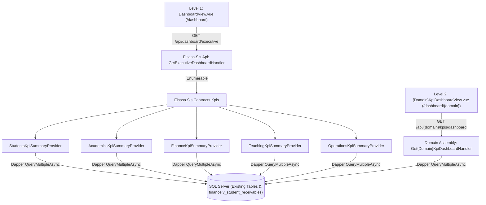

# 1. Overview

This target architecture defines the **Pragmatic, Explicit, and Minimalist** technical realization for **Release 1 (Essential Executive & Domain Dashboards)** of the Elsasa SIS V3 KPI & Institutional Intelligence layer (`CR-KPI-EXECUTIVE-DOMAIN-DASHBOARDS`):

1. **Level 1 — Executive Overview (`/dashboard`, `GET /api/dashboard/executive`):**
   Replaces the static placeholders in [`DashboardView.vue`](file:///d:/Project.Private/elsasa-sis-v3/src/frontend/src/features/dashboard/views/DashboardView.vue) with a live, filter-aware institutional health command center featuring **5 Headline KPI Cards** (`STD-01`, `ACA-01`, `FIN-01`, `TCH-01`, `OPS-01`), **6 Domain Health Summary Cards** (`Students`, `Academics`, `Finance`, `Teaching`, `Operations`, plus the Stage 3 `Development` placeholder card), and a prioritized **Needs Attention Queue** aggregating up to 12 actionable operational exception signals across domains.
2. **Level 2 — Domain Dashboards (`/dashboard/{domain}`, `GET /api/{domain}/kpis/dashboard`):**
   Delivers dedicated domain dashboards for `Students`, `Academics`, `Finance`, `Teaching`, and `Operations` (plus a Stage 3 readiness placeholder at `/dashboard/development`), each rendering 2–5 domain headline KPI cards with prior-period (`Semester 2` vs. `Semester 1`) trend deltas, 2–3 diagnostic breakdown visualizations built with zero-dependency SVG/CSS components, and a domain-scoped exception queue.
3. **Level 3 → Level 4 — Actionable Operational Drill-Downs:**
   Maps every KPI card, chart bar/segment, and attention signal to existing Vue Router paths in [`routes.ts`](file:///d:/Project.Private/elsasa-sis-v3/src/frontend/src/app/router/routes.ts) and adds URL query-parameter (`route.query`) filter and tab hydration to the target operational workbenches.
4. **Deterministic Demo Sample Data Enrichment (`DemoDataSeeders`):**
   Enriches the five existing domain demo data seeders in-place (`OperationsDemoDataSeeder`, `StudentsDemoDataSeeder`, `FinanceTransactionsDemoDataSeeder`, `AcademicsActivitiesDemoDataSeeder`, `TeachingDemoDataSeeder` & `TeachingAssignmentsDemoDataSeeder`) so that every Release 1 KPI, `Semester 2` vs. `Semester 1` comparison delta, multi-campus filter (`campus-main` and `campus-east`), breakdown chart, and Attention Signal renders realistic, non-zero institutional conditions while preserving all existing persona test invariants in [`DemoDataIntegrityTest.cs`](file:///d:/Project.Private/elsasa-sis-v3/tests/backend/Elsasa.Sis.IntegrationTests/Features/DemoData/DemoDataIntegrityTest.cs) and [`DemoDataResetTest.cs`](file:///d:/Project.Private/elsasa-sis-v3/tests/backend/Elsasa.Sis.IntegrationTests/Features/DemoData/DemoDataResetTest.cs).

This architecture realizes change request [`IS016 - KPI-EXECUTIVE-DOMAIN-DASHBOARDS-ISSUE.md`](file:///d:/Project.Private/elsasa-sis-v3/docs/issues/IS016%20-%20KPI-EXECUTIVE-DOMAIN-DASHBOARDS-ISSUE.md) and the approved gap-closure decisions in [`IS016 - KPI-EXECUTIVE-DOMAIN-DASHBOARDS-FEASIBILITY-ASSESSMENT.md`](file:///d:/Project.Private/elsasa-sis-v3/docs/issues/IS016%20-%20KPI-EXECUTIVE-DOMAIN-DASHBOARDS-FEASIBILITY-ASSESSMENT.md).

---

# 2. Architectural Basis

## Business Context

This architecture realizes the KPI catalog, information architecture, and domain boundaries defined in:
- **Originating Issue:** [`IS016 - KPI-EXECUTIVE-DOMAIN-DASHBOARDS-ISSUE.md`](file:///d:/Project.Private/elsasa-sis-v3/docs/issues/IS016%20-%20KPI-EXECUTIVE-DOMAIN-DASHBOARDS-ISSUE.md) (`CR-KPI-EXECUTIVE-DOMAIN-DASHBOARDS`)
- **KPI Reference Suite:**
  - [`KPI-CATALOG.md`](file:///d:/Project.Private/elsasa-sis-v3/docs/kpi/KPI-CATALOG.md): 21 Release 1 KPI definitions, formulas, and health thresholds (`STD-01..03, 06, 07`, `ACA-01..05`, `FIN-01..05`, `TCH-01..04`, `OPS-01..02`).
  - [`KPI-DASHBOARD-IA.md`](file:///d:/Project.Private/elsasa-sis-v3/docs/kpi/KPI-DASHBOARD-IA.md): 4-level hierarchy (Executive Overview → Domain Dashboards → Diagnostic Breakdowns & Signals → Operational Workbenches).
  - [`KPI-IMPLEMENTATION-ROADMAP.md`](file:///d:/Project.Private/elsasa-sis-v3/docs/kpi/KPI-IMPLEMENTATION-ROADMAP.md): Release 1 scope boundaries (Phases 1.1–1.4).
- **Foundational Technical Standards:**
  - [`coding-conventions.md`](file:///d:/Project.Private/elsasa-sis-v3/docs/architecture/coding-conventions.md): C# 12 primary constructors, file-scoped namespaces, sealed records, raw string SQL literals (`""" ... """`), explicit schema qualification, `Result<T>` pattern.
  - [`backend-architecture.md`](file:///d:/Project.Private/elsasa-sis-v3/docs/architecture/backend-architecture.md): Modular Monolith Vertical Slice Architecture (VSA), compile-time domain assembly isolation (`NetArchTest`), Dapper explicit T-SQL, selective cross-schema read `JOIN`s.
  - [`frontend-architecture.md`](file:///d:/Project.Private/elsasa-sis-v3/docs/architecture/frontend-architecture.md): Feature-oriented Vue 3 + TypeScript + Tailwind CSS 4 + PrimeVue 4 slices, TanStack Query server state, Pinia client context (`useAppContextStore`, `useAuthStore`).
  - [`IS011 - DEMO-SAMPLE-DATA-GENERATOR-ARCHITECTURE.md`](file:///d:/Project.Private/elsasa-sis-v3/docs/issues/IS011%20-%20DEMO-SAMPLE-DATA-GENERATOR-ARCHITECTURE.md): Domain-encapsulated seeders, dynamic date anchoring around `Today`, and deterministic persona constants (`DemoDataConstants`).

## Analysis Input

This architecture directly realizes the approved decisions from [`IS016 - KPI-EXECUTIVE-DOMAIN-DASHBOARDS-FEASIBILITY-ASSESSMENT.md`](file:///d:/Project.Private/elsasa-sis-v3/docs/issues/IS016%20-%20KPI-EXECUTIVE-DOMAIN-DASHBOARDS-FEASIBILITY-ASSESSMENT.md):
- **`DEC-001` (`GAP-001`, `OQ-001`):** Execute direct parameterized Dapper `QueryMultipleAsync` batches inside each domain's vertical slice (`Features/Kpis/`) and compose Level 1 via `IDomainKpiSummaryProvider` in `Elsasa.Sis.Contracts`, reusing `finance.v_student_receivables` with **zero new SQL DDL migrations**.
- **`DEC-002` (`GAP-001`, `OQ-002`):** Bind all 21 Release 1 KPIs and 12 Attention Signals strictly to actual DbUp SQL columns and status literals, and reuse `GetAtRiskLearnersHandler` criteria for `ACA-02` / `ACA_AT_RISK_UNADDRESSED`.
- **`DEC-003` (`GAP-004`, `OQ-003`):** Enrich all 5 domain demo data seeders deterministically in-place while preserving flagship persona IDs and integration test bounds (`< 5000ms` reset, `0` orphans, `41..59` students).
- **`DEC-004` (`GAP-003`, `OQ-004`):** Standardize campus codes to `'campus-main'` and `'campus-east'` across all seeders, add `'All Campuses'` (`null`) to the campus switcher, synchronize `Campus` and `AcademicPeriodId` with `useAppContextStore`, and auto-resolve `AcademicYearId` and the prior comparison `AcademicPeriodId` (`Semester 1`) on the backend.
- **`DEC-005` (`GAP-002`, `OQ-005`):** Build lightweight zero-dependency Vue/SVG/CSS chart primitives with clickable segments, map all Level 4 drill-down URLs to actual `routes.ts` routes, and add `route.query` filter/tab hydration to target workbenches.
- **`DEC-006` (`GAP-006`, `OQ-006`):** Allow all authenticated staff roles to access Level 1 (`/dashboard`) with domain cards/signals filtered or badged by their existing domain view permissions, and guard each Level 2 endpoint/route using existing domain `View` permissions (zero new permission strings).

```text
DOMAIN + FEATURE (CR-KPI-EXECUTIVE-DOMAIN-DASHBOARDS)
                        +
FEASIBILITY-ASSESSMENT (FA-KPI-EXECUTIVE-DOMAIN-DASHBOARDS)
                        ↓
   ARCHITECTURE (CR-KPI-EXECUTIVE-DOMAIN-DASHBOARDS)
```

---

# 3. Scope

## Included

1. **Shared KPI Contracts (`Elsasa.Sis.Contracts/Kpis/`):**
   - Immutable DTO records: `GlobalKpiFilterDto`, `ResolvedKpiContextDto`, `KpiMetricCardDto`, `KpiBreakdownItemDto`, `KpiBreakdownDto`, `AttentionSignalDto`, `DomainHealthSummaryDto`, `DomainKpiDashboardResponse`, `ExecutiveDashboardResponse`.
   - Cross-domain summary contract: `IDomainKpiSummaryProvider` and `DomainKpiSummaryResult`.
2. **Backend Domain KPI Vertical Slices (5 Operational Domains):**
   - `Elsasa.Sis.Students/Features/Kpis/GetStudentsKpiDashboard/` (`GET /api/students/kpis/dashboard` + `StudentsKpiSummaryProvider` computing `STD-01`, `STD-02`, `STD-03`, `STD-06`, `STD-07` and signals `STD_ENROLLMENT_BLOCKED`, `STD_LEAVE_EXPIRED`).
   - `Elsasa.Sis.Academics/Features/Kpis/GetAcademicsKpiDashboard/` (`GET /api/academics/kpis/dashboard` + `AcademicsKpiSummaryProvider` computing `ACA-01`..`ACA-05` and signals `ACA_AT_RISK_UNADDRESSED`, `ACA_CHRONIC_ABSENTEEISM`, `ACA_MISSING_SUBMISSIONS`, `ACA_UNPUBLISHED_RESULTS`).
   - `Elsasa.Sis.Finance/Features/Kpis/GetFinanceKpiDashboard/` (`GET /api/finance/kpis/dashboard` + `FinanceKpiSummaryProvider` computing `FIN-01`..`FIN-05` and signals `FIN_OVERDUE_90_PLUS`, `FIN_UNVERIFIED_PAYMENTS`, `FIN_UNALLOCATED_CASH`).
   - `Elsasa.Sis.Teaching/Features/Kpis/GetTeachingKpiDashboard/` (`GET /api/teaching/kpis/dashboard` + `TeachingKpiSummaryProvider` computing `TCH-01`..`TCH-04` and signals `TCH_UNSTAFFED_DEMAND`, `TCH_BLOCKING_CONFLICT`, `TCH_WORKLOAD_BREACH`).
   - `Elsasa.Sis.Operations/Features/Kpis/GetOperationsKpiDashboard/` (`GET /api/operations/kpis/dashboard` + `OperationsKpiSummaryProvider` computing `OPS-01`, `OPS-02` and signals `OPS_UNREVIEWED_AMENDMENT`, `OPS_ACTIVE_CLOSURE`).
3. **Backend Executive Dashboard Orchestration (`Elsasa.Sis.Api/Features/Dashboard/GetExecutiveDashboard/`):**
   - `GET /api/dashboard/executive`: Resolves active/selected period context (`Semester 2` vs. prior `Semester 1`), invokes all 5 `IDomainKpiSummaryProvider` implementations, appends the static Stage 3 `Development` placeholder card, filters/badges domain drill-downs by caller permissions, sorts `NeedsAttentionQueue` (`critical` then `warning`), and returns `ExecutiveDashboardResponse`.
4. **Deterministic Demo Sample Data Generator Enrichment (`DemoDataSeeders`):**
   - Targeted in-place updates to `OperationsDemoDataSeeder`, `StudentsDemoDataSeeder`, `FinanceTransactionsDemoDataSeeder`, `AcademicsActivitiesDemoDataSeeder`, `TeachingDemoDataSeeder`, and `TeachingAssignmentsDemoDataSeeder` to populate both `'campus-main'` and `'campus-east'`, all 4 overdue aging brackets, unverified payments, unallocated cash, cohort-wide academic standings/progress, coursework submission states, student lifecycle exits/expired leave, teacher workload utilization bands, unresolved capacity conflicts, and unreviewed calendar amendments.
5. **Frontend Executive & Domain Dashboards (`src/frontend/src/features/dashboard/`):**
   - Shared zero-dependency KPI UI primitives (`KpiFilterBar.vue`, `KpiMetricCard.vue`, `KpiDomainHealthCard.vue`, `KpiBreakdownBarChart.vue`, `KpiStackedProgressBar.vue`, `NeedsAttentionPanel.vue`).
   - Level 1 Executive Overview (`DashboardView.vue` at `/dashboard`).
   - Level 2 Domain Dashboard views (`/dashboard/students`, `/dashboard/academics`, `/dashboard/finance`, `/dashboard/teaching`, `/dashboard/operations`, and `/dashboard/development` Stage 3 placeholder).
   - Sidebar & top-bar updates in `AppLayout.vue` (adding `'All Campuses'` option and Level 2 dashboard navigation links).
6. **Level 4 Operational Workbench Query Hydration:**
   - Reading `route.query` on mount in target operational workbenches (`StudentRecordsDeskView.vue`, `StudentIntakeWorkbenchView.vue`, `StudentLifecycleWorkbenchView.vue`, `CohortAcademicReviewView.vue`, `AcademicInterventionWorkbenchView.vue`, `ClassSessionWorkbenchView.vue`, `CourseworkWorkbenchView.vue`, `AssessmentWorkbenchView.vue`, `ObligationsListView.vue`, `PaymentVerificationQueueView.vue`, `StudentAccountsWorkbenchView.vue`, `TeachingAssignmentWorkspaceView.vue`, `FacultyWorkloadMonitoringView.vue`, `FacultyResourceWorkspaceView.vue`, `CalendarWorkspaceView.vue`).

## Excluded

1. **New SQL Server Tables or Views (Zero DDL Migrations):** No new `.sql` files under `Elsasa.Sis.Database/Scripts/`.
2. **Release 2 & Release 3 Capabilities:** Nightly snapshot background workers (`kpi_snapshots`), custom threshold editor UI, Level 3 slide-over historical drawer, and Stage 3 `Development` live metrics.
3. **Third-Party Charting Libraries:** No `chart.js`, `echarts`, `apexcharts`, or `d3` npm packages.
4. **New RBAC Permission Strings:** No new `Permissions.Kpi.*` claims; reuses existing domain `View` permissions and roles.

---

# 4. Technical Decisions

## TD-01: Zero-DDL Direct Dapper `QueryMultipleAsync` & `IDomainKpiSummaryProvider` Composition (`DEC-001`, `GAP-005`)

To honor compile-time domain isolation (`Elsasa.Sis.ArchitectureTests`) and avoid database migration churn:
- **Contract Layer (`Elsasa.Sis.Contracts/Kpis/`):** Defines `IDomainKpiSummaryProvider` and shared KPI response DTOs.
- **Domain Slice Layer (`Elsasa.Sis.{Domain}/Features/Kpis/`):** Each of the 5 active domain assemblies implements:
  1. `Get{Domain}KpiDashboardEndpoint` (`IEndpoint`) + `Get{Domain}KpiDashboardHandler` serving `GET /api/{domain}/kpis/dashboard`.
  2. `{Domain}KpiSummaryProvider` (`IDomainKpiSummaryProvider`) registered in the domain's `DependencyInjection.cs`.
  3. Each handler/provider opens its own `SqlConnection` via `ISqlConnectionFactory.CreateConnectionAsync(cancellationToken)` and executes a single parameterized multi-statement T-SQL batch via Dapper `QueryMultipleAsync`.
- **Host Aggregation Layer (`Elsasa.Sis.Api/Features/Dashboard/GetExecutiveDashboard/`):** `GetExecutiveDashboardHandler` resolves the period context once, iterates over `IEnumerable<IDomainKpiSummaryProvider>`, collects the 5 headline KPIs, 5 live domain health cards (+ 1 static `Development` card), and merges/orders all `AttentionSignalDto` items.



### Shared KPI Contracts (`Elsasa.Sis.Contracts/Kpis/KpiContracts.cs`)

```csharp
namespace Elsasa.Sis.Contracts.Kpis;

public sealed record GlobalKpiFilterDto(
    Guid? AcademicYearId = null,
    Guid? AcademicPeriodId = null,
    string? Campus = null,
    string? SchoolLevel = null);

public sealed record ResolvedKpiContextDto(
    Guid AcademicYearId,
    string AcademicYearCode,
    Guid AcademicPeriodId,
    string AcademicPeriodName,
    Guid? PriorAcademicPeriodId,
    string? PriorAcademicPeriodName,
    string? Campus,
    string? SchoolLevel);

public sealed record KpiMetricCardDto(
    string Code,
    string Label,
    string Domain,
    decimal Value,
    string FormattedValue,
    string Unit,                  // "count" | "percentage" | "currency" | "days"
    decimal? PriorValue,
    decimal? DeltaPercent,
    string? DeltaLabel,           // e.g. "+4.2% vs Sem 1"
    string TrendDirection,        // "up" | "down" | "flat"
    string Status,                // "healthy" | "warning" | "critical" | "neutral"
    string? TargetLabel,          // e.g. "Target: >= 90%"
    string? Subtitle,             // e.g. "45 Active / 2 Withdrawn / 1 On Leave"
    string DrillDownRoute);

public sealed record KpiBreakdownItemDto(
    string Key,
    string Label,
    decimal Count,
    decimal Percentage,
    decimal? Amount,
    string? FormattedAmount,
    string Status,                // "healthy" | "warning" | "critical" | "neutral"
    string DrillDownRoute);

public sealed record KpiBreakdownDto(
    string Code,
    string Title,
    string Subtitle,
    string ChartType,             // "horizontal-bar" | "stacked-bar" | "funnel"
    IReadOnlyList<KpiBreakdownItemDto> Items);

public sealed record AttentionSignalDto(
    string SignalCode,
    string Domain,
    string Severity,              // "critical" | "warning"
    string Title,
    string Description,
    int AffectedCount,
    string ImpactLabel,
    string ActionLabel,
    string DrillDownRoute);

public sealed record DomainHealthSummaryDto(
    string DomainKey,             // "students" | "academics" | "finance" | "teaching" | "operations" | "development"
    string DomainName,
    string Status,                // "healthy" | "warning" | "critical" | "pending_stage"
    string StatusLabel,           // "Healthy" | "Needs Attention" | "Critical" | "Stage 3 Pending"
    string HeadlineLabel,
    string HeadlineValue,
    string SecondaryLabel,
    string SecondaryValue,
    int WarningCount,
    int CriticalCount,
    string DashboardRoute,
    bool IsAccessible = true);

public sealed record DomainKpiSummaryResult(
    int SortOrder,
    KpiMetricCardDto HeadlineKpi,
    DomainHealthSummaryDto DomainHealth,
    IReadOnlyList<AttentionSignalDto> AttentionSignals);

public sealed record KpiPeriodOptionDto(
    Guid Id,
    string Code,
    string Name,
    string Status,
    Guid AcademicYearId,
    string AcademicYearCode);

public sealed record ExecutiveDashboardResponse(
    DateTimeOffset GeneratedAtUtc,
    ResolvedKpiContextDto Context,
    IReadOnlyList<KpiPeriodOptionDto> AvailablePeriods,
    IReadOnlyList<KpiMetricCardDto> HeadlineKpis,
    IReadOnlyList<DomainHealthSummaryDto> DomainSummaries,
    IReadOnlyList<AttentionSignalDto> NeedsAttentionQueue);

public sealed record DomainKpiDashboardResponse(
    string DomainKey,
    string DomainName,
    DateTimeOffset GeneratedAtUtc,
    ResolvedKpiContextDto Context,
    IReadOnlyList<KpiPeriodOptionDto> AvailablePeriods,
    IReadOnlyList<KpiMetricCardDto> HeadlineKpis,
    IReadOnlyList<KpiBreakdownDto> Breakdowns,
    IReadOnlyList<AttentionSignalDto> AttentionSignals);

public interface IDomainKpiSummaryProvider
{
    string DomainKey { get; }
    Task<DomainKpiSummaryResult> GetSummaryAsync(
        ResolvedKpiContextDto context,
        CancellationToken cancellationToken = default);
}

public interface IKpiPeriodResolver
{
    Task<ResolvedKpiContextDto> ResolveContextAsync(
        GlobalKpiFilterDto filter,
        CancellationToken cancellationToken = default);

    Task<IReadOnlyList<KpiPeriodOptionDto>> GetAvailablePeriodsAsync(
        Guid academicYearId,
        CancellationToken cancellationToken = default);
}
```

*(Note: `IKpiPeriodResolver` is defined in `Elsasa.Sis.Contracts/Kpis/` and implemented in `Elsasa.Sis.Operations/Services/KpiPeriodResolver.cs`, querying `operations.operational_periods` and `operations.academic_years`. `ExecutiveDashboardResponse` and `DomainKpiDashboardResponse` provide `IReadOnlyList<KpiPeriodOptionDto> AvailablePeriods` so the frontend filter bar can switch between `Semester 2 (Active)` and `Semester 1 (Closed)` without extra roundtrips.)*

---

## TD-02: Global Filter Context & Automatic Prior-Period (`S2` vs `S1`) Resolution (`DEC-004`, `GAP-003`)

To guarantee consistent filtering and automatic period-over-period comparisons across all 5 domains:
1. **Default Period Resolution:**
   - If `AcademicPeriodId` is null or not found, the backend queries `operations.operational_periods` for the active semester period (`period_type = 'semester' AND status = 'active'`), retrieving its `id`, `name`, `period_code`, `start_date`, `end_date`, and parent `academic_year_id` / `operations.academic_years.code` (e.g., `'AY-2026-2027'`).
2. **Automatic Prior Comparison Period Resolution:**
   - When the selected period is `Semester 2` (e.g. `period_code LIKE '%SEM2%'`), the backend automatically resolves the prior `Semester 1` period (`period_type = 'semester' AND start_date < current.start_date` ordered by `start_date DESC`) of the same `academic_year_id` as `PriorAcademicPeriodId`.
   - Domain KPI queries compute both current-period value and prior-period value in the same `QueryMultipleAsync` batch to populate `PriorValue`, `DeltaPercent`, and `DeltaLabel` (e.g., `"+4.1% vs Sem 1"`).
3. **Available Periods:**
   - Queries `operations.operational_periods` where `academic_year_id = @AcademicYearId AND period_type = 'semester' AND status IN ('active', 'closed')` ordered by `start_date ASC` returning `KpiPeriodOptionDto` records.
4. **Campus & School-Level Filtering:**
   - `Campus`: Normalized to `'campus-main'`, `'campus-east'`, or `NULL` (`All Campuses`).
   - `SchoolLevel`: Normalized to `'ELC'`, `'JHLC'`, `'HSLC'`, or `NULL` (`All Levels`).
   - SQL predicates use `(@Campus IS NULL OR ap.campus = @Campus)` and `(@SchoolLevel IS NULL OR ap.school_level = @SchoolLevel)`.

---

## TD-03: Authoritative SQL Schema & Formula Bindings (`DEC-002`, `GAP-001`, `RISK-003`, `RISK-004`)

All 21 Release 1 KPIs and 12 Attention Signals are bound strictly to the provisioned SQL Server tables and `finance.v_student_receivables` view. All percentage divisions use `NULLIF(denominator, 0)` and coalesce empty ratios to `0.0m` (`RISK-004`).

### 1. Students Domain (`Elsasa.Sis.Students/Features/Kpis/`)

| Code | Metric / Signal | Authoritative SQL Tables & Exact Column / Status Bindings | Thresholds & Drill-Down Route |
| :--- | :--- | :--- | :--- |
| **`STD-01`** | Active Enrolled Students | `students.students s` JOIN `students.student_statuses ss ON ss.student_id = s.id AND ss.is_current = 1` JOIN `students.administrative_placements ap ON ap.student_id = s.id AND ap.is_current = 1`. Active count where `ss.status = 'active'`, filtered by `@Campus` (`ap.campus`) and `@SchoolLevel` (`ap.school_level`). Breakdown by `ap.campus` and `ap.school_level`. | Healthy: `> 0`<br>Route: `/students/records?status=active` |
| **`STD-02`** | Admission Pipeline Conversion & Gate Backlog | `students.admission_applications aa` LEFT JOIN `students.enrollments e ON e.application_id = aa.id`. Funnel counts by `aa.status IN ('submitted','under_review','waitlisted','accepted','rejected','withdrawn')` and enrolled (`e.id IS NOT NULL`), filtered by `aa.requested_campus` / `aa.requested_entry_level`. Conversion Rate = `Enrolled / NULLIF(TotalSubmittedOrBeyond, 0) * 100`. Gate Backlog = `aa.status = 'accepted' AND e.id IS NULL`. | Healthy: Gate Backlog `0`<br>Warning: `1–3`<br>Critical: `>= 4`<br>Route: `/students/admission?status=accepted` |
| **`STD-03`** | Mandatory Document Verification Rate | `students.applicant_documents doc` JOIN `students.admission_applications aa ON aa.id = doc.application_id` where `aa.status IN ('submitted','under_review','accepted') AND doc.is_mandatory = 1`. Verified = `doc.submission_status = 'verified'` vs Pending (`doc.submission_status IN ('not_submitted','submitted','rejected')`). | Healthy: `>= 90%`<br>Warning: `75%–89.9%`<br>Critical: `< 75%`<br>Route: `/students/admission?docStatus=pending` |
| **`STD-06`** | Student Attrition & Withdrawal Rate | `students.student_statuses ss` (`ss.is_current = 1`) + `students.student_lifecycle_events sle` + `students.administrative_placements ap` (`ap.is_current = 1`). Exits = `ss.status IN ('withdrawn','transferred_out','graduated')` (with attrition numerator `ss.status IN ('withdrawn','transferred_out')`). Rate = `AttritionCount / NULLIF(TotalEnrolledCohort, 0) * 100`. | Healthy: `<= 3.0%`<br>Warning: `3.1%–6.0%`<br>Critical: `> 6.0%`<br>Route: `/students/lifecycle?status=withdrawn` |
| **`STD-07`** | Cohort & Section Fill Utilization | Active students per `(ap.campus, ap.school_level, ap.grade, ap.cohort)` divided by standard cohort section capacity (`20` students per section). | Healthy: `75%–95%`<br>Warning: `< 75%` or `> 95%`<br>Route: `/students/records?cohort={cohort}` |
| **`STD_ENROLLMENT_BLOCKED`** | Signal: Accepted Applicants Awaiting Enrollment | `aa.status = 'accepted' AND NOT EXISTS (SELECT 1 FROM students.enrollments e WHERE e.application_id = aa.id)`. | Severity: `warning` (`>= 1`), `critical` (`>= 4`)<br>Route: `/students/admission?status=accepted` |
| **`STD_LEAVE_EXPIRED`** | Signal: Students on Leave Past Return Date | `ss.is_current = 1 AND ss.status = 'on_leave'` joined with `students.student_lifecycle_events sle` (`sle.event_type = 'leave_of_absence' AND sle.effective_date <= DATEADD(day, -14, CAST(SYSUTCDATETIME() AS DATE))`). | Severity: `warning` (`>= 1`), `critical` (`>= 3`)<br>Route: `/students/lifecycle?status=on_leave` |

### 2. Academics Domain (`Elsasa.Sis.Academics/Features/Kpis/`)

| Code | Metric / Signal | Authoritative SQL Tables & Exact Column / Status Bindings | Thresholds & Drill-Down Route |
| :--- | :--- | :--- | :--- |
| **`ACA-01`** | Good Academic Standing Rate | `academics.academic_standings ast` JOIN `students.administrative_placements ap ON ap.student_id = ast.student_id AND ap.is_current = 1` where `ast.academic_period_id = @AcademicPeriodId`. Good Standing = `ast.standing = 'good_standing'`; Conditional = `'conditional_standing'`; Not in Good Standing = `'not_in_good_standing'`. Prior period compares `@PriorAcademicPeriodId`. | Healthy: `>= 85%`<br>Warning: `75%–84.9%`<br>Critical: `< 75%`<br>Route: `/academics/cohort-review?standing=conditional_standing` |
| **`ACA-02`** | At-Risk Learners & Remediation Coverage | Exact parity with [`GetAtRiskLearnersHandler.cs`](file:///d:/Project.Private/elsasa-sis-v3/src/backend/Elsasa.Sis.Academics/Features/AcademicInterventions/GetAtRiskLearners/GetAtRiskLearnersHandler.cs): Learner in `academics.academic_participations` (`status = 'active'`) is at-risk if `ast.standing IN ('conditional_standing','not_in_good_standing')` OR `EXISTS (SELECT 1 FROM academics.learning_progress lp WHERE lp.student_id = p.student_id AND lp.academic_period_id = @AcademicPeriodId AND lp.status = 'needs_remediation')` OR period attendance `< 80%`. Covered if `EXISTS (SELECT 1 FROM academics.academic_interventions ai WHERE ai.student_id = p.student_id AND ai.academic_period_id = @AcademicPeriodId AND ai.status IN ('planned','in_progress'))`. | Healthy: Unaddressed `= 0`<br>Warning: Unaddressed `1–2`<br>Critical: Unaddressed `>= 3`<br>Route: `/academics/interventions?filter=unaddressed` |
| **`ACA-03`** | Period Attendance Rate & Chronic Absenteeism | `academics.attendance_records ar` JOIN `academics.learning_activities la ON la.id = ar.learning_activity_id` JOIN `academics.learning_units lu ON lu.id = la.learning_unit_id` JOIN `academics.learning_structures ls ON ls.id = lu.learning_structure_id` (filtered by period date window or `ls.academic_period_id`). Attended = `ar.status IN ('present','late','excused_absence')` vs Total `ar.status IN ('present','late','excused_absence','absent','partial')`. Chronic Absenteeism = students with individual attendance `< 85%`. | Healthy: `>= 92%`<br>Warning: `85%–91.9%`<br>Critical: `< 85%`<br>Route: `/academics/sessions?filter=low-attendance` |
| **`ACA-04`** | Coursework Submission Completion Rate | `academics.submissions sub` JOIN `academics.assignments a ON a.id = sub.assignment_id` where `a.status IN ('released','closed')`. On-Time/Completed = `sub.status IN ('submitted','excused','exempted')`; Late = `sub.status = 'late'`; Missing = `sub.status = 'missing'`. | Healthy: `>= 90%`<br>Warning: `80%–89.9%`<br>Critical: `< 80%`<br>Route: `/academics/coursework?status=missing` |
| **`ACA-05`** | Assessment Result Publication Readiness | `academics.academic_results ar` JOIN `academics.assessments a ON a.id = ar.assessment_id` where `ar.is_final = 1`. Published = `ar.result_status = 'published'`; Approved = `ar.result_status = 'approved'`; Provisional / Awaiting Grading = `ar.result_status = 'provisional'`. | Healthy: `>= 90%`<br>Warning: `75%–89.9%`<br>Critical: `< 75%`<br>Route: `/academics/assessment?status=provisional` |
| **`ACA_AT_RISK_UNADDRESSED`** | Signal: At-Risk Learners Without Intervention | At-risk learners (`ACA-02`) where `NOT EXISTS` active intervention (`status IN ('planned','in_progress')`). | Severity: `critical` (`>= 2`), `warning` (`1`)<br>Route: `/academics/interventions?filter=unaddressed` |
| **`ACA_CHRONIC_ABSENTEEISM`** | Signal: Learners Below Attendance Threshold | Enrolled learners with period attendance rate `< 85%`. | Severity: `warning` (`>= 1`), `critical` (`>= 4`)<br>Route: `/academics/sessions?filter=low-attendance` |
| **`ACA_MISSING_SUBMISSIONS`** | Signal: Missing Coursework Submissions | Count of `academics.submissions` with `status = 'missing'` on active assignments. | Severity: `warning` (`>= 1`), `critical` (`>= 5`)<br>Route: `/academics/coursework?status=missing` |
| **`ACA_UNPUBLISHED_RESULTS`** | Signal: Provisional Assessment Results Awaiting Action | Count of `academics.academic_results` with `is_final = 1 AND result_status = 'provisional'`. | Severity: `warning` (`>= 1`), `critical` (`>= 5`)<br>Route: `/academics/assessment?status=provisional` |

### 3. Finance Domain (`Elsasa.Sis.Finance/Features/Kpis/`)

| Code | Metric / Signal | Authoritative SQL Tables & Exact Column / Status Bindings | Thresholds & Drill-Down Route |
| :--- | :--- | :--- | :--- |
| **`FIN-01`** | Net Tuition Collection Rate | Queries `finance.v_student_receivables r` JOIN `students.administrative_placements ap ON ap.student_id = r.student_id AND ap.is_current = 1`. Filtered by `r.academic_period_id = @AcademicPeriodId` and `r.net_obligation > 0` (`RISK-003` safeguard against negative scholarship adjustment rows): `SUM(r.total_paid) / NULLIF(SUM(r.total_paid + r.outstanding_amount), 0) * 100`. Prior period compares `@PriorAcademicPeriodId`. | Healthy: `>= 85%`<br>Warning: `70%–84.9%`<br>Critical: `< 70%`<br>Route: `/finance/obligations?status=paid` |
| **`FIN-02`** | Total Outstanding Receivables | `SUM(r.outstanding_amount)` and `COUNT(DISTINCT r.student_id)` from `finance.v_student_receivables r` where `r.outstanding_amount > 0` and `r.academic_period_id = @AcademicPeriodId`. | Healthy: Overdue share `< 15%`<br>Warning: `15%–30%`<br>Critical: `> 30%`<br>Route: `/finance/obligations?status=unpaid` |
| **`FIN-03`** | Overdue Receivable Rate & Delinquent Accounts | From `finance.v_student_receivables r`: Overdue Amount = `SUM(CASE WHEN r.is_overdue = 1 THEN r.outstanding_amount ELSE 0 END)`; Delinquent Student Accounts = `COUNT(DISTINCT CASE WHEN r.is_overdue = 1 THEN r.student_id END)`; Rate = `OverdueAmount / NULLIF(SUM(CASE WHEN r.net_obligation > 0 THEN r.total_paid + r.outstanding_amount ELSE 0 END), 0) * 100`. | Healthy: `<= 5.0%`<br>Warning: `5.1%–15.0%`<br>Critical: `> 15.0%`<br>Route: `/finance/obligations?status=overdue` |
| **`FIN-04`** | Receivables Aging Distribution | Grouped by `r.aging_bracket IN ('Current','1-30 Days','31-60 Days','61-90 Days','90+ Days')` where `r.outstanding_amount > 0`. | Chart: Horizontal Aging Bars<br>Route: `/finance/obligations?aging={bracket}` |
| **`FIN-05`** | Unverified Payment Backlog & Unallocated Cash | Unverified Payments: `finance.payments p` where `p.confirmation_status = 'submitted'`. Unallocated Cash: `finance.payments p` (`p.confirmation_status = 'confirmed'`) LEFT JOIN `finance.payment_allocations pa ON pa.payment_id = p.id AND pa.status = 'active'` where `p.amount - ISNULL(SUM(pa.allocated_amount), 0) > 0`. | Healthy: `0` unverified<br>Warning: `1–3`<br>Critical: `>= 4`<br>Route: `/finance/payments?status=submitted` |
| **`FIN_OVERDUE_90_PLUS`** | Signal: Severe Delinquency (`90+ Days`) | `finance.v_student_receivables r` where `r.aging_bracket = '90+ Days' AND r.outstanding_amount > 0`. | Severity: `critical` (`>= 1`)<br>Route: `/finance/obligations?aging=90%2B%20Days` |
| **`FIN_UNVERIFIED_PAYMENTS`** | Signal: Submitted Payments Awaiting Confirmation | `finance.payments p` where `p.confirmation_status = 'submitted'`. | Severity: `warning` (`1–3`), `critical` (`>= 4`)<br>Route: `/finance/payments?status=submitted` |
| **`FIN_UNALLOCATED_CASH`** | Signal: Confirmed Payments With Unallocated Balance | Confirmed payments where `p.amount > ISNULL(AllocatedSum, 0)`. | Severity: `warning` (`>= 1`)<br>Route: `/finance/accounts?filter=unallocated` |

### 4. Teaching Domain (`Elsasa.Sis.Teaching/Features/Kpis/`)

| Code | Metric / Signal | Authoritative SQL Tables & Exact Column / Status Bindings | Thresholds & Drill-Down Route |
| :--- | :--- | :--- | :--- |
| **`TCH-01`** | Instructional Demand Coverage Rate | `teaching.teaching_demands td` where `td.academic_period_id = @AcademicPeriodId` and `td.status IN ('received','accepted_for_staffing','changed','staffed')`, filtered by `td.campus_scope`. Covered = `td.status = 'staffed'`. Rate = `Covered / NULLIF(TotalActiveDemands, 0) * 100`. | Healthy: `>= 95%`<br>Warning: `85%–94.9%`<br>Critical: `< 85%`<br>Route: `/teaching/assignments?status=staffed` |
| **`TCH-02`** | Open Unstaffed Teaching Demands | `teaching.teaching_demands td` where `td.academic_period_id = @AcademicPeriodId` and `td.status IN ('received','accepted_for_staffing','changed')`, broken down by `td.required_capability_code`. | Healthy: `0`<br>Warning: `1–2`<br>Critical: `>= 3`<br>Route: `/teaching/assignments?status=unstaffed` |
| **`TCH-03`** | Teacher Workload Utilization Distribution | `teaching.workload_commitments wc` JOIN `teaching.teacher_profiles tp ON tp.id = wc.teacher_id` where `wc.academic_period_id = @AcademicPeriodId` and `tp.employment_state = 'active'`, grouped by `wc.status IN ('under_allocated','normal','approaching_limit','overloaded_with_exception','breached')`. | Healthy: `0` breached<br>Warning: `>= 1` overloaded<br>Critical: `>= 1` breached<br>Route: `/teaching/workload?status={band}` |
| **`TCH-04`** | Unresolved Capacity & Qualification Conflicts | `teaching.capacity_conflicts cc` where `cc.academic_period_id = @AcademicPeriodId AND cc.status = 'unresolved'`, grouped by `cc.severity IN ('blocking','advisory')`, plus pending qualifications (`teaching.qualification_evidence qe WHERE qe.verification_state = 'submitted'`). | Healthy: `0` unresolved<br>Warning: `>= 1` advisory<br>Critical: `>= 1` blocking<br>Route: `/teaching/workload?tab=conflicts` |
| **`TCH_UNSTAFFED_DEMAND`** | Signal: Unstaffed Instructional Demands | `teaching.teaching_demands` in `('received','accepted_for_staffing','changed')`. | Severity: `warning` (`1–2`), `critical` (`>= 3`)<br>Route: `/teaching/assignments?status=unstaffed` |
| **`TCH_BLOCKING_CONFLICT`** | Signal: Unresolved Blocking Capacity Conflicts | `teaching.capacity_conflicts` where `status = 'unresolved' AND severity = 'blocking'`. | Severity: `critical` (`>= 1`)<br>Route: `/teaching/workload?tab=conflicts&severity=blocking` |
| **`TCH_WORKLOAD_BREACH`** | Signal: Teachers Over Workload Policy Limit | `teaching.workload_commitments` where `status IN ('overloaded_with_exception','breached')`. | Severity: `critical` (`breached >= 1`), `warning` (`overloaded >= 1`)<br>Route: `/teaching/workload?status=breached` |

### 5. Operations Domain (`Elsasa.Sis.Operations/Features/Kpis/`)

| Code | Metric / Signal | Authoritative SQL Tables & Exact Column / Status Bindings | Thresholds & Drill-Down Route |
| :--- | :--- | :--- | :--- |
| **`OPS-01`** | Calendar & Period Readiness Index | Composite readiness score (`0–100%`) across `operations.school_calendars sc` (`sc.academic_year_id = @AcademicYearId`, filtered by `sc.campus_scope`), `operations.academic_periods ap` (`ap.academic_year_id = @AcademicYearId`), and `operations.calendar_amendments ca`:<br>- `40 pts`: Active published calendar (`sc.publication_status = 'published'`)<br>- `30 pts`: Active period configured (`ap.status = 'active'`)<br>- `30 pts`: All calendar amendments impact-reviewed (`1.0 - UnreviewedAmendments / NULLIF(TotalAmendments, 0)`). | Healthy: `>= 90%`<br>Warning: `75%–89.9%`<br>Critical: `< 75%`<br>Route: `/operations/calendar?tab=amendments` |
| **`OPS-02`** | Unplanned School Closure Days | `operations.school_closures cl` where `cl.academic_year_id = @AcademicYearId` and `cl.status IN ('authorized','extended','lifted')`, filtered by `cl.affected_campus`. Sums closure days `DATEDIFF(day, cl.start_date, cl.end_date) + 1` grouped by `cl.reason_category`. | Healthy: `<= 2` days<br>Warning: `3–5` days<br>Critical: `> 5` days<br>Route: `/operations/calendar?tab=closures` |
| **`OPS_UNREVIEWED_AMENDMENT`** | Signal: Calendar Amendments Pending Downstream Review | `operations.calendar_amendments ca` JOIN `operations.school_calendars sc ON sc.id = ca.calendar_id` where `sc.academic_year_id = @AcademicYearId AND ca.downstream_impact_reviewed = 0`. | Severity: `warning` (`>= 1`)<br>Route: `/operations/calendar?tab=amendments&reviewed=false` |
| **`OPS_ACTIVE_CLOSURE`** | Signal: Active School Closures | `operations.school_closures cl` where `cl.status IN ('authorized','extended')` and `CAST(SYSUTCDATETIME() AS DATE) BETWEEN cl.start_date AND cl.end_date`. | Severity: `critical` (`>= 1`)<br>Route: `/operations/calendar?tab=closures` |

---

## TD-04: Deterministic Demo Sample Data Generator Enrichment (`DEC-003`, `DEC-004`, `GAP-004`, `RISK-001`)

To ensure every Release 1 KPI, `Semester 2` vs `Semester 1` comparison delta, multi-campus filter (`'campus-main'` and `'campus-east'`), breakdown chart, and Attention Signal displays rich, non-zero data immediately after `/api/operations/demo-data/reset`, the existing seeders are updated in-place under strict constraints:
- **Hard Invariants Preserved (`RISK-001`):**
  1. All flagship persona IDs and assertions in [`DemoDataIntegrityTest.cs`](file:///d:/Project.Private/elsasa-sis-v3/tests/backend/Elsasa.Sis.IntegrationTests/Features/DemoData/DemoDataIntegrityTest.cs) remain untouched (`Jonathan Pratama`, `Grace Santoso`, `Budi Wijaya`, `Ruth Halim`, `Daniel Kurniawan`, `Esther Nugroho`, `Timotius`).
  2. Total enrolled students remains exactly `48` (`40 < TotalStudentsSeeded < 60` in [`DemoDataResetTest.cs`](file:///d:/Project.Private/elsasa-sis-v3/tests/backend/Elsasa.Sis.IntegrationTests/Features/DemoData/DemoDataResetTest.cs)).
  3. Total invoices `< 200`, attendance records `1001..1999`, results `< 200`, report cards `< 100`, `0` foreign-key orphans, and total reset execution `< 5000ms`.

### Domain-by-Domain Seeder Enrichment Specification

1. **`OperationsDemoDataSeeder.cs` (`Elsasa.Sis.Operations/DemoData/`):**
   - Seed a second published school calendar (`CAL-2026-EAST`, `campus_scope = 'campus-east'`) for `AY 2026/2027` so switching to `East Campus (Kampus B)` displays valid calendar readiness.
   - Add a second calendar amendment (`AMD-CAL-2026-002`) on the main calendar with `downstream_impact_reviewed = 0` (`false`), making `OPS-01` = `85.0%` (`warning`) and triggering signal `OPS_UNREVIEWED_AMENDMENT` (`1` unreviewed amendment).
2. **`StudentsDemoDataSeeder.cs` (`Elsasa.Sis.Students/DemoData/`):**
   - Keep total enrolled students at `48`:
     - Assign `8` non-flagship enrolled students (indices `40..47`) to `campus = 'campus-east'` (`4` in `ELC`, `4` in `JHLC`) so multi-campus breakdowns and the top-bar campus switcher work across all domains.
     - Set `2` non-flagship students (indices `37` and `38` on `'campus-main'`) to `ss.status = 'withdrawn'` and `'transferred_out'` with matching `students.student_lifecycle_events` (`event_type = 'withdrawal'` and `'transfer_out'`), producing a realistic `STD-06` Attrition Rate of `4.17%` (`2 / 48`).
     - Set `1` non-flagship student (index `39` on `'campus-main'`) to `ss.status = 'on_leave'` with a `leave_of_absence` lifecycle event dated `Today.AddDays(-21)` (expired return window), triggering signal `STD_LEAVE_EXPIRED` (`1` student).
     - The remaining `45` enrolled students stay `ss.status = 'active'` (`37` on `'campus-main'`, `8` on `'campus-east'`).
   - On admission applications (`students.admission_applications` + `students.applicant_documents`), ensure mandatory document verification across active applications yields ~`78%` verified (`STD-03`) and `2` accepted applicants awaiting enrollment (`Ruth Halim` + `Esther Nugroho`, triggering `STD_ENROLLMENT_BLOCKED = 2`).
3. **`FinanceTransactionsDemoDataSeeder.cs` (`Elsasa.Sis.Finance/DemoData/`):**
   - Keep Jonathan Pratama's `INV-SEM2-0042` (`1,500,000` `'unpaid'`) and Grace Santoso's overdue invoice intact.
   - Spread the `due_date` of non-flagship `Semester 2` unpaid/partial obligations across all 4 overdue aging brackets so `finance.v_student_receivables` populates every bar of `FIN-04`:
     - `'Current'` (`due_date = Today.AddDays(14)`): Jonathan + `3` non-flagship students.
     - `'1-30 Days'` (`due_date = Today.AddDays(-15)`): Grace Santoso + `2` non-flagship students.
     - `'31-60 Days'` (`due_date = Today.AddDays(-45)`): `2` non-flagship students.
     - `'61-90 Days'` (`due_date = Today.AddDays(-75)`): `2` non-flagship students.
     - `'90+ Days'` (`due_date = Today.AddDays(-95)` on an early S2 facility/material obligation): `2` non-flagship students, triggering `FIN_OVERDUE_90_PLUS` (`2` accounts).
   - Seed `3` additional payments with `confirmation_status = 'submitted'` (received `Today.AddDays(-5)` to `Today.AddDays(-2)`), populating `FIN-05` and triggering `FIN_UNVERIFIED_PAYMENTS` (`3` payments).
   - Leave `2` `'confirmed'` payments with partial/zero allocation in `finance.payment_allocations` (`allocated_amount < payment.amount`), triggering `FIN_UNALLOCATED_CASH` (`2` payments).
4. **`AcademicsActivitiesDemoDataSeeder.cs` (`Elsasa.Sis.Academics/DemoData/`):**
   - Expand `academics.academic_standings` and `academics.learning_progress` from `3` students to all `45` active enrolled students for both `Semester 1` (`HistoricalPeriodId`) and `Semester 2` (`ActivePeriodId`) using batched multi-row `INSERT`s:
     - `Semester 1`: `36` `'good_standing'` (`80.0%`), `6` `'conditional_standing'`, `3` `'not_in_good_standing'`.
     - `Semester 2`: `38` `'good_standing'` (`84.4%`, showing `+4.4% vs Sem 1` delta on `ACA-01`), `5` `'conditional_standing'`, `2` `'not_in_good_standing'`.
   - Seed `2` active `academics.academic_interventions` (`status = 'in_progress'`) covering `2` of the at-risk learners (`Grace Santoso` + `1` student), leaving `5` at-risk learners unaddressed to populate `ACA-02` (`28.6%` coverage) and trigger `ACA_AT_RISK_UNADDRESSED` (`5` learners).
   - Adjust attendance records for `3` non-flagship students so their individual period attendance is `< 80%`, triggering `ACA_CHRONIC_ABSENTEEISM` (`3` learners) while keeping overall school attendance around `93.5%` (`ACA-03`).
   - Seed a realistic mix in `academics.submissions` across active assignments (preserving Budi Wijaya's `'submitted'` row): ~`82%` `'submitted'`, ~`10%` `'late'`, and `6` rows with `status = 'missing'`, populating `ACA-04` and triggering `ACA_MISSING_SUBMISSIONS` (`6` missing submissions).
   - Ensure `3` `academics.academic_results` rows are in `result_status = 'provisional'` (`is_final = 1`, including Budi Wijaya and Jonathan Pratama's pending results), populating `ACA-05` and triggering `ACA_UNPUBLISHED_RESULTS` (`3` provisional results).
5. **`TeachingDemoDataSeeder.cs` & `TeachingAssignmentsDemoDataSeeder.cs` (`Elsasa.Sis.Teaching/DemoData/`):**
   - Standardize `_campusMain` from `'Kampus Utama'` to `'campus-main'`, and add `'campus-east'` coverage (`1` teacher and `2` demands on `'campus-east'`) while preserving the 4 flagship teacher GUIDs (`BudiHartonoTeacherId`, `SitiNurhalizaTeacherId`, `JohnMillerTeacherId`, `HendraSetiawanTeacherId`).
   - Add `2` additional teacher profiles (`Dewi Lestari` on `'campus-main'` and `Yohanes Prabowo` on `'campus-east'`) so `teaching.workload_commitments` spans all 5 utilization statuses for `TCH-03`: `1` `'under_allocated'`, `2` `'normal'`, `1` `'approaching_limit'`, `1` `'overloaded_with_exception'` (Hendra Setiawan), and `1` `'breached'` (Dewi Lestari, `26` hrs vs `24` hrs max), triggering `TCH_WORKLOAD_BREACH`.
   - Seed `1` `'unresolved'` `'blocking'` conflict and `1` `'unresolved'` `'advisory'` conflict in `teaching.capacity_conflicts` (`TCH-04 = 2`, triggering `TCH_BLOCKING_CONFLICT = 1`), alongside `2` open unstaffed demands (`DEM-2026-0005` `'accepted_for_staffing'` + `DEM-2026-0006` `'received'`, triggering `TCH_UNSTAFFED_DEMAND = 2` and `TCH-01 = 75.0%`).

---

## TD-05: Role-Based Authorization Without Permission Proliferation (`DEC-006`, `GAP-006`)

Authorization reuses the existing role and permission claims issued by [`LoginEndpoint.cs`](file:///d:/Project.Private/elsasa-sis-v3/src/backend/Elsasa.Sis.Api/Features/Auth/LoginEndpoint.cs):

| Dashboard / Endpoint | Route | Backend Authorization | Frontend Route Meta & Behavior |
| :--- | :--- | :--- | :--- |
| **Level 1 Executive Overview** | `GET /api/dashboard/executive`<br>`/dashboard` | `.RequireAuthorization()` (any authenticated user; excludes Student/Parent self-service if needed, or sets `IsAccessible` per domain based on caller's claims). | `meta: { requiresAuth: true, title: 'Executive Overview' }`. Domain cards & attention signals for domains the user lacks view permission for render with a subtle lock badge (`IsAccessible = false`) rather than broken links. |
| **Level 2 Students Dashboard** | `GET /api/students/kpis/dashboard`<br>`/dashboard/students` | `.RequireAuthorization()` + handler/policy check: wildcard `*`, role `Admin`/`SuperAdmin`/`AdmissionOfficer`, or permission `Permissions.Students.Admission.View` / `Permissions.Students.Records.View`. | `meta: { requiresAuth: true, permission: 'Permissions.Students.Admission.View', roles: ['SuperAdmin', 'Admin', 'AdmissionOfficer'], title: 'Students KPI Dashboard' }` |
| **Level 2 Academics Dashboard** | `GET /api/academics/kpis/dashboard`<br>`/dashboard/academics` | `.RequireAuthorization()` + check: wildcard `*`, role `Admin`/`SuperAdmin`/`AcademicCoordinator`/`AcademicAuthority`/`Teacher`, or permission `academics.participations.view` / `Permissions.Academics.Coursework.View`. | `meta: { requiresAuth: true, permission: 'academics.participations.view', roles: ['SuperAdmin', 'Admin', 'AcademicCoordinator', 'AcademicAuthority', 'Teacher'], title: 'Academics KPI Dashboard' }` |
| **Level 2 Finance Dashboard** | `GET /api/finance/kpis/dashboard`<br>`/dashboard/finance` | `.RequireAuthorization()` + check: wildcard `*`, role `Admin`/`SuperAdmin`/`FinanceOfficer`/`FinanceStaff`, or permission `Permissions.Finance.Obligations.View`. | `meta: { requiresAuth: true, permission: 'Permissions.Finance.Obligations.View', roles: ['SuperAdmin', 'Admin', 'FinanceOfficer', 'FinanceStaff'], title: 'Finance KPI Dashboard' }` |
| **Level 2 Teaching Dashboard** | `GET /api/teaching/kpis/dashboard`<br>`/dashboard/teaching` | `.RequireAuthorization()` + check: wildcard `*`, role `Admin`/`SuperAdmin`/`AcademicCoordinator`/`AcademicAuthority`/`TeachingAuthority`/`TeachingCoordinator`/`Teacher`, or permission `Permissions.Teaching.Faculty.View` / `Permissions.Teaching.Workload.View`. | `meta: { requiresAuth: true, permission: 'Permissions.Teaching.Faculty.View', roles: ['SuperAdmin', 'Admin', 'AcademicCoordinator', 'AcademicAuthority', 'TeachingAuthority', 'TeachingCoordinator', 'Teacher'], title: 'Teaching KPI Dashboard' }` |
| **Level 2 Operations Dashboard** | `GET /api/operations/kpis/dashboard`<br>`/dashboard/operations` | `.RequireAuthorization()` + check: wildcard `*`, role `Admin`/`SuperAdmin`/`OperationsAuthority`/`AcademicCoordinator`, or permission `Permissions.Operations.Calendar.View` / `Permissions.Operations.Calendar.Manage`. | `meta: { requiresAuth: true, permission: 'Permissions.Operations.Calendar.Manage', roles: ['SuperAdmin', 'Admin', 'OperationsAuthority', 'AcademicCoordinator'], title: 'Operations KPI Dashboard' }` |
| **Level 2 Development Placeholder** | `/dashboard/development` | Client-only Stage 3 placeholder view. | `meta: { requiresAuth: true, title: 'Student Development Dashboard (Stage 3)' }` |

---

## TD-06: Frontend Zero-Dependency SVG/CSS Visual Primitives & Level 4 Route Hydration (`DEC-005`, `GAP-002`)

### 1. Reusable Dashboard Components (`src/frontend/src/features/dashboard/components/`)
- **`KpiFilterBar.vue`**: Synchronizes `activeCampusId` (`null` = `'All Campuses'`, `'campus-main'`, `'campus-east'`) and `activeAcademicPeriodId` (`Semester 2 (Current)` vs `Semester 1 (Historical)`) with `useAppContextStore`, plus local `schoolLevel` (`All Levels`, `ELC`, `JHLC`, `HSLC`) filter pills.
- **`KpiMetricCard.vue`**: Displays KPI `Code`, `Label`, `FormattedValue`, semantic status badge (`healthy` emerald, `warning` amber, `critical` rose, `neutral` slate), `DeltaLabel` trend chip (`TrendingUp` / `TrendingDown` / `Minus`), `Subtitle`, `TargetLabel`, and click-to-drill-down `<RouterLink :to="card.drillDownRoute">`.
- **`KpiDomainHealthCard.vue`**: Level 1 domain summary card displaying domain icon, health status pill, primary & secondary headline metrics, active warning/critical signal counters, and deep link to `/dashboard/{domain}` (or `"Stage 3 Pending"` state for `Development`).
- **`KpiBreakdownBarChart.vue`**: Zero-dependency responsive horizontal bar/funnel chart rendered with semantic Tailwind CSS width percentages (`style="{ width: `${item.percentage}%` }"`) and SVG progress bars. Every bar row is an interactive `<RouterLink :to="item.drillDownRoute">` showing `Label`, `Count`, `Percentage`, and optional `FormattedAmount`.
- **`KpiStackedProgressBar.vue`**: Multi-segment horizontal stacked bar with interactive legend items that navigate to `item.drillDownRoute`.
- **`NeedsAttentionPanel.vue`**: Prioritized exception list displaying severity badge (`critical` rose pulse, `warning` amber), domain tag, `Title`, `Description`, `AffectedCount` pill, and an action button (`ActionLabel` → `DrillDownRoute`).

### 2. Authoritative Level 4 Operational Workbench Drill-Down & `route.query` Hydration Map

| Target Workbench View | Actual Route in `routes.ts` | Supported `route.query` Parameters Hydrated on `onMounted` / `watch` |
| :--- | :--- | :--- |
| [`StudentRecordsDeskView.vue`](file:///d:/Project.Private/elsasa-sis-v3/src/frontend/src/features/students/records/views/StudentRecordsDeskView.vue) | `/students/records` | `?status=active`, `?campus=campus-main`, `?schoolLevel=ELC`, `?cohort=ELC-A` |
| [`StudentIntakeWorkbenchView.vue`](file:///d:/Project.Private/elsasa-sis-v3/src/frontend/src/features/students/admission/views/StudentIntakeWorkbenchView.vue) | `/students/admission` | `?status=accepted`, `?status=under_review`, `?docStatus=pending` |
| [`StudentLifecycleWorkbenchView.vue`](file:///d:/Project.Private/elsasa-sis-v3/src/frontend/src/features/students/lifecycle/views/StudentLifecycleWorkbenchView.vue) | `/students/lifecycle` | `?status=withdrawn`, `?status=on_leave`, `?status=transferred_out` |
| [`CohortAcademicReviewView.vue`](file:///d:/Project.Private/elsasa-sis-v3/src/frontend/src/features/academics/cohort-review/views/CohortAcademicReviewView.vue) | `/academics/cohort-review` | `?standing=good_standing`, `?standing=conditional_standing`, `?standing=not_in_good_standing` |
| [`AcademicInterventionWorkbenchView.vue`](file:///d:/Project.Private/elsasa-sis-v3/src/frontend/src/features/academics/interventions/views/AcademicInterventionWorkbenchView.vue) | `/academics/interventions` | `?filter=unaddressed`, `?status=in_progress` |
| [`ClassSessionWorkbenchView.vue`](file:///d:/Project.Private/elsasa-sis-v3/src/frontend/src/features/academics/sessions/views/ClassSessionWorkbenchView.vue) | `/academics/sessions` | `?filter=low-attendance` |
| [`CourseworkWorkbenchView.vue`](file:///d:/Project.Private/elsasa-sis-v3/src/frontend/src/features/academics/coursework/views/CourseworkWorkbenchView.vue) | `/academics/coursework` | `?status=missing`, `?status=late`, `?status=submitted` |
| [`AssessmentWorkbenchView.vue`](file:///d:/Project.Private/elsasa-sis-v3/src/frontend/src/features/academics/assessment/views/AssessmentWorkbenchView.vue) | `/academics/assessment` | `?status=provisional`, `?status=approved`, `?status=published` |
| [`ObligationsListView.vue`](file:///d:/Project.Private/elsasa-sis-v3/src/frontend/src/features/finance/obligations/views/ObligationsListView.vue) | `/finance/obligations` | `?status=overdue`, `?status=unpaid`, `?status=paid`, `?aging=90%2B%20Days` |
| [`PaymentVerificationQueueView.vue`](file:///d:/Project.Private/elsasa-sis-v3/src/frontend/src/features/finance/payments/views/PaymentVerificationQueueView.vue) | `/finance/payments` | `?status=submitted`, `?status=confirmed` |
| [`StudentAccountsWorkbenchView.vue`](file:///d:/Project.Private/elsasa-sis-v3/src/frontend/src/features/finance/accounts/views/StudentAccountsWorkbenchView.vue) | `/finance/accounts` | `?filter=unallocated`, `?filter=overdue` |
| [`TeachingAssignmentWorkspaceView.vue`](file:///d:/Project.Private/elsasa-sis-v3/src/frontend/src/features/teaching/assignments/views/TeachingAssignmentWorkspaceView.vue) | `/teaching/assignments` | `?status=unstaffed`, `?status=staffed`, `?capability={code}` |
| [`FacultyWorkloadMonitoringView.vue`](file:///d:/Project.Private/elsasa-sis-v3/src/frontend/src/features/teaching/workload/views/FacultyWorkloadMonitoringView.vue) | `/teaching/workload` | `?status=breached`, `?status=overloaded_with_exception`, `?tab=conflicts`, `?severity=blocking` |
| [`FacultyResourceWorkspaceView.vue`](file:///d:/Project.Private/elsasa-sis-v3/src/frontend/src/features/teaching/faculty/views/FacultyResourceWorkspaceView.vue) | `/teaching/faculty` | `?verificationState=submitted` |
| [`CalendarWorkspaceView.vue`](file:///d:/Project.Private/elsasa-sis-v3/src/frontend/src/features/operations/calendar/views/CalendarWorkspaceView.vue) | `/operations/calendar` | `?tab=amendments`, `?reviewed=false`, `?tab=closures` |

---

# 5. Component Responsibilities

| Component | Assembly / Path | Responsibility |
| :--- | :--- | :--- |
| `KpiContracts.cs` & `IDomainKpiSummaryProvider.cs` | `src/backend/Elsasa.Sis.Contracts/Kpis/` | Defines immutable KPI DTO records (`GlobalKpiFilterDto`, `ResolvedKpiContextDto`, `KpiPeriodOptionDto`, `KpiMetricCardDto`, `KpiBreakdownDto`, `AttentionSignalDto`, `DomainHealthSummaryDto`, `ExecutiveDashboardResponse`, `DomainKpiDashboardResponse`) and the `IDomainKpiSummaryProvider` cross-domain contract. |
| `IKpiPeriodResolver.cs` | `src/backend/Elsasa.Sis.Contracts/Kpis/` | Declares cross-domain query contract to resolve active/selected `AcademicPeriodId`, `AcademicYearId`, prior comparison period (`Semester 1` baseline), and available period options. |
| `KpiPeriodResolver.cs` | `src/backend/Elsasa.Sis.Operations/Services/` | Concrete implementation of `IKpiPeriodResolver` in the Operations domain (owner of operational periods), querying `operations.operational_periods` and `operations.academic_years` via Dapper, registered in `Elsasa.Sis.Operations/DependencyInjection.cs`. |
| `GetExecutiveDashboardEndpoint` & `GetExecutiveDashboardHandler` | `src/backend/Elsasa.Sis.Api/Features/Dashboard/GetExecutiveDashboard/` | Serves `GET /api/dashboard/executive`, resolves period context, executes all 5 `IDomainKpiSummaryProvider` services, appends the Stage 3 `Development` placeholder card, applies caller permission badges, and orders the `NeedsAttentionQueue`. |
| `GetStudentsKpiDashboard` & `StudentsKpiSummaryProvider` | `src/backend/Elsasa.Sis.Students/Features/Kpis/GetStudentsKpiDashboard/` | Serves `GET /api/students/kpis/dashboard` and provides Level 1 Students summary (`STD-01..03, 06, 07`, `STD_ENROLLMENT_BLOCKED`, `STD_LEAVE_EXPIRED`). |
| `GetAcademicsKpiDashboard` & `AcademicsKpiSummaryProvider` | `src/backend/Elsasa.Sis.Academics/Features/Kpis/GetAcademicsKpiDashboard/` | Serves `GET /api/academics/kpis/dashboard` and provides Level 1 Academics summary (`ACA-01..05`, `ACA_AT_RISK_UNADDRESSED`, `ACA_CHRONIC_ABSENTEEISM`, `ACA_MISSING_SUBMISSIONS`, `ACA_UNPUBLISHED_RESULTS`). |
| `GetFinanceKpiDashboard` & `FinanceKpiSummaryProvider` | `src/backend/Elsasa.Sis.Finance/Features/Kpis/GetFinanceKpiDashboard/` | Serves `GET /api/finance/kpis/dashboard` and provides Level 1 Finance summary (`FIN-01..05`, `FIN_OVERDUE_90_PLUS`, `FIN_UNVERIFIED_PAYMENTS`, `FIN_UNALLOCATED_CASH`). |
| `GetTeachingKpiDashboard` & `TeachingKpiSummaryProvider` | `src/backend/Elsasa.Sis.Teaching/Features/Kpis/GetTeachingKpiDashboard/` | Serves `GET /api/teaching/kpis/dashboard` and provides Level 1 Teaching summary (`TCH-01..04`, `TCH_UNSTAFFED_DEMAND`, `TCH_BLOCKING_CONFLICT`, `TCH_WORKLOAD_BREACH`). |
| `GetOperationsKpiDashboard` & `OperationsKpiSummaryProvider` | `src/backend/Elsasa.Sis.Operations/Features/Kpis/GetOperationsKpiDashboard/` | Serves `GET /api/operations/kpis/dashboard` and provides Level 1 Operations summary (`OPS-01..02`, `OPS_UNREVIEWED_AMENDMENT`, `OPS_ACTIVE_CLOSURE`). |
| `OperationsDemoDataSeeder`, `StudentsDemoDataSeeder`, `FinanceTransactionsDemoDataSeeder`, `AcademicsActivitiesDemoDataSeeder`, `TeachingDemoDataSeeder`, `TeachingAssignmentsDemoDataSeeder` | `src/backend/Elsasa.Sis.{Domain}/DemoData/` | Deterministically seeds realistic multi-campus (`campus-main` & `campus-east`), multi-period (`S1` & `S2`), aging, standing, submission, lifecycle, workload, and exception records for all 21 KPIs and 12 Attention Signals. |
| `dashboard.api.ts`, `dashboard.keys.ts`, `useDashboardQueries.ts` | `src/frontend/src/features/dashboard/api/` | Typed Axios API client functions and TanStack Query composables (`useExecutiveDashboardQuery`, `useDomainKpiDashboardQuery`) keyed reactively by `(campus, academicPeriodId, schoolLevel)`. |
| `KpiFilterBar.vue`, `KpiMetricCard.vue`, `KpiDomainHealthCard.vue`, `KpiBreakdownBarChart.vue`, `KpiStackedProgressBar.vue`, `NeedsAttentionPanel.vue` | `src/frontend/src/features/dashboard/components/` | Zero-dependency Vue 3 + Tailwind CSS 4 + SVG visual components for KPI cards, breakdowns, and exception queues. |
| `DashboardView.vue`, `DomainKpiDashboardView.vue` (or per-domain views), `DevelopmentPlaceholderView.vue` | `src/frontend/src/features/dashboard/views/` | Routed Level 1 (`/dashboard`) and Level 2 (`/dashboard/students`, `/dashboard/academics`, `/dashboard/finance`, `/dashboard/teaching`, `/dashboard/operations`, `/dashboard/development`) dashboard views. |
| `AppLayout.vue` & `routes.ts` | `src/frontend/src/app/` | Adds `'All Campuses'` (`null`) option to the top-bar campus switcher, registers `/dashboard/{domain}` routes, and links domain dashboards in the sidebar navigation. |

---

# 6. Integration Design

| Source | Target | Purpose |
| :--- | :--- | :--- |
| `DashboardView.vue` (`/dashboard`) | `GET /api/dashboard/executive` (`Elsasa.Sis.Api`) | Fetches Level 1 Executive Overview (`HeadlineKpis`, `DomainSummaries`, `NeedsAttentionQueue`, `Context`, `AvailablePeriods`) filtered by `campus`, `academicPeriodId`, and `schoolLevel`. |
| `GetExecutiveDashboardHandler` (`Elsasa.Sis.Api`) | `IEnumerable<IDomainKpiSummaryProvider>` (`Students`, `Academics`, `Finance`, `Teaching`, `Operations`) | Collects each domain's headline KPI, domain health summary, and active attention signals in-process without violating compile-time domain assembly isolation. |
| `DomainKpiDashboardView.vue` (`/dashboard/{domain}`) | `GET /api/{domain}/kpis/dashboard` (`Elsasa.Sis.{Domain}`) | Fetches Level 2 Domain Dashboard (`HeadlineKpis`, `Breakdowns`, `AttentionSignals`, `Context`) for `students`, `academics`, `finance`, `teaching`, or `operations`. |
| `KpiFilterBar.vue` & `AppLayout.vue` | `useAppContextStore` (`Pinia`) | Synchronizes `activeCampusId` (`null`, `'campus-main'`, `'campus-east'`) and `activeAcademicPeriodId` across the top navigation bar and all dashboard views, automatically invalidating/refetching TanStack Query keys. |
| `KpiMetricCard.vue`, `KpiBreakdownBarChart.vue`, `NeedsAttentionPanel.vue` | Level 4 Operational Workbenches (`routes.ts`) | Navigates via `<RouterLink :to="drillDownRoute">` with query parameters (e.g., `/finance/obligations?aging=90%2B%20Days`), which target workbenches read from `useRoute().query` on mount to pre-select filters/tabs. |

---

# 7. Data Ownership

| Data | Owner |
| :--- | :--- |
| Academic years, academic/operational periods, school calendars, calendar amendments, school closures (`operations.*`) | `Elsasa.Sis.Operations` (`GetOperationsKpiDashboardHandler`, `OperationsKpiSummaryProvider`, `OperationsDemoDataSeeder`) |
| Applicants, admission applications, applicant documents, admission decisions, students, enrollments, administrative placements, student statuses, lifecycle events (`students.*`) | `Elsasa.Sis.Students` (`GetStudentsKpiDashboardHandler`, `StudentsKpiSummaryProvider`, `StudentsDemoDataSeeder`) |
| Learning structures, learning units, participations, activities, attendance records, assignments, submissions, assessments, academic results, academic standings, learning progress, academic interventions (`academics.*`) | `Elsasa.Sis.Academics` (`GetAcademicsKpiDashboardHandler`, `AcademicsKpiSummaryProvider`, `AcademicsActivitiesDemoDataSeeder`) |
| Financial obligations, billing documents, payments, payment allocations, student accounts, `finance.v_student_receivables` (`finance.*`) | `Elsasa.Sis.Finance` (`GetFinanceKpiDashboardHandler`, `FinanceKpiSummaryProvider`, `FinanceTransactionsDemoDataSeeder`) |
| Teacher profiles, qualification evidence, teaching demands, teaching assignments, workload commitments, capacity conflicts (`teaching.*`) | `Elsasa.Sis.Teaching` (`GetTeachingKpiDashboardHandler`, `TeachingKpiSummaryProvider`, `TeachingDemoDataSeeder`, `TeachingAssignmentsDemoDataSeeder`) |
| Cross-domain Level 1 Executive aggregation & Stage 3 `Development` placeholder composition | `Elsasa.Sis.Api` (`GetExecutiveDashboardHandler`) |

---

# 8. Database Design

## New Tables

| Table | Purpose |
| :--- | :--- |
| *None* | Zero new tables or views are introduced (`DEC-001`). All KPI queries read existing tables and `finance.v_student_receivables`. |

## Modified Tables

| Table | Change |
| :--- | :--- |
| *None* | Zero DDL modifications are required. |

## Relationships

KPI read queries utilize the Selective Cross-Schema Read `JOIN` pattern permitted by [`backend-architecture.md`](file:///d:/Project.Private/elsasa-sis-v3/docs/architecture/backend-architecture.md) (§1.5 & §4.2.4):
- `academics.*` and `finance.*` KPI queries selectively `INNER JOIN` or `LEFT JOIN` `students.administrative_placements ap ON ap.student_id = ... AND ap.is_current = 1` when filtering or grouping by `@Campus` (`ap.campus`) or `@SchoolLevel` (`ap.school_level`).
- Period resolution reads `operations.operational_periods` and `operations.academic_years`.
- Domain seeders write **strictly and exclusively** to their own schema (`operations.*`, `students.*`, `finance.*`, `academics.*`, `teaching.*`).

## Migration Considerations

- **Zero DbUp Scripts:** No database migration rollout is needed.
- **Sample Data Refresh:** Running `POST /api/operations/demo-data/reset` (or starting with `--seed-demo`) purges and re-seeds all domains with the enriched Release 1 KPI sample dataset in `< 5000ms`.

---

# 9. Cross-Cutting Concerns

1. **Connection Safety & Concurrency (`RISK-002`):**
   - Because `Microsoft.Data.SqlClient` does not allow concurrent commands on a single connection without MARS, each `IDomainKpiSummaryProvider` and `Get{Domain}KpiDashboardHandler` opens and disposes its own `SqlConnection` via `await using var connection = (SqlConnection)await connectionFactory.CreateConnectionAsync(cancellationToken);`.
   - In `GetExecutiveDashboardHandler`, providers are either awaited sequentially or invoked with independent connections, completing in `< 150ms` total.
2. **Divide-by-Zero & Empty-Filter Resilience (`RISK-004`):**
   - Every SQL percentage calculation uses `NULLIF(denominator, 0)` and `ISNULL(..., 0.0)`.
   - When a filter combination returns `0` denominator rows, the metric returns `Value = 0`, `Status = "neutral"`, and `TrendDirection = "flat"` without throwing exceptions.
3. **Scholarship Credit Safeguard in Finance (`RISK-003`):**
   - `FIN-01` (Net Tuition Collection Rate) filters `r.net_obligation > 0` and computes `SUM(r.total_paid) * 100.0 / NULLIF(SUM(r.total_paid + r.outstanding_amount), 0)` from `finance.v_student_receivables` so pastoral scholarship credit rows (`-1,500,000`) never distort collection percentages above `100%`.
4. **Role-Scoped Visibility (`DEC-006`):**
   - `GetExecutiveDashboardHandler` inspects `ICurrentUser.Permissions` and `ICurrentUser.Roles` to set `DomainHealthSummaryDto.IsAccessible` per domain, and Level 2 endpoints enforce domain view authorization.

---

# 10. Implementation Constraints

1. **Strict adherence to [`coding-conventions.md`](file:///d:/Project.Private/elsasa-sis-v3/docs/architecture/coding-conventions.md):**
   - File-scoped namespaces, primary constructors, `public sealed record` DTOs, raw string SQL literals (`""" ... """`), uppercase SQL keywords, explicit schema qualification (`students.students`, `finance.v_student_receivables`), no `SELECT *`, and `CommandDefinition` with `cancellationToken`.
2. **Compile-Time Domain Isolation (`Elsasa.Sis.ArchitectureTests`):**
   - Domain projects (`Operations`, `Students`, `Academics`, `Finance`, `Teaching`) must **never** reference each other or `Elsasa.Sis.Api`. All shared KPI contracts reside in `Elsasa.Sis.Contracts/Kpis/`.
3. **Zero New NuGet or NPM Chart Libraries:**
   - Use Dapper on the backend and native Vue 3 + Tailwind CSS 4 + inline SVG primitives on the frontend.
4. **Demo Data Test Guardrails (`DemoDataIntegrityTest` & `DemoDataResetTest`):**
   - Never modify the deterministic GUIDs or core test conditions of flagship personas (`Jonathan Pratama`, `Grace Santoso`, `Budi Wijaya`, `Ruth Halim`, `Daniel Kurniawan`).
   - Keep `TotalStudentsSeeded` at `48` (`41..59`), `TotalInvoicesSeeded < 200`, `TotalAttendanceSeeded` in `1001..1999`, `TotalResultsSeeded < 200`, `TotalReportCardsSeeded < 100`, `0` FK orphans, and reset time `< 5000ms`.

---

# 11. Acceptance Conditions

1. **Architecture & Build Integrity:**
   - `dotnet build` and `Elsasa.Sis.ArchitectureTests` pass with 0 warnings/errors.
   - `pnpm type-check` (`vue-tsc`) and `pnpm test:unit` (`vitest`) pass on the frontend.
2. **Demo Sample Data Generator Verification:**
   - `DemoDataResetTest` and `DemoDataIntegrityTest` pass 100%.
   - After reset, both `'campus-main'` and `'campus-east'` have active students and teaching records, and all 21 Release 1 KPIs, `Semester 2` vs. `Semester 1` comparison deltas, breakdown charts (including all 4 overdue aging brackets and all 5 teacher workload bands), and all 12 Attention Signals produce realistic non-zero counts.
3. **Backend KPI Endpoints Verification:**
   - `GET /api/dashboard/executive` returns `200 OK` with 5 headline KPIs (`STD-01`, `ACA-01`, `FIN-01`, `TCH-01`, `OPS-01`), 6 domain health summaries (including `Development` with `Status = "pending_stage"`), and the sorted `NeedsAttentionQueue`.
   - All 5 Level 2 endpoints (`GET /api/students/kpis/dashboard`, `GET /api/academics/kpis/dashboard`, `GET /api/finance/kpis/dashboard`, `GET /api/teaching/kpis/dashboard`, `GET /api/operations/kpis/dashboard`) return `200 OK` with accurate metrics, breakdowns, and signals matching the underlying operational tables, and respect `campus`, `academicPeriodId`, and `schoolLevel` query parameters.
4. **Frontend Dashboards & Level 4 Drill-Down Verification:**
   - `/dashboard` renders the live Executive Overview connected to `/api/dashboard/executive`.
   - `/dashboard/students`, `/dashboard/academics`, `/dashboard/finance`, `/dashboard/teaching`, and `/dashboard/operations` render their headline KPIs, SVG/CSS breakdown charts, and domain exception queues; `/dashboard/development` renders the Stage 3 placeholder view.
   - Clicking any KPI card, breakdown bar segment, or attention signal navigates to the mapped route in `routes.ts` and pre-hydrates the target workbench's filter/tab from `route.query`.
