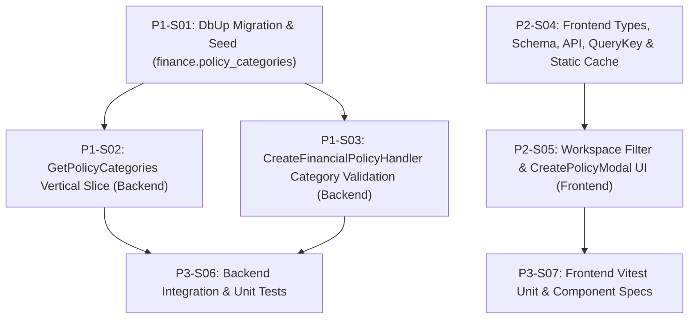

# 1. Objective

Implement the authoritative Financial Policy Category master reference table (`finance.policy_categories`), database referential integrity, authenticated dynamic lookup endpoint (`GET /api/finance/policy-categories`), policy creation category validation, and dynamic frontend category consumption across the Financial Policy Workspace and creation modal for issue `IS017` ([`IS017 - FIN-POLICY-CATEGORY-ISSUE.md`](file:///d:/Project.Private/elsasa-sis-v3/docs/issues/IS017%20-%20FIN-POLICY-CATEGORY-ISSUE.md)). This reconciles the taxonomy divergence between domain specifications, demo seed data (`FP-2026-002` with `general_fee`), and frontend filters/forms.

Planning Mode: FEATURE-PLANNING

Referenced artifacts:

- FEATURE / ISSUE:
  - [`IS017 - FIN-POLICY-CATEGORY-ISSUE.md`](file:///d:/Project.Private/elsasa-sis-v3/docs/issues/IS017%20-%20FIN-POLICY-CATEGORY-ISSUE.md) (`IS017`)
  - [`finance-domain.md`](file:///d:/Project.Private/elsasa-sis-v3/docs/domains/finance-domain.md) (Financial Policy and Charge Rules)
  - [`finance-entities-tables.md`](file:///d:/Project.Private/elsasa-sis-v3/docs/entities/finance-entities-tables.md) (Table 1.1 `financial_policies.category`)
  - [`adr.md`](file:///d:/Project.Private/elsasa-sis-v3/docs/architecture/adr.md) (ADR-001, ADR-002, ADR-004, ADR-005)
  - [`frontend-architecture.md`](file:///d:/Project.Private/elsasa-sis-v3/docs/architecture/frontend-architecture.md) (Section 8.1 TanStack Query Caching Tiers)
- FEASIBILITY-ASSESSMENT:
  - [`IS017 - FIN-POLICY-CATEGORY-FEASIBILITY-ASSESSMENT.md`](file:///d:/Project.Private/elsasa-sis-v3/docs/issues/IS017%20-%20FIN-POLICY-CATEGORY-FEASIBILITY-ASSESSMENT.md) (Status: `READY-FOR-PLANNING`)

Architecture Applicability: ARCHITECTURE-NOT-REQUIRED

No architectural target-state artifact was required. Implementation relies on existing technical structure. Approved feasibility decisions are authoritative for the change. The current codebase is the source of current technical truth.

---

# 2. Planning Scope

The planning scope encompasses all changes required across database migrations, Finance backend slices, Finance frontend policy modules, and automated tests:

1. **Database Persistence & Data Normalization (`src/backend/Elsasa.Sis.Database`):**
   - Add forward-only DbUp migration script `src/backend/Elsasa.Sis.Database/Scripts/20261111_0201_Finance_PolicyCategories_Table.sql` (automatically embedded via `Scripts\*.sql` in [`Elsasa.Sis.Database.csproj`](file:///d:/Project.Private/elsasa-sis-v3/src/backend/Elsasa.Sis.Database/Elsasa.Sis.Database.csproj)).
   - Provision `[finance].[policy_categories]` with natural primary key `[code] NVARCHAR(64) NOT NULL` (matching `[finance].[financial_policies].[category]` `NVARCHAR(64) NOT NULL` in [`20261104_0201_Finance_ObligationsBilling_Tables.sql`](file:///d:/Project.Private/elsasa-sis-v3/src/backend/Elsasa.Sis.Database/Scripts/20261104_0201_Finance_ObligationsBilling_Tables.sql) to satisfy SQL Server foreign-key type compatibility).
   - Seed the 8 canonical categories (`tuition`, `admission_fee`, `facilities`, `activities`, `general_fee`, `scholarship_guideline`, `refund_rule`, `clearance_rule`).
   - Normalize legacy category values in `finance.financial_policies` (`general`, `GENERAL_FEE` -> `general_fee`; `admission` -> `admission_fee`).
   - Add intra-schema foreign key `[fk_finance_financial_policies_category]` referencing `[finance].[policy_categories] ([code]) ON DELETE NO ACTION`.

2. **Backend Lookup Slice & Creation Validation (`src/backend/Elsasa.Sis.Finance`):**
   - Implement CQRS query vertical slice `GetPolicyCategories` (`GET /api/finance/policy-categories`) under `src/backend/Elsasa.Sis.Finance/Features/Policies/GetPolicyCategories/` returning active categories ordered by `display_order ASC, name ASC`, protected by `Permissions.Finance.Policies.View`, and registered in [`DependencyInjection.cs`](file:///d:/Project.Private/elsasa-sis-v3/src/backend/Elsasa.Sis.Finance/DependencyInjection.cs).
   - Update [`CreateFinancialPolicyHandler.cs`](file:///d:/Project.Private/elsasa-sis-v3/src/backend/Elsasa.Sis.Finance/Features/Policies/CreateFinancialPolicy/CreateFinancialPolicyHandler.cs) to validate `request.Category.Trim()` against `finance.policy_categories` (`WHERE code = @Category AND is_active = 1`), returning `DomainError.Validation("Finance.Policy.InvalidCategory", ...)` when missing or inactive while preserving existing DTO contracts.

3. **Frontend Types, Schema, API Client & Cache Layer (`src/frontend/src/features/finance`):**
   - Update [`policies.types.ts`](file:///d:/Project.Private/elsasa-sis-v3/src/frontend/src/features/finance/policies/types/policies.types.ts) to export `PolicyCategoryDto` and replace the static `PolicyCategory` literal union with `string`.
   - Remove hardcoded `POLICY_CATEGORIES` from [`policies.schema.ts`](file:///d:/Project.Private/elsasa-sis-v3/src/frontend/src/features/finance/policies/schemas/policies.schema.ts) while retaining non-empty, max-64 string validation.
   - Add `getPolicyCategories()` to [`policies.api.ts`](file:///d:/Project.Private/elsasa-sis-v3/src/frontend/src/features/finance/policies/api/policies.api.ts), `categories` query key to [`queryKeys.ts`](file:///d:/Project.Private/elsasa-sis-v3/src/frontend/src/features/finance/shared/queryKeys.ts), and `useFinancePolicyCategoriesQuery()` using `CACHE_TIERS.STATIC` to [`useFinancePolicies.ts`](file:///d:/Project.Private/elsasa-sis-v3/src/frontend/src/features/finance/policies/composables/useFinancePolicies.ts).

4. **Frontend Workspace & Creation Modal UI (`src/frontend/src/features/finance/policies`):**
   - Update [`FinancialPolicyWorkspaceView.vue`](file:///d:/Project.Private/elsasa-sis-v3/src/frontend/src/features/finance/policies/views/FinancialPolicyWorkspaceView.vue) to populate `categoryFilterOptions` dynamically from `useFinancePolicyCategoriesQuery()`, resolve category display labels in the master list and detail dossier via a `categoryNameByCode` map, and show graceful loading state on the filter `<Select>`.
   - Update [`CreatePolicyModal.vue`](file:///d:/Project.Private/elsasa-sis-v3/src/frontend/src/features/finance/policies/components/CreatePolicyModal.vue) to populate category dropdown options dynamically from `useFinancePolicyCategoriesQuery()`, initialize `category` as `""` with placeholder `"Select Category"`, and provide graceful loading/disabled state.

5. **Automated Tests (`tests/backend` and `src/frontend/src/features/finance/__tests__`):**
   - Update [`FinancialPolicyWorkflowIntegrationTests.cs`](file:///d:/Project.Private/elsasa-sis-v3/tests/backend/Elsasa.Sis.IntegrationTests/Features/Finance/FinancialPolicyWorkflowIntegrationTests.cs) to replace legacy `"general"` with `"general_fee"` and add integration coverage for `GET /api/finance/policy-categories`, invalid/inactive category rejection on `POST /api/finance/policies`, and `GET /api/finance/policies?category=general_fee`.
   - Update and expand frontend Vitest specs ([`policies.api.spec.ts`](file:///d:/Project.Private/elsasa-sis-v3/src/frontend/src/features/finance/__tests__/policies.api.spec.ts), [`policies.schema.spec.ts`](file:///d:/Project.Private/elsasa-sis-v3/src/frontend/src/features/finance/__tests__/policies.schema.spec.ts), [`finance.queryKeys.spec.ts`](file:///d:/Project.Private/elsasa-sis-v3/src/frontend/src/features/finance/__tests__/finance.queryKeys.spec.ts), [`finance.composables.spec.ts`](file:///d:/Project.Private/elsasa-sis-v3/src/frontend/src/features/finance/__tests__/finance.composables.spec.ts), [`FinancialPolicyWorkspaceView.spec.ts`](file:///d:/Project.Private/elsasa-sis-v3/src/frontend/src/features/finance/__tests__/FinancialPolicyWorkspaceView.spec.ts)).

### Explicit Out of Scope
- Administrative CRUD UI or write endpoints for `finance.policy_categories` (ASM-002).
- `finance.charge_rules.charge_type` options in [`CreateChargeRuleModal.vue`](file:///d:/Project.Private/elsasa-sis-v3/src/frontend/src/features/finance/policies/components/CreateChargeRuleModal.vue) and [`AssessAdHocFeeModal.vue`](file:///d:/Project.Private/elsasa-sis-v3/src/frontend/src/features/finance/accounts/components/AssessAdHocFeeModal.vue), which belong to charge rule / obligation charge types rather than `financial_policies.category`.

---

# 3. Dependencies

### External System & Tooling Dependencies
- .NET 8 SDK (`8.0.x`)
- Microsoft SQL Server 2022 / Testcontainers SQL Server (for DbUp migration and integration test execution)
- Node.js & `pnpm` (for frontend TypeScript typecheck and Vitest execution)

### Slice Dependencies
- `Depends On` declares implementation prerequisites.
- Dependencies reference Slice IDs only.
- Dependency satisfaction requires the referenced slice to have implementation status `IMPLEMENTED`.
- Dependency satisfaction does not require review status `GO`.
- Dependencies represent real implementation prerequisites; independent slices execute concurrently.

### Dependency Graph

---

# 4. Progress Summary

Plan status values are:
- NOT-STARTED
- IN-PROGRESS
- BLOCKED
- COMPLETED

Execution Approval values are:
- PENDING
- APPROVED

| Phase | Implementation Status | Review Status | Progress |
|---|---|---|---|
| P1 - Database Persistence & Backend Domain Layer | NOT-STARTED | NOT-REVIEWED | 0/3 |
| P2 - Frontend Data Layer & Policy Workspace UI | NOT-STARTED | NOT-REVIEWED | 0/2 |
| P3 - Automated Verification & Test Alignment | NOT-STARTED | NOT-REVIEWED | 0/2 |

---

# 5. Phases

## P1 - Database Persistence & Backend Domain Layer

Implementation Status: NOT-STARTED
Review Status: NOT-REVIEWED

### P1-S01

Title: Provision `finance.policy_categories` Master Table, Data Normalization, and Foreign Key Migration

Implementation Status: IMPLEMENTED
Review Status: GO

Objective:
Create the forward-only DbUp SQL migration script that provisions `finance.policy_categories`, seeds the 8 canonical categories, normalizes legacy category values in `finance.financial_policies`, and enforces the intra-schema foreign key constraint `fk_finance_financial_policies_category`.

Depends On: None

Repository: elsasa-sis-v3

Completion Criteria:
- `src/backend/Elsasa.Sis.Database/Scripts/20261111_0201_Finance_PolicyCategories_Table.sql` is created and idempotently creates `[finance].[policy_categories]` with `[code] NVARCHAR(64) NOT NULL` primary key (`[pk_finance_policy_categories]`), `[name] NVARCHAR(100) NOT NULL`, `[description] NVARCHAR(255) NULL`, `[display_order] INT NOT NULL`, `[is_active] BIT NOT NULL`, and standard audit columns (`[created_at]`, `[created_by]`, `[updated_at]`, `[updated_by]`).
- All 8 canonical categories from GAP-002 (`tuition`, `admission_fee`, `facilities`, `activities`, `general_fee`, `scholarship_guideline`, `refund_rule`, `clearance_rule`) are idempotently seeded with their approved `name`, `description`, and `display_order` (1 through 8).
- Pre-FK data normalization updates `[finance].[financial_policies]` mapping `'general'` / `'GENERAL_FEE'` (case-sensitive normalized to lowercase) to `'general_fee'` and `'admission'` to `'admission_fee'`.
- Intra-schema foreign key `[fk_finance_financial_policies_category]` on `[finance].[financial_policies] ([category])` referencing `[finance].[policy_categories] ([code]) ON DELETE NO ACTION` is idempotently created.
- `dotnet build src/backend/Elsasa.Sis.Database --no-restore` succeeds with 0 errors and embeds `20261111_0201_Finance_PolicyCategories_Table.sql`.

Notes:
- **Critical SQL Server Type Alignment:** In [`20261104_0201_Finance_ObligationsBilling_Tables.sql`](file:///d:/Project.Private/elsasa-sis-v3/src/backend/Elsasa.Sis.Database/Scripts/20261104_0201_Finance_ObligationsBilling_Tables.sql#L36), `[finance].[financial_policies].[category]` is defined as `NVARCHAR(64) NOT NULL`. Therefore `[finance].[policy_categories].[code]` **must** be `NVARCHAR(64) NOT NULL` (not `VARCHAR(64)`) so SQL Server permits creating the foreign key without Error 1778 and without altering `[financial_policies].[category]` or its existing index `ix_finance_financial_policies_category_status`.
- Use `COLLATE Latin1_General_CS_AS` (or equivalent case-sensitive comparison) when normalizing `'GENERAL_FEE'` to `'general_fee'` so case-insensitive server collations still rewrite uppercase values to lowercase.
- Confirm [`FinanceDemoDataPurger.cs`](file:///d:/Project.Private/elsasa-sis-v3/src/backend/Elsasa.Sis.Finance/Features/DemoData/FinanceDemoDataPurger.cs) does NOT delete from `finance.policy_categories` (reference master data must persist across demo purges).

Implementation Notes:
- Created forward-only idempotent DbUp migration `src/backend/Elsasa.Sis.Database/Scripts/20261111_0201_Finance_PolicyCategories_Table.sql` provisioning `[finance].[policy_categories]` with `[code] NVARCHAR(64) NOT NULL` PK `[pk_finance_policy_categories]`, `[name]`, `[description]`, `[display_order]`, `[is_active]`, and audit columns (`[created_at]`, `[created_by]`, `[updated_at]`, `[updated_by]`).
- Seeded all 8 canonical categories (`tuition`, `admission_fee`, `facilities`, `activities`, `general_fee`, `scholarship_guideline`, `refund_rule`, `clearance_rule`) with `display_order` 1 through 8 idempotently via `WHERE NOT EXISTS`.
- Added pre-FK data normalization in `[finance].[financial_policies]` mapping `'general'` / `'GENERAL_FEE'` (via `COLLATE Latin1_General_CS_AS`) to `'general_fee'` and `'admission'` to `'admission_fee'`.
- Added idempotent intra-schema foreign key `[fk_finance_financial_policies_category]` referencing `[finance].[policy_categories] ([code]) ON DELETE NO ACTION`.
- Confirmed [`FinanceDemoDataPurger.cs`](file:///d:/Project.Private/elsasa-sis-v3/src/backend/Elsasa.Sis.Finance/Features/DemoData/FinanceDemoDataPurger.cs) deletes from `finance.financial_policies` and does not delete from `finance.policy_categories`.
- Verified `dotnet build src/backend/Elsasa.Sis.Database --no-restore` succeeded with 0 warnings and 0 errors, and confirmed `Elsasa.Sis.Database.Scripts.20261111_0201_Finance_PolicyCategories_Table.sql` is embedded in `Elsasa.Sis.Database.dll`.

Changed Files:
- `src/backend/Elsasa.Sis.Database/Scripts/20261111_0201_Finance_PolicyCategories_Table.sql` (created)
- `docs/issues/IS017 - FIN-POLICY-CATEGORY-IMPLEMENTATION-PLAN.md` (updated `P1-S01` status, notes, and plan status)

---

### P1-S02

Title: Implement `GetPolicyCategories` Query Vertical Slice (`GET /api/finance/policy-categories`)

Implementation Status: IMPLEMENTED
Review Status: GO

Objective:
Expose an authenticated read-only Minimal API endpoint and Dapper query handler returning active policy categories ordered for UI consumption.

Depends On: P1-S01

Repository: elsasa-sis-v3

Completion Criteria:
- `src/backend/Elsasa.Sis.Finance/Features/Policies/GetPolicyCategories/PolicyCategoryDto.cs` defines `public sealed record PolicyCategoryDto(string Code, string Name, string? Description, int DisplayOrder, bool IsActive);` with XML documentation.
- `src/backend/Elsasa.Sis.Finance/Features/Policies/GetPolicyCategories/GetPolicyCategoriesHandler.cs` executes a parameterized Dapper query against `finance.policy_categories` filtering `WHERE is_active = 1 ORDER BY display_order ASC, name ASC` and returns `Result<IReadOnlyList<PolicyCategoryDto>>`.
- `src/backend/Elsasa.Sis.Finance/Features/Policies/GetPolicyCategories/GetPolicyCategoriesEndpoint.cs` implements `IEndpoint`, maps `GET /api/finance/policy-categories` with `.WithName("GetPolicyCategories")`, `.WithTags("FinancialPolicies")`, `.RequireAuthorization(Permissions.Finance.Policies.View)`, `.Produces<IReadOnlyList<PolicyCategoryDto>>(StatusCodes.Status200OK)`, `.ProducesProblem(StatusCodes.Status401Unauthorized)`, and `.ProducesProblem(StatusCodes.Status403Forbidden)`.
- `GetPolicyCategoriesHandler` is registered as scoped in [`DependencyInjection.cs`](file:///d:/Project.Private/elsasa-sis-v3/src/backend/Elsasa.Sis.Finance/DependencyInjection.cs).
- `dotnet build src/backend/Elsasa.Sis.Finance --no-restore` and `dotnet build src/backend/Elsasa.Sis.Api --no-restore` succeed with 0 errors.

Notes:
- Follow the exact vertical slice conventions of [`GetFinancialPoliciesEndpoint.cs`](file:///d:/Project.Private/elsasa-sis-v3/src/backend/Elsasa.Sis.Finance/Features/Policies/GetFinancialPolicies/GetFinancialPoliciesEndpoint.cs) and [`GetFinancialPoliciesHandler.cs`](file:///d:/Project.Private/elsasa-sis-v3/src/backend/Elsasa.Sis.Finance/Features/Policies/GetFinancialPolicies/GetFinancialPoliciesHandler.cs).
- `IEndpoint` implementations in `Elsasa.Sis.Finance` are auto-discovered by `app.MapEndpoints(DependencyInjection.Stage1Assemblies)` in `Program.cs`.

Implementation Notes:
- Created `src/backend/Elsasa.Sis.Finance/Features/Policies/GetPolicyCategories/PolicyCategoryDto.cs` defining `public sealed record PolicyCategoryDto(string Code, string Name, string? Description, int DisplayOrder, bool IsActive);` with XML documentation.
- Created `src/backend/Elsasa.Sis.Finance/Features/Policies/GetPolicyCategories/GetPolicyCategoriesHandler.cs` executing a Dapper `CommandDefinition` query against `finance.policy_categories` (`WHERE is_active = 1 ORDER BY display_order ASC, name ASC`) and returning `Result<IReadOnlyList<PolicyCategoryDto>>`.
- Created `src/backend/Elsasa.Sis.Finance/Features/Policies/GetPolicyCategories/GetPolicyCategoriesEndpoint.cs` implementing `IEndpoint`, mapping `GET /api/finance/policy-categories` with `.WithName("GetPolicyCategories")`, `.WithTags("FinancialPolicies")`, `.RequireAuthorization(Permissions.Finance.Policies.View)`, `.Produces<IReadOnlyList<PolicyCategoryDto>>(StatusCodes.Status200OK)`, `.ProducesProblem(StatusCodes.Status401Unauthorized)`, and `.ProducesProblem(StatusCodes.Status403Forbidden)`.
- Registered `GetPolicyCategoriesHandler` as scoped in `src/backend/Elsasa.Sis.Finance/DependencyInjection.cs`.
- Confirmed `app.MapEndpoints(DependencyInjection.Stage1Assemblies)` in `src/backend/Elsasa.Sis.Api/Program.cs` auto-discovers `IEndpoint` implementations in `Elsasa.Sis.Finance`.
- Verified `dotnet build src/backend/Elsasa.Sis.Finance --no-restore` and `dotnet build src/backend/Elsasa.Sis.Api --no-restore` both succeeded with 0 warnings and 0 errors.

Changed Files:
- `src/backend/Elsasa.Sis.Finance/Features/Policies/GetPolicyCategories/PolicyCategoryDto.cs` (created)
- `src/backend/Elsasa.Sis.Finance/Features/Policies/GetPolicyCategories/GetPolicyCategoriesHandler.cs` (created)
- `src/backend/Elsasa.Sis.Finance/Features/Policies/GetPolicyCategories/GetPolicyCategoriesEndpoint.cs` (created)
- `src/backend/Elsasa.Sis.Finance/DependencyInjection.cs` (modified)
- `docs/issues/IS017 - FIN-POLICY-CATEGORY-IMPLEMENTATION-PLAN.md` (updated `P1-S02` status, implementation notes, and changed files)

---

### P1-S03

Title: Enforce Active Master Category Validation in `CreateFinancialPolicyHandler`

Implementation Status: IMPLEMENTED
Review Status: GO

Objective:
Validate submitted policy category codes against `finance.policy_categories` in `CreateFinancialPolicyHandler` prior to insertion, returning a clear domain validation error for invalid or inactive categories.

Depends On: P1-S01

Repository: elsasa-sis-v3

Completion Criteria:
- [`CreateFinancialPolicyHandler.cs`](file:///d:/Project.Private/elsasa-sis-v3/src/backend/Elsasa.Sis.Finance/Features/Policies/CreateFinancialPolicy/CreateFinancialPolicyHandler.cs) queries `SELECT 1 FROM finance.policy_categories WHERE code = @Category AND is_active = 1;` using `request.Category.Trim()` before executing the insert.
- If no matching active category exists, `HandleAsync` returns `Result.Failure<CreateFinancialPolicyResponse>(DomainError.Validation("Finance.Policy.InvalidCategory", $"Policy category '{request.Category}' is invalid or inactive."))` (mapped to HTTP 400 ProblemDetails by [`CreateFinancialPolicyEndpoint.cs`](file:///d:/Project.Private/elsasa-sis-v3/src/backend/Elsasa.Sis.Finance/Features/Policies/CreateFinancialPolicy/CreateFinancialPolicyEndpoint.cs)).
- Existing duplicate policy code, superseded policy existence checks, and DTO property names/types remain unchanged and backward-compatible.
- `dotnet build src/backend/Elsasa.Sis.Finance --no-restore` succeeds with 0 errors.

Notes:
- Keep [`CreateFinancialPolicyValidator.cs`](file:///d:/Project.Private/elsasa-sis-v3/src/backend/Elsasa.Sis.Finance/Features/Policies/CreateFinancialPolicy/CreateFinancialPolicyValidator.cs) focused on synchronous input shape rules (`NotEmpty`, `MaximumLength(64)`), avoiding database calls inside FluentValidation validators per project conventions.
- Note that `CreateFinancialPolicyHandler` can also optionally normalize or persist the canonical trimmed code; if SQL Server collation is case-insensitive, querying the canonical `code` (e.g., `SELECT code FROM finance.policy_categories WHERE code = @Category AND is_active = 1`) and storing the returned canonical code guarantees exact case consistency with the master table.

Implementation Notes:
- Updated [`CreateFinancialPolicyHandler.cs`](file:///d:/Project.Private/elsasa-sis-v3/src/backend/Elsasa.Sis.Finance/Features/Policies/CreateFinancialPolicy/CreateFinancialPolicyHandler.cs) to query `SELECT code FROM finance.policy_categories WHERE code = @Category AND is_active = 1;` using `request.Category.Trim()` prior to inserting the draft policy.
- Returns `Result.Failure<CreateFinancialPolicyResponse>(DomainError.Validation("Finance.Policy.InvalidCategory", $"Policy category '{request.Category}' is invalid or inactive."))` when no matching active category is found.
- Persists and returns the canonical `code` retrieved from `finance.policy_categories` to ensure exact case consistency even under case-insensitive SQL Server collations.
- Left [`CreateFinancialPolicyValidator.cs`](file:///d:/Project.Private/elsasa-sis-v3/src/backend/Elsasa.Sis.Finance/Features/Policies/CreateFinancialPolicy/CreateFinancialPolicyValidator.cs), duplicate policy code validation, superseded policy validation, and DTO contracts unchanged.
- Verified `dotnet build src/backend/Elsasa.Sis.Finance --no-restore` succeeded with 0 warnings and 0 errors.

Changed Files:
- `src/backend/Elsasa.Sis.Finance/Features/Policies/CreateFinancialPolicy/CreateFinancialPolicyHandler.cs` (updated)
- `docs/issues/IS017 - FIN-POLICY-CATEGORY-IMPLEMENTATION-PLAN.md` (updated `P1-S03` status, implementation notes, and changed files)

---

## P2 - Frontend Data Layer & Policy Workspace UI

Implementation Status: NOT-STARTED
Review Status: NOT-REVIEWED

### P2-S04

Title: Replace Hardcoded Policy Category Constants with Dynamic API Client, Query Key, and Static Cache Composable

Implementation Status: IMPLEMENTED
Review Status: GO

Objective:
Remove hardcoded frontend policy category lists/unions and implement the typed API client, TanStack Query key, and `CACHE_TIERS.STATIC` composable for `GET /api/finance/policy-categories`.

Depends On: None

Repository: elsasa-sis-v3

Completion Criteria:
- [`policies.types.ts`](file:///d:/Project.Private/elsasa-sis-v3/src/frontend/src/features/finance/policies/types/policies.types.ts) exports `PolicyCategoryDto` (`code: string`, `name: string`, `description: string | null`, `displayOrder: number`, `isActive: boolean`) and replaces the hardcoded 5-item `PolicyCategory` union with `export type PolicyCategory = string;`.
- [`policies.schema.ts`](file:///d:/Project.Private/elsasa-sis-v3/src/frontend/src/features/finance/policies/schemas/policies.schema.ts) removes the hardcoded `POLICY_CATEGORIES` constant and validates `category` in `createFinancialPolicySchema` as a trimmed non-empty string up to 64 characters.
- [`policies.api.ts`](file:///d:/Project.Private/elsasa-sis-v3/src/frontend/src/features/finance/policies/api/policies.api.ts) exports `getPolicyCategories(): Promise<PolicyCategoryDto[]>` calling `apiClient.get('/finance/policy-categories')`.
- [`queryKeys.ts`](file:///d:/Project.Private/elsasa-sis-v3/src/frontend/src/features/finance/shared/queryKeys.ts) adds `categories: ['finance', 'policies', 'categories'] as const` under `financeKeys.policies`.
- [`useFinancePolicies.ts`](file:///d:/Project.Private/elsasa-sis-v3/src/frontend/src/features/finance/policies/composables/useFinancePolicies.ts) exports `useFinancePolicyCategoriesQuery(options?: FinanceQueryOptions)` using `financeKeys.policies.categories`, `getPolicyCategories`, and `CACHE_TIERS.STATIC` (`staleTime`, `gcTime`, `refetchOnWindowFocus`).
- All updated symbols are exported through [`index.ts`](file:///d:/Project.Private/elsasa-sis-v3/src/frontend/src/features/finance/policies/index.ts) and [`src/frontend/src/features/finance/index.ts`](file:///d:/Project.Private/elsasa-sis-v3/src/frontend/src/features/finance/index.ts).

Notes:
- Verify whether any file outside `policies` imports `POLICY_CATEGORIES` before removing it (search confirmed only `CreatePolicyModal.vue` imports `POLICY_CATEGORIES`, which is updated in `P2-S05`).
- Note that `CreatePolicyModal.vue` (`P2-S05`) depends on `P2-S04`, so typecheck across the full frontend package should be verified in `P2-S05` (or check `policies.api.ts`, `policies.types.ts`, `policies.schema.ts`, `useFinancePolicies.ts`, `queryKeys.ts` compile cleanly aside from `CreatePolicyModal.vue` until `P2-S05` lands).

Implementation Notes:
- Updated [`policies.types.ts`](file:///d:/Project.Private/elsasa-sis-v3/src/frontend/src/features/finance/policies/types/policies.types.ts) to replace the 5-item `PolicyCategory` union with `export type PolicyCategory = string;` and export `PolicyCategoryDto`.
- Updated [`policies.schema.ts`](file:///d:/Project.Private/elsasa-sis-v3/src/frontend/src/features/finance/policies/schemas/policies.schema.ts) to remove the hardcoded `POLICY_CATEGORIES` constant while retaining trimmed non-empty string validation (max 64 characters) on `category` in `createFinancialPolicySchema`.
- Updated [`policies.api.ts`](file:///d:/Project.Private/elsasa-sis-v3/src/frontend/src/features/finance/policies/api/policies.api.ts) to export `getPolicyCategories(): Promise<PolicyCategoryDto[]>` calling `apiClient.get('/finance/policy-categories')`.
- Updated [`queryKeys.ts`](file:///d:/Project.Private/elsasa-sis-v3/src/frontend/src/features/finance/shared/queryKeys.ts) to add `categories: ['finance', 'policies', 'categories'] as const` under `financeKeys.policies`.
- Updated [`useFinancePolicies.ts`](file:///d:/Project.Private/elsasa-sis-v3/src/frontend/src/features/finance/policies/composables/useFinancePolicies.ts) to export `useFinancePolicyCategoriesQuery(options?: FinanceQueryOptions)` using `financeKeys.policies.categories`, `getPolicyCategories`, and `CACHE_TIERS.STATIC` (`staleTime`, `gcTime`, `refetchOnWindowFocus`).
- Verified all updated symbols remain re-exported via [`index.ts`](file:///d:/Project.Private/elsasa-sis-v3/src/frontend/src/features/finance/policies/index.ts), [`shared/index.ts`](file:///d:/Project.Private/elsasa-sis-v3/src/frontend/src/features/finance/shared/index.ts), and [`src/frontend/src/features/finance/index.ts`](file:///d:/Project.Private/elsasa-sis-v3/src/frontend/src/features/finance/index.ts).
- Verified `CreatePolicyModal.vue` and `FinancialPolicyWorkspaceView.vue` were left untouched (scoped to `P2-S05`).
- Verified ESLint passes with 0 errors across all 5 modified TypeScript files and existing finance unit tests (`finance.queryKeys.spec.ts`, `policies.schema.spec.ts`, `policies.api.spec.ts`, `finance.composables.spec.ts`: 4 files, 45 tests) pass. Note: `vue-tsc -p tsconfig.app.json --noEmit` reported a pre-existing unrelated syntax error in `src/features/students/lifecycle/types/index.ts(14,3)` (`TS1109`).

Changed Files:
- `src/frontend/src/features/finance/policies/types/policies.types.ts` (updated)
- `src/frontend/src/features/finance/policies/schemas/policies.schema.ts` (updated)
- `src/frontend/src/features/finance/policies/api/policies.api.ts` (updated)
- `src/frontend/src/features/finance/shared/queryKeys.ts` (updated)
- `src/frontend/src/features/finance/policies/composables/useFinancePolicies.ts` (updated)
- `docs/issues/IS017 - FIN-POLICY-CATEGORY-IMPLEMENTATION-PLAN.md` (updated `P2-S04` status, implementation notes, and changed files)

---

### P2-S05

Title: Update `FinancialPolicyWorkspaceView.vue` and `CreatePolicyModal.vue` for Dynamic Category Lookup

Implementation Status: IMPLEMENTED
Review Status: GO

Objective:
Wire both the Financial Policy Workspace filter/display views and the Create Policy modal to `useFinancePolicyCategoriesQuery()`, resolving display names dynamically and enforcing explicit category selection during policy creation.

Depends On: P2-S04

Repository: elsasa-sis-v3

Completion Criteria:
- [`FinancialPolicyWorkspaceView.vue`](file:///d:/Project.Private/elsasa-sis-v3/src/frontend/src/features/finance/policies/views/FinancialPolicyWorkspaceView.vue):
  - Calls `useFinancePolicyCategoriesQuery()`.
  - Replaces hardcoded `categoryFilterOptions` with a computed array `[{ label: 'All Categories', value: '' }, ...(categories.value ?? []).map(c => ({ label: c.name, value: c.code }))]`.
  - Computes `categoryNameByCode` (`Record<string, string>`) and renders `categoryNameByCode[policy.category] || policy.category` in both the left master list card and the right policy detail dossier (adjusting casing utility classes so full category names such as `"General Institutional Fee (Biaya Umum)"` render naturally).
  - Passes `:loading="isLoadingCategories"` to the category filter PrimeVue `<Select>` (`RISK-002`).
- [`CreatePolicyModal.vue`](file:///d:/Project.Private/elsasa-sis-v3/src/frontend/src/features/finance/policies/components/CreatePolicyModal.vue):
  - Removes `POLICY_CATEGORIES` import and computes `categoryOptions` dynamically from `useFinancePolicyCategoriesQuery()` (`value: c.code`, `label: c.name`).
  - Initializes `category` to `""` in both `initialValues` and modal-open `resetForm`, requiring explicit user selection with placeholder `"Select Category"`.
  - Passes `:loading="isLoadingCategories"` and graceful disabled/placeholder handling while categories load (`RISK-002`).
- `pnpm --dir src/frontend typecheck` succeeds with 0 TypeScript errors.

Notes:
- Do not alter `CreateChargeRuleModal.vue` or `AssessAdHocFeeModal.vue`; those manage `chargeType`, not `financial_policies.category`.
- Removing `capitalize` / `uppercase` on the category text in `FinancialPolicyWorkspaceView.vue` prevents distorted casing on display names like `Tuition (SPP)` or `General Institutional Fee (Biaya Umum)`.

Implementation Notes:
- Updated [`FinancialPolicyWorkspaceView.vue`](file:///d:/Project.Private/elsasa-sis-v3/src/frontend/src/features/finance/policies/views/FinancialPolicyWorkspaceView.vue) to call `useFinancePolicyCategoriesQuery()`, derive `categoryFilterOptions` and `categoryNameByCode` dynamically, render `categoryNameByCode[policy.category] || policy.category` in both the left master list card and right policy detail dossier (removing `capitalize` and `uppercase tracking-wide` casing classes), and pass `:loading="isLoadingCategories"` to the category filter PrimeVue `<Select>`.
- Updated [`CreatePolicyModal.vue`](file:///d:/Project.Private/elsasa-sis-v3/src/frontend/src/features/finance/policies/components/CreatePolicyModal.vue) to remove the `POLICY_CATEGORIES` import, compute `categoryOptions` dynamically from `useFinancePolicyCategoriesQuery()` (`value: cat.code`, `label: cat.name`), initialize `category` to `""` in both `initialValues` and modal-open `resetForm`, and configure `:loading="isLoadingCategories"`, `:disabled="isLoadingCategories"`, dynamic `:placeholder`, and `empty-message="No categories available"` on the `<Select>`.
- Left `CreateChargeRuleModal.vue` and `AssessAdHocFeeModal.vue` untouched.
- Verified `pnpm --dir src/frontend typecheck` (`vue-tsc --noEmit`) passed with 0 errors (exit code 0). Note: running `pnpm --dir src/frontend exec vue-tsc -p tsconfig.app.json --noEmit` directly reports 0 errors in `src/features/finance` and 1 pre-existing unrelated syntax error in `src/features/students/lifecycle/types/index.ts(14,3)` (`TS1109`).
- Verified `pnpm --dir src/frontend exec eslint src/features/finance/policies/views/FinancialPolicyWorkspaceView.vue src/features/finance/policies/components/CreatePolicyModal.vue` passed with 0 errors (9 pre-existing warnings).

Changed Files:
- `src/frontend/src/features/finance/policies/views/FinancialPolicyWorkspaceView.vue` (updated)
- `src/frontend/src/features/finance/policies/components/CreatePolicyModal.vue` (updated)
- `docs/issues/IS017 - FIN-POLICY-CATEGORY-IMPLEMENTATION-PLAN.md` (updated `P2-S05` status, implementation notes, and changed files)

---

## P3 - Automated Verification & Test Alignment

Implementation Status: NOT-STARTED
Review Status: NOT-REVIEWED

### P3-S06

Title: Backend Integration & Unit Tests for Policy Categories Endpoint, Lookup Filtering, and Validation

Implementation Status: IMPLEMENTED
Review Status: GO

Objective:
Update existing finance policy integration tests to use canonical categories (`general_fee`) and add automated integration test coverage for `GET /api/finance/policy-categories`, `POST /api/finance/policies` category validation, and filtering by `general_fee`.

Depends On: P1-S02, P1-S03

Repository: elsasa-sis-v3

Completion Criteria:
- [`FinancialPolicyWorkflowIntegrationTests.cs`](file:///d:/Project.Private/elsasa-sis-v3/tests/backend/Elsasa.Sis.IntegrationTests/Features/Finance/FinancialPolicyWorkflowIntegrationTests.cs) replaces legacy `Category: "general"` with `Category: "general_fee"` (`RISK-003`).
- New integration test cases in `FinancialPolicyWorkflowIntegrationTests.cs` verify:
  - `GET /api/finance/policy-categories` returns 200 OK with the 8 seeded active categories in `display_order` order, and enforces authorization (`401`/`403` when unauthorized).
  - `POST /api/finance/policies` with an unknown or inactive category returns 400 Bad Request (`Finance.Policy.InvalidCategory`).
  - `GET /api/finance/policies?category=general_fee` returns policies persisted with `general_fee` (verifying `IS017` defect resolution).
- [`CreateFinancialPolicyValidatorTests.cs`](file:///d:/Project.Private/elsasa-sis-v3/tests/backend/Elsasa.Sis.IntegrationTests/UnitTests/Finance/CreateFinancialPolicyValidatorTests.cs) and `Elsasa.Sis.ArchitectureTests` pass.
- `dotnet test tests/backend/Elsasa.Sis.ArchitectureTests --no-restore` and `dotnet test tests/backend/Elsasa.Sis.IntegrationTests --no-restore --filter "FullyQualifiedName~FinancialPolicy"` pass with 0 failures (noting whether SQL/Docker tests ran or skipped if environment lacks Docker).

Notes:
- Run unit tests (`--filter "Category=UnitTest|FullyQualifiedName~CreateFinancialPolicyValidatorTests"`) in addition to the Finance integration tests to ensure full backend verification.

Implementation Notes:
- Updated [`FinancialPolicyWorkflowIntegrationTests.cs`](file:///d:/Project.Private/elsasa-sis-v3/tests/backend/Elsasa.Sis.IntegrationTests/Features/Finance/FinancialPolicyWorkflowIntegrationTests.cs) to replace legacy `Category: "general"` with `Category: "general_fee"` in `CreateChargeRule_OnDraftPolicy_Should_ReturnConflictOrValidationFailure`.
- Added 3 `[SkippableFact]` integration tests in [`FinancialPolicyWorkflowIntegrationTests.cs`](file:///d:/Project.Private/elsasa-sis-v3/tests/backend/Elsasa.Sis.IntegrationTests/Features/Finance/FinancialPolicyWorkflowIntegrationTests.cs):
  - `GetPolicyCategories_Should_EnforceAuthorization_And_ReturnSeededActiveCategoriesInDisplayOrder`: verifies `401 Unauthorized` (unauthenticated), `403 Forbidden` (missing `Permissions.Finance.Policies.View`), and `200 OK` returning the 8 seeded active categories in `display_order` order (`tuition`, `admission_fee`, `facilities`, `activities`, `general_fee`, `scholarship_guideline`, `refund_rule`, `clearance_rule`).
  - `CreateFinancialPolicy_WithUnknownOrInactiveCategory_Should_ReturnInvalidCategoryValidationError`: verifies both unknown and temporarily inserted inactive (`is_active = 0`) categories are rejected with `errorCode: "Finance.Policy.InvalidCategory"`. Note: `CreateFinancialPolicyHandler` returns `DomainError.Validation(...)`, which `ResultsExtensions.ToProblemDetails()` maps to HTTP `422 UnprocessableEntity` (rather than `400 BadRequest`), so the test asserts `HttpStatusCode.UnprocessableEntity` and `ProblemDetails.Extensions["errorCode"] == "Finance.Policy.InvalidCategory"`.
  - `GetFinancialPolicies_FilteredByGeneralFee_Should_ReturnMatchingPolicies`: creates policies with `general_fee` and `tuition` and verifies `GET /api/finance/policies?category=general_fee` returns the `general_fee` policy and excludes `tuition`.
- Updated [`SqlServerContainerFixture.cs`](file:///d:/Project.Private/elsasa-sis-v3/tests/backend/Elsasa.Sis.IntegrationTests/Fixtures/SqlServerContainerFixture.cs) to add `finance.policy_categories` to Respawn `TablesToIgnore` so DbUp-seeded master categories persist across per-test database resets.
- Updated [`CreateFinancialPolicyValidatorTests.cs`](file:///d:/Project.Private/elsasa-sis-v3/tests/backend/Elsasa.Sis.IntegrationTests/UnitTests/Finance/CreateFinancialPolicyValidatorTests.cs) to replace `"special_event"` with canonical `"general_fee"` in `Validate_EndDateEqualToEffectiveDate_ShouldPassValidation`, and updated [`FinanceDomainWiringTests.cs`](file:///d:/Project.Private/elsasa-sis-v3/tests/backend/Elsasa.Sis.IntegrationTests/UnitTests/Finance/FinanceDomainWiringTests.cs) to verify `GetPolicyCategoriesHandler` DI registration and `GetPolicyCategoriesEndpoint` `IEndpoint` wiring.
- Executed tests after final source edits:
  - `dotnet test tests/backend/Elsasa.Sis.ArchitectureTests --no-restore`: Passed 311, Failed 0, Skipped 0.
  - `dotnet test tests/backend/Elsasa.Sis.IntegrationTests --no-restore --filter "FullyQualifiedName~CreateFinancialPolicyValidatorTests"`: Passed 24, Failed 0, Skipped 0.
  - `dotnet test tests/backend/Elsasa.Sis.IntegrationTests --no-restore --no-build --filter "FullyQualifiedName~FinancialPolicy"`: Passed 24, Failed 0, Skipped 6 (all 6 `[SkippableFact]` SQL/Docker integration tests skipped because Docker runtime is unavailable and `TEST_SQLSERVER_CONNECTION_STRING` is not set).
  - `dotnet test tests/backend/Elsasa.Sis.IntegrationTests --no-restore --no-build --filter "FullyQualifiedName~FinanceDomainWiringTests"`: Passed 5, Failed 0, Skipped 0.

Changed Files:
- `tests/backend/Elsasa.Sis.IntegrationTests/Features/Finance/FinancialPolicyWorkflowIntegrationTests.cs` (modified)
- `tests/backend/Elsasa.Sis.IntegrationTests/Fixtures/SqlServerContainerFixture.cs` (modified)
- `tests/backend/Elsasa.Sis.IntegrationTests/UnitTests/Finance/CreateFinancialPolicyValidatorTests.cs` (modified)
- `tests/backend/Elsasa.Sis.IntegrationTests/UnitTests/Finance/FinanceDomainWiringTests.cs` (modified)
- `docs/issues/IS017 - FIN-POLICY-CATEGORY-IMPLEMENTATION-PLAN.md` (updated `P3-S06` status, implementation notes, and changed files)

---

### P3-S07

Title: Frontend Vitest Unit & Component Specs for Dynamic Policy Categories

Implementation Status: IMPLEMENTED
Review Status: GO

Objective:
Update and expand Vitest unit and component specs to verify the new policy categories API client, query key, static cache composable, Zod schema, and dynamic workspace/modal UI behavior.

Depends On: P2-S05

Repository: elsasa-sis-v3

Completion Criteria:
- [`policies.api.spec.ts`](file:///d:/Project.Private/elsasa-sis-v3/src/frontend/src/features/finance/__tests__/policies.api.spec.ts) adds unit test verifying `getPolicyCategories()` calls `GET /finance/policy-categories`.
- [`finance.queryKeys.spec.ts`](file:///d:/Project.Private/elsasa-sis-v3/src/frontend/src/features/finance/__tests__/finance.queryKeys.spec.ts) and [`finance.composables.spec.ts`](file:///d:/Project.Private/elsasa-sis-v3/src/frontend/src/features/finance/__tests__/finance.composables.spec.ts) verify `financeKeys.policies.categories`, `useFinancePolicyCategoriesQuery` (`CACHE_TIERS.STATIC` behavior), and update legacy `'general'` fixtures to `'general_fee'`.
- [`policies.schema.spec.ts`](file:///d:/Project.Private/elsasa-sis-v3/src/frontend/src/features/finance/__tests__/policies.schema.spec.ts) verifies `createFinancialPolicySchema` accepts dynamic category codes (e.g., `'general_fee'`, `'scholarship_guideline'`) and rejects empty category `""`.
- [`FinancialPolicyWorkspaceView.spec.ts`](file:///d:/Project.Private/elsasa-sis-v3/src/frontend/src/features/finance/__tests__/FinancialPolicyWorkspaceView.spec.ts) mocks `useFinancePolicyCategoriesQuery` with canonical categories (including `tuition` and `general_fee`), verifies `FP-2026-002` (`general_fee`) renders its resolved category display name, updates `CreatePolicyModal` submission test to explicitly select a category, and asserts validation blocks submission when category is empty.
- `pnpm --dir src/frontend typecheck` and `pnpm --dir src/frontend test` pass with 0 failures.

Notes:
- Be careful with PrimeVue `<Select>` in jsdom component tests (`FinancialPolicyWorkspaceView.spec.ts`) — inspect how other specs in `src/frontend/src/features/finance/__tests__/` set `<Select>` values or mock PrimeVue components if needed.

Implementation Notes:
- Updated [`policies.api.spec.ts`](file:///d:/Project.Private/elsasa-sis-v3/src/frontend/src/features/finance/__tests__/policies.api.spec.ts) to add a unit test verifying `getPolicyCategories()` invokes `apiClient.get('/finance/policy-categories')` and returns `PolicyCategoryDto[]`.
- Updated [`finance.queryKeys.spec.ts`](file:///d:/Project.Private/elsasa-sis-v3/src/frontend/src/features/finance/__tests__/finance.queryKeys.spec.ts) to verify `financeKeys.policies.categories` (`['finance', 'policies', 'categories']`) and policy list key generation with `category: 'general_fee'`.
- Updated [`finance.composables.spec.ts`](file:///d:/Project.Private/elsasa-sis-v3/src/frontend/src/features/finance/__tests__/finance.composables.spec.ts) to verify `financeKeys.policies.categories`, test `useFinancePolicyCategoriesQuery` (`CACHE_TIERS.STATIC` `staleTime`, `gcTime`, `refetchOnWindowFocus: false`, and `enabled: false`), and replace legacy `'general'` fixtures with `'general_fee'`.
- Updated [`policies.schema.spec.ts`](file:///d:/Project.Private/elsasa-sis-v3/src/frontend/src/features/finance/__tests__/policies.schema.spec.ts) to verify `createFinancialPolicySchema` accepts dynamic category codes (`'general_fee'`, `'scholarship_guideline'`, `'admission_fee'`, `'refund_rule'`, `'clearance_rule'`) and rejects empty `""` and >64-char categories.
- Updated [`FinancialPolicyWorkspaceView.spec.ts`](file:///d:/Project.Private/elsasa-sis-v3/src/frontend/src/features/finance/__tests__/FinancialPolicyWorkspaceView.spec.ts) to mock `useFinancePolicyCategoriesQuery` with canonical categories (`tuition`, `admission_fee`, `facilities`, `activities`, `general_fee`), verify `FP-2026-002` (`general_fee`) renders `'General Institutional Fee (Biaya Umum)'` in the master list and detail dossier alongside dynamic filter options, update `CreatePolicyModal` submission test to explicitly select `'general_fee'` on PrimeVue `<Select>`, assert validation blocks submission with `'Category is required.'` when category is empty, and unmount mounted wrappers cleanly in `afterEach`.
- Executed checks after final source edits:
  - `pnpm --dir src/frontend typecheck`: exited with code 0 (`vue-tsc --noEmit`, 0 errors).
  - `pnpm --dir src/frontend test -- src/features/finance/__tests__/policies.api.spec.ts src/features/finance/__tests__/finance.queryKeys.spec.ts src/features/finance/__tests__/policies.schema.spec.ts src/features/finance/__tests__/finance.composables.spec.ts src/features/finance/__tests__/FinancialPolicyWorkspaceView.spec.ts`: 5 test files passed, 64 tests passed, 0 failed.
  - `pnpm --dir src/frontend test -- src/features/finance/__tests__`: 26 test files passed, 264 tests passed, 0 failed.
  - `pnpm --dir src/frontend test`: 222 passed / 2 failed test files (2333 passed / 3 failed tests) plus 1 post-teardown unhandled `ReferenceError: HTMLElement is not defined` from PrimeVue `TabList.vue` timeout in pre-existing `StudentAccountsWorkbenchView.spec.ts`. The 2 failing test files are pre-existing unrelated failures in `src/features/academics/curriculum/__tests__/StructureOverviewAndModals.spec.ts` (1 failed) and `src/features/academics/curriculum/__tests__/components/CurriculumWorkspaceView.spec.ts` (2 failed).

Changed Files:
- `src/frontend/src/features/finance/__tests__/policies.api.spec.ts` (updated)
- `src/frontend/src/features/finance/__tests__/finance.queryKeys.spec.ts` (updated)
- `src/frontend/src/features/finance/__tests__/finance.composables.spec.ts` (updated)
- `src/frontend/src/features/finance/__tests__/policies.schema.spec.ts` (updated)
- `src/frontend/src/features/finance/__tests__/FinancialPolicyWorkspaceView.spec.ts` (updated)
- `docs/issues/IS017 - FIN-POLICY-CATEGORY-IMPLEMENTATION-PLAN.md` (updated `P3-S07` status, implementation notes, and changed files)

---

# 6. Change Log

- 2026-11-11 (v1.0): Initial implementation plan authored from approved Feasibility Assessment `IS017 - FIN-POLICY-CATEGORY-FEASIBILITY-ASSESSMENT.md` (`READY-FOR-PLANNING`, `ARCHITECTURE-NOT-REQUIRED`).
