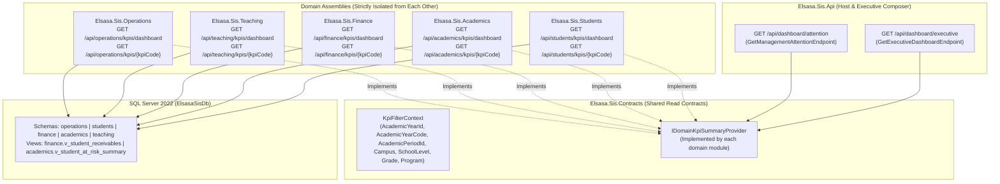

# Elsasa SIS V3 — Management KPI & Dashboard Technical Architecture

## 1. Architectural Alignment & Core Principles

This technical architecture designs the Management KPI & Dashboard system to fit **natively** into Elsasa SIS V3's existing stack ([`backend-architecture.md`](file:///d:/Project.Private/elsasa-sis-v3/docs/architecture/backend-architecture.md) and [`frontend-architecture.md`](file:///d:/Project.Private/elsasa-sis-v3/docs/architecture/frontend-architecture.md)) while incorporating proven read-side composition and UI patterns from **BTR Portal** (`D:\Project.Private\btr-platform\docs\features\btr-portal\btr-portal-architecture.md`).

### Architectural Fit Summary
| Layer | Elsasa SIS V3 Baseline | KPI Dashboard Architecture Pattern |
|---|---|---|
| **Backend Style** | .NET 8 / C# 12 Modular Monolith with Vertical Slice Architecture (VSA) & Minimal APIs (`IEndpoint`) | Domain-owned KPI vertical slices inside each domain assembly + Executive Composer in `Elsasa.Sis.Api` (or `Elsasa.Sis.Contracts`). |
| **Data Access** | Explicit parameterized T-SQL via **Dapper** (`ISqlConnectionFactory`) over SQL Server 2022 | Read-only analytical SQL queries (`SELECT ... JOIN`) and SQL Views (`finance.v_student_receivables`) using Dapper `QueryMultipleAsync`. Zero EF Core. |
| **Database Isolation** | 1 Database (`ElsasaSisDb`), 5 isolated schemas (`operations`, `students`, `finance`, `academics`, `teaching`), zero cross-schema FKs | Preserves strict write isolation. Cross-schema read `JOIN`s are explicitly permitted by `backend-architecture.md` §4.2 Rule 4. |
| **Frontend State & UI** | Vue 3.5 + TypeScript + PrimeVue v4 + Tailwind CSS v4 + **TanStack Query v5** + **Pinia** | Reusable BTR-inspired dashboard primitives (`DashboardMetricCard`, `ExecutiveAttentionCard`, `KpiChip`, `KpiProgress`) backed by TanStack Query hooks keyed by `useAppContextStore` filters. |

---

## 2. Adapting BTR Portal's Architecture to Elsasa SIS V3

In BTR Portal (`btr-portal-architecture.md`), the portal is a separate `.NET Framework 4.8` Web API (`btr.portal.api`) + background Windows Task Scheduler console worker (`btr.portal.worker`) that materializes `BTRPD_*` tables from a legacy WinForms desktop app (`btr.distrib`).

In **Elsasa SIS V3**, we have a major architectural advantage: **transactional workbenches and management dashboards share the same .NET 8 Minimal API host and Vue 3 SPA**. Therefore, we adapt BTR Portal's patterns without introducing unnecessary infrastructure overhead:

| Architectural Aspect | BTR Portal Pattern | Elsasa SIS V3 Adaptation |
|---|---|---|
| **Single Source of Calculation Truth** | Portal DALs wrap existing Desktop DALs and `Dashboard{Domain}Aggregator` classes so SQL and business rules are never duplicated. | **Shared SQL Views & Domain Query Specifications**: Complex domain calculations live in authoritative SQL views (like the existing `finance.v_student_receivables` and proposed `academics.v_student_at_risk_summary`) queried by **both** the operational workbench and the KPI dashboard. |
| **Executive Overview Composition** | `DashboardExecutiveComposer` (`M16`) composes domain summaries (`Sales`, `Piutang`, `Inventory`, `Purchasing`) into `GET /api/dashboard/executive`. | **`GetExecutiveDashboardHandler` Composer**: Calls domain-owned summary providers (`IStudentKpiProvider`, `IAcademicKpiProvider`, `IFinanceKpiProvider`, `ITeachingKpiProvider`, `IOperationsKpiProvider` in `Elsasa.Sis.Contracts`) in parallel and composes the Executive Overview & Management Attention response. |
| **Live Aggregation vs. Materialized Snapshots** | BTR Portal materializes all KPIs via `btr.portal.worker` every 15–60 mins into `BTRPD_*` tables because legacy desktop queries scan millions of rows without period partitioning. | **Two-Stage Hybrid Strategy**:<br/>1. **Release 1 (Live Dapper Queries + Indexed Views)**: School datasets per academic period (~500–5,000 students) execute in $< 30\text{ ms}$ on SQL Server 2022 using existing period indexes (`IX_*_academic_period_id`). Live queries avoid stale data during active grading or cashier collection.<br/>2. **Release 2 (Periodic Snapshot Table `operations.kpi_period_snapshots`)**: Lightweight in-process `.NET 8 BackgroundService` (or period-close hook) captures daily/monthly point-in-time snapshots for mutable balances so historical trend charts never drift. |
| **Investigation & Drill-Down Routing** | `InvestigationRegistry.cs` + `buildInvestigationQuery.ts` map `SignalKey` alerts to `/reports/{domain}?signal=...`. | **`sisInvestigationRegistry.ts`** maps every `SignalKey` and KPI breakdown row directly to the existing SIS operational workbench route (`/finance/receivables`, `/academics/interventions`, `/teaching/workload`, etc.) with pre-hydrated query parameters. |

---

## 3. Backend Module Boundaries & Vertical Slice Structure

Per `backend-architecture.md` §2.2, **Domain Modules (`Elsasa.Sis.Students`, `Elsasa.Sis.Academics`, `Elsasa.Sis.Finance`, `Elsasa.Sis.Teaching`, `Elsasa.Sis.Operations`) must never reference one another**. All cross-module contracts reside in `Elsasa.Sis.Contracts`.



### 3.1 Vertical Slice Folder Layout Inside Each Domain Module
Each domain assembly owns its Level 2 Domain Dashboard endpoint and Level 3 KPI Detail endpoint under `Features/DashboardKpis/`:

```text
src/backend/Elsasa.Sis.Finance/
└── Features/
    └── DashboardKpis/
        ├── GetFinanceDashboardKpis/
        │   ├── GetFinanceDashboardKpisEndpoint.cs   // GET /api/finance/kpis/dashboard
        │   ├── GetFinanceDashboardKpisHandler.cs    // Dapper QueryMultipleAsync over finance.v_student_receivables & payments
        │   └── FinanceDashboardKpisResponse.cs      // Domain KPI cards, aging series, grade breakdown, attention signals
        ├── GetFinanceKpiDetail/
        │   ├── GetFinanceKpiDetailEndpoint.cs       // GET /api/finance/kpis/{kpiCode}
        │   ├── GetFinanceKpiDetailHandler.cs        // Period trend + Campus/Grade/Program/ChargeType breakdown
        │   └── FinanceKpiDetailResponse.cs
        └── FinanceKpiSummaryProvider.cs             // Implements IDomainKpiSummaryProvider for Executive Overview
```

### 3.2 Executive Overview Composition Slice (`Elsasa.Sis.Api`)
In `src/backend/Elsasa.Sis.Api/Features/Dashboard/`:
- `GetExecutiveDashboardEndpoint.cs` (`GET /api/dashboard/executive`)
- `GetExecutiveDashboardHandler.cs`:
  1. Resolves the active `KpiFilterContext` (translating `AcademicYearId` $\leftrightarrow$ `operations.academic_years.code` and determining the **Equivalent Prior Period** from `operations.operational_periods`).
  2. Checks user permissions (`ICurrentUser`) so it only queries domains (or masks sensitive drill-downs) the user is authorized to view.
  3. Invokes registered `IDomainKpiSummaryProvider` implementations to assemble the 6 `ExecutiveAttentionCard` payloads, `ExecutiveDomainSummaryRow` items, and prioritized `ManagementAttentionSignal` items.
  4. For **Student Development (`Development`)**, returns `IsAvailable = false, UnavailableReason = "Stage 3 Module — Planned"` (matching BTR Portal's `ExecutiveAttentionCard.vue` `unavailable` prop) until `Elsasa.Sis.Development` is registered in Stage 3.

---

## 4. Data Flow, SQL Aggregation & Single-Source-of-Truth Strategy

### 4.1 Preventing Calculation Drift Between Workbenches and Dashboards
A critical risk in any KPI system is duplicating formulas between operational screens and management dashboards. We prevent drift through **three concrete mechanisms**:

1. **Authoritative Database Views for Multi-Table Domain Concepts**:
   - **Finance (`finance.v_student_receivables`)**: Already exists in [`20261104_0301_Finance_PaymentsReceivables_Tables.sql`](file:///d:/Project.Private/elsasa-sis-v3/src/backend/Elsasa.Sis.Database/Scripts/20261104_0301_Finance_PaymentsReceivables_Tables.sql#L88-L137). Both `ReceivablesAgingView.vue` (`/finance/receivables`) and the Finance KPI handlers (`FIN-01`, `FIN-02`, `FIN-03`, `FIN-04`) query `finance.v_student_receivables`.
   - **Academics (`academics.v_student_at_risk_summary` — Recommended View Extraction)**: Currently, the at-risk learner logic (`ACA-02`) is embedded inside [`GetAtRiskLearnersHandler.cs`](file:///d:/Project.Private/elsasa-sis-v3/src/backend/Elsasa.Sis.Academics/Features/AcademicInterventions/GetAtRiskLearners/GetAtRiskLearnersHandler.cs#L19-L115). Extracting the `RiskProgress`, `RiskStanding`, `RiskAttendance`, and `RiskAssessment` CTEs into a reusable SQL view `academics.v_student_at_risk_summary` (or shared SQL builder in `Elsasa.Sis.Academics`) guarantees that `/academics/interventions` and the Executive/Academic KPI dashboards always report the exact same at-risk learner count.
   - **Students (`students.v_active_student_placements` — Recommended View)**: Encapsulates the canonical join between `students.students`, `students.student_statuses` (`is_current = 1`), `students.administrative_placements` (`is_current = 1`), and `operations.academic_years` (`ON ay.code = ap.academic_year`), eliminating the `academic_year` string vs. `academic_year_id` UUID mismatch across all domains.

2. **Dapper `QueryMultipleAsync` Batching**:
   - Each Level 2 Domain Dashboard endpoint (`GET /api/{domain}/kpis/dashboard`) executes a single `QueryMultipleAsync` round-trip that returns:
     - Result Set 1: Current Period Headline KPI Aggregates
     - Result Set 2: Equivalent Prior Period Aggregates (for period-over-period delta calculation)
     - Result Set 3: Primary Chart Series (e.g., Aging brackets or Weekly Attendance trend)
     - Result Set 4: Dimensional Breakdown by Grade / Campus / Program
     - Result Set 5: Active Domain Attention Signals (`SignalKey` rows)
   - This keeps each dashboard load to **1 HTTP request and 1 SQL connection round-trip**.

### 4.2 Resolving Cross-Schema Filter Joins Cleanly
Because SQL Server schemas (`operations`, `students`, `finance`, `academics`, `teaching`) reside in the same database (`ElsasaSisDb`), Dapper read queries can join `finance.v_student_receivables` or `academics.academic_standings` with `students.administrative_placements` (`ap.student_id = r.student_id AND ap.is_current = 1`) to slice Financial and Academic KPIs by `ap.campus`, `ap.school_level`, `ap.grade`, and `ap.program` without violating module write boundaries.

---

## 5. Historical Data & Snapshot Strategy

School management needs two types of historical comparison:

### 5.1 Period-over-Period Comparison (Immediately Supported in Release 1)
All core operational tables in `academics`, `finance`, and `teaching` are already keyed by `academic_period_id` (`UNIQUEIDENTIFIER`), and `students.administrative_placements` is keyed by `academic_year` (`NVARCHAR(32)`).
- Comparing `Semester 1 2026/2027` against `Semester 1 2025/2026` or `Semester 2 2025/2026` works directly on live tables by passing `@CurrentPeriodId` and `@ComparisonPeriodId` into the Dapper query.

### 5.2 Intra-Period Point-in-Time Trend Snapshots (Release 2 Enhancement)
Some tables overwrite state in place (e.g., `teaching.workload_commitments.workload_status`, `teaching.capacity_conflicts.resolution_status`, or `finance.v_student_receivables` which compares `due_date` against `SYSDATETIMEOFFSET()`). To show how **Overdue Receivables (`FIN-03`)**, **Active Student Headcount (`STD-01`)**, or **Open Teaching Demands (`TCH-02`)** evolved week-by-week over the past 12 weeks:
- Introduce a single lightweight snapshot table in the `operations` schema (`operations.kpi_snapshots`) in Release 2:
  ```sql
  CREATE TABLE operations.kpi_snapshots (
      id                  UNIQUEIDENTIFIER NOT NULL CONSTRAINT PK_operations_kpi_snapshots PRIMARY KEY DEFAULT NEWID(),
      snapshot_date       DATE             NOT NULL,
      academic_year_id    UNIQUEIDENTIFIER NOT NULL,
      academic_period_id  UNIQUEIDENTIFIER NULL,
      campus              NVARCHAR(100)    NOT NULL CONSTRAINT DF_kpi_snapshots_campus DEFAULT 'All',
      kpi_code            NVARCHAR(32)     NOT NULL, -- e.g. 'STD-01', 'FIN-01', 'FIN-03', 'ACA-02', 'TCH-01'
      actual_value        DECIMAL(18,4)    NOT NULL,
      numerator_value     DECIMAL(18,4)    NULL,
      denominator_value   DECIMAL(18,4)    NULL,
      metadata_json       NVARCHAR(MAX)    NULL,
      captured_at         DATETIMEOFFSET   NOT NULL CONSTRAINT DF_kpi_snapshots_captured_at DEFAULT SYSDATETIMEOFFSET(),
      CONSTRAINT UQ_operations_kpi_snapshots UNIQUE (snapshot_date, academic_year_id, academic_period_id, campus, kpi_code)
  );
  ```
- A lightweight daily/weekly `.NET 8 BackgroundService` (or manual `"Capture Snapshot"` button for administrators, similar to BTR Portal's `AdminDashboardRefreshController.cs`) populates `operations.kpi_snapshots`.

---

## 6. Authorization, Role Visibility & Confidentiality Boundaries

### 6.1 Mapping Roles & Permissions to Dashboard Levels
Elsasa SIS V3 uses flat permission strings (`{domain}.{resource}.{action}`) in `ICurrentUser.Permissions` and `useAuthStore().hasPermission()`.

| Dashboard Surface | Recommended Permission Gate | Role Visibility & Behavior |
|---|---|---|
| **Level 1: Executive Overview** (`/dashboard`) | Authenticated User (`RequireAuthorization()`) with domain-scoped card visibility | **Principal / School Leadership (`SystemAdmin`)**: Sees all 6 domain cards and cross-domain attention strip.<br/>**Domain Coordinators (`AcademicAdmin`, `FinanceOfficer`, `Registrar`, `StaffingCoordinator`, `OperationsAdmin`)**: Sees Executive Overview with full drill-down into their authorized domains; unauthorized domain cards show summary headline only (or are hidden based on school policy) and disable Level 4 record drill-down.<br/>**Teachers (`Teacher`)**: Redirected to Teacher Operational Home or sees only `Academics` & `Teaching` summary. |
| **Level 2: Student Dashboard** (`/dashboard/students`) | `students.students.read` OR `students.admissions.read` | Accessible to School Leadership, Registrar, Admissions Officer. |
| **Level 2: Academic Dashboard** (`/dashboard/academics`) | `academics.standings.read` OR `academics.assessments.read` | Accessible to School Leadership, Academic Coordinator, Homeroom/Subject Teachers (scoped). |
| **Level 2: Finance Dashboard** (`/dashboard/finance`) | `finance.receivables.read` | Strictly restricted to School Leadership and Finance Officers. Teachers and Academic Coordinators cannot view student financial balances or Level 4 receivables records. |
| **Level 2: Teaching Dashboard** (`/dashboard/teaching`) | `teaching.workload.read` OR `teaching.demands.read` | Accessible to School Leadership, Teaching/Staffing Coordinator, Academic Coordinator. |
| **Level 2: Development Dashboard** (`/dashboard/development` — Stage 3) | `development.analytics.read` (Aggregate) vs `development.cases.read_confidential` (Detail) | **Strict Confidentiality Rule**: General leadership (`SystemAdmin` / Principal) sees **only anonymized aggregate counts** (`DEV-01` to `DEV-05`, with cell suppression for counts $< 5$). Drill-down to individual counselling, wellbeing, or sensitive discipline records is blocked at the API handler level unless the user holds `development.cases.read_confidential`. |
| **Level 2: Operations Dashboard** (`/dashboard/operations`) | `operations.calendars.read` | Accessible to School Leadership and Operations Admin. |

### 6.2 Campus Scoping Enforcement
Every KPI endpoint must inspect `ICurrentUser.CampusScope` (alongside the selected `Campus` filter parameter):
- If a user's JWT `campus_id` / `CampusScope` is restricted to a single campus (e.g., `'Main Campus'`), the backend handler overrides any `'All'` filter parameter and restricts SQL `WHERE` clauses to that user's authorized campus.

---

## 7. Frontend Architecture (`src/frontend/src/features/dashboard/`)

Following `frontend-architecture.md` and BTR Portal's component modularization (`btr.portal.web/src/components/dashboard/`), the frontend dashboard feature is organized as follows:

```text
src/frontend/src/features/dashboard/
├── api/
│   ├── dashboard.api.ts                 // TanStack Query hooks: useExecutiveDashboardQuery, useDomainDashboardQuery, useKpiDetailQuery
│   └── dashboard.types.ts               // TypeScript DTOs matching backend responses (KpiCardDto, AttentionSignalDto, KpiBreakdownDto)
├── components/
│   ├── primitives/                      // BTR Portal-inspired reusable KPI primitives
│   │   ├── DashboardMetricCard.vue      // Top-bordered metric card with tabular-nums, KpiProgress, and KpiChip
│   │   ├── ExecutiveAttentionCard.vue   // Level 1 domain card with requiresAttention, AchievementBand, and unavailable state
│   │   ├── ExecutiveDomainSummaryRow.vue// Scannable 1-line domain summary with "Details ->" link
│   │   ├── KpiChip.vue                  // Semantic status pill (healthy | warning | critical | stable | policy-needed | unavailable)
│   │   ├── KpiProgress.vue              // Compact horizontal progress bar
│   │   └── GlobalKpiFilterBar.vue       // Synced with useAppContextStore (Academic Year, Period, Campus, Level, Grade, Program)
│   ├── attention/
│   │   ├── ManagementAttentionStrip.vue // Top critical exceptions strip on Level 1
│   │   └── DomainAttentionList.vue      // Level 2 domain exception table with "Investigate ->" deep links
│   └── detail/
│       └── KpiDetailDrawer.vue          // Level 3 slide-over drawer (Definition, Formula, Trend Chart, Dimension Tabs, Level 4 Link)
├── services/
│   ├── kpiPolarity.ts                   // HigherIsBetter / LowerIsBetter / BalancedRange color & delta interpretation
│   └── sisInvestigationRegistry.ts      // Maps SignalKey & KPI codes to SIS operational workbench routes + query params
└── views/
    ├── DashboardView.vue                // Level 1: Executive Overview (/dashboard)
    ├── StudentKpiDashboardView.vue      // Level 2: /dashboard/students
    ├── AcademicKpiDashboardView.vue     // Level 2: /dashboard/academics
    ├── FinanceKpiDashboardView.vue      // Level 2: /dashboard/finance
    ├── TeachingKpiDashboardView.vue     // Level 2: /dashboard/teaching
    ├── DevelopmentKpiDashboardView.vue  // Level 2: /dashboard/development (Stage 3 placeholder + Academic Achievements)
    └── OperationsKpiDashboardView.vue   // Level 2: /dashboard/operations
```

### TanStack Query Reactive Caching
All dashboard queries include the reactive Pinia filter state from `useAppContextStore` in their query key:
```ts
queryKey: ['dashboard', domain, { academicYearId, academicPeriodId, campus, schoolLevel, grade, program }]
```
Whenever school leadership switches the **Academic Year**, **Academic Period**, or **Campus** in the global header (`AppLayout.vue` / `GlobalKpiFilterBar.vue`), TanStack Query automatically refetches and caches the corresponding slice with a `staleTime` of `2 * 60 * 1000` (2 minutes) and an explicit `[Refresh]` button.
