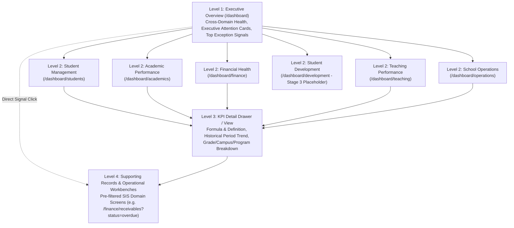

# Elsasa SIS V3 — Management Dashboard Information Architecture & Visual Design

## 1. Design Philosophy & Inspiration from BTR Portal

The Elsasa SIS V3 Management Dashboard takes direct architectural and UX inspiration from **BTR Portal** (`D:\Project.Private\btr-platform\src\j05-btr-distrib\btr.portal.web` and `docs\features\btr-portal\`), adapting its proven decision-support patterns to the specific operational realities of a K-12 / multi-level school:

### What We Adopt from BTR Portal
1. **The 5-Step Management Decision Journey** (`btr-portal-domain.md` §2):
   ```text
   What is happening overall?   →  Level 1: Executive Overview (/dashboard)
   What needs attention now?    →  Management Attention Center & Signal Strips
   Why is this happening?       →  Level 2: Domain Dashboard (/dashboard/{domain})
   How is this KPI behaving?    →  Level 3: KPI Detail & Breakdown Drawer/View
   Show me the records / Act    →  Level 4: SIS Operational Workbench (?signal=... deep-link)
   ```
2. **Compact, High-Density UI Primitives** (modeled after `btr.portal.web/src/components/dashboard/primitives/`):
   - **`DashboardMetricCard`**: Top-accented compact metric card (`tabular-nums` primary value, muted uppercase label, secondary context subtitle, optional `KpiProgress` bar, and semantic `KpiChip` badge).
   - **`ExecutiveAttentionCard`**: Domain summary card on the Executive Overview displaying 2–4 headline metrics (`DashboardMetric`), a `requiresAttention` left-border indicator, an `AchievementBand` / health chip, and graceful `unavailable` state rendering (`"Stage 3 — Not Yet Available"`) for unimplemented domains (`Student Development`).
   - **`ExecutiveDomainSummaryRow`**: Scannable one-line narrative health summary per domain with a `Details →` router link.
   - **Canonical `SignalKey` Investigation Routing** (inspired by `ALERT-REGISTRY.md` & `buildInvestigationQuery.ts`): Clicking an attention item or KPI breakdown segment navigates directly to the owning SIS operational screen with pre-hydrated URL filter parameters (`?signal=FIN_OVERDUE_90&aging=90+`).

### How We Adapt Around School Management Needs (Not Blind Replication)
- **Academic Period & Year Rhythms vs. Monthly Commercial Cycles**: Unlike distribution sales that reset every calendar month, school KPIs operate on **Academic Years** (`2026/2027`), **Operational Periods / Semesters** (`operations.operational_periods`), and lifecycle milestones (Admissions window $\rightarrow$ Enrollment gate $\rightarrow$ Instructional attendance $\rightarrow$ Mid-term/Final grading $\rightarrow$ Promotion board).
- **In-App Operational Resolution**: In BTR Portal, users inspect reports in the web portal and switch to WinForms (`BTR Desktop`) to take action. In **Elsasa SIS V3**, the operational workbenches (`SCR-STD-*`, `SCR-ACA-*`, `SCR-FIN-*`, `SCR-TCH-*`, `SCR-OPS-*`) live inside the **same Vue 3 SPA**, enabling seamless one-click transition from Level 3/4 KPI inspection into the authorized domain workbench.

---

## 2. Four-Level Information Architecture Hierarchy



---

## 3. Level 1 — Executive Overview (`/dashboard`)

Replaces the current static launcher in [DashboardView.vue](file:///d:/Project.Private/elsasa-sis-v3/src/frontend/src/features/dashboard/views/DashboardView.vue) with the **School Management Attention Center**.

### Questions Answered on One Screen
1. **How is the school performing overall?** (Headline strip of 6 cross-domain pulse metrics)
2. **Which domains require management attention right now?** (6 `ExecutiveAttentionCard` blocks—one per SIS domain)
3. **What are the most urgent operational or academic exceptions today?** (Prioritized Cross-Domain Management Attention Strip + Domain Summary Rows)
4. **What has improved or deteriorated compared to the prior equivalent period?** (Period-over-period delta chips)

### Cross-Domain KPIs Selected for Level 1 (12 Metrics Across 6 Domain Cards)
Only the highest-signal indicators appear on Level 1:
- **Student Management Card**: `STD-01` Active Student Population (with period net change), `STD-02` New Student Enrollment Realization, `STD-06` Student Withdrawal/Attrition Count.
- **Academic Performance Card**: `ACA-01` Good Standing Rate (%) vs Unsatisfactory Standing, `ACA-02` At-Risk Learners Requiring Intervention (Highlighting *Unaddressed* count), `ACA-03` Learning Activity Attendance Rate (%).
- **Financial Health Card**: `FIN-02` Net Fee Collection Rate (%), `FIN-01` Total Outstanding Receivables (IDR), `FIN-03` Overdue Receivables (IDR & `90+ Days` share).
- **Teaching Performance Card**: `TCH-01` Teaching Demand Staffing Coverage (%), `TCH-02` Unassigned Open Demands, `TCH-03` Faculty Workload Limit Breaches (`breached` + `overloaded_with_exception`).
- **School Operations Card**: `OPS-01` Calendar & Period Publication Readiness (%), `OPS-02` Unscheduled Closure Days & Unreviewed Calendar Amendments.
- **Student Development Card**: Displays clean BTR-style `unavailable` state (`"Stage 3 Module — Planned"`) in Release 1–2, activating `DEV-01` and `DEV-03` in Release 3.

### Level 1 ASCII Wireframe — Executive Overview (`/dashboard`)

```text
+------------------------------------------------------------------------------------------------------------------+
| ELSASA SIS V3 | MANAGEMENT ATTENTION CENTER                                                                      |
| Global Context: [AY: 2026/2027 v] [Period: Sem 1 (Active) v] [Campus: All Campuses v] [Level: All v] [Refresh]   |
| Data Freshness: Live Ledger & Academic State as of 11 Nov 2026 11:35 WIB                     [Open Alert Center] |
+------------------------------------------------------------------------------------------------------------------+
| CRITICAL MANAGEMENT ATTENTION STRIP (Top Qualifying Signals Across Domains)                                      |
| [!] FIN_OVERDUE_90   : Rp 142.5M overdue >90 days across 18 students          [View Finance ->] [Investigate ->] |
| [!] ACA_AT_RISK_UNADDRESSED : 14 At-Risk learners have NO active intervention [View Academic->] [Investigate ->] |
| [!] TCH_OPEN_DEMAND  : 4 Teaching Demands (12 load units) remain unstaffed    [View Teaching->] [Investigate ->] |
| [!] FIN_PAYMENT_QUEUE: 9 Submitted payments (Rp 28.4M) awaiting verification  [View Finance ->] [Investigate ->] |
+------------------------------------------------------------------------------------------------------------------+
| DOMAIN ATTENTION CARDS (Click any card to open its Level 2 Domain Dashboard)                                     |
|                                                                                                                  |
| +-----------------------------------+ +-----------------------------------+ +----------------------------------+ |
| | [Students] STUDENT MANAGEMENT     | | [Academics] ACADEMIC PERFORMANCE  | | [Finance] FINANCIAL HEALTH   [!] | |
| | Status: [Healthy]                 | | Status: [Warning - 14 Unaddressed]| | Status: [Attention Required]     | |
| |-----------------------------------| |-----------------------------------| |----------------------------------| |
| | Active Students      1,248 (+3.2%)| | Good Standing Rate   88.4% (-1.1%)| | Net Collection Rate  78.5% [===.]| |
| | New Enrollments        312 (94.5%)| | At-Risk Learners       42 (14 new)| | Total Receivables    Rp 845.0M   | |
| | Attrition (YTD)          9 (0.7%) | | Activity Attendance  94.2% [====.]| | Overdue (>Due Date)  Rp 210.4M   | |
| | Admission Yield      71.8% [===.] | | Result Publication   82.0% [===..] | | >90 Days Overdue     Rp 142.5M   | |
| +-----------------------------------+ +-----------------------------------+ +----------------------------------+ |
|                                                                                                                  |
| +-----------------------------------+ +-----------------------------------+ +----------------------------------+ |
| | [Teaching] TEACHING PERF.     [!] | | [Operations] SCHOOL OPERATIONS    | | [Development] STUDENT DEV.       | |
| | Status: [Warning - 4 Open Demands]| | Status: [Healthy]                 | | Status: [Stage 3 - Not Available]| |
| |-----------------------------------| |-----------------------------------| |----------------------------------| |
| | Demand Coverage      96.4% [====.]| | Calendar Readiness  100.0% (Pub)  | | Behaviour Incidents  Not Avail.  | |
| | Open Demands             4 (12 u) | | Active Periods        4 / 4 Active| | Active Interventions Not Avail.  | |
| | Workload Breaches        2 Faculty| | Unscheduled Closures      1 Day   | | Extracurricular %    Not Avail.  | |
| | Open Cap. Conflicts      3 Open   | | Unreviewed Amend.         0       | | (Scheduled for Stage 3 Release)  | |
| +-----------------------------------+ +-----------------------------------+ +----------------------------------+ |
+------------------------------------------------------------------------------------------------------------------+
| DOMAIN HEALTH SUMMARY & QUICK NAVIGATION                                                                         |
| Students    | 1,248 active learners across 2 campuses; 18 enrollments pending gate clearance        | Details -> |
| Academics   | 94.2% attendance; 42 at-risk learners identified (28 in intervention, 14 unaddressed) | Details -> |
| Finance     | Rp 2.65B allocated of Rp 3.38B billed (78.5%); 9 submitted payments pending review    | Details -> |
| Teaching    | 108/112 demands staffed; 2 teachers in workload breach; 3 open capacity conflicts     | Details -> |
| Operations  | 2026/2027 calendars published; 1 unscheduled closure day recorded in Sem 1            | Details -> |
+------------------------------------------------------------------------------------------------------------------+
```

---

## 4. Level 2 — Six Domain Dashboards (`/dashboard/{domain}`)

Each domain dashboard follows a consistent 4-zone layout inspired by BTR Portal's `DashboardDetailLayout.vue`:
- **Zone A — Domain KPI Strip**: 4 to 6 `DashboardMetricCard` tiles grouped by semantic role (`execution`, `activity`, `monitoring`, `risk`, `caution`).
- **Zone B — Primary Trend & Comparison Charts**: 2 side-by-side charts (e.g., Period Trend / Funnel + Dimensional Breakdown by Grade/Campus/Program).
- **Zone C — Domain Attention List (`{Domain}AttentionList`)**: Enumerated exceptions with one-click `Investigate →` links to SIS operational workbenches.
- **Zone D — Dimensional Summary Table**: Compact breakdown table by Grade / School Level / Program / Campus with drill-down triggers into Level 3 KPI Detail.

### 4.1 Student Management Dashboard (`/dashboard/students`)
- **Group 1 — Population & Capacity (`execution`)**:
  - `STD-01` Active Student Population (by Campus & School Level)
  - `STD-07` Cohort & Homeroom Utilization (Average students per cohort section)
- **Group 2 — Intake & Admissions Funnel (`activity`)**:
  - `STD-02` New Student Enrollment Realization (`active` vs `pending_activation`)
  - `STD-03` Admission Funnel Conversion & Offer Yield Rate
  - `STD-04` Admission Application Review Backlog (`submitted`/`under_review` count & avg age)
- **Group 3 — Retention, Attrition & Lifecycle Exceptions (`risk` / `caution`)**:
  - `STD-06` Student Withdrawal & Attrition Rate (`withdrawn`, `transferred_out`, `expelled`)
  - `STD-05` Cohort Continuation Rate (`PARTIAL`)
  - `STD-08` Lifecycle Exception Counts (`on_leave`, `leave_expired`, `suspended`, `enrolled_pending_activation`)
- **Primary Visuals**:
  - *Left Chart*: **Admission-to-Enrollment Funnel Bar Chart** (`Submitted` $\rightarrow$ `Under Review` $\rightarrow$ `Accepted` $\rightarrow$ `Enrolled Active`).
  - *Right Chart*: **Student Population Stacked Bar Chart** by Grade Level and Program (segmented by Campus).

### 4.2 Academic Performance Dashboard (`/dashboard/academics`)
- **Group 1 — Standing & Progression Health (`execution`)**:
  - `ACA-01` Academic Standing Distribution (`good_standing` vs `academic_warning`, `academic_probation`, `unsatisfactory_standing`)
  - `ACA-07` Promotion, Conditional Progression & Retention Distribution
  - `ACA-06` Learning Unit Mastery & Remediation Rate (`remediation_flag = 1`)
- **Group 2 — Early Warning & Intervention Coverage (`risk`)**:
  - `ACA-02` At-Risk Learners Requiring Intervention (Total At-Risk vs Unaddressed At-Risk Learners)
- **Group 3 — Instructional Engagement & Grading Execution (`activity` / `monitoring`)**:
  - `ACA-03` Learning Activity Attendance Rate & Unexcused Absence Rate
  - `ACA-04` Assignment On-Time Submission vs Missing Work Rate
  - `ACA-05` Assessment Grading & Result Publication Rate
  - `ACA-08` Report Card Publication Completeness
- **Primary Visuals**:
  - *Left Chart*: **Weekly Attendance & Coursework Submission Trend Line Chart** across the active semester.
  - *Right Chart*: **Academic Standing & At-Risk Breakdown Stacked Horizontal Bar Chart** by Grade Level.

### 4.3 Financial Health Dashboard (`/dashboard/finance`)
- **Group 1 — Billing & Settlement Realization (`execution` / `activity`)**:
  - `FIN-02` Net Fee Collection (Obligation Settlement) Rate (`total_paid / net_obligation`)
  - `FIN-07` Enrollment Gate Financial Clearance Rate (`payment_gate_cleared = 1`)
- **Group 2 — Receivable Exposure & Delinquency Risk (`risk`)**:
  - `FIN-01` Total Outstanding Receivables (IDR & open student count)
  - `FIN-03` Overdue Receivables & Student Delinquency Rate (`is_overdue = 1`)
  - `FIN-04` Chronic Overdue Exposure (`90+ Days` bucket IDR & %)
- **Group 3 — Treasury & Cashier Operational Queues (`caution` / `monitoring`)**:
  - `FIN-05` Unverified Payment Confirmation Backlog (`confirmation_status = 'submitted'`)
  - `FIN-06` Confirmed Unallocated Payment Balance (`confirmed` payments minus `active` allocations)
- **Primary Visuals**:
  - *Left Chart*: **Receivables Aging Distribution Bar/Donut Chart** (`Current`, `1-30 Days`, `31-60 Days`, `61-90 Days`, `90+ Days` from `finance.v_student_receivables`).
  - *Right Chart*: **Obligations Billed vs. Allocated Collections vs. Overdue Balance by Grade/Charge Type** (`tuition`, `enrollment_fee`, `activity_fee`, etc.).

### 4.4 Teaching Performance Dashboard (`/dashboard/teaching`)
- **Group 1 — Instructional Demand Coverage (`execution` / `risk`)**:
  - `TCH-01` Teaching Demand Staffing Coverage Rate (% demands & % load units staffed)
  - `TCH-02` Unassigned Open Teaching Demands (`open` + `partially_staffed`)
- **Group 2 — Faculty Workload Balance & Capacity Governance (`monitoring` / `caution`)**:
  - `TCH-03` Faculty Workload Distribution (`under_allocated`, `normal`, `approaching_limit`, `overloaded_with_exception`, `breached`)
  - `TCH-04` Unresolved Teaching Capacity Conflicts (`resolution_status = 'open'`, split by `blocking` vs `warning`)
- **Group 3 — Credential Compliance & Instructional Continuity (`activity`)**:
  - `TCH-05` Teacher Qualification Verification & Authorization Coverage (`unverified_credential_warning = 0`)
  - `TCH-06` Active Teacher Substitution & Reassignment Rate
  - `TCH-07` Teaching Assignment Completion & Handover Rate
- **Primary Visuals**:
  - *Left Chart*: **Faculty Workload Distribution Bar Chart** across the 5 policy bands (`teaching.workload_commitments`).
  - *Right Chart*: **Staffing Coverage & Unassigned Load Units by School Level and Subject Area**.

### 4.5 Student Development Dashboard (`/dashboard/development`)
- **Release 1–2 State**: Renders a structured **Stage 3 Readiness Banner** explaining that Behaviour & Discipline, Wellbeing & Interventions, and Extracurricular Activities are scheduled for Stage 3, while surfacing **Academic Achievements** (`academics.academic_achievements`, which *is* already implemented in `20261107_0401_Academics_StandingProgression_Tables.sql`).
- **Release 3 State (Once Stage 3 Schema Exists)**:
  - **Group 1 — School Climate & Positive Culture**: `DEV-01` Behaviour Incident Frequency & Triage Rate, `DEV-02` Positive Recognition Ratio.
  - **Group 2 — Pastoral Support Coverage (Strictly Anonymized Aggregates)**: `DEV-03` Active Development Interventions & On-Time Review Rate (suppressing cells $< 5$ students; zero counselling/wellbeing narrative exposure).
  - **Group 3 — Co-Curricular Engagement**: `DEV-04` Extracurricular Participation Coverage, `DEV-05` Non-Academic Achievement Distribution.

### 4.6 School Operations Dashboard (`/dashboard/operations`)
- **Group 1 — Institutional Time & Calendar Governance (`execution` — Available in Release 1)**:
  - `OPS-01` Operational Calendar & Period Publication Readiness (`academic_years`, `operational_periods`, `school_calendars`)
  - `OPS-02` Unscheduled School Closure Days & Unreviewed Calendar Amendments (`downstream_impact_reviewed = 0`)
- **Group 2 — Master Scheduling & Room Utilization (Stage 2 — Deferred to Release 3)**:
  - `OPS-03` Master Schedule Publication Rate (`NOT AVAILABLE`)
  - `OPS-04` Room Utilization & Allocation Conflict Rate (`NOT AVAILABLE`)
  - `OPS-05` Unresolved Operational Activity Requests (`NOT AVAILABLE`)
- **Group 3 — Campus Events & Communications (Stage 3 — Deferred to Release 3)**:
  - `OPS-06` School Event Completion & Announcement Reach (`NOT AVAILABLE`)

### Level 2 ASCII Wireframe — Financial Health Domain Dashboard (`/dashboard/finance`)

```text
+------------------------------------------------------------------------------------------------------------------+
| <- Back to Overview | FINANCIAL HEALTH DASHBOARD                                                                 |
| Global Filters: [AY: 2026/2027 v] [Period: Sem 1 v] [Campus: All v] [Level: All v] [Grade: All v] [Program: All] |
+------------------------------------------------------------------------------------------------------------------+
| ZONE A: FINANCIAL KPI CARDS (Click any card to open Level 3 KPI Detail Drawer)                                   |
| +--------------------+ +--------------------+ +--------------------+ +--------------------+ +------------------+ |
| | NET COLLECTION %   | | TOTAL RECEIVABLES  | | OVERDUE EXPOSURE   | | UNVERIFIED PYMTS   | | UNALLOCATED CASH | |
| | 78.5%              | | Rp 845.0M          | | Rp 210.4M          | | 9 Payments         | | Rp 34.2M         | |
| | [========..] +2.1% | | 342 Open Accounts  | | 24.9% of Total [!] | | Rp 28.4M Pending   | | 12 Confirmed Pymt| |
| | Policy Target: N/A | | Billed: Rp 3.38B   | | 68 Delinquent Std. | | Oldest: 4 days ago | | Needs Allocation | |
| +--------------------+ +--------------------+ +--------------------+ +--------------------+ +------------------+ |
+------------------------------------------------------------------------------------------------------------------+
| ZONE B: AGING DISTRIBUTION & GRADE/CHARGE BREAKDOWN                                                              |
| +--------------------------------------------------------+ +---------------------------------------------------+ |
| | RECEIVABLES AGING DISTRIBUTION (v_student_receivables) | | COLLECTION vs OUTSTANDING BY GRADE LEVEL          | |
| |                                                        | |                                                   | |
| | Current (Not Due) : [================] Rp 634.6M (75%) | | Grade 10 : [=============....] 81.2% (Rp 280M Due)| |
| | 1 - 30 Days Over  : [==..............] Rp  38.2M ( 5%) | | Grade 11 : [============.....] 76.4% (Rp 315M Due)| |
| | 31 - 60 Days Over : [=...............] Rp  19.8M ( 2%) | | Grade 12 : [===========......] 74.1% (Rp 250M Due)| |
| | 61 - 90 Days Over : [=...............] Rp   9.9M ( 1%) | |                                                   | |
| | 90+ Days Overdue  : [====............] Rp 142.5M (17%) | | Charge Filter: [All Charges | Tuition | Intake]   | |
| +--------------------------------------------------------+ +---------------------------------------------------+ |
+------------------------------------------------------------------------------------------------------------------+
| ZONE C: FINANCIAL MANAGEMENT ATTENTION LIST (Actionable Exceptions)                                              |
| Signal              | Scope / Entity           | Exposure / Detail                  | Action                     |
|---------------------+--------------------------+------------------------------------+----------------------------|
| [CRITICAL] 90+ Days | Grade 12 - Main Campus   | 11 students owe Rp 94.0M >90 days  | [Investigate Receivables->]|
| [WARNING] Gate Hold | 2026/2027 Intake Cohort  | 18 enrollments blocked by fee gate | [Open Enrollment Gate ->]  |
| [WARNING] Unverified| Cashier Queue            | 9 submitted payments >48h unchkd   | [Open Payment Desk ->]     |
| [CAUTION] Unalloc.  | Confirmed Payments       | 12 confirmed payments unallocated  | [Open Allocation Desk ->]  |
+------------------------------------------------------------------------------------------------------------------+
```

---

## 5. Level 3 — KPI Detail View / Drawer & Level 4 — Supporting Records

When a user clicks any KPI card on Level 1 or Level 2, a slide-over **Level 3 KPI Detail Drawer** (or dedicated sub-route `/dashboard/{domain}/kpi/{kpiCode}`, modeled on BTR Portal's `SalesmanDetailDrawer.vue` and `kpi-explain-*.md` pattern) opens without losing the user's filter state.

### Level 3 KPI Detail Structure
1. **Business Definition & Formula Header**: Displays the exact KPI Name, owning domain, plain-language definition, explicit mathematical formula, and data source (`finance.v_student_receivables`, etc.).
2. **Four-Part Value Strip**:
   - **Actual Value**: Current computed metric (`78.5%` or `Rp 210.4M`).
   - **Policy Target / Threshold**: Displays configured policy value or `"Policy Not Configured"` if management has not set a numerical target.
   - **Prior Equivalent Period Comparison**: Value in the prior semester/academic year (`Sem 1 2025/2026: 76.4%`, Delta: `+2.1%`).
   - **Status Interpretation Badge**: Semantic interpretation (`Improving`, `Deteriorating`, `Warning`, `Critical`).
3. **Historical Trend Chart**: Multi-period line/bar chart across consecutive academic periods or months.
4. **Multi-Dimensional Breakdown Tabs**: Switchable breakdown table by **Campus**, **School Level / Grade**, **Program**, and **Cohort / Homeroom**.
5. **Level 4 Drill-Down Button (`Inspect Supporting Records →`)**: Navigates to the authoritative SIS operational workbench with pre-applied filter query parameters.

### Level 3 ASCII Wireframe — KPI Detail Drawer (`ACA-02: At-Risk Learners`)

```text
+--------------------------------------------------------------------------------------------------+
| KPI DETAIL: ACA-02 — STUDENTS REQUIRING ACADEMIC INTERVENTION (AT-RISK RATE)               [X]   |
| Domain: Academic Performance | Source: academics.academic_standings, learning_progress, ...      |
+--------------------------------------------------------------------------------------------------+
| DEFINITION & FORMULA                                                                             |
| Percentage of active participating students in the period meeting >=1 early-warning risk trigger |
| (Unsatisfactory/Probation/Warning standing, Below-Expectation progress, >=3 unexcused absences,  |
| or failing assessment score), paired with Active Intervention Coverage Rate.                     |
+--------------------------------------------------------------------------------------------------+
| ACTUAL VALUE           | INTERVENTION COVERAGE  | VS PRIOR EQUIV. PERIOD | STATUS INTERPRETATION |
| 42 Students (3.4%)     | 66.7% (28 / 42 Active) | Sem 1 25/26: 2.8%      | [WARNING: 14 Unaddr.] |
| (Lower is Better)      | 14 Unaddressed Learners| Delta: +0.6% (+8 std)  | Deteriorating (+0.6%) |
+--------------------------------------------------------------------------------------------------+
| BREAKDOWN BY GRADE & RISK TRIGGER                                                                |
| Grade Level | Active Std | Total At-Risk | With Intervention | Unaddressed | Top Trigger         |
|-------------+------------+---------------+-------------------+-------------+---------------------|
| Grade 10    |        420 |     19 (4.5%) |                11 |      8 [!]  | Failing Assessment  |
| Grade 11    |        418 |     14 (3.3%) |                10 |      4 [!]  | >=3 Absences        |
| Grade 12    |        410 |      9 (2.2%) |                 7 |      2 [!]  | Below Expectation   |
+--------------------------------------------------------------------------------------------------+
| LEVEL 4 SUPPORTING RECORDS DRILL-DOWN                                                            |
| [Open At-Risk Early Warning Workbench (Pre-filtered to 14 Unaddressed Learners) ->]              |
| Route: /academics/interventions?academicPeriodId=...|tab=at-risk|onlyUnaddressed=true            |
+--------------------------------------------------------------------------------------------------+
```

### Level 4 — Supporting Records Mapping (Dashboard $\rightarrow$ Existing SIS Workbenches)

The dashboard never duplicates CRUD workflows. Every Level 4 drill-down routes to an existing screen in `src/frontend/src/app/router/routes.ts`:

| Domain | KPI / Signal | Level 4 Target Route in `routes.ts` | Screen ID & Component |
|---|---|---|---|
| **Students** | `STD-01`, `STD-06`, `STD-07`, `STD-08` | `/students/directory?status=...&grade=...&campus=...` | `SCR-STD-03` (`StudentDirectoryView.vue`) |
| **Students** | `STD-02`, `FIN-07` | `/students/enrollment?gateCleared=false` | `SCR-STD-02` (`EnrollmentActivationView.vue`) |
| **Students** | `STD-03`, `STD-04` | `/students/admissions?status=submitted,under_review` | `SCR-STD-01` (`AdmissionApplicationsView.vue`) |
| **Students** | `STD-05` | `/students/lifecycle-workbench` | `SCR-STD-05` (`StudentLifecycleWorkbenchView.vue`) |
| **Academics** | `ACA-01`, `ACA-06`, `ACA-07` | `/academics/progression?academicPeriodId=...` | `SCR-ACA-06` (`StandingProgressionView.vue`) |
| **Academics** | `ACA-02` | `/academics/interventions?academicPeriodId=...` | `SCR-ACA-07` (`InterventionAchievementView.vue`) |
| **Academics** | `ACA-03`, `ACA-04` | `/academics/attendance-coursework?academicPeriodId=...` | `SCR-ACA-03` (`AttendanceCourseworkView.vue`) |
| **Academics** | `ACA-05`, `ACA-09` | `/academics/gradebook?academicPeriodId=...` | `SCR-ACA-04` (`AssessmentGradebookView.vue`) |
| **Academics** | `ACA-08` | `/academics/reports-transcripts?academicPeriodId=...` | `SCR-ACA-05` (`ReportCardTranscriptView.vue`) |
| **Finance** | `FIN-01`, `FIN-02`, `FIN-03`, `FIN-04` | `/finance/receivables?status=overdue&agingBracket=...` | `SCR-FIN-05` (`ReceivablesAgingView.vue`) |
| **Finance** | `FIN-05`, `FIN-06` | `/finance/payments?confirmationStatus=submitted` | `SCR-FIN-04` (`PaymentsAllocationView.vue`) |
| **Teaching** | `TCH-01`, `TCH-02` | `/teaching/assignments?status=open,partially_staffed` | `SCR-TCH-02` (`DemandAssignmentView.vue`) |
| **Teaching** | `TCH-03`, `TCH-04` | `/teaching/workload?status=breached,overloaded` | `SCR-TCH-03` (`WorkloadMonitoringView.vue`) |
| **Teaching** | `TCH-05` | `/teaching/teachers?credentialWarning=true` | `SCR-TCH-01` (`TeacherProfilesView.vue`) |
| **Teaching** | `TCH-06`, `TCH-07` | `/teaching/continuity` | `SCR-TCH-04` (`SubstitutionsCloseoutView.vue`) |
| **Operations** | `OPS-01`, `OPS-02` | `/operations/calendars` & `/operations/academic-years` | `SCR-OPS-02` & `SCR-OPS-01` |

---

## 6. Visual Conventions, Polarity & Interpretation Rules

### 6.1 Distinguishing the Four Analytical Layers on Every KPI Card
Every KPI presentation clearly separates:
1. **Actual Value**: Primary large `tabular-nums` number (`94.2%`, `Rp 210.4M`, `14 Students`).
2. **Target / Policy Threshold**: Displayed only when backed by an institutional policy table (`teaching.workload_policies`, `academics.assessments.passing_score`) or a configured school management policy setting. When unconfigured, displays `Policy Target: Not Set` (matching BTR Portal's `'no-target'` formatter in `dashboardEmptyStates.ts`).
3. **Historical Comparison**: Delta badge (`+2.1% vs Sem 1 2025/2026`) with explicit comparison anchor label.
4. **Status / Interpretation**: Semantic `KpiChip` (`Healthy`, `Warning`, `Critical`, `Stable`, `Policy Needed`, `Not Available`).

### 6.2 Polarity Rules ("Higher Is Not Always Better")
Inspired by BTR Portal's `useComparisonColors.ts`, every KPI has an explicit **Polarity Direction** (`HigherIsBetter`, `LowerIsBetter`, or `BalancedRange`):

| Polarity Type | Meaning of Increase ($\uparrow$) | Meaning of Decrease ($\downarrow$) | Applicable KPIs |
|---|---|---|---|
| **`HigherIsBetter`** | **Improving** (Emerald `#16a34a`) | **Deteriorating** (Rose `#dc2626`) | `STD-01`, `STD-02`, `STD-03`, `STD-05`, `ACA-03`, `ACA-05`, `ACA-08`, `FIN-02`, `FIN-07`, `TCH-01`, `TCH-05`, `TCH-07`, `OPS-01` |
| **`LowerIsBetter`** | **Deteriorating** (Rose `#dc2626`) | **Improving** (Emerald `#16a34a`) | `STD-04` (Backlog), `STD-06` (Attrition), `ACA-01` (Unsatisfactory %), `ACA-02` (At-Risk Rate), `ACA-04` (Missing Work %), `ACA-06` (Remediation %), `FIN-01`, `FIN-03` (Overdue), `FIN-05` (Unverified Queue), `FIN-06` (Unallocated Cash), `TCH-02` (Open Demands), `TCH-04` (Conflicts), `OPS-02` (Unscheduled Closures) |
| **`BalancedRange`** | Normal within policy band; Warning/Critical outside `min` or `max` | Normal within policy band; Warning/Critical below `min` | `TCH-03` (Faculty Workload: `under_allocated` $< \text{min}$ vs `normal` vs `breached` $> \text{max}$), `STD-07` (Cohort size balance) |

### 6.3 Consistent Visual Token Palette
| Condition | Badge / Chip Label | Color Token (Tailwind / PrimeVue) | Visual Cue |
|---|---|---|---|
| **Normal / Healthy** | `Healthy` / `On Track` | Emerald (`#16a34a` / `bg-emerald-50 text-emerald-700`) | Check circle icon (`pi-check-circle`) |
| **Improving** | `Improving (+X%)` | Emerald (`#16a34a`) | Trend arrow in favorable polarity direction |
| **Deteriorating** | `Deteriorating` | Amber (`#d97706`) or Rose (`#dc2626`) | Trend arrow in unfavorable polarity direction |
| **Warning** | `Warning` / `Approaching Limit` | Amber (`#d97706` / `bg-amber-50 text-amber-800`) | Exclamation triangle (`pi-exclamation-triangle`) |
| **Critical / Breach** | `Critical` / `Limit Breached` | Rose (`#dc2626` / `bg-rose-50 text-rose-700`) | Left 4px border accent + Octagon alert (`pi-times-circle`) |
| **Unavailable / Insufficient Data** | `Not Available` / `No Target` | Slate (`#64748b` / `bg-slate-100 text-slate-600`) | Muted card opacity (`0.75`), explicit reason subtitle |

---

## 7. Global Filtering & Period Comparison Rules

### 7.1 Supported Global Context Bar Filters
Building upon `src/frontend/src/app/stores/appContext.store.ts` (which currently stores `academicYearId`, `academicPeriodId`, and `campusId`), the Dashboard Filter Bar provides:

| Filter | Source in Database | Behavior Across Dashboard Levels |
|---|---|---|
| **Academic Year** (`academicYearId` + `code`) | `operations.academic_years` (`id`, `code`) | **Global (Level 1, 2, 3, 4)**. Filters `operations`, `admission_applications` by `academic_year_id`, and `enrollments` / `administrative_placements` by `academic_year = code`. |
| **Academic Period / Semester** (`academicPeriodId`) | `operations.operational_periods` (`id`, `academic_year_id`, `period_type`) | **Global (Level 1, 2, 3, 4)**. Filters all `finance`, `academics`, and `teaching` tables via `academic_period_id`. |
| **Campus** (`campus`) | Distinct `students.administrative_placements.campus` & `operations.school_calendars.campus_context` | **Global (Level 1, 2, 3, 4)** for `Students`, `Academics`, `Finance`, and `Operations`. Displays a subtle tooltip *"Campus filter not applicable to Teaching demands"* on Teaching cards until `teaching_demands.campus` is added. |
| **School Level & Grade** (`schoolLevel`, `grade`) | `students.administrative_placements` (`school_level`, `grade`), `academics.learning_structures` (`school_level`, `grade_level`), `teaching.teaching_demands` (`school_level`, `grade_level`) | **Level 2 & Level 3 Filter Bar** (optional on Level 1). Filters all student, academic, finance, and teaching metrics cleanly. |
| **Program** (`program`) | `students.administrative_placements.program`, `academics.learning_structures.program` | **Level 2 & Level 3 Filter Bar** for `Students`, `Academics`, and `Finance`. |
| **Cohort / Section** (`cohort`) | `students.administrative_placements.cohort`, `academics.learning_activities.cohort_section`, `teaching.teaching_demands.cohort_section` | **Level 2 (Academics/Students/Teaching) & Level 3 Breakdown**. |
| **Date Range** (`fromDate`, `toDate`) | `la.activity_date`, `p.payment_date`, `ss.effective_date` | **Level 2 & Level 3 Time-Series Filter** for event-dated KPIs (Attendance, Payments, Admissions, Withdrawals), constrained within the selected Academic Period's `[start_date, end_date]`. |

### 7.2 Equivalent Period Historical Comparison Rules
To prevent misleading comparisons (such as comparing a 2-week summer intake period against a 5-month instructional semester):
1. **Same `period_type` & Sequence Matching**: When comparing `Semester 1 (2026/2027)` (`period_type = 'semester'`), the default comparison anchor is either:
   - **Year-over-Year Equivalent Period**: `Semester 1 (2025/2026)` (same `period_type` and sequence index in the prior `operations.academic_years`), OR
   - **Preceding Sequential Period**: `Semester 2 (2025/2026)` (immediately preceding `operational_period` of the same `period_type`).
2. **Explicit Comparison Basis Label**: Every delta chip must state the exact comparison period name (e.g., `vs Sem 1 2025/2026` or `vs Sem 2 2025/2026`). If no prior period exists in `operations.operational_periods`, the delta badge displays `First Recorded Period`.

---

## 8. Management Attention & Exception Monitoring Registry

Modeled after BTR Portal's `ALERT-REGISTRY.md`, management does not need to inspect all 45 KPIs to find problems. The **Management Attention Engine** evaluates deterministic SQL conditions and surfaces active exceptions on Level 1 and Level 2.

> [!IMPORTANT]
> **Strict Governance Boundary**: The dashboard surfaces exceptions and routes authorized users to the appropriate workbench, but **never** automatically executes domain decisions (it never auto-promotes students, never auto-waives fees, never auto-assigns teachers, and never modifies student statuses).

| SignalKey | Attention Title | Trigger Condition (Deterministic SQL Rule) | Required Data Source | Owning Domain | Severity | Supporting Records & Management Action (Workbench Route) |
|---|---|---|---|---|---|---|
| **`FIN_OVERDUE_90_PLUS`** | Chronic Overdue Receivables (>90 Days) | `COUNT(DISTINCT student_id) > 0` where `v_student_receivables.aging_bracket = '90+ Days' AND outstanding_amount > 0` | `finance.v_student_receivables` | `Finance` | **Critical** | Inspect delinquent student accounts in `/finance/receivables?aging=90+`; Finance Officer initiates collection follow-up. |
| **`ACA_AT_RISK_UNADDRESSED`** | At-Risk Learners Without Active Intervention | Students matching `GetAtRiskLearnersHandler` criteria where `NOT EXISTS (SELECT 1 FROM academics.academic_interventions WHERE status IN ('initiated','in_progress','monitoring'))` | `academics.academic_standings`, `learning_progress`, `attendance_records`, `academic_results`, `academic_interventions` | `Academics` | **Critical** | Open `/academics/interventions?tab=at-risk`; Academic Coordinator reviews student evidence and initiates an `AcademicIntervention`. |
| **`TCH_UNSTAFFED_DEMAND`** | Unstaffed Teaching Demands in Active/Upcoming Period | `teaching.teaching_demands.status IN ('open', 'partially_staffed')` for an `active` or upcoming `operational_period` | `teaching.teaching_demands`, `operations.operational_periods` | `Teaching` | **Critical** | Open `/teaching/assignments?status=open`; Teaching Coordinator evaluates eligible teachers and creates `TeachingAssignment`. |
| **`TCH_WORKLOAD_BREACH`** | Faculty Workload Limit Breached | `teaching.workload_commitments.workload_status = 'breached'` (or `'overloaded_with_exception'`) | `teaching.workload_commitments`, `teaching.workload_policies` | `Teaching` | **Critical** | Open `/teaching/workload?status=breached`; Coordinator rebalances assignments or records formal `WorkloadException`. |
| **`TCH_BLOCKING_CONFLICT`** | Unresolved Blocking Capacity Conflicts | `teaching.capacity_conflicts.resolution_status = 'open' AND severity = 'blocking'` | `teaching.capacity_conflicts` | `Teaching` | **Critical** | Open `/teaching/workload` conflict queue; resolve availability or schedule overlap conflict. |
| **`FIN_UNVERIFIED_PAYMENTS`** | Unverified Submitted Payments Backlog | `finance.payments.confirmation_status = 'submitted'` pending $> \text{SLA hours}$ (policy-configurable; default $> 0$ queued) | `finance.payments` | `Finance` | **Warning** | Open `/finance/payments?confirmationStatus=submitted`; Finance Officer verifies proof of payment to confirm or reject. |
| **`FIN_UNALLOCATED_CASH`** | Confirmed Payments Not Yet Allocated | `finance.payments.confirmation_status = 'confirmed'` with `payment_amount > SUM(active allocated_amount)` | `finance.payments`, `finance.payment_allocations` | `Finance` | **Warning** | Open `/finance/payments`; allocate confirmed payment funds against open student obligations. |
| **`STD_ENROLLMENT_BLOCKED`** | Pending Enrollments Blocked by Gate | `students.enrollments.enrollment_status = 'pending_activation'` where `payment_gate_cleared = 0 OR mandatory_documents_completed = 0` | `students.enrollments` | `Students` | **Warning** | Open `/students/enrollment`; Admissions/Registrar reviews missing documents or unpaid intake fee gate. |
| **`STD_LEAVE_EXPIRED`** | Students with Expired Leave of Absence | `students.student_statuses.is_current = 1 AND status = 'leave_expired'` | `students.student_statuses` | `Students` | **Warning** | Open `/students/directory?status=leave_expired`; Registrar contacts guardian to process return to `active` or `withdrawn`. |
| **`ACA_UNPUBLISHED_RESULTS`** | Overdue Grading / Unpublished Assessment Results | Assessments with `scheduled_date < Today` and `academic_results.result_status IN ('draft', 'under_review')` | `academics.assessments`, `academics.academic_results` | `Academics` | **Warning** | Open `/academics/gradebook`; Homeroom/Subject Teacher and Coordinator complete grading approval. |
| **`TCH_CREDENTIAL_WARNING`** | Active Teachers with Unverified/Expired Credentials | `teaching.teaching_authorizations.unverified_credential_warning = 1` or `qualification_evidence.verification_status IN ('pending', 'expired')` | `teaching.teaching_authorizations`, `teaching.qualification_evidence` | `Teaching` | **Warning** | Open `/teaching/teachers`; Staffing Admin verifies qualification evidence or updates supervision requirement. |
| **`OPS_UNREVIEWED_AMENDMENT`** | Calendar Amendments Pending Downstream Impact Review | `operations.calendar_amendments.downstream_impact_reviewed = 0` | `operations.calendar_amendments` | `Operations` | **Warning** | Open `/operations/calendars`; Operations Admin coordinates impact review with Academics, Teaching, and Finance. |
