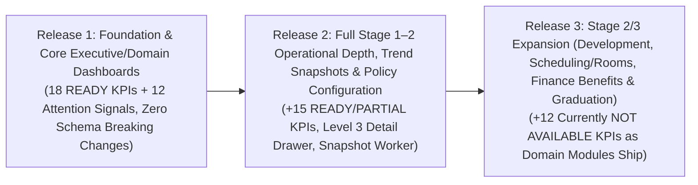

# Elsasa SIS V3 — Management KPI & Dashboard Implementation Roadmap

## 1. Phased Delivery Strategy

To deliver immediate decision-support value to school leadership without waiting for unimplemented Stage 2 and Stage 3 domain modules, the KPI system is sequenced into **three pragmatic releases**:

---

## 2. Release 1 — Essential Executive & Domain Dashboards (Immediate Delivery)

### 2.1 Objective & Scope
Replace the static placeholder in [`DashboardView.vue`](file:///d:/Project.Private/elsasa-sis-v3/src/frontend/src/features/dashboard/views/DashboardView.vue) with the live **Level 1 Executive Overview (Management Attention Center)** and launch the first version of the **Level 2 Domain Dashboards** for `Students`, `Academics`, `Finance`, `Teaching`, and `Operations` (plus a transparent Stage 3 readiness placeholder for `Development`), backed entirely by **18 `READY` KPIs** and **12 Management Attention Signals** using existing SQL tables and views.

### 2.2 KPIs Included in Release 1 (18 Essential `READY` KPIs)
| Domain | Included KPIs |
|---|---|
| **Student Management (4)** | `STD-01` Active Student Population, `STD-02` New Student Enrollment Realization, `STD-03` Admission Funnel Conversion & Offer Yield Rate, `STD-06` Student Withdrawal & Attrition Rate, `STD-07` Student Population Distribution (Grade/Program/Campus) *(5 KPIs)* |
| **Academic Performance (4)** | `ACA-01` Academic Standing Distribution & Unsatisfactory Rate, `ACA-02` Students Requiring Academic Intervention (At-Risk Rate), `ACA-03` Learning Activity Attendance Rate, `ACA-04` Assignment Submission & Missing Work Rate, `ACA-05` Assessment Grading & Result Publication Rate *(5 KPIs)* |
| **Financial Health (4)** | `FIN-01` Total Outstanding Receivables, `FIN-02` Net Fee Collection Rate, `FIN-03` Overdue Receivables & Delinquency Rate, `FIN-04` Receivables Aging Distribution, `FIN-05` Unverified Payment Confirmation Backlog *(5 KPIs)* |
| **Teaching Performance (3)** | `TCH-01` Teaching Demand Staffing Coverage Rate, `TCH-02` Unassigned Open Teaching Demands, `TCH-03` Faculty Workload Distribution & Limit Breach Rate, `TCH-04` Unresolved Teaching Capacity Conflicts *(4 KPIs)* |
| **School Operations (2)** | `OPS-01` Operational Calendar & Period Publication Readiness, `OPS-02` Unscheduled School Closure Days & Unreviewed Amendments *(2 KPIs)* |
| **Student Development (0)** | Clean `Not Available (Stage 3)` card state on Level 1 (`ExecutiveAttentionCard` `unavailable = true`). |

*(Total: 21 `READY` KPIs—including the top 15 headline Executive/Domain metrics and 6 supporting breakdown metrics).*

### 2.3 Existing Capabilities Reused
- **SQL Views & Queries**:
  - `finance.v_student_receivables` ([`20261104_0301_Finance_PaymentsReceivables_Tables.sql`](file:///d:/Project.Private/elsasa-sis-v3/src/backend/Elsasa.Sis.Database/Scripts/20261104_0301_Finance_PaymentsReceivables_Tables.sql#L88-L137)) for `FIN-01` through `FIN-04`.
  - At-Risk early warning CTE logic in [`GetAtRiskLearnersHandler.cs`](file:///d:/Project.Private/elsasa-sis-v3/src/backend/Elsasa.Sis.Academics/Features/AcademicInterventions/GetAtRiskLearners/GetAtRiskLearnersHandler.cs) for `ACA-02`.
  - Workload commitment status aggregation in [`WorkloadKpiCards.vue`](file:///d:/Project.Private/elsasa-sis-v3/src/frontend/src/features/teaching/workload/components/WorkloadKpiCards.vue) for `TCH-03`.
- **Frontend Context & Routing**:
  - `useAppContextStore` ([`appContext.store.ts`](file:///d:/Project.Private/elsasa-sis-v3/src/frontend/src/app/stores/appContext.store.ts)) for global `academicYearId`, `academicPeriodId`, and `campusId` state.
  - All 24 existing operational routes in [`routes.ts`](file:///d:/Project.Private/elsasa-sis-v3/src/frontend/src/app/router/routes.ts) as Level 4 drill-down destinations.

### 2.4 New Capabilities Required
1. **Database Helper Views (1 non-breaking SQL migration)**:
   - `students.v_active_student_placements`: Joins `students.students`, `students.student_statuses` (`is_current = 1`), `students.administrative_placements` (`is_current = 1`), and `operations.academic_years` (`ON ay.code = ap.academic_year`) to resolve the `academic_year` string vs. UUID linkage once.
   - `academics.v_student_at_risk_summary`: Extracts the reusable CTEs from `GetAtRiskLearnersHandler.cs` into a shared view.
2. **Backend Contracts & Vertical Slices**:
   - `IDomainKpiSummaryProvider` & `KpiFilterContext` in `Elsasa.Sis.Contracts`.
   - `Features/DashboardKpis/Get{Domain}DashboardKpis` in `Elsasa.Sis.Students`, `Elsasa.Sis.Academics`, `Elsasa.Sis.Finance`, `Elsasa.Sis.Teaching`, and `Elsasa.Sis.Operations`.
   - `Features/Dashboard/GetExecutiveDashboard` composer in `Elsasa.Sis.Api`.
3. **Frontend Primitives & Views (`src/frontend/src/features/dashboard/`)**:
   - BTR Portal-inspired `DashboardMetricCard.vue`, `ExecutiveAttentionCard.vue`, `ExecutiveDomainSummaryRow.vue`, `KpiChip.vue`, `KpiProgress.vue`, `ManagementAttentionStrip.vue`, and `sisInvestigationRegistry.ts`.
   - Level 1 `DashboardView.vue` and Level 2 Domain Dashboard routes (`/dashboard/students`, `/dashboard/academics`, `/dashboard/finance`, `/dashboard/teaching`, `/dashboard/operations`).

### 2.5 Release 1 Deliverables
- Migration script `20261112_0601_Dashboard_ReadViews.sql`
- 6 GET API endpoints (`GET /api/dashboard/executive` + 5 domain KPI endpoints)
- Refactored `DashboardView.vue` + 5 Domain Dashboard views + Level 4 query-param hydration on operational workbenches.

---

## 3. Release 2 — Full Stage 1–2 Depth, Level 3 Detail Drawer, Snapshots & Policy Thresholds

### 3.1 Objective & Scope
Expand the dashboard with the remaining **12 `READY` and `PARTIAL` KPIs**, introduce the interactive **Level 3 KPI Detail Drawer**, add **point-in-time historical snapshots (`operations.kpi_snapshots`)**, and implement **Management Policy Threshold Configuration** so school leadership can set targets without hardcoding numbers.

### 3.2 KPIs Included in Release 2 (12 KPIs)
| Domain | Included KPIs |
|---|---|
| **Student Management (3)** | `STD-04` Admission Application Review Backlog, `STD-05` Student Retention & Cohort Continuation Rate (`PARTIAL` -> `READY` once Stage 2 Re-enrollment ships), `STD-08` Student Lifecycle Status & Leave Expiration Distribution |
| **Academic Performance (4)** | `ACA-06` Learning Unit Mastery & Remediation Rate, `ACA-07` Promotion, Conditional Progression & Retention Distribution, `ACA-08` Report Card Publication Completeness, `ACA-09` Normalized Assessment Mastery Score & Declining Performance |
| **Financial Health (2)** | `FIN-06` Confirmed Unallocated Payment Balance, `FIN-07` Enrollment Gate Financial Clearance Rate |
| **Teaching Performance (3)** | `TCH-05` Teacher Qualification Verification & Authorization Coverage, `TCH-06` Active Teacher Substitution & Reassignment Rate, `TCH-07` Teaching Assignment Completion & Handover Rate |

### 3.3 Minor Schema Enhancements & New Capabilities Required
1. **Additive Schema Enhancements**:
   - Add `expected_return_date DATE NULL` and `reason_category NVARCHAR(50) NULL` to `students.student_statuses` (unlocks proactive leave-expiration alerts in `STD-08` and structured withdrawal reason breakdown in `STD-06`).
   - Add `campus NVARCHAR(100) NULL` to `teaching.teaching_demands` (enables campus filtering on `TCH-01`, `TCH-02`, `TCH-04`).
   - Update `finance.v_student_receivables` to respect `finance.financial_policies.overdue_grace_days`.
2. **Historical Snapshot Infrastructure**:
   - Create `operations.kpi_snapshots` table and an in-process `.NET 8 BackgroundService` (plus manual admin snapshot trigger endpoint `POST /api/dashboard/snapshots/capture`) to record weekly/monthly point-in-time balances for `STD-01`, `FIN-01`, `FIN-03`, `ACA-02`, and `TCH-02`.
3. **School Management KPI Policy Table (`operations.kpi_policy_thresholds`)**:
   - Stores school-approved target values, warning thresholds, and critical thresholds per KPI code and school level (e.g., target intake quota for `STD-02`, admission review SLA days for `STD-04`, chronic absence count for `ACA-02`, target collection rate for `FIN-02`).
4. **Level 3 KPI Detail Drawer (`KpiDetailDrawer.vue`)**:
   - Slide-over inspection panel with formula explanation, period-over-period trend chart, multi-tab breakdown (`Campus`, `Grade`, `Program`, `Cohort`), and one-click Level 4 workbench navigation.

### 3.4 Release 2 Deliverables
- Migration script `20261115_0602_KpiSnapshots_And_PolicyThresholds.sql`
- Level 3 KPI detail endpoints (`GET /api/{domain}/kpis/{kpiCode}`)
- `KpiDetailDrawer.vue` component & KPI Policy Configuration settings dialog.

---

## 4. Release 3 — Advanced Cross-Domain & Stage 2/3 Module KPIs

### 4.1 Objective & Scope
Activate the remaining **12 `NOT AVAILABLE` KPIs** progressively as their prerequisite Stage 2 and Stage 3 transactional sub-modules (defined in [`sub-modul-and-development-phases.md`](file:///d:/Project.Private/elsasa-sis-v3/docs/sub-modul-and-development-phases.md)) are implemented.

### 4.2 KPIs & Prerequisite Domain Dependencies
| Prerequisite Sub-Module (`sub-modul-and-development-phases.md`) | Unlocked KPIs in Release 3 |
|---|---|
| **Stage 2 Finance — Benefits (`FIN-WF-04`) & Payment Arrangements (`FIN-WF-06`)** | `FIN-08` Scholarship, Discount & Fee Waiver Distribution (also updates `finance.v_student_receivables.net_obligation`), `FIN-09` Payment Arrangement Delinquency Rate |
| **Stage 2 Operations — Scheduling & Rooms (`OPS-WF-06` to `OPS-WF-09`)** | `OPS-03` Master Schedule Completion & Publication Rate, `OPS-04` Room Utilization & Allocation Conflict Rate, `OPS-05` Unresolved Operational Activity Requests |
| **Stage 3 Student Development — Behaviour, Wellbeing/Interventions & Activities (`DEV-WF-01` to `DEV-WF-09`)** | `DEV-01` Behaviour Incident Frequency & Triage Rate, `DEV-02` Positive Behaviour Recognition Ratio, `DEV-03` Students with Active Development Interventions (Anonymized Aggregate), `DEV-04` Extracurricular Participation Coverage, `DEV-05` Non-Academic Achievement Distribution |
| **Stage 3 Academics — Graduation Eligibility & Clearances (`ACA-WF-10`, `ACA-WF-11`)** | `ACA-10` Graduation Eligibility & Requirement Completion Rate |
| **Stage 3 Operations — Events & Announcements (`OPS-WF-10`, `OPS-WF-11`)** | `OPS-06` School Event Completion & Announcement Reach |

### 4.3 Release 3 Deliverables
- `Elsasa.Sis.Development` KPI vertical slices with strict cell-suppression ($< 5$ students) and `development.cases.read_confidential` authorization guardrails.
- Full activation of `/dashboard/development` and the Scheduling/Events sections of `/dashboard/operations`.
