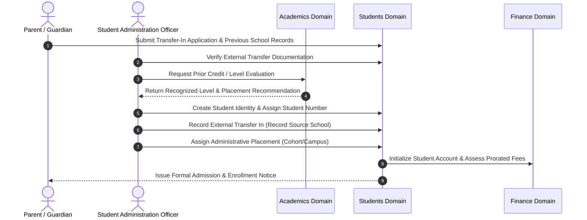
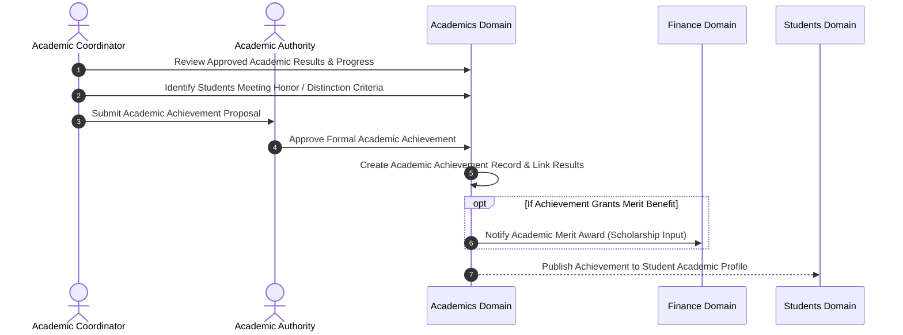
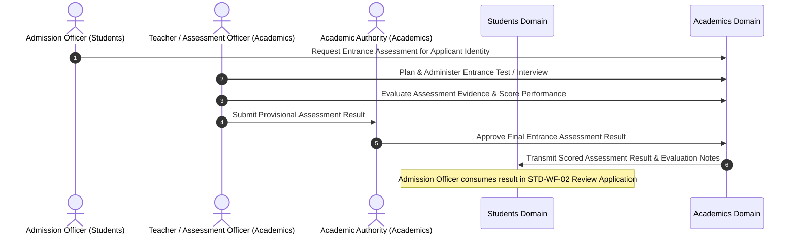
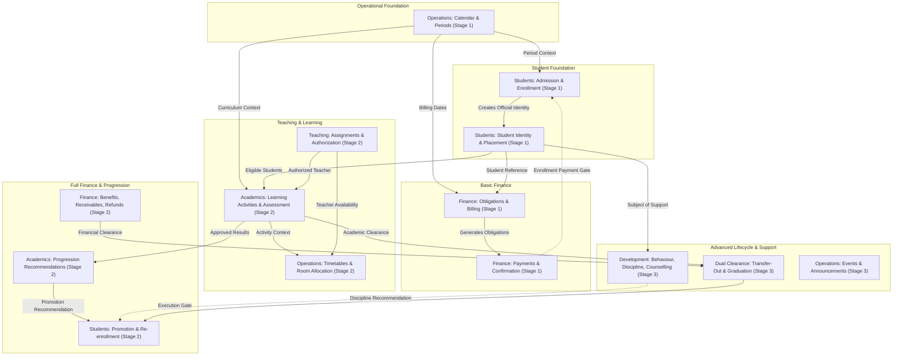
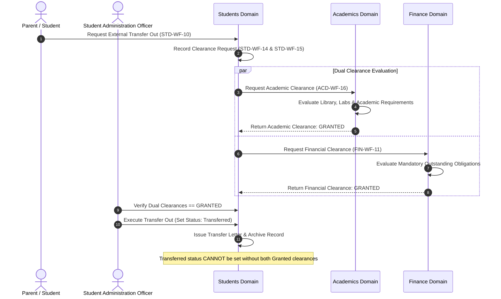
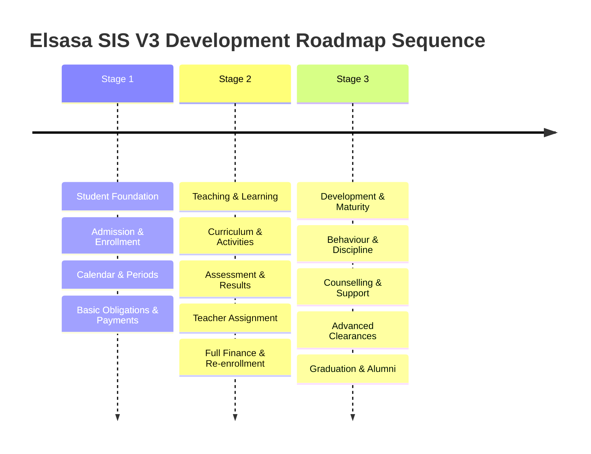

# Operational Workflow Discovery — Elsasa SIS V3

---

## Executive Summary

This document establishes the **Operational Workflow Discovery** for the Elsasa Student Information System (SIS) V3. It provides a consolidated, traceable, and authoritative analysis of the business workflows operating across all six core domains of the system: **Students**, **Academics**, **Finance**, **Operations**, **Teaching**, and **Development**.

This discovery builds directly upon the existing domain definitions, entity definitions, table models, and the approved three-stage development roadmap (`sub-modul-and-development-phases.md`). It preserves the documented business boundaries, terminology, and ownership principles established by the architecture team.

---

## A. Discovery Scope and Sources

### A.1 Scope of Discovery

The scope of this discovery covers all operational business processes across the six core SIS domains. The discovery focuses strictly on **business workflows** — defined as purposeful sequences of business activities initiated by a recognized business trigger, carried out by authorized business actors, consuming specific inputs, enforcing established business rules, and producing auditable business outcomes.

In accordance with architectural principles:
- **CRUD operations are not workflows.** Screen actions such as creating, reading, updating, deleting, listing, or searching an entity are system interaction patterns, not autonomous business workflows.
- **Domain ownership is strictly preserved.** No workflow ownership is transferred or combined merely because multiple domains participate. Distinctions between *providing information*, *making an authoritative decision*, *issuing a recommendation*, *granting approval*, *issuing a clearance*, *executing an administrative transition*, and *coordinating operational resources* are strictly maintained.
- **Stage classification is roadmap-driven.** Every workflow is assigned to Stage 1, Stage 2, or Stage 3 strictly according to the module allocations, deliverables, and prerequisites set forth in `sub-modul-and-development-phases.md`.

### A.2 Source Documents Examined

The following repository documents serve as the authoritative evidence for this discovery:

| Category | Document Path | Role in Discovery |
|---|---|---|
| **Primary Domain Sources** | `domains/student-domain.md` | Primary business authority for student identity, admission, enrollment, placement, and lifecycle transitions. |
| | `domains/academic-domain.md` | Primary business authority for curriculum structure, participation, learning activities, assessment, grading, standing, and academic clearance. |
| | `domains/finance-domain.md` | Primary business authority for financial policies, obligations, billing, payments, receivables, refunds, and financial clearance. |
| | `domains/operational-domain.md` | Primary business authority for academic calendar, operational periods, room context, scheduling, events, and announcements. |
| | `domains/teaching-domain.md` | Primary business authority for teacher profiles, qualification verification, teaching authorizations, demand intake, and workload assignments. |
| | `domains/development-domain.md` | Primary business authority for behaviour observations, discipline cases, counselling, wellbeing, non-academic interventions, and extracurriculars. |
| **Development Roadmap** | `sub-modul-and-development-phases.md` | Authoritative standard for module decomposition (20 modules), submodules, implementation sequence (Stages 1–3), deliverables, and completion criteria. |
| **Supporting Entity Definitions** | `entities/student-entities.md`<br>`entities/academic-entities.md`<br>`entities/finance-entities.md`<br>`entities/operational-entities.md`<br>`entities/teaching-entities.md`<br>`entities/development-entities.md` | Authoritative definition of business entities, core vs. supporting vs. reference roles, relationships, and attributes. |
| **Technical Table Definitions** | `entities/*-entities-tables.md`<br>`*-entities-tables.md` | Supporting technical reference to confirm physical table support for business entities without redefining business logic. |

---

## B. Consolidated Workflow Inventory

The workflow discovery identified **87 operational business workflows** across the six domains:
- **81 existing workflows** formally documented in the primary domain specifications.
- **4 missing workflows** that are required by documented domain scope, core entity models, or roadmap deliverables but lacked standalone workflow definitions.
- **2 refined workflows** whose cross-stage scope expansions (Stage 1 foundational scope vs. Stage 2 integrated scope) require explicit operational clarification.

### Legend
- **Status:**
  - `Existing`: Fully or substantially documented in primary domain sources.
  - `Refined`: Existing workflow whose operational scope evolves across development stages.
  - `Missing`: Required by documented scope, entities, or roadmap deliverables; fully specified in this document.
  - `Unresolved`: Workflow dependent on unresolved school governance or policy decisions.

---

### B.1 Students Domain Workflows

| Code | Workflow Name | Stage | Short Business Purpose | Primary Actor | Cross-Domain Involvement | Status |
|---|---|---|---|---|---|---|
| `STD-WF-01` | **Register Admission Application** | Stage 1 | Register prospective student application and initial documents for an admission period. | Applicant / Parent / Admission Officer | Operations (admission period context) | Existing |
| `STD-WF-02` | **Review Admission Application** | Stage 1 / Stage 2 | Evaluate application against admission criteria and record an official admission decision. | Admission Officer / Committee / School Leadership | Academics (manual assessment evidence in Stage 1; integrated assessment result in Stage 2) | Refined |
| `STD-WF-03` | **Enroll Accepted Applicant** | Stage 1 | Transform accepted applicant into official student, assign student number, record initial placement. | Student Administration Officer | Finance (enrollment payment confirmation when policy requires) | Existing |
| `STD-WF-04` | **Maintain Student Identity** | Stage 1 | Update, correct, and audit official biographical, identity, and guardian information. | Student Administration Officer | None (internal to Students) | Existing |
| `STD-WF-05` | **Change Administrative Placement** | Stage 1 | Reassign student cohort, stream, homeroom cohort, campus, or level with effective dating. | Student Administration Officer | Operations (room allocation context), Teaching (advisory context) | Existing |
| `STD-WF-06` | **Place Student on Leave** | Stage 2 | Temporarily suspend active enrollment for an approved leave period up to 1 academic year. | Parent / Student Administration Officer / Principal | Academics (participation suspension), Finance (fee adjustment context) | Existing |
| `STD-WF-07` | **Return Student from Leave** | Stage 2 | Reinstate student from On Leave or Leave Expired status back to Active status. | Student Administration Officer / Principal | Academics (participation resumption), Finance (billing resumption) | Existing |
| `STD-WF-08` | **Execute Promotion or Retention** | Stage 2 | Apply approved academic progression decision by updating student administrative placement. | Student Administration Officer | Academics (consumes progression recommendation) | Existing |
| `STD-WF-09` | **Process Internal Transfer** | Stage 2 | Move student between campuses, programs, or streams within the school organization. | Student Administration Officer / Principal | Academics (curriculum realignment), Finance (account balance transfer) | Existing |
| `STD-WF-10` | **Process External Transfer Out** | Stage 3 | Formally release student transferring to another school upon dual clearance. | Student Administration Officer / Principal | Academics (Academic Clearance), Finance (Financial Clearance) | Existing |
| `STD-WF-11` | **Process Withdrawal** | Stage 3 | Conclude enrollment prior to graduation due to relocation, voluntary exit, or discipline. | Student Administration Officer / School Leadership | Development (discipline outcome), Finance (obligation settlement) | Existing |
| `STD-WF-12` | **Execute Graduation** | Stage 3 | Transition eligible student to Graduated status upon completion and financial clearance. | Student Administration Officer / Academic Authority | Academics (Graduation Eligibility), Finance (Graduation Financial Clearance) | Existing |
| `STD-WF-13` | **Activate Alumni Status** | Stage 3 | Automatically establish alumni record and preserve identity continuity upon graduation. | System Automated (within WF-12) | None (internal to Students) | Existing |
| `STD-WF-14` | **Request Academic Clearance for Transfer Out** | Stage 3 | Formally request Academics to determine academic clearance prerequisite for transfer-out. | Student Administration Officer | Academics (evaluates and returns clearance) | Existing |
| `STD-WF-15` | **Request Purpose-Specific Financial Clearance** | Stage 3 | Formally request Finance to evaluate financial clearance for transfer-out or graduation. | Student Administration Officer | Finance (evaluates and returns clearance) | Existing |
| `STD-WF-16` | **Re-enroll Student** | Stage 2 | Confirm continuing enrollment of active student into the next academic period. | Student Administration Officer / Parent | Operations (re-enrollment window), Finance (re-enrollment fee trigger) | Missing |
| `STD-WF-17` | **Process External Transfer In** | Stage 3 | Formally enroll student entering from another school mid-program with recognized history. | Student Administration Officer | Academics (transfer credit recognition), Operations (intake period) | Missing |

---

### B.2 Academics Domain Workflows

| Code | Workflow Name | Stage | Short Business Purpose | Primary Actor | Cross-Domain Involvement | Status |
|---|---|---|---|---|---|---|
| `ACD-WF-01` | **Define or Adopt Learning Structure** | Stage 2 | Establish curriculum framework, learning units, academic requirements, and versions. | Academic Authority / Academic Coordinator | Operations (academic year and period context) | Existing |
| `ACD-WF-02` | **Establish Student Learning Plan** | Stage 2 | Create, approve, and adjust individualized learning plans, accommodations, or exemptions. | Academic Coordinator / Academic Authority | Students (student identity and placement context) | Existing |
| `ACD-WF-03` | **Start Academic Participation** | Stage 2 | Register an active student to undertake learning in a specific learning unit. | Academic Coordinator / Student | Students (verifies active enrollment) | Existing |
| `ACD-WF-04` | **Conduct Learning Activity** | Stage 2 | Execute and record a planned learning session, lecture, seminar, or workshop. | Teacher / Learning Facilitator | Teaching (verifies teaching assignment), Operations (room/schedule) | Existing |
| `ACD-WF-05` | **Record or Correct Attendance** | Stage 2 | Capture observed student attendance for a learning activity or correct attendance history. | Teacher / Academic Officer | None (learning-activity attendance owned by Academics) | Existing |
| `ACD-WF-06` | **Issue and Receive Assignment** | Stage 2 | Publish coursework tasks, record student submissions, and track submission states. | Teacher / Student | Operations (calendar due-date context) | Existing |
| `ACD-WF-07` | **Plan and Conduct Assessment** | Stage 2 | Establish assessment schedule, rubrics, criteria, and collect evaluative evidence. | Teacher / Assessment Officer | Operations (exam timetable and room allocation context) | Existing |
| `ACD-WF-08` | **Evaluate Student Learning** | Stage 2 | Score assessment evidence against criteria and record provisional academic evaluations. | Teacher / Assessor | None (internal to Academics) | Existing |
| `ACD-WF-09` | **Approve and Publish Academic Result** | Stage 2 | Moderate provisional grades, grant official approval, and publish results to students. | Academic Authority / Assessment Officer | None (internal to Academics) | Existing |
| `ACD-WF-10` | **Review Progress and Initiate Academic Intervention** | Stage 2 | Detect underperformance and establish a targeted academic support/intervention plan. | Academic Coordinator / Teacher | Development (referral for non-academic issues when needed) | Existing |
| `ACD-WF-11` | **Complete Learning** | Stage 2 | Conclude a student's participation in a learning unit against completion requirements. | Academic Coordinator / Teacher | None (internal to Academics) | Existing |
| `ACD-WF-12` | **Produce Report Card or Transcript** | Stage 2 | Compile and certify approved academic results, attendance, and progress records. | Academic Coordinator / Assessment Officer | None (authoritative communication artifact) | Existing |
| `ACD-WF-13` | **Determine Academic Standing and Progression Recommendation** | Stage 2 | Evaluate overall progress and issue promotion/retention recommendations to Students. | Academic Authority / Committee | Students (consumes recommendation for administrative execution) | Existing |
| `ACD-WF-14` | **Determine Graduation Eligibility** | Stage 3 | Evaluate student cumulative record against graduation criteria and certify eligibility. | Academic Authority / Committee | Students (consumes eligibility for graduation execution) | Existing |
| `ACD-WF-15` | **Correct Approved Academic Record** | Stage 2 | Correct finalized grades, scores, or evaluations through an auditable correction protocol. | Academic Authority / Assessment Officer | Students (re-evaluates downstream recommendations if impacted) | Existing |
| `ACD-WF-16` | **Determine Academic Clearance** | Stage 3 | Evaluate academic obligations for transfer-out and issue formal Granted/Denied result. | Academic Coordinator / Academic Authority | Students (consumes clearance for transfer-out execution) | Existing |
| `ACD-WF-17` | **Correct Academic Clearance** | Stage 3 | Correct an inaccurate academic clearance determination with mandatory rationale. | Academic Authority | Students (notified to re-evaluate pending transfer-out) | Existing |
| `ACD-WF-18` | **Correct Phase-2 Academic Record** | Stage 2 / Stage 3 | Correct non-grade records (assignments, standing, recommendations, eligibility). | Teacher / Academic Coordinator / Academic Authority | Students (notified if recommendation changed) | Existing |
| `ACD-WF-19` | **Recognize Academic Achievement** | Stage 2 | Formally record and award academic honors, subject distinctions, and merit recognitions. | Academic Authority / Academic Coordinator | Finance (merit scholarship input), Students (student reference) | Missing |
| `ACD-WF-20` | **Conduct Entrance Assessment for Applicant** | Stage 2 | Administer academic assessment for an applicant and provide scored result to Admission. | Assessment Officer / Teacher | Students (consumes scored result in Admission Review) | Missing |

---

### B.3 Finance Domain Workflows

| Code | Workflow Name | Stage | Short Business Purpose | Primary Actor | Cross-Domain Involvement | Status |
|---|---|---|---|---|---|---|
| `FIN-WF-01` | **Define or Adopt Financial Policy** | Stage 1 | Establish fee structures, charge rules, due schedules, and currency rounding rules. | Finance Authority / School Leadership | Operations (effective academic period context) | Existing |
| `FIN-WF-02` | **Assess and Issue Financial Obligation** | Stage 1 | Generate monetary charges (tuition, fees) against student financial accounts. | Billing Officer | Students (student identity and placement context), Operations (period) | Existing |
| `FIN-WF-03` | **Approve Scholarship, Discount, or Waiver** | Stage 2 | Award financial benefits, configure benefit stacking, and apply deductions to obligations. | Scholarship Officer / Finance Authority | Academics (merit evidence), Development (financial aid referral) | Existing |
| `FIN-WF-04` | **Issue Bill or Financial Statement** | Stage 1 | Generate and communicate official billing statements to authorized parents/payers. | Billing Officer | Students (parent/guardian contact context) | Existing |
| `FIN-WF-05` | **Receive and Confirm Payment** | Stage 1 | Capture incoming payment from payer/bank, verify funds, and confirm receipt. | Cashier / Payment Officer | External Payment Provider (bank statement/gateway) | Existing |
| `FIN-WF-06` | **Allocate or Reallocate Payment** | Stage 1 | Apply confirmed payment or credit value to specific outstanding obligations. | Payment Officer / Receivables Officer | Students (provides payment confirmation status for enrollment) | Existing |
| `FIN-WF-07` | **Manage Due and Overdue Receivable** | Stage 2 | Track aging balances, dispatch reminders, and approve installment payment arrangements. | Receivables Officer / Finance Authority | None (internal to Finance; no direct academic sanctions) | Existing |
| `FIN-WF-08` | **Manage Financial Dispute or Adjustment** | Stage 2 | Adjudicate billing challenges and execute credit adjustments or obligation reversals. | Billing Officer / Finance Authority | None (internal to Finance) | Existing |
| `FIN-WF-09` | **Manage Credit or Overpayment** | Stage 2 | Track excess unallocated funds, apply to future obligations, or authorize credit transfer. | Payment Officer / Receivables Officer | None (internal to Finance) | Existing |
| `FIN-WF-10` | **Request, Approve, and Execute Refund** | Stage 2 | Process disbursement of refundable credit balances back to verified payers. | Payment Officer / Finance Authority | Students (verifies withdrawal or overpayment context) | Existing |
| `FIN-WF-11` | **Determine Financial Clearance** | Stage 3 | Evaluate mandatory outstanding obligations for Transfer Out or Graduation purposes. | Finance Officer / Finance Authority | Students (consumes clearance for transfer-out or graduation) | Existing |
| `FIN-WF-12` | **Correct Approved Finance Record** | Stage 2 | Correct erroneous financial entries, payment metadata, or clearance records auditably. | Finance Authority | Students (notified if clearance was impacted) | Existing |
| `FIN-WF-13` | **Confirm Enrollment Payment Status** | Stage 1 | Provide real-time confirmation of required enrollment fees to unblock student intake. | Cashier / Billing Officer | Students (intake gate for applicant enrollment) | Refined |

---

### B.4 Operations Domain Workflows

| Code | Workflow Name | Stage | Short Business Purpose | Primary Actor | Cross-Domain Involvement | Status |
|---|---|---|---|---|---|---|
| `OPS-WF-01` | **Establish or Amend Academic Year and School Calendar** | Stage 1 | Define academic year dates, terms, operational periods, holidays, and school calendar. | Calendar Authority / Operations Coordinator | All domains consume date and period context | Existing |
| `OPS-WF-02` | **Submit and Clarify Operational Activity Request** | Stage 2 | Receive and triage operational requests for space, time, or shared coordination. | Operations Coordinator / Requesting Actor | Academics, Teaching, Development, Students (requesting domains) | Existing |
| `OPS-WF-03` | **Review Operational Feasibility** | Stage 2 | Evaluate physical room availability, schedule conflicts, and operational constraints. | Scheduler / Room Coordinator | Teaching (verifies teacher availability context) | Existing |
| `OPS-WF-04` | **Schedule an Activity and Allocate a Room** | Stage 2 | Create scheduled occurrence, link timetable entry, and allocate specific physical room. | Scheduler / Room Coordinator | Academics (learning activities), Teaching (homeroom rooms) | Existing |
| `OPS-WF-05` | **Resolve Operational Conflict or Exception** | Stage 2 | Resolve room double-bookings, timetable collisions, or facility capacity breaches. | Operations Coordinator / Operations Authority | Requesting domains (negotiates alternative times or locations) | Existing |
| `OPS-WF-06` | **Plan and Approve School Event** | Stage 3 | Coordinate operational logistics, facility reservations, and approvals for school events. | Event Organizer / Operations Coordinator | Development, Academics, Students (event purpose owners) | Existing |
| `OPS-WF-07` | **Publish or Withdraw Operational Announcement** | Stage 3 | Broadcast official announcements across channels and manage corrections or withdrawals. | Communications Officer / Operations Authority | All domains (content source and target audiences) | Existing |
| `OPS-WF-08` | **Record Room Restriction or Unavailability** | Stage 2 | Flag room maintenance, damage, or facility closures and identify affected schedules. | Room Coordinator / Facilities Officer | None (internal to Operations; triggers rescheduling) | Existing |
| `OPS-WF-09` | **Reschedule, Relocate, Postpone, or Cancel** | Stage 2 | Modify or cancel scheduled occurrences and notify affected teachers, students, and owners. | Scheduler / Operations Coordinator | Academics, Teaching (notified of altered schedule) | Existing |
| `OPS-WF-10` | **Coordinate School or Campus Closure** | Stage 1 / Stage 2 | Execute emergency or scheduled school closures affecting calendar and operational schedules. | Calendar Authority / Operations Authority | Stage 1 (calendar impact for all domains); Stage 2 (timetable disruptions) | Refined |
| `OPS-WF-11` | **Close Completed Operational Arrangement** | Stage 2 | Conclude finished operational schedules, release facility holds, and archive logs. | Operations Coordinator / Scheduler | None (internal operational housekeeping) | Existing |
| `OPS-WF-12` | **Correct Approved Operations Record** | Stage 2 / Stage 3 | Audit and correct historical calendar entries, room allocations, or timetable records. | Operations Authority | Requesting domains (notified of operational corrections) | Existing |

---

### B.5 Teaching Domain Workflows

| Code | Workflow Name | Stage | Short Business Purpose | Primary Actor | Cross-Domain Involvement | Status |
|---|---|---|---|---|---|---|
| `TCH-WF-01` | **Establish or Change Teaching Profile** | Stage 2 | Maintain teacher professional profiles, identity links, roles, and institutional affiliations. | Teaching Coordinator / Teaching Authority | External HR / Employee boundary (provisional person reference) | Existing |
| `TCH-WF-02` | **Submit and Verify Qualification Evidence** | Stage 2 | Verify academic degrees, professional certifications, and license validity for teachers. | Teacher / Qualification Verifier | None (internal to Teaching) | Existing |
| `TCH-WF-03` | **Grant, Restrict, Suspend, or Revoke Teaching Authorization** | Stage 2 | Determine formal teaching authorization levels and supervision requirements. | Teaching Authority | None (internal governance gate before assignment) | Existing |
| `TCH-WF-04` | **Establish or Change Teacher Availability** | Stage 2 | Record teacher working capacity, blocked time windows, and leave constraints. | Teacher / Teaching Coordinator | Operations (consumes availability for timetable review) | Existing |
| `TCH-WF-05` | **Receive and Clarify Teaching Demand** | Stage 2 | Receive and validate requests for teaching staff from curriculum learning units or homerooms. | Teaching Coordinator | Academics (learning unit staffing), Students (homeroom cohort context) | Existing |
| `TCH-WF-06` | **Evaluate Teacher Eligibility and Capacity** | Stage 2 | Match candidate teacher qualifications, authorizations, and available hours against demand. | Teaching Coordinator / Department Lead | None (internal to Teaching) | Existing |
| `TCH-WF-07` | **Propose and Approve Teaching Assignment** | Stage 2 | Commit teacher to learning unit or homeroom advisory role and record workload unit impact. | Teaching Coordinator / Teaching Authority | Academics (authorized teacher for activity), Operations (scheduling) | Existing |
| `TCH-WF-08` | **Change, Suspend, or Cancel Teaching Assignment** | Stage 2 | Adjust, suspend, or terminate an active teaching commitment prospectively. | Teaching Coordinator / Teaching Authority | Academics (requires reassignment or activity postponement) | Existing |
| `TCH-WF-09` | **Arrange Substitution or Reassignment** | Stage 2 | Appoint an authorized temporary substitute teacher for absent faculty without altering history. | Teaching Coordinator / Operations Scheduler | Academics (authorized teacher for activity conduct), Operations | Existing |
| `TCH-WF-10` | **Review Workload and Resolve Capacity Conflict** | Stage 2 | Monitor teacher teaching hours, enforce policy thresholds, and approve workload exceptions. | Teaching Coordinator / Teaching Authority | None (internal workload policy enforcement) | Existing |
| `TCH-WF-11` | **Complete Teaching Assignment** | Stage 2 | Conclude teaching assignment at period end, conduct handovers, and release capacity. | Teaching Coordinator / Teacher | Academics (confirms learning term conclusion) | Existing |
| `TCH-WF-12` | **Correct Approved Teaching Record** | Stage 2 | Audit and correct historical teaching profiles, qualifications, or assignment records. | Teaching Authority | Academics, Operations (notified if assignment was corrected) | Existing |

---

### B.6 Development Domain Workflows

| Code | Workflow Name | Stage | Short Business Purpose | Primary Actor | Cross-Domain Involvement | Status |
|---|---|---|---|---|---|---|
| `DEV-WF-01` | **Record Behaviour Observation or Recognition** | Stage 3 | Record objective positive behaviour recognitions or factual conduct observations. | Teacher / Student Advisor / Officer | Students (student reference) | Existing |
| `DEV-WF-02` | **Report and Triage Behaviour Incident** | Stage 3 | Document alleged misconduct or safety events and triage for support or formal discipline. | Authorized Reporter / Discipline Officer | Students (involved student identities) | Existing |
| `DEV-WF-03` | **Investigate and Determine Discipline Case** | Stage 3 | Conduct fair process investigation into alleged infractions and record formal sanctions. | Discipline Officer / Committee / Principal | Students (disciplinary withdrawal recommendation if expulsion) | Existing |
| `DEV-WF-04` | **Receive and Route Development Referral** | Stage 3 | Triage requests for non-academic support and route to counselling or wellbeing staff. | Student / Parent / Teacher / Counselor | Students (student reference) | Existing |
| `DEV-WF-05` | **Manage Counselling Support** | Stage 3 | Manage confidential counselling sessions, goals, notes, and external referrals. | Counselor / Student | Students (student reference; highly restricted confidentiality) | Existing |
| `DEV-WF-06` | **Assess and Support Wellbeing Concern** | Stage 3 | Develop support plans for student emotional, physical, or social wellbeing challenges. | Counselor / Student Development Officer | Academics (requests learning plan accommodations if needed) | Existing |
| `DEV-WF-07` | **Establish and Review Non-Academic Intervention** | Stage 3 | Formulate, monitor, and conclude holistic behavioral or wellbeing intervention plans. | Student Development Officer / Support Team | Students (student reference) | Existing |
| `DEV-WF-08` | **Establish Extracurricular Program** | Stage 3 | Create approved clubs, sports teams, arts ensembles, and student leadership bodies. | Extracurricular Coordinator / Principal | Operations (requests facility reservation and calendar entry) | Existing |
| `DEV-WF-09` | **Manage Extracurricular Participation** | Stage 3 | Handle student registrations, attendance, active involvement, and program completions. | Extracurricular Facilitator / Student | Students (active student status check), Operations (event space) | Existing |
| `DEV-WF-10` | **Recognize Non-Academic Achievement** | Stage 3 | Acknowledge accomplishments in sports, arts, leadership, or community service. | Extracurricular Facilitator / Development Officer | Students (student reference) | Existing |
| `DEV-WF-11` | **Issue Cross-Domain Recommendation** | Stage 3 | Formally transmit non-academic recommendations (expulsion, support) to other domains. | Development Officer / Discipline Authority | Students (administrative status actions), Academics (SLP inputs) | Existing |
| `DEV-WF-12` | **Correct Approved Development Record** | Stage 3 | Correct erroneous incident reports, observations, or case records under confidentiality rules. | Development Officer / Counselor / Principal | Receiving domains (notified if recommendation was revised) | Existing |

---

## C. Detailed Workflow Specifications

### C.1 Missing Workflows Formally Specified

The following four workflows are fully defined here in standard format to close identified architectural gaps.

---

### `STD-WF-16`. Re-enroll Student

```mermaid
sequenceDiagram
    autonumber
    actor Parent as Parent / Guardian
    actor Admin as Student Administration Officer
    participant Ops as Operations (Calendar)
    participant Student as Students Domain
    participant Finance as Finance Domain

    Ops->>Student: Re-enrollment Period Active
    Parent->>Student: Submit Re-enrollment Intent / Request
    Admin->>Student: Verify Active Student Status
    opt If Policy Requires Re-enrollment Fee
        Student->>Finance: Trigger Re-enrollment Obligation
        Finance-->>Student: Confirm Fee Payment Status
    end
    Admin->>Student: Confirm Continuing Enrollment
    Student->>Student: Record Re-enrollment Record & Preserve History
    Student-->>Parent: Issue Re-enrollment Confirmation
    Note over Student,Finance: Student remains Active; answers "Continuing Next Period?"
```

#### Trigger
The operational re-enrollment period opens in the school calendar (from Operations), and an Active student (or their parent/guardian) confirms intent to continue enrollment for the upcoming academic period.

#### Actor
* Student Administration Officer (verifies and records official administrative confirmation)
* Parent or Guardian (submits continuation intent and required documentation)
* Student (when permitted by school policy)

#### Input
* Student identity reference (must be in `Active` administrative status)
* Target academic period reference (must be an upcoming period established by Operations)
* Re-enrollment confirmation form or digital submission
* Re-enrollment payment confirmation (from Finance, when required by school policy)
* Updated guardian contact or address information, if changed

#### Outcome
* A `Re-enrollment` record is created linking the student to the target academic period
* Student administrative status remains `Active` for the upcoming operating cycle
* Historical continuity is preserved in administrative history
* Notification is made available to Academics that the student is administratively eligible for upcoming academic course registration/participation

#### Business Rules
* **Administrative Scope Only:** Re-enrollment answers the administrative question: *"Is this student continuing enrollment next year?"* It is owned by Students. It does not select subjects, courses, or learning units (which is owned by Academics under `ACD-WF-03: Start Academic Participation`).
* **Active Status Prerequisite:** Only students currently in `Active` status (or formally approved for return from leave via `STD-WF-07`) may be re-enrolled. Students who are Withdrawn, Transferred, or Graduated cannot use re-enrollment (a withdrawn student requires re-admission).
* **Payment Gate Dependency:** When school policy requires a re-enrollment fee, Finance must confirm payment receipt and allocation before the re-enrollment confirmation is finalized.
* **No Automatic Promotion:** Re-enrollment does not promote a student to the next academic grade or level. Academic level promotion is governed strictly by `STD-WF-08` upon receipt of an Academic progression recommendation.
* **Immutability of Prior Periods:** Re-enrollment creates a distinct period record; it never overwrites previous enrollment or re-enrollment records.

---

### `STD-WF-17`. Process External Transfer In



#### Trigger
A prospective student who has previously completed academic coursework at another recognized educational institution applies for mid-program admission and enrollment into Elsasa School.

#### Actor
* Student Administration Officer (verifies documents, creates student identity, records transfer-in)
* Authorized School Leader / Principal (approves exceptional transfer intake)
* Parent or Guardian (provides transfer credentials from origin school)

#### Input
* Applicant biographical and identity documents
* Official transfer certificate / release letter from the originating institution
* Certified academic transcripts, report cards, or competency portfolios from the originating institution
* Target entry level, program, and intended enrollment date
* Academic evaluation of prior coursework (from Academics)

#### Outcome
* Official student identity is created and a unique Student Number is assigned
* A `Transfer Record` of variant `External Transfer In` is permanently recorded, capturing the source school, date, entry level, and supporting documents
* Student administrative status is set to `Active` (or `Enrolled`)
* Initial administrative placement (campus, level, program, cohort) is assigned
* Student financial account is initialized in Finance

#### Business Rules
* **Origin School Traceability:** An external transfer in must record the official name, location, and accredited status of the originating school along with the reason for transfer.
* **Academic Credit Separation:** The Students domain records the administrative entry of the student. The evaluation, recognition, or conversion of prior academic credits and coursework belongs strictly to Academics and does not alter the student's administrative intake record.
* **Identity Uniqueness:** The system must verify that the incoming student does not already hold an existing Student Number from a prior enrollment at Elsasa School. If a former student returns, their original identity is reactivated per re-admission rules.
* **Transfer Record Immutability:** An external transfer-in record cannot be deleted or converted into a fresh admission application once executed; corrections must follow the administrative history correction procedure.

---

### `ACD-WF-19`. Recognize Academic Achievement



#### Trigger
A student fulfills the established academic criteria for formal honors, subject distinction, dean's list, academic competition representation, or mastery recognition based on approved academic results.

#### Actor
* Academic Coordinator (evaluates results and compiles candidate nominations)
* Academic Authority / Academic Head / Principal (approves the formal achievement recognition)

#### Input
* Student identity reference (from Students)
* Approved academic results, grades, or learning progress records (from Academics)
* Applicable academic honors policy version and achievement criteria
* Achievement category (e.g., *Subject Distinction*, *Honor Roll*, *Academic Competition*, *Valedictorian Candidate*)
* Effective academic period reference (from Operations)

#### Outcome
* An `Academic Achievement` record is formally created and linked to the supporting academic evidence
* The achievement is published to the student's official academic profile and transcript
* When applicable, a formal notification is made available to Finance as an authorized input for merit scholarship evaluation

#### Business Rules
* **Evidence-Based Recognition:** Academic achievements must link directly to verified, approved academic results or verified academic competition records. Achievements cannot be awarded based on subjective impressions without an auditable policy basis.
* **Academic vs. Non-Academic Boundary:** Academics owns achievements derived from curriculum learning, subject mastery, and school-sanctioned academic contests. Non-academic achievements (sports, artistic performances, civic leadership, club awards) are owned strictly by Development under `DEV-WF-10`.
* **No Direct Financial Deduction:** An academic achievement does not automatically deduct or waive tuition fees. If the achievement qualifies the student for a merit scholarship, Finance must independently evaluate and execute the benefit under `FIN-WF-03`.
* **Correction and Revocation:** If the underlying academic result is subsequently corrected or revoked under `ACD-WF-15`, the linked academic achievement must be reviewed and re-adjudicated by the Academic Authority.

---

### `ACD-WF-20`. Conduct Entrance Assessment for Applicant



#### Trigger
The Student Admission module requests an entrance assessment for a registered applicant during the Stage 2 integrated admission cycle.

#### Actor
* Teacher / Assessment Officer (administers assessment, evaluates evidence, records scores)
* Academic Authority (approves the official assessment score and evaluation report)
* Admission Officer (requests assessment and consumes final result)

#### Input
* Applicant reference and temporary applicant identity (from Students)
* Target admission level and academic program
* Assessment instrument (written diagnostic, practical task, or oral interview rubric)
* Applicable evaluation scoring guidelines
* Date and administration session context (from Operations)

#### Outcome
* Evaluated and approved entrance assessment score, competency rating, and diagnostic notes are recorded in Academics
* Scored assessment evidence is transmitted to Students as an authorized input to `STD-WF-02: Review Admission Application`
* Historical record of applicant assessment performance is retained in Academics

#### Business Rules
* **Applicant Identity Support:** Academics must evaluate the prospective student using their `Applicant` identity reference. The applicant is not required to have an enrolled `Student Number` or an active `Student` record.
* **Assessment Only, Not Admission Decision:** Academics evaluates academic readiness and provides scores, percentiles, or recommendations (e.g., *Meets Standard*, *Remediation Recommended*, *Exceeds Standard*). Academics **never** makes the admission decision. The final decision (*Accepted*, *Rejected*, *Waitlisted*) belongs strictly to Students under `STD-WF-02`.
* **Curriculum Alignment:** Entrance assessments must be linked to the academic requirements and learning structures of the target entry level.
* **Stage Evolution:** In Stage 1, entrance assessment scores are entered manually into Students as external evidence. In Stage 2, this workflow executes as an integrated Academics process.

---

### C.2 Refined Workflows Across Stages

#### `STD-WF-02`. Review Admission Application (Stage 1 vs. Stage 2 Refinement)
- **Source Document Reference:** `domains/student-domain.md`, Section "2. Review Admission Application", lines 749–786.
- **Stage 1 Scope:** Admission review relies on manual verification of applicant documents. If the school conducts an entrance exam, the scores are uploaded or manually keyed into the application as supporting external evidence (`Entrance Assessment Evidence`).
- **Stage 2 Expanded Scope:** Admission review consumes an official, digitally integrated assessment result produced by Academics via `ACD-WF-20`. The Admission Officer views the authorized diagnostic score, evaluation report, and recommendation directly from Academics before recording the admission decision.
- **Ownership Note:** Regardless of stage, the final admission decision (*Accepted*, *Rejected*, *Waitlisted*, *Returned*) belongs strictly to Students.

#### `OPS-WF-10`. Coordinate School or Campus Closure (Stage 1 vs. Stage 2 Refinement)
- **Source Document Reference:** `domains/operational-domain.md`, Section "10. Coordinate School or Campus Closure", lines 876–908.
- **Stage 1 Scope:** The Calendar Authority amends the school calendar (`OPS-WF-01`) to mark dates as unscheduled closure days or emergency holidays, broadcasting calendar changes to all domains.
- **Stage 2 Expanded Scope:** Closure coordination expands to identify all affected `Scheduled Occurrences`, learning activities, room allocations, and teacher assignments. Operations automatically flags conflicts and initiates bulk rescheduling or cancellation workflows (`OPS-WF-09`) in coordination with Academics and Teaching.

#### `FIN-WF-13`. Confirm Enrollment Payment Status (Stage 1 Specialized Inquiry Gate)
- **Source Document Reference:** `domains/finance-domain.md`, Section "5. Receive and Confirm Payment" & "6. Allocate Payment".
- **Stage 1 Scope:** Rather than invoking the heavyweight formal clearance workflow (which is reserved for Stage 3 transfer-out and graduation), Finance exposes a lightweight inquiry interface based on `FIN-WF-05` and `FIN-WF-06`. Students queries whether mandatory admission/enrollment obligations for an accepted applicant have reached `Confirmed` payment and full allocation. When confirmed, Students proceeds with enrollment (`STD-WF-03`).

---

### C.3 Referenced Existing Workflows

All other 78 workflows remain authoritative as documented in their primary domain specifications. The table below maps their exact location in the source documents:

| Domain | Workflow Range | Document Location |
|---|---|---|
| **Students** | `STD-WF-01` to `STD-WF-15` | `domains/student-domain.md` (lines 713–1218) |
| **Academics** | `ACD-WF-01` to `ACD-WF-18` | `domains/academic-domain.md` (lines 681–1280) |
| **Finance** | `FIN-WF-01` to `FIN-WF-12` | `domains/finance-domain.md` (lines 828–1260) |
| **Operations** | `OPS-WF-01` to `OPS-WF-12` | `domains/operational-domain.md` (lines 573–960) |
| **Teaching** | `TCH-WF-01` to `TCH-WF-12` | `domains/teaching-domain.md` (lines 672–1100) |
| **Development** | `DEV-WF-01` to `DEV-WF-12` | `domains/development-domain.md` (lines 600–1020) |

---

## D. Cross-Domain Workflow Dependencies

Cross-domain workflows represent the core operational fabric of Elsasa SIS V3. The relationships below define the strict boundaries, handshakes, and information flow between domains.



### D.1 Foundational Handshakes (Stage 1)

1. **Calendar Context Handshake:**
   - *Provider:* Operations (`OPS-WF-01: Calendar & Periods`)
   - *Consumer:* All Domains
   - *Handshake:* Operations establishes authoritative dates for Academic Years, Terms, and Admission Windows. No domain can assess fees, accept applications, or schedule classes without referencing an active operational period.
2. **Intake & Financial Obligation Handshake:**
   - *Provider:* Students (`STD-WF-01` & `STD-WF-03`)
   - *Consumer:* Finance (`FIN-WF-02`)
   - *Handshake:* When an applicant registers or an accepted applicant enrolls, Students emits identity and placement events. Finance assesses applicable application and tuition charges.
3. **Enrollment Payment Confirmation Gate:**
   - *Provider:* Finance (`FIN-WF-05`, `FIN-WF-06`, `FIN-WF-13`)
   - *Consumer:* Students (`STD-WF-03`)
   - *Handshake:* When school policy mandates payment prior to enrollment, Students queries Finance for payment confirmation before issuing the official Student Number.

### D.2 Core Teaching and Learning Matrix (Stage 2)

1. **Demand and Assignment Handshake:**
   - *Initiator:* Academics (`ACD-WF-01`) identifies staffing demand for learning units.
   - *Decision Maker:* Teaching (`TCH-WF-05`, `TCH-WF-06`, `TCH-WF-07`) verifies teacher qualifications, checks workload limits, and issues an approved Teaching Assignment.
   - *Consumer:* Academics (`ACD-WF-04`) conducts learning activities exclusively with authorized faculty.
2. **Scheduling and Facility Allocation Matrix:**
   - *Initiator:* Academics submits activity scheduling requests (`OPS-WF-02`).
   - *Information Provider:* Teaching provides teacher time availability (`TCH-WF-04`).
   - *Decision Maker:* Operations (`OPS-WF-03`, `OPS-WF-04`) verifies room suitability, resolves room collisions, commits physical rooms, and publishes the operational timetable.
   - *Executor:* Academics conducts classes and records attendance within the scheduled room and time occurrence.
3. **Academic Progression to Administrative Execution:**
   - *Evaluator:* Academics (`ACD-WF-13`) evaluates learning progress and issues a formal Progression Recommendation (*Promote*, *Retain*, *Conditional Promote*).
   - *Executor:* Students (`STD-WF-08`) executes the administrative transition by updating the student's cohort, level, and administrative placement. Academics never modifies student administrative status directly.

### D.3 Advanced Lifecycle Dual-Clearance Pipeline (Stage 3)

The SIS enforces rigorous dual-clearance workflows for terminating transitions:



- **Transfer-Out Execution Gate:**
  - `STD-WF-10: Process External Transfer Out` cannot execute unless **both** `ACD-WF-16: Academic Clearance` and `FIN-WF-11: Financial Clearance` return a verified result of `Granted`.
  - Results of `Denied`, `Conditional`, `Cannot Yet Be Determined`, or `Expired` hard-block transfer-out release.
- **Graduation Execution Gate:**
  - `STD-WF-12: Execute Graduation` requires that Academics certify `ACD-WF-14: Graduation Eligibility` and that Finance certify `FIN-WF-11: Financial Clearance (Graduation Purpose)` when policy requires a financial gate.
  - When both prerequisites are satisfied, Students executes Graduation and automatically activates Alumni status (`STD-WF-13`).

---

## E. Stage Classification and Traceability

Workflows are partitioned into three stages following the operational dependency logic of `sub-modul-and-development-phases.md`.



---

### E.1 Stage 1 — Student Foundation, Operational Context, and Basic Finance

**Stage Objective:** Establish student identity, define the institutional calendar, operate the intake pipeline, and assess/collect basic financial obligations.

#### Workflows Active in Stage 1

| Domain | Workflow Code & Name | Scope Delivered in Stage 1 |
|---|---|---|
| **Operations** | `OPS-WF-01` Establish or Amend Academic Year & Calendar | Full scope: Academic years, terms, school calendar, and holidays published. |
| **Operations** | `OPS-WF-10` Coordinate School or Campus Closure | Foundational scope: Calendar closure coordination and date adjustments. |
| **Students** | `STD-WF-01` Register Admission Application | Full scope: Applicant registration and document capture for open periods. |
| **Students** | `STD-WF-02` Review Admission Application | Stage 1 scope: Admission decisions evaluated with manual external exam inputs. |
| **Students** | `STD-WF-03` Enroll Accepted Applicant | Full scope: Official student creation, student number assignment, parent linking. |
| **Students** | `STD-WF-04` Maintain Student Identity | Full scope: Biographical record updates and administrative auditing. |
| **Students** | `STD-WF-05` Change Administrative Placement | Foundational scope: Initial cohort, level, program, and campus assignments. |
| **Finance** | `FIN-WF-01` Define or Adopt Financial Policy | Full scope: Tuition policies, charge rules, due dates, and rounding rules. |
| **Finance** | `FIN-WF-02` Assess and Issue Financial Obligation | Full scope: Charge assessment (application, enrollment, tuition) on student accounts. |
| **Finance** | `FIN-WF-04` Issue Bill or Financial Statement | Full scope: Generating and communicating billing statements to parents. |
| **Finance** | `FIN-WF-05` Receive and Confirm Payment | Core scope: Capturing and confirming incoming payments from payers/banks. |
| **Finance** | `FIN-WF-06` Allocate or Reallocate Payment | Core scope: Settling outstanding fee obligations against confirmed payments. |
| **Finance** | `FIN-WF-13` Confirm Enrollment Payment Status | Full scope: Providing real-time payment confirmation gate for admissions. |

#### Stage 1 Completion Criteria Traceability
- **Criterion 1 (Calendar):** Delivered by `OPS-WF-01`.
- **Criteria 2–5 (Intake & Identity):** Delivered by `STD-WF-01`, `STD-WF-02`, `STD-WF-03`, `STD-WF-04`, `STD-WF-05`.
- **Criteria 6–9 (Basic Finance):** Delivered by `FIN-WF-01`, `FIN-WF-02`, `FIN-WF-04`, `FIN-WF-05`, `FIN-WF-06`, `FIN-WF-13`.
- **Criterion 10 (Traceability):** Built into all Stage 1 domain event records.

---

### E.2 Stage 2 — Academic Learning, Teaching Assignments, and Expanded Finance

**Stage Objective:** Define curriculum, authorize and assign teachers, conduct classes, record attendance and assignments, produce report cards, promote students, operate annual re-enrollment, and execute full financial operations (scholarships, payment plans, refunds).

#### Workflows Added or Expanded in Stage 2

| Domain | Workflow Code & Name | Scope Delivered in Stage 2 |
|---|---|---|
| **Academics** | `ACD-WF-01` to `ACD-WF-13` | Full scope: Curriculum structure, learning plans, participation, classes, attendance, assignments, assessments, results, progress intervention, completion, report cards, and progression recommendations. |
| **Academics** | `ACD-WF-15` Correct Approved Academic Record | Full scope: Auditable grade and result correction protocol. |
| **Academics** | `ACD-WF-18` Correct Phase-2 Academic Record | Full scope: Correction of assignment, standing, and recommendation records. |
| **Academics** | `ACD-WF-19` Recognize Academic Achievement | Full scope: Formal recognition of academic distinctions, honors, and awards. |
| **Academics** | `ACD-WF-20` Conduct Entrance Assessment for Applicant | Integrated scope: Direct administration of applicant entrance assessments. |
| **Teaching** | `TCH-WF-01` to `TCH-WF-12` | Full scope: Complete domain delivery — teacher profiles, qualification verification, teaching authorizations, demand intake, eligibility review, assignments, workload management, substitutions, and completions. |
| **Students** | `STD-WF-02` Review Admission Application | Expanded scope: Consumes direct entrance assessment results from `ACD-WF-20`. |
| **Students** | `STD-WF-06` Place Student on Leave | Full scope: Processing temporary leaves of absence up to 1 year. |
| **Students** | `STD-WF-07` Return Student from Leave | Full scope: Reinstating students from leave back to Active status. |
| **Students** | `STD-WF-08` Execute Promotion or Retention | Full scope: Applying approved progression recommendations from Academics. |
| **Students** | `STD-WF-09` Process Internal Transfer | Full scope: Moving students across campuses, programs, or streams. |
| **Students** | `STD-WF-16` Re-enroll Student | Full scope: Confirming annual continuation for active students. |
| **Finance** | `FIN-WF-03` Approve Scholarship, Discount, or Waiver | Full scope: Administering benefits, benefit stacking, and waivers. |
| **Finance** | `FIN-WF-07` Manage Due and Overdue Receivable | Expanded scope: Receivables tracking, overdue reminders, payment arrangements. |
| **Finance** | `FIN-WF-08` Manage Financial Dispute or Adjustment | Full scope: Handling billing challenges, adjustments, and charge reversals. |
| **Finance** | `FIN-WF-09` Manage Credit or Overpayment | Full scope: Managing unallocated funds and authorized credit transfers. |
| **Finance** | `FIN-WF-10` Request, Approve, and Execute Refund | Full scope: Disbursing credit balances to verified payers. |
| **Finance** | `FIN-WF-12` Correct Approved Finance Record | Full scope: Correcting financial accounting entries auditably. |
| **Operations** | `OPS-WF-02` to `OPS-WF-05`, `08`, `09`, `11` | Full scope: Room scheduling, timetable occurrences, activity requests, feasibility reviews, room restrictions, cancellations, and completed arrangement closures. |
| **Operations** | `OPS-WF-10` Coordinate School or Campus Closure | Expanded scope: Automated timetable disruption handling and rescheduling. |

#### Stage 2 Completion Criteria Traceability
- **Criteria 1–6 (Academic Cycle):** Delivered by `ACD-WF-01` through `ACD-WF-13`, `ACD-WF-19`.
- **Criteria 7–8 (Teaching & Substitution):** Delivered by `TCH-WF-01` through `TCH-WF-12`.
- **Criteria 9, 13, 14 (Student Lifecycle Expansion):** Delivered by `STD-WF-06`, `STD-WF-07`, `STD-WF-08`, `STD-WF-09`, `STD-WF-16`.
- **Criterion 10 (Expanded Finance):** Delivered by `FIN-WF-03`, `FIN-WF-07`, `FIN-WF-08`, `FIN-WF-09`, `FIN-WF-10`.
- **Criterion 11 (Timetable & Rooms):** Delivered by `OPS-WF-02`, `OPS-WF-03`, `OPS-WF-04`, `OPS-WF-05`.
- **Criterion 12 (Student Learning Plan):** Delivered by `ACD-WF-02`.
- **Criterion 15 (Entrance Assessment Integration):** Delivered by `ACD-WF-20` and expanded `STD-WF-02`.

---

### E.3 Stage 3 — Student Development, Advanced Lifecycle, and Operational Maturity

**Stage Objective:** Implement student behaviour, discipline, counselling, wellbeing, extracurricular programs, and execute terminal lifecycle transitions (transfer-out, withdrawal, graduation) governed by cross-domain clearances.

#### Workflows Added or Expanded in Stage 3

| Domain | Workflow Code & Name | Scope Delivered in Stage 3 |
|---|---|---|
| **Development** | `DEV-WF-01` to `DEV-WF-12` | Full scope: Complete domain delivery — behaviour observations, incident reporting, discipline cases, counselling cases, wellbeing support, non-academic interventions, extracurricular programs, student participation, non-academic achievements, and cross-domain recommendations. |
| **Academics** | `ACD-WF-14` Determine Graduation Eligibility | Full scope: Evaluating cumulative credits/mastery for graduation. |
| **Academics** | `ACD-WF-16` Determine Academic Clearance | Full scope: Formal academic clearance determination for Transfer Out. |
| **Academics** | `ACD-WF-17` Correct Academic Clearance | Full scope: Auditable correction protocol for academic clearances. |
| **Finance** | `FIN-WF-11` Determine Financial Clearance | Full scope: Purpose-specific financial clearance for Transfer Out & Graduation. |
| **Students** | `STD-WF-10` Process External Transfer Out | Full scope: Formal release upon dual Granted academic & financial clearances. |
| **Students** | `STD-WF-11` Process Withdrawal | Full scope: Formal withdrawal with administrative and disciplinary reasons. |
| **Students** | `STD-WF-12` Execute Graduation | Full scope: Graduation execution upon academic eligibility and financial clearance. |
| **Students** | `STD-WF-13` Activate Alumni Status | Full scope: Automated transition to alumni upon graduation execution. |
| **Students** | `STD-WF-14` Request Academic Clearance | Full scope: Formal request workflow to Academics for transfer-out. |
| **Students** | `STD-WF-15` Request Financial Clearance | Full scope: Formal request workflow to Finance for transfer-out/graduation. |
| **Students** | `STD-WF-17` Process External Transfer In | Full scope: Intake of mid-program transfers from other schools. |
| **Operations** | `OPS-WF-06` Plan and Approve School Event | Full scope: End-to-end logistics, facility holds, and approvals for school events. |
| **Operations** | `OPS-WF-07` Publish or Withdraw Announcement | Full scope: Multi-channel broadcasting, corrections, and withdrawals. |
| **Operations** | `OPS-WF-12` Correct Approved Operations Record | Full scope: Correction of event and operational approval records. |

#### Stage 3 Completion Criteria Traceability
- **Criteria 1–4 (Development Submodules):** Delivered by `DEV-WF-01` through `DEV-WF-10`, `DEV-WF-12`.
- **Criteria 5–7 (Eligibility & Clearances):** Delivered by `ACD-WF-14`, `ACD-WF-16`, `FIN-WF-11`, `STD-WF-14`, `STD-WF-15`.
- **Criteria 8–10 (Advanced Lifecycle Transitions):** Delivered by `STD-WF-10`, `STD-WF-11`, `STD-WF-12`, `STD-WF-13`, `STD-WF-17`.
- **Criteria 11–12 (Events & Announcements):** Delivered by `OPS-WF-06`, `OPS-WF-07`.
- **Criterion 13 (Cross-Domain Recommendations):** Delivered by `DEV-WF-11` to `STD-WF-11` (Disciplinary Withdrawal).

---

## F. Resolved Architectural Gaps and Policy Decisions

All eight findings identified across domain boundaries, governance rules, and operational policies have been formally adjudicated and resolved using a **pragmatic**, **explicit**, and **minimalist** approach. No blockers remain for Stage 1, Stage 2, or Stage 3.

### F.1 Inventory of Resolutions

| ID | Affected Domain(s) / Workflow | Original Issue | Agreed Resolution & Technical Mechanism | Status |
|---|---|---|---|---|
| `GAP-01` | **Finance / Students**<br>`FIN-WF-13` / `STD-WF-03` | Enforcement Level of Enrollment Payment Gate | **Hard block by default with explicit administrative override:** Enrolling an accepted applicant requires confirmed payment allocation; an authorized role (Principal / Bursar) can execute an override with a mandatory logged reason to enroll with pending fees. | **Resolved** |
| `GAP-02` | **Development / Students**<br>`DEV-WF-03`, `DEV-WF-11` / `STD-WF-11` | Discipline Decision Authority vs. Execution | **Two-step workflow (Development recommends, Students executes):** Development investigates and determines disciplinary sanctions; authorized Student Leadership / Admin executes the status change (Suspension or Disciplinary Withdrawal) in Students domain. | **Resolved** |
| `GAP-03` | **Academics / Development / Operations**<br>`ACD-WF-05` | General School-Gate Daily Attendance Ownership | **Homeroom session in Academics for statutory daily totals; Operations owns physical gate scans:** Daily roll-call runs as a scheduled homeroom learning activity (`activity_type = 'homeroom_session'`). Stage 3 campus gate/turnstile logs belong to Operations. Development queries truancy flags without an independent attendance ledger. | **Resolved** |
| `GAP-04` | **Development**<br>`DEV-WF-06` | Safeguarding and Child Protection Scope | **Exclude statutory safeguarding from SIS; manage off-system:** Core SIS manages routine pastoral/wellbeing support (`DEV-WF-06`) and confidential counselling notes (`DEV-WF-05`). Statutory child protection and mandatory external reporting are handled strictly via manual/legal institutional protocols outside the SIS. | **Resolved** |
| `GAP-05` | **Students**<br>`STD-WF-09` | Multi-Campus Transfer Prerequisites | **Administrative reallocation with central account continuity:** Internal transfer between campuses requires only Student Admin/Principal approval. No exit clearances are required because student identity, central financial account, and transcripts are organization-wide. | **Resolved** |
| `GAP-06` | **Finance**<br>`FIN-WF-01`, `FIN-WF-02` | Initial Charge Types Configuration | **Minimalist 3 core types:** Seed `APPLICATION_FEE` (one-off during admission), `ENROLLMENT_FEE` (one-off before enrollment), and `TUITION_FEE` (recurring/termly); all additional fee types are defined dynamically via the policy engine without code changes. | **Resolved** |
| `GAP-07` | **Academics / Students**<br>`ACD-WF-20` / `STD-WF-01` | Applicant Reference Identifier in Academics | **Explicit nullable foreign keys with CHECK constraint:** Assessment tables maintain nullable `student_id` and nullable `applicant_id` with constraint `CHECK ((student_id IS NOT NULL AND applicant_id IS NULL) OR (student_id IS NULL AND applicant_id IS NOT NULL))`. Preserves native RDBMS referential integrity. | **Resolved** |
| `GAP-08` | **Academics / Students**<br>`STD-WF-17` | Prior Coursework Credit Evaluation Procedure | **Direct Learning Unit Recognition:** Academic Authority records recognized prior/transferred learning by creating completed `academic_participations` rows (`participation_type = 'transferred_in'`), capturing `source_institution`, external grade/credit, and approval basis. Transcripts display `[T]` tag without synthetic attendance or lessons. | **Resolved** |

---

### F.2 Detailed Resolution Specifications

#### 1. Resolution of GAP-01: Enrollment Payment Gate Enforcement (`FIN-WF-13` / `STD-WF-03`)
* **Policy Rule:** When enrollment fee policy is active, the system strictly enforces payment receipt and full allocation before `STD-WF-03: Enroll Accepted Applicant` can be executed.
* **Administrative Override:** If an accepted applicant is permitted to enroll with deferred payment, financial assistance, or special leadership approval, an authorized user (`Principal` or `Bursar` role) may trigger an explicit administrative override.
* **Auditability:** The override requires entering an explicit, mandatory justification string (`override_reason`), which is permanently logged in the enrollment audit trail and flagged on the student's initial financial account.

#### 2. Resolution of GAP-02: Disciplinary Sanction Authority vs. Administrative Execution (`DEV-WF-03`, `DEV-WF-11` / `STD-WF-11`)
* **Strict Domain Boundary:** Development retains exclusive authority to investigate misconduct and adjudicate disciplinary sanctions. However, Development **never** directly alters a student's administrative lifecycle status.
* **Workflow Handshake:** Upon determining a sanction of suspension or expulsion, Development issues a formal cross-domain recommendation (`DEV-WF-11`).
* **Execution in Students Domain:** Authorized School Leadership / Student Administration consumes the recommendation and executes `STD-WF-11: Process Withdrawal` (with reason category `Disciplinary / Expulsion`) or updates placement/status to `Suspended`, linking the formal Development case ID.

#### 3. Resolution of GAP-03: School Attendance Architecture (`ACD-WF-05`)
* **Single Instructional Ledger:** Academics owns all classroom and daily statutory attendance. Statutory daily presence totals on report cards are derived from a scheduled daily homeroom roll-call activity (`learning_activities.activity_type = 'homeroom_session'`).
* **Physical Gate Tracking in Operations:** In Stage 3, automated campus gate / turnstile RFID badge logs are owned strictly by Operations as facilities presence logs. They do not overwrite academic attendance.
* **Pastoral Interventions in Development:** Development queries academic attendance data for truancy thresholds and behavioural patterns; it does not maintain a duplicate attendance ledger.

#### 4. Resolution of GAP-04: Safeguarding and Child Protection Boundaries (`DEV-WF-06`)
* **Boundary Decision:** Formal statutory child protection workflows (e.g., criminal investigations, statutory social welfare reports) are excluded from the core SIS to prevent security risks, sensitive data breaches, and legal liabilities.
* **SIS Scope:** Development provides standard pastoral wellbeing support plans (`DEV-WF-06`) and confidential counselling session tracking (`DEV-WF-05`) restricted strictly to authorized counselors.
* **Escalation Protocol:** Any concern categorized as statutory safeguarding triggers an immediate system notification directing the designated officer to handle the case off-system under physical institutional safeguarding protocols.

#### 5. Resolution of GAP-05: Multi-Campus Transfer Protocol (`STD-WF-09`)
* **Organization-Wide Scope:** Student identity, student numbering, official academic transcripts, and financial ledgers are centralized across all campuses.
* **Zero Exit Clearances:** Moving a student from one campus to another within Elsasa School is an internal administrative reallocation (`STD-WF-09`). It requires Student Administration and Principal approval.
* **Automated Continuity:** Outstanding balances and prior course credits remain attached to the unified student account; no formal exit clearances (`ACD-WF-16`, `FIN-WF-11`) are required.

#### 6. Resolution of GAP-06: Initial Fee Catalog Configuration (`FIN-WF-01`, `FIN-WF-02`)
* **Seed Configuration:** Stage 1 MVP seeds three standard charge types:
  1. `APPLICATION_FEE` (one-off charge assessed upon application registration)
  2. `ENROLLMENT_FEE` (one-off registration fee assessed upon acceptance)
  3. `TUITION_FEE` (regular termly or periodic instructional charge)
* **Dynamic Extension:** Additional charges (e.g., uniforms, books, facility fees) are created as needed through the financial policy configuration engine without software schema alterations.

#### 7. Resolution of GAP-07: Dual Candidate Reference in Academics (`ACD-WF-20` / `STD-WF-01`)
* **Database Design:** Academics assessment tables (`assessment_evidence`, `assessment_evaluations`, etc.) utilize explicit nullable foreign keys:
  - `student_id UUID NULL REFERENCES students(id)`
  - `applicant_id UUID NULL REFERENCES admission_applications(id)`
* **Integrity Constraint:** Enforce table-level check constraint:
  `CHECK ((student_id IS NOT NULL AND applicant_id IS NULL) OR (student_id IS NULL AND applicant_id IS NOT NULL))`
* **Pragmatic Value:** Guarantees strict foreign key referential integrity at the database engine level, prevents orphan test results, and enables entrance assessments (`ACD-WF-20`) to execute cleanly prior to student enrollment.

#### 8. Resolution of GAP-08: Prior Learning and Transfer Credit Recognition (`STD-WF-17`)
* **Academic Ownership:** When a mid-program student transfers in from another school (`STD-WF-17`), Academics evaluates prior transcripts and establishes recognized credits.
* **Mechanism:** Academic Authority creates `academic_participations` rows with:
  - `participation_type = 'transferred_in'` (or `'recognized_prior'`)
  - `status = 'completed'`
  - `source_institution` = Originating school name
  - `external_grade_or_credit` = Recognized score/credits
  - `recognition_basis` = Documentary evaluation reference
  - `approved_by` = Authorizing academic official
* **Transcript Representation:** Recognized units are displayed on official cumulative transcripts with a `[T]` transfer notation without generating synthetic lessons or attendance.

---

## G. Consistency and Architectural Guardrails

### G.1 Architectural Integrity Review
The findings of this Operational Workflow Discovery have been validated against all primary domain definitions and the implementation roadmap:
1. **Ownership Invariance:**
   - Academics retains exclusive authority over learning structures, curriculum versions, evaluations, grades, standing, and academic clearance.
   - Students retains exclusive authority over student biographical identity, official student numbering, administrative placement, administrative lifecycle status, and transition execution.
   - Finance retains exclusive authority over financial policies, obligation issuance, billing communications, payment allocations, receivables management, refunds, and financial clearance.
   - Operations retains exclusive authority over shared calendar dates, periods, operational activity feasibility, physical room allocations, master timetables, school events, and announcements.
   - Teaching retains exclusive authority over teacher profiles, qualification verification, teaching authorizations, capacity evaluation, and teaching workload assignments.
   - Development retains exclusive authority over behaviour observations, incident records, discipline cases, counselling cases, wellbeing plans, non-academic interventions, and extracurricular programs.
2. **Clearance Distinction:**
   - Clearances are purpose-specific. Transfer-out clearance and graduation clearance are distinct determinations and cannot be cross-applied.
   - Enrollment financial confirmation in Stage 1 is an inquiry status check against specific intake fees, distinct from the comprehensive clearance determinations of Stage 3.
3. **No CRUD Assumptions:**
   - Every workflow documented represents a meaningful business process triggered by an authorized event, bounded by business rules, and producing auditable state changes. No artificial workflows were created for basic data entry or browsing.
4. **All Open Policy Questions Formally Resolved:**
   - All 8 gaps (`GAP-01` to `GAP-08`) identified during discovery have been formally resolved through explicit, minimalist architectural rules aligned with domain boundaries.

---

## H. Next Steps and Implementation Handover

Following the completion and full resolution of this Operational Workflow Discovery, the project is positioned to proceed directly with subsequent system design activities:
1. **Actor Definition & Workspace Modeling:** Define the actor profiles, responsibilities, and dedicated workspaces across all six domains based on the primary actors identified in Section B.
2. **Use Case Specification:** Translate the 87 operational workflows into formal system use cases detailing pre-conditions, main success scenarios, exception flows, and post-conditions.
3. **Stage 1 Implementation Kickoff:** Begin implementation of the Stage 1 foundational modules (Operations Calendar & Periods, Student Admission & Enrollment, Finance Obligations & Payments) with zero unresolved blockers.
